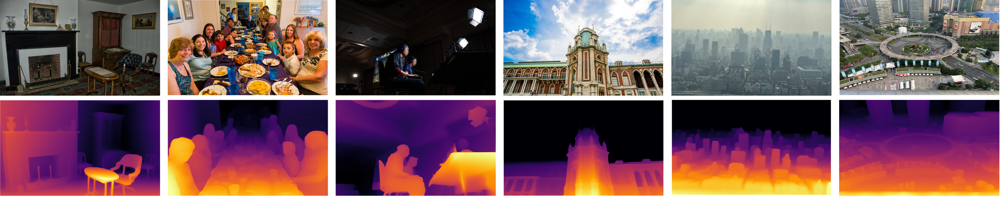
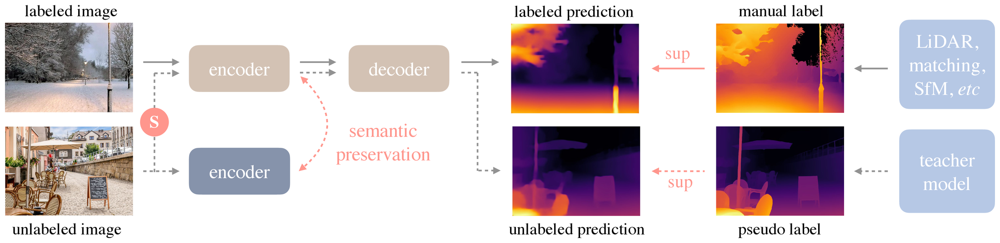
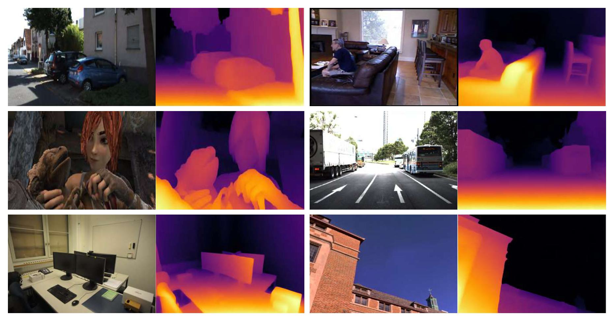
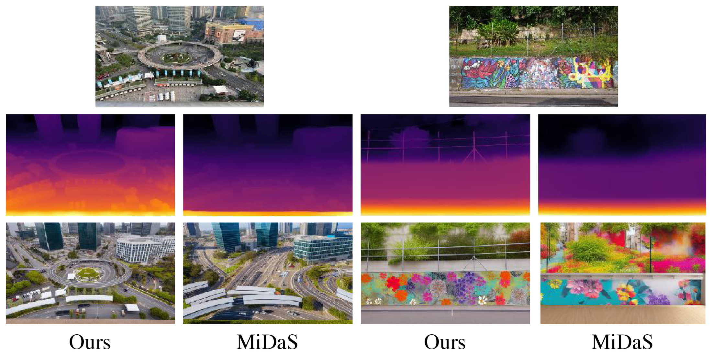

# Depth Anything：大规模无标注数据释放单目深度

!!! info "论文信息"
    - 论文：`Depth Anything: Unleashing the Power of Large-Scale Unlabeled Data`
    - 系统：`Depth Anything / DA1`
    - 链接：[arXiv:2401.10891](https://arxiv.org/abs/2401.10891)
    - 项目页：[depth-anything.github.io](https://depth-anything.github.io/)
    - 代码与模型：[LiheYoung/Depth-Anything](https://github.com/LiheYoung/Depth-Anything)
    - 关键词：monocular depth、unlabeled data、pseudo label、self-training、DINOv2、DPT、feature alignment、metric depth


Depth Anything 放在具身智能专题里，是因为它补的是机器人闭环里最常被低估的一层：**从普通 RGB 图像得到开放域、 dense、可复用的相对深度先验**。它不直接输出动作，也不替代 RGB-D 或标定，但它能让 VLA、抓取、导航、重建、数据质检和仿真资产流程拥有更强的几何输入。

这篇论文的主张很清楚：单目深度基础模型的瓶颈不只在结构，而在数据覆盖。作者没有设计一个复杂新架构，而是把训练数据从 1.5M labeled images 扩到 62M unlabeled images，并用 teacher-student、自训练强扰动和 DINOv2 feature alignment 让这些无标注图像真正产生增益。

## 它的效率贡献是什么

| 维度 | 贡献 |
| --- | --- |
| 节省的成本 | 不再依赖大规模人工深度标注、LiDAR、stereo matching 或 SfM；先用 1.5M labeled images 训练 teacher，再自动给 62M unlabeled images 生成 dense pseudo depth labels |
| 核心机制 | DINOv2 encoder + DPT decoder、affine-invariant depth loss、teacher-student self-training、strong perturbation、CutMix、DINOv2 feature alignment |
| 对具身主线的意义 | 给机器人视觉状态、VLA 视觉编码、几何规划、仿真资产检查和数据回流提供开放域单目深度底座 |
| 主要风险 | 基础模型输出主要是相对深度，不天然给厘米级绝对距离；单目先验仍可能在新相机、罕见物体、反光透明表面和尺度错觉中失真 |
| 应接到本站哪里 | [相机、深度与机器人视觉](../../embodied-ai/cameras-depth-and-robot-vision.md)、[Depth Anything V2](depth-anything-v2.md)、[Depth Anything 3](depth-anything-3.md) |

## 论文位置

在 DA1 之前，MiDaS 已经证明了多数据集训练和 affine-invariant loss 能带来不错的 zero-shot relative depth。但 MiDaS 的数据覆盖有限，而且很多深度数据来自 stereo、LiDAR 或重建流程，采集和标注成本高，覆盖面也不够开放。

Depth Anything 选择了另一条路线：

```text
1.5M labeled images
  -> train a strong MDE teacher
  -> pseudo-label 62M unlabeled images
  -> retrain a student on labeled + pseudo-labeled data
  -> add hard perturbations and semantic feature alignment
```

这里最重要的不是“无标注数据更多”，而是作者发现：**如果只是把 labeled 和 pseudo-labeled images 简单混起来，模型并不会明显变好**。原因是 teacher 和 student 架构、预训练权重接近，学生很容易只复制 teacher 已经会的东西。DA1 的关键补丁，是在学习无标注图像时给 student 更难的优化目标，让它从同一张图里学到额外不变性和语义结构。

{ width="920" }

<small>图源：`Depth Anything`，Figure 1。原论文图意：Depth Anything 在 COCO、SA-1B hold-out 和作者自采图像等未见场景中展示深度泛化，覆盖低光、复杂多人场景、雾天城市和超远距离建筑。</small>

!!! note "这张图怎么读"
    **输入输出**：输入是大规模无标注图像和少量深度监督，输出是单目深度预测。  
    **效率机制**：用伪标签和数据规模提升几何感知的样本效率。  
    **对主线意义**：深度可作为具身/world model 的几何状态层。  
    **不能证明什么**：单目深度精度不能证明接触动力学、动作策略或闭环成功。

## 数据引擎

论文把数据分成两层。

第一层是 labeled images，用于训练 teacher。它们来自 6 个公开数据集，总量约 1.5M。作者刻意没有使用 KITTI 和 NYUv2 训练集，因为后面要把它们作为 zero-shot evaluation。第二层是 unlabeled images，来自 8 个大规模公开数据源，总量约 62M。它们没有使用原始任务标签，只作为视觉分布覆盖来用。

Table 1 is redrawn below with the original English fields.

| Dataset | Indoor | Outdoor | Label | # Images |
| --- | --- | --- | --- | --- |
| **Labeled Datasets** |  |  |  |  |
| BlendedMVS | ✓ | ✓ | Stereo | 115K |
| DIML | ✓ | ✓ | Stereo | 927K |
| HRWSI | ✓ | ✓ | Stereo | 20K |
| IRS | ✓ |  | Stereo | 103K |
| MegaDepth |  | ✓ | SfM | 128K |
| TartanAir | ✓ | ✓ | Stereo | 306K |
| **Unlabeled Datasets** |  |  |  |  |
| BDD100K |  | ✓ | None | 8.2M |
| Google Landmarks |  | ✓ | None | 4.1M |
| ImageNet-21K | ✓ | ✓ | None | 13.1M |
| LSUN | ✓ |  | None | 9.8M |
| Objects365 | ✓ | ✓ | None | 1.7M |
| Open Images V7 | ✓ | ✓ | None | 7.8M |
| Places365 | ✓ | ✓ | None | 6.5M |
| SA-1B | ✓ | ✓ | None | 11.1M |

<small>表源：`Depth Anything`，Table 1。原论文表格要点：DA1 使用 1.5M labeled images 和 62M unlabeled images 联合训练；unlabeled sources 覆盖道路、地标、通用物体、场景、分割图像和大规模互联网视觉分布。</small>

这张表对具身智能的启发很直接：如果一个单目深度模型只见过室内 RGB-D 或固定自动驾驶相机，它很容易把“场景先验”误当成“几何能力”。DA1 用 62M 无标注图像补的不是更精确的深度标签，而是更宽的视觉分布。

## 训练总路线

论文 Figure 2 是整套方法的核心图。

{ width="920" }

<small>图源：`Depth Anything`，Figure 2。原论文图意：solid line 表示 labeled image 流程，dotted line 表示 unlabeled image 流程；无标注图像经 teacher 产生 pseudo label，student 在强扰动图像上学习，同时通过 frozen DINOv2 encoder 做 semantic preservation。</small>

!!! note "这张图怎么读"
    上半部分是 labeled image：真实或重建得到的 depth label 监督 teacher / student 的深度输出。下半部分是 unlabeled image：teacher 对 clean image 产生 pseudo label，student 看到的却是经过强颜色扰动或 CutMix 的图像。这个错位是关键，它逼 student 学习对颜色、局部拼接和图像扰动不敏感的深度表征。

    图中粉色 `semantic preservation` 不是语义分割 head，而是把 student encoder 的特征向 frozen DINOv2 encoder 对齐。DA1 的判断是，离散 segmentation masks 会损失太多语义信息，不如直接保留 DINOv2 连续特征空间里的语义先验。

## 模型结构

DA1 的结构故意保持简单。

| Component | Depth Anything choice | Why it matters |
| --- | --- | --- |
| Encoder | DINOv2 ViT-S / ViT-B / ViT-L | 借用大规模自监督视觉预训练的开放域语义和纹理先验 |
| Decoder | DPT | 沿用 MiDaS / DPT 系列的 dense depth regression head |
| Output | relative inverse depth / disparity-like map | 适合跨数据集训练和 zero-shot 相对深度，但不是绝对米制距离 |
| Model scales | ViT-S 24.8M, ViT-B 97.5M, ViT-L 335.3M | 覆盖轻量部署、质量折中和高质量离线推理 |

训练前，真实 depth value 会先转成 disparity space：

\[
d = 1 / t
\]

然后每张 depth map 单独归一化到 0 到 1。为了跨数据集训练，DA1 采用 affine-invariant mean absolute error，不要求不同数据源共享同一 scale 和 shift：

\[
\mathcal{L}_l = \frac{1}{HW}\sum_{i=1}^{HW}\rho(d_i^*, d_i)
\]

其中 \(\rho(d_i^*, d_i)=|\hat d_i^*-\hat d_i|\)，而 \(\hat d\) 会用 median 和 mean absolute deviation 做平移与尺度归一：

\[
\hat d_i=\frac{d_i-t(d)}{s(d)}, \quad
t(d)=\mathrm{median}(d), \quad
s(d)=\frac{1}{HW}\sum_{i=1}^{HW}|d_i-t(d)|
\]

这也解释了 DA1 的使用边界：它很适合告诉机器人“哪里更近、哪里有边界、物体大致关系如何”，但如果任务要 3D 坐标、抓取距离或安全制动阈值，就要接相机标定、metric fine-tuning、多视角几何或真实 depth sensor。

## 训练细节

### 1. Teacher stage

teacher 先只在 labeled images 上训练，目标是得到一个足够可靠的 MDE annotator。

| Setting | Value |
| --- | --- |
| Architecture | DINOv2 encoder + DPT decoder |
| Training data | 1.5M labeled images from 6 public datasets |
| Epochs | 20 |
| Labeled data sampling | simply combined together without re-sampling |
| Encoder initialization | DINOv2 pre-trained weights |
| Sky handling | use a pre-trained semantic segmentation model to detect `sky`, then set its disparity to 0 |

`sky` 这个细节很实用。天空通常没有可靠深度，stereo / SfM / LiDAR 标签也容易缺失或噪声很大。DA1 把天空 disparity 设为 0，本质上是在告诉模型：天空应被看成最远背景，不要让数据噪声污染这类区域。

### 2. Pseudo-labeling stage

给定 teacher \(T\)，DA1 用一次前向推理为每张 unlabeled image 生成 pseudo depth：

\[
\hat{\mathcal{D}}^u = \{(u_i, T(u_i)) \mid u_i \in \mathcal{D}^u\}_{i=1}^{N}
\]

这个阶段的好处是成本极低：不需要双目匹配，不需要 SfM，不需要 LiDAR，也不需要人工深度标注。对 62M 级别的数据来说，这正是 DA1 相对传统深度数据构建方式的效率来源。

但论文明确说，普通 self-training 不够。直接把 labeled 和 pseudo-labeled images 合并训练，提升很有限，甚至可能没有提升。原因是 teacher 和 student 使用相似 architecture 与 DINOv2 initialization，student 只是在学习 teacher 已经会的预测，额外视觉知识没有被充分挖出来。

### 3. Student stage: strong perturbation

DA1 的修正是：对 unlabeled images 的 student input 加强扰动，但 teacher pseudo label 来自 clean image。

| Perturbation | Used on | Purpose |
| --- | --- | --- |
| color jittering | unlabeled student input | 逼模型不要依赖颜色捷径 |
| Gaussian blurring | unlabeled student input | 让深度结构对低频/模糊变化更稳 |
| CutMix | unlabeled student input, 50% probability | 用空间拼接制造更难的局部几何目标 |
| clean image | teacher pseudo-labeling | 保持 pseudo labels 尽量可靠 |

CutMix 在 DA1 里不是简单分类增强，而是要让无标注深度监督在两个图像区域内分别对齐 teacher：

\[
u_{ab}=u_a \odot M + u_b \odot (1-M)
\]

\[
\mathcal{L}^M_u=\rho(S(u_{ab}) \odot M, T(u_a)\odot M)
\]

\[
\mathcal{L}^{1-M}_u=\rho(S(u_{ab}) \odot (1-M), T(u_b)\odot (1-M))
\]

\[
\mathcal{L}_u=\frac{\sum M}{HW}\mathcal{L}^M_u+
\frac{\sum (1-M)}{HW}\mathcal{L}^{1-M}_u
\]

这里的关键不是“把图拼起来更花”，而是让 student 在更难的输入分布上追 clean teacher 的局部 depth structure。这样无标注数据才从“复制 teacher”变成“学习鲁棒表征”。

### 4. Semantic feature alignment

DA1 还尝试过一条看起来更直观的路：用 RAM + GroundingDINO + HQ-SAM 给 unlabeled images 生成 semantic segmentation labels，经过后处理得到约 4K 类，在 joint-training 阶段让模型同时输出 depth 和 segmentation。结果没有带来增益。

作者的解释是，离散 segmentation masks 会把连续语义空间压扁。对一个已经很强的深度模型来说，这种粗粒度类别监督反而不够信息量。于是他们改用 frozen DINOv2 encoder 的连续特征作为辅助监督：

\[
\mathcal{L}_{feat}=1-\frac{1}{HW}\sum_{i=1}^{HW}\cos(f_i, f'_i)
\]

其中 \(f\) 来自 online student depth model，\(f'\) 来自 frozen DINOv2 encoder。DA1 没有额外加随机初始化 projector，因为初期 alignment loss 太大时会压过深度学习目标。

更细的点是 tolerance margin \(\alpha\)。DINOv2 这类语义 encoder 会把同一物体不同部位的特征拉近，例如车头和车尾；但深度模型必须区分同一物体内部不同深度。DA1 因此只对 cosine similarity 低于 \(\alpha\) 的位置施加 feature loss，超过阈值就不再强行对齐。论文主设置为：

| Setting | Value |
| --- | --- |
| Feature source | frozen DINOv2 encoder |
| Online feature | student depth encoder feature |
| Tolerance margin \(\alpha\) | 0.85 |
| Overall loss | average of \(\mathcal{L}_l\), \(\mathcal{L}_u\), \(\mathcal{L}_{feat}\) |

这个设计对机器人很有意义：深度边界不能和物体语义边界完全脱钩，但也不能被语义特征抹平。feature alignment 的 margin 正是在这两者之间留空间。

### 5. Implementation details

| Setting | Value |
| --- | --- |
| Input preprocessing | resize shorter side to 518, keep aspect ratio |
| Training crop | 518 x 518 |
| Inference | no crop, only make both sides multiples of 14 |
| Evaluation | interpolate prediction to original resolution |
| Zero-shot alignment | manually align scale and shift with ground truth, following MiDaS |
| Student training | sweep across all unlabeled images for one time |
| Batch ratio | labeled : unlabeled = 1 : 2 |
| Optimizer | AdamW |
| Encoder LR | 5e-6 |
| Decoder LR | 10x encoder LR |
| LR schedule | linear decay |
| Labeled augmentation | horizontal flipping only |

后续把 DA encoder fine-tune 到 metric depth 时，论文采用 ZoeDepth codebase，只替换 MiDaS encoder。NYUv2 training resolution 为 `392 x 518`，KITTI 为 `384 x 768`，encoder learning rate 设为随机初始化 decoder 的 `1/50`，batch size 16，训练 5 epochs。

把 encoder fine-tune 到 semantic segmentation 时，论文采用 MMSegmentation 和 Mask2Former。ADE20K / Cityscapes resolution 都是 `896 x 896`，encoder LR 为 `3e-6`，decoder LR 为 10 倍，ADE20K 训练 160K iterations，Cityscapes 训练 80K iterations，batch size 16，不使用 COCO 或 Mapillary pre-training。

## 关键结果

Table 2 is redrawn below with the original English fields.

| Method | Encoder | KITTI AbsRel | KITTI \(\delta_1\) | NYUv2 AbsRel | NYUv2 \(\delta_1\) | Sintel AbsRel | Sintel \(\delta_1\) | DDAD AbsRel | DDAD \(\delta_1\) | ETH3D AbsRel | ETH3D \(\delta_1\) | DIODE AbsRel | DIODE \(\delta_1\) |
| --- | --- | --- | --- | --- | --- | --- | --- | --- | --- | --- | --- | --- | --- |
| MiDaS v3.1 | ViT-L | 0.127 | 0.850 | 0.048 | 0.980 | 0.587 | 0.699 | 0.251 | 0.766 | 0.139 | 0.867 | 0.075 | 0.942 |
| **Depth Anything** | ViT-S | 0.080 | 0.936 | 0.053 | 0.972 | 0.464 | 0.739 | 0.247 | 0.768 | 0.127 | **0.885** | 0.076 | 0.939 |
| **Depth Anything** | ViT-B | 0.080 | 0.939 | 0.046 | 0.979 | **0.432** | 0.756 | 0.232 | 0.786 | **0.126** | 0.884 | 0.069 | 0.946 |
| **Depth Anything** | ViT-L | **0.076** | **0.947** | **0.043** | **0.981** | 0.458 | **0.760** | **0.230** | **0.789** | 0.127 | 0.882 | **0.066** | **0.952** |

<small>表源：`Depth Anything`，Table 2。原论文表格要点：在 six unseen datasets 上，DA1 ViT-L 大幅超过 MiDaS v3.1；即使 ViT-S 参数量不到 MiDaS ViT-L 的 1/10，也在多个 unseen datasets 上超过 MiDaS。</small>

两个结果特别值得记住。

第一，DA1 没用 KITTI 和 NYUv2 的训练图像，但在这两个常用 benchmark 上仍强于 MiDaS。论文也提醒，MiDaS v3.1 对 KITTI 和 NYUv2 并不是严格 zero-shot，因为它使用了对应训练图像。

第二，小模型已经很强。ViT-S 在 Sintel、DDAD、ETH3D 等 unseen sets 上能超过 MiDaS ViT-L，这说明数据 recipe 对资源受限场景很重要。机器人部署常常受延迟、显存和功耗限制，不能默认只上最大模型。

{ width="860" }

<small>图源：`Depth Anything`，Figure 3。原论文图意：DA1 在 KITTI、NYUv2、Sintel、DDAD、ETH3D 和 DIODE 等 unseen datasets 上展示定性结果，强调跨室内、室外、合成、自动驾驶和真实 3D 数据的鲁棒性。</small>

## Ablation: 为什么强扰动和 feature alignment 是关键

Table 8 is redrawn below with the original English fields.

| \(\mathcal{L}_l\) | \(\mathcal{L}_u\) | \(\mathcal{S}\) | \(\mathcal{L}_{feat}\) | KI | NY | SI | DD | ET | DI |
| --- | --- | --- | --- | --- | --- | --- | --- | --- | --- |
| ✓ |  |  |  | 0.085 | 0.053 | 0.492 | 0.245 | 0.134 | 0.070 |
| ✓ | ✓ |  |  | 0.085 | 0.054 | 0.481 | 0.242 | 0.138 | 0.073 |
| ✓ | ✓ | ✓ |  | 0.081 | 0.048 | 0.469 | 0.235 | 0.134 | 0.068 |
| ✓ | ✓ | ✓ | ✓ | **0.076** | **0.043** | **0.458** | **0.230** | **0.127** | **0.066** |

<small>表源：`Depth Anything`，Table 8。原论文表格要点：只加入 pseudo-labeled unlabeled images 并不稳定提升；加入 strong perturbations \(\mathcal{S}\) 后明显改善；再叠加 feature alignment \(\mathcal{L}_{feat}\) 得到最佳 AbsRel。</small>

这张表可以把 DA1 的训练逻辑讲透：

1. 只有 labeled loss 时，模型已经很强；
2. 直接加 unlabeled pseudo labels，收益很小，NY、ET、DI 甚至变差；
3. 对 unlabeled student input 加强扰动后，六个指标几乎全面变好；
4. 再加 DINOv2 feature alignment，所有 unseen datasets 的 AbsRel 都达到最好。

附录进一步说明了 margin 和 feature loss 应该放在哪里。

Table 9 is redrawn below with the original English fields.

| \(\alpha\) | KITTI | NYU | Sintel | DDAD | ETH3D | DIODE | **Mean** |
| --- | --- | --- | --- | --- | --- | --- | --- |
| 1.00 | 0.085 | 0.055 | 0.523 | 0.250 | 0.134 | 0.079 | 0.188 |
| 0.85 | 0.080 | **0.053** | **0.464** | **0.247** | **0.127** | **0.076** | **0.175** |
| 0.70 | **0.079** | 0.054 | 0.482 | 0.248 | 0.127 | 0.077 | 0.178 |

<small>表源：`Depth Anything`，Table 9。原论文表格要点：\(\alpha=1.00\) 等于几乎强制更充分对齐 DINOv2 feature，反而会伤害深度；\(\alpha=0.85\) 在 mean AbsRel 上最好。</small>

Table 10 is redrawn below with the original English fields.

| U | L | KITTI | NYU | Sintel | DDAD | ETH3D | DIODE | **Mean** |
| --- | --- | --- | --- | --- | --- | --- | --- | --- |
|  |  | 0.083 | 0.055 | 0.478 | 0.249 | 0.133 | 0.080 | 0.180 |
| ✓ |  | **0.080** | **0.053** | **0.464** | **0.247** | **0.127** | **0.076** | **0.175** |
|  | ✓ | 0.084 | 0.054 | 0.472 | 0.252 | 0.133 | 0.081 | 0.179 |

<small>表源：`Depth Anything`，Table 10。原论文表格要点：feature alignment 应该主要施加在 unlabeled data 上；对 labeled data 加这个辅助目标没有明显收益，可能干扰高质量深度标签的学习。</small>

这个结论很细，但对复现很重要：\(\mathcal{L}_{feat}\) 不是通用地“越多越好”。它最适合补 pseudo labels 的噪声和信息不足，而不是压过 labeled depth supervision。

## 下游迁移

DA1 不只把深度图做得更好，也把 encoder 做成了一个更好的视觉初始化。

在 metric depth 上，论文把 DA encoder 放进 ZoeDepth pipeline，只替换原来的 MiDaS encoder。结果是在 NYUv2、KITTI 以及 zero-shot metric generalization 上都更好。对具身系统来说，这很关键：基础 DA 输出相对深度，但 encoder 可以作为 metric depth fine-tuning 的强初始化。

在 semantic segmentation 上，DA1 用 MMSegmentation + Mask2Former fine-tune 到 ADE20K 和 Cityscapes。结果显示，经过大规模 MDE 训练和 feature alignment 后的 encoder 仍保留很强语义能力，甚至能超过一些大规模 ImageNet-21K 预训练 encoder。这说明 DA1 并不是把 DINOv2 语义先验“洗掉”成纯几何模型，而是在语义和几何之间做了更有用的折中。

{ width="920" }

<small>图源：`Depth Anything`，Figure 4。原论文图意：作者比较 DA1 与 MiDaS 的 depth prediction，并把深度图作为 ControlNet 条件生成新图像；更准确的深度图能提供更稳定的图像/视频编辑控制信号。</small>

## 和 DA2、DA3 的关系

Depth Anything 系列可以按训练监督的演进来读：

| Version | Core contribution | Limitation |
| --- | --- | --- |
| Depth Anything / DA1 | 用 62M unlabeled images、strong perturbation 和 DINOv2 feature alignment 建立开放域相对深度 foundation model | 细结构、透明/反光、复杂边界仍不够强；基础模型主要是相对深度 |
| [Depth Anything V2 / DA2](depth-anything-v2.md) | 用 precise synthetic labels 训练最大 teacher，再把能力蒸馏到 pseudo-labeled real images，显著增强细节和效率 | 仍主要处理单图深度，不直接解决多视角一致性和相机几何 |
| [Depth Anything 3 / DA3](depth-anything-3.md) | 把单目深度扩展到任意视角 geometry，输出 depth、ray、camera 和可融合 3D 表示 | 不直接解决动作、接触动力学、控制安全和机器人策略 |

一句话总结：DA1 证明“大规模无标注图像可以让单目深度变成 foundation model”；DA2 修正标签质量和细节瓶颈；DA3 把单图深度进一步推到多视角视觉空间恢复。

## 具身应用时怎么用

在机器人系统里，DA1 更适合作为 perception prior，而不是最终测距器。

| 用法 | 推荐程度 | 原因 |
| --- | --- | --- |
| VLA / policy 的视觉辅助特征 | 高 | 深度边界和物体布局能补 RGB 语义特征的几何盲点 |
| 数据质检和仿真资产检查 | 高 | 可以快速发现深度不连续、遮挡异常、薄结构缺失等问题 |
| 低成本导航和避障辅助 | 中 | 相对深度有帮助，但安全距离仍需 metric calibration 或其他传感器 |
| 抓取位姿直接回归 | 中低 | 抓取需要绝对尺度、接触几何和夹爪约束，单目相对深度不能单独承担 |
| 安全制动 / 人机协作距离 | 低 | 这类闭环必须用可靠测距、标定和冗余安全层 |

最稳的工程接法是：把 DA1/DA2/DA3 看作开放域视觉几何底座，再和 RGB-D、多视角、相机标定、SLAM、接触传感和控制器结合。它能显著降低“没有几何先验”的成本，但不能替代真实机器人闭环里的测量和安全约束。

## 参考资料

1. [Depth Anything: Unleashing the Power of Large-Scale Unlabeled Data](https://arxiv.org/abs/2401.10891)
2. [Depth Anything project page](https://depth-anything.github.io/)
3. [LiheYoung/Depth-Anything](https://github.com/LiheYoung/Depth-Anything)
