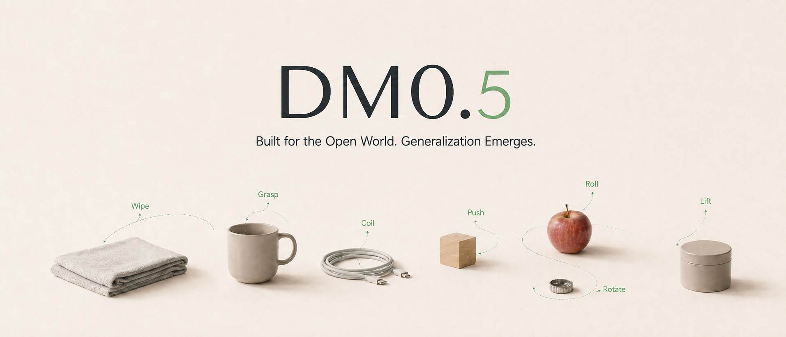
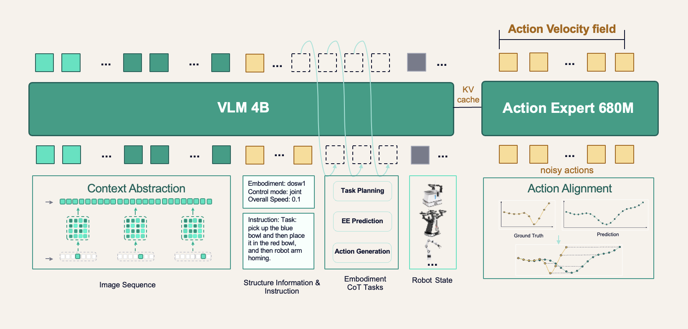
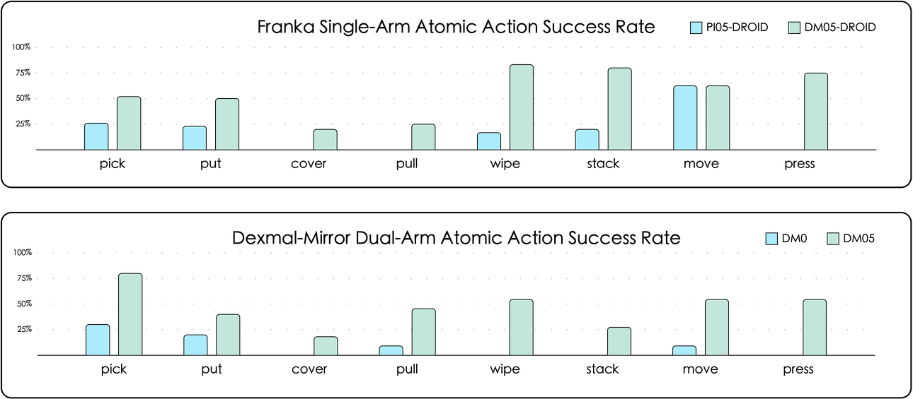
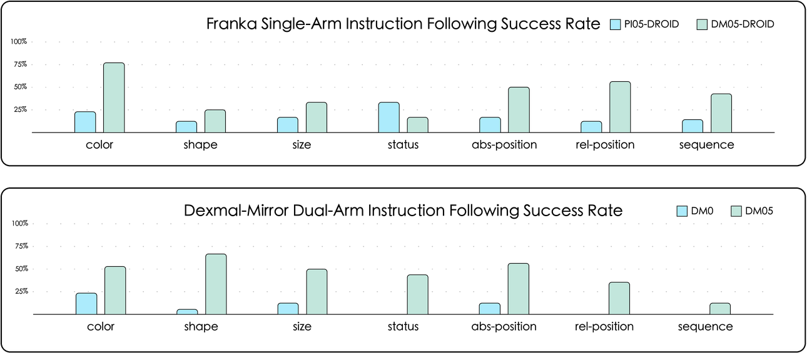
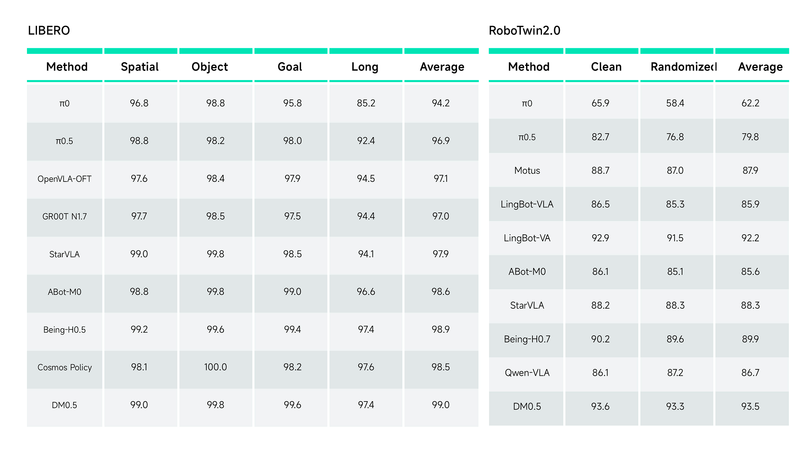
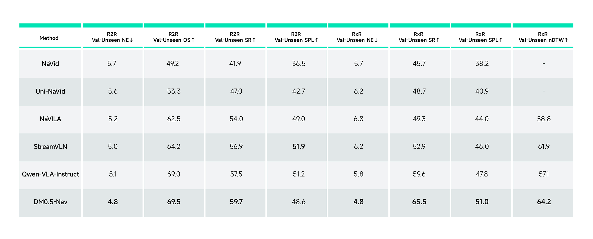
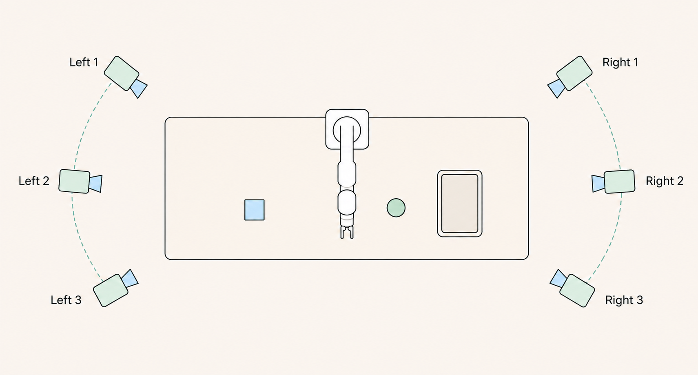
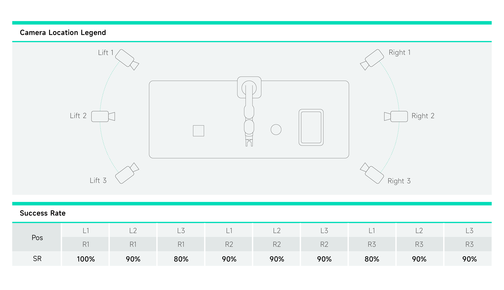

# DM0.5：开放世界具身基础模型

!!! info "论文信息"
    **官方题名：** DM0.5: An Open-World Foundation Model for General-Purpose Embodied Intelligence。 
    **作者 / 团队：** Dexmal；官方博客和 OpenDM README 未列出个人作者，本文按官方团队材料处理。 
    **时间 / 主题：** 2026-07；具身智能 / VLA / 开放世界机器人控制。 
    **官方博客 / 项目：** 技术博客：[dexmal.com/blog/dm0.5](https://www.dexmal.com/blog/dm0.5/index_en.html)；GitHub：[dexmal/opendm](https://github.com/dexmal/opendm)。 
    **模型：** Hugging Face collection：[Dexmal/dm05](https://huggingface.co/collections/Dexmal/dm05)，含 `Dexmal/DM05` 与 `Dexmal/DM05-libero`。 
    **相关前作：** DM0 arXiv：[2602.14974](https://arxiv.org/abs/2602.14974)；Dexbotic DM0 tutorial：[docs/DM0.md](https://github.com/dexmal/dexbotic/blob/main/docs/DM0.md)。 
    **元数据来源与核验口径：** 来源：官方博客、OpenDM README、Hugging Face collection、DM0 arXiv 页面；Checked Date：2026-07-09；Repro Status：Official blog / official repo / official model collection reviewed, independent reproduction not claimed。

## 当前画面里没有的任务进度，应该从哪里补回来

DM0.5 试图解决的一个具体问题，是机器人做得越久，正确动作越难只由当前画面决定。杯子从桌上拿起之后，原来的位置可能已经空了；擦过与没有擦过的区域，在图像里可能没有明显区别；人类在开头展示过的摆放规则，也不会一直留在摄像头前。即使视觉识别和局部抓取都很准确，策略仍可能在后半程忘记应该恢复哪个状态、下一步应遵守什么规则。[官方报告，Model](https://www.dexmal.com/blog/dm0.5?lang=en-US#model)

另一类困难来自示范本身。同样的拿起、移动、放下，熟练操作者可能一气呵成，另一位操作者可能在接触前停顿、在搬运中调整姿态。固定时间索引把这些节奏差异写进动作标签，模型就需要同时拟合任务结构与采集时的快慢。DM0.5 的设计因此沿着三个相关方向展开：压缩历史观测以补足任务状态，用具身语言任务监督事件和动作意图，再让动作监督按轨迹进度匹配。[官方报告，Model](https://www.dexmal.com/blog/dm0.5?lang=en-US#model)

{ width="920" }

这张总览把擦拭、抓取、推移、旋转等能力放在同一开放环境愿景下。后面的结果需要拆开理解。未见任务配置上的 zero-shot 操作，标准 benchmark 上经过微调的专门策略，以及有历史输入的记忆演示，回答的是不同问题。DM0.5 在操作适配和部分导航指标上有明确的数值优势；对于历史压缩、具身 CoT、动作对齐各贡献多少，报告没有给出可以逐项分离的消融。

## 一次控制决策怎样经过 VLM 和动作专家

DM0.5 使用 **4B Vision-Language Model** 处理视觉语言条件，使用 **680M Action Expert** 产生连续机器人动作。它延续 Flow Matching 的动作生成方式，把“从观测中形成条件”与“在条件下生成动作轨迹”连接起来。前者可以使用图像、语言和历史信息，后者还需要当前机器人状态及带噪的动作输入。[官方报告，Architecture](https://www.dexmal.com/blog/dm0.5?lang=en-US#model)

为说明接口，可以把一次输出记为下面的动作块。这是解释性记号，报告没有以此给出正式概率模型。

$$
A_t=(a_t,a_{t+1},\ldots,a_{t+H-1}),\qquad
A_t\sim\pi_\theta(\,\cdot\mid I_t,s_t,\ell,e,z_{<t}).
$$

这里，$I_t$ 表示当前多相机观测，$s_t$ 是机器人本体状态，$\ell$ 是任务指令，$e$ 表示本体和控制条件，$z_{<t}$ 是历史观测压缩后的视觉上下文，$H$ 是输出动作数。把这些变量分开有实际意义：换机器人会改变状态与动作含义，换相机顺序会改变视觉条件，增加历史则会改变上下文长度；它们不能仅靠修改一句任务文本来互相替代。

{ width="920" }

图中左侧的 **Context Abstraction** 先处理图像序列；中间的 VLM 将视觉、任务指令和结构化条件组织起来，并通过 **KV Cache** 向动作专家提供条件信息。右侧的动作专家接收机器人状态与 **Noisy Actions**，输出 **Action Velocity Field**。此处的 velocity field 是生成动作时用于更新动作变量的场，不宜直接理解为机器人控制器接收的关节速度命令；具体动作可以是关节目标等表示，取决于训练与部署配置。

结构化条件也值得注意。架构图给出的示例包含 `Embodiment`、`Control mode` 和 `Overall Speed`。它们让同一句“把蓝碗放到红碗上”可以附带机器人类型、关节或末端控制模式以及动作速度条件。部署文档进一步把本体名称连接到相应的归一化参数。因此，本体条件既参与语义建模，也必须在接口层对应正确的数值定义。[官方推理接口](https://github.com/dexmal/opendm/blob/main/docs/en/dm05_inference.md)

一次动作生成默认采用 **10 个 diffusion / Flow Matching steps**，产生 **50-step action chunk**。这里有三个不同的时间尺度：生成器内部迭代多少次，一次预测多少个动作，机器人实际执行多少步后重新接收观测。第一个影响生成计算，第二个影响预测时域，第三个决定闭环反馈的频率。后面的 LIBERO 配置采用 10 步动作块，已经说明 50 不是所有下游模型都共享的固定接口。[官方报告，Inference](https://www.dexmal.com/blog/dm0.5?lang=en-US#model)

## 历史压缩保存什么，又会丢掉什么

### 从过去关键帧得到有限长度的上下文

DM0.5 的历史输入由当前帧与过去若干关键帧组成，报告描述的架构可覆盖最多约 **60 秒**任务历史。训练数据管线从当前时刻之前采样多个 historical slots，对每个 slot 做时间采样和空间采样，再将它压缩为固定数量的视觉 token。这样，策略可以使用过去发生过的状态变化，同时控制长序列图像带来的计算量。[官方报告，Context Abstraction Layer](https://www.dexmal.com/blog/dm0.5?lang=en-US#model)

这一设计的关键是把历史变成动作条件。杯子原来的位置、人类此前展示的电池摆放方向、工具是否已经使用过，都可能成为当前动作需要的信息。压缩后的 token 仍然来自视觉观测，报告没有把它描述成一个可精确检索任意过去事实的符号数据库，也没有承诺保留每一帧的所有细节。发生在两次采样之间的短暂接触，或在空间压缩中变得很小的物体，都可能成为需要额外验证的情形。

训练并不始终提供同样长的完整历史。随机历史长度和历史增强让模型接触长历史、短历史以及没有有效历史的输入，目的在于降低对固定窗口的依赖。这样做可以训练策略在上下文缺失时更多依靠当前观测；对于“杯子究竟原来放在哪里”这类当前帧无法确定的问题，缺失信息本身仍然无法凭空恢复。历史鲁棒性与历史内容的可辨识性需要分别讨论。

### 60 秒能力描述与实际历史配置要分开

公开实现进一步展示了历史怎样进入真实训练与服务。以下是具体入口的设置，属于各自的适配和部署配方，不能直接当作全部预训练都使用的参数。[MEM 微调指南](https://github.com/dexmal/opendm/blob/main/docs/en/dm05_mem_sft.md)、[RoboDojo 指南](https://github.com/dexmal/opendm/blob/main/docs/en/dm05_robodojo.md)、[推理指南](https://github.com/dexmal/opendm/blob/main/docs/en/dm05_inference.md)

| Configuration | Current images | History images | History sampling | Action chunk | Relevant context setting |
|---|---:|---:|---|---:|---|
| Parent inference configuration with history enabled | 3 | 5 | 由客户端与数据配置确定 | 依 checkpoint | Fast prefix default: 1024 |
| DM05-MEM SFT demo | 3 | 32 | 主视角，1 FPS；数据为 25 FPS | 50 | Model max length: 2048 |
| RoboDojo `cover_blocks` | 3 | 20 | 主视角，1 FPS；运行频率 25 FPS | 25 | Fast prefix: 2048 |
| RoboChallenge ARX5 configuration | 3 | 5 | 由对应部署配置管理 | 50 | 生成后按其播放配置执行 |

MEM 示例从数据的第一个图像键中采样历史，因此它增加的是过去主视角的观测，并非将所有历史时刻的三个相机都完整送入模型。历史可以由数据管线生成，训练 JSONL 无须事先写好 `history_images`；推理请求则通过这个字段按从旧到新的顺序提供历史。这区分了离线采样和在线客户端维护的责任。

该示例的数据也有明确用途。它只有 300 帧，并复用 15 张图像文件；接近轨迹末尾时能够得到约 10 张非空历史图像。若以 25 FPS 数据、1 FPS 历史采样填满 32 个历史槽，需要约 800 帧。因此，运行这个小样例可以检查历史管线和训练接口，却不足以检验完整窗口上的长期记忆表现。32 槽的示例与“架构支持最多 60 秒”分别属于具体配置和能力描述，两者没有必要被强行写成同一个数字。[MEM 数据与验证示例](https://github.com/dexmal/opendm/blob/main/docs/en/dm05_mem_sft.md)

## 11 项具身语言任务给动作监督增加了哪一层含义

只用连续动作训练时，同一条轨迹最直接告诉模型的是“在这个输入下，下一段关节或末端动作应当是什么”。DM0.5 进一步在机器人数据上加入 **11 项自回归任务**，要求模型根据当前图像、本体状态、任务指令和历史上下文，回答有关任务进度与未来行为的问题。报告将它们归入三类，没有逐一公开全部 11 项的完整问题模板。[官方报告，Embodiment CoT Tasks](https://www.dexmal.com/blog/dm0.5?lang=en-US#model)

| Task category | Supervision focus | 对连续控制增加的约束 |
|---|---|---|
| Task Planning | Current task stage, previous and future steps, overall progress | 当前动作应与已完成步骤和后续目标一致 |
| Event and Environment Prediction | Task boundaries, state transitions, key future events | 动作需要考虑环境会如何变化，以及何时进入下一阶段 |
| Action Generation | Future actions or semantic summaries of action intent | 在生成连续动作前，形成可表达的行为意图 |

例如，抓住杯子之后，动作数据可以直接监督抬升和移动；任务阶段监督还要求模型将这段行为放到“为了擦杯子下面的桌面，先把杯子移开”的上下文中。这是对机制的解释性例子。它说明语言目标为什么可能帮助区分外形相似、目标不同的轨迹，但不代表报告公开过这一条完整训练问答。

三类监督共同使用同一段机器人经历，使视觉语言表示不仅关心静态物体，也关心事件边界和动作后果。它们与历史输入具有互补性：历史提供过去发生过什么的证据，语言任务要求表示这些事件对现在的意义。若只增加历史帧而训练目标仍允许忽略它，模型未必会利用远处信息；若只有任务问答却没有相关历史观测，一些问题又无法从输入中解答。

**训练时加入 CoT 任务，并不意味着控制时必须先生成长段推理文本。** 官方 `/v1/infer` 接口直接返回动作块；另一个 `/v1/chat/completions` 接口才返回文本，而且不要求机器人状态，也不自动添加动作接口的本体、控制模式和状态前缀。将两者混为一谈，会误判执行延迟，也会把文本问答能力误当作相同条件下的动作控制能力。[官方推理指南，HTTP API](https://github.com/dexmal/opendm/blob/main/docs/en/dm05_inference.md#5-call-the-http-api)

## 动态动作匹配怎样消除示教节奏的干扰

### 固定时间索引为什么会产生不必要的监督冲突

设两段示范都依次经历接近物体、夹爪闭合、抬起和放下。如果某一段在接近后停顿更久，同一个未来时间索引可能在一段示范中对应闭合夹爪，在另一段中对应继续等待。模型会同时面对任务上可以解释、时间上却互相冲突的标签。DM0.5 的 **Trajectory Alignment Layer** 对齐轨迹进度，让固定数量的预测动作可以对应更细粒度真实轨迹中的不同位置。[官方报告，Dynamic Action Matching](https://www.dexmal.com/blog/dm0.5?lang=en-US#model)

用解释性记号表示，假设预测动作有 $H$ 个，保留的真实轨迹有 $M$ 个候选位置，匹配为每个预测动作选择一个真实锚点 $j_i$。报告规定的严格单调关系可写成：

$$
1\leq j_1<j_2<\cdots<j_H\leq M.
$$

严格递增保留了动作先后关系。第一个预测动作一旦对应真实轨迹的某个位置，之后的动作只能去匹配更晚的位置。与此同时，相邻锚点可以隔得较近，也可以隔得较远，因而容纳示范中的速度变化。这里改变的是训练监督的对应关系，执行时仍然输出有限长度动作块。

### 动态规划解决全局匹配，连续性限制“挑容易的点”

报告先根据预测动作与真实候选锚点之间的误差计算匹配代价，再用动态规划寻找总匹配损失较低的单调路径。这样，某一步看起来最合适的候选点，还必须与前后动作的匹配共同成立；逐个独立挑选最近点可能造成的时序倒退受到约束。

不过，仅要求锚点递增仍然不够。一个动作序列可能在抓取前后都经过相似的位置，却在中间完成了非常关键的夹爪闭合和接触。如果只选少数容易拟合的点，模型可能跳过中间的必要变化。DM0.5 因此还考虑相邻锚点之间的轨迹连续性，要求真实中间轨迹能够由相邻预测动作的变化合理解释。允许执行快慢不同，同时限制把困难阶段从监督中删掉，这两点需要同时成立。

| Matching choice | 允许什么变化 | 必须防止的问题 |
|---|---|---|
| Fixed timestamp correspondence | 时间索引保持固定 | 把遥操作停顿和节奏噪声写进动作标签 |
| Monotonic anchor matching | 相邻预测动作覆盖不同长度的真实时间段 | 时序逆转、互相矛盾的局部匹配 |
| Between-anchor continuity | 保留合理的速度弹性 | 跳过接触、夹紧、释放等关键过程 |

报告没有给出完整的代价函数、误差范数、动态规划递推式或连续性项权重，因此不能进一步断言它就是某一种标准 DTW 损失，也不能自行补成端点平方误差加速度正则的公式。可以确认的改变是监督匹配从固定时间索引转向受顺序和连续性约束的轨迹进度。它有针对示教节奏噪声的合理作用路径，但主 benchmark 使用完整系统，无法从总分中单独读取这一层的贡献。

## 多源训练首先要保证视觉、状态和动作描述的是同一件事

DM0.5 的预训练同时使用机器人操作、具身导航、人类第一视角操作，以及通用图像、视频和视觉指令数据。它们提供的监督并不相同。[官方报告，Data Composition](https://www.dexmal.com/blog/dm0.5?lang=en-US#data)

| Data source | Examples or content | Training role |
|---|---|---|
| Robotic Manipulation | AgileX ALOHA, Galaxea R1 Lite, AgiBot G1, Franka Emika Panda, UR5, ARX5, Dexmal dual-arm mobile robot | 主要连续动作监督，覆盖不同本体与任务 |
| Embodied Navigation | 公开视觉语言/开放词汇导航数据，内部 3D 重建场景导航数据 | 长指令理解与路径决策 |
| First-Person Human Manipulation | 生产环境中的手物交互、工具使用、细粒度原子动作 | 操作事件与动态视觉经验 |
| General Multimodal Vision-Language | 图像、视频、视觉指令，空间定位、未来状态、动作结果及反事实数据生成 | 保留开放词汇、空间和时序理解 |

人类第一视角视频可以让模型看到工具怎样使用、事件怎样展开，但它本身不等价于目标机器人的关节动作标签。跨源训练仍需要各自合适的监督入口。报告给出的总体安排是机器人数据承担主要动作学习，其他来源补充语义、时序和导航表示，没有公开各来源的总量与混合比例，因而不能据此计算“每个动作样本对应多少人类视频”。

清洗过程也围绕跨模态一致性展开。单独检查动作向量是否落在数值范围内并不充分：图像中出现明显机械臂运动，状态和动作记录却保持不变，仍可能给策略提供错误的输入输出对应。官方清洗包含以下五类处理。[官方报告，Data Cleaning Strategy](https://www.dexmal.com/blog/dm0.5?lang=en-US#data)

| Cleaning step | 具体处理 | 为什么影响动作学习 |
|---|---|---|
| Outlier removal | 过滤不可达或不连续数值，检查图像与状态/动作的一致性 | 避免把记录异常或跨模态错配学成控制规律 |
| Static-frame removal | 去掉长时间没有有效状态或动作变化的片段 | 减少静止样本占用，并降低停顿模式的影响 |
| Low-value action removal | 过滤未完成、意图不清或与目标无关的行为 | 让监督更集中于任务相关过程 |
| Action-pattern deduplication | 对某些平台上近似相同末端运动的不同关节模式去重 | 减少相近视觉条件下互相冲突的关节映射 |
| Relabeling incorrect annotations | 通过跨模态检查修正子任务标签 | 让语言描述与实际行为一致 |

动作模式去重的说明尤其容易被过度解释。官方指出 ALOHA 等平台可能存在近似相同末端运动、不同关节组合的情况，并尝试保留更一致的表示；这不足以证明系统采用了特定逆运动学规范化算法，也不能推断它能自动消除全部多解性。能直接复用的是检查思路：视觉相似、末端运动相似的示范，其动作标签是否在无关的关节选择上互相冲突。

优化方面，VLM 骨干使用较小学习率，以减少原有视觉语言能力的遗忘；Action Expert 使用较大学习率，以学习连续动作分布。训练采用混合精度和分布式优化，并对动作专家进行效率优化以承受多相机、长上下文和历史 token 的成本。具体预训练步数、硬件总量和各损失权重没有由这份报告给出，后面的下游指南只能补充对应任务的资源预算。[官方报告，Training](https://www.dexmal.com/blog/dm0.5?lang=en-US#model)

## Zero-shot 结果需要在同一机器人和同一约束维度内比较

官方将未见任务配置的测试分为两个轴。动作轴覆盖 **pick、put、move、pull、cover、wipe、stack、press** 八类；条件轴覆盖 **color、shape、size、status、sequence、relative position、absolute position** 七类。前者检查能执行哪些基本操作，后者检查语言如何改变物体选择、空间目标和顺序。[官方报告，Zero-Shot Generalization](https://www.dexmal.com/blog/dm0.5?lang=en-US#experiments)

平台与对照关系也固定：Franka 上比较 **Pi0.5-Droid** 和 **DM0.5-Droid**，Dexmal-Mirror 上比较 **DM0** 和 **DM0.5**。因此，首先应在每个平台内部读两根柱子的关系；跨平台差异还包含本体、训练配置和任务可执行性的变化。

{ width="820" }

动作图呈现的趋势是多数类别改善，但不同类别的改善幅度不同。Franka 的 move 两者接近，wipe、stack、press 的差距更明显；Mirror 上 pick、wipe、move 的变化也较突出。这些条形没有逐项精确数字标签，适合判断方向和相对差距，不应从柱高制造带小数位的成功率。

{ width="820" }

条件图给出了一个需要保留的反例。Franka 上 DM0.5-Droid 在颜色、相对位置等维度表现更好，但 **status** 柱低于 Pi0.5-Droid。状态识别与状态条件下的操作并没有随其他语义维度一起全面改善。Mirror 的整体趋势更一致，也不能把它外推为任意本体上的所有条件均领先。

这组实验支持完整系统具有更广的未见配置执行能力。它无法单独判断提升来自更多机器人数据、语言监督、历史机制还是动作匹配；“zero-shot”在这里修饰评测时的未见任务配置，也不意味着基础模型从未接触过相关机器人、物体类别或动作类型。

## 操作微调成绩很高，训练暴露和预算同样需要看清

### LIBERO 的平均值接近饱和，但各列仍有差别

LIBERO 和 RoboTwin2.0 评估经过目标域微调的策略。官方把两组原始表放在一起，分别呈现单臂和双臂操作的适配结果。

{ width="1000" }

下面保留 LIBERO 中足以判断领先幅度与例外的几行。单位为成功率百分比，表头沿用原图。[官方操作结果原图](https://www.dexmal.com/blog/dm0.5/dm05-finetuning-benchmarks.png)

| Model | Spatial | Object | Goal | Long | Average |
|---|---:|---:|---:|---:|---:|
| π0.5 | 98.8 | 98.2 | 98.0 | 92.4 | 96.9 |
| OpenVLA-OFT | 97.6 | 98.4 | 97.9 | 94.5 | 97.1 |
| ABot-M0 | 98.8 | 99.8 | 99.0 | 96.6 | 98.6 |
| Being-H0.5 | 99.2 | 99.6 | 99.4 | 97.4 | 98.9 |
| Cosmos Policy | 98.1 | 100.0 | 98.2 | 97.6 | 98.5 |
| DM0.5 | 99.0 | 99.8 | 99.6 | 97.4 | 99.0 |

DM0.5 相对 π0.5 的平均值高 **2.1 个百分点**，Long 高 **5.0 个百分点**；相对 Being-H0.5 的平均值只高 **0.1 个百分点**。同时，Being-H0.5 的 Spatial、Cosmos Policy 的 Object 和 Long 都高于 DM0.5。结论应是整体适配成绩很强、平均值最高，而各子集仍有不同的优势模型。由于表格没有给出这些微小平均差距的置信区间，0.1 个百分点本身不适合承担很强的优越性判断。

公开 LIBERO 指南使用 `playground/dm05_libero.py`，注册全部套件数据，给出 **8 GPU、100K steps、chunk size 10** 的训练配置。评估示例采用 **50 trials per task、seed 7、wait 10、replan step 10**。模型接收主相机与腕部相机两张图，状态为 8 维，动作为 7 维；这些维度和 50 步、14 维的基础模型入口不同。指南建议将推理服务和仿真分置 GPU，以免互相争用资源。[LIBERO 训练与评测](https://github.com/dexmal/opendm/blob/main/docs/en/dm05_libero.md)

这些细节说明复现不能停在“下载 DM0.5，运行 LIBERO”这一层。必须使用匹配的入口、数据集、动作块、状态动作维度与 `norm_stats.json`。评测示例参数有助于固定执行协议，但也不能替代每个对照方法各自的训练信息。

### RoboTwin2.0 的 randomized 数据实际参与了训练

| Model | Clean | Randomized | Average |
|---|---:|---:|---:|
| π0.5 | 82.7 | 76.8 | 79.8 |
| Motus | 88.7 | 87.0 | 87.9 |
| LingBot-VA | 92.9 | 91.5 | 92.2 |
| StarVLA | 88.2 | 88.3 | 88.3 |
| Being-H0.7 | 90.2 | 89.6 | 89.9 |
| DM0.5 | 93.6 | 93.3 | 93.5 |

DM0.5 的 Clean 与 Randomized 仅差 **0.3 个百分点**，对比 π0.5 分别高 10.9 和 16.5 个百分点，平均值比 LingBot-VA 高 1.3 个百分点。这说明对应协议下策略对随机化场景有很强适配能力。决定该结论适用范围的条件在官方训练指南中：默认数据混合包含 **50 tasks × clean/randomized，共 100 个配置**。因此，这不是只在 clean 数据上训练后直接迁移到 randomized 的 Clean2Random 结果。[RoboTwin2.0 指南](https://github.com/dexmal/opendm/blob/main/docs/en/dm05_robotwin2.md)

该指南还说明动作标签如何构造。训练目标是**从未来状态读取的绝对关节目标**，不使用数据原始的 `action` 字段。数据先在原生 **14 维**空间验证和归一化，不做 quantile clipping，再把归一化动作和掩码填充到 **32 维**训练布局。若把原始动作字段直接送入同一个训练入口，表面上仍是机器人动作数据，实际学习目标已经发生变化。这里的填充维度也不意味着机器人新增了 18 个可执行自由度。

视觉输入包括头部、左腕、右腕三个视角；多任务采样使用权重，并在任务与子任务提示之间采样。参考训练采用 **4 nodes × 8 GPUs × batch 32 × accumulation 1 = global batch 1024**，训练 100K steps，使用 BF16、FSDP1、MuonAdamW，最大 token 长度 1152，动作块 50。指南要求保持这些关键设置以沿用参考训练预算；这并不等于所有 DM0.5 下游适配都在理论上必须使用 32 张 GPU。

评估按 50 个任务、clean/randomized 两种条件、每种 100 个 episode 展开，对应 **10,000 个 episode**，这是由指南配置计算得到的数量。其指令类型为 `seen`。因此，表中的场景随机化鲁棒性与未见语言表达泛化也应分开评价，不能由同一平均成功率同时代替。

### 真实机器人 Table30 v2 中，过程分与完整成功率回答不同问题

RoboChallenge Table30 v2 覆盖记忆、顺序执行、定位、精细抓放、工具交互和双臂协调。官方报告及 OpenDM 结果表给出：

| Model | Success Rate (%) | Score |
|---|---:|---:|
| π0.5 | 14.3 | 31.48 |
| DM0.5 | 43.0 | 54.42 |

成功率的差距为 **28.7 个百分点**，Score 的差距为 **22.94 分**，两者均由表中数据相减得到。Score 允许表达部分进度，不能将 54.42 当作完整任务成功率。43% 也意味着完整成功仍远未覆盖全部测试，不能只引用较高的过程分来描述可靠性。[官方报告，RoboChallenge](https://www.dexmal.com/blog/dm0.5?lang=en-US#experiments)、[OpenDM 结果表](https://github.com/dexmal/opendm)

这里使用的是 **Table30 v2**，不宜直接与另一篇工作的 Table30 v1 分数排序。具体部署也按机器人分别配置 checkpoint 和归一化统计。ARX5 配置使用三张当前图与五张历史图，生成 50 步动作并按相应播放设置执行；UR5 使用两张当前图和 25 步动作；ALOHA/W1 的默认配置则使用三张当前图与 25 步动作。由此可见，这个综合分并不代表每一个任务都在同样的 60 秒历史和 50 步动作设置下运行。[RoboChallenge 部署指南](https://github.com/dexmal/opendm/blob/main/docs/en/dm05_robochallenge.md)

## 导航中，到达更多目标与走更有效的路径不是同一个指标

导航结果使用 **DM0.5-Nav**，评测为 R2R 和 RxR 的 Val-Unseen。NE 衡量导航误差，越低越好；OS、SR、SPL 和 nDTW 越高越好。其中 SR 关心是否成功到达，SPL 还考虑路径效率，nDTW 反映轨迹与参考路径的匹配程度。

{ width="1000" }

先看 R2R，最关键的差异发生在 SR 与 SPL 之间。[官方导航结果原图](https://www.dexmal.com/blog/dm0.5/dm05-navigation-benchmarks.png)

| Model | NE ↓ | OS ↑ | SR ↑ | SPL ↑ |
|---|---:|---:|---:|---:|
| NaVILA | 5.2 | 62.5 | 54.0 | 49.0 |
| StreamVLN | 5.0 | 64.2 | 56.9 | 51.9 |
| QwenVLA-Instruct | 5.1 | 69.0 | 57.5 | 51.2 |
| DM0.5-Nav | 4.8 | 69.5 | 59.7 | 48.6 |

DM0.5-Nav 的 NE、OS 和 SR 都是所列方法中最好，但 SPL 低于上述三项对照。相对 StreamVLN，SR 高 **2.8 个百分点**，SPL 低 **3.3 个百分点**。这组方向相反的指标说明，更多 episode 成功到达，并没有同时转化为更高的路径长度加权成功。它不能单独证明每一次成功轨迹都更长，却足以否定“导航各项指标全面领先”的表述。

RxR 的结果更一致。

| Model | NE ↓ | SR ↑ | SPL ↑ | nDTW ↑ |
|---|---:|---:|---:|---:|
| NaVILA | 6.8 | 49.3 | 44.0 | 58.8 |
| StreamVLN | 6.2 | 52.9 | 46.0 | 61.9 |
| QwenVLA-Instruct | 5.8 | 59.6 | 47.8 | 57.1 |
| DM0.5-Nav | 4.8 | 65.5 | 51.0 | 64.2 |

DM0.5-Nav 在 RxR 的四项指标中均领先原表对照，既提高了成功率，也提高了路径相关指标。因此，报告在 RxR 上的结论比 R2R 更完整。导航版本展示了模型训练路线可以延伸到另一类具身任务；这些指标没有与桌面操作成功率通用的加总尺度，也不意味着下载一个操纵 checkpoint 就自动得到导航策略。[官方报告，Navigation](https://www.dexmal.com/blog/dm0.5?lang=en-US#experiments)

## 记忆演示和相机实验分别证明到哪里

### 两个记忆任务让过去观测具有不可替代的作用

Mirror 平台上的第一个任务是拿起杯子、擦拭杯子下面的桌面，再把杯子放回原来的位置。这里的关键不是能否再次抓住杯子，而是复位目标来自之前的场景。第二个任务让机器人先观察人类摆放电池的规则，再在后续操作中沿用；它需要把早期视觉示范与较晚动作联系起来。报告将这些结果用于说明历史表征可以在下游 SFT 中被激活。[官方报告，Historical Context Modeling](https://www.dexmal.com/blog/dm0.5?lang=en-US#experiments)

两者分别涉及过去场景状态和过去示范规则。把视频作为指令的一部分，也使输入形式超出了一句静态文本。这些演示说明历史条件下可以产生有意义的连续机器人行为，但没有与无历史模型在同一任务、相同预算下的量化对照，也没有给出随记忆长度增长的性能曲线。因此，不能由演示单独判断历史压缩层带来多少成功率增益，或断言任何信息经过 60 秒都仍然可靠。

公开 RoboDojo 教程提供了另一个具体记忆使用场景，但范围更窄。它面向单任务 `cover_blocks`，从 DM05-MEM 出发，使用 20 张 1 FPS 主视角历史、25 步动作块、绝对动作，参考训练为 8 GPU、30K steps。它采用的物理平台描述是 ARX X5，接口中的本体语义使用 `Aloha`。这种差别要求对照数据和控制约定，不能仅根据机器人名称字符串判断兼容性。[RoboDojo 单任务教程](https://github.com/dexmal/opendm/blob/main/docs/en/dm05_robodojo.md)

该教程的 XPolicyLab 服务协议与 OpenDM `/v1/infer` 也不同。官方 generalist 结果对应单独的 DM05-MEM-Robodojo-Sim checkpoint，不能把一次 `cover_blocks` 微调运行当作复现 generalist 排名。这是同一模型家族内部仍需区分任务、模型与执行协议的例子。

### 外部相机改变时，固定腕部相机仍承担近距离修正

Franka 视角实验使用一台固定腕部相机和两台可移动外部相机。左右各选三个位置，共形成九个组合。

{ width="880" }

每个组合测试十次拾放，其中六次采用普通桌面高度、四次提高目标位置。下面的完整官方图补充了各组合的成功率，固定腕部相机始终保留。

{ width="960" }

| Left camera | Right 1 SR | Right 2 SR | Right 3 SR |
|---|---:|---:|---:|
| Left 1 | 100% | 90% | 80% |
| Left 2 | 90% | 90% | 90% |
| Left 3 | 80% | 90% | 90% |

九组各十次，总计 90 次；由表中数值可算出 80 次成功，即约 **88.9%**。这是对原图的汇总计算，并非报告另列的总体统计。每组只有十次，90% 与 80% 相差的就是一次成功，不能将其读成精确稳定的总体性能差距。[官方相机实验原图](https://www.dexmal.com/blog/dm0.5/dm05-camera-robustness.en.png)

官方观察将执行分为两个阶段：外部相机提供粗定位，使末端接近目标；稳定的腕部视角在靠近后帮助局部微调。在更极端的外部视角下，初始位置偏差可能较大，但局部视觉反馈可以补偿。这支持**固定腕部视角配合变化外部视角**的闭环适应，尚不足以推广到全部相机同时移动、腕部遮挡或相机角色交换。

人为扰动展示则包括移动容器或目标，以及短时遮挡后调整行为。它说明策略能根据新观测改变运动。报告没有统一扰动速度、幅度、持续时间下的失败统计，因而这些案例适合说明纠错行为的存在，不能替代部署环境中的扰动分布测试。[官方报告，Robustness](https://www.dexmal.com/blog/dm0.5?lang=en-US#experiments)

## 从公开 checkpoint 到实际控制，需要保持哪些接口一致

### 动作值的含义由模型、入口和归一化共同确定

OpenDM 的 `/v1/infer` 使用 JSON 请求，当前图像以 Base64 发送，键名为连续的 `"1"`、`"2"` 等，顺序与服务启动时的 `image_prompts` 一一对应。状态必须是一维数组，长度和顺序与相应归一化参数一致；历史图像按从旧到新排列，只有服务启用历史输入时才接受。[官方推理指南](https://github.com/dexmal/opendm/blob/main/docs/en/dm05_inference.md)

| API field | Meaning | 必须匹配的条件 |
|---|---|---|
| `observation.prompt` | 任务指令 | 与训练时指令形式和任务语义相容 |
| `observation.state` | 当前本体状态 | 维度、顺序、状态含义和归一化统计 |
| `observation.images` | 当前相机图像 | 数量、顺序及相机标签 |
| `observation.history_images` | 从旧到新的历史帧 | 历史功能开关、帧数上限、采样约定 |
| `observation.robot_type` | 本体语义与统计 profile | 使用确切名称选择对应 profile |
| `observation.control_mode`, `observation.speed` | 控制模式和速度文本条件 | 基础模型应显式提供；SFT 模型取决于训练条件 |
| `sampling.num_steps` | 动作生成迭代数 | 与服务固定的 diffusion steps 一致 |

一个 `norm_stats.json` 可以包含多个机器人 profile。未知 `robot_type` 不会静默回退为默认机器人，这避免把相同长度但不同语义的数值错误解释为另一个本体。基础模型可选择 `DOS W1` 或 `Aloha`，默认 profile 是前者；它的 `speed` 默认值与 MEM 示例的默认值也不同。实际集成应显式提供训练所需条件，而不能把某个教程默认值当作全家族约定。

最小的正确接入单位因此是 **checkpoint + entry point + normalization + observation/action schema**。先确定这个组合，再确认相机和历史顺序、动作维度与控制模式，最后让客户端执行返回的动作块。只把模型权重换成另一个 benchmark 的 checkpoint，无法保证剩下的配置继续成立。

### 更长历史带来的成本会落在图像引擎与上下文容量上

公开实现提供 default 和 fast 两种后端。default 使用标准 PyTorch VLM prefix，在支持的 CUDA 配置下为动作 suffix 使用 CUDA Graph，并在不支持或失败时回到 eager 执行。fast 则要求 TensorRT、Triton 和 PyTorch FlexAttention，启动时准备视觉引擎并捕获执行 profiles，再开始服务。[官方推理指南，Fast Backend](https://github.com/dexmal/opendm/blob/main/docs/en/dm05_inference.md#4-start-the-fast-backend)

| Deployment property | Default backend | Fast backend |
|---|---|---|
| VLM prefix path | 标准 PyTorch | 优化 attention/MLP 与静态执行路径 |
| Vision engine | 普通模型路径 | TensorRT，必须与 checkpoint 和图像布局匹配 |
| Action suffix | 支持时使用 CUDA Graph，必要时 eager | 启动时捕获固定配置的 profiles |
| Prefix capacity | 使用对应模型配置 | 明确的 `fast_prefix_len` 与 buckets |
| History effect | 增加视觉和上下文开销 | 还会改变 TensorRT 图像数与 profile 容量 |

启用历史时，视觉引擎图像数为当前视角数加最大历史帧数。因此，三张当前图加五张历史需要 **8-image engine**，MEM 的三加三十二需要 **35-image engine**，RoboDojo 的三加二十需要 **23-image engine**。fast 父配置的 prefix 上限为 1024，MEM 示例和 `cover_blocks` 使用 2048。这使历史窗口成为计算配置的一部分，不能只给 HTTP 请求追加一个长数组而保持引擎不变。

fast 服务以 batch size 1 串行处理请求，动作生成步数在启动捕获 profiles 时确定；增加 buckets 会增加启动时间和显存占用。视觉引擎也应按 checkpoint 使用独立路径：已有引擎可能依据图像数被复用，相同图像数并不代表它包含当前 checkpoint 的权重。官方提供强制重建选项来处理这种情况。

可选 FP8 优化针对 prefix MLP，需要使用部署输入进行校准，视觉引擎仍是 FP16。因此，开启这一选项不能笼统描述为整个 DM0.5 全部以 FP8 运行。对于判断延迟是否可迁移，图像数、历史上限、prefix 长度、生成步数和精度路径都比单独一张 GPU 型号更有解释力。

报告给出优化后单 RTX 4090 上 **10 Hz**、单 H100 上 **20 Hz** 的模型推理速度。50 步动作块与 10/20 Hz 属于不同维度，不能相乘后声称机器人每秒获得 500/1000 次新的视觉闭环决策。真实反馈速度还取决于图像采集、传输、API 延迟、执行了多少动作才重规划，以及控制器如何处理新旧动作块。[官方报告，Inference](https://www.dexmal.com/blog/dm0.5?lang=en-US#model)

## DM0.5 留下的研究判断

这项工作的价值在于把长任务中的信息缺口与示范中的时间噪声放到同一策略学习过程里处理。历史压缩让过去观测仍能影响现在，具身语言任务要求表示任务阶段与动作后果，动态动作匹配则让训练目标更贴近轨迹进度。公开模型和接口把这些想法落实到了可配置的相机、状态、历史和动作块上。

证据最扎实的部分是完整系统经过适配后的 benchmark 结果，以及相机实验中明确的条件与成功率。LIBERO 接近饱和、RoboTwin2 同时接受两种场景条件训练、R2R 的 SPL 下降、Franka 的 status 反例，都提醒读者把平均优势还原到具体能力。记忆和扰动演示补充了行为层面的可行性，但尚未把三个关键设计的独立收益分离出来。

对于复用，最有启发的顺序是先确定任务中哪些必要信息会从当前观测消失，再设计可承受的历史输入与监督；接着检查示范是否把执行节奏和任务进度混在一起，最后按实际本体、相机、动作表示和计算预算进行闭环评估。这样才能判断收益来自更好的状态表示、更一致的动作学习，还是目标域适配本身。
