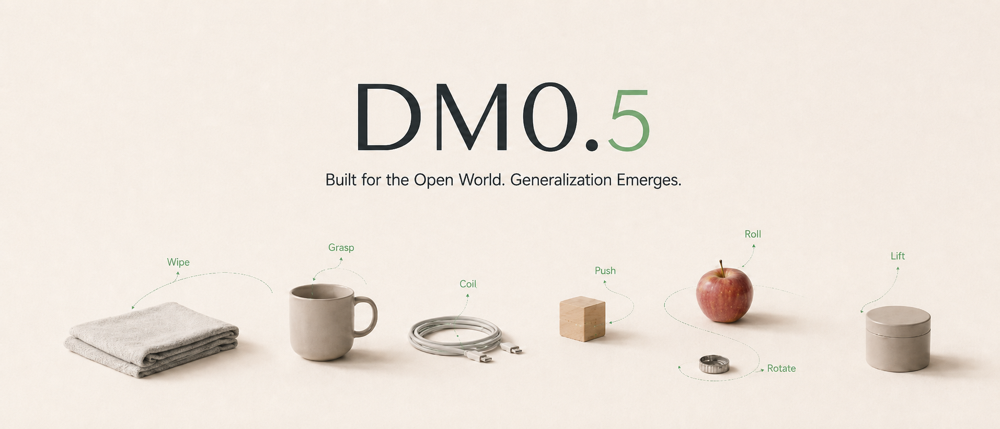
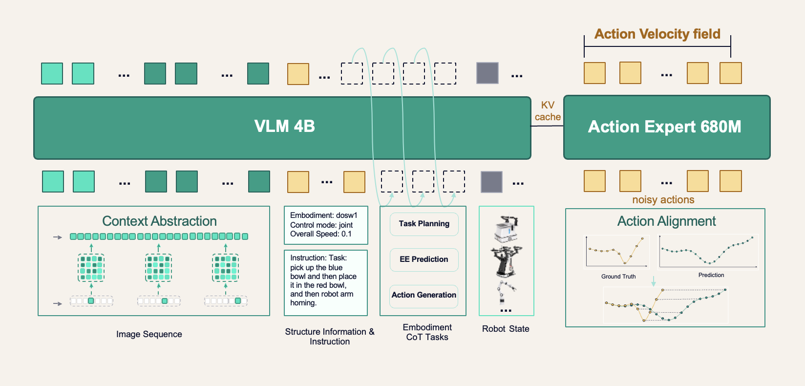
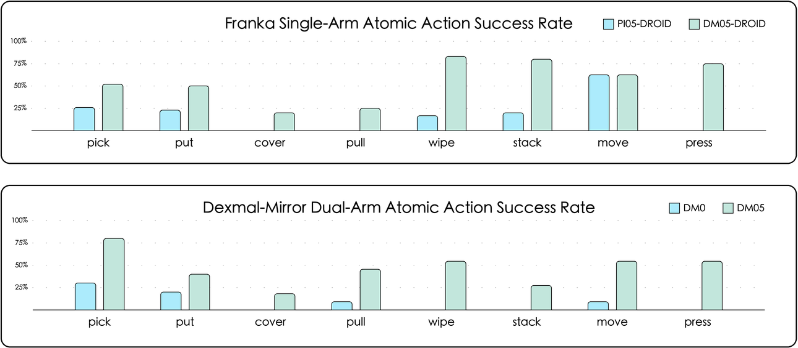
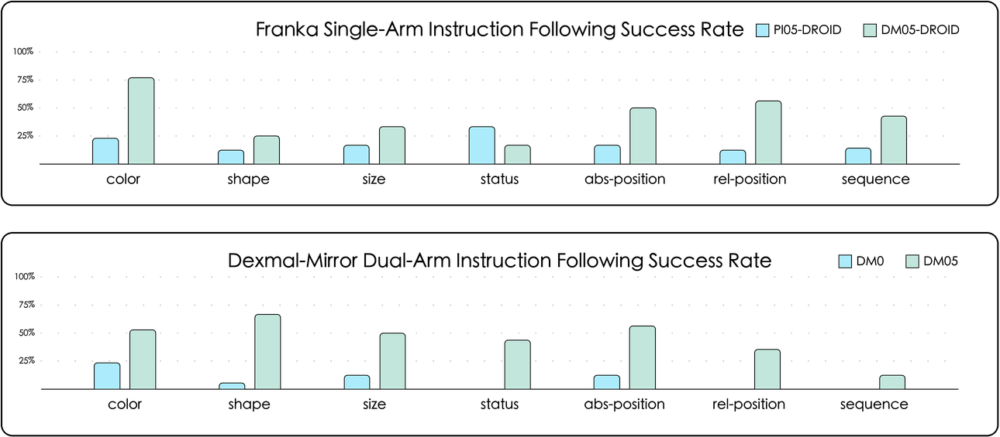
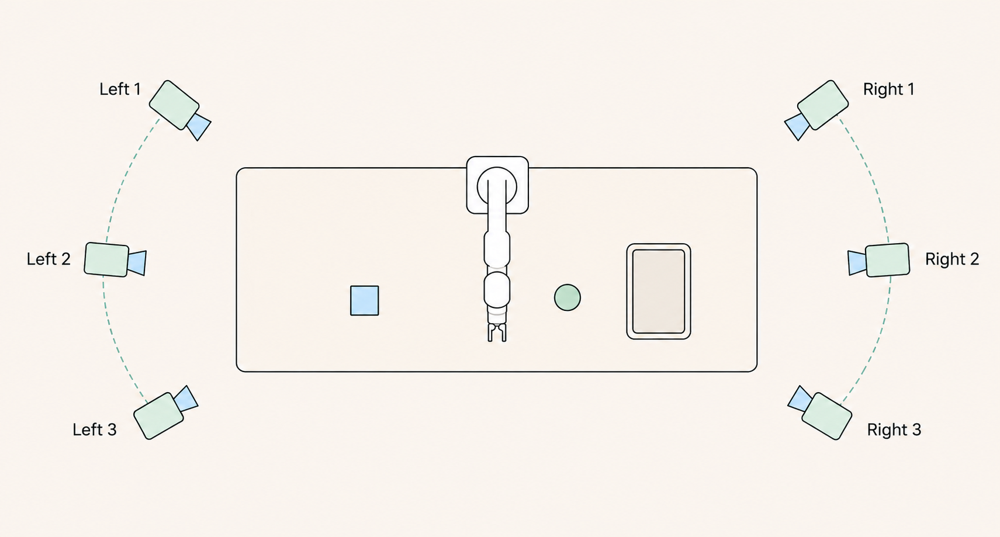

# DM0.5：开放世界具身基础模型

!!! info "论文信息"
    **官方题名：** DM0.5: An Open-World Foundation Model for General-Purpose Embodied Intelligence。<br>
    **作者 / 团队：** Dexmal；官方博客和 OpenDM README 未列出个人作者，本文按官方团队材料处理。<br>
    **时间 / 主题：** 2026-07；具身智能 / VLA / 开放世界机器人控制。<br>
    **官方博客 / 项目：** 技术博客：[dexmal.com/blog/dm0.5](https://www.dexmal.com/blog/dm0.5/index_en.html)；GitHub：[dexmal/opendm](https://github.com/dexmal/opendm)。<br>
    **模型：** Hugging Face collection：[Dexmal/dm05](https://huggingface.co/collections/Dexmal/dm05)，含 `Dexmal/DM05` 与 `Dexmal/DM05-libero`。<br>
    **相关前作：** DM0 arXiv：[2602.14974](https://arxiv.org/abs/2602.14974)；Dexbotic DM0 tutorial：[docs/DM0.md](https://github.com/dexmal/dexbotic/blob/main/docs/DM0.md)。<br>
    **元数据来源与核验口径：** 来源：官方博客、OpenDM README、Hugging Face collection、DM0 arXiv 页面；Checked Date：2026-07-09；Repro Status：Official blog / official repo / official model collection reviewed, independent reproduction not claimed。

## 原论文故事线

### 研究背景

DM0.5 延续 DM0 的 embodied-native VLA 路线。DM0 的关键判断是：不要把互联网预训练 VLM 当成完全外部的语义模型，再用少量机器人数据做动作后处理；而要从预训练阶段就混入 embodied manipulation、navigation 和交互日志，让语义知识、空间先验和动作生成在同一个系统里形成接口。

DM0.5 进一步把问题推向开放世界。真实机器人不只是在固定实验台上复现任务列表，还要处理自然语言约束、物体状态变化、相机视角变化、人为扰动、长时记忆和不同机器人 embodiment。官方博客给出的定位是：DM0.5 不只是更大的 DM0，而是围绕历史上下文、embodied reasoning、动态动作监督和数据清洗做系统升级。

### 问题（Challenge）

DM0.5 要解决的问题是：**一个 VLA policy 怎样在开放环境中同时具备 zero-shot 执行、有限数据 fine-tuning、长上下文记忆、扰动鲁棒性和多 embodiment 迁移。** 这比单一 benchmark 成功率更难，因为模型需要知道“当前动作为什么必要”，也要知道“过去发生了什么”和“当前感知变化是否应该改变动作”。

难点主要有四类。第一，当前帧不一定包含所有任务条件，例如杯子原始位置、早期人类示范规则或已经完成的子步骤。第二，机器人遥操作数据有速度差异，同一任务的动作时间轴不严格对齐。第三，开放环境中相机、光照、人为扰动和物体位置会改变执行轨迹。第四，多机器人、多任务、多源数据如果没有清洗和对齐，会把噪声直接写进动作监督。

### Finding

DM0.5 的核心 finding 可以概括为：**开放世界 VLA 的瓶颈不只是 action head 能否拟合动作，而是上下文记忆、任务阶段推理、动作时间对齐和多源数据质量能否一起支撑稳定闭环。** 这把问题从“当前图像到动作”推进到“历史、语义、进度和动作 chunk 的联合建模”。

这个洞见能解释 DM0.5 的几个设计：历史上下文解决非 Markov 状态，embodiment CoT 任务把机器人数据扩展成语言监督下的任务进度和事件预测，Trajectory Alignment Layer 用动态匹配降低遥操作速度噪声，数据清洗则防止异常状态、静止片段和错误标注污染 action distribution。

### 方法

DM0.5 使用 Gemma3 4B VLM 作为 backbone，接一个 680M Action Expert 生成连续动作。官方博客描述它支持最长约 60 秒历史上下文；推理时输入当前帧和若干历史关键帧，训练时对历史 slots 做时间采样、空间采样、token 压缩、随机长度和历史增强，让模型既能利用长历史，也能在历史缺失时退回当前观测驱动。

训练中加入 11 类 robot-data autoregressive tasks，分为 task planning、event/environment prediction 和 action generation 三类。动作侧仍基于 Flow Matching，但引入 Trajectory Alignment Layer：模型输出固定长度未来动作段，监督信号在更细粒度真实轨迹上做单调动态匹配，从而允许不同示教速度，同时避免跳过抓取、对齐、接触、释放等关键阶段。

### 结论

官方博客报告 DM0.5 在 zero-shot 操作、RoboChallenge Table30 v2、LIBERO、RoboTwin2.0、R2R/RxR navigation、历史记忆、相机视角和人为扰动实验中表现强。最具体的数值包括：Table30 v2 总体 Success Rate 为 `43%`、Score 为 `54.42`；LIBERO Average 为 `99.0`；RoboTwin2.0 Average 为 `93.5`；R2R Val-Unseen SR 为 `59.7`；RxR Val-Unseen SR 为 `65.5`。OpenDM 也释放了 `DM05` 和 `DM05-libero` 权重。

边界同样要讲清：DM0.5 当前主要是官方博客、官方代码和官方模型集合披露；没有看到独立第三方复现或完整论文级消融细节。zero-shot 和鲁棒性 demo 能说明能力形态，但不能等同于开放家庭环境长期部署；Table30 v2 与 simulated benchmarks 也不能直接证明所有机器人平台都可稳定迁移。

### 关键术语

- **Open-world embodied foundation model（开放世界具身基础模型）**：面向非固定任务、非固定场景和自然语言约束的机器人 VLA 模型。
- **Historical Context Fusion（历史上下文融合）**：把当前观测和过去关键帧一起编码，用于恢复任务进度、已移动物体和早期示范规则。
- **Embodiment CoT Tasks（具身链式思考任务）**：在机器人数据上加入自回归语言任务，让模型预测任务阶段、事件变化和动作意图。
- **Trajectory Alignment Layer（轨迹对齐层）**：用动态匹配把预测动作段和真实遥操作轨迹按进度对齐，而不是按固定时间戳硬对齐。
- **Flow Matching（流匹配）**：连续动作生成目标，用速度场学习从噪声到动作轨迹的变换。
- **Action Chunk（动作块）**：一次推理生成的一段未来动作；DM0.5 官方默认描述为 10 个 Flow Matching steps 生成 50-step action chunk。
- **Multi-embodiment Transfer（多形态机器人迁移）**：通过多机器人、多任务训练，使模型可经后训练迁移到预训练未见过的机器人形态。

DM0.5 最值得抓住的不是某一个 benchmark 数字，而是它把 VLA 的工程重心从“当前帧动作预测”转到“历史上下文 + 任务进度推理 + 动作监督对齐 + 多源数据清洗”。这让它和 [π0.5](pi05.md)、[Qwen-RobotManip](qwen-robotmanip.md)、[kai0](kai0.md) 形成一条很清楚的对照线：π0.5 强调开放世界任务组织，Qwen-RobotManip 强调 alignment unlocks scale，kai0 强调部署分布一致性，DM0.5 则强调开放环境里的长上下文和动态动作匹配。

## 证据等级与外推边界

| 结论 | 主要证据 | 可吸收为工程判断 | 不能直接外推 |
| --- | --- | --- | --- |
| 历史上下文能帮助长时任务 | 官方博客的 60 秒上下文描述、cup wipe table 和 human demonstration demos | 当前帧不够时，VLA 应显式接入历史关键帧或 episode context | demo 不是严格消融；没有公开完整错误率分解 |
| 动态动作匹配能降低遥操作速度噪声 | Trajectory Alignment Layer 方法描述 | action chunk 监督不应只按固定时间索引对齐，可按轨迹进度做单调匹配 | 官方博客未给完整公式和独立 ablation 数字 |
| 多源数据清洗是 VLA scale 的前提 | outlier/static/low-value/dedup/relabeling 策略 | 机器人数据小时数不能直接等于有效训练信号，必须做跨模态一致性检查 | 清洗阈值、规则和内部数据细节未完全公开 |
| DM0.5 在 Table30 v2 与模拟 benchmark 上领先 | 官方博客 Table30 v2、LIBERO、RoboTwin2.0、R2R/RxR 表格 | 可作为官方报告性能和训练 recipe 参考 | 不能当作第三方复现；不同 benchmark 口径不可直接横比 |
| OpenDM 提供可用模型和训练/推理脚本 | GitHub README 与 HF collection | 可以作为 fine-tuning / inference 起点 | 权重可用不等于论文主结果可一键复现 |

## 论文位置

DM0.5 放在具身智能专题里，应读作一篇 **VLA 系统升级报告**，不是单纯 action head 论文。它继承 DM0 的 embodied-native 预训练路线，又把开放世界部署最痛的几个问题放到模型和数据管线里。

{ width="920" }

<small>图源：[DM0.5 官方博客](https://www.dexmal.com/blog/dm0.5/index_en.html)，hero image。原图用于展示 DM0.5 面向开放世界桌面操作、双臂协作和真实机器人任务的系统定位；它是能力版图示意，不是单独实验结果。</small>

可以用一条链路定位 DM0.5：

```text
DM0：embodied-native VLA 预训练
  -> DM0.5：加入历史上下文、embodied CoT、动态动作匹配和多源数据清洗
      -> OpenDM：开放 DM05 / DM05-libero 权重、训练和推理脚本
```

这条路线与 [Qwen-RobotManip](qwen-robotmanip.md) 的差别在侧重点。Qwen-RobotManip 的关键词是跨 embodiment action/state 对齐和数据规模；DM0.5 的关键词是开放场景里的上下文记忆、任务进度推理和动作时间对齐。两者都在回答同一个大问题：机器人数据不是文本数据，规模收益必须先经过物理接口和时间结构的整理。

## 总体架构

{ width="920" }

<small>图源：[DM0.5 官方博客](https://www.dexmal.com/blog/dm0.5/index_en.html)，architecture overview。原图意图：展示 Gemma3 4B VLM、680M Action Expert、历史上下文、embodied reasoning、Flow Matching action generation、Trajectory Alignment Layer 和数据清洗之间的关系。</small>

**Figure 怎么读。**
先看 backbone：DM0.5 用 Gemma3 4B VLM 承担视觉、语言和空间语义表示；再看 action side：680M Action Expert 负责连续动作生成。中间最关键的是两条补充信号：历史上下文把过去关键帧接进当前决策，embodiment CoT 把机器人数据变成任务阶段、事件变化和动作意图的语言监督。最后，Trajectory Alignment Layer 和数据清洗处理的是动作标签质量，而不是推理时多一个显式 planner。

这张图支撑的是“开放世界 VLA 需要多信号训练和动作监督对齐”。它不能单独证明 DM0.5 已拥有完整物理世界模型，也不能证明模型能在任意家庭环境长期自主恢复失败。

| Component | 官方描述 | 作用 |
| --- | --- | --- |
| VLM backbone | Gemma3 4B | 编码视觉、语言、空间语义和历史上下文 |
| Action Expert | 680M | 通过 Flow Matching 生成连续动作 |
| Historical context | up to 60 seconds | 让模型利用过去关键状态、示范规则和任务进度 |
| Embodiment CoT | 11 autoregressive tasks | 监督 task planning、event/environment prediction 和 action generation |
| Trajectory Alignment | monotonic dynamic matching | 用轨迹进度对齐动作监督，缓解不同示教速度 |
| Inference | 10 Flow Matching steps, 50-step chunk；10 Hz on RTX 4090, 20 Hz on H100 | 说明 action chunk 推理的部署口径 |

## Context Abstraction Layer：从当前帧走向 episode 记忆

传统 VLA 常把当前图像、当前机器人状态和指令作为输入。这对短程、局部、近似 Markov 的任务够用，但开放任务经常不是 Markov 的：目标曾经在哪里、哪个区域已经清理过、人类最开始示范了什么规则，这些信息可能在当前帧里消失。

DM0.5 的 Context Abstraction Layer 试图补这个缺口。推理时，模型接收当前帧和过去若干关键帧；训练时，对历史 slots 做 temporal sampling、spatial sampling 和 token compression，并随机化历史长度。这种做法有两个工程含义：

| 设计 | 解决的问题 | 具身系统读法 |
| --- | --- | --- |
| 历史关键帧 | 当前帧看不到被移动前的位置或早期示范 | episode memory 要进入 policy，而不只是日志回放 |
| 随机历史长度 | 部署时历史可能缺失或质量不稳定 | 模型要学会在长历史、短历史和无有效历史间退化 |
| token compression | 多相机、长历史带来上下文成本 | 历史必须压缩成可训练、可推理的表示预算 |

官方博客中的两个历史记忆 demo 对应短期和长期两种情况：一个是拿起杯子、擦桌子、再把杯子放回原位；另一个是早期人类示范电池摆放规则，机器人后续执行时保持这个规则。它们说明历史上下文可以参与动作预测，但证据等级是 official demo，还不是严格的 memory ablation。

## Embodiment CoT：让机器人数据不只监督动作

DM0.5 在 robot data 上加入 11 类自回归任务，官方归成三组：

| Task family | 监督内容 | 为什么有用 |
| --- | --- | --- |
| Task planning | 当前任务阶段、过去/未来步骤关系、总体进度 | 缓解“视觉相似但阶段不同”的动作混淆 |
| Event and environment prediction | 边界、状态转移、关键未来事件 | 强化动态场景和阶段变化表征 |
| Action generation | 未来动作或动作意图摘要 | 在连续动作生成前形成语义层面的行为计划 |

这里的 CoT 不应理解成把大语言模型的自由推理原样搬到机器人控制里。更稳的读法是：它是一种把机器人 episode 重新标注成多任务监督的方式。模型不仅要回归 action，还要回答“任务到哪一步了”“接下来为什么要这样做”“环境会发生什么变化”。这样可以让 VLM backbone 更少退化成单纯视觉到动作映射。

与 [Qwen-RobotManip](qwen-robotmanip.md) 的 VLA/VLM co-training 类似，DM0.5 也在处理一个共同风险：后训练如果只优化动作，VLM 的语言和场景理解能力可能被削弱。DM0.5 选择用 embodied reasoning tasks 把机器人数据本身扩展成语言和时间理解监督。

## Trajectory Alignment Layer：不要把遥操作速度当成物理规律

机器人示教轨迹的时间轴很嘈杂。同一个 pick-and-place，有的人动作快，有的人动作慢；同一阶段内部也可能因为犹豫、微调、接触误差而拉长。如果模型被迫在固定时间戳上预测动作，就可能学到“示教者的节奏”，而不是任务本身的进度。

DM0.5 的 Trajectory Alignment Layer 可以抽象成一个单调匹配问题。设模型输出固定长度动作段

$$
\hat A=(\hat a_1,\hat a_2,\ldots,\hat a_M),
$$

真实轨迹提供更细粒度动作 anchors：

$$
A=(a_1,a_2,\ldots,a_N), \quad N\ge M.
$$

训练时选择单调索引

$$
1\le j_1<j_2<\cdots<j_M\le N,
$$

让匹配损失尽量小：

$$
\min_{j_1<\cdots<j_M}\sum_{i=1}^{M} d(\hat a_i,a_{j_i})+\lambda C(j_{i-1},j_i).
$$

这里 \(d\) 表示预测动作和候选 anchor 的误差，\(C\) 表示相邻 anchors 之间的轨迹连续性约束。上式是本站根据官方描述写出的读法，不是官方博客给出的原始公式。关键是两点：匹配必须单调，避免时间倒流；同时要看相邻 anchors 之间的连续轨迹，避免只挑局部容易点而跳过抓取、接触和释放。

这类设计对 VLA 很重要，因为 action chunk 训练本质上是在压缩未来一段控制信号。固定时间对齐会把不同示教速度误当作监督噪声；动态进度对齐则更接近“当前动作段应该覆盖哪个任务阶段”。

## 数据：多源混合之前先清洗

官方博客把 DM0.5 数据分成四类：robotic manipulation、embodied navigation、first-person human manipulation 和 general multimodal vision-language data。这里最值得看的是数据清洗，而不是只看来源数量。

| Cleaning strategy | 官方描述的问题 | 工程含义 |
| --- | --- | --- |
| Outlier removal | ROS 记录中异常大、小或不连续的状态 / 动作值 | state/action 先过物理可达性和连续性检查 |
| Static-frame removal | 图像和机器人状态长时间静止 | 静止片段会降低动作响应性，也浪费训练预算 |
| Low-value action removal | 不完整执行、意图不清或与任务无关行为 | 不是所有真实机器人数据都该进 policy 训练 |
| Action-pattern deduplication | ALOHA 等平台中不同 joint 组合对应近似 EEF 运动 | 要减少等价动作模式互相冲突 |
| Relabeling incorrect annotations | 原始任务标注错误 | 用跨模态一致性检查修正 subtask labels |

这一点和本站多篇具身论文的经验一致：机器人数据的难点不是“能不能记录下来”，而是“记录下来的图像、状态、动作、指令和阶段标签是否同向”。如果数据质量没有先被处理，scale 会把错误的控制约定放大。

## 实验与结论

### Zero-shot generalization

官方博客把 zero-shot 评测拆成 action type 和 conditional constraint 两条轴。action type 包括 pick、put、move、pull、cover、wipe、stack、press；condition 包括 color、shape、size、status、sequence、relative position、absolute position。比较平台包括 Franka 上的 Pi0.5-Droid / DM0.5-Droid，以及 Dexmal-Mirror 上的 DM0 / DM0.5。

{ width="820" }

<small>图源：[DM0.5 官方博客](https://www.dexmal.com/blog/dm0.5/index_en.html)，zero-shot results by atomic action。原图表达不同原子动作类别上的 zero-shot success rate 对比；读数边界是官方测试设置，不能直接外推到所有开放环境。</small>

{ width="820" }

<small>图源：[DM0.5 官方博客](https://www.dexmal.com/blog/dm0.5/index_en.html)，zero-shot results by instruction constraint。原图表达不同语义约束类别上的 zero-shot success rate 对比；它支撑 DM0.5 在语言条件操作上的官方报告优势，但不等同于独立复现。</small>

这两张图要一起读。第一张看动作覆盖：模型是否只会 pick/place，还是能处理 wipe、stack、press 这类更具接触或阶段要求的动作。第二张看语言约束：模型是否只认物体名，还是能处理颜色、大小、状态、顺序和相对/绝对空间关系。它们支撑的是“zero-shot 操作覆盖更宽”，不是“开放世界问题已解决”。

### Fine-tuning capability

官方博客报告 DM0.5 在 RoboChallenge Table30 v2 上达到 `43%` Success Rate 和 `54.42` Score。这个 benchmark 覆盖长期记忆、多步顺序执行、视觉定位、精细 pick-and-place、工具交互和双臂协调。需要注意，Table30 v2 结果没有在博客中逐项列全表，页面给的是总体分数和若干任务能力解释。

模拟 benchmark 表格可以保留原英文字段：

| Method | Spatial | Object | Goal | Long | Average |
| --- | ---: | ---: | ---: | ---: | ---: |
| π0 | 96.8 | 98.8 | 95.8 | 85.2 | 94.2 |
| π0.5 | 98.8 | 98.2 | 98.0 | 92.4 | 96.9 |
| OpenVLA-OFT | 97.6 | 98.4 | 97.9 | 94.5 | 97.1 |
| GR00T N1.7 | 97.7 | 98.5 | 97.5 | 94.4 | 97.0 |
| StarVLA | 99.0 | 99.8 | 98.5 | 94.1 | 97.9 |
| ABot-M0 | 98.8 | 99.8 | 99.0 | 96.6 | 98.6 |
| Being-H0.5 | **99.2** | 99.6 | 99.4 | 97.4 | 98.9 |
| Cosmos Policy | 98.1 | **100.0** | 98.2 | **97.6** | 98.5 |
| DM0.5 | 99.0 | 99.8 | **99.6** | 97.4 | **99.0** |

<small>表源：DM0.5 官方博客，LIBERO benchmark。读数边界：这是官方汇总，且 LIBERO 的高分区间已经接近饱和；Average 差异需要结合任务拆分、训练设置和统计方差读。</small>

| Method | Clean | Randomized | Average |
| --- | ---: | ---: | ---: |
| π0 | 65.9 | 58.4 | 62.2 |
| π0.5 | 82.7 | 76.8 | 79.8 |
| Motus | 88.7 | 87.0 | 87.9 |
| LingBot-VLA | 86.5 | 85.3 | 85.9 |
| LingBot-VA | 92.9 | 91.5 | 92.2 |
| ABot-M0 | 86.1 | 85.1 | 85.6 |
| StarVLA | 88.2 | 88.3 | 88.3 |
| Being-H0.7 | 90.2 | 89.6 | 89.9 |
| Qwen-VLA | 86.1 | 87.2 | 86.7 |
| DM0.5 | **93.6** | **93.3** | **93.5** |

<small>表源：DM0.5 官方博客，RoboTwin2.0 benchmark。读数边界：Randomized 更接近分布扰动能力，但仍是仿真 benchmark，不能直接替代真实机器人闭环长期运行。</small>

### Navigation results

DM0.5 还给出 navigation 版本在 R2R / RxR Val-Unseen 上的结果：

| Method | R2R Val-Unseen NE↓ | R2R Val-Unseen OS↑ | R2R Val-Unseen SR↑ | R2R Val-Unseen SPL↑ | RxR Val-Unseen NE↓ | RxR Val-Unseen SR↑ | RxR Val-Unseen SPL↑ | RxR Val-Unseen nDTW↑ |
| --- | ---: | ---: | ---: | ---: | ---: | ---: | ---: | ---: |
| NaVid | 5.7 | 49.2 | 41.9 | 36.5 | 5.7 | 45.7 | 38.2 | - |
| Uni-NaVid | 5.6 | 53.3 | 47.0 | 42.7 | 6.2 | 48.7 | 40.9 | - |
| NaVILA | 5.2 | 62.5 | 54.0 | 49.0 | 6.8 | 49.3 | 44.0 | 58.8 |
| StreamVLN | 5.0 | 64.2 | 56.9 | **51.9** | 6.2 | 52.9 | 46.0 | 61.9 |
| Qwen-VLA-Instruct | 5.1 | 69.0 | 57.5 | 51.2 | 5.8 | 59.6 | 47.8 | 57.1 |
| DM0.5-Nav | **4.8** | **69.5** | **59.7** | 48.6 | **4.8** | **65.5** | **51.0** | **64.2** |

<small>表源：DM0.5 官方博客，R2R / RxR navigation results。这里说明 DM0.5 路线覆盖 embodied navigation，但 manipulation 和 navigation 的动作接口、评测口径不同，不能把二者简单合成一个总能力分。</small>

### Camera viewpoint robustness

{ width="880" }

<small>图源：[DM0.5 官方博客](https://www.dexmal.com/blog/dm0.5/index_en.html)，camera positions on Franka platform。原图表达 3 个左侧第三人称相机位置与 3 个右侧第三人称相机位置的组合，用来测试视角变化下的 pick-and-place 鲁棒性。</small>

| Pos | L1/R1 | L2/R1 | L3/R1 | L1/R2 | L2/R2 | L3/R2 | L1/R3 | L2/R3 | L3/R3 |
| --- | ---: | ---: | ---: | ---: | ---: | ---: | ---: | ---: | ---: |
| SR | 100% | 90% | 80% | 90% | 90% | 90% | 80% | 90% | 90% |

<small>表源：DM0.5 官方博客，camera viewpoint experiment。每个配置 10 次连续 pick-and-place trials；样本量较小，适合作为鲁棒性现象证据，不宜过度解释成泛化保证。</small>

这个实验的读法是两阶段视觉控制：第三人称相机提供全局粗定位，腕部相机提供局部精调。极端第三人称视角会放大第一阶段空间偏移，但腕部相机仍可能帮助局部修正。对机器人系统来说，这比“某个固定摄像头最好”更有启发：多视角策略要区分 global guidance 和 local refinement。

## 对具身智能的启发

DM0.5 对具身智能项目的启发可以压成四点。

| 启发 | 可落地做法 | 风险 |
| --- | --- | --- |
| 让历史进入 policy | 保存 episode keyframes、已完成子任务、物体初始位置和示范规则 | 历史太长会提高上下文和延迟成本 |
| 把机器人数据转成多任务监督 | 给 episode 添加阶段、事件、动作意图和未来变化标签 | 自动标注错误会污染 reasoning signal |
| 按轨迹进度对齐动作 | 用 monotonic matching / dynamic programming 处理不同示教速度 | 如果关键阶段被错误压缩，模型会跳步 |
| 数据清洗优先于堆数据量 | 检查 state/action 连续性、静止片段、低价值行为、标注一致性 | 内部阈值不透明时，复现难度会上升 |

和 [kai0](kai0.md) 对读时，DM0.5 更偏“预训练和后训练数据管线”，kai0 更偏“部署分布一致性和真机长时可靠性”。两者真正重合的地方是：高可靠机器人不是只靠模型架构，而是靠数据、训练、推理、控制和评测一起闭环。

## 局限与风险

第一，DM0.5 目前最主要的技术来源是官方博客和官方开源材料，而不是完整论文。博客披露了架构、训练思想、数据清洗策略和结果表，但缺少更细粒度的消融、方差、失败案例统计和评测配置细节。

第二，部分能力证据是 demo 或官方系统测试。历史记忆和人为扰动视频能说明模型行为形态，但不能直接当作大样本成功率；相机视角实验每个配置 10 次，也更适合做现象验证而不是统计定论。

第三，OpenDM 释放权重和脚本降低了复用门槛，但从“能下载模型”到“复现官方 Table30 v2 / RoboTwin2.0 / R2R 结果”之间仍有数据、硬件、norm stats、benchmark client 和训练 recipe 差异。本文不把官方 repo 可用写成独立复现。

第四，DM0.5 的多 embodiment transfer 仍需要后训练。官方说它可以迁移到预训练未见过的 embodiment，但这不是 zero-shot 适配所有机器人；新的自由度、控制频率、相机外参、夹爪/灵巧手接口和安全控制都需要重新验证。

## 阅读结论

DM0.5 是一篇值得放进具身智能专题的官方系统报告：它没有把开放世界 VLA 简化成更大模型，而是把历史上下文、embodied reasoning、动态动作匹配和数据清洗都放进训练闭环。可复用机制主要在四处：episode memory、robot-data autoregressive tasks、monotonic trajectory matching、multi-source data cleaning。不可外推的是长期真实家庭部署、跨所有 embodiment 的直接迁移和独立复现成功率。下一步最需要的证据，是公开 ablation、失败案例、第三方 benchmark 复现、真实机器人长时运行日志，以及不同历史长度和动作匹配策略的系统对比。

## 外部精读

- 官方博客：[DM0.5: An Open-World Foundation Model for General-Purpose Embodied Intelligence](https://www.dexmal.com/blog/dm0.5/index_en.html)。
- 官方代码：[dexmal/opendm](https://github.com/dexmal/opendm)。
- 模型集合：[Dexmal/dm05](https://huggingface.co/collections/Dexmal/dm05)。
- 相关前作：[DM0 arXiv:2602.14974](https://arxiv.org/abs/2602.14974)。
- 站内对读：[π0.5：开放世界 VLA](pi05.md)。
- 站内对读：[Qwen-RobotManip：先对齐再扩规模的机器人操作基础模型](qwen-robotmanip.md)。
- 站内对读：[kai0：资源受限下的高可靠机器人操作](kai0.md)。
- 站内下一步：[VLA 数据、模型与评测路线](../../embodied-ai/vla-data-model-and-evaluation-roadmap.md)。
