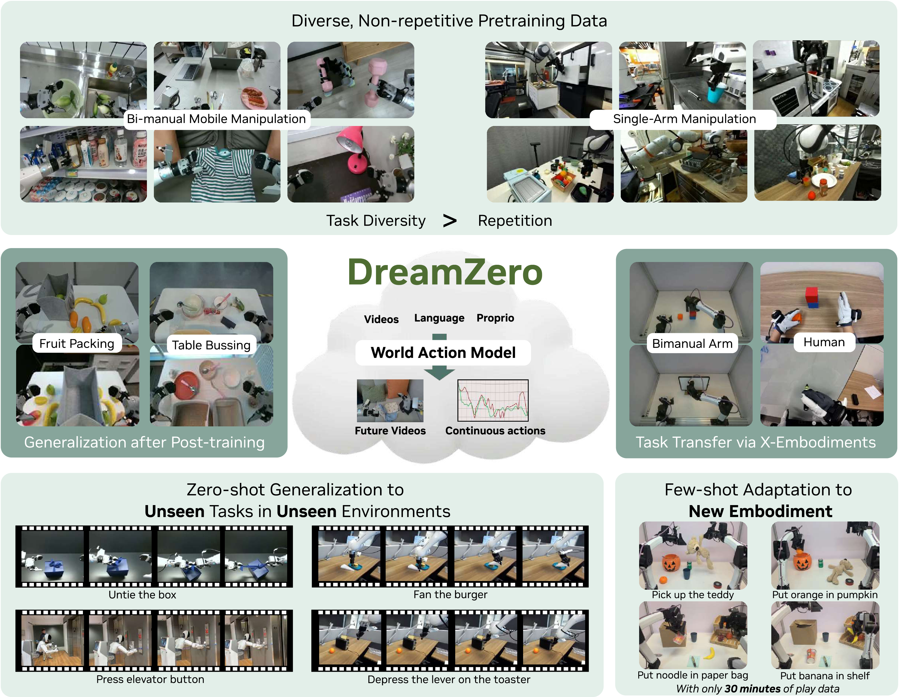
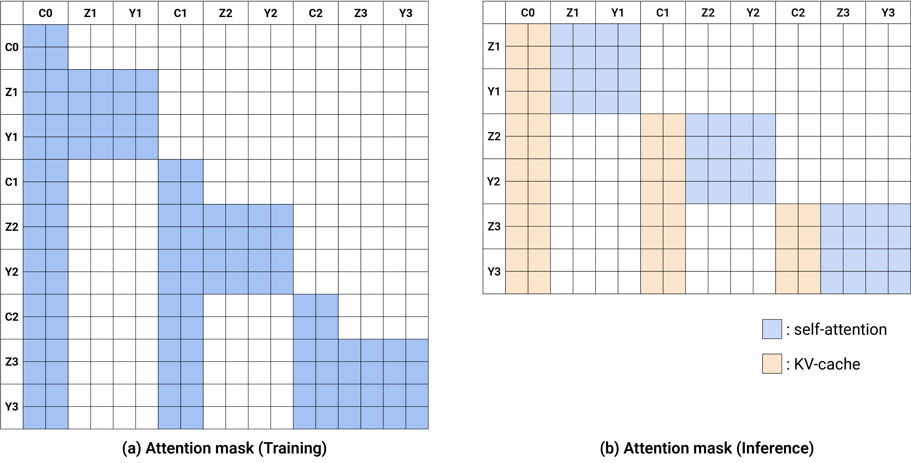
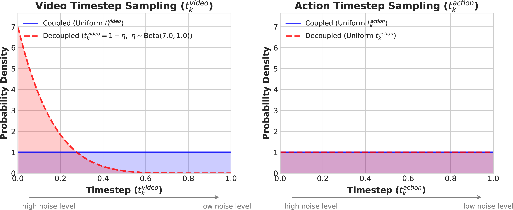
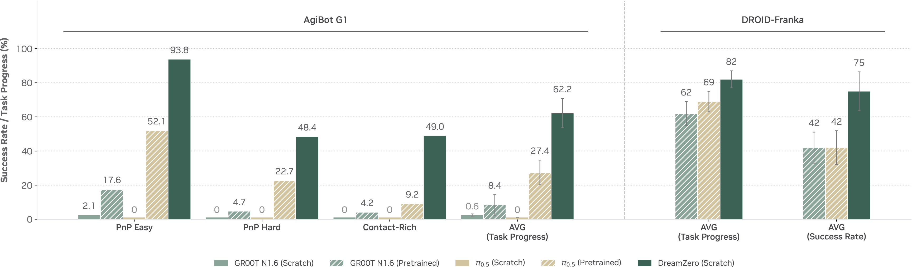
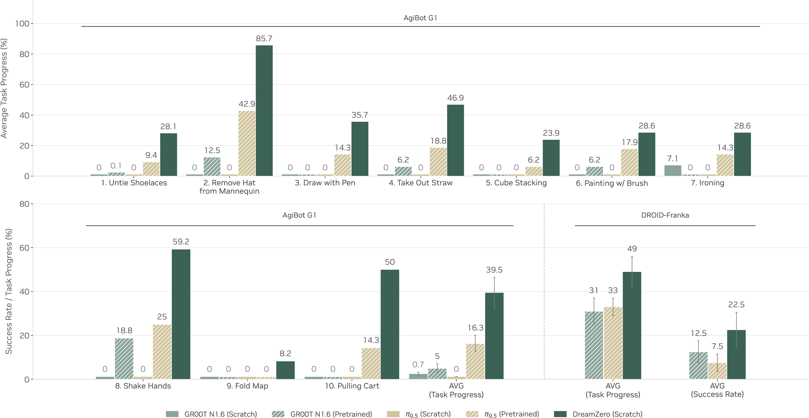
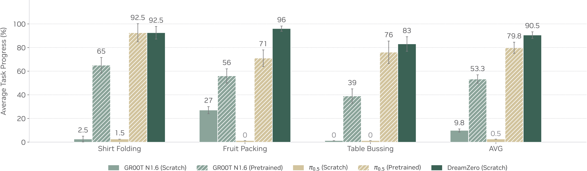

# DreamZero：世界动作模型为什么可以做零样本策略

!!! info "论文信息"
    **论文题名：** World Action Models are Zero-shot Policies。 
    **作者：** Seonghyeon Ye、Yunhao Ge、Kaiyuan Zheng、Shenyuan Gao、Sihyun Yu、George Kurian、Suneel Indupuru、You Liang Tan、Chuning Zhu、Jiannan Xiang 等（共 36 人）。 
    **机构：** NVIDIA。 
    **时间 / 主题：** 2026-02；具身智能。 
    **arXiv / 官方报告：** arXiv：[2602.15922](https://arxiv.org/abs/2602.15922)；官方材料：[dreamzero0.github.io/](https://dreamzero0.github.io/)。 
    **GitHub / 项目：** GitHub：未找到官方链接；项目页：[dreamzero0.github.io/](https://dreamzero0.github.io/)。 
    **元数据来源与核验口径：** 来源：[arXiv](https://arxiv.org/abs/2602.15922)；[官方 / 项目材料](https://dreamzero0.github.io/)；Checked Date：2026-06-04；Repro Status：Paper / official materials reviewed, independent reproduction not claimed。

DreamZero 这篇论文要回答一个比“视频生成模型能不能预测未来”更尖锐的问题：**如果模型一边预测未来画面，一边预测产生这些画面的机器人动作，它能不能直接变成闭环机器人 policy？**

这就是论文所谓的 World Action Model，简称 WAM。普通 VLA 学的是“当前图像和语言 -> 动作”；WAM 学的是“当前世界状态和语言 -> 未来世界怎样变化，以及机器人要做哪段动作”。两者都输出动作，但学习信号完全不同。VLA 容易把动作当成标签回归；WAM 被迫解释动作的后果，因此更接近“我知道这样动会把世界推到哪里”。

## 一句话核心

DreamZero 的核心不是把视频模型拿来当想象模块，而是把视频扩散模型改造成一个联合去噪器：

\[
p_\theta(v_{t+1:t+H}, a_{t:t+K} \mid o_{\le t}, s_{\le t}, l)
\]

其中 \(v_{t+1:t+H}\) 表示未来视频 latent，\(a_{t:t+K}\) 表示未来一段 action chunk，\(o_{\le t}\) 是历史视觉观测，\(s_{\le t}\) 是机器人本体状态，\(l\) 是语言指令。这个式子最重要的部分不是条件很多，而是输出同时包含 video 和 action：动作不再只是独立回归目标，而必须和未来画面变化一致。

{ width="920" }

<small>图源：`World Action Models are Zero-shot Policies`，Figure 1。原图表达 DreamZero 的路线：从预训练视频扩散模型继承世界动态先验，再通过视频-动作联合建模支持多样机器人数据、未见任务泛化、跨具身迁移和少样本适配。本站读法：先看它没有把 video prediction 当辅助任务，而是把 video 和 action 都放进 policy 输出。</small>

## VLA 缺的不是语言，而是动作后果

很多 VLA 论文强调语义泛化：模型见过“杯子”“桌子”“把 A 放到 B”这类语言和视觉概念，所以能把指令映射到动作。但机器人操作的困难不只在语义。一个策略需要知道“夹爪往左 3 厘米后，物体是否会被碰倒”“拉抽屉时把手和手腕轨迹会怎样变化”“从这个角度抓会不会滑落”。

这类知识更像物理动态，而不是语言知识。DreamZero 的批评点在这里：如果训练目标只让模型拟合动作标签，它可以在训练集附近学到动作模板，却不一定学到动作如何改变世界。相反，如果模型必须预测未来视频，它就要关心物体、手、相机、接触和遮挡的连续变化。

可以把 VLA 和 WAM 的目标粗略写成：

\[
\text{VLA}: \quad a_t = f_\theta(o_t, s_t, l)
\]

\[
\text{WAM}: \quad (v_{t+1:t+H}, a_{t:t+K}) = g_\theta(o_{\le t}, s_{\le t}, l)
\]

其中第一行表示单纯从当前观测回归动作，第二行表示同时预测未来世界和一段动作。这里的差异不是公式复杂度，而是训练时模型有没有被要求解释“动作之后会看到什么”。DreamZero 的整个贡献都围绕第二行展开。

{ width="920" }

<small>图源：`World Action Models are Zero-shot Policies`，Figure 2。原图表达模型同时生成未来视频和动作。本站读法：观察动作轨迹和预测画面是否互相支持，尤其是未见任务中模型是否能生成合理的动作后果。</small>

## 架构：把 Wan2.1 视频扩散模型改成动作模型

DreamZero 使用 Wan2.1-I2V-14B-480P 作为 backbone。这个选择很重要：论文并没有从头训练一个机器人 transformer，而是复用大视频模型已经学到的视觉动态、物体外观、相机运动和场景变化先验。

为了让视频模型理解机器人，DreamZero 只增加几类机器人相关模块：

- `state encoder`：把本体状态编码进模型。
- `action encoder`：训练时把带噪动作 latent 放入联合去噪。
- `action decoder`：把去噪后的 action latent 解码为机器人 action chunk。
- 多视角输入拼接：把多摄像头画面拼成一个视频帧，避免重写 backbone。

这也解释了 DreamZero 和 Wan、Diffusion Forcing 的关系。Wan 提供的是强视频 latent 与 DiT 动态先验；DreamZero 把这个视频底座接上状态、动作和闭环真实观测；Diffusion Forcing 则从训练范式上提醒我们，未来 token 的不确定性不应该全一样。三者合起来看，路线不是“视频越真越像世界模型”，而是：视频底座要有动作接口，采样/训练要表达不确定性，真实执行时还要用观测回写打断错误想象。

{ width="920" }

<small>图源：`World Action Models are Zero-shot Policies`，Figure 4。原图表达 DreamZero 架构：视觉上下文、语言和本体状态进入自回归 DiT，训练时联合去噪视频与动作 latent，推理时用真实观测刷新上下文。本站读法：把这张图看成“视频扩散模型如何多出动作接口”，而不是普通 VLA 架构图。</small>

训练样本被切成 chunk。每个 chunk 内，模型看到历史条件帧和机器人状态，然后对未来视频 latent 与动作 latent 做 flow matching。一个简化的训练目标可以写成：

\[
\mathcal{L}
= \mathbb{E}_{t, \epsilon}
\left[
\lambda_v \lVert u_v - \hat{u}_{v,\theta} \rVert_2^2
+
\lambda_a \lVert u_a - \hat{u}_{a,\theta} \rVert_2^2
\right]
\]

其中 \(u_v\) 和 \(u_a\) 分别表示视频 latent 与动作 latent 的目标速度场，\(\hat{u}_{v,\theta}\) 和 \(\hat{u}_{a,\theta}\) 是模型预测，\(\lambda_v,\lambda_a\) 是两类损失的权重。这里要读懂的是“同一个模型同时学两个去噪方向”：视频去噪要求它理解未来画面，动作去噪要求它把这种未来变化落到机器人控制上。

## 为什么要自回归，而不是一次性生成整段视频

离线视频生成可以一次性生成几十帧，但机器人闭环控制不能这样。真实执行时，机器人每走一步都会得到新观测；如果模型继续相信自己上一轮生成的未来画面，误差会越来越大。DreamZero 因此采用 autoregressive WAM：生成一个 action chunk 后，系统等待真实观测回来，再把真实观测写回上下文。

这有两个直接好处。

第一，KV cache 能复用历史条件帧，让大模型推理不必每次从头算。第二，真实观测会替换模型想象的画面，把错误从闭环中截断。也就是说，DreamZero 不是让机器人活在生成视频里，而是每个控制周期都用真实世界纠偏。

{ width="860" }

<small>图源：`World Action Models are Zero-shot Policies`，Figure 14。原图表达训练和推理时的注意力策略。本站读法：重点看推理侧，条件帧 KV 被缓存，生成的 future frame 不是长期信念，真实观测会回写到上下文中。</small>

## 实时化：WAM 的难点是 14B 视频模型要跑闭环

DreamZero 最容易被低估的部分是系统实现。一个 14B 视频扩散模型天然不适合机器人控制：朴素生成一个 action chunk 需要数秒，而真实机器人需要接近 5-10Hz 的响应频率。论文把这个问题称作 `reactivity gap`。

它的优化分三层：

| 层级 | 做法 | 解决的问题 |
| --- | --- | --- |
| 系统层 | asynchronous execution、CFG parallelism、DiT caching | 让感知、生成和执行流水化，减少重复计算 |
| 实现层 | torch.compile、CUDA Graphs、kernel / scheduler 优化、NVFP4 量化 | 降低每步 DiT 推理成本 |
| 模型层 | DreamZero-Flash、少步去噪、decoupled noise schedules | 减少扩散步数，同时保住动作质量 |

这张加速表的读法不是“用了很多工程技巧”，而是看瓶颈迁移：单靠缓存、编译和量化只能把延迟压下一部分；真正让 WAM 进入闭环的是少步化模型本身。

## DreamZero-Flash：为什么动作和视频要用不同噪声日程

少步扩散容易出现一个问题：视频生成还没有充分去噪，动作已经必须可执行。DreamZero-Flash 的做法是 decoupled noise schedules：视频 latent 可以保持更高噪声，因为它主要提供未来动态上下文；动作 latent 则需要更快靠近 clean action。

{ width="860" }

<small>图源：`World Action Models are Zero-shot Policies`，Figure 5。原图表达 coupled 和 decoupled noise schedule 的区别。本站读法：动作不是等视频完全生成好再预测，而是在有噪视觉上下文里尽快得到可执行 chunk。</small>

这背后的直觉很实用：机器人不需要每个控制周期都生成一段电影级未来视频，它需要从粗糙但方向正确的未来动态里抽出下一段动作。DreamZero-Flash 让模型在 noisy visual context 下学习 clean actions，所以 1-step 推理还能保持任务进展。

## 数据：为什么 diverse data 对 WAM 特别重要

DreamZero 使用两类机器人数据：AgiBot G1 的约 500 小时 teleoperation data，以及 DROID-Franka 这类公开异质机器人数据。它强调的不是“同一个任务做很多遍”，而是 homes、restaurants、supermarkets、coffee shops、offices 等不同环境里的多样操作。

对 VLA 来说，多样但非重复的数据可能带来动作分布噪声；对 WAM 来说，这些数据还有一个额外价值：即使动作标签不完美，未来视频仍然告诉模型世界怎样变化。因此 WAM 更可能从 heterogeneous data 里学习可迁移动态。

论文的消融也支持这个方向：diverse data、14B model scale、自回归闭环结构都不是装饰。尤其是模型规模，视频动态先验和机器人动作接口都依赖大 backbone 的表达能力；如果模型太小，联合预测很容易退化成普通动作回归。

## 实验应该怎样读

DreamZero 的实验不应只看平均分，而要按四个问题读。

第一，seen tasks 的新环境和新物体能不能泛化。论文报告 AgiBot G1 上 DreamZero 平均 task progress 明显高于 pretrained VLA baseline。这个结果说明 WAM 从多样数据中学到的不是单个环境模板。

{ width="920" }

<small>图源：`World Action Models are Zero-shot Policies`，Figure 8。原图表达 seen tasks 在新环境和新物体设置下的表现。本站读法：看 DreamZero 是否在每类任务上都提升，而不是只靠某个容易任务拉高平均值。</small>

第二，训练中没出现过的 tasks 能不能有非平凡进展。论文覆盖 untying shoelaces、ironing、painting with a brush、shaking hands 等任务，并报告 DreamZero 在 AgiBot G1 和 DROID-Franka 上都高于多个 VLA baseline。

{ width="920" }

<small>图源：`World Action Models are Zero-shot Policies`，Figure 9。原图表达 unseen tasks 的 zero-shot generalization。本站读法：这组图最接近论文标题中的 zero-shot policy，但仍要记住评测任务来自作者设定的机器人平台和任务集。</small>

第三，post-training 会不会破坏开放泛化。论文在三个下游任务上继续训练，结果显示任务表现提高，同时保留一定环境泛化。这个结论比“后训练涨分”更重要，因为很多机器人 policy 一微调就会过拟合实验室环境。

{ width="920" }

<small>图源：`World Action Models are Zero-shot Policies`，Figure 10。原图表达 post-training 后的任务结果。本站读法：关注后训练是否把模型变成窄任务专家，还是仍能保留 WAM 的泛化优势。</small>

第四，cross-embodiment transfer 是否真的来自视频动态。论文用 robot-to-robot 和 human-to-robot 的 video-only demonstration 改善未见任务表现。这个实验很有价值，因为它绕开了动作空间不一致的问题：视频可以跨具身共享，但动作标签不能直接共享。

{ width="920" }

<small>图源：`World Action Models are Zero-shot Policies`，Figure 11。原图表达跨具身迁移，包括机器人到机器人和人到机器人。本站读法：把它看成 WAM 路线最有想象力的证据，前提是任务和场景仍在论文覆盖范围内。</small>

## 边界：WAM 不是万能机器人大脑

DreamZero 的强主张很吸引人，但边界也要写清楚。

第一，它仍然依赖真实机器人数据。视频 backbone 提供动态先验，但动作接口、控制频率、末端执行器习惯、状态编码都要靠机器人数据对齐。第二，它的 closed-loop control 依赖很强的系统工程；没有低延迟推理，WAM 只能是离线想象器。第三，视频预测失败会直接诱导错误动作，因为动作和未来画面在模型里是耦合的。

{ width="920" }

<small>图源：`World Action Models are Zero-shot Policies`，Figure 16。原图表达 generated video 与 executed action 的失败配对。本站读法：当未来视频计划错了，动作也会沿着错误计划执行，这正是 WAM 比普通 VLA 更强也更危险的地方。</small>

所以更准确的结论是：DreamZero 证明了“视频世界模型 + 动作联合建模 + 闭环真实观测回写”可以成为一条可工作的机器人 policy 路线；它还没有证明一个 WAM 可以替代所有 VLA、规划器和低层控制器。

## 阅读结论

DreamZero 最重要的知识点是“动作和未来画面要共同去噪”。普通 VLA 可以把动作当标签回归，WAM 则要求动作必须解释未来世界怎样变化；这让它更接近 action-conditioned world model。真正让论文成立的不是一个大标题，而是四个条件同时出现：Wan2.1 这类视频动态先验，多样真实机器人数据，video-action joint diffusion objective，以及推理时用真实观测回写的闭环系统。读完这篇后，应该能区分三件事：VLM 看到什么，VLA 现在做什么，WAM 做了以后世界会怎样变。

## 外部精读

- [World Action Models are Zero-shot Policies](https://arxiv.org/abs/2602.15922)：论文原文，重点读方法、系统加速和真实机器人实验。
- [DreamZero project page](https://dreamzero0.github.io/)：项目页有演示视频，适合核对 zero-shot、post-training 和 cross-embodiment 的实际效果。
- [Wan 2.1 technical report](https://arxiv.org/abs/2503.20314)：理解 DreamZero 为什么选择 Wan2.1-I2V-14B 作为视频扩散 backbone。
- [Diffusion Forcing](https://arxiv.org/abs/2407.01392)：作为序列扩散训练范式对照，理解 per-token uncertainty 和 causal rollout 为什么重要。
- [DROID dataset](https://droid-dataset.github.io/)：理解 DreamZero 为什么强调异质机器人数据。
- [π0.5: a Vision-Language-Action Model with Open-World Generalization](https://www.physicalintelligence.company/blog/pi05)：作为 VLA 路线对照，帮助区分 semantic generalization 和 world-action modeling。

## 相关阅读与下一步

- 外部材料：[论文标题 arXiv 检索](https://arxiv.org/search/?query=dreamzero&searchtype=title)。
- 外部材料：[Semantic Scholar 标题检索](https://www.semanticscholar.org/search?q=dreamzero)。
- 外部材料：[Papers with Code 检索](https://paperswithcode.com/search?q=dreamzero)。
- 站内下一步：[论文精读专题](../index.md)。
- 站内下一步：[论文专题写作规范](../writing-standard.md)。
- 站内下一步：[外部精读来源台账](../../references/external-reading-ledger.md)。
