# DreamZero：世界动作模型为什么可以做零样本策略

!!! info "论文信息"
    **论文题名：** World Action Models are Zero-shot Policies。 
    **作者：** Seonghyeon Ye、Yunhao Ge、Kaiyuan Zheng、Shenyuan Gao、Sihyun Yu、George Kurian、Suneel Indupuru、You Liang Tan、Chuning Zhu、Jiannan Xiang 等（共 36 人）。 
    **机构：** NVIDIA。 
    **时间 / 主题：** 2026-02；具身智能。 
    **arXiv / 官方报告：** arXiv：[2602.15922](https://arxiv.org/abs/2602.15922)；官方材料：[dreamzero0.github.io/](https://dreamzero0.github.io/)。 
    **GitHub / 项目：** GitHub：[dreamzero0/dreamzero](https://github.com/dreamzero0/dreamzero)；项目页：[dreamzero0.github.io/](https://dreamzero0.github.io/)。 
    **元数据来源与核验口径：** 来源：[arXiv](https://arxiv.org/abs/2602.15922)；[官方 / 项目材料](https://dreamzero0.github.io/)；[官方 GitHub](https://github.com/dreamzero0/dreamzero)；Checked Date：2026-06-16；Repro Status：Paper / official materials / official GitHub reviewed, independent reproduction not claimed。

## 视频模型看过很多运动，为什么仍然需要学习怎样控制机器人

DreamZero 的出发点是视觉语言先验与视觉动态先验之间的差别。理解“把饮料放到某个人物图片旁边”，主要需要辨认对象和目标，再调用已有的搬运动作；理解“解开鞋带”“用锅铲翻动食物”，还需要知道物体在接触和操作过程中怎样变化。视频模型从连续画面中学习了后一类信息，但它输出的是未来视觉状态，并不能直接给机器人发送关节命令。[原文第 2 页](https://arxiv.org/pdf/2602.15922v1#page=2)

论文尝试用一个联合模型打通这两者。**World Action Model，WAM（世界动作模型）** 同时预测未来视频和连续动作，使同一段未来既包含“世界应当怎样变化”，也包含“这个机器人怎样让它发生”。DreamZero 从 14B 视频生成骨干出发，用约 500 小时 AgiBot 操作数据学习这个接口，并在另一套独立训练中使用 DROID 数据适配 Franka。[原文第 6 页](https://arxiv.org/pdf/2602.15922v1#page=6)、[第 10–11 页](https://arxiv.org/pdf/2602.15922v1#page=10)

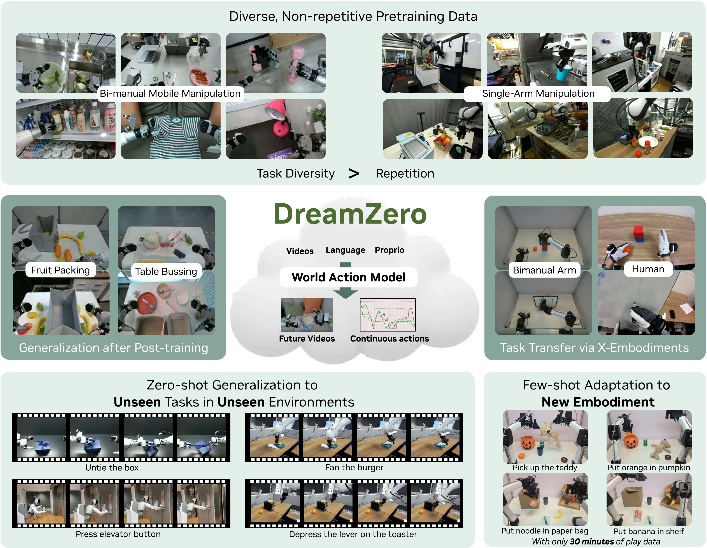{ width="920" }

*Figure 1。中心是视频与动作联合预测，四周是采用不同训练与评测条件的能力展示。*

标题里的 zero-shot 指经过机器人训练后，某些下游任务或场景可以直接执行，不需要为该次评测再收集目标机器人的任务示范。它不意味着没有机器人训练，也不意味着只给任意机器人看一段视频就能立刻控制。论文后面的纯视频跨本体补充训练，以及 30 分钟新机器人适配，分别改变了训练数据，必须与基础模型直接评测分开。

主要结果确实显示很强的泛化增益，但指标通常是 **Task Progress（任务进度）**。例如 AgiBot 未见任务的平均进度为 39.5%，高于预训练 π0.5 的 16.3%；这不等于 39.5% 的任务完整成功。DROID 未见任务另外报告 22.5% 完整成功率，而平均进度为 49%。这些区别决定了“零样本策略”目前能完成多少工作。[原文第 14 页](https://arxiv.org/pdf/2602.15922v1#page=14)

## 联合分布把视觉未来与动作联系起来，实际只训练一个模型

设 $o_{0:l}$ 为截至当前时刻 $l$ 的视觉观测，$q_l$ 为本体感知状态，$c$ 为语言指令，$H$ 为预测时域。原文 Eq. 1 将未来视频与动作的联合预测写成：

$$
\pi_0(o_{l:l+H},a_{l:l+H}\mid o_{0:l},c,q_l)
=
\pi_0(o_{l:l+H}\mid o_{0:l},c,q_l)
\pi_0(a_{l:l+H}\mid o_{0:l+H},q_l).
$$

左侧是 WAM 希望学习的整体策略。右侧第一个因子预测符合指令和当前场景的视觉未来；第二个因子是 **Inverse Dynamics Model，IDM（逆动力学模型）** 的角色，根据前后视觉变化和机器人状态确定对应动作。这个写法让语言目标可以通过视觉未来影响动作生成。[原文 Eq. 1，第 6 页](https://arxiv.org/pdf/2602.15922v1#page=6)

DreamZero 没有在部署时先完整运行一个视频网络，再把其输出交给另一张独立 IDM 网络。它采用一个端到端 DiT 联合去噪视频与动作，让两种模态在共享计算中互相约束。分解式用于解释学习问题；实现上，动作损失和视频损失都影响同一个生成骨干。模型也不需要在测试时枚举候选动作、逐一用前向动力学模拟、再做奖励搜索，动作块直接由条件生成过程产生。[原文第 7 页](https://arxiv.org/pdf/2602.15922v1#page=7)、[Appendix A，第 20 页](https://arxiv.org/pdf/2602.15922v1#page=20)

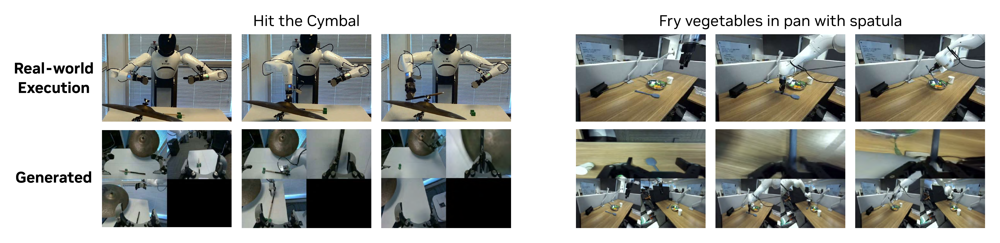{ width="920" }

*Figure 2。上排是真实执行，下排是模型生成的视觉未来。重点是动作与预测物体变化的对应，而非生成画面的视觉美观。*

击钹和炒菜示例呈现了视频与真实动作相近的运动过程。它们支持联合输出能够形成可执行对应，但这份对应本身并不保证任务正确。末尾的失败分析中，模型预测了错误的行为，机器人也忠实地执行了错误行为；视觉一致性因此是接口成立的一种证据，仍需和任务完成度一起评估。

## 模型接口怎样接入视频骨干

DreamZero 使用 **Wan2.1-I2V-14B-480P** 初始化视频骨干，新增状态编码器、动作编码器和动作解码器。对于多个相机视角，作者先把它们拼为一张图像，再交给视频模型，避免为多视角重新设计整套骨干。[原文第 7、11 页](https://arxiv.org/pdf/2602.15922v1#page=7)

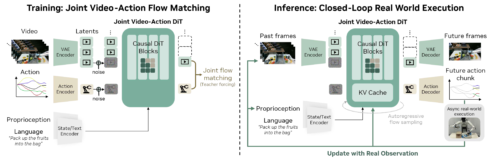{ width="920" }

*Figure 4。左侧同时监督视频与动作，右侧把实际执行后的观测送回历史缓存。*

| Component | Input / output | Training treatment |
|---|---|---|
| Text encoder | 指令变为语言条件 | Frozen |
| Image encoder and VAE | 图像条件、视频 latent 与视觉解码 | Frozen |
| State encoder | 本体状态编码 | Trainable |
| Action encoder / decoder | 归一化动作与动作 token 之间转换 | Trainable |
| Video DiT backbone | 根据观测、语言、状态联合预测视频和动作的速度场 | All DiT blocks updated |

冻结的编码器让原有视觉语言接口保持稳定，更新 DiT 与动作相关模块则使视频动态适应机器人的视角和动作空间。论文尝试过 LoRA，并报告结果不如所采用方案，但没有给出足以量化这一差距的表格。因此，公开结果对应的是完整更新 DiT 的训练路线，不能将其成本或效果直接归到轻量 LoRA 适配上。[原文第 11 页及脚注 7](https://arxiv.org/pdf/2602.15922v1#page=11)

动作表示默认使用 **relative joint positions（相对关节位置）**，训练前过滤 idle actions。视频未来可以跨本体提供行为线索，但动作编码和归一化仍必须对应当前机器人的数值定义。这解释了为什么跨本体纯视频能补充知识，却不能自动免除新机器人动作接口的学习。

## 联合 Flow Matching 的监督究竟约束了什么

### 一块内部共享噪声时刻，块与块之间独立采样

对于第 $k$ 块，$z_1^k$ 是干净视频 latent，$a_1^k$ 是归一化真实动作；$z_0^k$ 和 $a_0^k$ 是高斯噪声。原文使用线性路径构造带噪输入：

$$
z_{t_k}^k=t_kz_1^k+(1-t_k)z_0^k,\qquad
 a_{t_k}^k=t_ka_1^k+(1-t_k)a_0^k.
$$

因此 **$t=0$ 对应纯噪声，$t=1$ 对应干净样本**。主训练阶段，同一块内部的视频和动作共享 $t_k\sim\mathcal U(0,1)$，不同块独立采样。共享噪声水平使两种模态在训练初期较容易建立对应关系，后面的 Flash 阶段才主动改变这个条件。[原文 Eq. 2，第 7 页](https://arxiv.org/pdf/2602.15922v1#page=7)

网络要预测的是沿这条路径从噪声走向数据的联合速度：

$$
v^k=[z_1^k-z_0^k,\ a_1^k-a_0^k].
$$

它与机器人机械运动的速度不是同一个概念。这是生成空间中的变化方向，包含视频 latent 分量与动作分量；最终动作仍按训练时的关节表示解码。

将原文 Eq. 3 的求和块数统一记为 $M$，以避免与每块 latent 帧数的符号混用，训练目标为：

$$
\mathcal L(\theta)=\mathbb E_{z,a,\{t_k\}}
\left[
\frac{1}{M}\sum_{k=1}^{M}w(t_k)
\left\|u_\theta([z_{t_k}^k,a_{t_k}^k];\mathcal C_k,c,q_k,t_k)-v^k\right\|^2
\right].
$$

$u_\theta$ 预测联合速度，$q_k$ 提供当前块的机器人状态，$\mathcal C_k$ 是干净历史上下文，$w(t_k)>0$ 是预先设定的噪声权重函数。论文没有在这里给出它的具体函数形状，不能另补一个常用扩散权重充当本文配置。关键结构是视频误差与动作误差共同训练生成过程，使未来场景与可执行控制同时受监督。[原文 Eq. 3，第 7–8 页](https://arxiv.org/pdf/2602.15922v1#page=7)

### Teacher forcing 的历史可见性由注意力掩码决定

训练时，当前带噪块以此前干净块为条件，这就是 **Teacher Forcing（教师强制）**。但不能仅根据公式中的“历史上下文”一词，推断模型会读取任意过去动作。原文形式化地将 $\mathcal C_k$ 写成干净视频和动作的历史集合，实际跨块访问则必须结合 Figure 14 的掩码理解。

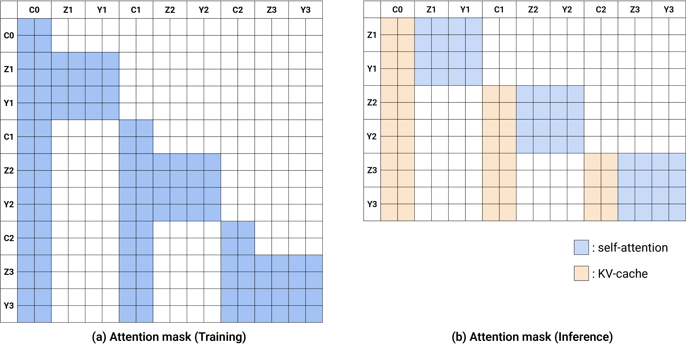{ width="860" }

*Figure 14。纵轴是 Query，横轴是 Key/Value。$C_i$ 是干净条件画面，$Z_i$ 和 $Y_i$ 分别是待生成视频与动作。*

例如 $Y_3$ 可以访问 $C_0,C_1,C_2$，并与当前块的 $Z_3,Y_3$ 交换信息；它不需要把过去预测的 $Y_1,Y_2$ 当成动作历史继续自回归。训练图中保留干净条件路径，推理图中把对应的历史条件编码为 KV cache。**跨块延续的是视觉历史，当前块内部联合生成视频与动作。** 这与把所有过去动作预测不断接回模型的策略有不同的误差传播方式。[Appendix C，第 21 页](https://arxiv.org/pdf/2602.15922v1#page=21)

## 为什么采用自回归视频，以及怎样让时间轴真正对齐

### 长指令和短动作块之间存在时间尺度差异

附录用“把黑色物体放进抽屉并关上抽屉”解释双向视频生成的困难。长指令描述多个阶段，固定长度视频块却可能只覆盖其中一小段；如果为了包含完整任务而对整段视频稀疏采样，采样点之间的物理时间又发生变化。对于机器人，未来动作不能随意忽略这种变化，因为动作采样频率决定每一步应在什么时候执行。[Appendix B，第 20–21 页](https://arxiv.org/pdf/2602.15922v1#page=20)

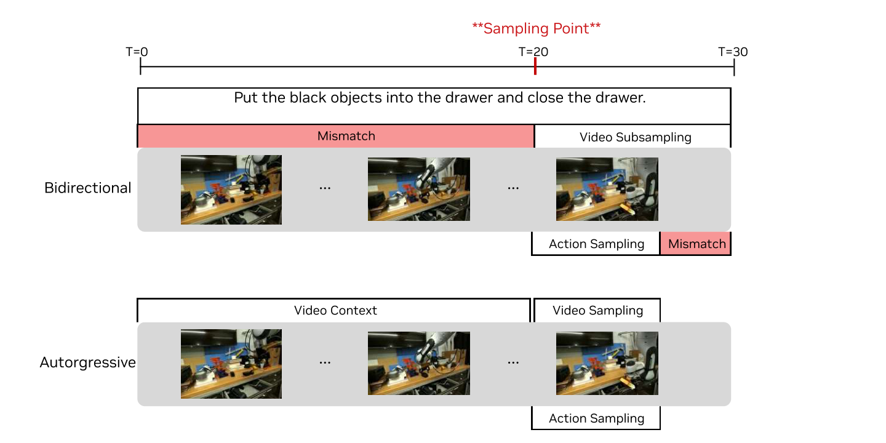{ width="920" }

*Figure 13。中途采样点位于 $T=20$，上方双向方案为覆盖任务区间改变视频采样，下方自回归方案用历史上下文说明已经发生的过程。*

自回归方式将已经发生的部分留在条件历史里，当前块按固定时间尺度预测下一段，不必每次把整条长指令对应的全部过程塞进一个固定视频窗口。论文把这称为保留 native frame rate；具体实现仍以 **5 FPS** 采样视频，因此应理解为避免随任务区间伸缩的额外时间扭曲，而不是完全不对原始摄像头视频降采样。

### 视频频率、动作频率与缓存长度分别是什么

| Setting | Video sampling | Action frequency | Action horizon | Time per chunk |
|---|---:|---:|---:|---:|
| AgiBot G1 | 5 FPS | 30 Hz | 48 | 1.6 s |
| DROID-Franka | 5 FPS | 15 Hz | 24 | 1.6 s |

每块有 **2 个 latent frames**，默认训练序列包含 **4 个 chunks**，较短轨迹可以用更少块。最大视觉上下文为 8 个 latent frames，对应 33 个原始采样帧，即约 **6.6 秒**；讨论部分将其概括为约 6 秒。动作的 48/24 步与视频 latent 的 2 帧在时间跨度上相配，不能只看 token 数量判断对齐。[Appendix C，第 21 页](https://arxiv.org/pdf/2602.15922v1#page=21)

### 下一块使用实际画面，避免把想象当成已发生事实

推理首先编码初始真实观测并准备历史 KV cache，然后从视频和动作噪声开始联合去噪。动作块解码和滤波后交给机器人执行；控制过程获得新的真实图像与本体状态，再把真实图像编码进缓存，丢弃这一次生成的视频 latent。下一次动作预测因而依据实际结果继续，而非沿着自己预测的画面无限展开。[Algorithm 2，第 22 页](https://arxiv.org/pdf/2602.15922v1#page=22)

例如，生成视频预测抓取已经成功，但机器人实际上没有夹住物体，下一次真实观测仍显示物体留在桌面。真实观测回填可以阻止“已经拿起”的错误想象持续污染后续视觉历史。这是闭环接口的作用，不代表所有错误都被消除：已经执行的碰撞或错误放置无法由缓存更新撤销，策略也可能在正确观测下再次作出错误判断。

实现时还需注意原文伪代码的时间记号。Algorithm 2 把干净上下文 prefill 标为 `t=0`，而 Eq. 2 中生成路径的干净端是 $t=1$。论文没有进一步解释这是专用条件路径约定还是记号不一致。可靠的概念结论是“缓存真实、干净的观测”；复现时则需要核对条件编码路径，不能仅把伪代码这一标号当成全局噪声定义。

这个缓存允许使用近期视觉历史，但作者明确没有专门评测或后训练那些只能依靠记忆才能成功的任务。6.6 秒上下文证明模型有历史输入接口，尚不能代替长期记忆任务上的能力验证。[原文第 8 页脚注 2](https://arxiv.org/pdf/2602.15922v1#page=8)、[第 18 页](https://arxiv.org/pdf/2602.15922v1#page=18)

## 多样数据怎样被真正采集出来

AgiBot 训练集约 **500 小时**，来自 **22 个环境、7,193 条 episode**，平均每条 **4.4 分钟、42.4 个子任务**。环境包括家庭、餐厅、超市、咖啡店、办公室等，任务同时包含搬运、整理、擦拭以及不同高度的操作。这里的多样性不只是一项结果描述，附录给出了具体的采集制度。[原文第 10–11 页](https://arxiv.org/pdf/2602.15922v1#page=10)、[Appendix E，第 24–25 页](https://arxiv.org/pdf/2602.15922v1#page=24)

遥操作者每天从区域任务单上选择三个粗粒度任务连续执行，每个任务通常需要一到两分钟。例如一次 episode 可以先清走餐具，再擦桌子，最后整理调料。当天结束后记录任务次数，某个任务累计出现在 **50 个 episode** 中就从任务单移除，并鼓励操作者提出新任务。这个机制使采集不断扩展到新的有用行为，而不会长期围绕少数固定物体位置重复。

因此，“non-repetitive”并非同一行为绝不出现第二次。它描述的是相对于大量同任务重复示范的采集策略：有意限制单一粗任务的重复次数，增加环境、物体、阶段过渡和状态动作对应的覆盖。三项粗任务与平均 42.4 个子任务也属于不同粒度，不能直接相减或视为标签冲突。

| Training setting | AgiBot | DROID |
|---|---|---|
| Embodiment | AgiBot G1 mobile bimanual robot | Franka single-arm robot |
| Data | 约 500 h，自采多样遥操作 | DROID |
| Initialization | Wan2.1-I2V-14B-480P | Wan2.1-I2V-14B-480P |
| Steps | 100K | 100K |
| Global batch size | 128 | 128 |
| Default action representation | Relative joint positions | Relative joint positions |
| Training relation | 独立预训练 | 独立预训练 |

论文没有用一个模型同时在 AgiBot 与 DROID 上做多本体预训练；它把这留作后续方向。比较的 VLA 包括 GR00T N1.6 和 π0.5，各有两种初始化。`Scratch` 从预训练 VLM 权重开始、此前没有机器人训练，`Pretrained` 从已有跨机器人 checkpoint 开始，再在与 DreamZero 相同的数据上继续训练。DreamZero 的 `Scratch` 同样已有大规模视频预训练，不能理解成所有权重随机初始化。[原文第 10–11 页](https://arxiv.org/pdf/2602.15922v1#page=10)

作者通过相同 batch size 和梯度步数控制后续训练预算。这个控制便于比较相同机器人数据和更新次数下的学习结果，但不等价于相同 FLOPs、GPU 小时或相同基础模型预训练成本。14B 视频骨干的算力负担仍是实际成本，论文没有提供足以换算完整训练费用的硬件时长与优化器配置。

## 泛化实验先固定“未见”的含义，再看分数

### 两套机器人协议与两种结果指标

AgiBot 以“运动方式加物体类型”划分任务。例如训练时折红衬衫，评测时折颜色、尺寸不同的衬衫，仍属于 seen task；折袜子因所需运动不同，被用作 unseen task 的说明。评测地点与采集地点不同，默认还包含未见环境和对象，因此 seen task 也要面对场景迁移。[原文第 11–12 页](https://arxiv.org/pdf/2602.15922v1#page=11)

| Evaluation | Task count | Rollouts | What changes |
|---|---:|---:|---|
| AgiBot seen | 10 | 8/task，共 80 | 已见任务类别，新环境和对象 |
| AgiBot unseen | 10 | 8/task，共 80 | 新任务类别，同时有场景变化 |
| DROID seen | 20 | 2/task，共 40 | 已见任务，改变对象位置 |
| DROID unseen verbs | 20 | 2/task，共 40 | 按 DROID 中未出现的动词选择指令 |

AgiBot 每个任务在四台机器人上各跑两次。DROID 在不同 checkpoint 之间固定物体位置以便比较，每次 rollout 根据部分完成程度给 0 到 1 的分数。其 Task Progress 与完整完成的 Success Rate 分别报告，两者不能混用。

DROID 的划分还存在一项具体边界。附录 seen 列表包含“Push the lever on the bread toaster downwards”，unseen verbs 列表又包含“Depress the lever on the toaster”。两个动词不同，但物理操作明显相近。因此，DROID 结果支持未见动词条件下的指令与任务泛化，却不能据此断言测试集每项都要求训练中从未出现过的物理运动。这一例子也不否定其他任务的难度，只是限定“新技能”的解释范围。[Appendix G，第 28 页](https://arxiv.org/pdf/2602.15922v1#page=28)

### 已见任务在新环境中，主要增益来自哪里

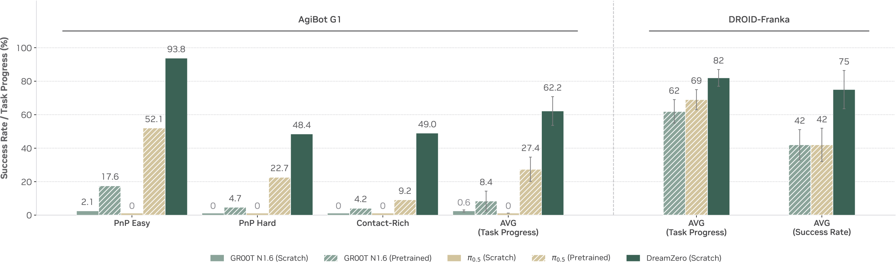{ width="920" }

*Figure 8。AgiBot 左侧按任务类别分组，DROID 右侧分别列任务进度与完整成功率。*

| Model | AgiBot PnP Easy | AgiBot PnP Hard | AgiBot Contact-Rich | AgiBot AVG Task Progress |
|---|---:|---:|---:|---:|
| GR00T N1.6 (Pretrained) | 17.6 | 4.7 | 4.2 | 8.4 |
| π0.5 (Pretrained) | 52.1 | 22.7 | 9.2 | 27.4 |
| DreamZero | 93.8 | 48.4 | 49.0 | 62.2 |

单位均为百分比，列值按原图。DreamZero 的平均任务进度比预训练 π0.5 高 **34.8 个百分点**，比值约 **2.27 倍**。简单拾放已经接近满分，而困难拾放和接触丰富任务约在一半，表明广泛泛化并未消除精细操作难度。`Scratch` VLA 在相同异质机器人数据下接近零分，是这个设置中的学习失败，不能扩写成所有 VLA 都无法学习机器人控制。[原文 Figure 8，第 13 页](https://arxiv.org/pdf/2602.15922v1#page=13)

DROID seen 结果同样改善，但幅度不同：DreamZero 的任务进度为 **82**，π0.5 为 **69**，GR00T 为 **62**；完整成功率原图标为 **75、42、42**。这里任务进度相对 π0.5 约为 1.19 倍，已经说明不能把 AgiBot 的“超过两倍”无条件推广到每个机器人和每个指标。

### 未见任务有真实进展，也有明显薄弱项

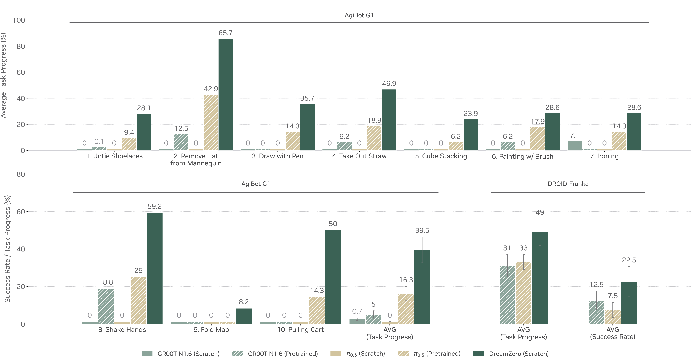{ width="920" }

*Figure 9。AgiBot 按任务展示进度，DROID 在右下角区分 Task Progress 与 Success Rate。*

| Benchmark / metric | GR00T N1.6 (Pretrained) | π0.5 (Pretrained) | DreamZero |
|---|---:|---:|---:|
| AgiBot unseen Task Progress (%) | 5.0 | 16.3 | 39.5 |
| DROID unseen Task Progress (%) | 31.0 | 33.0 | 49.0 |
| DROID unseen Success Rate (%) | 12.5 | 7.5 | 22.5 |

AgiBot 的进度比值约为 **39.5/16.3 = 2.42 倍**，DROID 则约为 **49/33 = 1.48 倍**。DROID 完整成功率从 π0.5 的 7.5% 提高到 22.5%，确实是三倍，但绝对值仍低于四分之一。把这些数值分别写清楚，比笼统的“泛化翻倍”更能说明策略的实际能力。[原文第 14 页](https://arxiv.org/pdf/2602.15922v1#page=14)

AgiBot 内部差异也很大。取下人偶帽子为 **85.7%**，握手为 **59.2%**，拉推车为 **50.0%**；解鞋带为 **28.1%**，立方体堆叠为 **23.9%**，折地图仅 **8.2%**。任务进度非零意味着模型能在某些阶段作出有效操作，却不能将一个局部成功片段等同于整个长动作链完成。

论文还展示了超过一百项自由指令测试。这些 rollout 扩展了可观察行为的范围，但不是与上述固定任务、固定次数相同的统一成功率统计。作者观察到部分 VLA 不论指令仍倾向于接近和抓取物体，这有助于解释部分进度的来源；它仍属于该评测中的行为观察，而非对所有 VLA 泛化机制的完整归因。

## 任务微调保留了多少新环境能力

后训练使用 AgiBot 的三项任务，各自训练 50K steps，测试时仍改变环境、桌面高度与距离、物体和摆放位置。作者通过初始画面 overlay 尽量降低摆放差异，每项测试十次。[原文第 12–13 页](https://arxiv.org/pdf/2602.15922v1#page=12)

| Task | Data | Progress definition | π0.5 (Pretrained) | DreamZero |
|---|---:|---|---:|---:|
| Shirt Folding | 33 h | 完成五个折叠阶段的比例 | 92.5 | 92.5 |
| Fruit Packing | 12 h | 十个水果成功装袋的比例 | 71.0 | 96.0 |
| Table Bussing | 40 h | 五件垃圾与五件餐具被清走的进度 | 76.0 | 83.0 |
| Average | — | 三项平均 Task Progress (%) | 79.8 | 90.5 |

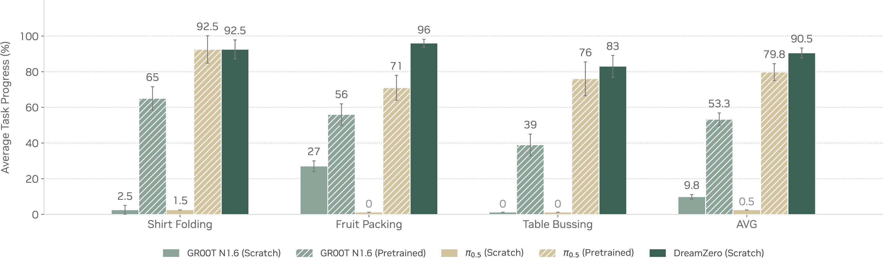{ width="920" }

*Figure 10。各任务都在微调后继续测试场景变化，不能只理解成对训练摆放的记忆。*

平均值提高 **10.7 个百分点**，但优势不均匀。衬衫折叠与 π0.5 持平，果盘整理高 25 个百分点，清理餐桌高 7 个百分点。结果支持视频先验在任务微调后仍可用于新环境，尤其在该组果盘任务中收益明显；三项任务和每项十次测试还不足以确定所有精细操作都会获得相近改善。[原文第 15 页](https://arxiv.org/pdf/2602.15922v1#page=15)

## 两种跨本体实验改变的是不同的东西

### 给原来的机器人补充其他本体的视频经验

第一种迁移保持目标机器人为 AgiBot，只增加人类或 YAM 机器人完成目标任务的纯视频。新增数据没有动作标签，因此只使用视频预测目标；原 AgiBot 数据仍使用视频与动作的联合目标，维持原有控制接口。[原文第 15 页](https://arxiv.org/pdf/2602.15922v1#page=15)

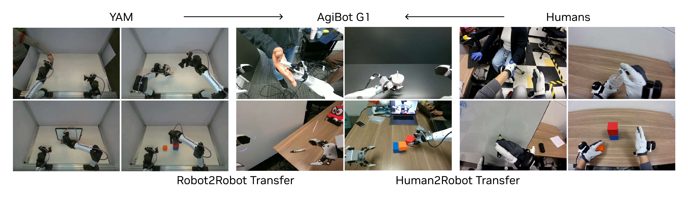{ width="920" }

*Figure 11。箭头终点仍然是 AgiBot，变化的是额外视觉经验的提供者。*

两个设置各采集 **72 条多视角轨迹，9 个任务、每任务 8 条**。YAM 视频约 20 分钟，人类第一视角视频约 12 分钟；因为 YAM 采集设置无法方便地遥操作拉推车，排除了该任务。新增数据与原预训练数据按 **1∶1** 混合，从 DreamZero-AgiBot 继续训练 **10K steps**。[原文第 16 页](https://arxiv.org/pdf/2602.15922v1#page=16)

| Method | Task Progress |
|---|---:|
| DreamZero | 38.3% ± 7.6% |
| DreamZero + Human2Robot Transfer | 54.3% ± 10.4% |
| DreamZero + Robot2Robot Transfer | 55.4% ± 9.5% |

这是 Table 2 的九任务均值，误差为 **standard error（标准误）**。基线 38.3% 与此前十任务的 39.5% 不同，不能交叉相减。人类视频提高 **16.0 个百分点**，YAM 视频提高 **17.1 个百分点**；换成相对增益约为 **41.8%** 和 **44.6%**。摘要所说的约 42% 级别改善是相对量，不是提高 42 个百分点。

这个实验最有价值的证据是，目标机器人可以从没有对应动作标签的额外视频中受益。它仍经过目标任务视频的补充训练，原有机器人动作数据也没有被移除。因此，它支持“视频可以承担一部分新任务学习”，没有证明完全没有机器人动作训练也能控制本体，更没有把实验室里的 12 分钟人类示范扩展成大规模野外视频迁移的既成结果。

### 将策略真正搬到一台新机器人上

第二种实验才改变执行本体。作者从 DreamZero-AgiBot 出发，使用 YAM 的 **55 条轨迹、11 个任务、约 30 分钟 play data** 做后训练，再展示对南瓜、玩具熊、杯面、纸袋等新物体的拾放和语言跟随。[原文第 16–17 页](https://arxiv.org/pdf/2602.15922v1#page=16)

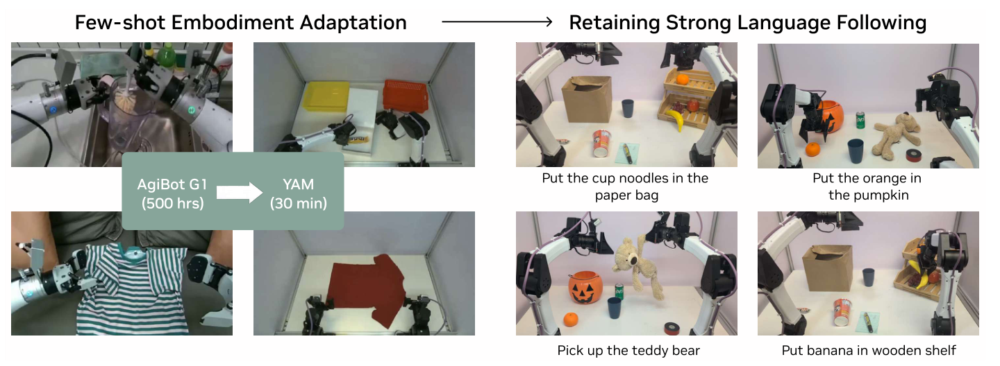{ width="960" }

*Figure 12。左侧标出 AgiBot 预训练与 YAM 适配数据量，右侧是新物体和指令实例。*

| Transfer setting | 执行机器人是否改变 | 新增监督 | 可以直接支持的判断 |
|---|---|---|---|
| Human2Robot / Robot2Robot video transfer | 否，仍为 AgiBot | 其他本体视频，无动作标签 | 额外视觉经验改善九任务进度 |
| Few-shot YAM adaptation | 是，AgiBot → YAM | 新机器人 play trajectories | 少量适配后可展示新物体拾放与语言跟随 |

YAM 实验使用 11 条全局任务语言标注，未提供与 Table 2 相同形式的系统成功率表。作者提出，两者都是双臂平行夹爪，视觉形态相近，以及隐式逆动力学的学习较省数据，可能解释这种适配效率。这些是有依据的假设，不能直接推广到任意高自由度机器人或不同末端执行器。

## 5.7 秒生成时间怎样压进持续控制的预算

### 异步执行先改变等待关系

朴素 DreamZero 需要约 **5.7 秒**生成一块动作，而 AgiBot 的 48 步动作以 30 Hz 执行，只覆盖 **1.6 秒**。如果机器人每次都停下来等待下一块预测，动作之间会出现明显停顿；如果一直执行旧预测，观测又会迅速过时。只让模型生成动作、不生成视频，在这个 14B 设置中也没有带来很大速度收益，作者认为主要开销仍在 DiT 层数和反复去噪。[原文第 8 页及脚注 3](https://arxiv.org/pdf/2602.15922v1#page=8)

异步执行让控制器和模型同时工作。控制器执行当前时间戳上最近可用的动作，模型用最新观测生成新块；新结果准备好后进入后续执行。预算因此从“等推理完成才能运动”变成“新块应在当前可执行时域耗尽前到达”。但仅低于 1.6 秒还不等于反应足够快，作者把目标延迟设在约 **200 ms 以下**，以留出平滑衔接和对场景变化反应的余量。[原文第 8 页](https://arxiv.org/pdf/2602.15922v1#page=8)、[Appendix D.1，第 23 页](https://arxiv.org/pdf/2602.15922v1#page=23)

### 两类缓存解决不同的重复计算

**历史 KV cache** 保存真实条件帧经过模型后的表示，避免每块重复计算全部过去视觉上下文。**DiT velocity cache** 则发生在同一块的迭代去噪中：比较相邻速度预测的余弦相似度，方向足够一致时，在后续少数步骤复用缓存速度，跳过昂贵的 DiT 前向。后者让平均实际 DiT 计算从约 16 次降到 4 次，阈值没有在文中具体给出。[原文第 8 页](https://arxiv.org/pdf/2602.15922v1#page=8)、[第 23 页](https://arxiv.org/pdf/2602.15922v1#page=23)

复用速度仍沿去噪日程更新变量，与直接把采样步数改成一次是不同优化。缓存使用近似，是否仍保留动作质量需要评测；真实观测回填则改变下一块的条件来源，二者不应被统称为一种“缓存加速”。

### 38 倍来自完整计算栈，表中数字不能再相乘

CFG 需要 conditional 与 unconditional 两次估计，作者将其分到两张 GPU 并行运行，单步延迟下降约 47%。随后通过 `torch.compile`、CUDA Graphs、cuDNN attention 和 GPU 侧 scheduler 减少 Python、kernel launch 及 CPU–GPU 同步开销。编译覆盖 DiT、scheduler、text encoder、image encoder 和 VAE；静态形状使第一条轨迹因缓存形状变化产生编译，之后复用执行图。[Appendix D，第 22–23 页](https://arxiv.org/pdf/2602.15922v1#page=23)

| Optimization | H100 | GB200 |
|---|---:|---:|
| Baseline | 1× | 1.1× |
| + CFG Parallelism | 1.9× | 1.8× |
| + DiT Caching | 5.5× | 5.4× |
| + Torch Compile + CUDA Graphs | 8.9× | 10.9× |
| + Kernel & Scheduler Opts. | 9.6× | 14.8× |
| + Quantization (NVFP4) | — | 16.6× |
| + DreamZero-Flash | — | 38× |

Table 1 每一行已经包含此前优化，是累计加速比。38× 对应从约 5.7 秒到约 150 ms；不能把 1.8、5.4、10.9 等再相乘，也不能把 GB200 的最后两项直接赋给 H100。[原文 Table 1，第 10 页](https://arxiv.org/pdf/2602.15922v1#page=10)

量化采用混合精度。Blackwell 上权重和激活使用 NVFP4，敏感的 QKV projection 和 Softmax 保持 FP8，LayerNorm、RoPE 等非线性操作使用 FP16 累加。它不是所有计算都统一降到 4 bit。作者还将 KV cache 显式作为编译函数的输入和输出，以减少状态副作用引发的图断裂；原本放在 CPU 的调度运算迁到 GPU，避免反复同步。[Appendix D.2，第 23 页](https://arxiv.org/pdf/2602.15922v1#page=23)

最终约 **7 Hz** 的模型动作块更新运行在 **两张 GB200** 上。AgiBot 内部仍以 **30 Hz** 执行动作，DROID 的动作频率为 **15 Hz**。块更新、动作频率、动作块长度分别描述模型反应、控制执行和预测时域，不能相乘后当成新视觉决策频率。作者也承认，与能在消费级 GPU 上高频运行的 VLA 相比，这个部署成本仍然很高。[原文第 18 页](https://arxiv.org/pdf/2602.15922v1#page=18)

## Flash 为什么故意让视频保持更嘈杂

### 同噪声训练与极少步推理之间出现条件错配

主模型训练时视频和动作共享噪声时刻，模型经常在两者都已经较清晰时预测后续速度。但在单步或极少步推理中，视频 token 可能仍不准确，动作却已经需要变成可执行数值。直接减少步数，会把残留视觉噪声带进动作预测。Flash 因而在主模型训练之后增加一个阶段，主动让动作生成面对更高噪声的视频条件。[原文第 9 页](https://arxiv.org/pdf/2602.15922v1#page=9)

主模型的采样为：

$$
t_k^{\mathrm{video}}=t_k^{\mathrm{action}}=t_k,
\qquad t_k\sim\mathcal U(0,1).
$$

Flash 使用：

$$
t_k^{\mathrm{video}}=1-\eta,\qquad
\eta\sim\operatorname{Beta}(7,1),\qquad
 t_k^{\mathrm{action}}\sim\mathcal U(0,1).
$$

由于 $\mathbb E[\eta]=7/8$，所以：

$$
\mathbb E[t_k^{\mathrm{video}}]=1-\frac78=0.125.
$$

这里 $t$ 越小越接近噪声，因此视频更多落在高噪声状态；动作仍覆盖均匀的噪声阶段。两种模态分别代入各自的插值式，模型就会见到“动作需要较清楚，但当前生成视频仍然嘈杂”的训练条件。[原文 Eq. 4–6，第 23–24 页](https://arxiv.org/pdf/2602.15922v1#page=24)

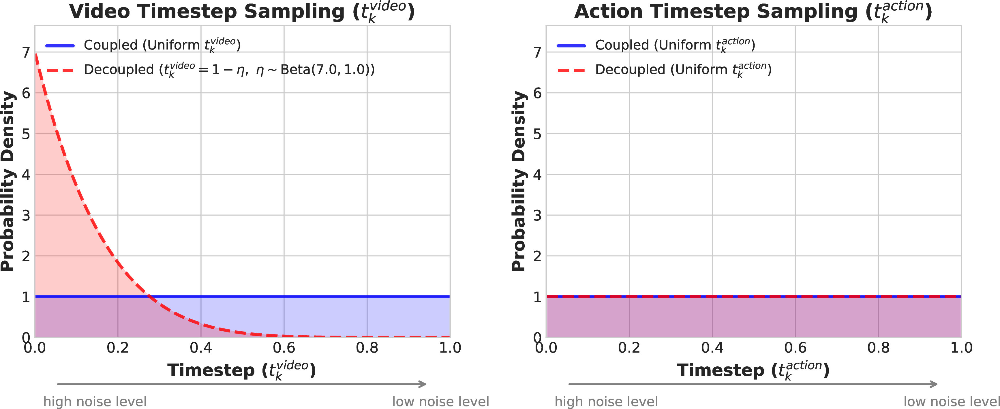{ width="860" }

*Figure 5。左图红色密度集中在接近 0 的高噪声端，右图动作分布仍均匀。判断方向时必须连同横轴噪声含义一起读。*

原文存在一处会影响复现的写法差异：Algorithm 1 第 13 行直接写 $t^{\mathrm{vid}}\sim\operatorname{Beta}(7,1)$，省略了正文和 Eq. 5 的 $1-\eta$ 变换。按 Eq. 2 的时间方向，这会把视频偏向低噪声，与 Figure 5 和主文解释相反。上面的机制解释采用正文、分布图和 Eq. 5 一致的高噪声方案；实现时需要核对实际采样代码，不能只抄这行伪代码。[Algorithm 1，第 22 页](https://arxiv.org/pdf/2602.15922v1#page=22)

Flash 减弱的是动作对“当前生成视频已经充分去噪”的依赖。真实观测仍然作为干净条件，视频 token 和联合骨干也仍然存在；它没有把视觉输入删除，也没有把模型变成单独的轻量动作网络。

### 单步恢复了一部分性能，但存在明确的速度代价交换

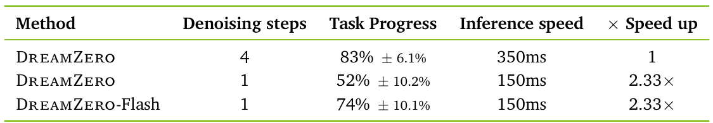{ width="920" }

| Method | Denoising steps | Task Progress | Inference speed | × Speed up |
|---|---:|---:|---:|---:|
| DreamZero | 4 | 83% ± 6.1% | 350 ms | 1 |
| DreamZero | 1 | 52% ± 10.2% | 150 ms | 2.33× |
| DreamZero-Flash | 1 | 74% ± 10.1% | 150 ms | 2.33× |

Table 3 的误差为标准误。直接改成单步，进度下降 **31 个百分点**；Flash 在相同 150 ms 下收回 **22 个百分点**，仍比四步模型低 **9 个百分点**。因此，这项结果是改善极少步推理的速度与效果折中，不能支持所有优化都“没有性能损失”的笼统结论。原文附近段落将 74% 称为 success rate，但表头和图注都明确是 Task Progress，应按表格口径理解。[原文第 17 页](https://arxiv.org/pdf/2602.15922v1#page=17)

此外，真实执行还包含动作平滑：先用三次插值将动作块上采样到两倍分辨率，再应用 **Savitzky–Golay filter，window size 21、polynomial order 3**，最后下采样回原分辨率。这意味着机器人执行的轨迹已经过后处理；评价动作平滑度时，应把模型生成与该滤波环节一起考虑。[Appendix D.3，第 24 页](https://arxiv.org/pdf/2602.15922v1#page=24)

## 受控消融把数据、模型规模和架构分开比较

主结果同时改变了基础模型、监督形式和数据使用方式，Table 4 进一步固定 **50K steps、batch size 32**，只在 **PnP Easy** 上做消融。这一预算比主模型的 100K、128 小，因此不能将表中的 50% 与主实验的 93.8% 当成同设置重复测量。[原文第 17–18 页](https://arxiv.org/pdf/2602.15922v1#page=17)

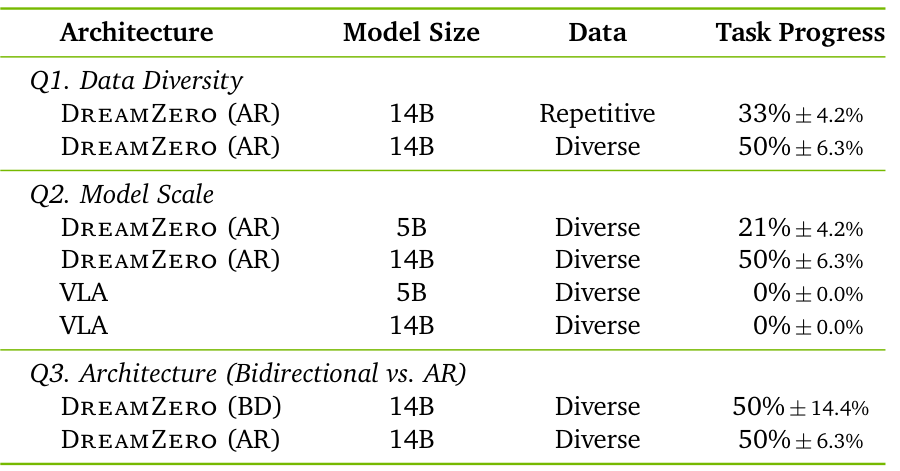{ width="880" }

| Comparison | Architecture | Model Size | Data | Task Progress |
|---|---|---:|---|---:|
| Data Diversity | DreamZero (AR) | 14B | Repetitive | 33% ± 4.2% |
| Data Diversity | DreamZero (AR) | 14B | Diverse | 50% ± 6.3% |
| Model Scale | DreamZero (AR) | 5B | Diverse | 21% ± 4.2% |
| Model Scale | DreamZero (AR) | 14B | Diverse | 50% ± 6.3% |
| Model Scale | VLA | 5B | Diverse | 0% ± 0.0% |
| Model Scale | VLA | 14B | Diverse | 0% ± 0.0% |
| Architecture | DreamZero (BD) | 14B | Diverse | 50% ± 14.4% |
| Architecture | DreamZero (AR) | 14B | Diverse | 50% ± 6.3% |

**数据多样性比较保持总小时数相同。** 两组都是 500 小时，重复组包含 70 个任务、相似物体位置和配置下的大量示范，多样组高 17 个百分点。它支持在这套 WAM 与预算下，增加状态动作覆盖比继续重复固定配置更有利。作者用“视频先验已经提供部分动态知识，机器人数据应补足更多逆动力学对应”解释结果，这是机制假设，实验并没有直接测量一个独立 IDM 的误差。

**14B 比 5B 更好，但尚未建立 scaling law。** 同一多样数据设置中，进度从 21% 到 50%；作者观察到小模型更容易产生视觉幻觉并带来动作错误。匹配规模的 VLA 对照来自 8B/32B VLM 的前半 Transformer blocks，并附加 DiT 动作模块，得到表中的 5B/14B 系统，两者在该消融上都为零。这个控制说明单纯增大这类 VLA 对照不能复现收益，但不能替代跨数据量、计算量和更多模型规模的系统缩放研究。[原文第 18 页](https://arxiv.org/pdf/2602.15922v1#page=18)

**AR 与 BD 的平均任务进度相同。** 两者都是 50%，不同的是误差条、作者观察到的运动平滑度，以及 AR 借助缓存获得的约 3–4 倍推理速度。自回归架构因此有明确的工程与时序动机，但这张表没有证明它在平均任务进度上优于双向模型。把架构设计的合理性与消融实际测得的量分开，可以避免把相同均值写成性能胜出。

## 联合预测失败时，视觉与动作可能一起走错

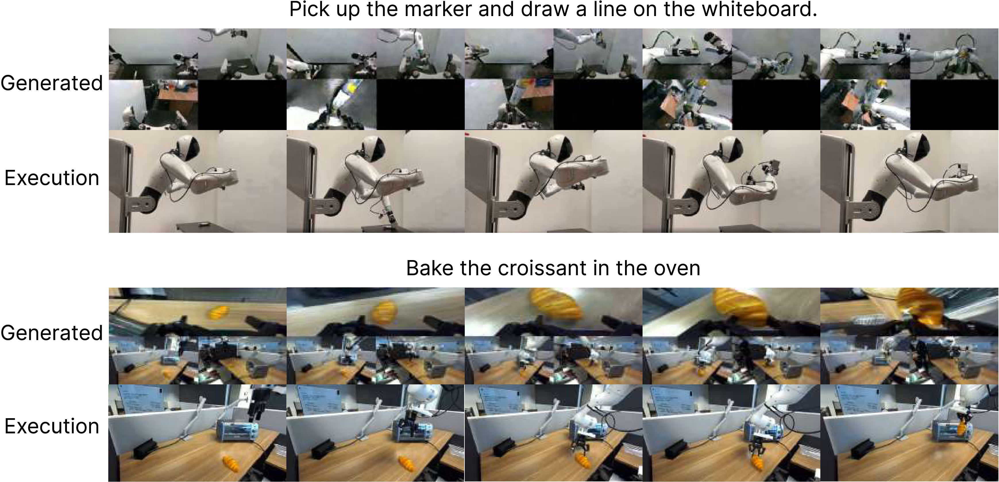{ width="920" }

*Figure 16。每组先看 Generated，再看 Execution，检查机器人究竟执行了哪一个视觉计划。*

第一个任务要求拿起记号笔在白板上画线。生成视频却显示左臂拿笔后递给右臂，真实执行也发生了换手，未完成绘画。第二个任务要求把可颂放进烤箱，生成视频先拿起面包而没有先开烤箱，真实机器人随后拿着面包到达烤箱前陷入停滞。[Appendix H，第 28–29 页](https://arxiv.org/pdf/2602.15922v1#page=28)

这些例子揭示了联合建模的双面性。视觉未来与动作高度一致，可以让动作执行来自视频先验的复杂行为；当未来本身违反指令或遗漏前置条件时，一致性也会把错误带到控制中。作者据此认为许多失败源于视频生成，但展示的案例没有给出完整失败分类统计，也没有通过只替换视觉计划的干预实验隔离因果关系。因此，“改善视频生成可能改善控制”是值得检验的研究方向，尚不能被写成充分条件。

实际边界还包括亚厘米精度任务、短视觉历史和高计算成本。作者指出钥匙插入、精细装配等仍难，多样化预训练未必包含足够密集的精细动作示范；人类视频迁移只用了少量实验室数据；新本体适配也主要发生在形态相近的双臂夹爪之间。[原文第 18–19 页](https://arxiv.org/pdf/2602.15922v1#page=18)

DreamZero 最值得复用的是一条完整的工作链：让视频与动作共同受监督，用真实观测维护短期上下文，让多样机器人数据补充动作对应，再把整个生成过程压进闭环执行预算。评估这条路线时，应同时检查预测未来是否符合任务、实际动作是否完成相应变化、反馈是否及时，以及新环境与新任务究竟改变了哪些因素。这样才能看清视频先验的收益，也能定位“看起来合理的未来”离可靠机器人控制还有多远。
