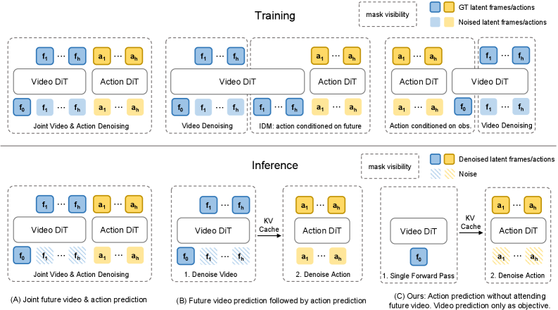
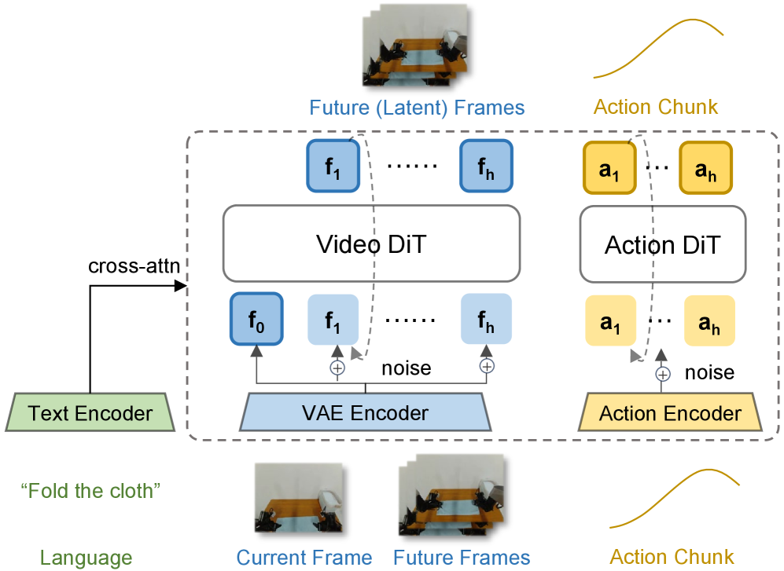
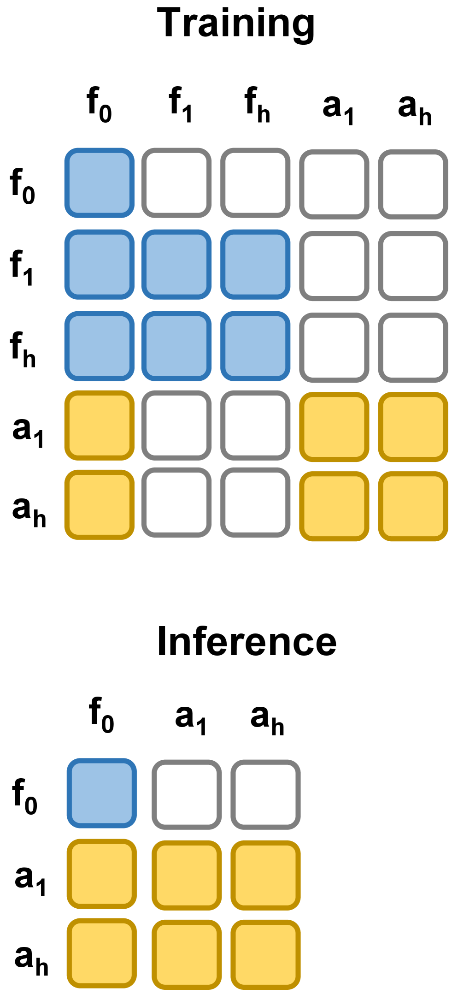
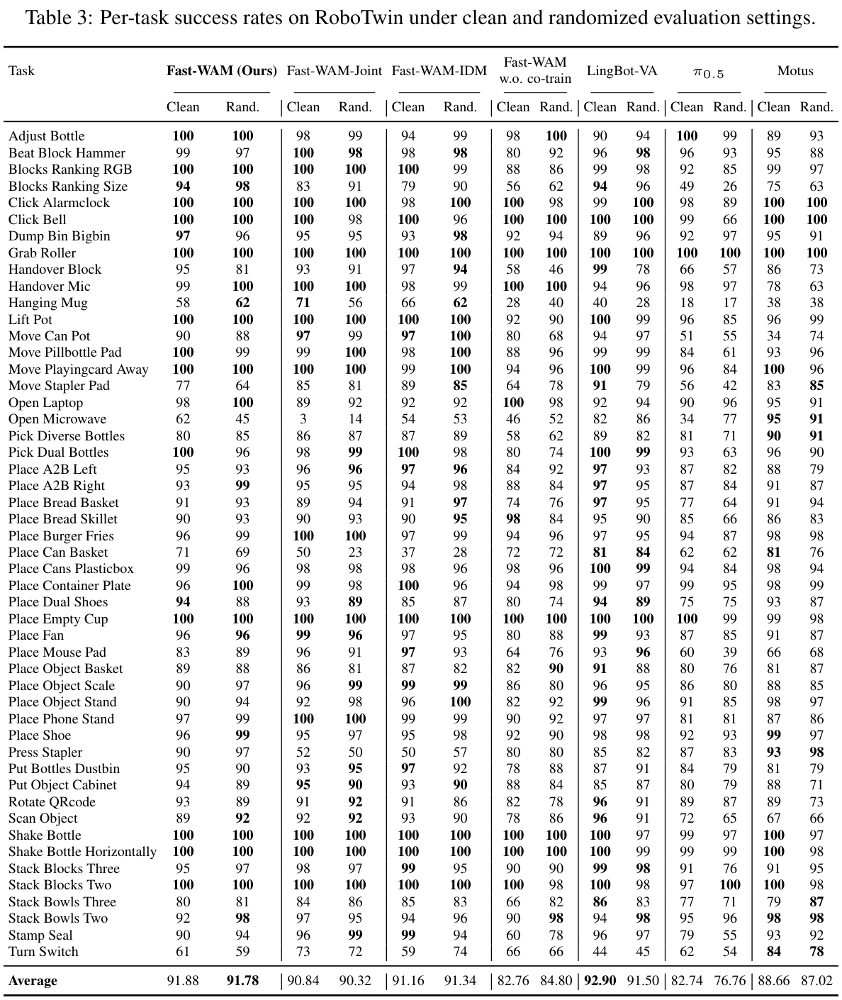
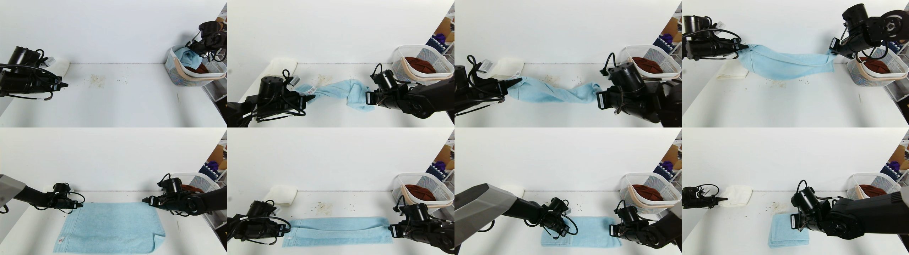
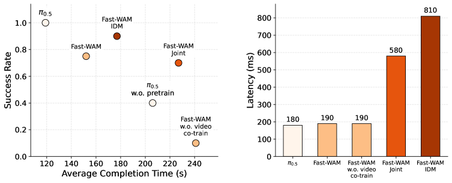

# Fast-WAM：WAM 一定要推理时想象未来吗

!!! info "论文信息"
    **论文题名：** Fast-WAM: Do World Action Models Need Test-time Future Imagination?。 
    **作者：** Tianyuan Yuan、Zibin Dong、Yicheng Liu、Hang Zhao。 
    **机构：** IIIS, Tsinghua University；Galaxea AI。 
    **时间 / 主题：** 2026-03；具身智能 / World Action Model。 
    **arXiv / 官方报告：** arXiv v1：[2603.16666v1](https://arxiv.org/html/2603.16666v1)；PDF：[2603.16666](https://arxiv.org/pdf/2603.16666)；项目页：[yuantianyuan01.github.io/FastWAM/](https://yuantianyuan01.github.io/FastWAM/)。 
    **GitHub / 项目：** GitHub：[github.com/yuantianyuan01/FastWAM](https://github.com/yuantianyuan01/FastWAM)；项目页：[Fast-WAM](https://yuantianyuan01.github.io/FastWAM/)。 
    **元数据来源与核验口径：** 来源：[arXiv v1 HTML](https://arxiv.org/html/2603.16666v1)、[arXiv TeX Source](https://arxiv.org/src/2603.16666v1)、[项目页](https://yuantianyuan01.github.io/FastWAM/)、[GitHub API / repo](https://github.com/yuantianyuan01/FastWAM)；Checked Date：2026-06-16；Repro Status：Paper / official materials reviewed, independent reproduction not claimed。注意：arXiv abstract 页已提示存在 v2，本文按用户指定的 v1 HTML 和 v1 TeX 源文件解读。

## 把视频预测的训练价值与执行成本拆开

Fast-WAM 研究的是一个容易被 WAM 的整体成绩掩盖的问题。机器人学会预测未来画面以后，动作策略变好了，这份收益究竟来自训练时学到的环境表示，还是来自执行时真的生成了一段未来视频？两种解释对应不同的部署方案。前者允许把视频预测留在训练阶段，后者则要求每次决策继续支付视频生成的成本。常见 WAM 同时保留这两个环节，只与不预测视频的策略比较，无法分清各自贡献。[↗](https://arxiv.org/pdf/2603.16666v1#page=2)

论文给出的答案有明确的实验范围。在 RoboTwin 和 LIBERO 上，只保留训练期视频目标的 Fast-WAM，平均成功率接近推理时仍生成未来的两个变体；去掉训练期视频目标，下降幅度反而更大。单卡真机推理中，Fast-WAM 为 190 ms，联合生成变体为 580 ms，先视频后动作的变体为 810 ms。不过，LIBERO 的部分分组和 RoboTwin 的部分单任务仍受益于显式未来生成，真机 IDM 变体的成功率也更高。因此，本文支持的是一种值得采用的计算取舍，不能读成未来想象对控制普遍没有价值。[↗](https://arxiv.org/pdf/2603.16666v1#page=7)[↗](https://arxiv.org/pdf/2603.16666v1#page=8)[↗](https://arxiv.org/pdf/2603.16666v1#page=9)

先看 Figure 1 中未来视频与动作之间的依赖，再看每种路径需要反复运行哪个网络。Joint 在去噪过程中耦合视频与动作；IDM 先得到未来视频，再交给动作模块；Fast-WAM 只编码当前观测，动作模块读取这一份固定的视觉上下文。最后一条路径能够省掉未来视频，前提是训练时就没有让动作依赖这些未来 token。

{ width="920" }

*原论文 Figure 1，三种 WAM 推理路径。图中的 KV Cache 缓存供动作专家读取的条件；Fast-WAM 的条件来自当前观测的一次编码，IDM 的条件则需要先生成未来视频。[↗](https://arxiv.org/pdf/2603.16666v1#page=2)*

这也是本文与单纯减少视频采样步数、跳过最终像素解码的区别。减少步数仍在计算未来 latent，跳过 VAE 解码仍可能让动作读取生成的未来表示。Fast-WAM 改变动作的条件依赖，使未来 latent 在部署时连实例化都不需要。它把 WAM 的视频监督与直接策略的执行接口放进同一模型，再用受控变体检验这种组合的收益。

## 从策略分布看三种方案究竟差在哪里

设当前视觉观测为 $o$，语言指令为 $l$，未来 $H$ 步动作块为 $a_{1:H}$。普通视觉动作策略直接建模 $p(a_{1:H}\mid o,l)$。引入未来观测序列 $v_{1:T}$ 后，论文用下面的分解描述 imagine-then-execute 路线。

$$
p(a_{1:H}\mid o,l)
=\int p(v_{1:T}\mid o,l)\,
p(a_{1:H}\mid o,l,v_{1:T})\,dv_{1:T}.
$$

第一项预测可能发生的视觉未来，第二项在给定这段未来后推断动作。积分表达未来的不确定性；实际系统可以先生成视频再预测动作，也可以在共享生成过程里联合去噪视频和动作。这个公式本身没有要求部署时枚举许多候选未来并做最优规划，不能把引入未来变量直接等同于搜索式规划。[↗](https://arxiv.org/pdf/2603.16666v1#page=4)

Fast-WAM 把部署接口写成

$$
p_\theta(a_{1:H}\mid o,l)
=p_\theta(a_{1:H}\mid z(o,l)).
$$

这里的 $z(o,l)$ 是视频骨干在当前观测与语言条件下产生的表示，通过单次前向编码取得。它受视频预测训练塑造，但不是推理时从未来视频分布采样得到的 $v_{1:T}$。两个对象都可以称作 latent，却承担不同职责。前者是当前信息的编码，后者是模型生成的未来随机变量。[↗](https://arxiv.org/pdf/2603.16666v1#page=4)

本文为控制变量，讨论的是一个动作块的生成，并明确省略部分前作使用的外层自回归 rollout。真实机器人仍可以执行动作、获取新观测、再次调用策略；这里没有证明把跨块记忆、长时程未来搜索或候选轨迹筛选一起删除也不会影响成绩。这个边界使实验问题足够具体：给定当前视觉与语言，下一块动作是否必须经过显式未来视频才能生成？

## 视频骨干、动作专家与三组 token

Fast-WAM 以 **Wan2.2-5B 的视频 Diffusion Transformer** 为骨干，沿用预训练 T5 文本编码器和视频 VAE，并新增约 1B 参数的动作专家。动作专家采用与视频分支相同的架构形式，隐藏维度缩小到 1024，整体规模约 6B。两条分支组成 Mixture-of-Transformers，通过共享注意力接口交换信息，而动作 token 的变换由动作专家承担。[↗](https://arxiv.org/pdf/2603.16666v1#page=4)[↗](https://arxiv.org/pdf/2603.16666v1#page=6)

从输入开始读 Figure 2(a)，可以把模型分成几条明确的数据流。

| Input / module | 表示与作用 | 训练与部署中的位置 |
|---|---|---|
| Language / T5 | 将任务指令编码为语言 embedding | 三组 token 均通过 cross-attention 读取 |
| Current frame / VAE | 当前多相机图像先拼成一张图，再编码为干净视觉 latent | 训练与部署共同拥有的观测条件 |
| Future frames / VAE | 将示范中的后续图像编码为未来视频 latent，再加噪 | 仅在训练中承担视频预测目标 |
| Action chunk / Action expert | 对示范动作块加噪，预测动作速度场 | 训练学习去噪；部署从噪声恢复动作块 |
| Video DiT | 编码当前视觉条件，同时在训练中预测未来 latent | 部署只处理当前观测一次 |

多视角拼接意味着多个相机先进入同一个 VAE 图像输入。论文没有在这里引入单独的显式三维地图或相机几何模块，不能仅从“world representation”这个名字推断模型维护了可查询的物理世界状态。它的动态知识体现在被视频监督训练的神经网络表示中。

{ width="780" }

*原论文 Figure 2(a)。从左侧当前帧进入 VAE 和 Video DiT，再看动作专家读取视觉条件；上方未来帧分支同时训练视频预测。语言条件通过 cross-attention 进入各组 token。[↗](https://arxiv.org/pdf/2603.16666v1#page=5)*

图里出现当前帧、未来帧和动作，并不意味着它们可以任意互相注意。真正决定部署能否删除未来分支的是下一步的掩码。

## 掩码同时切断直接与间接的未来信息通路

用 $F_0$ 表示干净当前帧 token，$F$ 表示加噪的未来视频 token，$A$ 表示加噪动作 token。下表按“谁发出 query，允许读取哪些 key/value”展开 Figure 2(b)。它只描述视觉与动作 token 之间的注意力，语言 cross-attention 仍对各组开放。

| Query group | Can attend to $F_0$ | Can attend to $F$ | Can attend to $A$ |
|---|---|---|---|
| $F_0$ | Yes | No | No |
| $F$ | Yes | Yes, bidirectional | No |
| $A$ | Yes | No | Yes, bidirectional |

最直观的约束是动作不能读取未来视频，即堵住 $A\leftarrow F$。但只做这一步还不够。如果当前帧可以先读取未来，再被动作读取，就会形成 $A\leftarrow F_0\leftarrow F$ 的间接通路。Fast-WAM 进一步规定当前帧 token 在这组三类 token 中只注意自身，使视觉条件不随未来视频的内容和噪声状态变化。[↗](https://arxiv.org/pdf/2603.16666v1#page=4)[↗](https://arxiv.org/pdf/2603.16666v1#page=5)

{ width="460" }

*原论文 Figure 2(b)。训练时未来视频和动作各自读取同一组干净观测 token；推理时删去未来视频对应的行列，动作可读取的条件仍然存在。当前帧那一行的隔离与动作行的隔离同样关键。[↗](https://arxiv.org/pdf/2603.16666v1#page=5)*

这会带来一个看似矛盾的问题：既然动作不能看未来视频，视频目标怎样帮助动作？需要区分前向信息流与训练梯度。视频预测分支读取当前帧表示，视频损失会优化承担这些计算的视频骨干及其表示。动作分支随后读到的，仍是被视频预测任务训练过的当前观测特征。阻止动作在前向过程中使用未来 token，不等于阻止视频损失影响共享参数。

可以用一个解释性例子理解这种训练信号。对同一张含有毛巾的观测，只有动作监督时，网络要学会下一块控制量；同时预测后续视觉变化时，它还要形成足以支持后续形状变化建模的特征。部署可以只读取前者所需的条件表示，而不把后续毛巾画面真正生成出来。论文的消融验证了加入视频目标的效果，但没有直接测量某个隐藏通道是否编码了特定物理概念，所以不能进一步宣称它已经显式学出质量、摩擦或完整接触模型。

这种条件独立性需要在训练架构中建立。对一个原本允许动作依赖未来的 Joint 模型，部署时直接删除未来 token，会改变模型所依赖的输入，不能自动得到 Fast-WAM 的性质。该方法的可复用部分首先是训练时的信息通路设计，随后才是缓存优化。

## 一次视频前向，仍然需要十步动作去噪

部署时首先编码语言和当前图像。Video DiT 只处理保留下来的干净当前帧 token，产生供动作专家读取的视觉条件，并按 Figure 1 的接口缓存 K/V。动作专家从带噪动作开始，多次读取同一份条件，直到得到动作块。因为当前帧不能注意动作，也不能注意未来视频，其条件表示不需要随动作去噪步反复重算。[↗](https://arxiv.org/pdf/2603.16666v1#page=2)[↗](https://arxiv.org/pdf/2603.16666v1#page=5)

“one-pass”修饰的是大视频骨干处理当前观测的次数。本文实验依然使用 **10 步去噪**，CFG scale 为 1.0。动作专家的输入会随着噪声水平和当前动作估计变化，因而仍需迭代运行。把一次视觉编码写成“一次网络前向即可输出最终动作”，会漏掉约 1B 参数动作专家的多步计算。[↗](https://arxiv.org/pdf/2603.16666v1#page=6)

| 部署中的计算 | Fast-WAM | Fast-WAM-Joint | Fast-WAM-IDM |
|---|---|---|---|
| 当前视觉与语言编码 | 需要 | 需要 | 需要 |
| 未来视频 token | 不创建 | 创建并与动作联合去噪 | 先生成，供后续动作使用 |
| 大视频模型的反复未来去噪 | 省去 | 保留 | 保留 |
| 动作专家去噪 | 保留 | 保留，且与视频耦合 | 保留，在未来视频条件下运行 |
| 动作条件何时就绪 | 当前观测编码后 | 随联合生成过程变化 | 未来视频生成后 |

这个表说明了 190 ms 的来源为何不只是少解码几张图。Fast-WAM 在动作采样的关键路径上省去了未来视频的迭代生成；IDM 即使能够缓存生成后的条件，也必须先支付生成这份条件的时间。它们的缓存对象与获得缓存所需的计算不同。

## Flow matching 如何同时训练视频与动作

两条分支使用同一种 flow matching 目标。设 $y$ 为一个干净训练目标，它可以是动作块，也可以是 VAE 编码的未来视频 latent；采样高斯噪声 $\epsilon\sim\mathcal N(0,I)$ 和噪声时间 $t$，构造

$$
y_t=(1-t)y+t\epsilon.
$$

在这个约定下，$t=0$ 是干净目标，$t=1$ 是噪声。沿 $t$ 增大方向，线性路径的速度为 $\epsilon-y$。模型回归这一速度场，因此训练损失写为

$$
\mathcal L_{\mathrm{FM}}(y)
=\mathbb E_{y,\epsilon,t}
\left[
\left\|f_\theta(y_t,t,o,l)-(\epsilon-y)\right\|_2^2
\right].
$$

模型输入包括带噪目标 $y_t$、当前噪声水平、视觉与语言条件，输出与目标形状对应的速度估计。部署从噪声端向干净端运行去噪过程。这里的端点方向决定目标符号，不能把其他论文中“$t=0$ 为噪声”的惯例直接搬过来。[↗](https://arxiv.org/pdf/2603.16666v1#page=5)

动作目标取 $y=a_{1:H}$；视频目标取 $y=z_{1:T}$，其中 $z_{1:T}$ 专指未来视频经 VAE 得到的 latent。它与前文 $z(o,l)$ 的当前上下文表示不是同一个对象。两项监督合为

$$
\mathcal L_{\mathrm{act}}=\mathcal L_{\mathrm{FM}}(a_{1:H}),
\qquad
\mathcal L_{\mathrm{vid}}=\mathcal L_{\mathrm{FM}}(z_{1:T}),
\qquad
\mathcal L=\mathcal L_{\mathrm{act}}+\lambda\mathcal L_{\mathrm{vid}}.
$$

$\lambda$ 平衡动作学习与视频联合训练；论文没有给出其数值。这个缺口会影响严格复现两项梯度的相对权重，但不妨碍理解消融改变了什么。no-video 变体去掉第二个目标，保留原来的视觉骨干、动作架构和推理过程。它依然继承 Wan 的视频预训练知识，因此比较的是在机器人训练阶段继续加入视频监督的价值，不是“拥有视频先验”和“完全没有视频先验”的比较。[↗](https://arxiv.org/pdf/2603.16666v1#page=5)[↗](https://arxiv.org/pdf/2603.16666v1#page=6)

具体训练和采样设置如下。表中没有将模型规模或动作块长度换算成未报告的物理控制频率。

| Item | Setting | 对计算或学习的影响 |
|---|---|---|
| Video backbone | Pretrained Wan2.2-5B | 提供视频建模初始化 |
| Action expert | About 1B, hidden dimension 1024 | 独立承担动作 token 处理 |
| Action horizon | 32 | 每次预测一个 32 步动作块 |
| Video temporal downsampling | $4\times$, 9 video frames per chunk | 视频时间轴比动作序列稀疏 |
| Noise schedule | Logit-normal over $t$, following Wan | 决定训练与采样使用的噪声水平 |
| Denoising steps / CFG | 10 / 1.0 | 部署仍是多步动作生成 |
| Optimizer | AdamW | 两种目标共同训练 |
| Learning rate / Weight decay | $10^{-4}$ / 0.01 | 原论文实现设置 |
| Learning-rate schedule | Cosine annealing | 随训练进度调整学习率 |
| Precision / Gradient clipping | Mixed precision / 1.0 | 原论文实现设置 |

原文未提供 logit-normal 的具体参数、训练 batch size、训练 GPU 数或训练时长，因而不能据此算出端到端训练成本。T5 和 VAE 的“预训练复用”也不自动等同于明确的冻结策略。已给出的实现信息足以定位架构与主要目标，但与一份完全可复制的训练配置仍有区别。[↗](https://arxiv.org/pdf/2603.16666v1#page=6)

## 四种变体怎样构成有解释力的对照

若只拿 Fast-WAM 与另一套机器人模型相比，骨干、数据和训练配方的差异都可能影响结果。作者把主流 WAM 范式放进一个尽量对齐骨干、tokenization 和训练设置的框架中，形成下面四种变体。它们是对代表性设计模式的受控实例化，不等于完整复刻各篇前作的所有系统组件。[↗](https://arxiv.org/pdf/2603.16666v1#page=5)[↗](https://arxiv.org/pdf/2603.16666v1#page=6)

| Variant | Training-time video objective | Test-time future generation | 检验的问题 |
|---|---|---|---|
| Fast-WAM | Yes | No | 通过视频监督学表示，能否直接产生动作 |
| Fast-WAM-Joint | Yes | Joint with actions | 动作与未来共同去噪是否带来额外收益 |
| Fast-WAM-IDM | Yes | Video first, action second | 先得到未来条件是否改善动作预测 |
| Fast-WAM w.o. video co-train | No | No | 相同部署架构是否需要继续接受视频监督 |

IDM 还处理了一个具体训练与部署差异。训练动作模块时，条件可以来自真实未来视频；部署时，它读到的是模型生成的未来，二者质量与分布可能不同。本文以概率 0.5 对 ground-truth video token 加噪，沿用前作的噪声增强思路，减轻这种差异。这个设置不能证明分布差异被完全消除，但说明 IDM 对照并非只在完美未来上训练，然后直接暴露于生成误差。[↗](https://arxiv.org/pdf/2603.16666v1#page=6)

三类实验覆盖不同问题，训练和评测口径也不同。

| Benchmark / task | Training data | Training steps | Evaluation |
|---|---|---:|---|
| LIBERO | 4 suites，每套 10 tasks、500 demonstrations | 20K | 40 tasks 合计 2000 trials，使用不同随机种子 |
| RoboTwin 2.0 | 2500 clean + 25000 randomized demonstrations | 30K | 每任务在 clean 与 randomized 条件下各评测 100 trials |
| Real-world towel folding | Galaxea R1 Lite，60 hours teleoperation | 30K | Success rate 与 average completion time |

RoboTwin 的训练混合已经含有随机化场景，所以 Rand. 列衡量模型在这一训练协议下的随机场景表现，不能写成只在干净场景训练、对从未见过的随机化零样本迁移。LIBERO 的多随机种子是评测采样描述，也不能据此声称表格给出了多次独立训练的均值与置信区间。[↗](https://arxiv.org/pdf/2603.16666v1#page=6)

## RoboTwin 的平均成绩支持哪条判断

先看同框架四种变体，最能隔离训练目标和推理范式。单位为成功率百分比，Average 保留原表的舍入值。

| Method | Clean | Rand. | Average |
|---|---:|---:|---:|
| Fast-WAM | 91.88 | 91.78 | 91.8 |
| Fast-WAM-Joint | 90.84 | 90.32 | 90.6 |
| Fast-WAM-IDM | 91.16 | 91.34 | 91.3 |
| Fast-WAM w.o. video co-train | 82.76 | 84.80 | 83.8 |

Fast-WAM 比 Joint 和 IDM 的平均成绩分别高 1.2、0.5 个百分点。这个结果说明，在当前任务集合和配方下，为动作显式生成未来并不是获得约 91% 成功率的必要条件。与此同时，去掉训练期视频目标后，平均成绩下降 8.0 个百分点；按未舍入的分列数值计算，Clean 下降 9.12 个百分点，Rand. 下降 6.98 个百分点。训练期监督变化对应的差距，明显大于三种有视频监督模型之间的平均差距。[↗](https://arxiv.org/pdf/2603.16666v1#page=7)

但 no-video 在随机化条件下仍有 84.80%，并非策略失去视觉理解或完全无法控制。它说明已有视频初始化与动作监督本身也能形成有效策略，额外视频联合训练进一步改善了结果。如此解读，才能与“no-video 仍使用同一个预训练视觉骨干”的实验设计一致。

外部模型比较回答另一个问题：这套低延迟接口是否只能在较弱水平上成立？Table 1 给出了下面的成绩。

| Method | Embodied PT. | Clean | Rand. | Average |
|---|---|---:|---:|---:|
| π0 | Yes | 65.92 | 58.40 | 62.2 |
| π0.5 | Yes | 82.74 | 76.76 | 79.8 |
| Motus | Yes | 88.66 | 87.02 | 87.8 |
| Motus from WAN2.2 | No | 77.56 | 77.00 | 77.3 |
| LingBot-VA | Yes | 92.90 | 91.50 | 92.2 |
| LingBot-VA from WAN2.2 | No | 80.60 | — | 80.6 |
| Fast-WAM | No | 91.88 | 91.78 | 91.8 |

Fast-WAM 接近具身预训练 LingBot-VA 的 92.2，并高于此表 Motus 的 87.8，表明省去部署期未来生成仍可达到较强的策略水平。但 **Embodied PT. = No** 只表示这里没有额外的具身预训练阶段。它继承 Wan2.2 的基础模型预训练，也使用 RoboTwin 的机器人示范训练，不能称作“完全从零”或“无需机器人数据”。[↗](https://arxiv.org/pdf/2603.16666v1#page=7)

还有一个影响比较的缺失单元格。LingBot-VA from WAN2.2 的 Rand. 未报告，Average 80.6 实际只对应已有的 Clean 成绩；不能把它当成与 91.8 完全相同的双条件平均值。可直接比较的是 Clean 的 91.88 与 80.60。至于不同外部模型之间的数据、初始化和训练预算差异，这张表也没有把它们统一成等算力实验，所以它支持性能位置判断，不能单独证明某一架构拥有更好的训练计算效率。

## LIBERO 显示了保留视频监督与省去想象的不同量级

LIBERO 的四套任务分别改变空间、对象、目标和长任务条件。按分组展开，有助于看到平均分压缩掉的差异。

| Method | Spatial | Object | Goal | Long | Average |
|---|---:|---:|---:|---:|---:|
| Fast-WAM | 98.2 | 100.0 | 97.0 | 95.2 | 97.6 |
| Fast-WAM-Joint | 99.6 | 99.4 | 98.2 | 96.8 | 98.5 |
| Fast-WAM-IDM | 98.8 | 97.8 | 97.8 | 97.6 | 98.0 |
| Fast-WAM w.o. video co-train | 89.2 | 99.2 | 95.4 | 90.0 | 93.5 |

这里，Joint 比 Fast-WAM 高 0.9 个百分点，IDM 高 0.4 个百分点。Long 分组中，二者分别高 1.6、2.4 个百分点。因此“生成未来的额外收益较小”符合平均结果，“生成未来没有收益”则不符合这些单元格。论文没有给出足以判定这些差异是否统计显著的训练重复与置信区间，不能把“平均接近”替换成严格的等效性结论。[↗](https://arxiv.org/pdf/2603.16666v1#page=8)

再看 no-video。相对 Fast-WAM，其 Spatial、Object、Goal、Long 分别下降 9.0、0.8、1.6、5.2 个百分点，平均下降 4.1 个百分点。较大的退化集中在 Spatial 和 Long，Object 则依然达到 99.2%。这说明视频目标的价值依赖任务要求，并不是每个分组都会以同样幅度受益。

外部基线中，π0.5 的 Spatial/Object/Goal/Long 为 98.8/98.2/98.0/92.4，平均 96.9；LingBot-VA 为 98.5/99.6/97.2/98.5，平均 98.5；Motus 为 96.8/99.8/96.6/97.6，平均 97.7。Fast-WAM 的 97.6 处于这一较高区间，但它没有在所有分组占优。比如 Object 的 100.0 高于上述模型，而 Long 的 95.2 低于 LingBot-VA 与 Motus。[↗](https://arxiv.org/pdf/2603.16666v1#page=8)

将两个仿真 benchmark 放在一起，比较稳固的结论来自差距的相对量级。在 RoboTwin 上，去视频训练目标损失 8.0 个百分点，而部署是否显式生成未来对应的平均差异为 0.5–1.2；LIBERO 上，这两组幅度分别为 4.1 与 0.4–0.9。它们共同支持先保留视频联合训练、再评估是否值得为未来生成支付延迟的设计顺序，并没有要求每项任务采用同一个最优取舍。

## 附录逐任务结果怎样限制平均结论

Appendix Table 3 列出 RoboTwin 的 50 个任务。阅读时先看同一任务横向的四个变体，再比较 Clean 与 Rand.，比只看最下方 Average 更容易发现模型之间的能力交换。下面选取了领先方向不同的行，保留原任务名称；每格均为 **Clean / Rand. success rate (%)**。

| Task | Fast-WAM | Fast-WAM-Joint | Fast-WAM-IDM | Fast-WAM w.o. co-train |
|---|---:|---:|---:|---:|
| Blocks Ranking Size | 94 / 98 | 83 / 91 | 79 / 90 | 56 / 62 |
| Handover Block | 95 / 81 | 93 / 91 | 97 / 94 | 58 / 46 |
| Move Can Pot | 90 / 88 | 97 / 99 | 97 / 100 | 80 / 68 |
| Move Stapler Pad | 77 / 64 | 85 / 81 | 89 / 85 | 64 / 78 |
| Open Microwave | 62 / 45 | 3 / 14 | 54 / 53 | 46 / 52 |
| Place Can Basket | 71 / 69 | 50 / 23 | 37 / 28 | 72 / 72 |
| Press Stapler | 90 / 97 | 52 / 50 | 50 / 57 | 80 / 80 |
| Turn Switch | 61 / 59 | 73 / 72 | 59 / 74 | 66 / 66 |
| Grab Roller | 100 / 100 | 100 / 100 | 100 / 100 | 100 / 100 |

这几组行回答不同的问题。Press Stapler 中，Fast-WAM 的 90/97 明显高于 Joint 的 52/50 和 IDM 的 50/57，说明省去未来生成可以保留甚至提升某些任务表现。Open Microwave 也显示 Fast-WAM 相对 Joint 的大幅优势，但它在 Rand. 下的 45 仍低于 IDM 的 53，因此连同一个任务的两个条件也不能合并成全面胜出。[↗](https://arxiv.org/pdf/2603.16666v1#page=13)

反过来，Move Can Pot 中 Joint 和 IDM 明显更好；Handover Block 的 Rand. 中 Fast-WAM 为 81，而 Joint/IDM 为 91/94。Move Stapler Pad 的 Rand. 也从 Fast-WAM 的 64 提高到 81/85。对这些具体操作，如果应用更看重成功率，推理期未来生成的成本可能有实际回报。

视频训练目标同样不是逐任务单调增益。Place Can Basket 的 no-video 为 72/72，略高于 Fast-WAM 的 71/69；Turn Switch 的 no-video 为 66/66，也高于 Fast-WAM 的 61/59。另一方面，Blocks Ranking Size 的 no-video 只有 56/62，明显低于 Fast-WAM 的 94/98。Grab Roller 的四个变体都达到 100/100，说明这一任务已经无法用表内成绩区分这些设计。

{ width="1080" }

*原论文 Appendix Table 3 的完整表格。上面的节选同时保留了 Fast-WAM 领先、显式未来变体领先和 no-video 未退化的任务；完整表还能核对这些行在总体平均中的位置。[↗](https://arxiv.org/pdf/2603.16666v1#page=13)*

这些数据足以说明平均结果不能替代目标任务评估，但不能单靠任务名称推断失败原因。比如 Joint 在 Open Microwave 上低分，并不自动证明是视频幻觉造成；IDM 在 Move Can Pot 上高分，也不自动证明它学出了某个特定接触规划步骤。论文没有给出针对这些行的因果干预，合理的解读应停在观察到的能力差异。

## 真机评测同时问能否完成与多久完成

真机任务是在 **Galaxea R1 Lite** 上折毛巾，使用 60 小时遥操作示范，训练 30K 步。毛巾的形状会随操作改变，策略需要在连续操作中利用新观测修正动作。Figure 3 展示了这一任务的场景与过程；它把问题从仿真的多任务平均，推进到可形变物体上的真实执行。[↗](https://arxiv.org/pdf/2603.16666v1#page=7)

{ width="920" }

*原论文 Figure 3。真机折毛巾任务考察可形变物体上的连续操作，主要评价完整任务成功与执行效率。[↗](https://arxiv.org/pdf/2603.16666v1#page=7)*

这里有两种不同指标。**Success Rate** 衡量给足时间后是否最终完成；**Average Completion Time** 衡量完成过程是否高效。一个策略可以多次试错后成功，所以成功率较高与完成速度较快不必指向同一个模型。Figure 4 左图的横轴是秒，纵轴是成功率，左上方更好。[↗](https://arxiv.org/pdf/2603.16666v1#page=7)[↗](https://arxiv.org/pdf/2603.16666v1#page=9)

{ width="760" }

*原论文 Figure 4。左侧比较任务成功率与平均完成时间，右侧比较单次模型推理延迟。两侧时间指标的对象不同，应先分别读，再分析计算速度是否转化为任务执行效率。[↗](https://arxiv.org/pdf/2603.16666v1#page=9)*

原文给出的排序是，预训练 π0.5 同时拥有最高成功率和最短完成时间。Fast-WAM 家族内部，IDM 成功率最高，Fast-WAM 的完成时间更好；三个保留视频训练目标的变体都明显好于未经过具身预训练的 π0.5。no-video 的成功率降到 **10%**，并且完成时间最长。这个结果继续支持视频联合训练的重要性，也表明 Fast-WAM 没有在这项真机任务上全面超过强预训练 VLA。[↗](https://arxiv.org/pdf/2603.16666v1#page=8)[↗](https://arxiv.org/pdf/2603.16666v1#page=9)

论文没有明确给出真机试验次数、超时设定，以及失败尝试如何计入平均完成时间。这会影响对 10% 成功率模型耗时的细致比较，但不改变文中明确报告的低成功率和最长完成时间排序。更广的真机泛化仍需更多任务，单项折毛巾结果不能代表所有长任务。

## 190 ms 的部署收益与可复用的设计原则

Figure 4 右侧延迟柱图给出了明确数值，统一测量硬件为 **单张 NVIDIA RTX 5090D V2 32GB**。

| Method | Inference Latency (ms) |
|---|---:|
| π0.5 | 180 |
| Fast-WAM | 190 |
| Fast-WAM w.o. video co-train | 190 |
| Fast-WAM-Joint | 580 |
| Fast-WAM-IDM | 810 |

按同一图中的数值计算，Joint/Fast-WAM 的延迟比为 $580/190\approx3.05$，IDM/Fast-WAM 为 $810/190\approx4.26$。这些倍数说明显式未来生成在当前实现中占据了可观的推理成本，尤其是先视频再动作的串行路径。它们不表示机器人整项任务也快了相同倍数，任务执行还包括物理运动、动作质量与纠错次数。[↗](https://arxiv.org/pdf/2603.16666v1#page=6)[↗](https://arxiv.org/pdf/2603.16666v1#page=9)

Fast-WAM 与 no-video 均为 190 ms，是这组对照中尤其有解释力的一点。相同部署计算结构，因训练目标不同，得到很不一样的任务成功率与完成效率。视频监督的价值可以保存在模型参数和当前视觉表示里，无需在部署时重新生成未来来“兑现”。同时，π0.5 为 180 ms，说明 Fast-WAM 的优势应限定为相对本文的显式未来生成变体，不能扩写为比所有直接策略更快。

动作块长度也不能与延迟混成控制频率。32 步表示一次输出多少动作；190 ms 表示本文测得的一次模型推理耗时。物理执行以多高频率发送动作、每次执行整个动作块还是其中一部分、观测到执行是否还有通信延迟，都需要部署接口信息。论文没有提供足够细节将这里的速度直接换算为执行器控制 Hz。

对于要落地 WAM 的研究者，本文提供了一个具体可复用的路线。先决定哪些训练监督值得保留，再通过注意力约束确保动作只依赖部署时已有的观测条件；随后缓存这一条件，省去动作采样过程中不必要的视觉重算。最后用目标任务上的成功率与真实完成时间检验取舍，尤其关注平均表格掩盖的单任务退化。

如果应用本身需要可查看的未来视频、多个未来候选的搜索，或由外部模块依据预测轨迹筛选动作，那么未来生成也是系统输出接口的一部分，不能只用 190 ms 这个数字决定删除。Fast-WAM 最清楚地证明的是，在本文测试的直接动作块策略中，视频预测可以主要作为训练表示的监督，而显式未来生成是否值得保留，应由具体任务的收益与计算预算共同决定。
