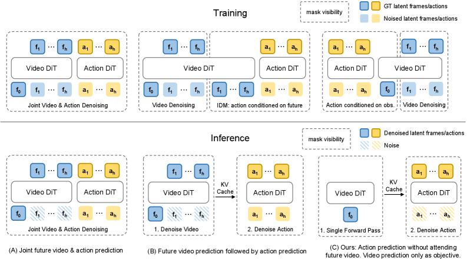
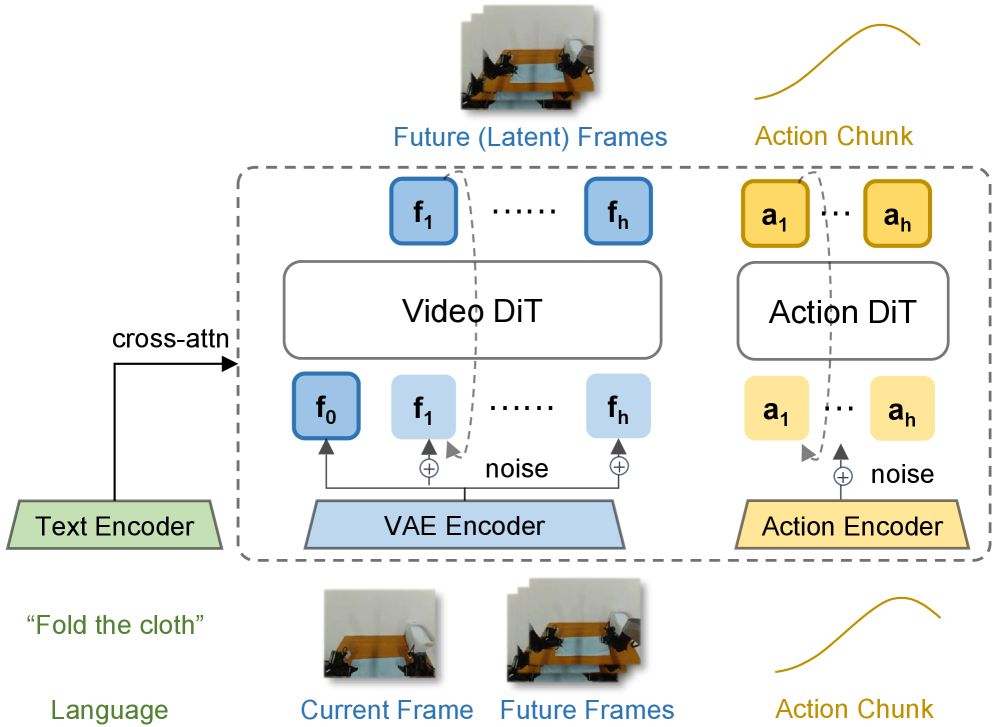
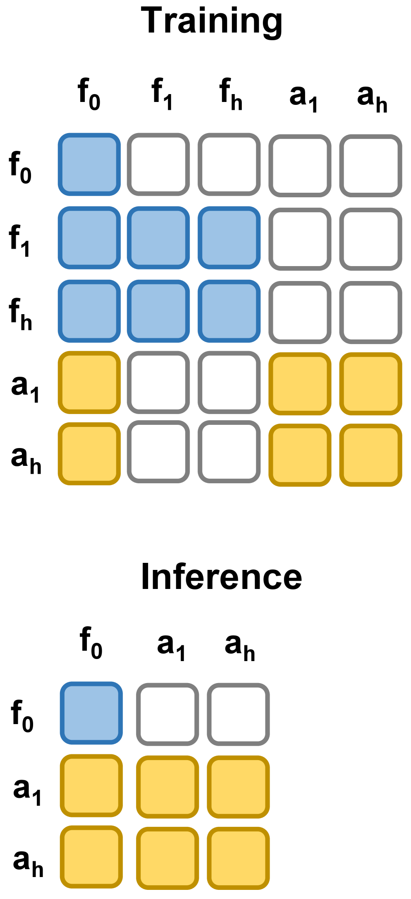
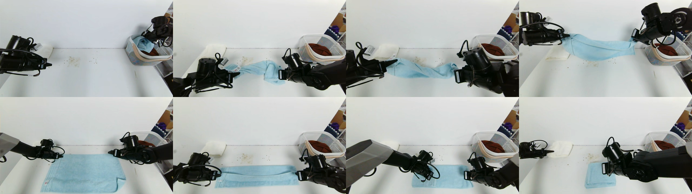
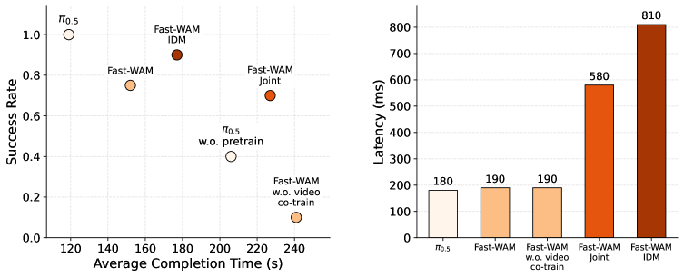

# Fast-WAM：WAM 一定要推理时想象未来吗

!!! info "论文信息"
    **论文题名：** Fast-WAM: Do World Action Models Need Test-time Future Imagination?。 
    **作者：** Tianyuan Yuan、Zibin Dong、Yicheng Liu、Hang Zhao。 
    **机构：** IIIS, Tsinghua University；Galaxea AI。 
    **时间 / 主题：** 2026-03；具身智能 / World Action Model。 
    **arXiv / 官方报告：** arXiv v1：[2603.16666v1](https://arxiv.org/html/2603.16666v1)；PDF：[2603.16666](https://arxiv.org/pdf/2603.16666)；项目页：[yuantianyuan01.github.io/FastWAM/](https://yuantianyuan01.github.io/FastWAM/)。 
    **GitHub / 项目：** GitHub：[github.com/yuantianyuan01/FastWAM](https://github.com/yuantianyuan01/FastWAM)；项目页：[Fast-WAM](https://yuantianyuan01.github.io/FastWAM/)。 
    **元数据来源与核验口径：** 来源：[arXiv v1 HTML](https://arxiv.org/html/2603.16666v1)、[arXiv TeX Source](https://arxiv.org/src/2603.16666v1)、[项目页](https://yuantianyuan01.github.io/FastWAM/)、[GitHub API / repo](https://github.com/yuantianyuan01/FastWAM)；Checked Date：2026-06-16；Repro Status：Paper / official materials reviewed, independent reproduction not claimed。注意：arXiv abstract 页已提示存在 v2，本文按用户指定的 v1 HTML 和 v1 TeX 源文件解读。

Fast-WAM 问的是 WAM 里一个很关键、也很容易被混在一起的问题：**视频预测到底是训练时用来塑造世界表征，还是推理时必须真的生成未来视频？**

它的答案偏工程，也偏反直觉：保留训练时的 video co-training，但推理时不再显式生成未来帧，模型仍然能在 LIBERO、RoboTwin 和真实毛巾折叠任务上保持强表现，并把真实任务推理延迟压到 `190 ms`。因此这篇论文的重点不是“世界模型不重要”，而是把 WAM 的收益拆成两部分：训练目标带来的世界表征，和推理时未来想象带来的额外 foresight。

## 论文位置

标准 VLA policy 通常直接学习：

$$
p(a_{1:H}\mid o,l)
$$

其中 \(o\) 是当前观测，\(l\) 是语言指令，\(a_{1:H}\) 是未来 action chunk。WAM 则会把未来视觉状态引进来，常见 imagine-then-execute 写法是：

$$
p(a_{1:H}\mid o,l)
=
\int p(v_{1:T}\mid o,l)\,
p(a_{1:H}\mid o,l,v_{1:T})\,dv_{1:T}
$$

这个公式的直觉很自然：先想象未来会怎样，再决定怎么做。但机器人控制有一个现实约束：视频扩散模型要反复 denoise，闭环控制周期很容易被延迟拖住。Fast-WAM 的判断是，未来视频预测也许更适合作为训练信号，而不是每次部署都必须显式生成的中间产物。

## 一句话核心

Fast-WAM 把 WAM 拆成两种能力：

| Factor | Role in Fast-WAM |
| --- | --- |
| Video co-training during training | 用未来视频 latent 的 flow matching 目标塑造 world-grounded representation |
| Explicit future generation at inference | 被移除；推理时只做当前观测编码和 action denoising |

用更直白的话说：训练时让模型学会“世界会怎样变”，部署时让模型直接用这种 latent 知识出动作，不再花时间把未来画出来。

## 证据等级与外推边界

| 论文结论 | 主要证据 | 可迁移判断 | 不能直接外推 |
| --- | --- | --- | --- |
| WAM 的主要收益可能来自 video co-training | Fast-WAM、Fast-WAM-Joint、Fast-WAM-IDM 和无 video co-train 变体对比 | 训练时预测未来可以作为动作策略的表征监督 | 不能推出所有任务都不需要 test-time planning |
| 推理时去掉未来视频生成仍可保持强表现 | LIBERO、RoboTwin、真实毛巾折叠结果 | 对实时机器人控制，latent world representation 可能比显式视频更实用 | 不能证明长时开放任务中未来想象没有价值 |
| 延迟收益明显 | 真实任务 Figure 4 报告 Fast-WAM `190 ms`，Fast-WAM-IDM `810 ms` | WAM 部署要把 denoising steps 和控制频率一起算 | 单卡延迟不能直接等同整机闭环吞吐 |
| 训练细节可复用 | Wan2.2-5B、1B action expert、flow matching、structured attention mask | 可以作为视频底座接动作扩散头的参考 recipe | 论文 v1 未给出所有超参，例如 \(\lambda\) 的具体数值 |
| 无 embodied pretraining 仍强 | RoboTwin / LIBERO 上与使用 embodied pretraining 的基线比较 | 视频底座和任务数据微调有较强数据效率 | 不能把它等同于零样本真实机器人泛化 |

## 三种 WAM 范式

{ width="920" }

<small>图源：`Fast-WAM`，Figure 1。原图表达三种 WAM 范式：(A) joint-modeling WAMs 同时 denoise future video 和 action tokens；(B) causal WAMs 先生成 future observations，再条件化 action prediction；(C) Fast-WAM 保留训练时 video co-training，但推理时不生成未来视频，直接从 latent world representations 预测动作。</small>

**Figure 1 怎么读。**
左边两类方法都把未来视频生成放进推理路径。A 类把未来视频 token 和动作 token 放在同一个 denoising 过程里，动作预测一直和视频生成耦合；B 类先 denoise 出未来视频，再让 action module 根据未来表征出动作。Fast-WAM 的 C 类只保留训练期的未来视频监督，推理时只对当前观测做 single forward encoding，再让 action expert 生成 action chunk。

这张图实际定义了论文的控制变量：如果 C 和 A/B 表现接近，而去掉 video co-training 的版本明显掉分，那么就说明 WAM 的收益更像来自训练目标，而不是来自部署时把未来视频显式生成出来。

## 模型结构

Fast-WAM 建在 `Wan2.2-5B` 视频 DiT 上，复用其 video DiT、T5 text encoder 和 video VAE。视觉观测先经 VAE 变成 latent video tokens，语言指令经 T5 编码后通过 cross-attention 提供给所有 token。动作侧新增一个 action expert DiT，用来生成 action chunk。

{ width="780" }

<small>图源：`Fast-WAM`，Figure 2(a)。原论文图意：Fast-WAM 使用 shared-attention Mixture-of-Transformer 结构，把 Video DiT 和 Action DiT 接在同一套训练框架下；future latent frames 只在训练中服务 video co-training，action chunk 由 action expert 生成。</small>

结构里有三组 token：

| Token group | Training role | Inference role |
| --- | --- | --- |
| Clean latent tokens of first observation frame | 作为共享视觉锚点 | 保留，用于 single forward encoding |
| Noisy latent tokens of future video frames | 只用于 video co-training | 移除，不做未来视频 denoising |
| Action tokens | 训练 action flow matching | 推理时 denoise 成 action chunk |

关键不是“多加一个动作头”，而是 video branch 和 action branch 通过 shared attention 共享世界表征，同时用 mask 防止未来信息泄漏到动作预测。

{ width="460" }

<small>图源：`Fast-WAM`，Figure 2(b)。原论文图意：训练时 future video tokens 在视频分支内双向 attention，并可访问 clean first-frame tokens；action tokens 在动作分支内双向 attention，也可访问 clean first-frame tokens，但不能访问 future video tokens；推理时 future video branch 被移除。</small>

**Figure 2 怎么读。**
训练 mask 的核心是“共享当前，不偷看未来”。video branch 可以学习未来视频 latent，action branch 可以学习动作 chunk，但 action tokens 不能 attend 到 future video tokens。这样一来，video co-training 会塑造 video DiT 的 latent representation，却不会让 action head 在训练中直接看答案。推理 mask 更激进：只保留当前帧 latent 和 action tokens，跳过未来视频分支。

## 训练目标

Fast-WAM 使用 flow matching 同时训练动作和未来视频 latent。对目标变量 \(y\)，其中 \(y\) 可以是 action chunk \(a_{1:H}\)，也可以是 future video latents \(z_{1:T}\)，先采样噪声 \(\epsilon\sim\mathcal{N}(0,I)\) 和时间 \(t\in(0,1)\)，构造：

$$
y_t=(1-t)y+t\epsilon
$$

模型学习速度场：

$$
\mathcal{L}_{\mathrm{FM}}(y)
=
\mathbb{E}_{y,\epsilon,t}
\left[
\left\|
f_\theta(y_t,t,o,l)-(\epsilon-y)
\right\|_2^2
\right]
$$

动作和视频两条损失分别是：

$$
\mathcal{L}_{\mathrm{act}}=\mathcal{L}_{\mathrm{FM}}(a_{1:H}),
\quad
\mathcal{L}_{\mathrm{vid}}=\mathcal{L}_{\mathrm{FM}}(z_{1:T})
$$

总目标是：

$$
\mathcal{L}
=
\mathcal{L}_{\mathrm{act}}
+
\lambda\mathcal{L}_{\mathrm{vid}}
$$

这里 \(\lambda\) 用来平衡动作学习和视频共训练。v1 HTML 与 v1 TeX 源文件里只给出这个符号和作用，没有给出具体数值，所以复现时不能自行假设。

## 训练细节

| Detail | Value / Setting | Why it matters |
| --- | --- | --- |
| Video backbone | `Wan2.2-5B` video DiT | 继承视频生成模型的视觉和动态先验 |
| Text / video modules | Wan2.2 built-in T5 encoder and video VAE | 语言通过 cross-attention，图像进 latent video space |
| Action expert | same architecture as video branch, reduced hidden dimension \(d_a=1024\) | 形成约 `1B` action expert |
| Total model size | `6B` parameters | 5B 视频底座 + 1B action expert |
| Action horizon | \(h=32\) | 每次生成一个 action chunk |
| Video chunk | temporally downsampled by `4x`, `9` video frames per chunk | 降低未来视频 co-training 的时序成本 |
| Multi-camera handling | images from multiple cameras are concatenated into a single image before VAE | 避免改 VAE 接口，但也把多视角几何压进单图输入 |
| Noise schedule | logit-normal distribution over \(t\) | 与 Wan2.2 flow matching recipe 对齐 |
| Inference denoising | `10` denoising steps, CFG scale `1.0` | action branch 仍是生成式 denoising，但不 denoise future video |
| Optimizer | AdamW, learning rate `1e-4`, weight decay `0.01`, cosine annealing | 论文公开的核心训练超参 |
| Stability | mixed precision, gradient clipping `1.0` | 控制大模型训练数值稳定性 |
| Latency hardware | single NVIDIA RTX 5090D V2 32GB | 所有延迟数值按这个硬件口径读 |

这个训练 recipe 的要点是：Fast-WAM 没有把动作预测退回普通回归模型，而是仍然保留 action diffusion / flow matching 的生成式动作头。它省掉的是未来视频 denoising，而不是动作 denoising。

### 受控变体

论文为了拆解因果关系，设计了三类对照：

| Variant | What changes | What it tests |
| --- | --- | --- |
| Fast-WAM | video co-training during training, no explicit future generation at inference | 主方法 |
| Fast-WAM-Joint | allow attention between video and action tokens | 模拟 joint future video and action denoising |
| Fast-WAM-IDM | first generate future video tokens, then condition action prediction on future representation; uses ground-truth video token noise augmentation with probability \(p=0.5\) | 模拟 video-then-action / inverse-dynamics 路线 |
| Fast-WAM w.o. video co-train | same architecture and inference path, remove only video modeling objective | 直接检验 video co-training 本身的贡献 |

这个设计比单纯和外部 baseline 比较更有价值，因为它把 backbone、tokenization 和训练 recipe 尽量固定，只改变是否推理时想象未来，以及是否训练时做视频共训练。

## 评测设置

Fast-WAM 的实验覆盖两个仿真 benchmark 和一个真实机器人任务。

| Setting | Protocol |
| --- | --- |
| LIBERO | four suites: LIBERO-Spatial, LIBERO-Object, LIBERO-Goal, LIBERO-Long；each suite has 500 demonstrations across 10 tasks；all models train for `20k` steps；report success rates over `2000` trials across `40` tasks |
| RoboTwin 2.0 | more than 50 bimanual manipulation tasks；training mix: `2,500` clean demonstrations + `25,000` heavily randomized demonstrations；all models train for `30k` steps；report average success over `100` trials per task under clean and randomized settings |
| Real-world towel folding | Galaxea R1 Lite；`60 hours` teleoperated demonstrations；all models train for `30k` steps；report success rate, average completion time and inference latency |

{ width="920" }

<small>图源：`Fast-WAM`，Figure 3。原论文图意：Galaxea R1 Lite 平台上的真实毛巾折叠任务；变形物体、长时程规划和闭环精细操作共同构成真实评测场景。</small>

**Figure 3 怎么读。**
毛巾折叠不是简单 pick-and-place。它涉及 deformable object dynamics，动作错误会改变布料状态，后续还要恢复或继续修正。因此论文同时报告 success rate 和 average completion time 是合理的：只靠反复试错最终完成，不等于策略真的高质量。

## 仿真结果

Table 1 from the paper can be redrawn as follows, keeping the original English fields:

| Method | Embodied PT. | Clean | Rand. | Average |
| --- | --- | --- | --- | --- |
| \(\pi_0\) | ✓ | 65.92 | 58.40 | 62.2 |
| \(\pi_{0.5}\) | ✓ | 82.74 | 76.76 | 79.8 |
| Motus | ✓ | 88.66 | 87.02 | 87.8 |
| Motus from WAN2.2 | ✗ | 77.56 | 77.00 | 77.3 |
| LingBot-VA | ✓ | 92.90 | 91.50 | 92.2 |
| LingBot-VA from WAN2.2 | ✗ | 80.60 | -- | 80.6 |
| Fast-WAM (Ours) | ✗ | 91.88 | 91.78 | 91.8 |
| Fast-WAM | ✗ | 91.88 | 91.78 | 91.8 |
| Fast-WAM-Joint | ✗ | 90.84 | 90.32 | 90.6 |
| Fast-WAM-IDM | ✗ | 91.16 | 91.34 | 91.3 |
| Fast-WAM w.o. video co-train | ✗ | 82.76 | 84.80 | 83.8 |

<small>表源：`Fast-WAM`，Table 1。原表含义：RoboTwin 上 clean / randomized settings 的平均成功率。读数重点是 Fast-WAM 在没有 embodied pretraining 的情况下达到 `91.8`，接近带 embodied pretraining 的 LingBot-VA `92.2`；Fast-WAM、Fast-WAM-Joint、Fast-WAM-IDM 三者很接近，但去掉 video co-training 后跌到 `83.8`。</small>

Table 2 from the paper can be redrawn as follows, keeping the original English fields:

| Method | Embodied PT. | Spatial | Object | Goal | Long | Average |
| --- | --- | --- | --- | --- | --- | --- |
| OpenVLA | ✓ | 84.7 | 88.4 | 79.2 | 53.7 | 76.5 |
| \(\pi_0\) | ✓ | 96.8 | 98.8 | 95.8 | 85.2 | 94.1 |
| \(\pi_{0.5}\) | ✓ | 98.8 | 98.2 | 98.0 | 92.4 | 96.9 |
| LingBot-VA | ✓ | 98.5 | 99.6 | 97.2 | 98.5 | 98.5 |
| Motus | ✓ | 96.8 | 99.8 | 96.6 | 97.6 | 97.7 |
| Fast-WAM (Ours) | ✗ | 98.2 | 100.0 | 97.0 | 95.2 | 97.6 |
| Fast-WAM | ✗ | 98.2 | 100.0 | 97.0 | 95.2 | 97.6 |
| Fast-WAM-Joint | ✗ | 99.6 | 99.4 | 98.2 | 96.8 | 98.5 |
| Fast-WAM-IDM | ✗ | 98.8 | 97.8 | 97.8 | 97.6 | 98.0 |
| Fast-WAM w.o. video co-train | ✗ | 89.2 | 99.2 | 95.4 | 90.0 | 93.5 |

<small>表源：`Fast-WAM`，Table 2。原表含义：LIBERO 四个 suite 的成功率。最关键的对照不是 Fast-WAM 是否绝对第一，而是无 video co-training 版本在 Spatial 和 Long 上明显掉分，平均从 `97.6` 降到 `93.5`。</small>

**Table 1 / Table 2 怎么读。**
两张表给出的核心信号一致：推理时要不要显式生成未来视频，对结果影响较小；训练时有没有 video co-training，影响更大。RoboTwin 上，Fast-WAM 和 Fast-WAM-IDM 差 `0.5` 个平均点，但去掉 video co-training 掉 `8.0` 个点。LIBERO 上，Fast-WAM 与 IDM 差 `0.4` 个平均点，去掉 video co-training 掉 `4.1` 个点，且 Spatial / Long 最受影响。

这说明未来视频预测目标很可能在训练阶段提供了物理和时间结构监督，尤其对空间关系和长链任务更有用；但在这组任务里，把未来视频真的生成出来，不是动作成功率的主要来源。

## 真实任务和延迟

{ width="760" }

<small>图源：`Fast-WAM`，Figure 4。原论文图意：左图是毛巾折叠任务的 success rate 与 average completion time，越靠左上越好；右图是推理延迟对比，Fast-WAM 为 `190 ms`，Fast-WAM-IDM 为 `810 ms`。</small>

**Figure 4 怎么读。**
真实任务里，\(\pi_{0.5}\) 仍是成功率和完成时间最强的点，但它使用了 embodied pretraining。Fast-WAM 家族中，带 video co-training 的三个版本都明显优于 \(\pi_{0.5}\) without pretraining；无 video co-training 版本只有 `10%` success rate。右侧延迟更直接：Fast-WAM 和 no-video-co-train 都是 `190 ms`，Joint 是 `580 ms`，IDM 是 `810 ms`。这正好对应论文问题：显式未来想象会带来推理成本，但在这组结果里没有带来同等幅度的收益。

这里要避免一个误读：Fast-WAM 不是说真实机器人不需要未来预测。它说的是，未来预测可以在训练时作为表征学习目标，而部署时未必需要把未来帧显式 denoise 出来。对高速闭环任务，这个区分非常关键。

## 训练启发

Fast-WAM 给具身智能训练路线的启发可以拆成四点：

1. **视频底座可以当 world encoder。** Wan2.2-5B 原本是视频生成模型，但经过 action expert 和 video co-training 后，它可以提供动作预测用的 latent world representation。
2. **future prediction objective 比 future frame output 更重要。** 未来视频不一定要作为推理中间产物，训练目标本身就可能把物理动态压进表示。
3. **mask 是防泄漏的核心。** 如果 action tokens 能在训练时看到 future video tokens，实验就无法证明模型真的能从当前观测出动作。
4. **实时性要进入模型设计。** `10` step action denoising 已经有成本，如果再加未来视频 denoising，真实闭环延迟会明显上升。

对复现或二次开发来说，最该先确认的是三件事：第一，是否拿得到 Wan2.2 对应 VAE/text encoder/video DiT 权重；第二，动作 token 和多相机拼接的具体 shape 是否和代码一致；第三，\(\lambda\)、batch size、训练硬件等未在 v1 论文正文中完整披露的细节是否能从官方代码或配置中补齐。

## 局限和误解

第一，Fast-WAM 没有证明“test-time future imagination 永远没用”。论文明确为受控比较简化了 single action chunk generation，并省略外层 auto-regressive loop。对长时开放世界任务、复杂失败恢复或需要显式规划搜索的场景，未来想象仍可能有价值。

第二，它的真实任务主要是毛巾折叠。这个任务很有代表性，因为它包含 deformable object 和长时闭环，但不能覆盖所有接触、装配、导航或多机器人协作场景。

第三，无 embodied pretraining 的结果很强，但不等于零样本泛化。LIBERO、RoboTwin 和真实毛巾折叠都仍有任务数据训练；论文比较的是不使用大规模 embodied pretraining 的数据效率。

第四，Fast-WAM 仍然有动作 denoising。它不是纯前馈回归 policy；省掉的是未来视频生成分支。部署时仍要评估 action denoising steps、控制频率、低层控制器和安全约束。

## 阅读结论

Fast-WAM 的核心贡献是把 WAM 的“训练时视频预测”和“推理时未来想象”拆开验证。结果显示，video co-training 对世界表征和动作成功率很关键，而显式生成未来视频在这组任务里收益有限、延迟很高。对具身智能系统来说，这是一条很实用的路线：训练时用视频预测强化物理表征，部署时走低延迟 action interface。

最值得复用的是 shared-attention MoT、structured attention mask、action / video 双 flow-matching objective 和受控变体设计。最需要保留边界的是：这不是对显式规划的否定，也不是开放世界机器人能力证明；它更像是在告诉我们，WAM 的训练信号可以留下，推理时昂贵的未来视频生成要重新审视。

## 外部精读

- [Fast-WAM arXiv v1 HTML](https://arxiv.org/html/2603.16666v1)：本文按用户指定版本解读，重点读 Figure 1、Figure 2、Table 1、Table 2 和 Figure 4。
- [Fast-WAM PDF](https://arxiv.org/pdf/2603.16666)：适合核对 PDF 图表排版和公式。
- [Fast-WAM project page](https://yuantianyuan01.github.io/FastWAM/)：看方法图、实验表和真实任务视频入口。
- [FastWAM GitHub](https://github.com/yuantianyuan01/FastWAM)：官方代码仓库，适合进一步核对配置、训练脚本和未在 v1 正文披露的细节。
- [Wan2.2 / Wan video model](https://arxiv.org/abs/2503.20314)：Fast-WAM 复用的视频 DiT、VAE 和训练 recipe 背景。
- [LingBot-VA / Causal world modeling for robot control](https://arxiv.org/abs/2602.14977)：Fast-WAM-IDM 参考的 video-then-action WAM 路线之一。

## 相关阅读与下一步

- 站内下一步：[Video Prediction Policy：预测视觉表征训练策略](video-prediction-policy.md)。
- 站内下一步：[DreamZero：WAM 零样本策略](dreamzero.md)。
- 站内下一步：[LingBot-World：视频基础模型到世界模拟器](../world-models/lingbot-world.md)。
- 站内下一步：[VLA 数据与策略学习](../../vla/data-and-policy-learning.md)。
- 站内下一步：[论文精读专题](../index.md)。
