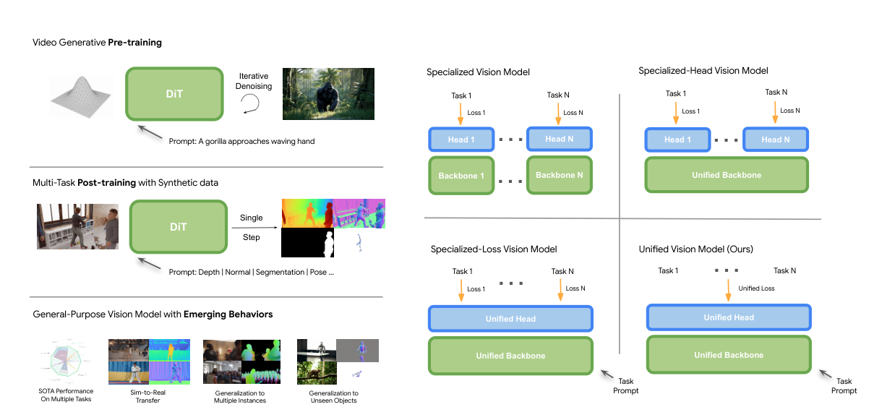
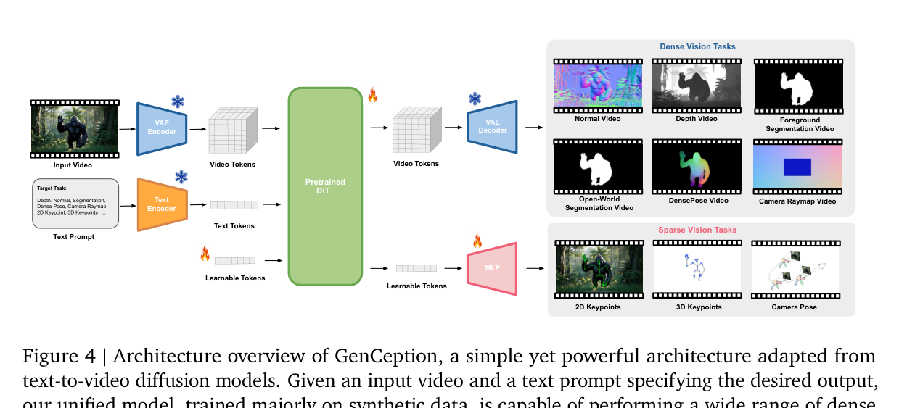
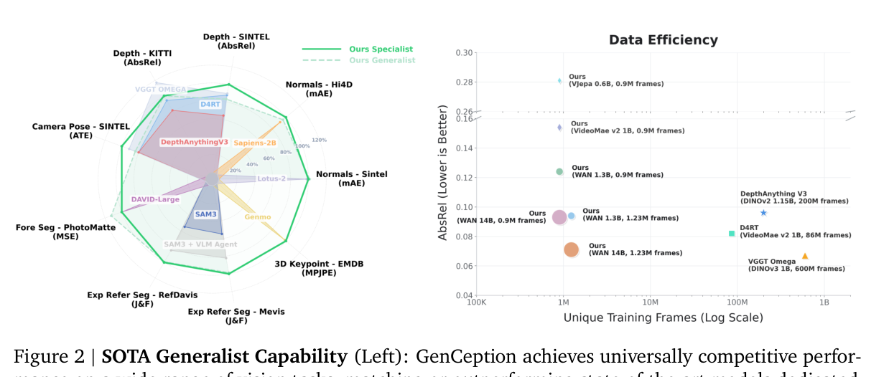
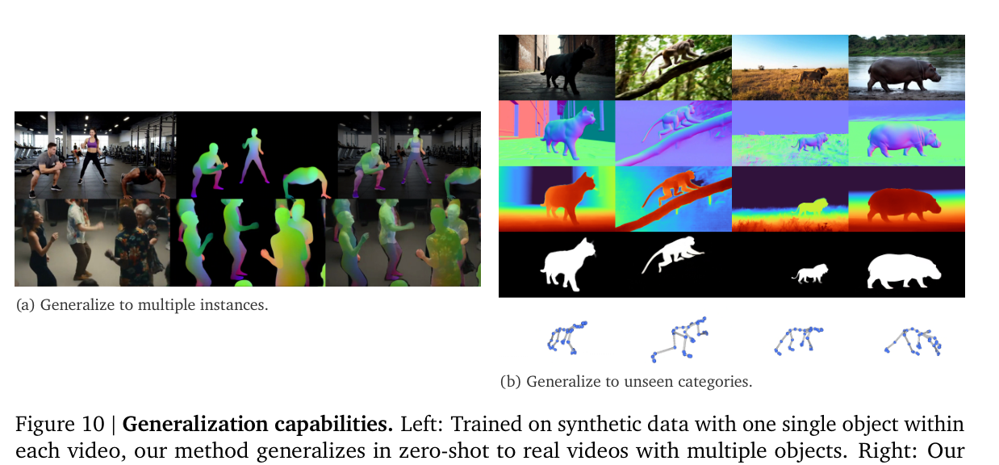

# GenCeption：视频生成模型如何成为通用视觉学习器

!!! info "论文信息"
    **论文题名：** Video Generation Models are General-Purpose Vision Learners。<br>
    **模型 / 方法名：** GenCeption。<br>
    **作者：** Letian Wang、Chuhan Zhang、Rishabh Kabra、Jasper Uijlings、Steven Waslander、Andrew Zisserman、Joao Carreira、Kaiming He、Misha Andriluka、Eduard Gabriel Bazavan、Andrei Zanfir、Cristian Sminchisescu。<br>
    **机构：** Google DeepMind、University of Toronto、University College London、University of Oxford、MIT、Lund University。<br>
    **时间 / 主题：** 2026-07；视频生成预训练 / 通用视频感知 / 具身视觉状态。<br>
    **会议：** arXiv 页面备注为 ECCV 2026；正式出版信息以会议最终版本为准。<br>
    **原论文：** [arXiv:2607.09024](https://arxiv.org/abs/2607.09024)，[PDF](https://arxiv.org/pdf/2607.09024)。<br>
    **项目页：** [genception.github.io](https://genception.github.io)。论文未在正文中给出独立 GitHub 代码仓库。<br>
    **元数据来源与核验口径：** 来源为 arXiv 摘要页、PDF 和项目页；Checked Date：2026-07-13；Repro Status：Paper / project page reviewed, independent reproduction not claimed。

## 先给结论

GenCeption 的核心主张是：**大规模 text-to-video 扩散模型不仅学习“怎样生成视频”，也可以作为通用视觉感知的预训练底座。** 作者把 WAN 2.1 的视频 DiT、VAE 和文本编码器改造成一个单步 feed-forward 感知模型，用文本 prompt 指定输出模态，再用以合成数据为主的多任务后训练统一学习深度、法线、前景分割、表达式指代分割、DensePose、相机 raymap、2D/3D keypoint 等任务。

这篇论文对具身智能的直接价值，不是提供一个机器人 policy，而是提供一条 **视频生成预训练 -> 几何/语义状态估计 -> VLA 或世界模型消费** 的感知路线。它报告的结果显示，14B WAN 2.1 backbone 在多项任务上接近或超过专用模型，并在深度估计上以远少于 D4RT、VGGT-Ω 的训练帧数达到可比性能。但“通用世界模型”仍是作者根据感知迁移和泛化现象提出的解释，不等于已经证明了可用于规划或物理闭环的世界模拟器。

## 原论文故事线

### 研究背景

视觉领域仍然被大量专用模型切分：Depth Anything 负责深度，Segment Anything 负责分割，VGGT 或 D4RT 负责几何与动态场景，人体模型负责姿态。它们各自可以很强，但架构、decoder、loss 和数据格式常常跟着任务变化。作者把问题类比到 NLP：LLM 之所以能统一处理翻译、摘要、推理和代码，一个关键前提是存在可规模化的通用生成预训练目标。

论文寻找的是视觉领域对应的“next-token prediction”。作者认为 text-to-video generation 同时满足三个条件：

1. **Spatio-Temporal Evolution（时空演化）**：生成连续视频迫使模型学习运动、3D 几何、物体持续存在和物理交互等时空先验；
2. **Vision-Language Alignment（视觉语言对齐）**：视频生成原生以文本为条件，视觉表征与语义概念在预训练阶段就发生绑定；
3. **Scaled Up（可规模化）**：视频生成受到商业需求推动，能使用大规模数据和计算，比许多密集标注的视觉预训练路线更容易继续扩展。

### 问题（Challenge）

论文要解决的问题是：**能否把一个已经完成大规模视频生成预训练的扩散 DiT，改造成单个统一架构，用文本指令完成多种密集和稀疏视觉任务，而且保持接近专用模型的精度和推理效率。**

困难在于，生成模型和感知模型的接口不一样。生成模型从噪声出发，重复 denoising 后得到视频；感知模型需要给定输入视频，在一次前向中直接输出几何、分割或坐标。不同感知任务的输出空间也不一样：深度是单通道标量图，法线是三维向量，位姿可能是矩阵或 raymap，3D keypoint 则是每帧的稀疏坐标。如果为每个任务单独设计 head 和 loss，就失去了统一架构的主要收益。

### Finding

作者的 finding 可以分成三层：

- **预训练层：** 视频生成骨干包含可迁移的时空和语义先验，且在相同后训练数据下优于 V-JEPA、VideoMAE V2 等替代预训练；
- **接口层：** 任务差异可以主要放进 prompt 和 target data representation，而不是放进不同 backbone、head 和 loss；
- **泛化层：** 以人类合成视频为主的训练，可以迁移到真实视频、多实例和训练中未出现的动物或类人对象。

这改变了问题的表述：通用视觉模型不一定要从零设计一个“万能感知头”，也可以把生成模型已经学到的时空表征保留下来，只在数据格式和最小输出接口上做后训练适配。

### 方法

GenCeption 的信息流可以概括为：

```text
input RGB video + task prompt
    -> VAE encoder -> video latents
    -> text encoder -> text tokens
    -> pretrained WAN 2.1 DiT, t = 0, single forward
    -> VAE decoder / learnable-token MLP
    -> dense RGB-like target or sparse per-frame coordinates
```

密集任务共享 VAE decoder 和 RGB ambient-space 表示；稀疏任务额外添加每帧 learnable tokens，再由轻量 MLP 解码为 K 维坐标。训练时只使用一个标准 L2 loss：密集任务在 latent space 监督，稀疏任务在输出坐标空间监督。任务特定性主要通过 target representation 和 data mixture 表达。

### 结论

论文在 surface normal、depth、camera pose、soft foreground segmentation、expression-referring open-world segmentation 和 3D human keypoint 上进行评测。作者报告：

- 统一模型在多项指标上接近或超过 DepthAnything3、D4RT、VGGT-Ω、SAM3、Sapiens、DAViD、Genmo 和 Lotus-2 等专用模型；
- 相同 7,500 个视频和约 0.9M 帧后训练数据下，WAN 2.1 优于 V-JEPA 与 VideoMAE V2；
- 14B WAN 2.1 的平均深度 AbsRel 为 0.093，使用 4 个合成数据集和 1.23M 帧时为 0.071；对比的 D4RT 为 0.082，VGGT-Ω 为 0.067，但后两者使用的训练帧数约为 86M 与 600M；
- 论文还展示了从合成到真实、从单实例到多实例、从人类到动物和类人对象的泛化，但其中一部分证据是定性展示，不能直接等价为机器人闭环泛化。

## 论文位置：从视频生成到具身状态

GenCeption 位于视频生成、通用视觉表征和具身感知的交叉点。它与 [VGGT：前向恢复相机、深度、点云与轨迹](vggt.md)、[VGGT-Ω：几何重建怎样变成具身空间表征](vggt-omega.md)、[Depth Anything 3：任意视角 3D 几何底座](depth-anything-3.md) 关注相似的几何状态，但路线不同：VGGT 系列直接针对几何重建建模，GenCeption 试图从更大规模的视频生成预训练中迁移通用先验。

它也不同于 [Video Prediction Policy：预测视觉表征训练策略](video-prediction-policy.md) 和 [Motus：统一 latent action 世界模型](motus.md)。后两类工作更接近 action-conditioned policy 或 latent action world model；GenCeption 的输入是视频和任务 prompt，输出是感知状态，没有动作条件、动作生成或机器人执行评测。

因此，在具身智能系统里，GenCeption 更适合被放在状态估计层：


图中的最后两步是本站的系统推断，不是论文实验。论文只证明了前半段的多任务感知能力，尚未证明 GenCeption 输出直接能支撑某个机器人控制器的安全执行。

## 方法一：把扩散 DiT 改成单步感知器

### 原始生成路径

WAN 2.1 的核心由 VAE encoder-decoder、text encoder 和 latent diffusion transformer（DiT）组成。原始生成路径从高斯噪声 latent 开始，DiT 在多个时间步反复 denoise，最后由 VAE decoder 还原视频。论文采用 Rectified Flow 形式时，DiT 预测速度：

$$
v = \epsilon - x_0,
$$

其中 $x_0$ 是原始干净视频的 latent，$\epsilon$ 是噪声。生成模型依赖多个时间步，是因为每个时间步都在把当前 noisy latent 推向目标分布。

### Feed-Forward Reformulation

GenCeption 不再把 noisy latent 当输入，而是直接把输入 RGB 视频经过 VAE encoder 得到的 clean latent 输入 DiT，并固定 conditioning timestep 为 $t=0$。在 Rectified Flow 约定下，作者将 DiT 的原始输出取负：

$$
-v = x_0 - \epsilon.
$$

这个量更接近目标视频 latent，之后进入 dense decoder 或 loss。直观上，DiT 不再被当作一个必须完整采样的生成器，而被当作一个已经包含时空先验的特征提取器和单步预测器。作者还强调直接使用最终层特征，使其与原生 decoder 保持接口一致，避免为了下游感知重新插入复杂的中间 feature adapter。

这一步的工程意义是把迭代式生成成本换成一次前向，但代价是模型不再执行完整的生成采样过程。它能否保持生成预训练中的全部能力，必须回到后面的 ablation 和跨任务结果判断，而不能只由结构图推出。

## 方法二：用数据表示统一不同任务

### 密集任务统一到 RGB ambient space

所有密集输出都被整理到 $[0,1]$ 的三通道 RGB 空间：

| 任务 | 目标表示 | 处理方式 |
| --- | --- | --- |
| Depth | 单通道深度图 | 复制到三个通道 |
| Foreground / open-world segmentation | mask | 复制到三个通道 |
| Surface normal | 三维方向向量 | 三个通道分别表示方向分量 |
| DensePose | 三维人体语义/几何量 | 映射到三个通道 |
| Camera pose | raymap | 用空间布局把高维 ray 信息装入 3 通道图 |

相机位姿通常不是天然的三通道图。论文使用 pixel-space raymap：rotation raymap 与 translation raymap 的信息被空间划分到同一张三通道图中，中心区域保存 ray origins，周边区域保存 ray directions。作者把这种设计称为 “Rothko” raymap。它的关键不是名字，而是把原本高维、结构化的相机信息重排成视频生成模型熟悉的连续空间。

深度的尺度歧义也在数据层处理，而不是增加 scale-invariant loss。论文先用场景 median depth 归一化，再使用：

$$
d' = \operatorname{clip}\left(\alpha\log(d+1), 0, 1\right),
$$

其中 $d$ 是归一化后的深度，$\alpha$ 控制模型更关注近场细节还是远场结构。这样多任务训练可以保留一个统一的 L2 objective，把任务差异转移给 target encoding 和 mixture ratio。

### 稀疏任务使用 learnable tokens

3D keypoint、2D keypoint 和 camera pose 中的部分结构需要直接输出坐标，单纯用 RGB-like 视频表示并不方便。GenCeption 为每个视频帧添加一个 learnable token，共 $T$ 个 token。DiT 处理后，MLP 将每帧 token 解码成 $K$ 维目标：

$$
z_{1:T} = \operatorname{DiT}(x_{\text{video}}, x_{\text{text}}, q_{1:T}),
\qquad
\hat y_t = \operatorname{MLP}(z_t) \in \mathbb{R}^{K}.
$$

这些额外 token 使用 DiT 原生的 3D RoPE。因为它们没有固定空间位置，空间位置设为可学习；时间位置则把真实帧索引按视频 latent 的压缩长度 $T'$ 做 interpolation，避免超出预训练时见过的 temporal range。作者报告，这种 additional-query 方式优于增加额外 attention layers。

这里也埋下了一个重要风险：learnable tokens 是从零开始训练的，而生成 DiT 的原生能力主要在连续 pixel / latent 空间中形成。后面的 joint-training ablation 显示，稀疏 token 接口会损害 3D keypoint 任务，这说明“统一架构”不是无条件成立的。

{ width="920" }

<small>图源：[Video Generation Models are General-Purpose Vision Learners](https://arxiv.org/abs/2607.09024)，Figure 1。左侧是视频生成预训练、合成数据多任务后训练和泛化行为；右侧对比专用模型、共享 backbone / 多 head、共享 loss 与 GenCeption 的统一视觉模型。</small>

**这张图怎么读。** 左侧不是“先生成一个视频再做感知”，而是说明生成预训练提供 base model，后训练把它改成单步感知器。右侧的真正变化是把 task specification 从架构和 loss 迁移到 task prompt 与 target data representation。图能支持“统一接口”的方法主张，但不能单独证明所有任务在联合训练中都不互相干扰。

{ width="920" }

<small>图源：同论文 Figure 4。输入视频和 task prompt 经过 VAE / text encoder 后进入预训练 DiT；密集任务通过 VAE decoder 输出视频式 target，稀疏任务通过 learnable tokens 和 MLP 输出每帧坐标。</small>

**架构图的关键接口。** 冻结雪花标记表示 VAE encoder、text encoder 和 VAE decoder 保持预训练接口；火焰标记表示 DiT 和稀疏任务 MLP 是后训练中适配的部分。这里体现了作者的最小修改原则：尽量不破坏视频生成 backbone，同时让 dense / sparse 两条输出路径共用主干。

## 方法三：合成数据和训练配方

### 合成数据构造

论文认为真实世界数据很难同时提供深度、法线、分割、DensePose、2D/3D keypoint 和相机位姿标注，因此以可规模化的 synthetic data 为主：

| 组成 | 论文设置 | 作用 |
| --- | --- | --- |
| 人体资产 | 800 个 RenderPeople assets | 身份和外观多样性 |
| 运动 | 200 个 CMU motion capture motions | 动态和姿态覆盖 |
| 场景 | 多种 3D full scenes / HDRI backdrops | 背景与光照变化 |
| 相机 | focal length、位置和轨迹随机化 | 相机运动和几何条件 |
| 总规模 | 7,500 个视频 | 主要多任务合成训练集 |
| 标注 | Blender render passes、rig joint positions | 深度、法线、mask、DensePose、2D/3D keypoint、camera pose |

数据预处理阶段缓存输入 RGB video latent、target-modality video latent 和 text embedding。这降低了后训练期间重复 VAE / text encoder 计算的开销，也让大批量多任务训练更接近 latent-space 数据管线。

作者还加入少量公开 synthetic datasets：TartanAir、Virtual KITTI、MVS Synth 用于额外深度和相机轨迹；expression-referring segmentation 则使用 MeViS、Ref-COCO、YouTube-VOS 的真实数据，因为这类语言指代表达式标注不能简单由 Blender render pass 替代。

### 训练细节

| 项目 | 论文披露的设置 |
| --- | --- |
| Backbone | 开源、开放权重的 WAN 2.1 text-to-video diffusion model |
| 输入 | 480×832，81 frames，24 FPS |
| 压缩 | temporal factor 4，空间宽高 factor 8 |
| Batch | 64 |
| 硬件 | 256 v6e TPUs |
| 优化器 | Adam，learning rate (5\times10^{-5}) |
| 训练步数 | 15,000 steps，前 250 steps linear warmup |
| 稳定性 | gradient clipping；超过更高阈值的 batch 做 gradient dropping |
| Dense loss | latent space 中的标准 L2 |
| Sparse loss | 输出坐标空间中的标准 L2 |
| 数据输入 | 离线缓存 video latent、target latent 和 text embedding |

论文只说明使用 gradient clipping 和 gradient dropping，但没有在正文给出对应阈值；这类未披露的数值不能自行补齐。训练配方的核心不是某个复杂 loss，而是用数据表示处理深度尺度和通道差异，再让 data mixture ratio 承担任务平衡。

## 推理成本：从 50-step diffusion 到一次前向

GenCeption 的 feed-forward 改写直接消除了 WAN 标准生成流程中的 50-step diffusion。论文在单张 v6e TPU、81 帧、480×832 输入上报告：

| 模型 | 总耗时 / clip | DiT 耗时 | 吞吐 | VRAM |
| --- | ---: | ---: | ---: | ---: |
| WAN 2.1 S，1.3B | 5.92 s | 0.96 s | 13.6 FPS | 15.3 GB |
| WAN 2.1 L，14B | 10.03 s | 5.11 s | 8.0 FPS | 42.8 GB |

两种配置共享约 10GB text encoder 和 0.25GB VAE，这些组件可以 offload 到系统内存，以速度换显存。这里的 FPS 是对固定 81 帧视频 clip 的感知吞吐，不能直接写成机器人控制频率，也不能证明整个 VLA 闭环满足实时安全约束。

## 实验与结论

### 评测协议

| 任务 | Benchmark | 指标 |
| --- | --- | --- |
| Surface normal | Hi4D、SINTEL | mean angular error 等 |
| Depth | KITTI、SINTEL、ETH3D、Goliath | AbsRel、RMSE；Table 2 还报告 δ1 |
| Camera pose | SINTEL | ATE、RPE-T、RPE-R |
| Soft foreground segmentation | VideoMatte、PhotoMatte 85、PPM-100 | MSE |
| Expression-referring segmentation | Ref-DAVIS、MeViS | J&F |
| 3D human keypoint | EMDB | MPJPE |

作者强调，除 expression-referring segmentation 外，GenCeption 不使用评测 benchmark 的训练集，主要依赖合成数据。Goliath 的评测沿用 DAViD 的选取：12 cameras、16 frames、4 subjects，约 2.2k frames。VideoMatte 没有官方 split，使用先前工作构造的 static split，因此不同论文之间的数字仍需按协议对齐。

### 多任务结果：统一模型的收益和代价

下面保留 Table 1 中最能说明问题的行。指标方向均按论文原表：mAE、AbsRel、ATE、RPE 和 MSE 越低越好，J&F 越高越好，MPJPE 越低越好。

| Method | Backbone | Normals: SINTEL / Hi4D mAE | Depth: SINTEL / KITTI / ETH3D / Goliath AbsRel | Cam. pose: ATE / RPE-T / RPE-R | Foreground: V.Mat / P.Mat MSE | Referring: Ref-DAVIS / MeViS J&F | 3D human MPJPE |
| --- | --- | --- | --- | --- | --- | --- | ---: |
| DepthAnything 3 | DINOv2 1.15B | - | 0.201 / 0.059 / 0.028 / - | 0.065 / 0.048 / 0.456 | - | - | - |
| D4RT | VideoMAE2 1B | - | 0.148 / 0.051 / - / - | 0.065 / 0.024 / 0.126 | - | - | - |
| VGGT-Ω | DINOv3 1B | - | 0.145 / 0.041 / 0.016 / - | 0.057 / 0.059 / 0.407 | - | - | - |
| Ours, Specialist-L | WAN 2.1 14B | 29.7 / 10.99 | 0.130 / 0.048 / 0.037 / 0.008 | 0.050 / 0.018 / 0.464 | 0.0027 / 0.0009 | 76.4 / 70.0 | 71.8 |
| Ours, Generalist-L | WAN 2.1 14B | 29.3 / 11.47 | 0.156 / 0.048 / 0.044 / 0.011 | 0.062 / 0.018 / 0.485 | 0.0010 / 0.0008 | 75.8 / 69.0 | - |

“Specialist” 是每个任务单独训练的模型，“Generalist” 是单个模型联合训练所有任务。结果说明统一模型确实能覆盖宽任务面，但 joint training 并不总是优于 specialist：Generalist-L 在部分 depth、camera pose 和 3D keypoint 项目上退化或没有结果，而 foreground 和 referring segmentation 更稳定。

### 预训练、规模和数据效率

Table 2 固定深度任务后训练数据，比较预训练 backbone：

| Method | Size | Training frames | Average AbsRel ↓ | Average δ1 ↑ |
| --- | ---: | ---: | ---: | ---: |
| V-JEPA-H | 0.6B | 0.9M | 0.281 | 52.2 |
| VideoMAE V2-H | 0.6B | 0.9M | 0.175 | 62.0 |
| VideoMAE V2-G | 1B | 0.9M | 0.154 | 66.9 |
| WAN 2.1-S | 1.3B | 0.9M | 0.122 | 85.8 |
| WAN 2.1-L | 14B | 0.9M | 0.093 | 90.7 |
| D4RT | 1B | about 86M | 0.082 | 91.7 |
| VGGT-Ω | 1B | about 600M | 0.067 | 95.2 |
| WAN 2.1-S | 1.3B | 1.23M | 0.094 | 90.6 |
| WAN 2.1-L | 14B | 1.23M | 0.071 | 93.8 |

这组结果支持三条比较谨慎的判断：

1. 在相同约 0.9M frame 后训练数据下，WAN 2.1 预训练比 V-JEPA / VideoMAE V2 更有利于深度估计；
2. 在作者测试的区间内，增加 WAN 模型规模和后训练数据通常带来更好的深度结果；
3. 相比 D4RT 和 VGGT-Ω 的报告训练规模，GenCeption 以约 7× 到 500× 更少的训练帧达到可比区间，但这些数字来自不同论文的数据与模型管线，不能当作严格的相同预算对照。

{ width="920" }

<small>图源：同论文 Figure 2。左侧雷达图比较多任务 specialist/generalist 与专用模型；右侧以 unique training frames 为横轴、depth AbsRel 为纵轴，展示预训练方法、模型大小和数据量的关系。</small>

**这张结果图的读数边界。** 右图最有价值的是“同一后训练数据下的预训练比较”和“随着数据/模型规模增加的趋势”；它不是一个严格的 scaling law，也不意味着所有视觉任务都遵循同样曲线。左图显示的是多任务覆盖能力，不能被压缩成单一总分。

### Ablation：统一并不等于没有冲突

论文给出的消融诊断比“全任务 SOTA”更重要：

| 诊断 | 结果 | 说明 |
| --- | --- | --- |
| Joint training vs. task-specific | foreground segmentation 稳定受益；surface normal、depth、camera pose 混合；3D human keypoint 严重退化 | 稀疏 token 回归和 dense latent 预训练空间存在接口冲突 |
| Pretrained layers transfer | 从随机初始化 DiT 开始几乎没有学习曲线；迁移的预训练层越多，性能越好 | 下游性能依赖视频生成预训练，不只是模型容量 |
| WAN vs. V-JEPA / VideoMAE | 相同后训练集下 WAN 深度结果更好 | 支持生成式目标携带更强时空先验，但不完全排除实现与结构差异 |
| Data / model scaling | 测试区间内更多数据、更大 WAN 模型通常更好 | 论文只报告 preliminary scaling property，尚未给出普适 scaling law |

作者解释 3D keypoint 退化有两个原因：第一，token-based coordinate regression 与连续 pixel-space 预训练不一致；第二，从零初始化的 learnable tokens 会扰动预训练 DiT 的 native attention mechanics，需要更多数据才能收敛。这是对统一多任务模型设计很有价值的反例：共享 backbone 和 unified loss 可以减少工程分支，但不代表不同输出接口天然兼容。

### Emergent behaviors：从合成到真实、从人到非人

论文 Figure 10 展示三类泛化：

- 训练视频每次只有一个对象，测试时可对真实视频中的多个对象做预测；
- 训练只使用人类类别，测试时可处理动物和类人 articulated objects；
- 合成 Blender 数据训练后，真实视频中的细节仍能得到较好的深度、mask 和姿态结果。

{ width="920" }

<small>图源：同论文 Figure 10。左侧是从单实例合成训练到真实多实例视频；右侧是仅在人类视频上训练后，对猫、猴、牛、河马等非人类别进行深度、分割和关键点预测。</small>

**证据边界。** 这些行为可以说明视频生成预训练中存在可迁移的视觉先验，但“emergent”是作者对现象的命名和解释，不是对机制的独立证明。尤其是 Figure 10 的跨类别结果主要是定性展示；它不能替代在机器人、非刚体物体、遮挡、接触和动作条件下的定量闭环评测。

## 对具身智能的启发

### 1. 把视频生成骨干当作状态编码器

具身系统需要的不是一张“看起来合理”的图，而是可被规划器和 policy 消费的状态：深度、相机、物体 mask、关键点、动态轨迹和不确定性。GenCeption 的统一 prompt 接口提供了一个可能的状态提取层：同一视频输入可以按任务请求不同 modality，再把结果写入 episode state。

这条启发属于本站推断。论文没有测试 action-conditioned prediction，也没有报告 perception error 如何传递到机器人成功率，因此落地时仍需单独做几何尺度校准、时序稳定性、遮挡恢复和控制敏感性评测。

### 2. 合成数据的价值不只在数量

论文的 7,500 个视频不是简单复制，而是把 identity、motion、scene、HDRI、焦距和相机轨迹组合成可控变化，并利用 render pass 生成多种 ground truth。这种设计适合具身数据引擎：同一段状态变化可以同时产生深度、法线、mask、joint 和 pose label，减少跨任务标注不一致。

但人体中心的合成数据并不等于机器人世界的充分覆盖。桌面物体、柔性物体、接触动力学、夹爪遮挡和相机安装方式仍然需要额外数据或仿真资产；Figure 10 的 OOD object 结果不能替代这些物理条件。

### 3. Prompt 和 data representation 是可扩展接口

如果新任务能被编码成连续 target video 或 per-frame sparse token，就有机会复用 backbone、decoder 和 L2 loss。对具身系统而言，候选任务包括：相机 raymap、末端关键点、抓取区域、物体可达性 mask、场景深度和短时轨迹。

但是，输出“能被编码”不等于“足够支持决策”。动作可行性、碰撞约束、接触状态和置信度可能需要显式结构化输出；如果一味把所有东西塞进 RGB-like space，会掩盖坐标系、尺度和不确定性语义。

## 局限与风险

1. **没有机器人闭环。** 论文评测的是视觉感知 benchmark，不包含机械臂、移动机器人、动作条件、抓取成功率、控制延迟或安全停止。
2. **泛化证据部分是定性的。** synthetic-to-real、multi-instance 和 OOD category 现象有启发，但不能直接等价于长时程具身泛化。
3. **统一模型存在任务冲突。** Table 1 明确显示 joint training 对 3D keypoint 可能严重退化，generalist 也不总是优于 specialist。
4. **训练配方仍有未披露项。** gradient clipping / dropping 的阈值、任务 mixture ratio、每任务样本权重和完整数据清洗细节没有在正文中给出，独立复现会受影响。
5. **预训练比较不是完全隔离变量。** WAN、V-JEPA 和 VideoMAE 的架构与训练目标不同，结果支持“WAN 路线更强”，但不能把全部差异严格归因于 diffusion objective。
6. **所谓 universal world model 仍未被闭环验证。** 感知迁移说明模型可能学到了丰富的视觉先验，但没有证明它能预测动作后果、进行规划或在分布外物理交互中保持稳定。

### 关键术语

- **GenCeption（GenCeption）**：本文提出的通用视频感知模型，把视频生成扩散 backbone 改造成单步、多任务感知器。
- **Video Generative Pre-training（视频生成式预训练）**：以 text-to-video 生成作为预训练目标，学习时空、几何和视觉语言先验。
- **Feed-Forward Reformulation（前向化重写）**：给定 clean input latent，固定 $t=0$，用一次 DiT 前向替代多步 diffusion sampling。
- **Rectified Flow（整流流）**：把噪声与目标样本之间的速度场作为生成训练目标；本文利用 $v=\epsilon-x_0$ 的形式做单步感知重写。
- **Unified Task Representation（统一任务表示）**：把不同密集目标编码到 RGB ambient space，任务差异由数据格式和 prompt 指定。
- **Rothko Raymap（Rothko 光线图）**：将相机 ray origins 和 directions 按空间布局装入三通道图，用于共享视频 decoder。
- **Learnable Tokens（可学习 token）**：为稀疏任务按帧添加的查询 token，再由 MLP 输出坐标。
- **Expression-Referring Segmentation（表达式指代分割）**：根据“左边正在奔跑的人”这类语言表达，在视频中分割对应对象。
- **Emergent Behavior（涌现行为）**：论文对训练目标之外的跨实例、跨类别和 synthetic-to-real 泛化现象的称呼；这里不等同于已证明的通用智能机制。

## 阅读结论

GenCeption 属于 **前沿待复现 / 官方论文结果**。它最可复用的机制是把大规模视频生成预训练当作视觉状态底座，再以 prompt、target representation 和统一 L2 loss 扩展任务；对具身系统最值得吸收的是合成多模态标注、视频级时空表征和几何状态接口。它不能外推为机器人 policy、物理世界模拟器或已经验证的闭环 world model。下一步证据应包括公开代码和完整训练配方、机器人或动作条件评测、任务冲突下的更细 ablation，以及独立复现和感知误差到控制成功率的链路分析。

## 外部精读

- [原论文 arXiv 页面](https://arxiv.org/abs/2607.09024)
- [原论文 PDF](https://arxiv.org/pdf/2607.09024)
- [GenCeption 项目页](https://genception.github.io)
- [WAN：Open and Advanced Large-Scale Video Generative Models](https://arxiv.org/abs/2503.20314)
