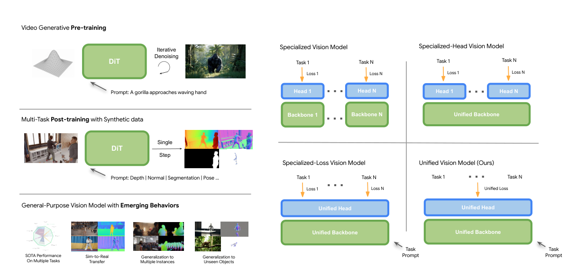
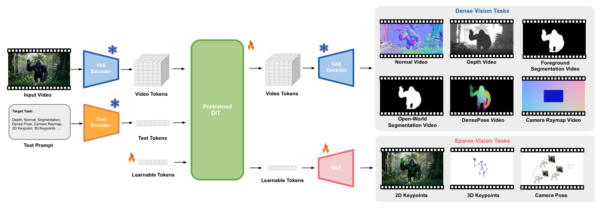
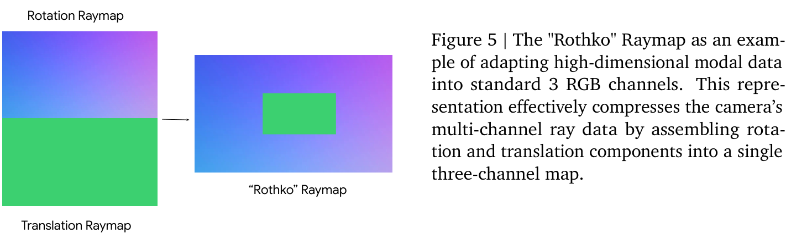
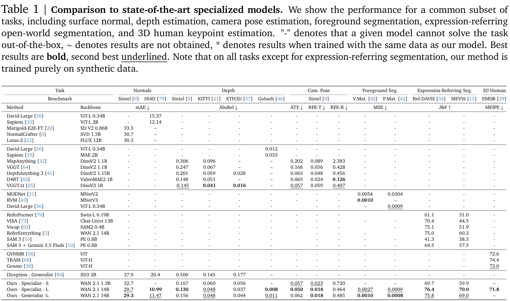
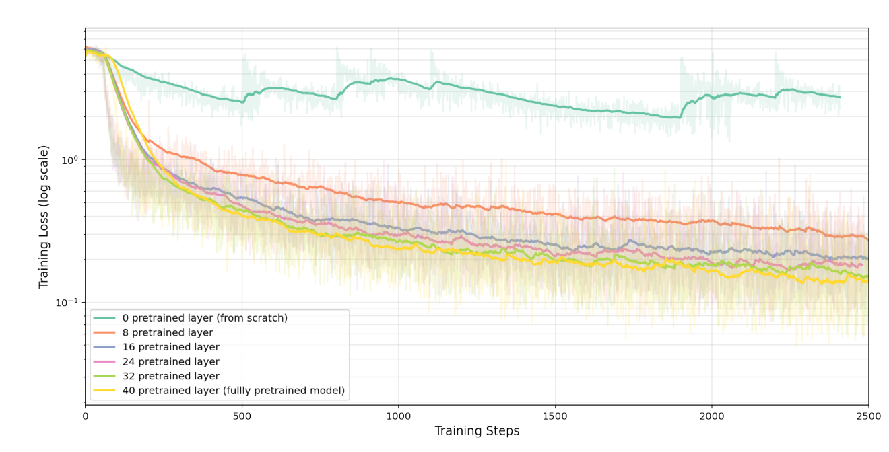
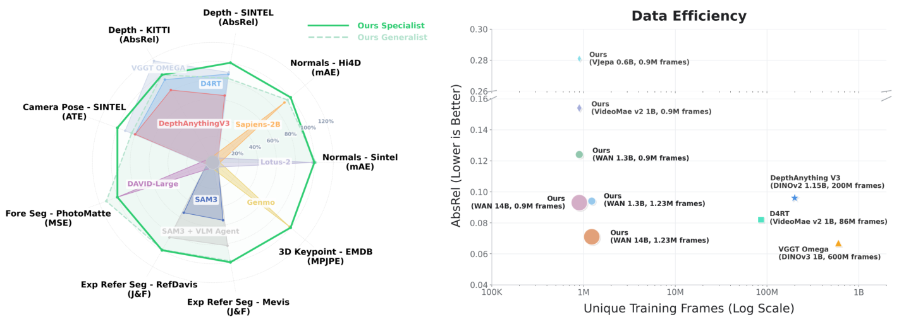
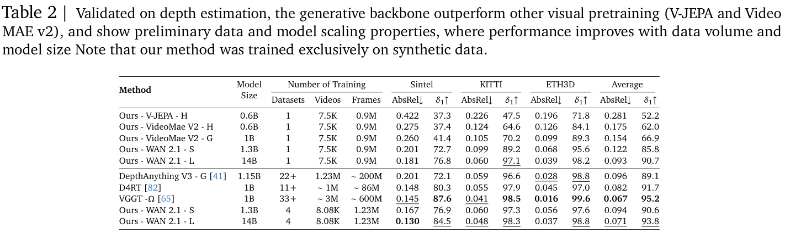
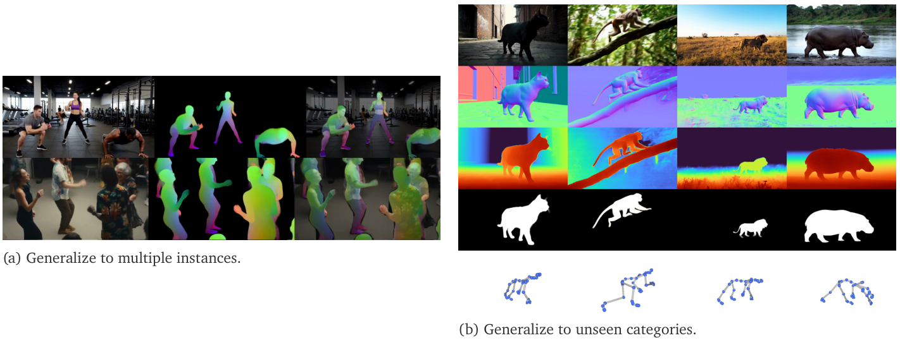

# GenCeption：视频生成模型如何成为通用视觉学习器

!!! info "论文信息"
    **论文题名：** Video Generation Models are General-Purpose Vision Learners。 
    **模型 / 方法名：** GenCeption。 
    **作者：** Letian Wang、Chuhan Zhang、Rishabh Kabra、Jasper Uijlings、Steven Waslander、Andrew Zisserman、Joao Carreira、Kaiming He、Misha Andriluka、Eduard Gabriel Bazavan、Andrei Zanfir、Cristian Sminchisescu。 
    **机构：** Google DeepMind、University of Toronto、University College London、University of Oxford、MIT、Lund University。 
    **时间 / 主题：** 2026-07；视频生成预训练 / 通用视频感知 / 具身视觉状态。 
    **会议：** arXiv 页面备注为 ECCV 2026；正式出版信息以会议最终版本为准。 
    **原论文：** [arXiv:2607.09024](https://arxiv.org/abs/2607.09024)，[PDF](https://arxiv.org/pdf/2607.09024)。 
    **项目页：** [genception.github.io](https://genception.github.io)。论文未在正文中给出独立 GitHub 代码仓库。 
    **元数据来源与核验口径：** 来源为 arXiv 摘要页、PDF 和项目页；Checked Date：2026-07-13；Repro Status：Paper / project page reviewed, independent reproduction not claimed。

## 生成视频的知识，怎样变成可用的感知输出

GenCeption 把预训练视频生成器改造成文本指令驱动的视频感知模型。输入一段真实 RGB 视频和目标任务，模型一次前向输出深度、法向、分割或相机 raymap；通过额外的查询 token，还能回归 2D/3D 关键点。它要解决的困难是，生成器虽然学过大规模视频，却原本从噪声逐步生成视觉内容，不能直接当作输入视频到几何状态的预测器。[↗](https://arxiv.org/pdf/2607.09024v1#page=5)[↗](https://arxiv.org/pdf/2607.09024v1#page=6)

论文把改造尽量集中在三个地方。首先，把带噪输入与多步采样改成干净视频 latent 的一次前向。其次，把多种密集标签编码为同一种三通道视频，让原来的 VAE 解码器继续工作。最后，把任务选择交给文本条件，并以统一的 $L_2$ 损失做感知微调。这样可以继承生成模型的视觉、时间和语言表示，减少为每个任务重新设计网络接口的工作。

结果需要分两层看。专项微调后的大模型，在多个任务上接近或超过表内专用方法；一套权重联合训练多个任务后，前景分割改善，部分深度与相机指标退化，稀疏人体关键点更出现严重的联合训练问题。因而“同一种架构能表达多种任务”和“同一个模型能无损兼顾所有任务”是两项不同主张，本文对前者的证据更完整。[↗](https://arxiv.org/pdf/2607.09024v1#page=11)[↗](https://arxiv.org/pdf/2607.09024v1#page=12)

Figure 1 左侧先展示预训练目标如何从噪声到视频，再展示感知后训练如何从真实视频到目标模态。右侧的对比重点是任务差异被放在哪里：不同骨干、不同输出头、不同损失，还是同一模型配合不同数据表示与任务文本。后文的 raymap 和深度归一化，正是把任务要求放进数据格式的具体例子。

{ width="920" }

*原论文 Figure 1。左侧区分视频生成预训练与感知后训练，右侧展示作者希望统一的 backbone、head、loss。稀疏查询分支及其联合训练结果，需要结合 Figure 4 和消融实验理解。[↗](https://arxiv.org/pdf/2607.09024v1#page=2)*

GenCeption 的输出是感知状态，论文没有训练动作生成器，也没有机器人闭环控制实验。放进具身系统时，它更接近视频到状态的感知模块。深度、相机和关键点可以为后续模块提供输入，但论文的感知成绩不能直接换算成控制成功率。

## 干净输入、零时间与取负输出分别解决什么

原来的 text-to-video 模型包含 VAE、文本编码器和视频 Diffusion Transformer。VAE 在像素视频与 latent 之间转换；文本编码器提供语言条件；DiT 在噪声时间 $t$ 下处理带噪 latent，经多轮更新后得到可解码的视频。Wan2.1 使用 rectified flow 形式，其速度目标为

$$
v=\epsilon-x_0,
$$

其中 $x_0$ 是干净视频 latent，$\epsilon$ 是噪声。这种预训练接口与感知任务有两处不匹配。感知已经拥有输入视频，不需要从随机噪声生成一个场景；所需输出是输入对应的目标模态，也通常不需要对同一段视频采样许多可能结果。[↗](https://arxiv.org/pdf/2607.09024v1#page=6)

GenCeption 因此直接将真实 RGB 视频经 VAE 得到的干净 latent 输入 DiT，将噪声条件固定为 **$t=0$**，并只运行一次。在本文采用的时间约定下，$t=0$ 对应生成过程的干净端点。固定这个条件，是让 DiT 的噪声调制与实际输入匹配，并不意味着仍在执行完整扩散过程的第一步。

接下来还要处理输出的含义。预训练 DiT 原本预测速度，而后续 VAE decoder 需要视频 latent。作者对 DiT 原始输出取负，再交给监督或解码器。对应原速度定义，有

$$
-v=x_0-\epsilon.
$$

这一变换保留了干净信号的正号，作者报告它能改善收敛与性能。但这个关系不是 $-v=x_0$ 的恒等式，也不是无需训练就能把输入 RGB 变成目标深度。感知微调仍要学习从输入视频到指定模态的映射；取负是在复用预训练末端输出时选择较合适的初始化接口。[↗](https://arxiv.org/pdf/2607.09024v1#page=7)

论文直接使用 DiT **最后一层**的输出，避免从中间层提特征后另建任务专用密集解码器。原因在于最后输出原本就与 VAE 解码路径相接，继续沿用它可以保留更多预训练接口。干净输入、正确的时间条件、速度取负和末层解码，是一组配合使用的设计；原文说明了这些选择的动机，但现有消融没有逐项分离各设计的贡献。

## 哪些模块被冻结，哪些参数在学习

GenCeption 基于开源权重的 **Wan2.1**，实验使用 1.3B 和 14B 两种 DiT 规模。Figure 4 的雪花与火焰图标给出了训练边界：VAE encoder、VAE decoder 和 text encoder 冻结，DiT 参与训练，稀疏任务新增的 learnable tokens 与 MLP 也参与训练。因此这里既不是从零学习视频表示，也不是仅在冻结的视频骨干上训练一个读出头。[↗](https://arxiv.org/pdf/2607.09024v1#page=6)

| Component | 输入与输出 | Training status |
|---|---|---|
| VAE Encoder | RGB 视频或目标模态视频 → latent | Frozen |
| Text Encoder | 任务文本或指代表达式 → text tokens | Frozen |
| Pretrained DiT | 干净输入 latent、文本条件、固定 $t=0$ → 目标表示 | Trainable |
| VAE Decoder | 预测的密集 latent → 三通道目标视频 | Frozen |
| Learnable tokens | 每个原视频帧一个可学习查询 | Trainable |
| MLP | 稀疏查询输出 → 每帧结构化坐标 | Trainable |

沿 Figure 4 上方的密集路径，输入视频进入 VAE，latent 与任务文本共同进入 DiT，预测结果再经原 VAE decoder 还原成指定模态。沿下方稀疏路径，附加查询与视频 token 一起处理，查询输出交给 MLP。两条路径共享 DiT，但读出方式确实不同。

{ width="920" }

*原论文 Figure 4。雪花表示冻结组件，火焰表示训练组件；上方密集模态沿用 VAE decoder，下方稀疏坐标由新增 token 与 MLP 输出。相机位姿也可以通过先预测 raymap 再恢复几何量的路径获得。[↗](https://arxiv.org/pdf/2607.09024v1#page=6)*

任务文本指定本次请求的输出。例如，深度与法向可以使用不同任务条件，指代分割则还需要描述要定位的对象。图上列出多种可能结果，不表示一次前向自动同时返回所有模态。共享模型权重减少了部署多个专用网络的负担，但若逐项请求多种输出，仍需按任务调用这个接口。

## 把密集任务放进三通道空间

统一密集解码器的约束来自 VAE 的原生输出格式。GenCeption 将所有密集目标表示为值域在 $[0,1]$ 的三通道视频，再把这些目标经同一个 VAE 编成训练 latent。模型面对的始终是视频到视频 latent 的映射，任务之间的语义差异由文本条件与目标编码定义。[↗](https://arxiv.org/pdf/2607.09024v1#page=7)

| Target modality | Three-channel representation | 表示所承载的信息 |
|---|---|---|
| Depth | 将处理后的单通道深度复制到三个通道 | 每像素相对深度 |
| Segmentation | 将单通道前景或目标 mask 复制到三个通道 | 前景归属或指代目标区域 |
| Surface normal | 三个通道分别表示不同分量 | 局部表面方向 |
| DensePose | 不同通道承载对应的密集人体表示 | 人体表面相关的密集输出 |
| Camera raymap | 在同一图像的不同空间区域放置 origins 与 directions | 相机相关的射线几何 |

复制单通道目标并不会增加三份独立监督信息，它只是使深度或 mask 符合已训练 VAE 的输入格式。法向则需要三维分量，三个通道分别有意义。这种表示统一让多个任务使用同一个输出网络，却没有消除每个任务的数据解释规则。

相机任务更能说明这种思路。射线原点和方向合计需要六个通道，直接堆叠会超出三通道接口。作者使用 **“Rothko” raymap**，将 origins 放在中心区域，将 directions 放在周边。Figure 5 左侧的 translation 与 rotation raymap 在右侧合成一幅三通道图，空间位置承担了区分两类信息的职责。[↗](https://arxiv.org/pdf/2607.09024v1#page=7)

{ width="1000" }

*原论文 Figure 5。先看中心色块承载的平移相关部分，再看周边变化的方向场。这个例子说明如何通过任务特定的空间布局沿用三通道解码器。[↗](https://arxiv.org/pdf/2607.09024v1#page=7)*

该设计使用了相机几何表示的结构，不能泛化为任意六通道数据都能无损塞进三通道。部署还需要知道布局、坐标约定及从预测 raymap 恢复相机参数的方法；论文没有展开完整的区域比例和求解流程，所以“可统一成 RGB”与“下游立即得到标准相机矩阵”之间仍有接口工作。

## 稀疏坐标为什么需要额外查询

关键点与密集图像不同。下游通常需要直接读取每帧的坐标数组，不能只得到一幅绘有骨架的图片。GenCeption 为原视频的每一帧添加一个可学习 token，共 $T$ 个；这些 token 经过 DiT 后，由 MLP 输出该帧的 $K$ 维结构化目标。$K$ 表示每帧目标向量维度，不应直接理解成关键点数量。[↗](https://arxiv.org/pdf/2607.09024v1#page=7)

位置编码需要处理两种不一致。第一，新增查询没有天然对应的空间像素位置，因此作者让空间位置可学习。第二，视频 VAE 把原来的 $T$ 帧压缩成较短的 latent 时间轴 $T'$，但查询仍是一帧一个。如果直接把原帧索引用于 3D RoPE，就会让查询时间位置超出预训练时视觉 token 使用的范围。作者通过 position interpolation 缩放查询的时间索引，使其落在压缩后的时间范围内。

这既保留了原始帧级输出的粒度，也尽量沿用 DiT 现有的时空位置机制。原文报告增加查询 token 比额外增加 attention layers 更好，但没有给出对应的量化表格。可确认的贡献是一个具体稀疏接口，不能把它写成已经消除了密集与稀疏任务的表示冲突。后面的联合训练失败，正发生在这个扩展上。

## 统一损失的关键在目标如何归一化

GenCeption 使用统一的 $L_2$ 损失。密集任务在 **latent 空间**比较预测与目标 VAE latent；稀疏任务在 **输出坐标空间**比较预测与真值。统一的是损失形式，监督所在的表示空间仍然不同。模型没有为法向、深度和分割分别设计一组专用损失，但它需要先让各任务的目标适合这种回归。[↗](https://arxiv.org/pdf/2607.09024v1#page=9)

深度是最清楚的例子。单目深度具有尺度歧义，同一视觉结构可能对应不同绝对尺寸。作者先按每段视频的场景中位深度归一化目标，把不同场景的尺度差异移到数据预处理阶段。随后对归一化后的深度 $d$ 使用

$$
d'=\operatorname{clip}\bigl(\alpha\log(d+1),0,1\bigr).
$$

对数映射压缩深度动态范围，$\alpha$ 改变近处细节与远处结构在有限区间中的分配，最后裁剪到 RGB 目标所需的 $[0,1]$。原文没有提供 $\alpha$ 的具体值。[↗](https://arxiv.org/pdf/2607.09024v1#page=9)

这种处理有两个实际后果。预测目标已经去掉每段视频的原始中位尺度，所以输出不能天然当作任意场景的绝对米制深度；落入裁剪饱和区的值，也不能仅靠逆变换恢复全部原始数值。这里的“统一”是选择一个可用的规范化感知目标，而非证明每项物理量都能无损地经 RGB VAE 往返。

统一损失还没有取消任务间的平衡问题。作者把它主要交给 **data mixture ratio**，通过不同任务数据出现的比例调整学习。深度的归一化、raymap 的空间布局、任务采样比例共同决定了各类监督的实际作用。因此工程定制从网络头和损失函数转移到了目标表示与数据混合，仍需认真设计和记录。

## 合成数据怎样一次提供多种监督

多任务视频感知需要时间对齐的多模态标签，而现实数据集往往只提供其中一部分。GenCeption 用可控渲染构造基础训练集：800 个 RenderPeople 人体资产配合 200 种 CMU motion capture 动作，变化三维场景或 HDRI 背景、焦距、相机位置和运动轨迹，总计生成 **7500 段视频**。[↗](https://arxiv.org/pdf/2607.09024v1#page=8)[↗](https://arxiv.org/pdf/2607.09024v1#page=9)

Blender 的不同 render passes 提供法向、深度和分割 mask；绑定骨架中的关节位置提供 2D/3D 关键点真值。这样同一个动作序列可以给出多种对齐监督，不必分别采集多套真实视频标签。输入 RGB、目标模态视频及任务文本还会离线编码，缓存为 latent 和 text embeddings，减少训练中的重复编码成本。

这套人体合成集并不是全部训练数据。作者还引入 TartanAir、Virtual KITTI 和 MVS Synth 增加深度监督，并使用 TartanAir 的相机轨迹。表达式指代分割则使用真实的 MeViS、Ref-COCO 和 YouTube-VOS 数据，因为这类语言与对象对应监督已有可用数据。[↗](https://arxiv.org/pdf/2607.09024v1#page=9)

| Data source | 提供的监督或变化 | 比较时应保留的边界 |
|---|---|---|
| Human-centric synthetic videos | 人体、动作、场景与相机变化，多种对齐标签 | 基础合成集为 7500 段 |
| TartanAir | 额外深度与相机轨迹 | 几何训练已不限于人体合成场景 |
| Virtual KITTI / MVS Synth | 额外深度 | 改变训练域与场景多样性 |
| MeViS / Ref-COCO / YouTube-VOS | 真实语言指代分割监督 | 此任务不属于纯合成感知训练 |
| Wan2.1 pretraining | 大规模文本到视频的初始化 | 不包含在下游 7500 段等数据统计内 |

“从合成到真实”的主张针对相应感知任务的后训练数据，不能扩展成基础视频模型从未使用真实视频。类似地，作者强调多数任务没有使用评测 benchmark 的配套训练集；但 MeViS 本身同时出现在指代训练数据和评测列表中，该任务应按其数据划分和监督设置理解，不能统称所有 benchmark 都是完全未见数据集。

## 训练资源与评测协议决定结果怎样比较

实现保留 Wan2.1 的视频输入规格。每段输入 81 帧，24 FPS，分辨率 $480\times832$；VAE 的时间压缩因子为 4，两个空间维度压缩因子均为 8。训练使用 batch size 64，在 **256 个 v6e TPU** 上运行 15000 步。[↗](https://arxiv.org/pdf/2607.09024v1#page=9)

| Training item | Setting |
|---|---|
| Backbone sizes | Wan2.1 1.3B / 14B |
| Video input | 81 frames, 24 FPS, $480\times832$ |
| VAE compression | Temporal $4\times$, spatial $8\times$ per axis |
| Optimizer | Adam |
| Learning rate | $5\times10^{-5}$ |
| Warmup | First 250 steps, linear |
| Training length | 15000 steps |
| Batch size / Hardware | 64 / 256 v6e TPUs |
| Stability | Gradient clipping and gradient dropping |

Gradient clipping 将梯度范数限制在阈值内；gradient dropping 则在范数超过更高阈值时直接丢弃整个 batch。后者会改变哪些样本实际参与一次参数更新，与普通裁剪不是同一操作。作者称二者对稳定训练重要，但未给出具体阈值、各任务数据比例及训练墙钟时间。下游数据规模相对较小，并不代表这套 14B 后训练只需要很少的计算资源。

评测中的几项具体选择影响可比性。Hi4D 沿用 Sapiens/DAVID 的 pairs 28、32、37，使用 camera 4、六名受试者，共 1195 帧。Goliath 沿用 DAVID 选取的 12 台相机、16 帧和四名受试者，含 face、upper body、full body 分组，共约 2.2K 帧。VideoMatte 没有官方 split，作者使用先前 RVM 工作构造的 static split。指代分割沿用 VoCap 的 Ref-VOS-DAVIS 与 MeViS 评测口径。[↗](https://arxiv.org/pdf/2607.09024v1#page=11)

| Task | Main reported metric | 读数方向与含义 |
|---|---|---|
| Surface normal | mAE | 越低越好，平均角度误差 |
| Depth | AbsRel | 越低越好，相对深度误差 |
| Camera pose | ATE, RPE-T, RPE-R | 越低越好，平移与旋转误差分别观察 |
| Soft foreground | MSE | 越低越好，软前景目标的均方误差 |
| Expression-referring segmentation | J&F | 越高越好，区域重叠与轮廓质量的均值 |
| 3D human keypoints | MPJPE | 越低越好，关节位置误差 |

主表同时含不同指标，不能把各列差值直接合并成统一精度。原表的 `-` 表示模型不能开箱处理该任务，`~` 表示没有取得结果，两者都不是零误差。专项版与通用版也必须分别读取，否则会把不同权重的最好成绩拼成一个并不存在的万能模型。

## 几何结果的优势随数据域和误差分量变化

先看法向估计。Sintel 中，14B 专项版 mAE 为 29.7，低于 Marigold-E2E-FT 的 33.5、NormalCrafter 的 30.7 和 Lotus-2 的 30.3；通用版进一步达到 29.3。Hi4D 中，专项版为 10.99，通用版为 11.47，二者都低于 David-Large 的 15.37 和 Sapiens 的 12.14，但联合训练在这个数据集上略有退化。即使同一个任务，跨数据集的多任务收益也不一致。[↗](https://arxiv.org/pdf/2607.09024v1#page=11)

深度的比较更能避免“所有几何任务全面领先”的误读。以下摘自 Table 1，均为 AbsRel。

| Method | Sintel ↓ | KITTI ↓ | ETH3D ↓ | Goliath ↓ |
|---|---:|---:|---:|---:|
| MapAnything | 0.306 | 0.096 | ~ | ~ |
| VGGT | 0.247 | 0.067 | ~ | ~ |
| DepthAnything 3 | 0.201 | 0.059 | 0.028 | ~ |
| D4RT | 0.148 | 0.051 | ~ | ~ |
| VGGT-Ω | 0.145 | 0.041 | 0.016 | ~ |
| Ours - Specialist - S | 0.167 | 0.060 | 0.056 | ~ |
| Ours - Specialist - L | 0.130 | 0.048 | 0.037 | 0.008 |
| Ours - Generalist - L | 0.156 | 0.048 | 0.044 | 0.011 |

14B 专项版在 Sintel 的 0.130 优于 VGGT-Ω 的 0.145，但 KITTI 和 ETH3D 分别为 0.048、0.037，仍高于 VGGT-Ω 的 0.041、0.016。ETH3D 上 DepthAnything 3 的 0.028 也更低。视频生成先验带来有效的几何迁移，不代表每个数据域都胜过专用重建模型。人体相关 Goliath 上，专项版 0.008 与通用版 0.011 则优于 Table 1 中 David-Large 的 0.012 和 Sapiens 的 0.033。[↗](https://arxiv.org/pdf/2607.09024v1#page=11)

相机位姿还要区分平移和旋转。下表同样取自 Table 1 的 Sintel 评测。

| Method | ATE ↓ | RPE-T ↓ | RPE-R ↓ |
|---|---:|---:|---:|
| MapAnything | 0.202 | 0.089 | 2.383 |
| VGGT | 0.168 | 0.056 | 0.428 |
| DepthAnything 3 | 0.065 | 0.048 | 0.456 |
| D4RT | 0.065 | 0.024 | 0.126 |
| VGGT-Ω | 0.057 | 0.059 | 0.407 |
| Ours - Specialist - S | 0.057 | 0.023 | 0.720 |
| Ours - Specialist - L | 0.050 | 0.018 | 0.464 |
| Ours - Generalist - L | 0.062 | 0.018 | 0.485 |

专项大模型的 ATE 和 RPE-T 很强，但 RPE-R 0.464 高于 D4RT 的 0.126，也高于 VGGT-Ω 的 0.407。通用模型的 RPE-T 保持 0.018，ATE 与 RPE-R 则退化。若实际系统依赖准确朝向，单看 ATE 会遗漏有影响的差异；raymap 的统一表示并未让所有位姿分量都达到最佳。

## 分割、语言指代与人体关键点各自证明什么

软前景分割最明显地受益于联合训练。VideoMatte 的 MSE 从专项版 0.0027 降到通用版 0.0010，与表内 RVM 相同；PhotoMatte 从 0.0009 降到 0.0008。这个变化说明共享任务可以带来正迁移，但不宜推广成所有密集任务都受益，因为前面的深度与位姿已经给出反例。[↗](https://arxiv.org/pdf/2607.09024v1#page=11)

表达式指代分割还考察语言条件是否能定位对象，而不只是输出通用前景。J&F 对所有文本查询取平均，以下保留 Table 1 的方法名称与数值。

| Method | Ref-DAVIS J&F ↑ | MeViS J&F ↑ |
|---|---:|---:|
| ReferFormer | 61.1 | 31.0 |
| VISA | 70.4 | 44.5 |
| Vocap | 75.1 | 51.9 |
| ReferEverything | 75.0 | 60.3 |
| SAM 3 | 41.3 | 38.3 |
| SAM 3 + Gemini 3.5 Flash | 64.5 | 57.5 |
| Ours - Specialist - S | 69.7 | 59.9 |
| Ours - Specialist - L | 76.4 | 70.0 |
| Ours - Generalist - L | 75.8 | 69.0 |

专项大模型在两个 benchmark 都取得较高成绩，通用版分别降低 0.6 和 1.0 个 J&F 点。与同样基于 Wan2.1 14B 的 ReferEverything 相比，它在 Ref-DAVIS 上提高 1.4 点，在 MeViS 上提高 9.7 点。不过，这张表没有把所有方法的数据、适配过程及交互方式统一，不能把全部差距单独归因于某一种预训练目标。这里尤其应记住，指代分割使用了真实的语言监督数据。

稀疏人体姿态展示了架构扩展的可行性。Figure 8 的设置直接输入完整视频帧，不要求先运行 person detection 或 2D keypoint estimation。Table 1 中，14B 专项版的 EMDB MPJPE 为 71.8，对照 GVHMR、TRAM、Genmo 分别为 72.6、74.4、73.0。专项模型在这种直接输入接口下达到有竞争力的结果。[↗](https://arxiv.org/pdf/2607.09024v1#page=10)[↗](https://arxiv.org/pdf/2607.09024v1#page=11)

但通用版关键点一格为 `~`，不能把专项版的 71.8 填过去。作者明确报告，加入关键点联合训练会严重损害关键点成绩，也会影响其他密集任务。这不是一个可以用“通用版略有下降”带过的细节，它决定了论文的统一模型到底统一到了什么程度。[↗](https://arxiv.org/pdf/2607.09024v1#page=12)

{ width="1200" }

*原论文 Table 1。阅读底部 Specialist-S、Specialist-L 和 Generalist-L 三行时，要沿同一列比较；Generalist 的关键点结果为空缺，不能与 Specialist 的最佳值合并。上方专用方法也只在对应任务列有可用结果。[↗](https://arxiv.org/pdf/2607.09024v1#page=11)*

## 联合训练的负面结果为何重要

统一输出格式可以降低工程复杂度，却不会自动让任务梯度兼容。把 14B 专项版与通用版放在一起，能看到模型容量、训练混合与任务接口共同带来的取舍。

| Metric / Benchmark | Specialist-L | Generalist-L | Joint-training change |
|---|---:|---:|---|
| Normal mAE / Sintel ↓ | 29.7 | 29.3 | Improves |
| Normal mAE / Hi4D ↓ | 10.99 | 11.47 | Regresses |
| Depth AbsRel / Sintel ↓ | 0.130 | 0.156 | Regresses |
| Depth AbsRel / KITTI ↓ | 0.048 | 0.048 | Unchanged |
| Depth AbsRel / ETH3D ↓ | 0.037 | 0.044 | Regresses |
| Camera ATE / Sintel ↓ | 0.050 | 0.062 | Regresses |
| Camera RPE-T / Sintel ↓ | 0.018 | 0.018 | Unchanged |
| Foreground MSE / VideoMatte ↓ | 0.0027 | 0.0010 | Improves |
| Foreground MSE / PhotoMatte ↓ | 0.0009 | 0.0008 | Improves |
| Referring J&F / Ref-DAVIS ↑ | 76.4 | 75.8 | Regresses slightly |
| Referring J&F / MeViS ↑ | 70.0 | 69.0 | Regresses slightly |

这些差异支持的是选择性正迁移。比如通用版让前景 MSE 更低，但 Sintel 深度 AbsRel 从 0.130 增至 0.156，相对增加 20%；这个相对变化由表内数值计算，各任务仍需按自身指标判断。评估通用模型时，需要按目标应用分别决定这些交换是否可以接受。

作者为稀疏任务退化提出两种解释。坐标回归与预训练的连续像素输出差异较大；从零学习的额外 token 进入 DiT 后，可能扰动原本已经训练好的注意力模式，需要更多数据重新协调。这两点是与现象相符的机制假设，论文没有通过逐项控制实验把它们完全分离。不能直接断言“所有负迁移都由随机查询造成”，也不能据此认定查询 token 这条路线本身不可行。[↗](https://arxiv.org/pdf/2607.09024v1#page=12)[↗](https://arxiv.org/pdf/2607.09024v1#page=13)

更稳妥的设计启示是，预训练接口的一致性可以减少适配困难，但统一框架需要同时验证单任务可表达性和多任务可共训性。GenCeption 的密集 RGB 路径较贴近生成预训练；稀疏坐标路径则用更大的接口变化换取下游直接可用的结构化输出，其代价需要独立评估。

## 哪些实验支持预训练有效，哪些还不能证明目标本身最优

论文提供了两类相关证据。Table 2 将不同预训练骨干在同一感知训练集上微调，比较深度结果；Figure 9 在 DiT 内改变继承预训练权重的层数，观察训练收敛。两者回答不同问题，不能合并成一个完全控制了数据与算力的“预训练目标优劣”实验。[↗](https://arxiv.org/pdf/2607.09024v1#page=11)[↗](https://arxiv.org/pdf/2607.09024v1#page=13)

同一个 7.5K 视频、约 0.9M 帧的合成感知训练集上，Table 2 的结果如下。前三列深度误差与 Average 均为 AbsRel，最后一列是作者报告的平均 $\delta_1$。

| Backbone | Model size | Sintel ↓ | KITTI ↓ | ETH3D ↓ | Average AbsRel ↓ | Average $\delta_1$ ↑ |
|---|---:|---:|---:|---:|---:|---:|
| V-JEPA-H | 0.6B | 0.422 | 0.226 | 0.196 | 0.281 | 52.2 |
| VideoMAE V2-H | 0.6B | 0.275 | 0.124 | 0.126 | 0.175 | 62.0 |
| VideoMAE V2-G | 1B | 0.260 | 0.105 | 0.099 | 0.154 | 66.9 |
| Wan2.1-S | 1.3B | 0.201 | 0.099 | 0.068 | 0.122 | 85.8 |
| Wan2.1-L | 14B | 0.181 | 0.060 | 0.039 | 0.093 | 90.7 |

Wan 初始化在这套适配方案中表现更好。与接近规模的 VideoMAE V2-G 相比，1.3B Wan 的平均 AbsRel 从 0.154 降到 0.122；继续放大至 14B，则降到 0.093。这是生成模型可提供有效感知初始化的证据。

但下游数据相同，不等于基础预训练数据、目标和规模全部相同。14B 与 0.6B 的参数差距很大；即使比较 1B 与 1.3B，原始视频数据和预训练配方也未被严格控制。因此，这个实验不足以把全部优势归因为 diffusion objective 本身。它更直接支持“现有 Wan 权重在此感知后训练方案中更有效”，而不是“在任何等预算条件下扩散预训练一定最佳”。

Figure 9 更接近对预训练必要性的直接检验。图中继承预训练权重的层数为 0、8、16、24、32、40；纵轴是对数刻度的 **training loss**，横轴到 2500 步。完全从零初始化的曲线整体下降很慢，继承更多层后通常下降更快、终点更低，完整预训练的 40 层表现较好。

{ width="1000" }

*原论文 Figure 9。先对比从零初始化与任何一条继承预训练权重的曲线，再看增加继承层数的趋势。图测量训练损失，支持收敛收益，不能直接当作测试集几何误差或证明从零训练永远无法学习。[↗](https://arxiv.org/pdf/2607.09024v1#page=12)*

这个结果也解释了为什么保持解码接口、少改网络结构具有实际价值。大量有效参数已经来自生成预训练，下游数据主要承担把它们导向目标任务的工作；新增随机初始化组件则需要在较小后训练数据上补学其与这些表示的配合。

## 数据效率成立于感知后训练口径

扩大数据时，作者从一个人体合成数据集增加到四个合成数据集，统计从 7.5K 视频、0.9M 帧变为 8.08K 视频、1.23M 帧。这里同时改变了数据量和场景组成，不能当作只复制更多同分布样本的纯规模实验。

| Backbone | Datasets | Videos | Frames | Average AbsRel ↓ | Average $\delta_1$ ↑ |
|---|---:|---:|---:|---:|---:|
| Wan2.1-S, 1.3B | 1 | 7.5K | 0.9M | 0.122 | 85.8 |
| Wan2.1-S, 1.3B | 4 | 8.08K | 1.23M | 0.094 | 90.6 |
| Wan2.1-L, 14B | 1 | 7.5K | 0.9M | 0.093 | 90.7 |
| Wan2.1-L, 14B | 4 | 8.08K | 1.23M | 0.071 | 93.8 |

增大模型与扩充数据都改善平均成绩。1.3B 的平均误差减少 0.028，14B 减少 0.022；四数据集条件下，大模型比小模型进一步降低 0.023。它们支持初步的规模与数据收益，但只有两档模型、两种数据组成，尚不足以拟合稳定 scaling law 或预言任意扩展后的性能。[↗](https://arxiv.org/pdf/2607.09024v1#page=11)[↗](https://arxiv.org/pdf/2607.09024v1#page=13)

再与 Table 2 中其他感知模型的训练规模比较。

| Method | Model size | Training datasets | Training frames | Average AbsRel ↓ |
|---|---:|---:|---:|---:|
| DepthAnything V3-G | 1.15B | 22+ | ~200M | 0.096 |
| D4RT | 1B | 11+ | ~86M | 0.082 |
| VGGT-Ω | 1B | 33+ | ~600M | 0.067 |
| Ours - Wan2.1-L | 14B | 4 | 1.23M | 0.071 |

按该表帧数直接计算，200M、86M、600M 分别约为 1.23M 的 **163、70、488 倍**。GenCeption 用较少的感知监督帧达到接近这些模型的误差区间，但 0.071 仍高于 VGGT-Ω 的 0.067；模型规模也从约 1B 增至 14B。论文使用“7–500 倍更少数据”概括数据效率，具体比较时应以相应行的数量和统计口径为准，而不是把这个区间当成每种对照都满足的精确倍率。[↗](https://arxiv.org/pdf/2607.09024v1#page=11)

更重要的是，这里的 1.23M 没有计入 Wan2.1 先前的生成预训练视频和计算。它反映的是复用已有基础权重后，下游感知标注与训练数据需求较少，不能证明完整训练生命周期比其他方法便宜同样倍数。

{ width="920" }

*原论文 Figure 2。左侧区分专项与通用模型，右侧横轴为对数刻度的感知训练帧数，纵轴为平均深度 AbsRel，越低越好。右图应结合参数规模及基础预训练来源读取。[↗](https://arxiv.org/pdf/2607.09024v1#page=3)*

{ width="1100" }

*原论文 Table 2。上半部分固定感知微调数据比较骨干，下半部分比较外部模型与扩充数据后的 Wan；它们分别回答初始化效果与下游数据效率的问题。[↗](https://arxiv.org/pdf/2607.09024v1#page=11)*

Table 1 与 Table 2 对 D4RT 的部分数值并不一致。前者 KITTI AbsRel 为 0.051、ETH3D 未列结果，后者为 0.055 和 0.045。本文保留各自表格口径；在缺少解释时，不应混合这些单元格重新计算一个所谓统一排名。

## 一次前向的真实成本与泛化边界

GenCeption 去掉了原 Wan 的 50 步扩散采样，但整个感知路径还包含文本编码、视频 VAE 编码、DiT 和输出解码。作者在 **单个 v6e TPU**、81 帧、$480\times832$ 输入下报告以下成本。[↗](https://arxiv.org/pdf/2607.09024v1#page=10)

| Model | End-to-end latency | Throughput | DiT latency | Reported memory |
|---|---:|---:|---:|---:|
| GenCeption 1.3B | 5.92 s | 13.6 FPS | 0.96 s | 15.3 GB |
| GenCeption 14B | 10.03 s | 8.0 FPS | 5.11 s | 42.8 GB |

按表内总时间减去 DiT 时间，剩余路径分别约为 4.96 秒和 4.92 秒。这个差额包括其他端到端环节，不能全部指定为 VAE 解码耗时；但它已经表明，小模型的多数时间并不在 DiT 内。继续压缩 DiT 时，需要同时检查编码、解码与数据移动，否则网络前向的加速不会等比例转化为整体吞吐。

两种规模还共享约 10 GB 的文本编码器和约 0.25 GB 的 VAE，论文提出可以卸载到系统内存，以速度交换设备内存。原文没有完全展开总内存数字的包含关系和卸载后的速度，所以不能自行把这些数字重复相加，或声称卸载不影响延迟。

81 帧除以完整处理时间得到的是 clip 吞吐率，不是每一帧到达后立即返回预测的延迟。模型按完整视频片段处理，报告的 8.0/13.6 FPS 也低于输入的 24 FPS。一次 DiT 前向因此不等于已经实现逐帧实时感知，更不能从原来 50 个采样步骤直接推导端到端快了 50 倍。

最后看 Figure 10 的泛化例子。左侧模型在单人体合成训练后，可以对真实多人的场景输出密集人体表示；右侧在猫、猴子、大型猫科动物、河马等对象上展示法向、深度、mask 和关键点。下游感知监督以人为主，模型仍能在这些类别上输出有结构的结果，说明预训练知识可以超出后训练类别被调用。[↗](https://arxiv.org/pdf/2607.09024v1#page=13)

{ width="920" }

*原论文 Figure 10。左侧是单实例到多实例的迁移，右侧是人体感知训练之外的类别。它展示定性输出，不提供这些动物类别上的系统误差统计，也不意味着动物从未出现在基础视频预训练中。[↗](https://arxiv.org/pdf/2607.09024v1#page=13)*

这些例子与标准 benchmark 的几何成绩共同支持视频生成先验具有迁移价值，但不应把可视化的动物关键点直接当作经过解剖标注验证的姿态。类似地，原生视频骨干为跨帧一致性提供了建模基础，主表却没有单独量化各任务的时间一致性收益。输出看起来连续、单帧误差较低、下游能稳定使用，仍是需要分别检验的性质。

这篇论文最可复用的部分，是一条具体的模型改造路径：复用生成预训练末端接口，用干净输入和固定噪声条件建立确定性感知映射，将密集任务差异落实到目标编码，并把标注资源集中到感知后训练。它同时留下一个明确的未解问题：当结构化稀疏输出要求新增查询与坐标头时，怎样在保留原视频表示的同时实现可靠共训。GenCeption 已经证明多种感知能力能够从同一类视频生成器中提取出来，统一模型的任务冲突与部署成本则决定了这条路线还能走多远。
