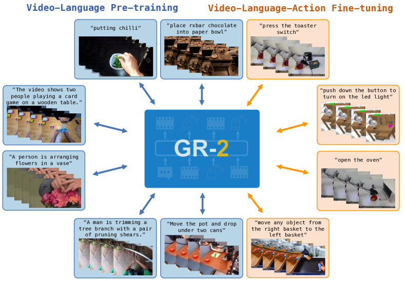
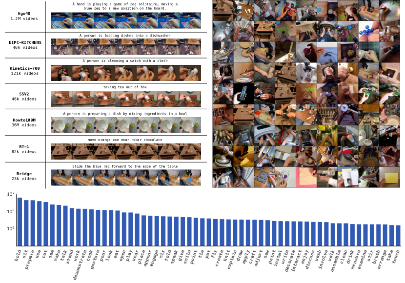
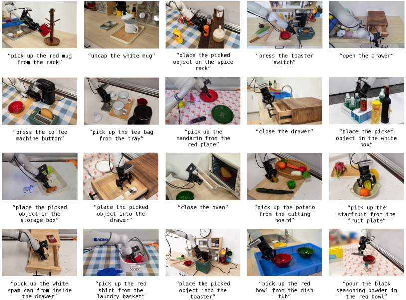
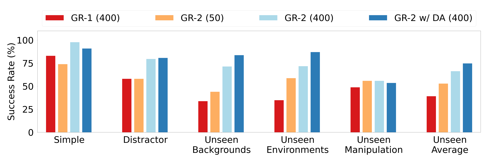
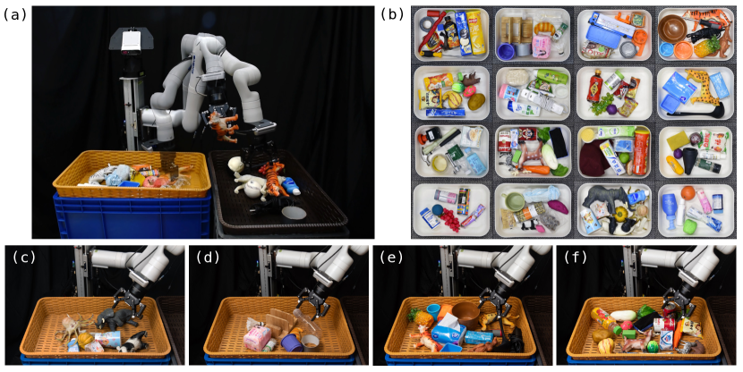
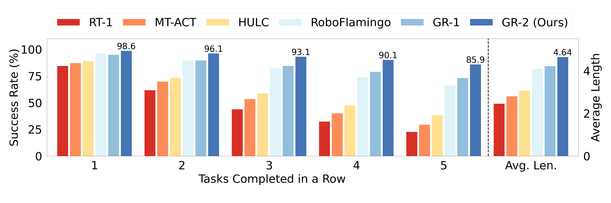

# GR-2：用 web-scale 视频知识迁移到机器人操作

!!! info "论文信息"
    - 论文：`GR-2: A Generative Video-Language-Action Model with Web-Scale Knowledge for Robot Manipulation`
    - 链接：[arXiv:2410.06158](https://arxiv.org/abs/2410.06158)
    - 关键词：video-language-action model、future video prediction、trajectory prediction、web-scale video pre-training、whole-body control

GR-2 的核心价值在于把“互联网视频里的动态先验”正式放进机器人策略训练：先在大规模人类活动视频上学习未来视频预测，再用少量真实机器人轨迹微调，让模型同时预测未来视频和机器人动作轨迹。

如果说 RT-1 证明 Transformer policy 可以吃真实机器人轨迹，GR-2 更像下一步：**没有动作标注的普通视频，也能通过未来预测给机器人提供世界动态知识。**

## 论文位置

传统 VLA 直接学：

\[
\pi(a_{t:t+k}\mid o_{t-h:t}, s_{t-h:t}, l)
\]

GR-2 多走一步：让模型先通过视频预训练学“接下来会发生什么”，再在机器人数据上把未来视频和动作轨迹绑起来。论文 Figure 1 很好地展示了这条线。

{ width="920" }

<small>Figure source: `GR-2`, Figure 1. 原论文图意：GR-2 先在大规模视频数据上预训练，学习未来视频预测，再通过真实机器人轨迹微调，输出机器人动作轨迹并部署到真实机器人操作。</small>

这篇论文最适合放在具身智能专题里，因为它回答的是一个非常实际的问题：机器人数据很贵，能不能让无动作标注的视频数据也参与学习？

## 模型结构

GR-2 是一个 GPT-style visual manipulation policy，输入语言指令、历史环境观测和机器人状态，输出未来动作轨迹。

| Component | GR-2 choice | Why it matters |
| --- | --- | --- |
| Model size | 230M parameters, 95M trainable | 模型不大，重点在训练配方和数据迁移 |
| Language encoder | frozen text encoder | 保持语言表征稳定 |
| Visual encoder | frozen VQGAN encoder | 把视频帧压成离散/latent 表示 |
| Robot state encoder | learnable linear layer | 编码 EEF position / angle 和 gripper state |
| Pre-training head | VQGAN decoder for future video frames | 让模型从普通视频中学动态先验 |
| Fine-tuning head | conditional VAE for future video and action | 把视频预测和动作轨迹预测对齐 |

{ width="920" }

<small>Figure source: `GR-2`, Figure 2. 原论文图意：展示 GR-2 使用的大规模视频预训练数据分布，以及从 web-scale 视频到机器人操作数据的训练路线。</small>

## 训练路线

论文的训练可以分成三段：

```text
web-scale video pre-training
  -> robot trajectory fine-tuning
  -> real-robot rollout with WBC
```

### 1. Web-scale video pre-training

GR-2 使用约 `38M video clips` 和 `50B tokens` 做预训练。通用视频数据覆盖家庭、户外、工作场所、休闲等日常活动；常见数据源包括 HowTo100M、Ego4D、Something-Something V2、EPIC-KITCHENS、Kinetics-700。

训练目标是：给定文本描述和当前视频帧，预测后续视频帧。这一步没有机器人动作，但能让模型获得大量动态知识：物体如何移动、手如何操作物体、容器如何开合、液体/工具/桌面场景如何变化。

### 2. Robot trajectory fine-tuning

机器人微调阶段同时学习 future video generation 和 action prediction。论文强调一个经验：预测动作轨迹比预测单步动作更好，轨迹更平滑，也更容易由控制器实时执行。

机器人数据包括：

| Dataset / setting | Scale | Role |
| --- | ---: | --- |
| Tabletop manipulation | 105 tasks, about 40K trajectories | 8 skills: picking, placing, uncapping, capping, opening, closing, pressing, pouring |
| Data-scarce setting | about 1/8 data, roughly 5K trajectories | 测少样本机器人数据下的视频预训练是否有帮助 |
| End-to-end bin picking | about 94K pick-and-place trajectories, 55 training objects | 测 clutter、unseen objects 和连续 picking |
| CALVIN ABC-D | 20K+ demonstrations, 34 tasks | 测语言条件长任务序列 |

{ width="900" }

<small>Figure source: `GR-2`, Figure 4. 原论文图意：展示 105 个桌面任务和 8 类操作技能，说明 GR-2 的真实机器人训练覆盖了多个操作原语。</small>

### 3. Data augmentation

为了缓解机器人数据稀缺，论文使用物体替换和背景替换增强：扩散模型在指定区域插入新对象，SAM 提取背景区域，再用视频生成模型在保持机器人运动的同时生成增强视频。

这一步很有工程启发：如果模型要泛化到未见背景、未见环境和未见物体，数据增强必须尽量保持动作与机器人运动一致，不能只做静态图像扰动。

## 真实机器人系统

GR-2 使用 `7-DoF Kinova Gen3 + Robotiq 2F-85 gripper`。观测来自两个相机：

| Camera | Role |
| --- | --- |
| Static head camera | 提供工作空间全局视角 |
| Wrist camera | 提供夹爪与环境交互的近距离视角 |

模型预测 Cartesian space 轨迹。生成轨迹先经过优化提高平滑度和连续性，再由 WBC 把 Cartesian 轨迹转成低层 joint actions，并以约 `200Hz` 在真实机器人上执行。

这个细节说明：VLA 输出不是电机命令。论文里的控制系统把碰撞约束和可操作性放进优化框架，真正执行的是控制器投影后的低层动作。

## 实验结果

GR-2 的实验覆盖多任务学习、bin picking 和 CALVIN。

{ width="920" }

<small>Figure source: `GR-2`, Figure 6. 原论文图意：展示多任务真实机器人评测，比较 Simple、Distractor、Unseen Backgrounds、Unseen Environments 和 Unseen Manipulation 等设置下的成功率。</small>

论文的核心结论不是“某个任务分数更高”，而是三件事：

1. web-scale video pre-training 可以迁移到真实机器人操作；
2. 在机器人数据稀缺时，视频预训练带来的收益更明显；
3. 轨迹预测比单步 action prediction 更适合平滑执行和实时控制。

{ width="900" }

<small>Figure source: `GR-2`, Figure 7. 原论文图意：展示 end-to-end bin picking 的源篮、目标篮、seen / unseen objects 和 cluttered settings。</small>

在 CALVIN 上，GR-2 需要在 ABC-D split 中连续执行 5 个语言任务。这类评测比单步抓取更接近长时程具身系统。

{ width="920" }

<small>Figure source: `GR-2`, Figure 10. 原论文图意：展示 CALVIN ABC-D 上完成 1 到 5 个连续任务的成功率和 average length。</small>

## 训练细节要点

| Detail | GR-2 choice | Why it matters |
| --- | --- | --- |
| Pre-training scale | 38M video clips, 50B tokens | 让模型从无动作标注视频中学习动态先验 |
| Robot data scarcity | 5K trajectories for 100+ tasks in scarce setting | 检验小样本机器人迁移 |
| Full tabletop data | 40K trajectories, 105 tasks | 覆盖 8 类技能和多任务泛化 |
| Bin picking data | 94K trajectories, 55 objects | 验证 clutter 和 unseen object generalization |
| Action output | Cartesian trajectory, not single action | 平滑、可优化、易接 WBC |
| Low-level execution | WBC at 200Hz | 把高层轨迹投影到可执行 joint actions |
| Cameras | static head + wrist camera | 兼顾全局语义和局部接触 |

## 局限

GR-2 还不是今天意义上的大 VLA。它的模型规模较小，任务主要集中在桌面操作和 bin picking，开放家庭长任务、无效指令拒绝、跨 embodiment scaling、动作块 flow matching 等问题还没有完全展开。

但它在具身智能论文谱系里很重要，因为它清楚地证明了一点：**视频预测不是只为了生成好看的未来，它可以作为机器人策略的动态知识来源。**

## 参考链接

1. [arXiv:2410.06158](https://arxiv.org/abs/2410.06158)
2. [ar5iv HTML and figures](https://ar5iv.labs.arxiv.org/html/2410.06158)
