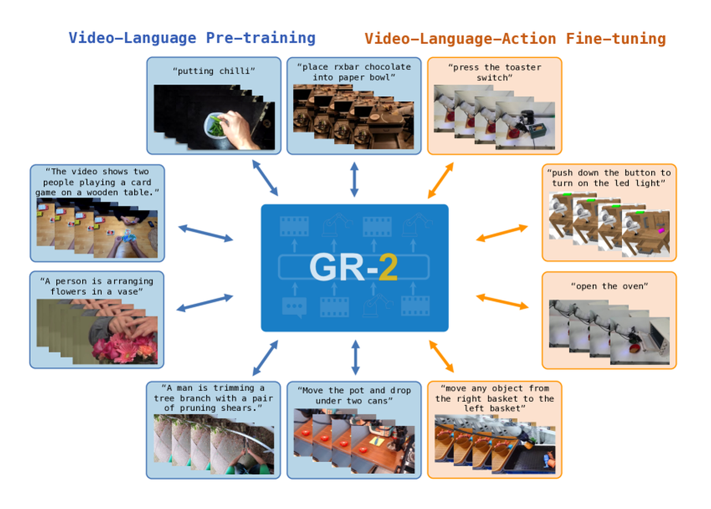
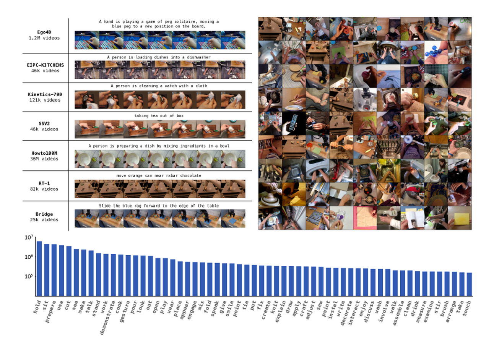
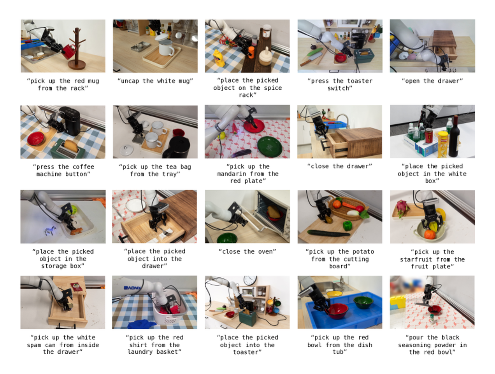
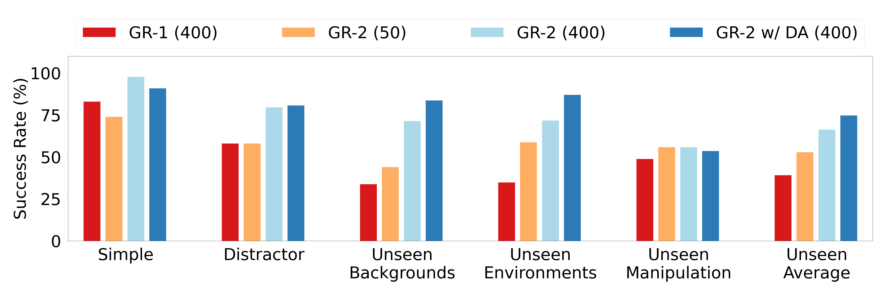
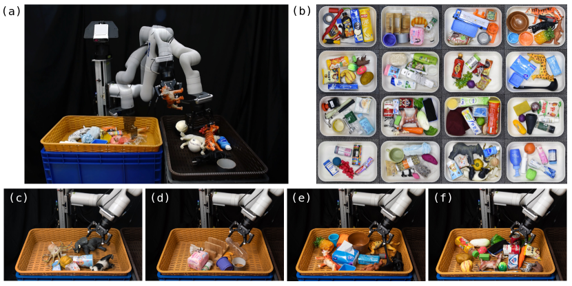
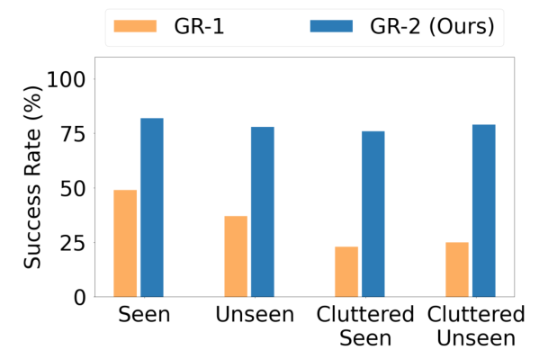
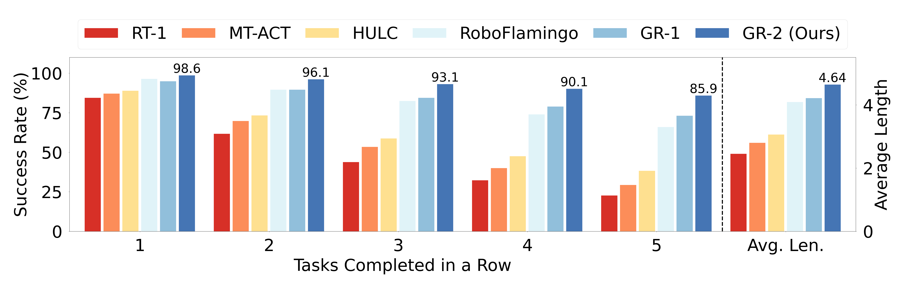
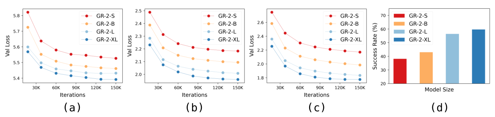
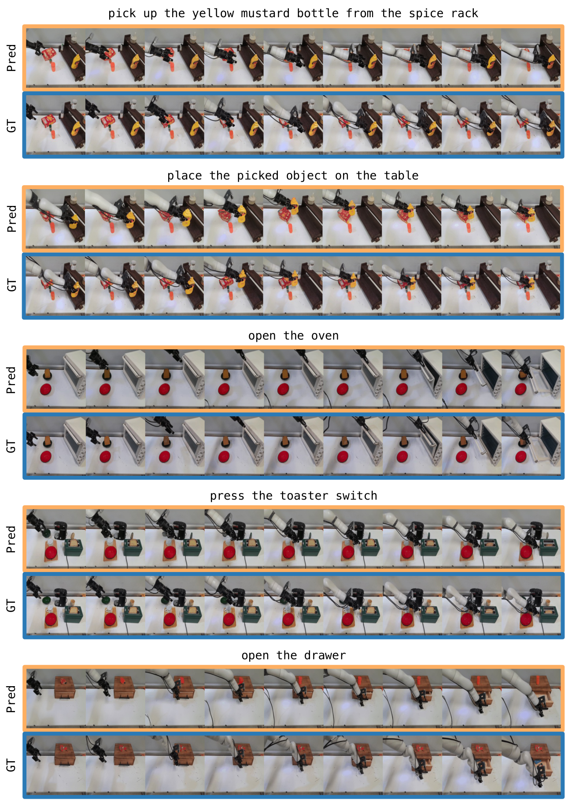

# GR-2：Web 视频知识怎样迁移到机器人操作

!!! info "论文信息"
    **论文题名：** GR-2: A Generative Video-Language-Action Model with Web-Scale Knowledge for Robot Manipulation。 
    **作者：** Chi-Lam Cheang、Guangzeng Chen、Ya Jing、Tao Kong、Hang Li、Yifeng Li、Yuxiao Liu、Hongtao Wu、Jiafeng Xu、Yichu Yang 等（共 12 人）。 
    **机构：** ByteDance Research。 
    **时间 / 主题：** 2024-10；具身智能。 
    **arXiv / 官方报告：** arXiv：[2410.06158](https://arxiv.org/abs/2410.06158)；官方材料：[gr2-manipulation.github.io/](https://gr2-manipulation.github.io/)。 
    **GitHub / 项目：** GitHub：[github.com/mees/calvin](https://github.com/mees/calvin)；项目页：[gr2-manipulation.github.io/](https://gr2-manipulation.github.io/)。 
    **元数据来源与核验口径：** 来源：[arXiv](https://arxiv.org/abs/2410.06158)；[GitHub API / repo](https://github.com/mees/calvin)；[官方 / 项目材料](https://gr2-manipulation.github.io/)；Checked Date：2026-06-15；Repro Status：Paper / official materials reviewed, independent reproduction not claimed。

## 视频知识怎样跨过没有动作标签的鸿沟

GR-2 延续 GR-1 的路线，用语言条件下的未来视频预测为机器人策略提供初始化，再用机器人示范学习动作。规模变化很大，预训练视频从约 80 万段增加到 **3800 万段、约 500 亿 token**，按片段数计算约扩大 47.5 倍。更关键的问题是，这些没有目标机器人动作标签的视频，能否帮助策略适应更多任务、场景和物体。[↗](https://arxiv.org/pdf/2410.06158v1#page=1)[↗](https://arxiv.org/pdf/2410.06158v1#page=17)

视频与机器人示范在这里承担不同职责。预训练看到语言和图像的时间变化，学习“描述中的交互发生后，画面怎样演变”；机器人微调再把视觉变化与末端动作、夹爪状态联系起来。它并没有从人类视频直接获得 Kinova 机械臂的关节命令，也没有省去具身示范。这种分工使互联网数据可以扩大视觉动态覆盖，同时保留一个明确的动作落地阶段。

实验中，GR-2 在接近训练条件的 105 项桌面任务上达到 97.7% 成功率，未见操作条件下为 55.8%；分拣实验的四条件平均成功率从 GR-1 的 33.3% 提高到 79.0%。这些结果说明规模化预训练与系统改造有效，但已见熟练度、新物体操作和工业分拣不是同一能力指标，后两者也各有不同训练数据与评测接口。[↗](https://arxiv.org/pdf/2410.06158v1#page=7)[↗](https://arxiv.org/pdf/2410.06158v1#page=8)

Figure 1 按蓝色与橙色区分两个训练阶段。蓝色中既有人类活动，也有公开机器人视频；橙色中则是目标机器人的具体操作。先分清哪部分只提供视频监督、哪部分提供动作轨迹，才能理解这里的“web-scale knowledge”如何进入策略。

{ width="720" }

*原论文 Figure 1，视频语言预训练与视频语言动作微调的总体关系。图展示两阶段的数据和任务实例，具体模块接口在方法部分展开。[↗](https://arxiv.org/pdf/2410.06158v1#page=2)*

## 策略同时需要语言、视觉历史和机器人状态

GR-2 的任务接口不是一条语言命令直接对应一个动作。设 $l$ 为指令，$o_{t-h:t}$ 为观测历史，$s_{t-h:t}$ 为机器人状态历史，策略输出未来动作轨迹

$$
a_{t:t+k}=\pi(l,o_{t-h:t},s_{t-h:t}).
$$

$h$ 表示历史范围，$k$ 表示动作轨迹范围；论文没有给出它们在各实验中的具体取值。观测告诉模型场景和物体状态，机器人状态则补充末端位置、旋转及二值夹爪状态。相同画面下，机械臂处于不同姿态或夹爪已闭合，合适的下一段动作都可能不同。[↗](https://arxiv.org/pdf/2410.06158v1#page=3)

在机器人微调阶段，输出还包含未来视觉观测，原文将联合学习写成

$$
\pi(l,o_{t-h:t},s_{t-h:t})
\longrightarrow o_{t+1},\ a_{t:t+k}.
$$

这条式子强调视频预测没有在加入动作监督后被完全丢弃。模型继续学习场景将变成什么样，同时生成机器人应执行的轨迹。实际机器人有多个相机视角，输出包括各视角的未来图像；$o_{t+1}$ 是联合视觉输出的简写，不应理解为只预测一张单相机照片。[↗](https://arxiv.org/pdf/2410.06158v1#page=3)[↗](https://arxiv.org/pdf/2410.06158v1#page=4)

从信息流看，两阶段之间的桥梁是语言条件下的视觉动态表示。预训练学到的开门、抓取和移动等画面变化，不能直接替代机器人动作，但可以让策略在少量示范中更容易识别任务相关的视觉状态与演变方向。论文的泛化结果检验了这个整体方案；它没有通过单独控制所有架构与数据因素，给每种先验分配独立的贡献数值。

## 离散视觉 token 与连续动作轨迹如何配合

GR-2 是 GPT 风格的视觉操作策略。文本经冻结的编码器处理，图像经 **VQGAN** 转成离散 token，机器人状态经可训练线性层处理。VQGAN 事先在互联网图像及域内机器人图像上训练，随后在 GR-2 的训练过程中冻结。[↗](https://arxiv.org/pdf/2410.06158v1#page=3)

| Component | 输入与输出 | 在训练中的作用 |
|---|---|---|
| Frozen text encoder | 自然语言 → 文本表示 | 为视频预测与动作提供任务条件 |
| Frozen VQGAN encoder | 每帧图像 → 离散视觉 token | 把视频变成可由自回归模型预测的序列 |
| GPT-style Transformer | 文本与图像序列等条件 → 未来视觉表示 | 先学视频生成，再参与机器人策略 |
| Frozen VQGAN decoder | 预测视觉 token → 未来图像 | 将视觉预期还原为可查看画面 |
| Trainable state projection | 末端位置、旋转、夹爪状态 → 状态表示 | 在机器人微调中引入本体信息 |
| Conditional VAE | 条件信息 → 连续动作轨迹 | 预测一段控制动作 |

视觉生成的基本操作是预测离散图像 token，再用 VQGAN 解码。它与连续 latent 扩散视频模型的多步去噪不是同一种计算接口。预训练时主要是单视角视频；微调时则接入头部与腕部等多视角序列，并预测每个视角的未来。保持视觉表示的编码与解码路径一致，有利于将预训练能力接到机器人任务上。

动作侧使用 **conditional VAE（条件变分自编码器，cVAE）**。输出单位是一条连续动作轨迹，视觉侧的离散 token 不直接充当机械臂的控制值。作者强调，轨迹级输出相较单步动作对平滑性和实时执行很重要：策略可以一次提供连续一段运动，执行层在这段轨迹上持续跟踪，而不要求每个低层控制周期都等待大模型重新决策。[↗](https://arxiv.org/pdf/2410.06158v1#page=4)

报告没有展开 cVAE 的编码器、后验分布、潜变量维度、损失权重和精确条件连接，也没有完整画出视觉 token 与动作模块的注意力结构。因此，可以明确其输入输出分工与训练阶段，但不能把 ACT、GR-1 或其他 cVAE 的具体损失直接视为 GR-2 配方。全文默认模型为 **230M 总参数，其中 95M 可训练**；后文规模实验也按可训练参数计数，这两个口径不能互换。报告未提供优化器、学习率、batch size 与训练硬件时长，因而 38M 视频和 50B token 只能描述数据规模，不能单独推出完整训练成本。

## 高频执行依赖轨迹优化与控制器

真实系统使用七自由度 **Kinova Gen3** 机械臂和 **Robotiq 2F-85** 夹爪。静态头部相机提供工作区全局视野，末端腕部相机提供夹爪与物体交互的近距离观测。模型根据这些输入生成笛卡尔空间轨迹，部署端再完成从任务空间到关节控制的转换。[↗](https://arxiv.org/pdf/2410.06158v1#page=4)

完整执行链条可以分为三步。

1. GR-2 预测一段笛卡尔动作轨迹。
2. 轨迹优化改善平滑性和连续性，并在优化框架中考虑碰撞约束与 manipulability。
3. Whole-Body Control 将轨迹转成低层关节动作，在真机以 **200 Hz** 执行。

这里的 200 Hz 是低层关节执行频率，即约每 5 ms 更新一次控制命令；5 ms 是由频率换算的控制周期。它不是 GR-2 完整推理耗时，论文也没有报告策略以 200 次每秒生成新视频和动作。动作块输出与高频轨迹跟踪共同构成可执行系统，这个分层比单报一个 Hz 更能解释实时性来源。

此外，报告中的“端到端策略”指视觉与语言可以直接产生动作轨迹，不表示整个机械臂系统取消了优化和控制模块。加入碰撞与可操作性约束也不等于已经给出全场景安全保证；它说明神经网络输出仍要经过有明确物理职责的执行层。原文未提供策略更新频率、推理硬件与延迟，无法据此估算一次新观测到动作更新的端到端反应时间。

## 3800 万段视频的组成与筛选

扩大数据前，GR-2 先针对操作任务整理视频。处理流程包含 **hand filtering** 和 **re-captioning**，让片段更聚焦人与物体交互，并让文本描述与画面对应。Figure 2 展示了来源和动作词分布，图中数量是本文整理出的片段规模，不是各公开数据集的全部原始规模。[↗](https://arxiv.org/pdf/2410.06158v1#page=3)[↗](https://arxiv.org/pdf/2410.06158v1#page=4)

| Pretraining source | Clips shown in Figure 2 | 数据角色 |
|---|---:|---|
| HowTo100M | 36M | 大量日常活动与操作视频 |
| Ego4D | 1.2M | 第一人称活动视角 |
| EPIC-KITCHENS | 46K | 厨房与手物交互 |
| Kinetics-700 | 121K | 多种活动场景 |
| Something-Something V2 | 46K | 物体交互与动作变化 |
| RT-1 | 82K | 公开机器人视频 |
| Bridge | 25K | 公开机器人视频 |

这些来源的数字经过舍入，不能要求它们逐项相加恰好等于摘要的 38M。HowTo100M 占主要部分，其他来源补充视角、活动与机器人外观。RT-1 和 Bridge 已进入预训练，因此这套初始化不应描述为“仅看人类视频、从未见过机器人”。

{ width="720" }

*原论文 Figure 2。上部是数据来源及样例，下部是常见动词分布。纵轴采用对数频次，柱高差不等于线性数量差；这些词反映训练描述的活动覆盖，不是机器人技能评测的成功率。[↗](https://arxiv.org/pdf/2410.06158v1#page=3)*

从任务设计看，筛选与重描述试图缩小互联网视频与操作任务之间的距离。但报告没有给出筛选阈值、详细重描述模板或不同来源独立消融，所以不能把每个数据源的贡献量化，也不能从 38M 视频直接推导有效动作监督的数量。互联网阶段的监督目标仍是未来视觉变化，机械臂动作的尺度与执行语义要由机器人示范补齐。

## 105 个桌面任务与少示范实验

多任务实验收集 **105 项桌面任务、约 40000 条遥操作轨迹**，平均每任务约 400 条。任务覆盖八类技能：picking、placing、uncapping、capping、opening、closing、pressing、pouring。任务名还区分物体、位置与目标，例如从杯架取红杯、将已抓物体放入抽屉或按下咖啡机按钮。[↗](https://arxiv.org/pdf/2410.06158v1#page=5)

{ width="760" }

*原论文 Figure 4。任务通过技能、对象与位置组合形成。先看同一技能如何覆盖不同对象，再看放置、开关、按压与倾倒的区别；105 个任务不等同于 105 种彼此独立的新运动原语。[↗](https://arxiv.org/pdf/2410.06158v1#page=5)*

作者另取约八分之一数据训练少示范版本，对应每任务约 50 条、总计约 5000 条轨迹。这里的 400、50、40000 都是近似数量。它回答的是，已经完成大规模视频预训练后，下游动作示范能否减少，而不是从零训练只需要 50 条示范。

| Policy setting | Robot demonstrations | 检验的能力 |
|---|---|---|
| GR-1 (400) | About 400 per task | 前代模型在相近下游示范规模下的基线 |
| GR-2 (50) | About 50 per task | 更强初始化在少示范条件下的适配 |
| GR-2 (400) | About 400 per task | 完整机器人训练集上的多任务策略 |
| GR-2 w/ DA (400) | 同一示范规模，加入视觉生成增强 | 扩展视觉训练分布的收益 |

对比 GR-1 与 GR-2 时，视频数据、模型架构、动作轨迹及系统设计都发生了变化。因此这组实验能够评估整套方案的提升，但不能把所有差距仅归于“视频数量增加 47.5 倍”。少示范版本与完整版本之间的比较，则更直接反映机器人数据减少后的结果。

## 生成式增强扩展视觉覆盖，也保留了原轨迹的边界

GR-2 的数据增强有三部分。作者先用自采物体数据与 Open Images 训练扩散模型，在指定区域插入指定对象；再用 SAM 提取背景区域进行替换；最后用一个同时读取原视频和编辑帧的视频生成模型，把编辑传播到整个片段，同时保留机器人运动。[↗](https://arxiv.org/pdf/2410.06158v1#page=5)

这一流程比逐帧颜色扰动更有针对性。背景替换让相同操作出现在新的纹理和环境中，物体插入增加干扰物，视频传播则减少只编辑单帧造成的时间不一致。它通过修改视觉观测复用已有动作轨迹，降低了为每个新背景重新遥操作采集的需求。

不过，保留原运动也限定了增强能够提供什么。给画面加入新对象，并不自动产生针对该对象新形状的真实抓取轨迹；扩展背景与干扰物覆盖，也不等同于采集了新的运动技能。因此后面 Unseen Environments 的显著提升与 Unseen Manipulation 的有限收益并不矛盾，两类测试改变的因素不同。

## 从已见熟练度到三种泛化，难度改变在哪里

论文把桌面评测分成两个基本设置和三个泛化设置。把变化因素分清，才能解释 97.7% 与 55.8% 为什么相差很大。

| Evaluation setting | 相对训练改变了什么 | 主要考察点 |
|---|---|---|
| Simple | 与训练环境相近 | 多任务熟练度与指令执行 |
| Distractor | 添加干扰物，可能颜色或形状相近 | 目标辨认、拥挤场景操作 |
| Unseen Backgrounds | 两种未见桌布 | 背景纹理变化 |
| Unseen Environments | 两个新厨房，并有场景相关干扰物 | 更大范围的视觉环境变化 |
| Unseen Manipulation | 未见对象实例、未见类别及相应新指令 | 新对象语义与动作适配 |

Unseen Manipulation 并非只改变一个可控变量。新类别可能带来新的名称，也可能改变形状、尺寸和抓取方式。报告中的“新操作”应按这个具体协议理解，不能自动扩展成对全新运动原语的系统评测。[↗](https://arxiv.org/pdf/2410.06158v1#page=5)[↗](https://arxiv.org/pdf/2410.06158v1#page=7)

Figure 6 在每个条件内并排放置四个模型。应先固定测试条件比较四种训练设置，再沿同一颜色跨条件看退化；直接拿 Simple 的高分与另一模型在新环境下的分数比较，会混入不同任务难度。

{ width="920" }

*原论文 Figure 6。括号中 400/50 表示平均每任务示范数量，DA 表示生成式视觉增强。深蓝色并未在每一组都高于浅蓝色，增强对不同测试条件的作用不同。[↗](https://arxiv.org/pdf/2410.06158v1#page=7)*

原文明确给出的数值如下，单位均为成功率百分比。

| Model / setting | Success rate (%) |
|---|---:|
| GR-2 (400), Simple | 97.7 |
| GR-2 (400), Unseen Backgrounds | 71.4 |
| GR-2 (400), Unseen Environments | 71.7 |
| GR-2 (400), Unseen Manipulation | 55.8 |
| GR-2 (50), Simple | 73.9 |
| GR-2 w/ DA (400), Unseen Environments | 87.0 |
| GR-2 w/ DA (400), Mean of three generalization settings | 74.7 |

完整 GR-2 在 Simple 上接近饱和，但新操作条件比它低 **41.9 个百分点**。减少到每任务约 50 条示范后，Simple 为 73.9%，比完整数据版本低 23.8 个百分点。少数据仍能执行大量任务，并不等于性能与完整数据相同；它在三种泛化设置上高于 GR-1 的结果，则说明已有视频初始化对有限机器人数据适配具有实际价值。[↗](https://arxiv.org/pdf/2410.06158v1#page=7)[↗](https://arxiv.org/pdf/2410.06158v1#page=8)

增强版本在新环境上从 71.7% 提升到 87.0%，增加 **15.3 个百分点**，三个泛化条件平均为 74.7%。但 Figure 6 的柱图还显示，增强版在 Simple 与 Unseen Manipulation 上略低于未增强完整版。图中这些柱子没有精确数值标签，所以这里保留方向判断；这已经足以说明生成式视觉增强的收益并非处处一致。每种真机条件的试验次数与置信区间未明确列出，柱图中的小差异也不宜直接解释为稳定的统计差异。

原文明确列出两种未见操作失败：抓不起新形状物体，以及面对未见对象指令时选错目标。前者涉及抓取与几何适配，后者涉及语言与视觉目标对应；报告没有给出各类失败占比，不能用单一原因概括。改善场景背景覆盖也不必同时解决这两种问题。

## 分拣实验把新对象和场景拥挤分成两条轴

第二组真实实验是从右侧篮子拿起物体、放入左侧篮子。它使用 **约 94000 条 pick-and-place 轨迹、55 种训练物体**，与前面的 40000 条桌面多任务示范是不同的训练设置。评测覆盖 122 种物体，其中 55 种见过、67 种未见。[↗](https://arxiv.org/pdf/2410.06158v1#page=8)

语言指令固定为 “move any object from the right basket to the left basket”。“any object”意味着策略可以选取任意物体，不必按名称识别用户指定的某件对象。因此它主要检验新形状、材质与拥挤条件下的拾放能力，不能用来替代前面更困难的未见对象指代测试。

{ width="760" }

*原论文 Figure 7。上部展示平台与物体集合，下部将对象是否见过与初始拥挤程度交叉组合。比较 Seen 和 Unseen 时固定普通物体数量；比较普通与 Cluttered 时观察密度变化。[↗](https://arxiv.org/pdf/2410.06158v1#page=7)*

| Setting | Object identity | Initial objects in source basket | 相对训练的新因素 |
|---|---|---:|---|
| Seen | Seen | 5–9 | 接近训练条件 |
| Unseen | Unseen | 5–9 | 物体身份 |
| Cluttered Seen | Seen | 12–17 | 场景密度 |
| Cluttered Unseen | Unseen | 12–17 | 物体身份与密度 |

Cluttered Seen 中物体虽然见过，初始堆积数量却约为普通设置两倍，所以仍属于新的场景条件。这个二维设计能区分“换一件物体”和“把熟悉物体堆得更拥挤”，比单独报告一个 unseen 均值更有解释力。

四条件平均成功率从 GR-1 的 **33.3%** 提升到 GR-2 的 **79.0%**，增加 45.7 个百分点。Figure 9 中，GR-1 从 Seen 转到 Unseen 和两种 Cluttered 条件后明显退化，GR-2 的四组柱高相对接近。报告没有给出图中各柱的精确标签，平均值与变化趋势已经足以支撑这项比较。[↗](https://arxiv.org/pdf/2410.06158v1#page=8)

{ width="760" }

*原论文 Figure 9。先看 GR-1 的跨条件退化，再看 GR-2 在新对象与新密度下是否保持接近 Seen 的水平。79.0% 是文中报告的四设置平均成功率。[↗](https://arxiv.org/pdf/2410.06158v1#page=8)*

透明、可变形和反光物体的拾放示例说明，这种视觉到轨迹方案能处理一些不易依赖传统几何重建的对象。但论文没有给出与几何抓取系统的逐材质定量对照，也没有报告连续运行吞吐、人工干预频率或长期故障率。分拣结果反映的是经过该任务 94000 条示范适配后的对象与拥挤泛化，不能描述成未经分拣训练的通用零样本能力。

## CALVIN 的五任务链为什么比单任务成功率更有信息

CALVIN 评测使用 **ABCD→D**：训练数据包含 A、B、C、D，测试在 D 中进行。数据包含 34 类任务和超过 20000 条专家示范，评测 1000 条不同指令链，每条要求连续完成五个任务。这个协议与只在 ABC 训练、到未见 D 测试的 ABC→D 不同，不能混在一个排名里讨论环境泛化。[↗](https://arxiv.org/pdf/2410.06158v1#page=8)

对照包含 RT-1、MT-ACT、HULC、RoboFlamingo 和 GR-1，覆盖直接语言条件策略、动作块、潜在计划和预训练视觉语言模型等路线。Figure 10 给出了 GR-2 每一级连续完成率的精确标签。

{ width="920" }

*原论文 Figure 10。前五组使用左侧成功率坐标轴，最右侧 Average Length 使用右侧任务数量坐标轴。第 $j$ 组表示连续完成至少 $j$ 个任务的比例，不能理解为第 $j$ 项独立任务的成功率。[↗](https://arxiv.org/pdf/2410.06158v1#page=10)*

| Tasks completed in a row | GR-2 success rate (%) |
|---|---:|
| 1 | 98.6 |
| 2 | 96.1 |
| 3 | 93.1 |
| 4 | 90.1 |
| 5 | 85.9 |

Average Length 可以用这些累计成功率直接理解。设一条链连续完成的任务数为 $N\in\{0,1,2,3,4,5\}$，则其期望等于达到每一级的概率之和。把图中百分比转为概率，得到

$$
\mathbb E[N]=\sum_{j=1}^{5}\Pr(N\ge j)
=0.986+0.961+0.931+0.901+0.859
=4.638\approx4.64.
$$

这是对评测指标的等价解释，并非论文新增的训练目标。每一个更早的失败都会减少后面能够继续完成的任务数，所以它比单次成功率更能反映连续执行的累计可靠性。

与 GR-1 相比，单任务成功率从 94.9% 到 98.6%，增加 3.7 个百分点；完整五任务链从 73.1% 到 85.9%，增加 **12.8 个百分点**；Average Length 从 4.21 到 4.64，增加 0.43 个任务。链式指标上的提升更大，说明局部错误减少能对完整序列产生明显作用。但不同任务和历史状态并非独立同分布，不能简单用单任务概率的五次方代替实测五任务成功率。[↗](https://arxiv.org/pdf/2410.06158v1#page=8)

## 规模实验同时观察视频损失与真实策略

GR-2 另训练四种大小，按 **可训练参数**计数分别为 S 30M、B 95M、L 312M、XL 719M。这里的 B 对应默认模型的 95M 可训练部分，而不是其 230M 总参数。Figure 11 前三个面板给出 Ego4D、RT-1 和自有机器人数据上的视频预测验证损失，第四个面板给出真实策略成功率。[↗](https://arxiv.org/pdf/2410.06158v1#page=10)

{ width="1100" }

*原论文 Figure 11。(a)(b)(c) 分别是三个数据域的验证损失，(d) 是真实机器人测试。各面板的纵轴范围不同，先在一个数据域内部比较四种模型；较大模型的损失较低，策略柱图也随规模增加而上升。[↗](https://arxiv.org/pdf/2410.06158v1#page=10)*

这项实验还有一个容易遗漏的协议条件。作者在视频预训练阶段加入域内机器人视频，随后在机器人轨迹微调时 **冻结预训练参数**，再在第 3.1 节的一部分设置中比较模型。这个冻结条件属于规模实验的明确描述，不能反向推断所有主实验都采用完全相同的冻结方式，也不能把这里的策略柱高当成完整 105 任务 Simple 结果。

图中验证曲线覆盖到约 150K iterations，较大模型在各域均表现出更低损失。真实策略结果也按 S、B、L、XL 逐步提高，使“视频模型规模增大可以传递到下游控制”获得支持。不过，报告没有给出相同 FLOPs 下的比较、训练方差或拟合的 scaling law，因此无法据此推算继续翻倍参数会带来多少成功率提升。

三个视频验证域同时改善，比只看互联网域损失更有意义。它说明容量收益不只出现在通用视频上，也出现在机器人视觉分布中。但验证损失和成功率一起变化仍是相关证据；要证明只改变视频预测质量就必然改善动作，还需要固定动作结构、数据和其他因素的干预实验。

## 生成的视频能解释策略预期到什么程度

报告把视觉轨迹描述为一种可支持动作生成的计划：先形成可能的视觉演变，再据此推断动作轨迹。Figure 12–17 将自回归预测视频与真实 rollout 并排展示，覆盖桌面任务、分拣和 CALVIN，并在部分实验中同时展示头部与腕部视角。[↗](https://arxiv.org/pdf/2410.06158v1#page=10)

Figure 12 中，每个任务包含 Pred 和 GT 两行。以打开烤箱或抽屉为例，可以沿时间方向看目标是否发生了预期的状态变化，再比较夹爪运动的大致方向。这种展示让策略所朝向的未来更容易观察，而不仅有一串抽象控制数值。

{ width="1000" }

*原论文 Figure 12。Pred 是生成的视觉轨迹，GT 是执行时记录的真实画面。两行可以对照目标状态与运动趋势；图像大体一致不等于接触时刻、姿态或像素都完全一致。[↗](https://arxiv.org/pdf/2410.06158v1#page=11)*

这组结果支持生成视频与动作执行在展示任务上具有对应关系，但报告没有给出候选轨迹搜索、显式代价函数或基于未来图像进行重规划的完整算法。因此，“视频起到计划作用”可以理解为为动作提供目标演变表示，不能自动等同于已经实现可验证的搜索式规划器。

可视化也没有提供校准后的失败概率。一个未来视频看起来合理，不保证实际夹爪能完成同样运动；预测与执行接近，也不能单凭示例建立“提高视频画质必然提高控制成功率”的因果结论。未见形状抓取失败和语言选错对象仍是实际评测中的困难，而这些问题需要结合动作与语义监督继续解决。

GR-2 给出的可复用系统经验，是把三种学习与执行职责分开。大规模视频预测提供语言条件下的动态先验，机器人轨迹建立视觉变化到具体动作的映射，轨迹优化与 WBC 负责将连续输出转成高频控制。它的成绩同时提示了应优先检查的瓶颈：已见任务接近饱和后，新对象指代与抓取适配仍可能明显退化；视觉增强擅长扩展背景覆盖，却不能替代缺失的新运动经验。

## 继续阅读

GR-2 的 web 视频迁移要结合[视频表征与记忆](../../vlm/video-representation-and-memory.md)理解；动作落地时再看[状态动作数据集](../../embodied-ai/state-action-robot-datasets.md)检查轨迹接口。
