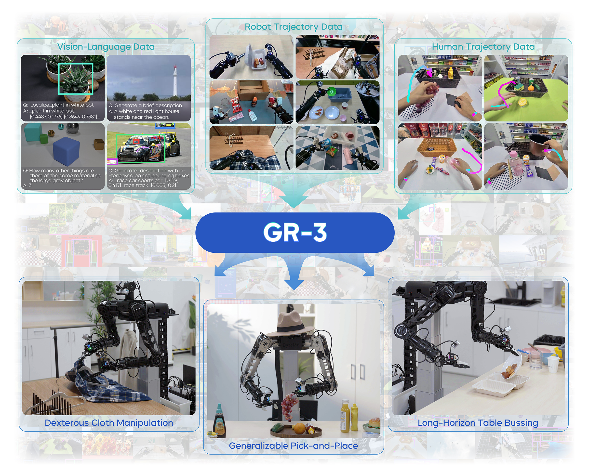
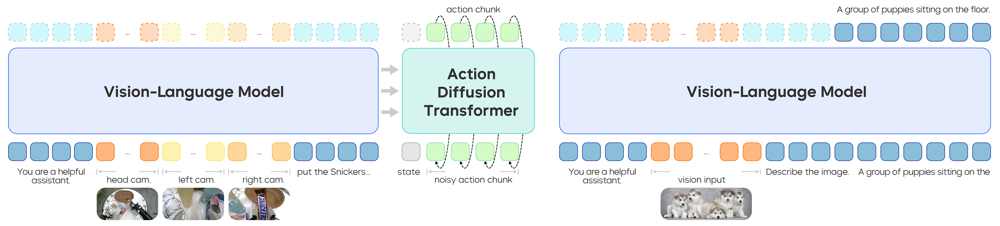
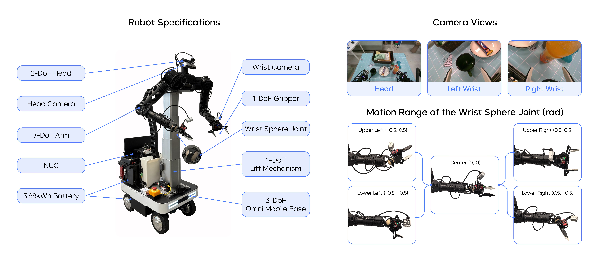
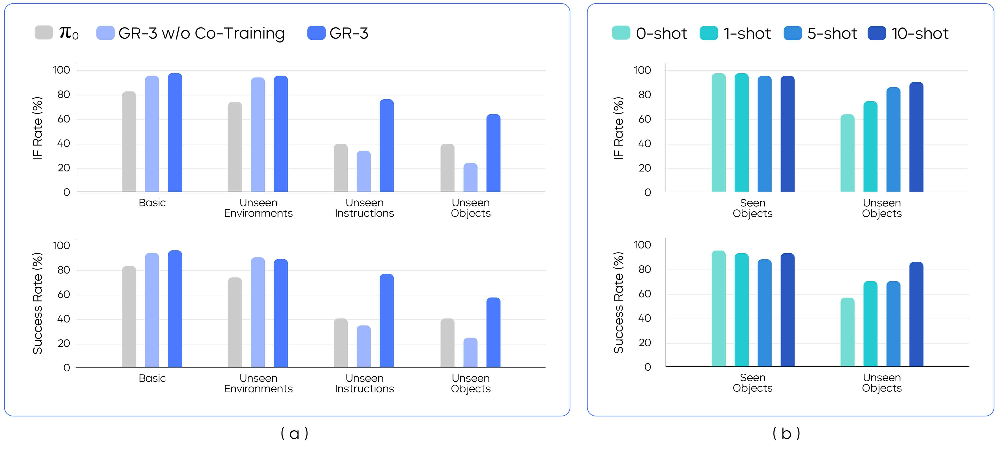
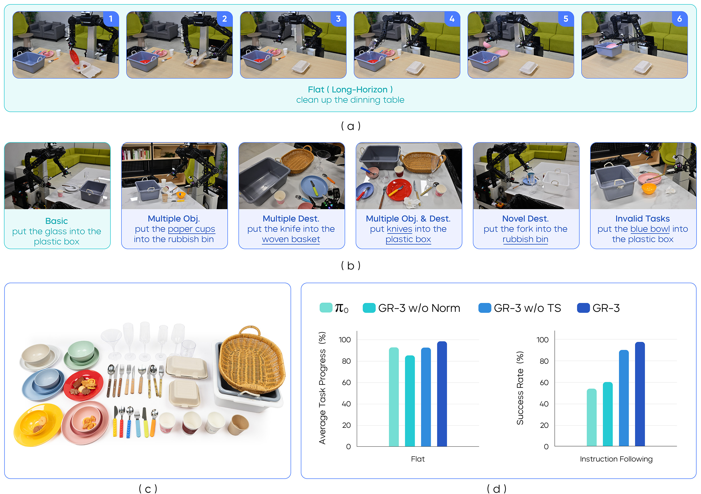
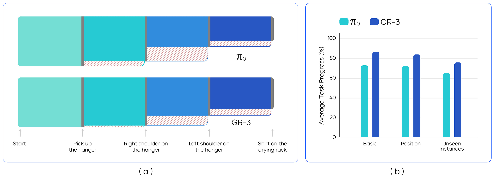

# GR-3：少样本长时程 VLA

GR-3 是一篇很适合放进具身智能专题的技术报告，因为它把 VLA 从“看图出动作”继续推向三个更真实的问题：严格语言跟随、少样本新物体适配，以及长时程/灵巧任务执行。

它最值得记的一点是：**VLA 不只要输出 action chunk，还要知道任务是在进行、结束，还是根本无效。**

## 论文位置

GR-3 接在 π0 / π0.5、GR-2 之后看最顺。GR-2 重点是视频知识迁移；π0.5 重点是异构数据和高层子任务；GR-3 更强调任务状态、VLM co-training、few-shot human trajectory adaptation 和真实双手移动机器人部署。

{ width="920" }

<small>Figure source: `GR-3 Technical Report`, Figure 1. 原论文图意：展示 GR-3 在新物体、新环境、抽象指令、长时程任务和灵巧衣物操作上的能力。</small>

**Teaser 图先看任务覆盖，不要当完整安全证明。**
**输入输出**：输入是少量机器人数据、视觉语言上下文和任务条件，输出是长时程操作策略。  
**效率机制**：通过数据配方和模型结构提高少样本真实机器人任务覆盖。  
**对主线意义**：它服务 VLA 的数据效率与开放任务泛化讨论。  
**不能证明什么**：少样本结果不能证明所有新 embodiment 或安全恢复都解决。

## 模型结构

GR-3 使用 `Qwen2.5-VL-3B-Instruct` 作为 VLM 主干，并接 flow matching Action DiT。总规模约 `4B parameters`。

{ width="920" }

<small>Figure source: `GR-3 Technical Report`, Figure 3. 原论文图意：GR-3 同时在 robot trajectories 和 vision-language data 上 co-train；左侧用 flow-matching objective 训练动作，右侧用 next-token prediction 保持视觉语言能力。</small>

| Component | GR-3 choice | Why it matters |
| --- | --- | --- |
| VLM backbone | Qwen2.5-VL-3B-Instruct | 保留强视觉语言理解和 grounding |
| Action model | flow matching Action DiT | 输出连续 action chunk |
| Conditioning | current robot state + VLM KV cache | 让动作生成利用 VLM 表征 |
| Action sequence | K-length action chunk as tokens | 建模短时动作依赖 |
| Attention | causal mask in Action DiT | 保持动作块内部时间结构 |
| Efficiency | Action DiT has about half the VLM layers and uses later-layer KV cache | 降低推理成本 |
| Stability | extra RMSNorm after attention and FFN linear layers | 提升训练稳定性和 instruction following |

GR-3 不只是把 VLM 输出接到动作头。它让动作 DiT 读取 VLM 后半层 KV cache，并通过 flow matching timestep / AdaLN 等方式生成动作块。这让视觉语言理解可以更直接地调制动作生成。

### Flow Matching Action DiT 怎么读

GR-3 的动作头不是离散 action token，也不是简单 MLP 回归。它把一段连续动作块 \(\mathbf{a}_{1:K}\) 当作要从噪声搬运到真实动作的生成对象。flow matching 的训练可以写成：

$$
\mathbf{x}_t = (1-t)\boldsymbol{\epsilon} + t\mathbf{a}, \quad
\mathbf{u}_t = \mathbf{a} - \boldsymbol{\epsilon}
$$

$$
\mathcal{L}_{\mathrm{FM}}
= \mathbb{E}_{t,\boldsymbol{\epsilon},\mathbf{a}}
\left[
\left\|
f_\theta(\mathbf{x}_t, t, c) - \mathbf{u}_t
\right\|_2^2
\right]
$$

这里 \(\boldsymbol{\epsilon}\) 是随机噪声动作，\(\mathbf{a}\) 是示范中的真实动作块，\(t\in[0,1]\) 是生成时间，\(c\) 是由 VLM 视觉语言上下文、机器人状态和 KV cache 组成的条件。训练目标不是直接预测动作值，而是预测“从当前 noisy action 往真实动作走的速度场”。推理时从噪声开始，沿这个速度场积分，得到连续 action chunk。

**为什么这比离散 token 更适合 GR-3。**
GR-3 要控制 ByteMini 的双手移动平台，动作空间连续、维度高，而且包含全身运动。离散 token 会让动作精度、token 数和解码延迟互相拉扯；flow matching 可以直接生成连续动作块，并保留多模态动作分布。Action DiT 再通过 VLM KV cache 接收任务语义，避免动作头只看到一个压扁的图文 embedding。

## 任务状态：in progress / terminate / invalid

GR-3 的一个关键设计，是把 task status 作为辅助监督的附加动作维度：

| Status | Meaning | System behavior |
| --- | --- | --- |
| `in progress` | task is being executed | continue rolling out action chunks |
| `terminate` | task has been successfully completed | stop and return to safe posture |
| `invalid` | instruction cannot be completed under current observation | refuse execution or ask for clarification |

论文指出，策略可能利用多视角里的虚假相关性，而不真正关注语言条件。加入 task status 后，模型被迫理解指令和当前场景是否匹配。训练时会随机把语言指令替换成无效指令，并让模型预测 `invalid`，但不监督动作块其他维度。

这对真实机器人非常关键：桌上没有刀时，“put the knife into the basket” 不应该触发机器人乱抓；它应该判断任务无效。

可以把 task status 看成一个安全控制接口，而不只是分类头：

```text
status = in progress -> execute next action chunk
status = terminate   -> stop task, return or hold safe posture
status = invalid     -> refuse execution / ask for clarification
```

这和传统 imitation learning 最大的差别是，模型被训练去回答“现在是否应该继续动”。很多 VLA 只会在任务完成后继续输出近似无意义的小动作，或者在无效指令下从训练集中找一个相似动作硬执行。GR-3 把停止和拒绝纳入动作空间，等于给 closed-loop rollout 加了一个最小的任务级刹车。

## 训练 recipe

GR-3 训练由三类数据共同构成：

1. robot trajectory data for imitation learning；
2. web-scale vision-language data for co-training；
3. few-shot human trajectory data from VR for adaptation。

{ width="920" }

<small>Figure source: `GR-3 Technical Report`, Figure 4. 原论文图意：展示 robot trajectory data、vision-language data 和 human trajectory data 的收集与 co-training 配方。</small>

### Robot trajectory + vision-language co-training

GR-3 把机器人轨迹和视觉语言数据联合训练。VL 数据覆盖 image captioning、visual question answering、image grounding 和 interleaved grounded image captioning。这样做的目的不是让机器人“会聊天”，而是让动作 DiT 在动作预测时仍能利用 VLM 的开放视觉语言能力。

这一步要避免一个误解：co-training 不是把网页图文数据和机器人动作数据混在一起做同一个 loss。机器人数据走 imitation / flow matching 目标，VL 数据走 next-token prediction，二者共享 VLM 主干。这样既能让动作条件继承语言 grounding，也能防止纯机器人微调把 VLM 的物体、属性和空间关系知识磨掉。

### Few-shot human trajectory adaptation

论文用 `PICO 4 Ultra Enterprise` 收集人类轨迹。PDF 笔记里记录了一个很实用的数字：人类轨迹可达到约 `450 trajectories/hour`，高于机器人遥操作约 `250 trajectories/hour`。人类轨迹缺少腕部视图、关节状态和夹爪状态，因此训练时填充空白腕部图像，并用手部轨迹监督。

这个设计说明：新物体适配未必只能重收昂贵机器人轨迹，人类 VR 轨迹可以作为快速适配信号。

但人类轨迹不是机器人轨迹的直接替代。它更像一种低成本“空间意图标注”：人手从哪里接近、抓哪一侧、把物体移向哪里。真正部署时仍要靠机器人数据和控制器把这些手部轨迹映射到 ByteMini 的可达空间、夹爪约束和全身运动上。

### Training tricks

| Trick | Role |
| --- | --- |
| Extra RMSNorm | 稳定 Action DiT 训练，并显著提升 instruction following |
| Multi-sampled flow timesteps per VLM forward | 加速训练，降低重复 VLM 前向开销 |
| Co-training with VL and robot data | 保住视觉语言泛化，同时学习动作 |
| Task status auxiliary dimension | 学会拒绝无效任务和判断终止 |

## ByteMini 机器人系统

GR-3 部署在 ByteMini 双手移动机器人上。

{ width="920" }

<small>Figure source: `GR-3 Technical Report`, Figure 5. 原论文图意：展示 ByteMini 的机器人规格、多相机视角和 wrist sphere joint 的运动范围。</small>

论文强调全身顺应性控制和全身遥操作。策略 rollout 时，GR-3 用预测的 action chunk 控制 `19 DoF`，并加入 pure pursuit 和 trajectory optimization 以减少抖动、保持路径点和轨迹之间的平滑过渡。

**这张机器人图怎么读。**
ByteMini 不是论文背景里的展示硬件，而是 GR-3 结果的一部分。双臂、移动底盘、多相机和 wrist sphere joint 让任务空间远比单臂桌面抓取复杂。也正因为如此，GR-3 输出的 action chunk 不能直接等同于底层电机命令；pure pursuit、轨迹优化和全身控制器承担了平滑、可达性和安全约束。读实验时要把“VLA 能力”和“机器人控制栈能力”一起看。

## 实验：从抓取到长时程桌面清理

GR-3 的实验覆盖三类任务。

### Generalizable pick-and-place

训练数据约 `35K robot trajectories`，覆盖 `101 objects`，总计约 `69 hours`。Unseen Objects 设置下，对 45 个未见对象每个最多收集 10 条人类轨迹；450 条人类轨迹总时长约 30 分钟，再 co-train 20K steps。

{ width="920" }

<small>Figure source: `GR-3 Technical Report`, Figure 7. 原论文图意：展示 GR-3 在 basic、unseen environments、unseen objects 和 few-shot human trajectory settings 下的 pick-and-place 结果。</small>

**Figure 7 怎么读。**
这组实验的主线是“泛化从哪里来”。Basic / unseen environments 主要看机器人轨迹 imitation 和视觉语言 co-training 是否稳；unseen objects 则测试物体外观、形状和语言 grounding；few-shot human trajectories 专门测试 VR 人类轨迹是否能快速补新物体。最突出的结论不是某个单点数字，而是 GR-3 在只给每个未见物体少量人类轨迹时仍能明显提升，相当于把昂贵机器人遥操作的一部分换成更快的人类空间示范。

### Long-horizon table bussing

这部分最能体现 task status 的价值。任务包括 Flat Setting 和 Instruction-Following Setting；invalid trials 要求模型在 `10 seconds` 内不操纵任何对象才算成功。论文记录该任务约 `101 hours` 机器人轨迹。

{ width="920" }

<small>Figure source: `GR-3 Technical Report`, Figure 8. 原论文图意：展示 table bussing 的任务设置、Flat / Instruction-Following / Invalid settings 和实验结果。</small>

**Figure 8 怎么读。**
Table bussing 不是单步 pick-and-place，而是长时程清理：机器人要在桌面上连续识别目标、选择顺序、移动双臂/底盘，并在任务完成或无效指令时停下来。`invalid` 试验尤其重要，因为成功标准不是“做对动作”，而是 `10 seconds` 内不乱动。这里 task status 的价值就很清楚：没有 terminate/invalid 监督，模型可能在完成后继续找东西抓，或者在指令不成立时执行相似训练动作。

### Dexterous cloth manipulation

衣物任务约 `116 hours` 机器人轨迹，要求模型处理柔体、衣架和晾衣架等复杂接触。

{ width="920" }

<small>Figure source: `GR-3 Technical Report`, Figure 10. 原论文图意：展示衣物操作任务的阶段拆解、成功/失败流向和不同设置下的结果。</small>

**Figure 10 怎么读。**
衣物任务的证据意义不在于证明 GR-3 已经掌握柔体物理，而在于它把 VLA 评测推到更难的接触分布。衣物会形变、遮挡、缠绕，成功往往依赖多阶段恢复。图中阶段拆解和失败流向比单个平均成功率更重要：它告诉读者模型在哪一步失手，是抓取、展开、挂衣架，还是移动到晾衣架。对工程复用来说，这类分阶段结果比“总成功率”更能指导数据补采。

## 训练细节要点

| Detail | GR-3 choice | Why it matters |
| --- | --- | --- |
| VLM backbone | Qwen2.5-VL-3B-Instruct | 强视觉语言 grounding |
| Total size | about 4B parameters | 比早期小 VLA 更接近 foundation policy |
| Action objective | flow matching Action DiT | 连续 action chunk 生成 |
| Task status | in progress / terminate / invalid | 让模型学会停止和拒绝 |
| Few-shot adaptation | PICO VR human trajectories | 快速适配新物体和新设置 |
| Pick-and-place data | 35K trajectories, 101 objects, 69 hours | 泛化抓取基础 |
| Table bussing data | about 101 hours | 长时程任务和 invalid refusal |
| Cloth data | about 116 hours | 柔体和灵巧操作 |
| Stabilization | RMSNorm after attention / FFN linear | 改善训练稳定和指令跟随 |

## 消融与工程判断

GR-3 技术报告没有像一些学术论文那样把每个模块都做成完整表格消融，但从报告叙述和实验设计里，可以抽出三条重要结论。

| Mechanism | 证据来自哪里 | 可支持的结论 | 不能证明什么 |
| --- | --- | --- | --- |
| VLM co-training | 模型结构图、VL 数据配方、抽象指令和属性跟随实验 | 保留视觉语言 grounding 对真实指令执行有帮助 | 不能单独证明动作物理泛化 |
| Human trajectory adaptation | unseen object few-shot 设置 | VR 人类轨迹可作为低成本新物体适配信号 | 不能完全替代机器人接触数据 |
| Task status | table bussing terminate / invalid 任务 | 停止和拒绝应进入策略输出空间 | 不能解决所有安全策略和碰撞风险 |
| Full-body control stack | ByteMini 部署、pure pursuit、trajectory optimization | VLA 输出需要控制器吸收抖动和可达性约束 | 不能把模型结果归因给 VLA 单独能力 |

最值得警惕的是最后一行：GR-3 是系统论文。它的强结果来自模型、数据、人类轨迹、真实机器人硬件和控制栈共同作用。把它简化成“4B VLA + flow matching 就够了”，会误读这篇报告。

## 局限与启发

GR-3 很强，但它也暴露了 VLA 走向真实机器人的成本：需要机器人数据、VL co-training、人类轨迹适配、全身控制器、任务状态标签和大量真实评测。模型本身只是系统的一层。

它最值得复用的工程经验是三条：

1. 任务状态要进入训练和部署；
2. 人类轨迹可以作为新设置快速适配桥梁；
3. VLA action chunk 必须接控制器和平滑优化，不能直接当电机命令。

**阅读结论。**
GR-3 要按 vision-language-action 闭环系统读：方法重点是多模态输入、任务数据和动作头的分工，实验重点是 ByteMini、cloth/table bussing 与跨任务泛化。它的强项是真机操作证据，边界是数据分布、长时任务和跨 embodiment 可迁移性。

## 外部精读

1. [arXiv:2507.15493](https://arxiv.org/abs/2507.15493)
2. [GR-3 project page](https://seed.bytedance.com/en/GR3)
3. [ar5iv HTML and figures](https://ar5iv.labs.arxiv.org/html/2507.15493)
