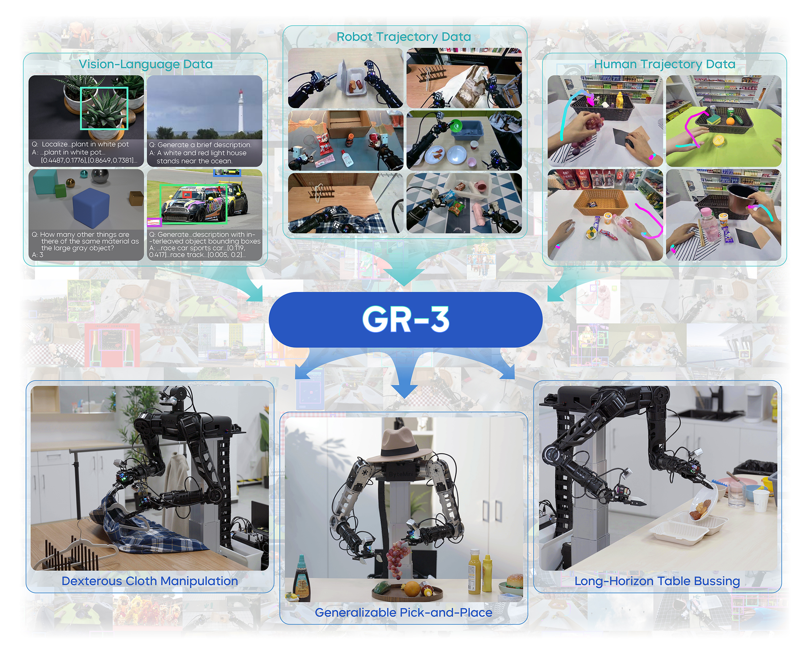
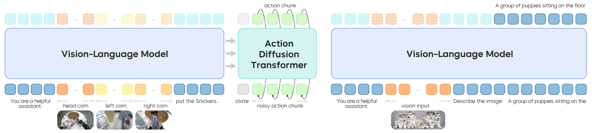
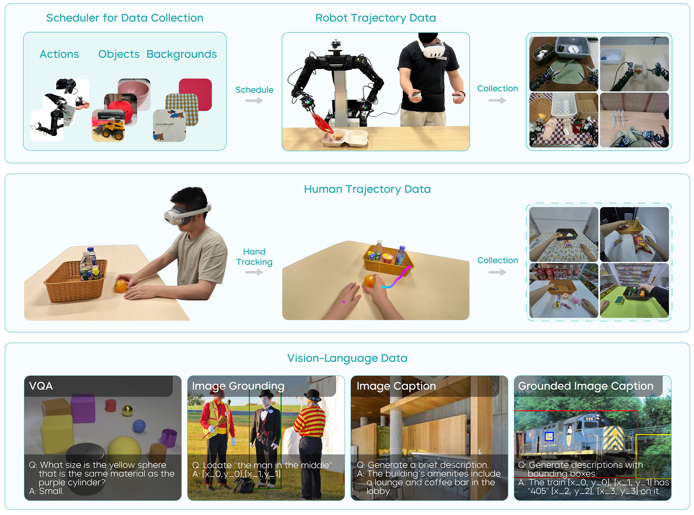
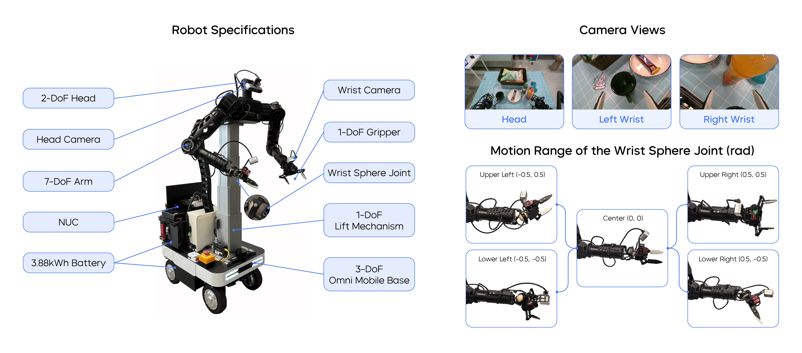
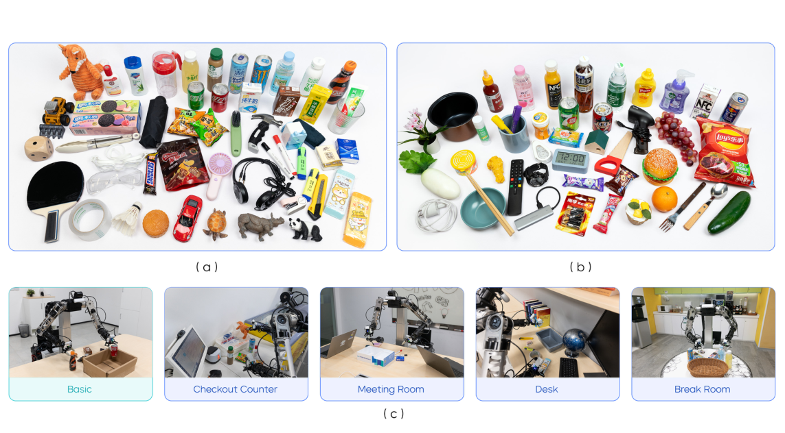
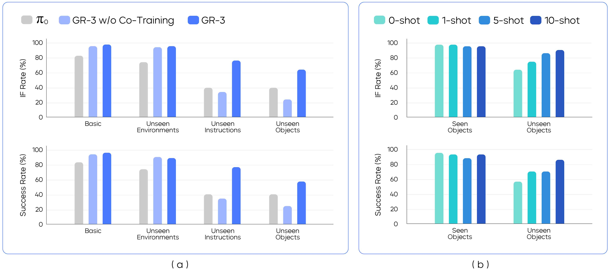
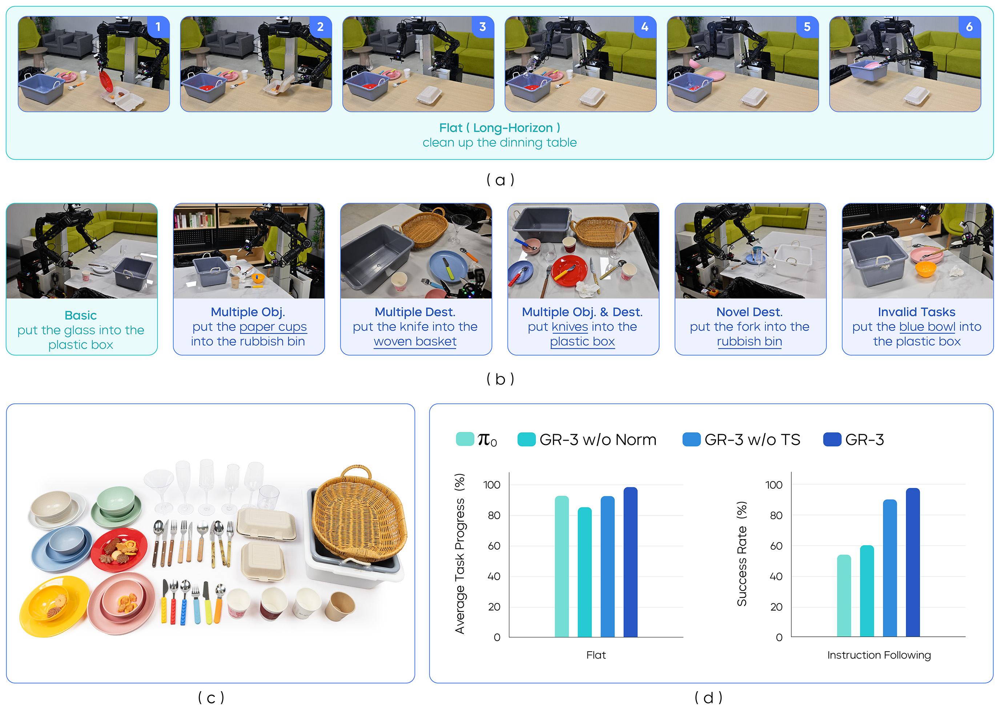
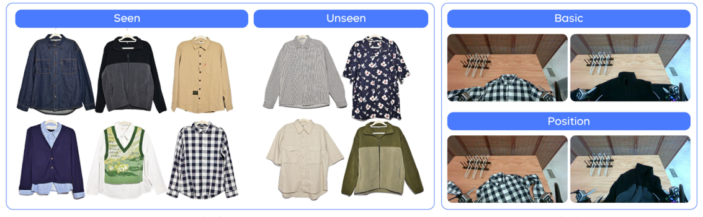
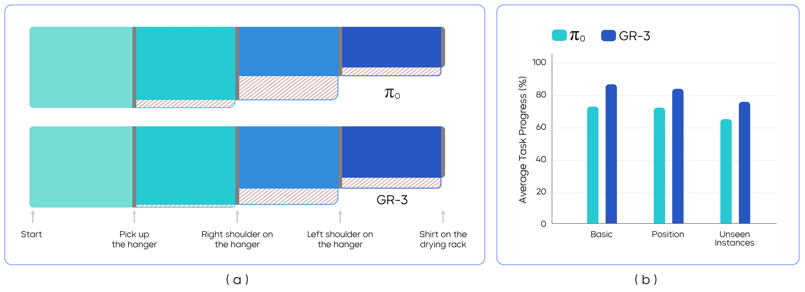

# GR-3：少样本长时程 VLA

!!! info "论文信息"
    **论文题名：** GR-3 Technical Report。 
    **作者：** Chilam Cheang、Sijin Chen、Zhongren Cui、Yingdong Hu、Liqun Huang、Tao Kong、Hang Li、Yifeng Li、Yuxiao Liu、Xiao Ma 等（共 21 人）。 
    **机构：** ByteDance Seed。 
    **时间 / 主题：** 2025-07；具身智能 / VLA。 
    **arXiv / 官方报告：** arXiv：[2507.15493](https://arxiv.org/abs/2507.15493)；官方材料：[seed.bytedance.com/en/GR3](https://seed.bytedance.com/en/GR3)。 
    **GitHub / 项目：** GitHub：未找到官方链接；项目页：[seed.bytedance.com/en/GR3](https://seed.bytedance.com/en/GR3)。 
    **元数据来源与核验口径：** 来源：[arXiv](https://arxiv.org/abs/2507.15493)；[官方 / 项目材料](https://seed.bytedance.com/en/GR3)；Checked Date：2026-06-15；Repro Status：Paper / official materials reviewed, independent reproduction not claimed。

## 会做常见任务，为什么仍可能没有听懂指令

GR-3 最有解释力的场景，是机器人面前有叉子、餐具盒和垃圾桶，指令却要求把叉子扔进垃圾桶。沿训练中最常见的物体与容器关联行动，机器人可能熟练地把叉子放回餐具盒；这条轨迹运动平滑、抓取正确，却没有执行当前要求。另一种情况是桌上根本没有蓝碗，机器人仍挑选某个物体开始搬运。它们暴露了 VLA 的一个具体问题：视觉输入足以提示常见动作时，动作训练未必迫使模型使用语言条件。[↗](https://arxiv.org/pdf/2507.15493v2#page=5) [↗](https://arxiv.org/pdf/2507.15493v2#page=12)

GR-3 围绕这个问题，把预训练视觉语言模型与连续动作专家连接起来，并同时调整训练目标、数据组织和动作网络。机器人示范提供可执行动作，视觉语言共同训练维持物体、关系与概念知识，额外的任务状态监督要求模型判断指令在当前场景中是否成立。人类手部轨迹则用于已有策略的新物体适配。这套方法仍以模仿学习为基础，论文把强化学习留作改善失败恢复的后续方向。[↗](https://arxiv.org/pdf/2507.15493v2#page=4) [↗](https://arxiv.org/pdf/2507.15493v2#page=14)

Figure 1 上方的三类数据，应分别对应下方需要解释的能力。视觉语言数据与开放语义有关，人类轨迹与少样本适配有关，机器人轨迹与实际控制有关。下方拾放、清理餐桌、衣物晾挂的展示，进一步把语义泛化、长流程和双臂精细操作分开。

{ width="920" }

*原论文 Figure 1，三类训练数据与任务展示。箭头表达训练方案的组成；三种任务的能力需要由各自的实验协议与指标判断。* [↗](https://arxiv.org/pdf/2507.15493v2#page=2)

理解论文时尤其要区分两个层次。GR-3 展示了一种可用于多类任务的模型和训练配方，但实验按任务训练策略，清理餐桌还分别训练 Flat 与 Instruction Following 两种版本。因此，后面的结果证明的是这套方案在相应训练设置下的能力，不能把它们合并成一个检查点同时完成全部任务的成绩。[↗](https://arxiv.org/pdf/2507.15493v2#page=8) [↗](https://arxiv.org/pdf/2507.15493v2#page=11)

## 从多视角理解到动作块，4B 模型如何分工

模型的输入包括自然语言指令 $l$、当前时刻的多相机观测 $o_t$ 和机器人状态 $s_t$，输出为一个连续动作块。这里的 **Action Chunk（动作块）** 表示连续一段时间的动作序列，网络一次预测多个动作位置，之后由执行系统处理轨迹。论文用 $a_t=a_{t:t+k}$ 表示长度为 $k$ 的动作块；$k$ 的具体取值并未在报告中展开。[↗](https://arxiv.org/pdf/2507.15493v2#page=4)

GR-3 采用 mixture-of-transformers 结构，以 Qwen2.5-VL-3B-Instruct 处理多视角图像和文字，另用 action Diffusion Transformer 预测动作，两者总规模约 4B。Figure 3 左半部分需要从下往上读：头部和双腕相机图像、指令进入 VLM；机器人状态与带噪动作块进入动作 DiT；VLM 的键值表示向动作专家提供条件。上方的动作输出是一组连续动作 token，不需要先把动作变成自然语言回答再执行。

{ width="920" }

*原论文 Figure 3。左侧机器人数据监督连续动作，右侧视觉语言数据监督文字 token；两种训练路径共享 VLM，但动作 DiT 只参与动作路径。* [↗](https://arxiv.org/pdf/2507.15493v2#page=4)

动作侧把长度为 $k$ 的带噪动作块表示为 $k$ 个 token，再拼接一个机器人状态 token。流匹配时间通过 AdaLN 注入，使同一个动作网络知道当前处理的噪声程度。动作 DiT 内部采用 causal attention mask，建模动作块内部的时间依赖。这里的因果掩码并不意味着逐个生成文字式的动作 token；动作块仍通过后文的流积分过程整体更新。[↗](https://arxiv.org/pdf/2507.15493v2#page=4)

连接两个网络的接口是 VLM 的 **KV Cache（键值缓存）**。动作专家利用视觉语言网络已产生的键和值读取条件，避免每次更新带噪动作时重复完成整套图像与语言计算。为缩小动作分支的成本，DiT 层数为 VLM 的一半，仅使用 VLM 后半部分层的 KV。这个设计把较重的场景理解和需要反复运行的动作更新分开，同时明确了动作分支实际读取的 VLM 层范围。[↗](https://arxiv.org/pdf/2507.15493v2#page=4)

另一个改动发生在动作 DiT 内部。作者早期训练频繁遇到不稳定，受 QK norm 启发，在注意力与 FFN 内的线性层后增加 RMSNorm。它既改善了训练稳定性，也在后续指令遵循消融中带来明显收益。报告提供了行为层面的证据，但没有用注意力可视化或专门的中间变量实验，证明某一条归一化到语言利用的唯一因果路径；准确的判断是，这个数值结构设计对最终的语言条件控制有实际影响。[↗](https://arxiv.org/pdf/2507.15493v2#page=4) [↗](https://arxiv.org/pdf/2507.15493v2#page=12)

## 流匹配究竟学什么，五步生成又发生在哪里

训练的总体目标是模仿专家示范。论文先用专家数据集 $\mathcal D$ 上的条件策略对数似然说明这个目标，再把连续动作学习具体落实为 flow matching。这里需要分清两个时间：$t$ 是真实机器人轨迹中的时刻，$\tau$ 是生成动作时从噪声走向数据的内部时间。机器人可以处在同一个 $t$，而动作生成器在多个 $\tau$ 上更新同一个动作块。[↗](https://arxiv.org/pdf/2507.15493v2#page=4)

给定示范动作 $a_t$，随机取高斯噪声 $\epsilon$ 和流时间 $\tau$，构造中间动作

$$
a_t^\tau=(1-\tau)\epsilon+\tau a_t,
\qquad \epsilon\sim\mathcal N(0,I),\quad
\tau\sim\mathcal U(0,1).
$$

这条插值路径在 $\tau=0$ 时是纯噪声，在 $\tau=1$ 时到达示范动作。沿着这条直线路径，目标速度为 $u(a_t^\tau\mid a_t)=a_t-\epsilon$。因此，动作专家需要在图像、语言和状态条件下，根据当前中间动作预测它向示范动作分布演化的方向。论文的动作损失可以写为

$$
\mathcal L_{\mathrm{action}}(\theta)=
\mathbb E_{\mathcal D,\tau,\epsilon}
\left[
\left\|v_\theta(l,o_t,s_t,a_t^\tau)
-(a_t-\epsilon)\right\|^2
\right].
$$

上式把论文在公式后定义的随机 $\tau,\epsilon$ 显式写进期望，目标仍是原文式（2）的速度回归。$v_\theta$ 输出与动作块同形状的速度；$\tau$ 通过前述 AdaLN 进入网络，虽然论文的函数简写未再单列它。图像与语言决定目标对象和任务，状态帮助把目标动作放在当前机器人的运动条件下。[↗](https://arxiv.org/pdf/2507.15493v2#page=4)

训练时，同一条示范可以抽取多个 $\tau$。这些样本共享相同的图像和指令，因此作者在一次 VLM 前向后，复用其结果计算多个流时间的动作损失。它节省的是重复条件编码的成本，动作 DiT 仍需处理相应的带噪动作。报告没有给出每次 VLM 前向具体复用多少个时间样本，不能据此计算精确训练加速比。[↗](https://arxiv.org/pdf/2507.15493v2#page=5)

推理时不再有专家动作可供插值。系统从随机噪声 $a_t^0$ 出发，用学到的速度场做 Euler 更新

$$
a_t^{\tau+\Delta\tau}
=a_t^\tau+\Delta\tau\,
v_\theta(l,o_t,s_t,a_t^\tau),
\qquad \Delta\tau=0.2.
$$

从 0 到 1 一共进行五步更新。五步指动作生成器的积分步数；VLM 的条件表示可以被复用，不能把它理解成五次完整的大模型视觉语言前向。生成结果还要进入机器人轨迹控制层，五个积分步也不能直接换算成控制频率或每秒能完成多少次抓取。[↗](https://arxiv.org/pdf/2507.15493v2#page=5)

## 让语言真正影响动作，数据和监督分别补哪一环

### 无效指令为什么只监督状态

如果同一张桌面的所有示范都要求把叉子放入餐具盒，模型即使忽略语言，也可能学出很好的动作预测。GR-3 在动作输出中增加一个 **Task Status（任务状态）** 维度，既表示任务进展，也判断当前指令是否与观测相容。

| Task Status | Value | Meaning |
|---|---:|---|
| Ongoing | 0 | 当前任务正在执行 |
| Terminated | 1 | 当前任务已经成功完成 |
| Invalid | −1 | 给定当前观测，指令无效 |

训练时，部分样本的语言被随机替换成当前场景无法完成的要求，例如桌上没有刀，却让机器人把刀放进篮子。对于这类样本，**只监督 Invalid 状态，其余动作维度不参与监督**。这一点很关键：原来那条专家轨迹对应的是原指令，换成无效指令后，它不再是正确运动标签；继续监督全部动作，会迫使网络一边报告任务无效、一边复现另一项任务的运动。屏蔽这些维度，才能把新增样本用于可执行性判断，而不制造冲突的运动示范。[↗](https://arxiv.org/pdf/2507.15493v2#page=5)

这个监督也给“是否读了语言”提供了直接压力。对于相同观测，有效指令与无效指令需要不同状态输出，仅靠桌面的视觉布局无法区分。其作用范围是当前任务与观测是否匹配，论文并没有把 Invalid 定义成通用碰撞检测、危险行为识别或物理安全认证。后续十秒不操作物体的测试，检验的是无效指令下能否避免执行错误任务。[↗](https://arxiv.org/pdf/2507.15493v2#page=11)

### 共同训练保留语义，机器人示范提供动作

预训练 VLM 已有相当多物体和关系知识，但把它接到动作网络上后，仅用狭窄的机器人数据继续训练，不能保证这些能力仍被保留并用于控制。GR-3 混入 image captioning、VQA、image grounding 和 interleaved grounded image captioning 数据，并对数据进行过滤和重标注。文字监督持续要求 VLM 利用开放语义，动作监督则学习如何据此移动机器人。[↗](https://arxiv.org/pdf/2507.15493v2#page=5)

| Training data | Supervision | Parameters updated | Role |
|---|---|---|---|
| Robot trajectories | Flow matching on action chunks | VLM + action DiT | 把语言、观测与机器人运动对应起来 |
| Vision-language data | Next-token prediction | VLM | 保持并训练视觉语义和语言关系理解 |
| Human trajectories，第二阶段加入 | 可观测的手部轨迹 | 沿动作学习路径训练 | 用少量新对象示范适配已有策略 |

机器人与 VL 数据以等权方式动态混入 minibatch，总目标为 next-token loss 与 flow-matching loss 之和。这里的“等权”描述论文的数据混合方式，不能扩展成每个 token、每秒视频或每个具体 VL 来源恰好相等。VL 分支不需要提供机器人动作标签，动作 DiT 也不在这条文字预测分支上更新。[↗](https://arxiv.org/pdf/2507.15493v2#page=5)

Figure 4 上方还给出一个容易被模型结构掩盖的环节：机器人数据采集调度器在每条轨迹开始前，指定动作、物体组合和背景，操作者据此布置场景。之后还会过滤无效或低质量轨迹。这样的数据组织有助于主动改变条件组合，减少采集者反复执行最顺手搭配的倾向；它与在已有图像上做光度增强承担不同作用。

{ width="920" }

*原论文 Figure 4。上方是有调度的机器人采集，中间是第一视角人类手部轨迹，下方是不同 VL 任务。三类数据的观测和标签并不相同，训练接口必须处理这些差异。* [↗](https://arxiv.org/pdf/2507.15493v2#page=6)

### 人类示范怎样接入缺少机器人状态的接口

人类数据来自 PICO 4 Ultra Enterprise，包含第一视角视频与手部轨迹，语言标注沿用机器人数据的流程。它没有双腕相机图像，也没有机器人的手臂关节状态和夹爪状态。GR-3 对缺失腕部视图填充空白图像，在人类样本上只训练可观测的手部轨迹；不会把不存在的关节、夹爪标签补成伪示范。[↗](https://arxiv.org/pdf/2507.15493v2#page=6)

训练顺序同样影响“少样本”的含义。第一阶段先用机器人轨迹和 VL 数据得到策略，第二阶段才加入少量人类数据，同时继续混合原有两类数据。人类样本因此是在已有控制能力上补充新对象经验，不能把这项结果理解为从零只看少量人类视频就掌握机器人操作。报告也没有展开完整的手部轨迹到机器人坐标标定配方，实际迁移这一做法仍需解决对应接口。[↗](https://arxiv.org/pdf/2507.15493v2#page=6)

作者报告人类轨迹采集约为每小时 450 条，机器人遥操作约为每小时 250 条，前者约为后者的 1.8 倍，这是按原文吞吐量相除得到的比较。它说明有手部追踪的示范采集可能降低适配成本；它不是策略推理速度，也不等于下文 450 条视频总时长约 30 分钟所描述的时间口径。[↗](https://arxiv.org/pdf/2507.15493v2#page=5)

## ByteMini 和控制层决定动作怎样真正落地

GR-3 的真实机器人实验依托 ByteMini。它有双臂、双夹爪、移动底盘、升降机构和头部，总计 22 个自由度。每条手臂为 7 自由度，紧凑的球形腕部用于在较小空间内操作，肘部允许向内收至 2.53 rad，帮助双臂在胸前区域协作。头部和双腕各装一台 RGBD 相机，腕部视角用于观察近距离接触区域；相机带深度能力，并不自动说明 VLM 输入显式使用了深度通道。[↗](https://arxiv.org/pdf/2507.15493v2#page=6) [↗](https://arxiv.org/pdf/2507.15493v2#page=7)

{ width="920" }

*原论文 Figure 5。左侧标出机器人部件与自由度，右上展示头部和双腕视角，右下展示球形腕部运动范围。衣物任务所需的胸前双臂操作，与这套结构和视角配置直接相关。* [↗](https://arxiv.org/pdf/2507.15493v2#page=7)

采集时，Meta VR Quest 用于全身遥操作，把人的运动重定向到机器人末端，同时控制手臂、夹爪、升降和底盘。它与前述采集人类手部轨迹的 PICO 设备承担不同工作。全身柔顺控制同时处理可操作性、奇异位形和关节限制，把遥操作输入变成可执行运动，给模仿学习提供专家轨迹。[↗](https://arxiv.org/pdf/2507.15493v2#page=7)

策略部署时，动作块控制其中 19 个自由度，排除头部与升降机构的 3 个自由度。系统再使用 pure pursuit 与轨迹优化，降低 jerk，并平滑路径点及相邻动作块之间的衔接。因此，一次完整执行包含“视觉语言条件计算—动作块生成—轨迹处理—机器人运动”的链条；长流程稳定性来自策略与控制层共同作用，不能只归给五步 flow matching。报告没有给出足以换算闭环刷新频率的模型延迟数据。[↗](https://arxiv.org/pdf/2507.15493v2#page=7)

## 拾放实验先拆开选目标、抓取与跨环境泛化

拾放使用 35K 条机器人轨迹，约 69 小时，覆盖 101 种物体，语言形式主要为“put A into B”。GR-3 用机器人与 VL 数据共同训练，消融 GR-3 w/o Co-Training 只使用机器人数据；基线 $\pi_0$ 从官方提供、已做大规模机器人预训练的 base model 出发，用该任务的机器人数据微调。机器人图像还使用光度增强。这不是让两种模型从相同随机初始化、相同预训练材料起步的实验，架构和预训练背景不能完全拆开归因。[↗](https://arxiv.org/pdf/2507.15493v2#page=8)

Figure 6 上方分别展示已见和未见物体，下方展示不同环境。这里“未见物体”以机器人轨迹为参照，不能扩大为 VLM 或所有视觉语言数据从未接触过该类别。新环境实验则刻意保留物体和布局，使环境变化与新对象识别尽量分开。

{ width="920" }

*原论文 Figure 6。Basic 与四个新环境使用相同已见物体和一致布局，Unseen Objects 则改变物体集合；二者回答不同的泛化问题。* [↗](https://arxiv.org/pdf/2507.15493v2#page=8)

| Setting | Protocol | Main question |
|---|---|---|
| Basic | 54 件已见物体分 9 组，每组 6 件，环境已见 | 能否按普通类别指令选对并搬运目标 |
| Unseen Environments | 相同物体与布局，换到收银台、会议室、书桌、休息室 | 场景变化是否破坏已学动作和对象选择 |
| Unseen Instructions | 大小、空间关系、常识描述，如“最大的物体”“雪碧旁边的可乐”“海洋动物” | 能否把机器人示范外的语义用于动作 |
| Unseen Objects | 45 件新物体分 9 组，每组 5 件，超过 70% 来自机器人示范中未见类别 | 能否识别、选择并操纵新对象 |

为了让不同模型的测试可比，作者用预先捕获的布局掩码摆放物体。两项指标又进一步拆分失败环节：**IF Rate** 只要求正确接近指令指定的目标；**Success Rate** 要求把这个目标放进容器。机器人选对物体但没抓牢，会被前一指标认可，却在后一指标中失败。两列一起看，才能避免把“理解对了”直接等同于“做成了”。[↗](https://arxiv.org/pdf/2507.15493v2#page=9)

Figure 7(a) 的上排是 IF，下排是任务成功。先看 Basic 和 Unseen Environments，完整 GR-3 与不做共同训练的版本差别不明显；再看 Unseen Instructions 和 Unseen Objects，完整模型的优势显著扩大。这组消融把共同训练的价值定位在开放语义条件上，说明它的作用不能只用训练场景的熟练程度衡量。

{ width="920" }

*原论文 Figure 7。左侧比较共同训练与基线，右侧比较人类轨迹的 0/1/5/10-shot 适配。柱图没有逐柱精确数值标签，下表采用正文明确报告的 Success Rate。* [↗](https://arxiv.org/pdf/2507.15493v2#page=9)

| Setting | $\pi_0$ Success Rate | GR-3 Success Rate | Difference |
|---|---:|---:|---:|
| Unseen Instructions | 40.0% | 77.1% | +37.1 percentage points |
| Unseen Objects | 40.0% | 57.8% | +17.8 percentage points |

差值由论文数值直接相减。新指令结果支持模型把大小、空间关系和常识描述转成目标选择；新物体结果还包含抓取新形状的难度，因此成功率更低也不能单独归咎于语义失败。作者同时观察到，只用机器人数据训练的 GR-3 在这两个条件中弱于 $\pi_0$，并推测后者的大规模跨本体预训练发挥了作用。这一推测不等于单独控制预训练数据后得到的因果结论。[↗](https://arxiv.org/pdf/2507.15493v2#page=10)

### 十条人类轨迹把哪一个条件从 57.8% 推到 86.7%

少样本实验针对上述 45 件未见物体，每件最多收集 10 条人类轨迹，共 450 条，**录制内容总时长约 30 分钟**。随后从已经用机器人和 VL 数据训练的 GR-3 检查点继续训练 20K 步，混合人类、机器人与 VL 三种数据。这里的 30 分钟是轨迹内容时长，不包含一个完整采集项目所需的摆物、准备、筛选、标注和训练时间。[↗](https://arxiv.org/pdf/2507.15493v2#page=10)

| Adaptation condition | Target objects | Success Rate |
|---|---|---:|
| 0-shot | 机器人训练中未见的 45 件物体 | 57.8% |
| 10-shot human trajectories per object | 同一批物体，每件加入至多 10 条人类示范 | 86.7% |

增加 10-shot 人类示范后，成功率提升 28.9 个百分点。Figure 7(b) 还展示 1-shot 和 5-shot，中间档位整体优于零样本；已见对象上的表现没有明显退化。由于新物体已进入适配数据，86.7% 衡量的是少样本适配后的迁移结果，57.8% 才是这组对象适配前的零样本结果，两者不应都冠以“未见对象零样本成功率”。[↗](https://arxiv.org/pdf/2507.15493v2#page=10)

这项实验实际支持了一种较具体的数据经济性：已有机器人策略可以用带手部运动标签的人类示范，补充对新物体的操作经验，同时继续保留原机器人数据约束。它没有测试纯视频、无手部标签、不同人类设备之间任意迁移，也没有消除原先 69 小时机器人数据的投入。

## 清理餐桌，把长流程与听指令分别测量

餐桌清理包含把食物装入外带盒、把餐具放入周转箱、把垃圾扔进垃圾桶，底盘需要移动才能覆盖工作区域。作者采集约 101 小时机器人轨迹，并设置两种评估。Figure 8(a) 的连续六帧展示一次整体清理，Figure 8(b) 则逐一改变语言要求；它们看似在同一张桌子上做相似动作，却有不同任务边界。[↗](https://arxiv.org/pdf/2507.15493v2#page=10)

{ width="920" }

*原论文 Figure 8。右下 Flat 的纵轴是 Average Task Progress，Instruction Following 的纵轴是 Success Rate；比较柱高前需要先看轴名。两种设置分别训练模型。* [↗](https://arxiv.org/pdf/2507.15493v2#page=11)

| Setting | Instruction and execution | Training instructions | Metric |
|---|---|---|---|
| Flat | “clean up the dining table”，单次运行自主完成整桌清理；评估 5 组物体 | 随机使用总体任务或子任务描述 | 成功子任务数 / 总子任务数的平均进度 |
| Instruction Following | 每次给具体子任务，每个子任务从 home position 开始 | 只使用子任务描述 | 平均子任务成功率 |

Flat 更接近连续长流程，途中错误会改变后续观测与任务状态；IF 通过每个子任务从 home position 开始，把重点移到指定对象、数量和容器是否被执行。每种方法都分别训练 Flat 和 IF 两个模型，因此 IF 的高分不能直接预测一个连续清理回合完整成功的概率。[↗](https://arxiv.org/pdf/2507.15493v2#page=10) [↗](https://arxiv.org/pdf/2507.15493v2#page=12)

IF 的六组指令逐渐改变模型可能依赖的习惯。Basic 接近训练布局；Multiple Objects 要求搬走某类别的全部实例；Multiple Destinations 增加编织篮等可选容器；Multiple Objects & Destinations 同时改变数量与目的地。这些条件要求语言中的“哪些”“多少”“到哪里”都参与动作决策。[↗](https://arxiv.org/pdf/2507.15493v2#page=10) [↗](https://arxiv.org/pdf/2507.15493v2#page=11)

另外两组更直接检验视觉捷径。Novel Destinations 使用训练中未出现的物体—容器配对，例如叉子放进垃圾桶，物体和容器本身不必都陌生。Invalid Tasks 则让模型处理当前场景不成立的要求；桌上没有蓝碗却要求拿蓝碗时，只有在十秒内不操作任何物体才算成功。后一条件下“没有动”可以是正确结果，前提是这个具体指令确实无效，不能脱离条件把静止视作普遍成功。[↗](https://arxiv.org/pdf/2507.15493v2#page=11)

论文明确报告 IF 成功率从 $\pi_0$ 的 53.8% 提升到 GR-3 的 97.5%，即提高 43.7 个百分点。$\pi_0$ 的失败包括混淆叉子和勺子，以及在新目标容器条件中把物体放回训练时常见的容器。它可以执行相当多清理动作，却没有可靠地让当前语言覆盖学到的物体—目的地关联。**97.5% 对应 IF 子任务成功率，不能写成整桌连续清理完成率。**[↗](https://arxiv.org/pdf/2507.15493v2#page=12)

消融把这项表现与前面的机制连接起来。GR-3 w/o Norm 去掉动作 DiT 内新增的 RMSNorm，Flat 与 IF 都下降，IF 尤其明显，新目的地泛化也变差；GR-3 w/o TS 去掉任务状态，IF 同样退化。Figure 8(d) 中无归一化版本在 Flat 仍能完成不少工作，而 IF 接近较低水平，这正说明动作熟练程度不足以判断语言利用情况。图中未标注各消融的精确柱值，但退化方向及其在两种设置下的程度差异很清楚。[↗](https://arxiv.org/pdf/2507.15493v2#page=11) [↗](https://arxiv.org/pdf/2507.15493v2#page=12)

## 衣物晾挂揭示剩下的接触和协作难点

衣物任务把难点从离散物体选择推进到可变形物体操作。机器人需要拿起衣架，把衣物左右肩依次套好，再转动底盘将衣服挂到晾衣架。数据约 116 小时，GR-3 仍使用机器人与 VL 共同训练，$\pi_0$ 在该任务数据上微调。[↗](https://arxiv.org/pdf/2507.15493v2#page=12)

Figure 9 左侧列出六件已见衣物与四件未见衣物。所有训练衣物都是长袖，未见集合中有两件短袖，因而变化包含衣物实例、图案和袖长。右侧的 Position 设置则直接旋转、揉皱已见衣物，用来检验状态与布局变化带来的困难。

{ width="920" }

*原论文 Figure 9。Basic、Position 与 Unseen Instances 改变的变量不同，后两者分别偏向初始布置与新衣物泛化。* [↗](https://arxiv.org/pdf/2507.15493v2#page=12)

该实验采用平均任务进度。完整成功记为 1.0，过程划分为拿起衣架、套上右肩、套上左肩、最终挂上晾衣架四个里程碑，每个里程碑贡献部分分数。报告没有明确展开各里程碑权重，不能额外假设一定等分；更不能把平均进度直接当成完整成功的试验比例。[↗](https://arxiv.org/pdf/2507.15493v2#page=12)

| Setting | Evaluation change | GR-3 Average Task Progress |
|---|---|---:|
| Basic | 六件已见衣物，初始位置接近训练 | 86.7% |
| Position | 旋转、揉皱衣物 | 83.9% |
| Unseen Instances | 四件未见衣物，其中两件短袖 | 75.8% |

Position 相比 Basic 下降 2.8 个百分点，未见衣物下降 10.9 个百分点，差值由论文结果计算。这说明报告中的布置扰动尚能较好应对，新实例仍明显增加难度。Figure 10(b) 中 GR-3 在三个条件都高于 $\pi_0$，后者的成绩以未标注精确数值的柱图展示。[↗](https://arxiv.org/pdf/2507.15493v2#page=13)

{ width="920" }

*原论文 Figure 10。左侧 Sankey 用实色表示成功流、斜线表示失败，沿四个里程碑追踪 Basic 回合；右侧汇总平均进度。左图没有给完整成功率的精确数字，不能由右侧 86.7% 反推。* [↗](https://arxiv.org/pdf/2507.15493v2#page=13)

最难的一步发生在右肩已套好之后。左领口经常折在衣架后面，机器人必须一边保持衣架，一边把左领口拉出来，再完成另一侧套入。动作会改变布料自身形状，还可能遮住下一次抓取位置；前一步成功并不保证后一步仍处在训练中的熟悉状态。作者另指出，套左肩时衣架可能从夹爪滑落，导致最后无法挂起。Sankey 因此把“知道要晾衣服”与“稳定完成接触密集的双臂过程”之间的差距显示出来。[↗](https://arxiv.org/pdf/2507.15493v2#page=13)

## 可以迁移的设计，以及实验仍留下的难题

GR-3 给出的可复用经验，首先体现在评测和监督如何对应。若想知道策略是否使用了语言，就需要改变大小与空间描述、物体—容器配对，或给出与当前观测不相容的指令；只有标准场景的抓取成功率，很容易让固定关联掩盖条件控制的问题。对应到训练，VL 共同训练维持开放语义，任务状态及无效样本让动作专家必须检查指令，归一化则让这套条件学习能稳定进行。三种设计承担不同环节，也有不同实验支持，不能用一句“更大模型理解更好”替代它们。[↗](https://arxiv.org/pdf/2507.15493v2#page=5) [↗](https://arxiv.org/pdf/2507.15493v2#page=12)

人类轨迹实验给出另一种可操作的适配路线：先有可执行的机器人策略，再采集新对象的第一视角视频和手部轨迹，只监督真实存在的运动标签，并继续混合原数据。这把“新对象适配需要多少新机器人遥操作”转化为“哪些对象经验可以用更易采集的人类轨迹补充”。86.7% 的结果属于这个具体前提，既包含先前机器人训练的投入，也包含适配阶段的运动标签和继续训练。[↗](https://arxiv.org/pdf/2507.15493v2#page=10)

未解决的问题也很具体。模型仍会误解新概念或新对象指令，抓取未见形状时会失败；模仿学习策略在执行中进入分布外状态后，还可能卡住而无法恢复。更长的任务会把这些状态偏移累积起来，衣架滑落便可能让后续动作失去起点。论文提出未来引入强化学习改善这种恢复能力，但当前成绩尚未验证这条路径。因而，采用 GR-3 的方法时，最有价值的下一项检验是让策略面对可控的中途扰动，观察它能否重新建立有效任务状态并继续执行，而不只重复正常起点上的成功回合。[↗](https://arxiv.org/pdf/2507.15493v2#page=14)

这篇的实验问题可以接到[家庭机器人工作流与失败模式](../../embodied-ai/household-robotics-workflows-and-failure-patterns.md)，把衣物接触拆成可记录的阶段；数据侧可看[VLA 数据与策略学习](../../vla/data-and-policy-learning.md)，比较人类轨迹、机器人示范和恢复样本各自能监督什么。若要把“中途扰动”真正测出来，再读[闭环恢复与失败分析](../../vla/closed-loop-recovery-and-failure-analysis.md)里的首次偏离、旧动作取消和接管字段。
