# kai0：资源受限下的高可靠机器人操作

!!! info "论文信息"
    **论文题名：** χ₀: Resource-Aware Robust Manipulation via Taming Distributional Inconsistencies。 
    **作者：** Checheng Yu、Chonghao Sima、Gangcheng Jiang、Hai Zhang、Haoguang Mai、Hongyang Li、Huijie Wang、Jin Chen、Kaiyang Wu、Li Chen、Lirui Zhao、Modi Shi、Ping Luo、Qingwen Bu、Shijia Peng、Tianyu Li、Yibo Yuan。 
    **机构：** HKU MMLab / OpenDriveLab 相关团队；以 arXiv/PDF affiliation block 和官方项目页为准。 
    **时间 / 主题：** 2026-02；具身智能 / 机器人操作 / VLA 后训练。 
    **arXiv / 官方报告：** arXiv：[2602.09021](https://arxiv.org/abs/2602.09021)；项目页：[mmlab.hk/research/kai0](https://mmlab.hk/research/kai0)。 
    **GitHub / 模型：** GitHub：[OpenDriveLab/KAI0](https://github.com/OpenDriveLab/KAI0)；Hugging Face：[OpenDriveLab-org/Kai0](https://huggingface.co/OpenDriveLab-org/Kai0)。 
    **元数据来源与核验口径：** 来源：[arXiv](https://arxiv.org/abs/2602.09021)、[GitHub](https://github.com/OpenDriveLab/KAI0)、[Hugging Face model card](https://huggingface.co/OpenDriveLab-org/Kai0)；Checked Date：2026-06-15；Repro Status：Paper / official repo / official model card reviewed, independent reproduction not claimed。

## 长任务的失败，发生在示范、策略和执行的交界处

χ₀ 研究的是两套双臂机器人协作整理衣物。衣服从任意初态被展平，T 恤继续折叠，有领衬衫交接到另一侧并挂起。这样的任务会反复遇到部分滑落、抓点偏移、布料遮挡和阶段切换。示范中一条流畅的成功轨迹，只覆盖了其中很窄的一部分；模型输出的动作块，也未必按预测时的时间和状态被实际执行。论文把这两种差异与策略自身的学习偏差放在一起，解释为什么模仿损失已经下降，机器人仍会反复重抓或停在原地。[↗](https://arxiv.org/pdf/2602.09021v3#page=2)

它的三个组件分别改动不同接口。**Model Arithmetic（MA）** 合并在不同数据子集上训练的策略权重；**Stage Advantage（SA）** 根据阶段与前后观测判断动作是否带来进展；**Train-Deploy Alignment（TDA）** 用恢复示范、时空增强和动作块平滑处理真实执行中的偏离。主要基座是 $\pi_{0.5}$，每个任务独立后训练。论文的贡献在于把这些环节组织成可比较的后训练与部署方案。[↗](https://arxiv.org/pdf/2602.09021v3#page=4) [↗](https://arxiv.org/pdf/2602.09021v3#page=15)

总流程图要从左侧的训练数据读起。恢复数据与增强扩展输入覆盖，人工阶段标注供进展估计器使用；中间的多个候选策略在权重空间合并；右侧动作缓冲负责把新预测接到正在执行的轨迹上，策略执行中暴露的问题又可进入 DAgger 数据回路。

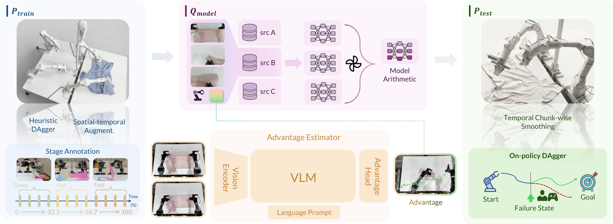{ width="920" }

*对应原论文 v3 Figure 2 的系统流程。图中的优势估计器为策略训练提供信号，执行端还包含独立的动作缓冲处理；两者解决的时间问题不同。* [↗](https://arxiv.org/pdf/2602.09021v3#page=3)

论文报告了相对基线近 250% 的成功率提升与连续 24 小时运行展示。理解这两个表述，仍要回到具体任务、相对增幅、重试次数和吞吐量。附录还保留了阶段条件失效、控制组合退化的结果，它们限定了哪些组件可以直接迁移、哪些必须重新验证。[↗](https://arxiv.org/pdf/2602.09021v3#page=1) [↗](https://arxiv.org/pdf/2602.09021v3#page=16)

## 三个“分布”分别是什么，为什么不能只修训练集

作者用 $P_{\mathrm{train}}$ 表示专家轨迹分布，用 $Q_{\mathrm{model}}=\pi(a\mid s;\hat\phi)$ 表示学到的条件动作策略，用 $P_{\mathrm{test}}$ 表示机器人部署时产生的轨迹分布。它们属于一个流程的不同层次：前后两者描述轨迹，中间是状态到动作的条件映射。论文没有通过一个直接计算的 KL 距离，同时把这三项优化到相等。[↗](https://arxiv.org/pdf/2602.09021v3#page=4)

执行端的区别在式（2）中最清楚。理想情况下，策略动作 $a_t$ 进入真实动力学 $T$；实际部署中，推理与执行算子 $I$ 产生真正施加的动作 $\tilde a_t$，于是有效转移为

$$
\widetilde T(s_{t+1}\mid s_t,a_t,\xi)
=\mathbb E_{\tilde a_t\sim I(\cdot\mid a_t,s_t)}
\left[T(s_{t+1}\mid s_t,\tilde a_t,\xi)\right].
$$

$\xi$ 是固定的环境参数，$I$ 汇总推理到执行过程的影响，$T$ 则描述物理状态如何变化。这一写法强调，即使策略在当前输入下预测了合适动作，实际运动仍受执行链条影响。机器人在等待新动作块时已经运动，新块的早期命令可能过期；直接从新块开头执行，就会把过去时刻的计划施加给现在的机器人。[↗](https://arxiv.org/pdf/2602.09021v3#page=4)

| Inconsistency | Concrete failure | Main intervention |
|---|---|---|
| Coverage Deficiency | 有限示范与单次优化遗漏可行操作模式 | 在同任务互补子集上训练并合并策略 |
| Temporal Mismatch | 相似画面处于不同任务阶段；新动作块到达时已与当前执行错位 | 阶段条件进展信号；过期动作删除与平滑衔接 |
| Failure Cascade | 小幅滑落或抓点偏差使策略进入缺少恢复示范的状态 | DAgger / Heuristic DAgger 与数据增强 |

这里有两个不同的“时间”。SA 处理任务语义随阶段变化的问题，例如同样的平铺衣物，在展平阶段与折叠阶段需要不同动作；动作缓冲处理真实时间上的延迟。只改进进展估计器，无法自动消除动作执行错位；只平滑关节轨迹，也无法教会模型滑落后怎样重新抓起衣物。[↗](https://arxiv.org/pdf/2602.09021v3#page=4) [↗](https://arxiv.org/pdf/2602.09021v3#page=6)

## Model Arithmetic，把有限示范中的不同模式合成一个策略

### 合并的对象是同任务候选模型的权重

MA 先把某个任务的数据随机分为互不重叠子集，分别训练策略。每个子集覆盖的衣物状态、外观和操作模式不同，优化后候选策略也可能保留不同偏好。论文实现使用 4 个检查点，再通过非负、和为 1 的系数进行权重插值

$$
\theta_{\mathrm{merged}}=\sum_{i=1}^{n}\alpha_i\theta_i,
\qquad \alpha_i\geq0,\qquad\sum_{i=1}^{n}\alpha_i=1.
$$

$\theta_i$ 是候选策略参数，$\alpha_i$ 是融合系数，最终部署的是 $\theta_{\mathrm{merged}}$ 这一个模型。它不需要同时运行四个策略后投票，也没有推理路由器，因此收益不以多模型在线推理为代价。不过训练多个候选、收集验证轨迹和搜索系数仍有成本，“部署无额外模型”不能延伸为整个流程零成本。[↗](https://arxiv.org/pdf/2602.09021v3#page=4) [↗](https://arxiv.org/pdf/2602.09021v3#page=14)

Figure 3 上半部分把验证损失映射成权重，下半部分列出其他搜索方法。重点是用什么数据计算这些损失，以及评估的是单个候选还是合并后的策略。

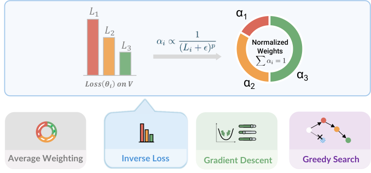{ width="760" }

*原论文 v3 Figure 3。Inverse Loss 用单个模型的验证损失构造权重；Gradient Descent 与 Greedy Search 则需要比较合并结果的验证表现。* [↗](https://arxiv.org/pdf/2602.09021v3#page=4)

| Strategy | Coefficient selection | What it tests |
|---|---|---|
| Average Weighting | 所有 $\alpha_i=1/n$ | 单纯合并是否已优于单个候选 |
| Inverse Loss | $\alpha_i\propto1/(L_i+\epsilon)^p$，再归一化 | 单模型验证损失能否指导权重分配 |
| Gradient Descent | 用 $\operatorname{softmax}(w)$ 参数化系数，优化合并模型的验证损失 | 连续优化能否找到更好的组合 |
| Greedy Search | 逐步加入能降低验证损失的检查点，在入选模型间均匀平均 | 简单候选筛选能否避免较差模型稀释能力 |

表中的 $L_i$ 为候选模型验证损失，$\epsilon$ 防止分母不稳定，$p$ 控制低损失模型获得多大偏重；它与 SA 中同样写作 $\epsilon$ 的筛选参数用途不同。附录方法细节采用 inverse-loss，主实验又比较了梯度下降及其自适应变体、贪心等方法，因此应区分一个实现配置与对多种合并策略的经验比较。[↗](https://arxiv.org/pdf/2602.09021v3#page=7) [↗](https://arxiv.org/pdf/2602.09021v3#page=14)

### 决定合并效果的验证集，来自机器人实际偏离的状态

如果验证集仍是干净的专家轨迹，低验证损失可能只奖励模型复现已经覆盖的动作。χ₀ 使用子集策略运行时收集的 DAgger 恢复轨迹作为 OOD 验证数据。它们相对原始子集包含新的失败邻域，系数搜索因此会考虑“偏离后能否接回来”。这里 OOD 的参照是原始示范分布，并非一个完全不相关的新领域。[↗](https://arxiv.org/pdf/2602.09021v3#page=4)

这也说明 MA 的能力边界。它让已有候选的参数组合更适合验证状态，没有凭权重相加创造此前完全不存在的恢复标签。恢复轨迹本身仍需要采集；如果所有候选都缺乏某个必要技能，模型合并并不提供从无到有的保证。论文只检验同任务不同子集的合并，跨任务策略融合被列为后续研究。[↗](https://arxiv.org/pdf/2602.09021v3#page=9)

Task C 的 Figure 8 同时放入 full data 和 single best 两个对照。前者排除“只是看到了更多训练数据”的简单解释，后者排除“其实只要挑中最强子模型”的解释。成功率和吞吐量上的整体优势支持参数合并的价值，但不同合并方法的重试成本并不一致，贪心也不是每一列吞吐都最高。

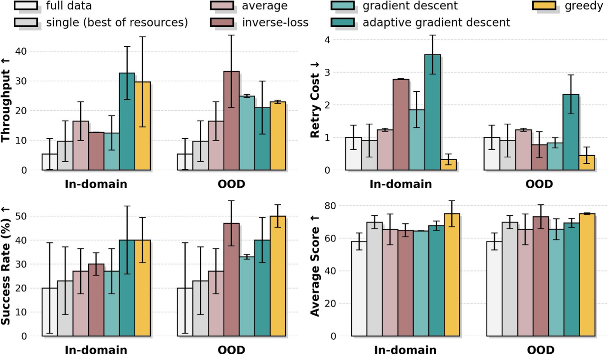{ width="840" }

*原论文 v3 Figure 8，Task C。每张子图内部先比较 full data、single best 与合并策略，再横向比较 In-domain 与 OOD 验证；误差线和各指标方向都要保留。图中没有逐柱精确数值标签。* [↗](https://arxiv.org/pdf/2602.09021v3#page=7)

扩展到 Task A/B 后，结论需要收窄。Figure 14 中 Task B 的合并策略大幅减少重试，但 Task A 的某些梯度合并配置在吞吐上并不高于 full-data；OOD 也并非在每项指标上更好。附录明确承认，验证损失与最终表现的相关性不够稳定，并提出 OOD 数据必须足够接近实际 $P_{\mathrm{test}}$ 才能成为有效代理的解释。因而，复用 MA 时应先审查恢复验证集的代表性，而非把“OOD”这个标签本身当作质量保证。[↗](https://arxiv.org/pdf/2602.09021v3#page=16)

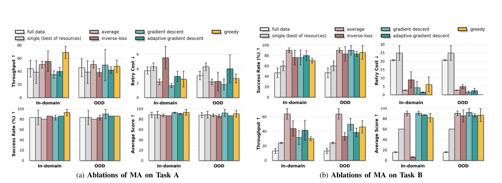{ width="1000" }

*原论文 Figure 14。左侧 Task A、右侧 Task B。Task B 的 Retry Cost 降低很明显；Task A 的吞吐与 OOD 对照则显示，正文概括的优势不能逐项推广。* [↗](https://arxiv.org/pdf/2602.09021v3#page=16)

## Stage Advantage，从单帧分数改为阶段内的前后比较

### 为什么两个进度值相减容易出问题

长时程示范包含有效推进、重复动作和恢复动作。普通行为克隆把这些动作都当成同等监督，可能学到重复展平却迟迟不折叠的行为。论文采用进展信号区分样本质量，先比较一种基于独立单帧进度值的方式

$$
A(s,a)=V(s')-V(s).
$$

其中 $V$ 预测状态的任务进度，$s'$ 为后续状态。若两个预测都带误差，相减后的信号可能波动；如果相似图像出现在不同阶段，单帧全局值还可能缺少确定语义。实验基线是作者在 $\pi_{0.5}$ 的 PaliGemma 上自行实现的 RECAP / $\pi_{0.6}^{*}$ 风格方法，以同轨迹未来 50 步的值减当前值。它不等同于官方完整 $\pi_{0.6}^{*}$ 系统的直接对照。[↗](https://arxiv.org/pdf/2602.09021v3#page=5) [↗](https://arxiv.org/pdf/2602.09021v3#page=7)

SA 首先把两个独立预测变为一个配对预测，让 VLM-based estimator 同时读取前后图像，直接输出相对进展；再加入当前阶段 $g$

$$
A_{\mathrm{stage}}(s,a,g)=f_\theta(s,s'\mid g),
\qquad g\in\left\{0,\frac1S,\ldots,\frac{S-1}{S}\right\}.
$$

$S$ 是阶段数，阶段由人工语义标注获得。训练帧对来自同一 episode，时间跨度随机抽取，$s'=s_{t+\Delta}$，避免只适配固定间隔。公式中的 $a$ 表示从 $s$ 到后续状态的行为，但网络的明确输入接口是两幅观测与阶段条件；不能据符号自行添加论文未给出的动作编码器。[↗](https://arxiv.org/pdf/2602.09021v3#page=5)

| Task | Stage annotations |
|---|---|
| A | flattening → folding |
| B | retrieving、flattening、folding、handover，覆盖条件分支中的子目标 |
| C | retrieving、dressing the rack、hanging |

Figure 4 展示把阶段优势累积后得到的轨迹。先看衣服滑落后曲线下降、重抓与展平后的回升，再看遮挡引起的振荡与重复展平段。它说明模型尝试让进展信号与动作后果对应，曲线仍会受视觉遮挡影响，不能把一次可视化当成无误差的奖励函数。[↗](https://arxiv.org/pdf/2602.09021v3#page=5)

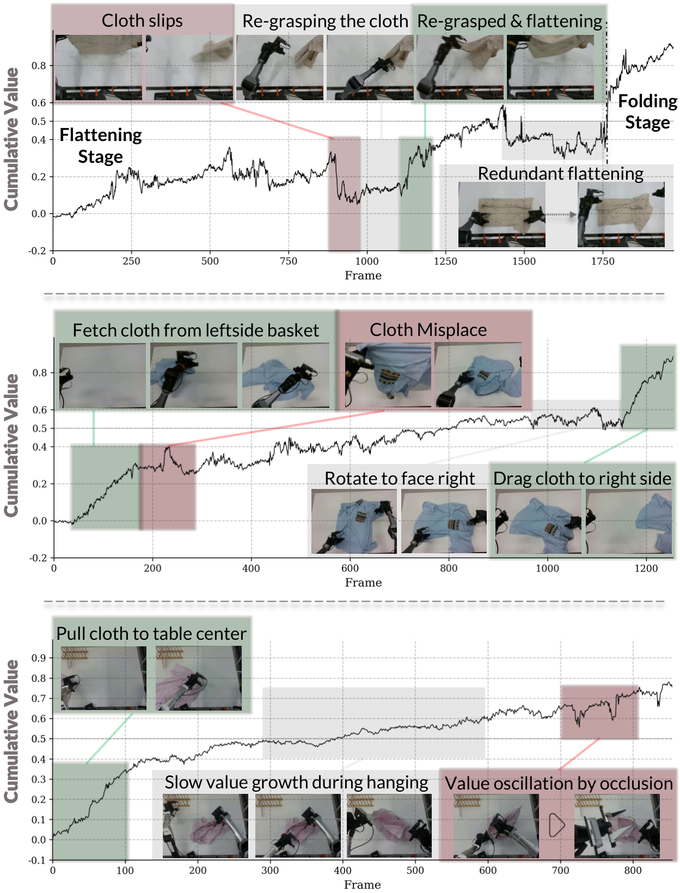{ width="820" }

*原论文 v3 Figure 4。三行分别来自 A/B/C，红、绿区域强调负向与正向进展；挂衣过程中的视觉遮挡仍可导致值振荡。* [↗](https://arxiv.org/pdf/2602.09021v3#page=5)

### 二元“好动作”标签如何产生

主文用 $I=\mathbf1[A_{\mathrm{stage}}>\epsilon]$ 概括把连续优势离散化的过程，附录则给出具体操作：按预测优势排序，取顶部 $\epsilon=0.3$ 比例为正样本，其余为负。这里应按**排名前 30%**理解，而不能把未归一化的优势绝对值 0.3 当成跨任务通用阈值。二元最优性条件随后用于偏向有效进展的策略学习。报告未展开条件 token 的完整编码与推理引导参数，因此这里能复用的是标签构造和训练思路，不能据此补出一套未披露的在线重排序流程。[↗](https://arxiv.org/pdf/2602.09021v3#page=14)

它的监督来源也影响解释。附录说明，帧对的相对进展标签基于它们在轨迹中的时间位置差，属于时间进度代理。作者承认这种方法隐含任务完成过程近似单调的假设：后出现的状态不一定更有价值，特别是恢复可能要先退回较早姿态。因此，SA 减少某些估计不稳定，并没有从根本上解决“什么行为真正有助于成功”的奖励定义问题。论文将这种优势加权学习与离线 RL / AWR 联系起来，未使用 PPO 那样依赖大量在线试错的训练方案。[↗](https://arxiv.org/pdf/2602.09021v3#page=13)

原图的训练损失曲线显示，SA 比自行实现的 $\pi_{0.6}^{*}$ 风格估计器收敛到更低损失。纵轴为对数刻度，这支持其在该进展监督上的拟合优势；是否转换为更好的真实机器人策略，还需要下一组实验。

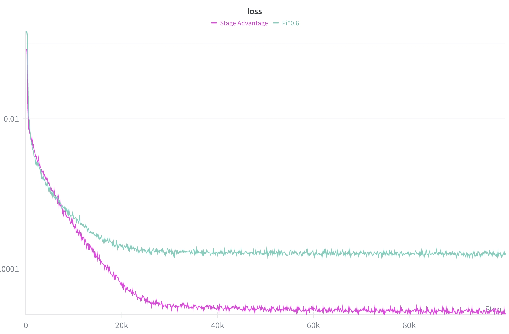{ width="760" }

*原论文 v3 Figure 13，优势估计训练损失。它衡量的是监督目标拟合，不能代替任务完成率。* [↗](https://arxiv.org/pdf/2602.09021v3#page=15)

### 更平滑的进展，并不自动带来更高成功率

Figure 9 对照 $\pi_{0.6}^{*}$-style、Direct、Direct + Stage。Direct 检验“配对预测”本身，Direct + Stage 再检验语义阶段条件。左侧使用 Smooth Frame Ratio（SFR）和 Mean Squared Temporal Difference（MSTD）描述数值行为，右侧给出实际策略的吞吐、重试、成功率和得分。原图将 SFR 标为越高越好、MSTD 标为越低越好；论文未完整交代两个指标的计算细节，因此可以比较图中的变化方向，但不能自行补出归一化方式或具体计算公式。[↗](https://arxiv.org/pdf/2602.09021v3#page=7)

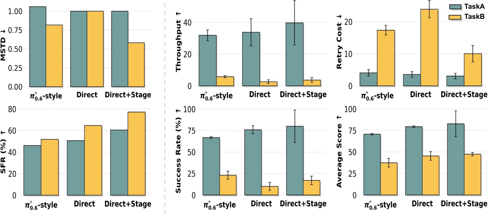{ width="840" }

*原论文 v3 Figure 9。青色 Task A、黄色 Task B。需要把同一任务在 SFR、Throughput、Retry Cost 与 Success Rate 中的柱子对应起来，避免只看稳定性指标。* [↗](https://arxiv.org/pdf/2602.09021v3#page=7)

Task A 中，加入阶段后吞吐、成功率和得分都较好。Task B 的结果更复杂：Direct + Stage 比 Direct 显著减少重试，也提高了后者的成功率，但其吞吐与成功率仍低于 $\pi_{0.6}^{*}$-style 基线；平均得分则提高。这意味着它可能更少空转、完成更多中间步骤，却没有在该对照中提高最终完成比例。把这组图概括为“阶段优势在各任务、各指标全面胜出”，会掩盖真正的权衡。

Task C 的附录反例更明确。Direct + Stage 的平滑性表现继续改善，成功率、吞吐和 Average Score 却低于基线。Direct 单独使用时，成功率较高，但吞吐和平均得分更低、重试更多，也不能说它在所有维度胜出。作者把困难与基础模型缺少挂衣先验联系起来，这仍是解释性假设，实验没有单独控制预训练中的挂衣数据来验证它。[↗](https://arxiv.org/pdf/2602.09021v3#page=16) [↗](https://arxiv.org/pdf/2602.09021v3#page=17)

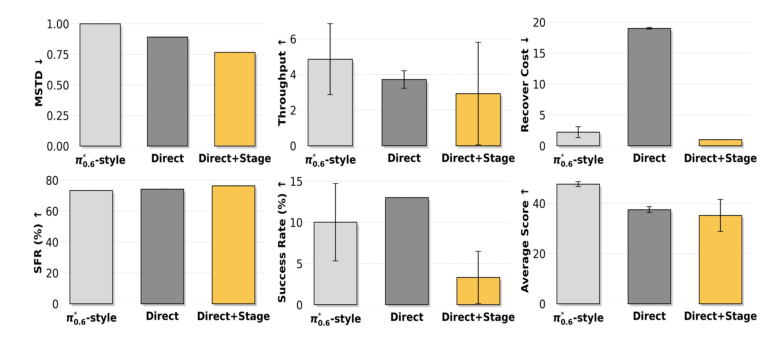{ width="920" }

*原论文 Figure 15。Direct + Stage 的低重试与较高 SFR，需要和低成功率一起理解；一条策略也可能因为缺少有效恢复而很少重试。* [↗](https://arxiv.org/pdf/2602.09021v3#page=16)

因此，SA 的可复用对象是“阶段条件的配对进展建模”这一接口，以及分开比较信号稳定性和闭环表现的实验方法。阶段如何划分、时间代理是否适合任务、筛出的高进展片段是否包含必要恢复动作，都需要在目标任务上重新检查。

## Train-Deploy Alignment，先让新动作块接到正确的时刻

### 删除过期命令，再处理交接处的跳变

异步推理能减少机器人等待，但新动作块到达时，旧块可能已经被执行了一段。如果直接切到新块开头，命令的时间基准会落后；如果硬切到某个新位置，相邻关节目标又可能跳变。Temporal Chunk-wise Smoothing 同时处理这两点，核心状态包括旧缓冲 $a^{\mathrm{old}}$、已消费索引 $k$、新预测 $a^{\mathrm{new}}$、最大删除量 $d_{\max}$ 和最小重叠长度 $m_{\min}$。[↗](https://arxiv.org/pdf/2602.09021v3#page=6)

Algorithm 1 先计算 $d=\min(k,d_{\max})$。如果 $d$ 已达到或超过新块长度，说明没有可用的新命令，保留旧缓冲和索引；否则删除新块前 $d$ 个命令，得到 $a^{\mathrm{new}}_{\mathrm{rem}}$。当旧缓冲短于最小重叠要求时，通过重复末命令补齐，再取两段可用长度的最小值作为 $L$。[↗](https://arxiv.org/pdf/2602.09021v3#page=6)

重叠区使用线性变化权重

$$
\tilde a_i=w_i a_i^{\mathrm{old}}+(1-w_i)a^{\mathrm{new}}_{\mathrm{rem},i},
\qquad
w_i=1-\frac{i}{\max(L-1,1)},\quad i=0,\ldots,L-1.
$$

当 $L>1$ 时，开头完全沿旧命令，末端完全采用新命令，中间平滑过渡。随后接上新块尚未用掉的尾部，重置消费索引为 0。分母中的 $\max(L-1,1)$ 避免只有一个重叠动作时除零；此时该位置按原算法保持旧命令。这个过程发生在执行缓冲层，不需要为了它重新设计动作专家网络。

Figure 5 下方的 Drop、Fill 和 Soft Updating 正对应上述步骤。图右侧的 t-SNE 展示不同数据与执行分布的相对形态，是直观诊断，不提供某个严格概率距离已经缩小的定量证明。

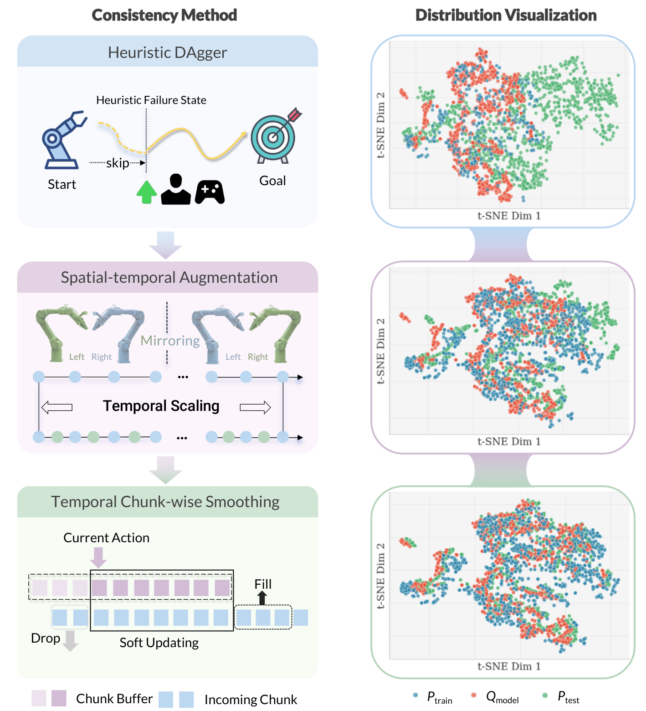{ width="820" }

*原论文 v3 Figure 5。三行分别改变恢复状态覆盖、时空数据覆盖和实际动作衔接；它们共同构成 TDA，不能都归为一种图像增强。* [↗](https://arxiv.org/pdf/2602.09021v3#page=5)

### 恢复数据的成本，在于等待机器人走到失败附近

标准 DAgger 先运行策略，出现持续失败后由人接管。附录给出的中断规则是连续超过 10 次抓衣失败，或超过 10 步重复无进展动作。软件停止向策略提供新观测和生成后续动作，机器人保持当前状态并切换遥操作；之前的策略轨迹和人工纠正轨迹都会保存。[↗](https://arxiv.org/pdf/2602.09021v3#page=14)

Heuristic DAgger 把这一步前移。操作者直接将衣物和机器人布置在人工设计的失败附近，例如抓点错位或部分滑落，再采集恢复示范，省去等待策略自然失败的在线过程。节省的是等待与 rollout 成本，人工布置、遥操作和标注依然存在。它也有覆盖上的取舍：真实 DAgger 会暴露策略特有的失败状态，人工设计只能覆盖操作者预想到的状态。[↗](https://arxiv.org/pdf/2602.09021v3#page=6)

时空增强提供另一种扩展。水平翻转图像时同步交换左右臂，保持视觉与动作对应；部分跳帧合成不同速度的运动片段。它们不增加机器人采集时间，但会改变策略看到的时空统计，必须与控制方式共同测试，不能直接把更多增强等同于更稳健。[↗](https://arxiv.org/pdf/2602.09021v3#page=6)

Figure 10/11 分别检验 Task A/C 中恢复数据的价值。两类 DAgger 都显著改善成功率、吞吐和中间得分；但 Task A 的 $\pi_{0.5}$ 在标准 DAgger 下，比 Heuristic DAgger 吞吐更高、重试更少，说明更省采集等待的方案不一定是最终执行效率最好的方案。Task C 中人工失败初始化也明显优于 Base，同时保留了较高重试成本。[↗](https://arxiv.org/pdf/2602.09021v3#page=8)

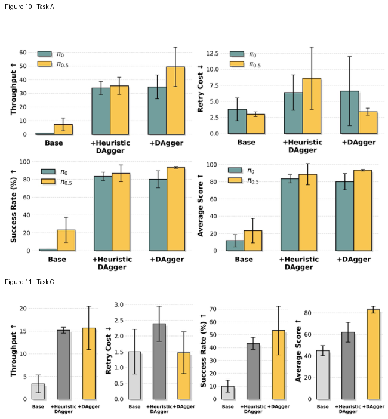{ width="820" }

*原论文 Figures 10、11 的原图面板，上方 Task A、下方 Task C。Base 重试少却成功率低，说明 Retry Cost 只有与 SR 和 TP 一起看，才能区分高效率与不会自救。* [↗](https://arxiv.org/pdf/2602.09021v3#page=8)

### 平滑控制与增强要按组合评估

Figure 12 比较 sync、naive async、temporal ensembling、RTC、chunk-wise smoothing 及 RTC + smoothing，并分别使用 Base、时间缩放、时间缩放加空间镜像数据。正确读法是先固定一组增强，再比较控制策略，随后再固定控制策略看增强的变化。否则容易把训练数据和执行方式的收益混在一起。

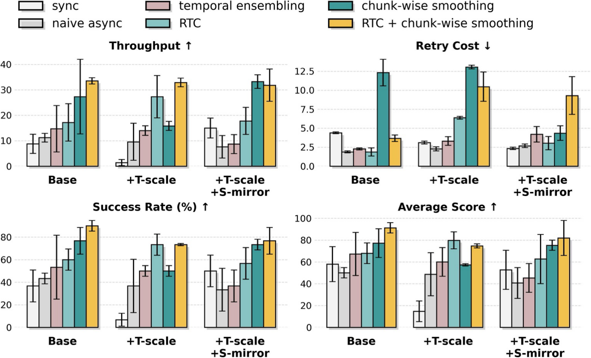{ width="840" }

*原论文 v3 Figure 12，Task A。平滑控制在多个配置中提高吞吐和成功率，但重试仍可能明显增加；组合 RTC 的作用也随增强配置改变。* [↗](https://arxiv.org/pdf/2602.09021v3#page=8)

Base 与只做时间缩放时，chunk-wise smoothing 虽有较高吞吐，也付出较高重试；叠加 RTC 后，这两组的重试下降。但在时间缩放加镜像的设置中，组合方案的重试又高于单独平滑。作者在主文也指出，时空增强对 Task A 没有显著收益。这些结果支持控制与数据需要配套选择，无法支持“把所有模块打开总会更好”的部署规则。[↗](https://arxiv.org/pdf/2602.09021v3#page=8)

附录进一步改变动作表示。Absolute Joint 预测绝对关节状态，Delta Joint 预测关节增量，两者对延迟、累计误差和细微动作的敏感性不同。Task C 的 Delta Joint / Base 下，同步控制的成功率与吞吐高于单独平滑及 RTC 组合，和图注的普遍优势概括并不一致；Task B 的 Absolute Joint / Base 中，同步控制的吞吐也更高。挂衣需要精确插入衣架，不能只沿用展平任务中表现最好的配置。[↗](https://arxiv.org/pdf/2602.09021v3#page=17) [↗](https://arxiv.org/pdf/2602.09021v3#page=18)

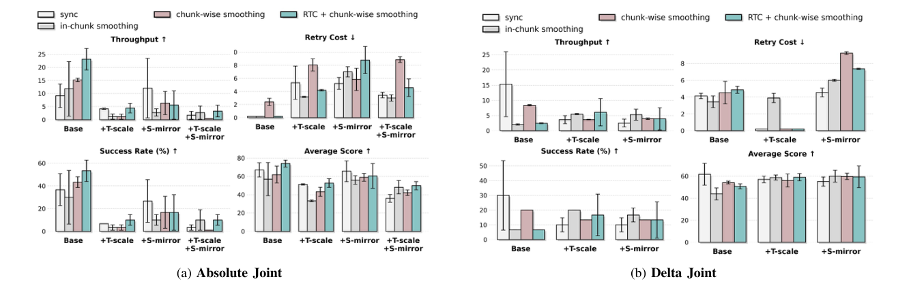{ width="1000" }

*原论文 Figure 18。左侧 Absolute Joint，右侧 Delta Joint；右侧 Base 的同步基线是重要反例。不同动作表示和增强下的柱组应分别解读。* [↗](https://arxiv.org/pdf/2602.09021v3#page=17)

## 实验预算与任务协议，决定“资源受限”如何理解

### 任务是分开训练的，硬件也并非完全相同

| Task | Goal and success condition | Time limit stated |
|---|---|---|
| A: T-Shirt Flattening and Folding | 从任意初态展平并完成折叠，放到桌面中央 | 180 s |
| B: Conditional Retrieval and Sorting | 取出并展平衣物；T 恤折叠堆到左上，有领衬衫交接到右侧 | 180 s |
| C: Garment Hanging | 接收 Task B 的展平衬衫，挂到杆上且稳定不掉落 | 原文未给同样的 180 s 限制 |

系统有两套双臂平台，分别采用 Agilex Piper 与 ARX X5。每条手臂为 6 自由度并配 1 自由度平行夹爪，两个平台第五关节的 pitch/yaw 配置不同。每套系统有一台固定头部相机和两台腕部 RealSense D435i，采集 $640\times480$ RGB 图像。具体任务模型分别微调，系统协作不能等价为一个模型无条件跨两种本体与所有任务部署。[↗](https://arxiv.org/pdf/2602.09021v3#page=6) [↗](https://arxiv.org/pdf/2602.09021v3#page=15)

附录 Table I 给出了可直接用于预算判断的后训练配置。

| Hyperparameter | Value |
|---|---:|
| Expert demonstration hours | $\sim20$ h per task |
| Action chunk length $K$ | 50 |
| Execution frequency | 100 Hz |
| Training steps | 80,000 |
| Batch size | 128 |
| Optimizer | AdamW |
| Learning rate | $2.5\times10^{-5}$ |
| Cosine Decay Steps | 10,000 |
| Conditioned noise level $\sigma$ | $[0.001,1.0]$ |
| Gradient Clip | 1.0 |
| MA: Number of checkpoints | 4 |
| SA: Advantage threshold $\epsilon$ | 0.3，附录按 top fraction 实现 |
| Training GPUs | $8\times$ A100 |
| Inference GPUs | RTX 4090 |

训练对开源 $\pi_{0.5}$ 做全参数 flow-matching 微调。数据与视觉输入按 30 Hz 采样；低层关节控制器为 100–200 Hz，Table I 的执行频率为 100 Hz。**这些控制频率并不说明 VLA 每秒完成 100 次大模型前向。**动作块、相机采样和低层控制属于不同时间尺度，论文没有提供足以还原每次推理延迟或完整训练 GPU 小时的数字。[↗](https://arxiv.org/pdf/2602.09021v3#page=15)

“每任务约 20 小时”也要与附录的数据统计分开。附录列出 A/B/C 分别为 2,668 / 3,519 / 2,988 个 episode，平均 30.41 / 34.40 / 39.01 秒，并注明包含较短的 DAgger 干预。按数量乘均值，分别约为 22.5 / 33.6 / 32.4 小时，这是对附录统计的计算，不等同于主文给出的约 20 小时专家示范口径。复用时应核对专家数据、干预与策略片段分别占多少，不应将整个项目或三项任务总共压缩成 20 小时。[↗](https://arxiv.org/pdf/2602.09021v3#page=15)

### 四项指标分别奖励什么

每种衣物进行 10 次试验，三种衣物合计 30 次；论文报告均值及其所称的 accumulative standard error。Success Rate 衡量完整成功比例，Throughput 估计每小时能完成多少任务，Retry Cost 为每 episode 的平均动作重试数，Average Score 则按里程碑累计部分分。它们分别回答完成、效率、恢复代价与完成到哪一步的问题。[↗](https://arxiv.org/pdf/2602.09021v3#page=6) [↗](https://arxiv.org/pdf/2602.09021v3#page=7)

Table II 的分数设计尤其影响长任务评价。同样“完成了一半动作”，不同任务和阶段未必拿到相同得分。

| Task | Sub-goals and scores | Total |
|---|---|---:|
| A | Flatten garment +40；1st / 2nd / 3rd fold 各 +20 | 100 |
| B – T-shirt | Retrieve & flatten +40；三次 fold 各 +15；Stack to top-left +15 | 100 |
| B – Shirt | Retrieve from basket +30；Flatten +50；Pull to right-side table +20 | 100 |
| C | Pull garment rightward +15；Grasp collar +15；Grasp hanger +15；Insert hanger into sleeve +20；Hook left collar on hanger +20；Hang on standing rack +15 | 100 |

例如，Task C 已完成两侧衣物与衣架处理却没挂稳，仍能得到较高部分分，但 Success Rate 会判失败。反过来，学会多次恢复可能提高最终成功率，也会增加 Retry Cost 和耗时。低重试既可能来自一次做成，也可能来自失败后没有任何恢复尝试，必须放回 SR/TP 上解释。[↗](https://arxiv.org/pdf/2602.09021v3#page=15)

## 完整系统的增益，要连同瓶颈和反例一起看

Figure 7 是 Task A 的组件组合实验。原图的成功率从基线约四分之一，提高到完整系统接近全部成功的水平；吞吐从每小时个位数提高到约六七十次。这些仅是按坐标轴读取的量级，图中没有逐柱精确数值标签。论文所称近 250% 的提升是相对增幅，不是增加 250 个百分点，也不是保证任意任务获得相同倍数。[↗](https://arxiv.org/pdf/2602.09021v3#page=1) [↗](https://arxiv.org/pdf/2602.09021v3#page=7)

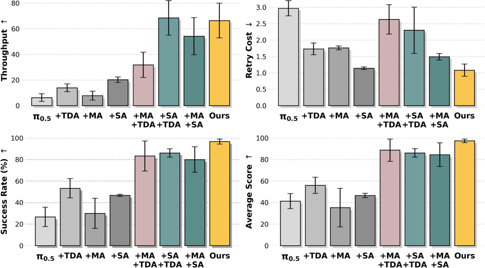{ width="840" }

*原论文 v3 Figure 7，Task A 的模块组合。完整系统成功率与 Average Score 很高，但 SA + TDA 的吞吐均值略高于完整系统，不能把“组件越多”解释为每个指标都单调增加。* [↗](https://arxiv.org/pdf/2602.09021v3#page=7)

单模块与组合之间的差异也有信息量。SA 的主要作用体现在推进效率，TDA 对最终完成更关键；MA 与其他模块组合后，能进一步改善候选策略的使用效果。图中不同配置的重试并非随成功率简单同向变化，说明某些恢复行为虽然要多尝试，却能把原本终止的回合接回任务。完整系统是这些环节在该任务上的配合结果，附录已经说明这种配合需要按任务重新选择。[↗](https://arxiv.org/pdf/2602.09021v3#page=7) [↗](https://arxiv.org/pdf/2602.09021v3#page=8)

连续 24 小时运行展示回答的是系统能否持续执行这一工程问题。报告没有同时给出这 24 小时对应的标准化回合总数、失败分母和人工干预统计，因而无法用它计算生产系统的平均无故障时间，或把它当成百分之百成功的任务测试。标准任务指标与长时间展示应分别保留。[↗](https://arxiv.org/pdf/2602.09021v3#page=2)

### 1,026 个失败案例把数据预算指向展平阶段

附录 Figure 16 提供了比总体成功率更适合指导下一轮采集的证据。记录的 1,026 个 Task A 失败案例中，1,010 个发生在展平，折叠失败为 12 个，其他 4 个。展平失败进一步主要由长期重抓与冗余展平构成。

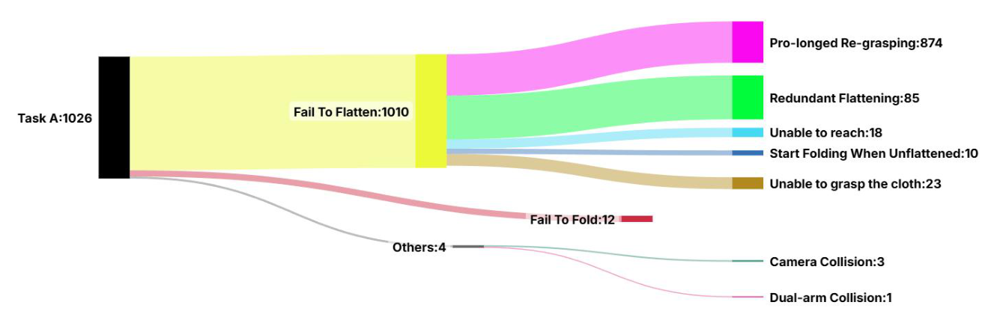{ width="1000" }

*原论文 Figure 16，失败案例的分类计数。这里的 1,026 是被分析的失败集合，不能当成完整系统所有评估回合的分母。* [↗](https://arxiv.org/pdf/2602.09021v3#page=16)

| Failure category | Count |
|---|---:|
| Fail To Flatten | 1,010 |
| └ Pro-longed Re-grasping | 874 |
| └ Redundant Flattening | 85 |
| └ Unable to reach | 18 |
| └ Start Folding When Unflattened | 10 |
| └ Unable to grasp the cloth | 23 |
| Fail To Fold | 12 |
| Others，Camera Collision 3 + Dual-arm Collision 1 | 4 |

由计数计算，约 98.4% 的已记录失败落在展平阶段，长期重抓占全部失败约 85.2%。这直接说明采集重点为什么应放在失败后的抓点选择、布料状态恢复和停止无效重复上，而非继续均匀增加已经熟练的折叠示范。DAgger 会自然遇到这些瓶颈，Heuristic DAgger 则可以主动布置相近状态。[↗](https://arxiv.org/pdf/2602.09021v3#page=16) [↗](https://arxiv.org/pdf/2602.09021v3#page=17)

附录还提出 **replay-ability（可回放性）** 作为数据质量原则：从相近初态开环重放示范，应能完成任务或带来明确进展。这既能筛掉损坏或错误示范，也能暴露采集与部署硬件之间的系统差异。它并不便宜，实际回放难以大规模并行；论文也把无需完整训练或大量物理回放的数据质量预测，列为未解决问题。[↗](https://arxiv.org/pdf/2602.09021v3#page=13)

## 对已有机器人策略，最值得复用的是诊断顺序

χ₀ 适合已经有可执行基础策略、但长流程可靠性不够的团队。可以先记录预测动作与实际执行的时间对应，确认新动作块是否过期、交接是否跳变；再按失败阶段统计恢复需求，决定使用真实 DAgger 还是人工失败初始化；如果问题集中在重复无进展与阶段混淆，再比较直接配对进展、阶段条件和原有价值差分。多个同任务检查点已经存在时，MA 提供了不增加在线模型数量的选择，但验证数据必须代表部署时真正会遇到的状态。

这些建议来自不同实验的作用位置，不是所有任务必须依次开启全部组件的固定配方。Task C 的 SA 与 Delta Joint 控制反例表明，一个数值更稳定的估计器或更平滑的动作缓冲，仍可能降低最终完成率。目标指标应始终回到带有耗时、重试和阶段得分的真实闭环执行。

论文没有系统验证后训练后通用能力的保留、刚体任务迁移，以及任意不同任务策略的合并。8 张 A100 与每任务约 20 小时示范，也建立在已有 $\pi_{0.5}$ 预训练能力之上。它最有用的认识是把可靠性损失定位到具体接口，再用匹配的恢复数据、进展监督和执行处理修复；“生产级”仍需要额外的任务覆盖与长期统计来证明。[↗](https://arxiv.org/pdf/2602.09021v3#page=9)
