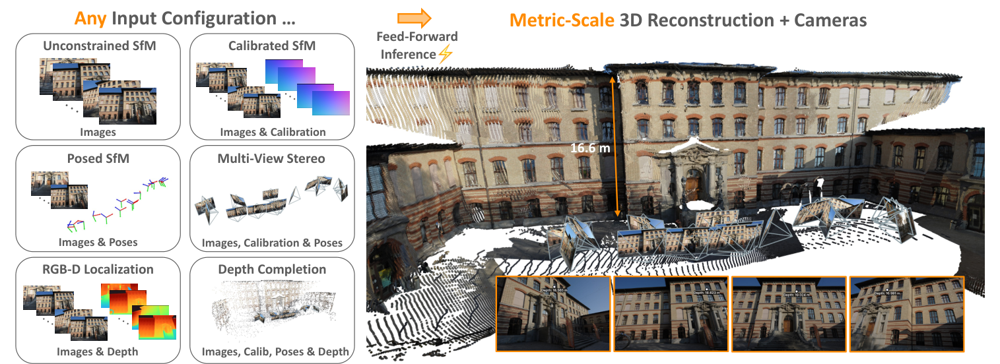
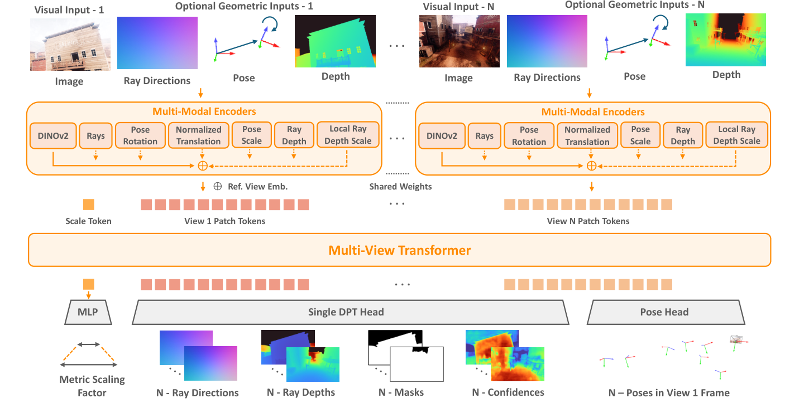
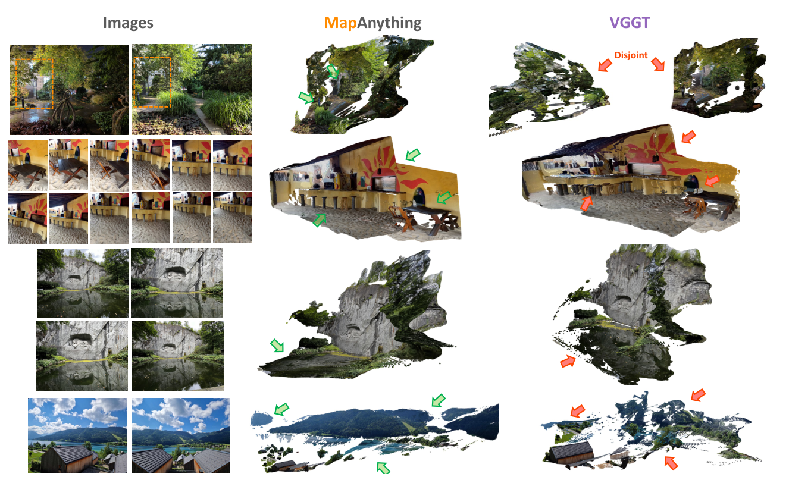
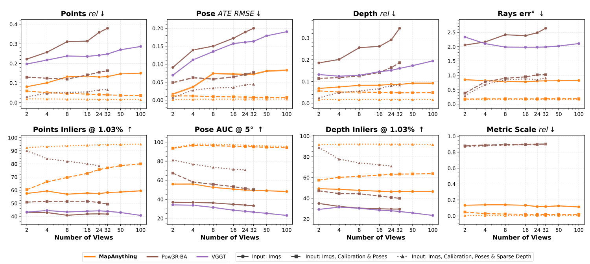
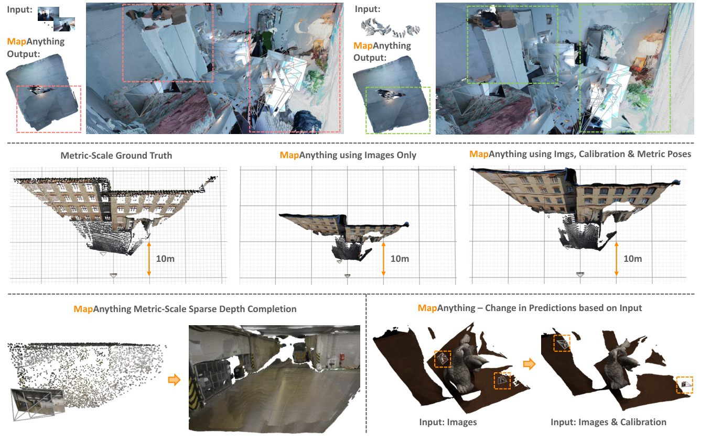
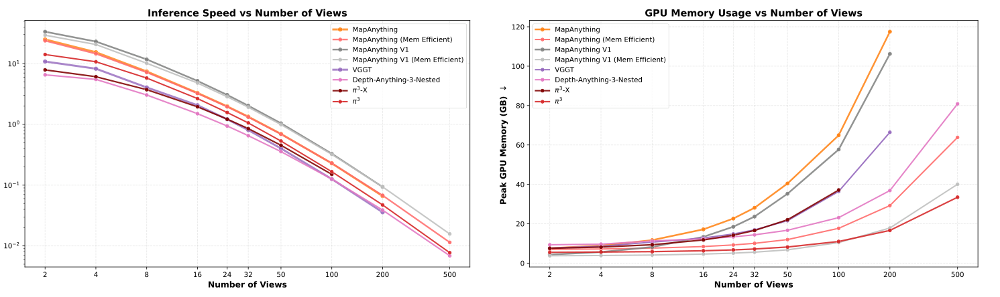
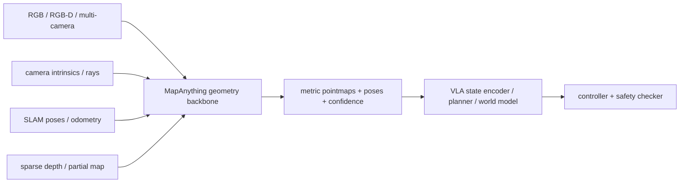

# MapAnything：统一前向 Metric 3D 重建骨干

!!! info "论文信息"
    **论文题名：** MapAnything: Universal Feed-Forward Metric 3D Reconstruction。<br>
    **作者：** Nikhil Keetha、Norman Müller、Johannes Schönberger、Lorenzo Porzi、Yuchen Zhang、Tobias Fischer、Arno Knapitsch、Duncan Zauss、Ethan Weber、Nelson Antunes 等（共 17 人）。<br>
    **机构：** Meta Reality Labs、Carnegie Mellon University。<br>
    **时间 / 主题：** 2025-09；具身智能。<br>
    **arXiv / 官方报告：** arXiv：[2509.13414](https://arxiv.org/abs/2509.13414)；官方材料：[map-anything.github.io/](https://map-anything.github.io/)。<br>
    **GitHub / 项目：** GitHub：[github.com/facebookresearch/map-anything](https://github.com/facebookresearch/map-anything)；项目页：[map-anything.github.io/](https://map-anything.github.io/)。<br>
    **元数据来源与核验口径：** 来源：[arXiv](https://arxiv.org/abs/2509.13414)；[GitHub API / repo](https://github.com/facebookresearch/map-anything)；[官方 / 项目材料](https://map-anything.github.io/)；Checked Date：2026-06-15；Repro Status：Paper / official materials reviewed, independent reproduction not claimed。

MapAnything 的核心价值，是把原本分散在 SfM、MVS、相机标定、深度估计、定位和补全里的几何问题，压到一个统一的前向模型里：**输入可以只有图像，也可以额外带 intrinsics、poses、depth 或 partial reconstruction；输出则是一套可合成 metric 3D reconstruction 的 factored geometry。**

它和 [VGGT](vggt.md) 很接近，但问题更“工程化”：VGGT 已经证明 camera、depth、point map、track 可以一起前向预测；MapAnything 继续追问，如果真实系统已经有一部分几何输入，比如机器人相机内参、SLAM 位姿、稀疏深度、RGB-D 深度，模型能不能把这些信息吃进去，并在同一个 metric scale 里输出更稳的重建。

## 它的效率贡献是什么

| Dimension | Contribution |
| --- | --- |
| Saved cost | 用一个 universal feed-forward model 覆盖 uncalibrated SfM、calibrated SfM、MVS、single-view calibration、camera localization、depth completion 等任务，减少为每种输入组合训练/维护 specialist model 的成本 |
| Core mechanism | factored scene representation：ray directions、ray depths、poses、metric scaling factor；几何输入和输出都用同一套分解表示 |
| Training contribution | 13 datasets 的监督标准化、covisibility-based multi-view sampling、geometric input probability augmentation、log-space losses、two-stage view curriculum |
| Embodied relevance | 机器人经常知道相机内参、局部 SLAM 位姿或稀疏深度；MapAnything 能把这些 partial geometric priors 接进 dense metric reconstruction |
| Main risk | 它仍是几何感知骨干，不建模动作、接触动力学、动态 scene flow 或控制安全；几何输入噪声和超大场景 memory 仍是限制 |

## 论文位置

传统 3D 重建常拆成一条长 pipeline：

```text
feature matching
  -> camera calibration / relative pose
  -> rotation & translation averaging
  -> bundle adjustment
  -> multi-view stereo
  -> point cloud / mesh / map
```

VGGT、DUSt3R、MASt3R 这类 feed-forward 方法把 pipeline 里的很多优化步骤前移到了模型里。MapAnything 的新增问题是：真实系统的输入不是固定的。机器人、AR、自动驾驶或扫描设备常常有不同程度的先验：

1. 只有一组 RGB 图像；
2. 有 camera intrinsics / ray directions；
3. 有 camera poses；
4. 有 metric depth 或 sparse depth；
5. 有 partial reconstruction；
6. 有上述信号的一部分视角，而不是所有视角。

这意味着模型不能只吃一种固定输入，也不能只输出 up-to-scale pointmaps。MapAnything 用 factored representation 同时解决两件事：**输入端可选、输出端 metric。**

{ width="920" }

<small>图源：`MapAnything`，Figure 1。原论文图意：MapAnything 用同一个 feed-forward 模型支持多种 input configuration，并输出 metric-scale 3D reconstruction 与 cameras；图中列出 unconstrained SfM、calibrated SfM、posed SfM、MVS、RGB-D localization 和 depth completion 等任务。</small>

**MapAnything 总图先看可选几何输入。**
左侧不是简单的任务展示，而是在强调输入组合的可变性：Images、Calibration、Poses、Depth 都可能存在或缺失。右侧的关键是 `Metric-Scale 3D Reconstruction + Cameras`，说明论文想解决的不是相对几何漂亮不漂亮，而是能否把局部估计放进统一 metric frame。

对具身系统来说，这点很实用。真实机器人通常已经有相机内参，移动机器人可能有 SLAM pose，RGB-D 相机有深度但会有洞；一个能融合这些输入的几何 backbone，比只能从 RGB 重建的模型更容易进入 episode schema 和规划系统。

## 核心问题：为什么要 factored geometry

MapAnything 不把场景直接表示成一组耦合 pointmaps，而是输出：

\[
\{m, (R_i, \tilde D_i, \tilde P_i)_{i=1}^{N}\}
\]

其中：

| Symbol | Meaning |
| --- | --- |
| \(R_i\) | local ray directions，等价于每个像素沿哪个相机射线出发 |
| \(\tilde D_i\) | up-to-scale ray depths |
| \(\tilde P_i\) | pose of image \(i\) in the frame of view 1，包含 quaternion \(Q_i\) 和 up-to-scale translation \(\tilde T_i\) |
| \(m\) | global metric scaling factor |

从这些量可以恢复局部点云和全局 metric 重建：

\[
\tilde L_i = R_i \cdot \tilde D_i
\]

这行式子在说：第 \(i\) 个视角的每条相机射线 \(R_i\) 乘上 up-to-scale 深度 \(\tilde D_i\)，得到局部坐标里的点 \(\tilde L_i\)。

\[
\tilde X_i = O_i \cdot \tilde L_i + \tilde T_i
\]

\[
X_i^{\text{metric}} = m \cdot \tilde X_i
\]

这里 \(O_i\) 由 quaternion \(Q_i\) 转成 rotation matrix。这个分解的好处有三层：

1. **camera calibration 与 depth 分开**：ray directions 可以表达更一般的 central camera，而不只是假设标准 pinhole；
2. **pose 与 scale 分开**：位姿的旋转、平移方向和 metric scale 不再强行耦合；
3. **partial supervision 更好用**：有些数据集只有 up-to-scale geometry，有些有 metric depth，有些有 pose，factored output 让不同数据都能贡献监督。

## 总体架构

{ width="920" }

<small>图源：`MapAnything`，Figure 2。原论文图意：模型把 RGB 图像和可选几何输入编码到共同 latent space，加入 reference view embedding 与 scale token，通过 multi-view transformer 融合多视角信息，再由 DPT head、pose head 和 scale MLP 输出 factored metric 3D geometry。</small>

**这张架构图怎么读。**
上方每个 view 都有 `Visual Input` 和可选的 `Optional Geometric Inputs`。图像走 DINOv2，ray / depth 走浅层 convolutional encoder，pose rotation、normalized translation、pose scale、ray depth scale 走 MLP。所有特征先对齐到同一个 latent space，再相加，而不是把几何信号只作为 prompt。

中间的 `Scale Token` 是 MapAnything 和普通 up-to-scale 重建的重要差异。局部几何和 pose 先在 up-to-scale 空间预测，scale token 再预测全局 metric scaling factor。这样既保留多视图相对几何，又能把结果拉回真实尺度。

### Encoder

MapAnything 的 image encoder 使用 DINOv2 ViT-G 的第 24 层 normalized patch features，特征维度是 1536，patch stride 对应 14。论文比较过 CroCoV2、DUSt3R image encoder、RADIO 和随机 patchification，认为 DINOv2 在下游性能、收敛速度和泛化上最好。

可选几何输入被分成两类：

| Input factor | Encoder |
| --- | --- |
| ray directions | shallow convolutional encoder with pixel unshuffle size 14 |
| normalized ray depths | shallow convolutional encoder with pixel unshuffle size 14 |
| rotations as unit quaternions | 4-layer MLP with GeLU |
| normalized translation directions | 4-layer MLP with GeLU |
| depth scales | 4-layer MLP with GeLU after log-transform |
| pose scales | 4-layer MLP with GeLU after log-transform |

这种输入分解很适合机器人：相机内参通常可靠，深度可能只对部分帧可靠，位姿可能来自 SLAM/odometry 且有尺度问题。把它们拆开编码，模型就能在不同输入可用性下保持同一套接口。

### Multi-View Transformer

所有 view 的 patch tokens 加上一个 learnable scale token 后，进入 multi-view transformer。论文使用：

| Setting | Value |
| --- | --- |
| Transformer type | 16-layer Alternating-Attention transformer |
| Attention heads | 24 |
| Latent dimension | 1536 |
| MLP ratio | 4 |
| Initialization | last 16 layers of DINOv2 ViT-G |
| Reference handling | constant reference view embedding added to view 1 tokens |
| RoPE | not used |

Alternating-Attention 继承了 VGGT 的核心直觉：跨帧 global attention 建立多视角几何关系，frame-wise attention 稳定每帧内部结构。MapAnything 的附录还用 ablation 说明，`Global w/ View PE` 在 50 views 上明显更差。

### Heads

| Head | Output |
| --- | --- |
| Single DPT Head | \(N\)-ray directions、\(N\)-ray depths、\(N\)-masks、\(N\)-confidences |
| Pose Head | \(N\)-poses in view 1 frame |
| Scale MLP | metric scaling factor |

DPT head 输出 local dense quantities；pose head 用 average-pooling-based convolutional design 输出 quaternion 和 up-to-scale translation；scale token 进入 2-layer MLP with ReLU，再通过 exponential scaling 得到 metric scaling factor。

## 训练目标

MapAnything 的训练目标很值得细读，因为它的“universal”不是靠一句多任务学习完成的，而是靠输出分解、loss 归一化、输入增强和数据标准化一起撑起来。

对于不依赖 scene scale 的量，直接监督：

\[
L_{\text{rays}}=\sum_i\|\hat R_i-R_i\|
\]

\[
L_{\text{rot}}=\sum_i\min(\|\hat Q_i-Q_i\|,\|-\hat Q_i-Q_i\|)
\]

这里 \(L_{\text{rays}}\) 表示预测 ray direction \(\hat R_i\) 和真值 \(R_i\) 的误差和；\(L_{\text{rot}}\) 表示旋转 quaternion 的误差和。quaternion 有 \(Q\) 和 \(-Q\) 表达同一旋转的问题，所以 rotation loss 取二者较小值。

对于 ray depths、pose translations、local pointmaps、world-frame pointmaps，论文沿用 DUSt3R 风格的 scale-invariant normalization，并把 log-space loss 作为关键设计。论文定义：

\[
f_{\log}(x) = (x / \|x\|)\cdot \log(1+\|x\|)
\]

并强调 ray depths、pointmaps 和 metric scale factor 都要在 log-space 里算 loss。为了避免 scale loss 的梯度污染 up-to-scale geometry，它使用：

\[
z^{\text{metric}}=m \cdot \text{sg}(\tilde z)
\]

其中 \(\text{sg}\) 表示 stop-gradient。

总 loss 为：

\[
\mathcal{L}
=10\cdot \mathcal{L}_{\text{pointmap}}
+\mathcal{L}_{\text{rays}}
+\mathcal{L}_{\text{rot}}
+\mathcal{L}_{\text{translation}}
+\mathcal{L}_{\text{depth}}
+\mathcal{L}_{\text{lpm}}
+\mathcal{L}_{\text{scale}}
+\mathcal{L}_{\text{normal}}
+\mathcal{L}_{\text{GM}}
+0.1\cdot \mathcal{L}_{\text{mask}}
\]

训练细节里有几个很工程化的点：

1. global pointmap loss 权重设为 `10`，mask loss 权重设为 `0.1`；
2. regression losses 使用 adaptive robust loss，参数 `c = 0.05`、\(\alpha = 0.5\)；
3. 每个 pixel loss 里 top `5%` 被剔除，用于降低训练数据噪声和异常值影响；
4. normal loss 和 multi-scale gradient matching loss 只用于 synthetic datasets，因为真实数据的几何可能粗糙或有噪声；
5. mask 用 binary cross entropy，预测 non-ambiguous classes for depth。

这部分对具身系统的启发是：几何监督不是“有 depth 就直接 L1”。真实数据经常有洞、噪声、尺度不一致和标注不完整；如果不在 loss 和输入 schema 上处理，模型会把数据集误差学成几何规律。

## 训练输入增强

为了让一个模型支持多种输入组合，MapAnything 在训练时随机提供或隐藏几何输入：

| Training input choice | Value |
| --- | --- |
| Overall geometric input probability | 0.9 |
| Individual factor probability | 0.5 each for ray directions, ray depth, pose |
| Depth input mode | equal probability of dense depth or 90% randomly sparsified depth |
| Per-view input probability | 0.95 |
| Metric scale input dropout | not provide metric scale factors with probability 0.05 |
| Supported exhaustive combinations | 64 possible input combinations in supplement |

这里的关键不是做数据增强本身，而是让模型学会“几何输入是可选的”。这和机器人部署很像：某些帧有深度、某些帧深度失效；某些相机标定可靠、某些外参刚重标定；SLAM 位姿有时漂移，有时可用。训练时把输入可用性打散，能减少模型对单一传感器契约的依赖。

## 训练数据

Table 1 is redrawn below with the original English fields.

| Dataset | License | # Scenes | Metric |
| --- | --- | ---: | :---: |
| BlendedMVS [80] | CC BY 4.0 | 493 | ✗ |
| Mapillary Planet-Scale Depth [36] | CC BY-NC-SA | 71,428 | ✓ |
| ScanNet++ v2 [81] | Non-commercial | 926 | ✓ |
| Spring [37] | CC BY 4.0 | 37 | ✓ |
| TartanAirV2-WB [73, 86] | CC BY 4.0 | 49 | ✓ |
| UnrealStereo4K [59] | MIT | 9 | ✓ |
| Additionally used for our CC BY-NC model: |  |  |  |
| Aria Synthetic Environments [2] | Non-commercial | 103,890 | ✓ |
| DL3DV-10K [32] | CC BY-NC 4.0 | 10,109 | ✗ |
| Dynamic Replica [25] | Non-commercial | 523 | ✓ |
| MegaDepth [30] | CC BY 4.0 | 269 | ✗ |
| MVS-Synth [21] | Non-commercial | 120 | ✓ |
| ParallelDomain-4D [62] | Non-commercial | 1,528 | ✓ |
| SAIL-VOS 3D [20] | Non-commercial | 171 | ✓ |
| Unique held-out scenes for dense up-to-N-view benchmarking: |  |  |  |
| ETH3D [54] | CC BY-NC-SA 4.0 | 13 | ✓ |
| ScanNet++ v2 [81] | Non-commercial | 30 | ✓ |
| TartanAirV2-WB [73, 86] | CC BY 4.0 | 5 | ✓ |

<small>表源：`MapAnything`，Table 1。原论文表格要点：训练数据覆盖真实室内、户外、合成、in-the-wild 和 metric / up-to-scale 场景；Apache 2.0 模型使用前 6 个数据集，CC BY-NC 4.0 模型额外使用后 7 个数据集。</small>

论文还补了一个细节：Mapillary Planet-Scale Depth 原本是 monocular metric depth dataset，作者额外获取 pose 和 camera information，使其变成约 `72K` scenes 的 real-world multi-view metric scale dataset，并开源这部分 metadata。

### Multi-View Sampling

训练时，作者对每个 dataset 预计算同一 scene 内所有 image pair 的 covisibility。covisibility 用 ground-truth depth 和 pose 做 reprojection error check 得到。训练采样时使用 `25%` covisibility threshold，通过 random walk sampling 得到单连通的 covisible view graph。

这一步对具身数据也很重要。如果直接随机抽图，模型可能拿到彼此几乎不重叠的视角，训练信号会混乱；如果只抽高度重叠视角，模型又学不到大 baseline、遮挡和场景覆盖。covisibility graph 是把“多视角可对齐”变成训练样本约束。

## 训练配方

Supplementary implementation details are redrawn below with the original English setting names.

| Setting | Value |
| --- | --- |
| Optimizer | AdamW |
| Peak LR for pre-trained DINOv2 encoder | \(5 \cdot 10^{-6}\) |
| Peak LR for everything else | \(10^{-4}\) |
| LR schedule | 10% linear warmup, then half-cycle cosine decay to 100x lower value |
| Weight decay | 0.05 |
| AdamW \(\beta_1, \beta_2\) | 0.9, 0.95 |
| Max image dimension | 518 pixels |
| Aspect ratio augmentation | randomized from 3:1 to 1:2 |
| Data augmentation | color jitter, Gaussian blur, grayscale conversion |
| Efficiency | mixed precision training, gradient checkpointing for DINOv2 encoder |
| Gradient clipping | norm threshold 1 |
| Batch scheme | dynamic batching based on number of views |
| Curriculum | two-stage curriculum, 420K steps |
| Stage 1 | 6 days on 64 H200-140GB GPUs, effective batch size 768-1536, views 4 to 2 |
| Stage 2 | 4 days on 64 H200-140GB GPUs, 10x lower peak LR, effective batch size 128-1536, views 24 to 2 |
| Ablation setup | same as above, but 8x lower effective batch size |

<small>信息源：`MapAnything`，Supplementary Material B。原论文要点：训练采用 DINOv2 小学习率微调、其他模块较大学习率、动态 batch 和两阶段 view curriculum；先在少视图上建立能力，再扩到更多 views。</small>

这份训练配方有三个值得记住的工程判断。

第一，DINOv2 不是冻死不用，而是用很小 LR 微调。几何任务需要保留视觉语义和纹理先验，但 ray、depth、pose 监督会改变特征的使用方式，小步微调比完全冻结更灵活。

第二，view curriculum 很关键。Stage 1 只在 `2-4` views 上训练，先把局部多视图几何学稳；Stage 2 扩到最多 `24` views，并降低 peak LR，让模型在更多视角下维持一致性。附录 Figure S.2 还显示，最多只训练到 4 views 的阶段模型，已经能泛化到更多 views，但最终模型明显更稳。

第三，动态 batch 不是小实现细节。多视图 Transformer 的 token 数随 views 增长，dense DPT head 还要输出每个 view 的像素级结果。固定 batch 很容易要么爆显存，要么浪费吞吐；按 views 调 batch 是这类模型训练的基本工程动作。

官方代码的 `train.md` 还把训练脚本拆成 Stage 1、Stage 2 和 Stage 3 confidence training。论文附录的主训练叙述是 two-stage curriculum；代码侧额外暴露 confidence 相关训练脚本，复现实验时应以具体 checkpoint / config 为准。

## 实验：重建质量与输入组合

{ width="920" }

<small>图源：`MapAnything`，Figure 3。原论文图意：只用 in-the-wild images 作为输入时，MapAnything 与 VGGT 的 qualitative comparison；论文说明 MapAnything 在大视差变化、季节变化、无纹理表面、水体和大场景上更稳。</small>

**Qualitative 图看几何连续性和断裂。**
这不是闭环机器人实验，而是几何重建鲁棒性样例。绿色箭头强调 MapAnything 在大场景和困难表面上的连续性，红色箭头指出 VGGT 的 disjoint 或几何断裂。它支撑的是 feed-forward metric reconstruction 的视觉质量证据，不能证明动作规划或动态交互能力。

{ width="920" }

<small>图源：`MapAnything`，Figure 4。原论文图意：MapAnything 在 2 到 100 views 以及不同 input configurations 下做 dense multi-view reconstruction，对比 VGGT 和 Pow3R-BA；指标覆盖 pointmaps、pose、depth、ray directions 和 metric scale。</small>

**Figure 4 的正确读法。**
先看横轴：views 从 `2` 增到 `100`。再看线型：同一个 MapAnything 在 `Input: Imgs`、`Input: Imgs, Calibration & Poses`、`Input: Imgs, Calibration, Poses & Sparse Depth` 下表现不同。结论不是“图像输入就够了”，而是模型能在同一 forward interface 里吸收额外几何信号；真实机器人越能提供可靠几何先验，MapAnything 越像一个融合器。

### Two-View Dense Reconstruction

Table 2 is redrawn below with the original English fields.

| Average across ETH3D, SN++v2 & TAV2 | Methods | Scale rel↓ | Points rel↓ | Points τ↑ | Pose ATE↓ | Pose AUC↑ | Depth rel↓ | Depth τ↑ | Rays err°↓ |
| --- | --- | ---: | ---: | ---: | ---: | ---: | ---: | ---: | ---: |
| a) Input: Images | DUSt3R [72] | -- | 0.21 | 43.9 | 0.08 | 35.5 | 0.17 | 32.6 | 2.55 |
| a) Input: Images | MASt3R [29] | 0.38 | 0.25 | 30.2 | 0.07 | 37.3 | 0.19 | 24.8 | 7.03 |
| a) Input: Images | Pow3R [23] | -- | 0.22 | 43.1 | 0.09 | 36.9 | 0.19 | 35.0 | 2.06 |
| a) Input: Images | VGGT [67] | -- | 0.20 | 43.2 | 0.07 | 34.2 | 0.13 | 29.3 | 2.34 |
| a) Input: Images | MapAnything | **0.13** | **0.08** | **57.5** | **0.02** | **56.0** | **0.07** | **49.3** | **0.85** |
| b) Input: Images & Intrinsics | Pow3R [23] | -- | 0.20 | 46.0 | 0.08 | 51.3 | 0.15 | 43.2 | 0.40 |
| b) Input: Images & Intrinsics | MapAnything | **0.13** | **0.07** | **59.3** | **0.01** | **64.7** | **0.06** | **55.1** | **0.19** |
| c) Input: Images, Intrinsics & Poses | Pow3R [23] | -- | 0.13 | 50.9 | 0.05 | 67.5 | 0.11 | 47.2 | 0.38 |
| c) Input: Images, Intrinsics & Poses | MapAnything | **0.05** | **0.06** | **60.4** | **0.01** | **93.6** | **0.06** | **57.5** | **0.18** |
| d) Input: Images, Intrinsics & Depth | Pow3R [23] | -- | 0.13 | **77.9** | 0.04 | 66.5 | 0.07 | **77.3** | 0.29 |
| d) Input: Images, Intrinsics & Depth | MapAnything | **0.02** | **0.04** | 77.8 | **0.01** | **73.1** | **0.03** | 76.6 | **0.18** |
| e) Input: Images, Intrinsics, Poses & Depth | Pow3R [23] | -- | 0.03 | **90.1** | 0.01 | 81.3 | 0.02 | **89.0** | 0.29 |
| e) Input: Images, Intrinsics, Poses & Depth | MapAnything | **0.01** | **0.02** | 82.0 | **0.00** | **94.8** | **0.02** | 81.5 | **0.16** |

<small>表源：`MapAnything`，Table 2。原论文表格要点：在 two-view reconstruction 上，MapAnything 在 images-only 和带几何输入时整体优于或匹配 specialist baselines；额外几何输入尤其改善 scale、pose 和 dense geometry。</small>

这张表最该关注的是输入组合。MapAnything 不是只在 `Images` 下和 VGGT 比，而是展示了一个统一模型如何随着 `Intrinsics`、`Poses`、`Depth` 增加而改变输出质量。这对具身智能的启发是：不要把几何模型只当 RGB 网络；如果系统已有 calibration、odometry、sparse depth，应该让模型把它们作为一等输入。

## 辅助几何输入为什么重要

{ width="920" }

<small>图源：`MapAnything`，Figure S.5。原论文图意：辅助几何输入可以改善 MapAnything 的 feed-forward performance；包括用 calibration 和 metric poses 改善 alignment / metric scale，用 sparse metric point cloud 做 dense metric depth completion，以及输入 calibration 后改变物体中心场景的预测。</small>

**这张补充图怎么读。**
上半部分说明，只靠 100 张图像时模型仍可能出现重复结构；加入 camera calibration 和 poses 后，几何对齐明显改善。中间展示 metric scale：images-only 的尺度估计不够准，加入 calibration 和 metric poses 后接近 ground truth。下半部分说明 sparse depth / calibration 不是装饰输入，它们会实际改变 dense reconstruction。

对机器人来说，这张图很关键：如果相机标定和局部位姿已经在系统里存在，就不该在模型输入层丢掉。MapAnything 的价值之一，就是把这些传统几何模块的输出重新变成 foundation model 的条件。

## 关键消融

Table 5 is redrawn below with the original English fields.

| (a) Scene Representation | Metric Scale rel↓ | Pointmaps rel↓ | Pointmaps τ↑ |
| --- | ---: | ---: | ---: |
| Input: Images Only |  |  |  |
| Local PM + Pose | 0.14 | 0.32 | 33.2 |
| RDP | 0.17 | 0.33 | 32.6 |
| LPMP & Scale | 0.16 | 0.30 | 38.7 |
| RDP & Scale (ours) | **0.16** | **0.28** | **40.7** |
| Input: Images, Intrinsics & Metric Poses |  |  |  |
| Local PM + Pose | **0.04** | 0.08 | 53.5 |
| RDP | 0.06 | 0.09 | 46.7 |
| LPMP & Scale | 0.06 | **0.07** | 55.9 |
| RDP & Scale (ours) | 0.05 | **0.07** | **57.8** |

| (b) Expert vs Universal Training | Metric Scale rel↓ | Pointmaps rel↓ | Pointmaps τ↑ |
| --- | ---: | ---: | ---: |
| Input: Images Only |  |  |  |
| Expert Training | 0.16 | 0.29 | 31.8 |
| Universal Training | **0.16** | **0.28** | **40.7** |
| Input: Images, Intrinsics & Metric Poses |  |  |  |
| Expert Training | **0.03** | **0.07** | 56.2 |
| Universal Training | 0.05 | **0.07** | **57.8** |
| Input: Images & Metric Depth |  |  |  |
| Expert Training | **0.06** | **0.24** | 53.0 |
| Universal Training | **0.06** | 0.25 | **54.0** |

<small>表源：`MapAnything`，Table 5。原论文表格要点：`RDP & Scale` 的 factored representation 是关键；universal training 在多个输入配置上的表现接近或优于为特定输入配置训练的 expert models。</small>

这张表支撑论文最核心的两个 claim：

1. **表示法重要**：只预测 local pointmap + pose，或者只做 RDP 而没有 metric scale，都不如 `RDP & Scale` 稳；
2. **universal training 不只是省事**：一个统一模型不是明显弱于 specialist，反而在一些输入组合上更好。

Supplementary Table S.2 进一步显示：

| (a) Loss Scheme | Metric Scale rel↓ | Pointmaps rel↓ | Pointmaps τ↑ |
| --- | ---: | ---: | ---: |
| Overall Factored Loss | **0.16** | **0.29** | **31.8** |
| No Log Loss | 0.17 | 0.39 | 27.3 |

| (b) Attention Scheme | Metric Scale rel↓ | Pointmaps rel↓ | Pointmaps τ↑ |
| --- | ---: | ---: | ---: |
| Alternating [67] | **0.16** | **0.29** | **31.8** |
| Global w/ View PE [78] | 0.20 | 0.53 | 19.7 |

<small>表源：`MapAnything`，Table S.2。原论文表格要点：log scaling 和 Alternating-Attention 对 50-view reconstruction 很关键，尤其是模型训练视角数少于评测视角数时。</small>

## 推理速度与显存

{ width="920" }

<small>图源：`MapAnything`，Figure S.1。原论文图意：在 H200-140GB GPU 上对比多视图 feed-forward reconstruction 模型的 inference speed 和 peak GPU memory；MapAnything 的 dense per-pixel regression 存在显存瓶颈，Mem Efficient 版本用 per-view decoding mini-batch loop 显著降低显存，速度损失很小。</small>

**推理图怎么读。**
左图看 view 数增加后 inference frequency 如何下降；右图看 peak GPU memory 如何上升。MapAnything 不是没有显存压力，瓶颈主要来自 dense per-pixel DPT decoding across views。论文的工程处理是把 per-view decoding 放进 mini-batched loop，降低显存峰值。

这对机器人部署有现实含义：如果只是少量相机或短窗口，feed-forward geometry 很有吸引力；如果要把 100+ views、长期 map、dense depth 和在线规划放在一起，必须设计 memory-efficient decoding、滑动窗口、关键帧筛选或 scene memory。

## 它和 VGGT / Depth Anything 3 的关系

| Method | Main state | Input flexibility | Metric scale | Embodied use |
| --- | --- | --- | --- | --- |
| [VGGT](vggt.md) | camera、depth、point map、tracks | 主要从多张 RGB 图像前向预测 | 通过训练规范和输出估计处理几何尺度 | 快速多视图几何状态和 tracking features |
| [Depth Anything 3](depth-anything-3.md) | depth、ray、camera、3DGS-friendly geometry | 任意视角图像，强调 depth-ray / cross-view geometry | 面向多视角几何和渲染式输出 | 3D 几何底座、重建与渲染接口 |
| MapAnything | ray directions、ray depths、poses、metric scale | RGB + 可选 intrinsics / poses / depth / partial reconstruction | 显式 global metric scaling factor | 统一几何融合器，适合接机器人已有 calibration、odometry、RGB-D 或 sparse depth |

MapAnything 最值得补进具身主线的原因，是它承认真实系统并不是“纯 RGB benchmark”。一个实际机器人 episode 里，常见字段会长这样：

```text
timestamp
rgb_images
camera_intrinsics / ray_directions
camera_extrinsics / odometry / SLAM poses
depth_or_sparse_depth
validity_mask
robot_base_to_camera
task_state
action
success_checker
```

VGGT 这类模型告诉我们多视角 feed-forward 几何可行；MapAnything 进一步告诉我们，模型接口应该允许这些几何字段缺失、部分存在、带 metric scale 或只 up-to-scale。这个接口设计比单个 benchmark 分数更值得工程系统吸收。

## 不能外推什么

MapAnything 的边界也很清楚：

1. **不建模动作和动力学**：它输出静态或准静态几何状态，不预测动作后果；
2. **不处理 scene flow**：论文明确说当前 scene parameterization 不捕获 dynamic motion 或 scene flow；
3. **不显式建模输入噪声**：几何输入可能来自 noisy SLAM、错误深度或漂移外参，论文把它列为未来方向；
4. **大场景 memory 仍是问题**：一对一的 input pixels 到 output scene representation 会限制 scalability；
5. **test-time compute scaling 未探索**：虽然架构可支持 iterative inference，但论文没有证明 test-time compute 如何稳定提升 3D reconstruction；
6. **不能替代控制器**：metric geometry 能帮助 planning，但速度、力、碰撞、安全回退仍要由 planner/controller/safety layer 处理。

## 项目启发

如果把 MapAnything 接入具身系统，我会把它放在“几何状态融合器”位置，而不是直接当策略。



最有价值的工程动作不是“替换掉所有传统几何模块”，而是把传统几何输出变成模型输入：

| System signal | How MapAnything can use it |
| --- | --- |
| calibrated camera intrinsics | encode as ray directions |
| known / estimated camera poses | encode as pose rotation and normalized translation |
| RGB-D or LiDAR-projected sparse depth | encode as dense or 90% sparsified depth-style input |
| partial reconstruction | condition dense metric completion |
| uncertain geometry | current paper does not explicitly model it; should add uncertainty filtering before input |

对 VLA 和世界模型来说，MapAnything 的输出可以作为 state，而不是直接作为 action。比如抓取前先把多相机 RGB-D 转成统一 metric pointmap，再让 planner 判断可达性、遮挡和碰撞；或者在世界模型里把 `metric geometry state + candidate action` 作为预测条件，而不是只用 RGB latent。

MapAnything 属于“前沿但很工程化的几何 foundation model”。它的成熟证据主要来自官方论文、开源代码/模型、跨数据集 benchmark、输入组合消融、训练配方和速度显存 profiling；它尚未证明真实机器人闭环收益。

最值得复用的是三件事：**factored scene representation、geometric input probability augmentation、two-stage view curriculum**。如果做具身项目，可以先把它作为几何状态层 baseline，而不是把它包装成完整具身智能方案。下一步最需要的证据，是带 noisy sensor / SLAM drift 的真实机器人 episode、与 planner/VLA/world model 的闭环 ablation，以及动态场景和失败恢复数据。

## 阅读结论

MapAnything 的方法证据来自 factored scene representation、几何输入增强和 view curriculum；实验要看多视图重建、速度显存和辅助输入消融。把它接入机器人时先作为几何状态层验收，再接 planner/VLA，不要直接当动作策略。

## 相关阅读与下一步

- 外部材料：[论文标题 arXiv 检索](https://arxiv.org/search/?query=MapAnything%3A+Universal+Feed-Forward+Metric+3D+Reconstruction&searchtype=title)。
- 外部材料：[Semantic Scholar 标题检索](https://www.semanticscholar.org/search?q=MapAnything%3A+Universal+Feed-Forward+Metric+3D+Reconstruction)。
- 外部材料：[Papers with Code 检索](https://paperswithcode.com/search?q=MapAnything%3A+Universal+Feed-Forward+Metric+3D+Reconstruction)。
- 站内下一步：[论文精读专题](../index.md)。
- 站内下一步：[论文专题写作规范](../writing-standard.md)。
- 站内下一步：[外部精读来源台账](../../references/external-reading-ledger.md)。
