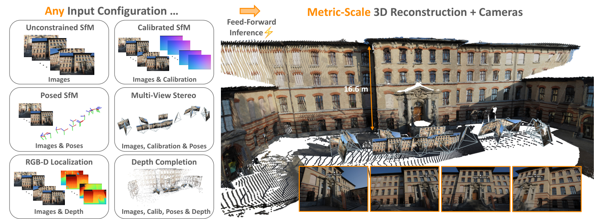
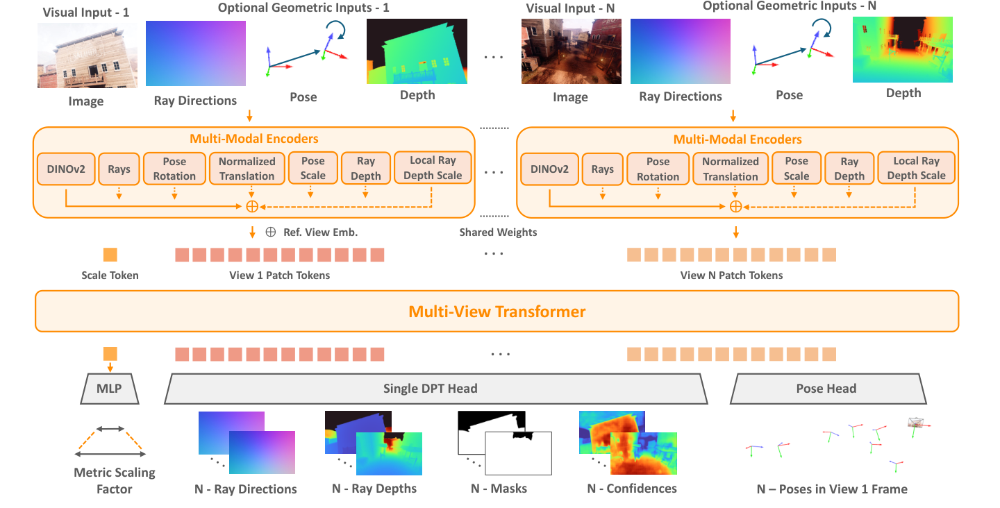
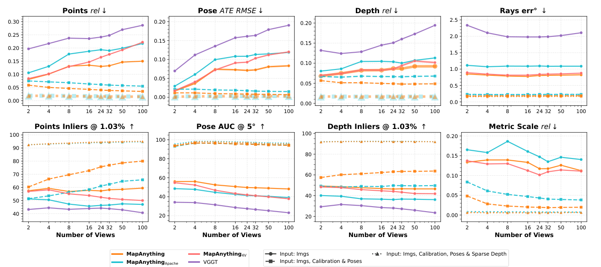
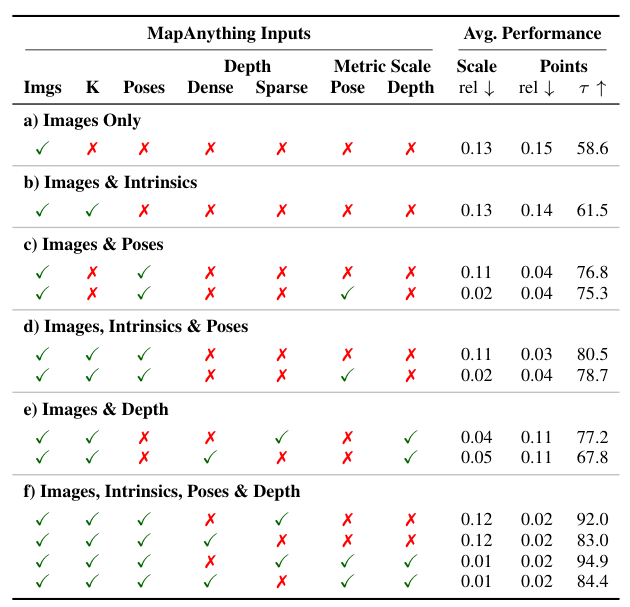
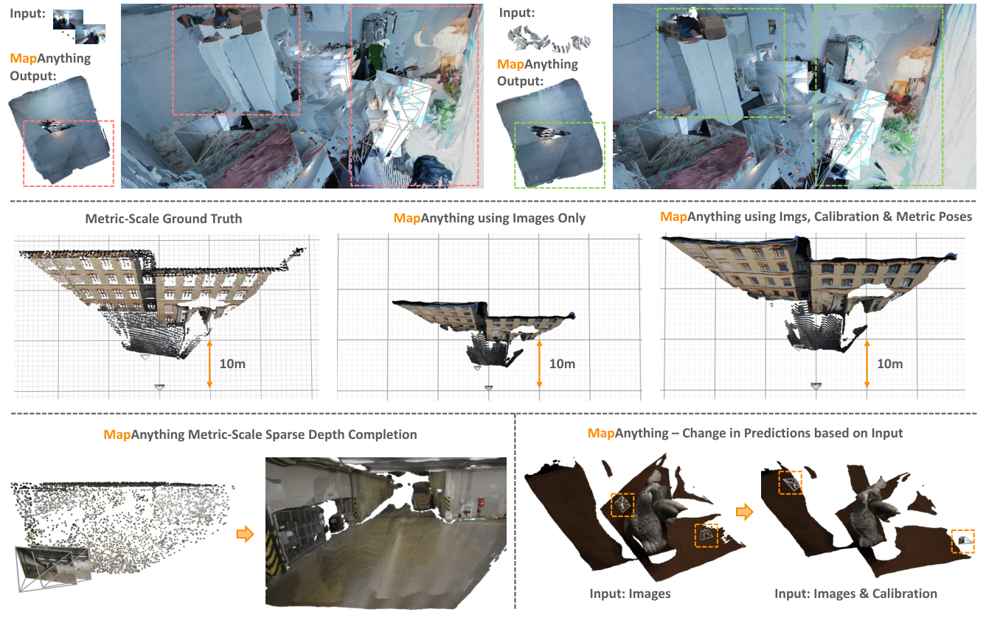
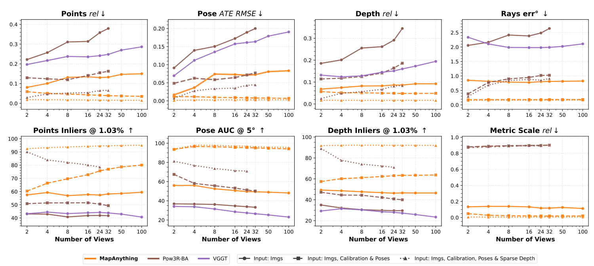
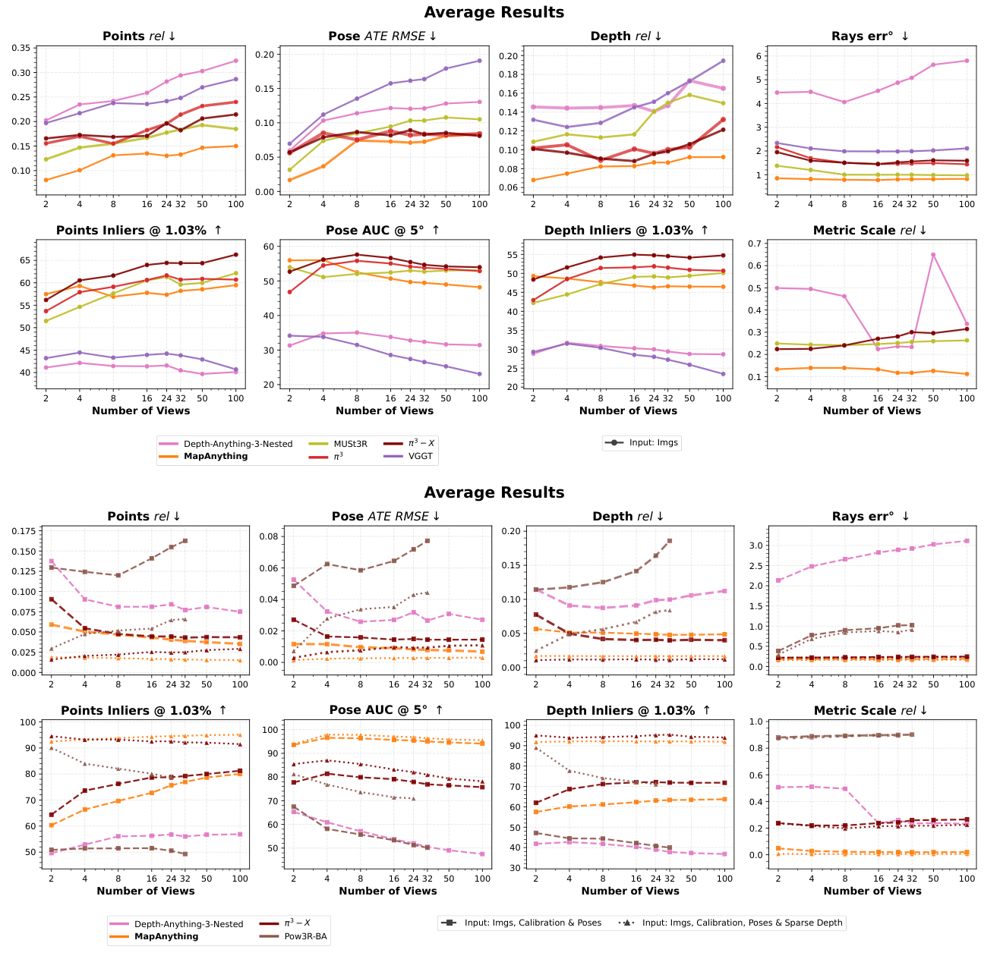
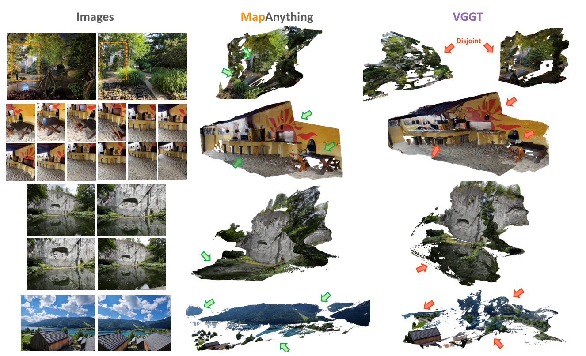
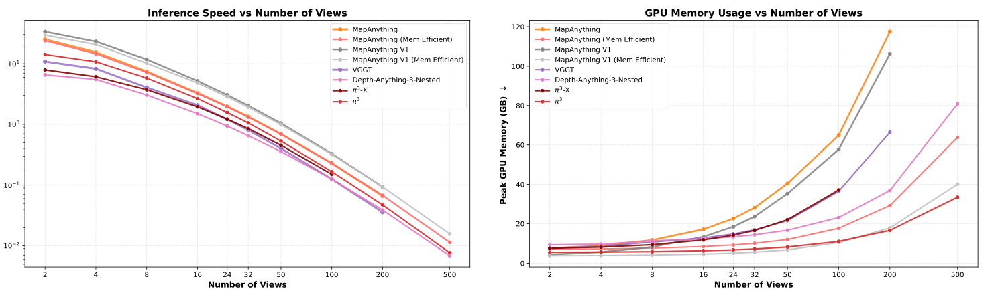

# MapAnything：统一前向 Metric 3D 重建骨干

!!! info "论文信息"
    **论文题名：** MapAnything: Universal Feed-Forward Metric 3D Reconstruction。 
    **作者：** Nikhil Keetha、Norman Müller、Johannes Schönberger、Lorenzo Porzi、Yuchen Zhang、Tobias Fischer、Arno Knapitsch、Duncan Zauss、Ethan Weber、Nelson Antunes 等（共 17 人）。 
    **机构：** Meta Reality Labs、Carnegie Mellon University。 
    **时间 / 主题：** 2025-09；具身智能。 
    **arXiv / 官方报告：** arXiv：[2509.13414](https://arxiv.org/abs/2509.13414)；官方材料：[map-anything.github.io/](https://map-anything.github.io/)。 
    **GitHub / 项目：** GitHub：[github.com/facebookresearch/map-anything](https://github.com/facebookresearch/map-anything)；项目页：[map-anything.github.io/](https://map-anything.github.io/)。 
    **元数据来源与核验口径：** 来源：[arXiv](https://arxiv.org/abs/2509.13414)；[GitHub API / repo](https://github.com/facebookresearch/map-anything)；[官方 / 项目材料](https://map-anything.github.io/)；Checked Date：2026-06-15；Repro Status：Paper / official materials reviewed, independent reproduction not claimed。

## 重建系统已经知道一部分几何时，模型该怎样使用它

同样是重建一个房间，输入可能只有手机照片，也可能带有相机内参、部分位姿或稀疏深度。已知量还不一定具有相同单位：视觉 SfM 的平移可能只确定到一个比例，深度相机却能提供米制距离。固定只接收 RGB 的模型无法直接利用这些信息；为每种组合训练一个专用模型，又会造成重复的数据处理与训练。MapAnything 把这些任务统一成一个接口，让图像始终作为输入，其他几何量按视图和类型选择性提供。[↗](https://arxiv.org/pdf/2509.13414v3#page=2)

其核心是一个可拆开、再组合的场景表示。相机射线描述每个像素朝向哪里，沿射线的深度描述表面离相机多远，相机位姿把不同视图放入同一坐标系，全局尺度再把相对几何变为米制结果。输入与输出采用相同的因子化思路，模型就能把“缺少哪些条件”作为任务变化，而无需为标定、SfM、深度补全分别更换整个网络。[↗](https://arxiv.org/pdf/2509.13414v3#page=3)

Figure 1 左侧应按可用信息阅读。Images 对应未标定重建，加入 Calibration 可做已标定 SfM，加入 Poses 与 Depth 又改变剩余未知量。右侧的 16.6 m 展示模型输出米制几何的目标，但这个单位来自什么信息，还需区分图像先验与外部测量。

{ width="920" }

*原论文 Figure 1。不同输入配置共享重建网络；它们提供的信息量不同，不能跨配置直接比较模型强弱。* [↗](https://arxiv.org/pdf/2509.13414v3#page=1)

下面的结构与实验对应论文 v3 所描述的 2026 年 1 月版本。补充材料明确区分它与 2025 年 9 月初版，后者使用不同的图像编码器和多视图 Transformer；将旧版架构参数与新版成绩拼在一起，会误判模型规模及预训练来源。[↗](https://arxiv.org/pdf/2509.13414v3#page=11)

## 四组几何量怎样生成一份一致的点云

给定 $N$ 幅 RGB 图像，模型可以接收部分视图的射线 $\hat R_i$、旋转四元数 $\hat Q_i$、平移 $\hat T_i$ 和 ray depth $\hat D_i$。不同类型可以对应不同的视图子集，旋转与平移也可单独提供。所有位姿以第一幅图像为参考坐标系。输出则包括每幅图像的单位射线 $R_i$、无绝对尺度深度 $\tilde D_i$、旋转 $O_i$、平移 $\tilde T_i$，以及整组图像共享的尺度 $m$。[↗](https://arxiv.org/pdf/2509.13414v3#page=4)

从这些量到最终点云，只需三步几何组合

$$
\tilde L_i=R_i\tilde D_i,
\qquad
\tilde X_i=O_i\tilde L_i+\tilde T_i,
\qquad
X_i^{\mathrm{metric}}=m\tilde X_i.
$$

$\tilde L_i$ 是当前相机坐标系下的局部点图，$\tilde X_i$ 是第一视图坐标系中的共同点图。$O_i$ 由四元数转换得到；$m$ 同时缩放场景结构与相机平移，才能保持所有视图共享一个米制空间。这里的“world frame”是约定的第一相机参考系，不代表输出自动对齐地理坐标。[↗](https://arxiv.org/pdf/2509.13414v3#page=4)

**Ray depth（沿射线深度）** 与普通 z-depth 有一个重要区别。由于 $R_i$ 已归一化为单位向量，$\tilde D_i$ 表示沿该方向的距离；其对应 z-depth 是局部点的第三坐标，也就是 $R_{i,z}\tilde D_i$。这是由上式直接得到的几何关系。接入外部深度传感器时，应先确认它输出的是哪一种深度，不能将光轴方向距离直接当作沿射线距离。

射线图也让模型摆脱“单一焦距、主点位于正中”的固定参数化。对中心投影相机，只要每个像素能表示为从同一中心出发的方向，就可进入该接口。不过，表示可以容纳更多相机模型，与训练已经验证了这些模型是两回事。论文的标定实验使用去畸变透视图像，鱼眼相机的泛化被描述为经适当训练后的潜力。[↗](https://arxiv.org/pdf/2509.13414v3#page=3) [↗](https://arxiv.org/pdf/2509.13414v3#page=6)

这套表示还减少了输出冗余。DUSt3R 类方法把多种几何信息耦合在点图中，之后再恢复相机与尺度；VGGT 同时预测点图以及相机、深度，存在多条输出路径。MapAnything 先预测可以直接组合的因子，用一套局部稠密头和位姿头生成整体几何。它仍需要学习跨视图一致性，但不必额外训练一个独立全局点图头来描述同一场景。[↗](https://arxiv.org/pdf/2509.13414v3#page=3)

## 输入侧先拆尺度，网络才能同时接受米制和相对几何

### 深度与平移采用不同的输入归一化

某幅图可能有深度却没有位姿，另一幅图可能只有旋转或相对平移。模型因此不能假定所有输入共用一个已知尺度。对深度，先计算每视图的平均 ray depth $\hat z_{d_i}$，把 $\hat D_i/\hat z_{d_i}$ 作为归一化形状；对可用平移，则用共享的平均平移范数

$$
\hat z_p=\frac{1}{|S_t|}\sum_{i\in S_t}\|\hat T_i\|,
\qquad \hat T_i^{\mathrm{norm}}=\hat T_i/\hat z_p.
$$

$S_t$ 是具有平移输入的视图集合。深度尺度是每视图一个，位姿尺度是所有可用平移共享一个。只有当相应深度或位姿确认具有米制单位时，模型才额外编码这个尺度数值；相对几何只提供归一化部分。尺度编码前取对数，避免室内与大场景的数值范围差异直接支配特征。[↗](https://arxiv.org/pdf/2509.13414v3#page=4)

因此，给定一组 up-to-scale 位姿仍有价值，它能约束视图间布局；但它不能提供真实相机基线长度。明确提供米制平移尺度，才额外给出绝对尺寸线索。输入的这一拆分与后文训练损失的归一化不同：输入侧允许各类信息独立存在，输出监督侧则要共同规范整组几何，才能约束多视图一致性。

### 不同模态怎样变成同一组 patch token

Figure 2 从上方输入读到下方输出。图像和稠密几何都有空间位置，全局位姿与尺度则广播到该视图的 patch；各路特征相加后，才进入跨视图网络。单独的 scale token 汇总整组视图，最后产生一个共同米制比例。

{ width="920" }

*原论文 Figure 2。注意每视图深度尺度与跨视图 pose scale 的区别；右下的位姿、中央局部几何与左下全局尺度需要共同使用。* [↗](https://arxiv.org/pdf/2509.13414v3#page=3)

| Component | Implementation in v3 | Purpose |
|---|---|---|
| Image encoder | DINOv2 ViT-G 第 24 层归一化 patch 特征，维度 1536，patch size 14 | 保留可迁移的图像表示 |
| Rays / normalized depth encoders | 浅卷积与一次 size-14 pixel unshuffle | 与图像特征对齐空间网格和维度 |
| Rotation / translation / scale encoders | 4 层 GeLU MLP，输出 1536 维后广播 | 注入每视图或整组几何条件 |
| Multi-view transformer | 16 层 alternating attention，24 heads，MLP ratio 4，维度 1536 | 交替进行视图内与跨视图信息融合 |
| Dense head | 一个 DPT 头 | 预测射线、相对 ray depth、mask 与 pointmap confidence |
| Pose head | 平均池化的卷积位姿头 | 预测单位四元数与相对平移 |
| Scale head | scale token → 2 层 ReLU MLP → exponential | 得到正的全局米制尺度 |

每路输入编码先 LayerNorm，再相加并再次归一化。第一视图的特征加入固定 reference embedding，所有视图 token 之外加入一个可学习 scale token。融合 Transformer 用 DINOv2 ViT-G 的后 16 层初始化；作者不使用 RoPE，而保留 DINOv2 的 patch 位置编码。这个选择属于本架构与训练设置的经验设计，不能泛化为几何任务都不适合 RoPE。[↗](https://arxiv.org/pdf/2509.13414v3#page=4)

补充材料给出版本差异：初版使用全部 24 层、1024 维的 DINOv2 ViT-L 编码器，搭配 24 层随机初始化、736 维的多视图 Transformer；新版改为上表中的 ViT-G 分割使用方式。两处同时改变，Figure S.3 只能说明整个新配置的表现改善，不能从中隔离出某一个结构改动的净收益。[↗](https://arxiv.org/pdf/2509.13414v3#page=11)

## 损失函数怎样把形状错误和单位错误分开

射线方向与旋转没有长度单位，直接监督即可。旋转采用 $\min(\|\hat Q_i-Q_i\|,\|-\hat Q_i-Q_i\|)$，因为 $Q$ 与 $-Q$ 代表同一个三维旋转。这个符号处理避免把等价四元数判成大误差，论文将其描述为与角距离相似的回归形式。[↗](https://arxiv.org/pdf/2509.13414v3#page=5)

深度、平移、局部点图和共同点图则共享尺度。训练先在有效点掩码上计算真值与预测的点图范数尺度 $\hat z$、$\tilde z$，分别归一化相应几何量。预测与真值各自消除整体比例，模型就可以先学习形状和相机相对布局；带米制标注的数据再监督绝对尺度。

对深度和点图，模型进一步使用径向对数变换

$$
f_{\log}(x)=\frac{x}{\|x\|}\log(1+\|x\|).
$$

它保留向量方向、压缩模长，降低远距离点或大场景在误差上的支配程度。以深度为例，比较的是 $f_{\log}(\hat D_i/\hat z)$ 与 $f_{\log}(\tilde D_i/\tilde z)$；平移则在归一化后比较。局部点图损失保证每个相机内部的几何合理，全局点图损失约束跨视图变换后的一致性。[↗](https://arxiv.org/pdf/2509.13414v3#page=5)

米制尺度的监督采用

$$
z_{\mathrm{metric}}=m\,\operatorname{sg}(\tilde z),
\qquad
\mathcal L_{\mathrm{scale}}
=\left\|f_{\log}(\hat z)-f_{\log}(z_{\mathrm{metric}})\right\|.
$$

$\operatorname{sg}$ 表示停止梯度。这个尺度损失通过 $m$ 调整米制比例，却不通过 $\tilde z$ 直接把无尺度形状拉大或压小。这样，单位不对与形状不对有不同的优化路径；对只提供相对几何的数据，仍可训练其有标注的几何部分。[↗](https://arxiv.org/pdf/2509.13414v3#page=5)

全局点图还使用预测置信度 $C_i$。把相应几何残差记作 $e_i$，原文的形式为 $C_i e_i-\alpha\log C_i$：第一项允许模型降低异常点权重，第二项避免通过让所有置信度趋近零来逃避监督。它是输出误差相关的置信度机制，不等同于显式判断输入位姿或深度传感器的不确定性。[↗](https://arxiv.org/pdf/2509.13414v3#page=5)

完整目标保留这些因子的对应关系

$$
\begin{aligned}
\mathcal L={}&10\mathcal L_{\mathrm{pointmap}}
+\mathcal L_{\mathrm{rays}}+\mathcal L_{\mathrm{rot}}
+\mathcal L_{\mathrm{translation}}+\mathcal L_{\mathrm{depth}}\\
&+\mathcal L_{\mathrm{lpm}}+\mathcal L_{\mathrm{scale}}
+\mathcal L_{\mathrm{normal}}+\mathcal L_{\mathrm{GM}}
+0.1\mathcal L_{\mathrm{mask}}.
\end{aligned}
$$

全局点图权重为 10，mask 权重为 0.1，强调几何一致性。训练排除最高的 5% 逐像素损失以减弱异常标签影响，并使用参数 $c=0.05,\alpha=0.5$ 的 adaptive robust loss；这里的 $\alpha$ 属于鲁棒损失参数，不能与前述置信度项系数混作同一数值。法向损失施加于局部点图，梯度匹配施加于局部 z-depth 的对数，仅用于合成数据，以免真实数据中粗糙几何标签迫使模型拟合错误细节。[↗](https://arxiv.org/pdf/2509.13414v3#page=5)

## 通用能力来自怎样的训练组合

### 随机缺失条件，替代逐个任务训练

MapAnything 用不同概率提供几何输入，使同一个模型看到各种条件组合。没有输入的几何量仍可能有监督标签，输入缺失与标注缺失应分开理解。

| Input selection | Probability / rule |
|---|---|
| 启用额外几何输入 | 0.9 |
| Rays、ray depth、pose 各类输入 | 各 0.5 |
| 视图具有选定几何输入 | 0.95 |
| 已选择深度时，dense / sparse | 各 0.5 |
| Sparse depth | 随机移除 90% 有效深度，保留约 10% |
| 对有米制标注的数据隐藏尺度输入 | 0.05 |

补充材料把几何分解为六类因素，称其支持 $2^6=64$ 种输入组合，并展示 12 种代表性配置。这个数字描述接口的组合空间，不能理解为训练了 64 个网络，也不表示每种组合都有同样充分的独立评估。主要基准仍以所有视图具有相应输入为主，部分视图缺失几何是接口与训练允许的更一般情况。[↗](https://arxiv.org/pdf/2509.13414v3#page=5) [↗](https://arxiv.org/pdf/2509.13414v3#page=9)

跨视图训练还有一个必要条件。作者依据真值深度与位姿预计算两两共视关系，以 25% 共视阈值构建图，再通过随机游走选出连通视图集合。这里不要求每一对图像都直接重叠，但要求整组图像能通过共视关系连接起来。主多视图测试也避免完全不相交的图像集合，因此“任意数量视图”不等于已经验证完全无连接图像能被可靠放进同一场景。[↗](https://arxiv.org/pdf/2509.13414v3#page=5) [↗](https://arxiv.org/pdf/2509.13414v3#page=6)

### 数据集与两种模型版本

基础配方使用 6 个数据集：BlendedMVS、Mapillary Planet-Scale Depth、ScanNet++ v2、Spring、TartanAirV2-WB 和 UnrealStereo4K。完整配方再加入 Aria Synthetic Environments、DL3DV-10K、Dynamic Replica、MegaDepth、MVS-Synth、ParallelDomain-4D 与 SAIL-VOS 3D，共 13 个。BlendedMVS、DL3DV 和 MegaDepth 不提供米制尺度，因子化监督使它们仍能贡献形状与相对几何学习。[↗](https://arxiv.org/pdf/2509.13414v3#page=5)

数据规模并不均匀。MPSD 为 71,428 个场景，Aria Synthetic Environments 为 103,890 个场景，另一些数据集只有几十个。作者为原本作为单目深度数据使用的 MPSD 补充相机与位姿元数据，使约 72K 场景进入多视图训练。主测试使用 ETH3D 的 13 个场景、ScanNet++ v2 的 30 个场景和 TartanAirV2-WB 的 5 个场景；后两者是同一数据集内与训练场景隔离的 held-out 场景，应称场景隔离，不能把全部三个数据集都描述为未参与训练的新域。[↗](https://arxiv.org/pdf/2509.13414v3#page=5)

发布的 Apache 2.0 模型使用六数据集配方，CC BY-NC 4.0 模型使用十三数据集配方。Table 1 特别注明，作者获得了部分数据集权利方对训练与宽松模型发布的许可；模型许可不能反过来改变原始数据的使用条款。Figure S.2 显示六数据集版本有性能差距，但补充几何信息后仍能明显改善，这为模型选择提供了性能与使用条件的实际区别。[↗](https://arxiv.org/pdf/2509.13414v3#page=5) [↗](https://arxiv.org/pdf/2509.13414v3#page=10)

{ width="1000" }

*原论文 Figure S.2。区分完整模型、Apache 模型和只完成最多 4 视图训练的模型；4V 版本能外推到更多视图，但仍有进一步训练带来的收益。* [↗](https://arxiv.org/pdf/2509.13414v3#page=10)

### 训练预算与视图课程

| Training setting | Value |
|---|---|
| Optimizer | AdamW，weight decay 0.05，$\beta_1=0.9,\beta_2=0.95$ |
| Peak learning rate | DINOv2 encoder $5\times10^{-6}$；其他部分 $10^{-4}$ |
| Schedule | 10% linear warmup；half-cycle cosine decay 到峰值的 1/100 |
| Images / dense geometry | 最大边 518，长宽比随机在 3:1 至 1:2 之间 |
| Augmentation | color jitter、Gaussian blur、grayscale |
| Efficiency / stability | mixed precision、encoder gradient checkpointing、gradient norm clip 1 |
| Stage 1 | 64 张 H200-140GB，6 天，2–4 视图，effective batch 1536–768 |
| Stage 2 | 同样 64 张 H200，4 天，2–24 视图，effective batch 1536–128，峰值 LR 降低 10 倍 |
| Total training steps | 420K |

动态 batch 随视图数调整，让较长的多视图样本不突破显存预算。按文中 64 张卡、10 天相乘，课程训练对应约 15,360 GPU 小时，这是由报告配置计算的量，不包含 DINOv2 预训练、所有消融和开发尝试。论文的“高效通用训练”主要是相对训练多个专家而言，不能解读为整个骨干只需很小训练预算。[↗](https://arxiv.org/pdf/2509.13414v3#page=9)

消融采用同类设置但 effective batch 小 8 倍。这个区别很重要：Table 5 的 50 视图 Images-only Points rel 为 0.28，而完整模型 Table S.1 为 0.15，二者不能直接当作同一预算模型的重复实验冲突，也不能混为某个单一模块带来的提升。[↗](https://arxiv.org/pdf/2509.13414v3#page=8) [↗](https://arxiv.org/pdf/2509.13414v3#page=9)

## 双视图实验，把视觉重建与几何条件收益分别量化

Table 2 使用 ETH3D、ScanNet++ v2 和 TartanAirV2-WB 的平均结果。Points / Depth rel 越低越好，Pose AUC 在 5° 阈值下越高越好，Rays err 为角度误差。下表保留主要输入组合，并将同条件的 VGGT 作为 Images-only 对照。

| Method / Inputs | Scale rel ↓ | Points rel ↓ | Points τ ↑ | Pose ATE ↓ | Pose AUC ↑ | Depth rel ↓ | Rays err° ↓ |
|---|---:|---:|---:|---:|---:|---:|---:|
| VGGT / Images | — | 0.20 | 43.2 | 0.07 | 34.2 | 0.13 | 2.34 |
| MapAnything / Images | 0.13 | 0.08 | 57.5 | 0.02 | 56.0 | 0.07 | 0.85 |
| MapAnything / Images + Intrinsics | 0.13 | 0.07 | 59.3 | 0.01 | 64.7 | 0.06 | 0.19 |
| MapAnything / Images + Intrinsics + Poses | 0.05 | 0.06 | 60.4 | 0.01 | 93.6 | 0.06 | 0.18 |
| MapAnything / Images + Intrinsics + Depth | 0.02 | 0.04 | 77.8 | 0.01 | 73.1 | 0.03 | 0.18 |
| MapAnything / Images + Intrinsics + Poses + Depth | 0.01 | 0.02 | 82.0 | 0.00 | 94.8 | 0.02 | 0.16 |

只给图像时，Points rel 从 VGGT 的 0.20 降到 0.08，按表中数值计算降低 60%；Pose AUC 提高 21.8 个百分点。加入内参后，射线角误差从 0.85° 降至 0.19°，但 Scale rel 仍为 0.13，符合内参主要约束成像方向、不能单独提供场景绝对长度的事实。加入位姿后 AUC 与尺度改善，加入深度后点图误差进一步下降。[↗](https://arxiv.org/pdf/2509.13414v3#page=7)

表中 $\tau$ 是原文的阈值内点比例，原表将阈值标为 1.03%；这里沿用该列而不额外改变其判定口径。平均相对误差和内点比例会给出不同排序。在完整输入条件下，Pow3R 的 Points rel 为 0.03，差于 MapAnything 的 0.02，但 Points $\tau$ 为 90.1，高于 82.0；Depth rel 同为 0.02，Depth $\tau$ 则是 89.0 对 81.5。这说明平均误差更低并不保证更多点进入某个严格阈值。[↗](https://arxiv.org/pdf/2509.13414v3#page=7)

另外，已知位姿作为网络条件输入，输出位姿仍由网络预测，论文并未把输入几何设成不可违反的硬约束。表中提供位姿后的 AUC 没有达到 100，也提醒读者这是一种学习条件融合。ATE 的 0.00 是表格显示精度，不能据此宣布所有相机位姿无误差。

## 米制尺度输入究竟增加了什么信息

Table S.1 将相对位姿与米制位姿分开，能更直接检验尺度因子的作用。下表为 50 视图完整模型结果，保留原表的 Scale rel、Points rel 与 Points $\tau$。

| Inputs | Metric scale supplied | Scale rel ↓ | Points rel ↓ | Points τ ↑ |
|---|---|---:|---:|---:|
| Images | None | 0.13 | 0.15 | 58.6 |
| Images + Intrinsics | None | 0.13 | 0.14 | 61.5 |
| Images + Poses | No | 0.11 | 0.04 | 76.8 |
| Images + Poses | Pose scale | 0.02 | 0.04 | 75.3 |
| Images + Intrinsics + Poses + Sparse Depth | No | 0.12 | 0.02 | 92.0 |
| Images + Intrinsics + Poses + Sparse Depth | Pose and depth scale | 0.01 | 0.02 | 94.9 |

相对位姿已经能把 Points rel 从 0.15 降到 0.04，但 Scale rel 仍为 0.11；再提供米制位姿尺度，形状误差几乎不变，Scale rel 降到 0.02。类似地，内参、相对位姿和相对稀疏深度能给出很低的点图误差，却仍有 0.12 的尺度误差；标明米制尺度后才降至 0.01。这个对照正好验证了“形状”和“单位”应分开的设计。[↗](https://arxiv.org/pdf/2509.13414v3#page=12)

原 Table S.1 还有两个容易遗漏的细节。名为 Images & Depth 的分组，其 K 列实际也打勾，不能转述成没有内参。完整输入中，稀疏深度版本的 Points $\tau$ 为 94.9，稠密深度版本为 84.4，尽管 Scale / Points rel 都为 0.01 / 0.02；相对位姿加入米制尺度后，内点比例也有小幅下降。因此，输入提供更多信息的总体趋势，不等于所有指标随每项输入严格单调改善。[↗](https://arxiv.org/pdf/2509.13414v3#page=12)

{ width="760" }

*原论文 Table S.1。按实际勾选的 K、Poses、Depth 和 Metric Scale 列识别配置，不能只读分组名称。Sparse 指随机移除 90% 有效深度。* [↗](https://arxiv.org/pdf/2509.13414v3#page=12)

Figure S.5 把收益变成可观察的几何现象。上方面板中，在 100 张图像下重复出现的结构，加入标定与位姿后更好地合并；中间用同样 10 m 标尺比较，只有图像时尺寸不准，加入米制位姿后更接近真值；下方再展示从稀疏米制几何补全稠密结果。这三部分分别检验对齐、尺度和补全，不能只用“点云更漂亮”概括。

{ width="920" }

*原论文 Figure S.5。对齐与尺度改善来自新增几何条件，场景先验与物理尺度线索的作用应分开。* [↗](https://arxiv.org/pdf/2509.13414v3#page=13)

## 单图标定较强，不代表所有米制深度基准都领先

### 单图标定验证了射线表示的作用

标定测试从三个测试数据集中随机抽帧，并用 3:1 至 1:2 的随机裁剪制造非中心主点。模型虽然没有专门按单图输入训练，仍能从单图预测射线。Table 3 的平均角误差如下。

| Method | Avg. ↓ | ETH3D ↓ | SN++v2 ↓ | TAV2 ↓ |
|---|---:|---:|---:|---:|
| VGGT | 4.00° | 2.83° | 5.21° | 3.95° |
| MoGe-2 | 1.95° | 1.89° | 1.56° | 2.40° |
| AnyCalib | 2.01° | 1.52° | 2.41° | 2.10° |
| MapAnything | 1.06° | 1.33° | 0.39° | 1.47° |

这组结果说明，多视图训练得到的局部射线表示可以服务单图标定，且不必把主点固定在图像中心。它仍属于所测透视图像与裁剪条件，不能直接外推到鱼眼或非中心相机。[↗](https://arxiv.org/pdf/2509.13414v3#page=6) [↗](https://arxiv.org/pdf/2509.13414v3#page=7)

### Robust-MVD 把尺度问题暴露出来

Table 4 采用 Robust-MVD 的数值口径，下面沿用原表的 rel 数值，不与前面的 0.08、0.13 直接拼接比较。K 表示是否提供内参，Poses 表示是否提供位姿。

| Approach / Setting | K | Poses | KITTI rel ↓ | ScanNet rel ↓ |
|---|---|---|---:|---:|
| MapAnything / Single-View Metric | ✗ | ✗ | 9.69 | 27.77 |
| MapAnything / Single-View Metric | ✓ | ✗ | 8.48 | 31.12 |
| MapAnything / Multi-View Metric | ✗ | ✗ | 5.45 | 22.23 |
| MapAnything / Multi-View Metric | ✓ | ✗ | 8.45 | 24.94 |
| MapAnything / Multi-View Metric | ✓ | ✓ | 4.63 | 5.58 |
| MVSA / Multi-View Metric | ✓ | ✓ | 3.20 | 3.70 |
| MapAnything / Multi-View w/ Alignment | ✗ | ✗ | 4.04 | 3.47 |
| MapAnything / Multi-View w/ Alignment | ✓ | ✗ | 3.97 | 3.34 |

ScanNet 是米制尺度不够可靠的明确反例。只给图像时，多视图 rel 为 22.23；提供内参后为 24.94，并未改善；加入位姿后才降到 5.58。KITTI 上，内参单独加入也从 5.45 退化到 8.45。这些数据说明，条件输入能够利用，不等于所有数据域都能稳定获益。[↗](https://arxiv.org/pdf/2509.13414v3#page=8)

再看 median scale alignment。相同的 Images-only 多视图结果在 ScanNet 从米制 rel 22.23 变为对齐后的 3.47，说明误差中有明显整体尺度成分。但对齐借助评估参考尺度，部署时不能把它视作免费获得的修正。即便去掉尺度影响，MapAnything 也不是所有形状指标的最优者：在 Multi-View w/ Alignment 中，$\pi^3$ 的 KITTI / ScanNet rel 为 3.09 / 1.98，VGGT 为 4.60 / 2.34，均呈现各自优势。[↗](https://arxiv.org/pdf/2509.13414v3#page=8)

作者猜测 ScanNet 的尺度表现与基准数据质量有关，这是解释性判断，不能当作排除了模型泛化问题的证据。原表还用灰字标出部分方法的评估数据处于训练分布内；因此，各行并非完全相同的零样本条件。该基准也因畸变问题排除 ETH3D，因非米制原因排除 DTU 与 Tanks and Temples，不能用它替代前面三数据集的多视图实验。[↗](https://arxiv.org/pdf/2509.13414v3#page=7) [↗](https://arxiv.org/pdf/2509.13414v3#page=8)

## 哪些设计真正被消融支持

Table 5(a) 在较低训练预算下用 50 视图评估表示方案。仅把局部点图拆成 Rays / Depth / Pose，没有独立尺度，结果并没有更好；完整收益来自因子化与尺度分支的配合。

| Representation, Images Only | Scale rel ↓ | Points rel ↓ | Points τ ↑ |
|---|---:|---:|---:|
| Local PM + Pose | 0.14 | 0.32 | 33.2 |
| RDP | 0.17 | 0.33 | 32.6 |
| LPMP & Scale | 0.16 | 0.30 | 38.7 |
| RDP & Scale | 0.16 | 0.28 | 40.7 |

完整方案降低点图相对误差并提高内点比例，但其 Scale rel 0.16 仍不如 Local PM + Pose 的 0.14。提供内参与米制位姿时也有相同的权衡：完整方案 Points rel / $\tau$ 为 0.07 / 57.8，优于 0.08 / 53.5；Scale rel 却是 0.05 对 0.04。因子化首先改善多量共同建模，不能简化为它使每一个回归头都最好。[↗](https://arxiv.org/pdf/2509.13414v3#page=8)

Table 5(b) 比较通用训练与输入配置专属训练。作者以相当于两个专属模型的计算量训练通用模型，再与三种专属配置比较，支持多任务训练的成本价值，但也保留了单项专家更好的指标。

| Inputs | Training | Scale rel ↓ | Points rel ↓ | Points τ ↑ |
|---|---|---:|---:|---:|
| Images Only | Expert | 0.16 | 0.29 | 31.8 |
| Images Only | Universal | 0.16 | 0.28 | 40.7 |
| Images + Intrinsics + Metric Poses | Expert | 0.03 | 0.07 | 56.2 |
| Images + Intrinsics + Metric Poses | Universal | 0.05 | 0.07 | 57.8 |
| Images + Metric Depth | Expert | 0.06 | 0.24 | 53.0 |
| Images + Metric Depth | Universal | 0.06 | 0.25 | 54.0 |

Images-only 的内点比例提升明显；已知米制位姿时，专家尺度更准；给米制深度时，专家的 Points rel 略低。通用化的实际价值是一个模型维持广泛接口并取得相近或更好表现，而非消灭所有专用优化空间。[↗](https://arxiv.org/pdf/2509.13414v3#page=8)

补充 Table S.2 再单独检验损失与注意力设计。去掉 log loss，Points rel 从 0.29 变为 0.39，内点比例从 31.8 降到 27.3；把 alternating attention 换成带 view positional encoding 的 global attention，Points rel 变为 0.53，内点比例为 19.7。这组 50 视图外推评估支持对数损失与交替融合在该训练方案中的作用，不能据此否定所有全局注意力实现。[↗](https://arxiv.org/pdf/2509.13414v3#page=12)

## 更多视图、更新基线与部署显存

Figure 4 评估 2–100 个连通视图，并用线型区分 Images-only、加入标定与位姿、再加入稀疏深度。先固定线型看方法差异，再比较同一方法的不同条件。曲线也表明，更多视图会引入更大覆盖与更难的跨视图关系，Images-only 的点图和位姿误差并不随视图数量单调下降。

{ width="920" }

*原论文 Figure 4。缺失的基线点包括 GPU 显存不足，不能当作零分；这里的输入集合满足共视连通条件。* [↗](https://arxiv.org/pdf/2509.13414v3#page=7)

新版补充实验加入截至 2026 年 1 月 20 日的 DA3-Nested 与 $\pi^3$-X。Figure S.6 中 MapAnything 的平均 Points / Depth rel 与尺度较好，但 $\pi^3$-X 在多个视图数下有更高的 Points / Depth 内点比例或 Pose AUC。按数据集拆开后，ETH3D 中 $\pi^3$-X 的点图与深度相对误差明显更低，MapAnything 在 TartanAirV2 的优势更突出。跨数据集均值因此不能替代目标场景下的比较。[↗](https://arxiv.org/pdf/2509.13414v3#page=14) [↗](https://arxiv.org/pdf/2509.13414v3#page=15)

{ width="1000" }

*原论文 Figure S.6。上方是 Images-only，下方是带辅助几何输入；平均误差与阈值内点比例的排序不同，新增输入也改变比较条件。* [↗](https://arxiv.org/pdf/2509.13414v3#page=14)

Figure 3 的定性比较展示弱纹理、大视差、季节变化和大场景。两种方法使用相同的法向边缘后处理与 MapAnything 天空掩码，因而可以比较保留下来的结构；这项展示并不是两个模型未经处理的原始输出逐点对照。

{ width="920" }

*原论文 Figure 3。观察结构是否断开、弱纹理区域是否连贯，以及远处场景是否保持合理形状；定性外观仍需结合前面的几何与尺度指标。* [↗](https://arxiv.org/pdf/2509.13414v3#page=6)

运行成本由视图数与稠密解码共同决定。Figure S.1 在一张 H200-140GB 上使用适当 autocast 精度，绘制 2–500 视图的推理频率与峰值显存。图中的 Hz 指完成一组重建的频率，不能当成每张图像或视频帧的处理速度。500 是输入视图数，也不意味着实时处理 500 FPS。

{ width="920" }

*原论文 Figure S.1。区分普通调用与 Mem Efficient 版本，也区分 V1 和新版；原始稠密头的显存曲线很高，显存优势来自实际解码调度。* [↗](https://arxiv.org/pdf/2509.13414v3#page=10)

作者发现，直接对全部视图运行 DPT 稠密头会成为显存瓶颈。Mem Efficient 改为按视图小批量解码，图中 minibatch size 为 1，在报告中仅带来较小速度代价，却显著降低峰值显存。它保留前面的多视图融合，只改变局部稠密输出的调度；这是一项容易被“单次前向”口号忽略的工程选择。逐像素输入与输出的一一对应仍限制超大场景规模，论文也没有给出压缩长期场景记忆的完整方案。[↗](https://arxiv.org/pdf/2509.13414v3#page=8) [↗](https://arxiv.org/pdf/2509.13414v3#page=10)

## 采用时应先确定信息来源，再确定相信哪一种输出

MapAnything 最适合已有部分标定、位姿或深度，希望在不同信息完整度下复用同一重建骨干的系统。接入时首先统一参考坐标系、ray depth 与 z-depth 的定义，并明确哪些量具有真实米制单位；之后分别评价相对几何、姿态和尺度，必要时保留可靠外部测量作为参照。只给图像时，米制比例来自学习先验，无法消除投影几何本身的尺度歧义，ScanNet 的实验已经显示这种误差可能很大。

当前模型没有显式处理几何输入的噪声与不确定性，也不支持某个输入视图完全没有图像。输出置信度不等于输入传感器置信度，不能自动修正错误标定或单位。将预测重新输入以增加测试计算量，是论文提出的后续方向，尚未证明多迭代必然更好；场景参数化同样不描述动态运动或 scene flow。[↗](https://arxiv.org/pdf/2509.13414v3#page=8)

值得迁移的设计是输入与输出共同采用几何因子化，并把绝对尺度从形状学习中分离。它让额外传感信息有明确入口，让只有相对标注的数据仍能参与训练，也让实验能指出误差究竟来自相机、局部深度、跨视图对齐还是单位。一个统一模型因此不仅减少接口数量，还提供了更清楚的几何诊断方式。

## 继续阅读

Metric 3D 重建输出如何变成可用状态，先看[坐标变换与手眼标定](../../embodied-ai/coordinate-transforms-and-hand-eye-calibration.md)；多视角数据的覆盖与误差分桶见[具身数据集](../../embodied-ai/state-action-robot-datasets.md)。
