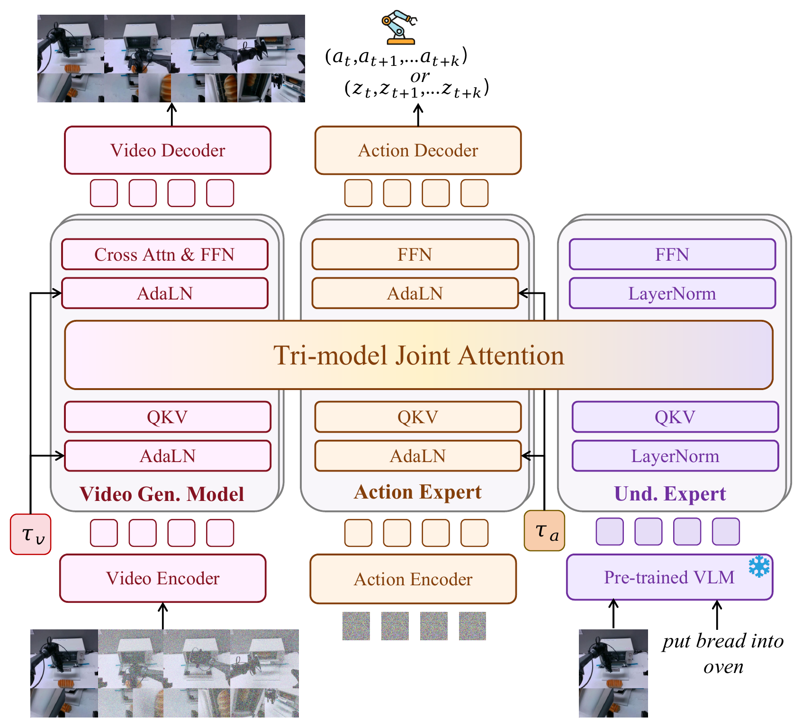
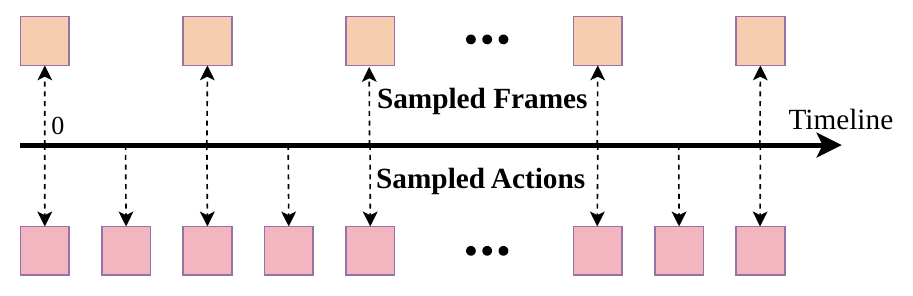
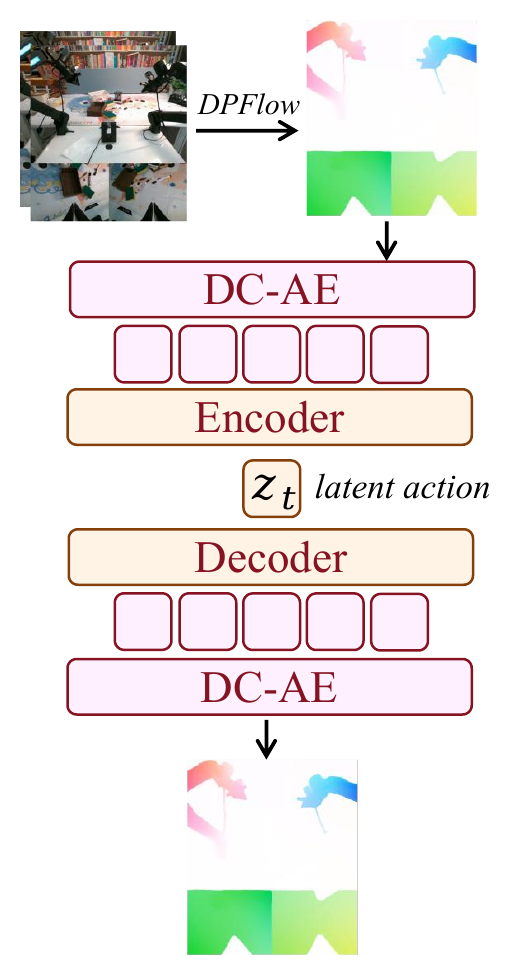
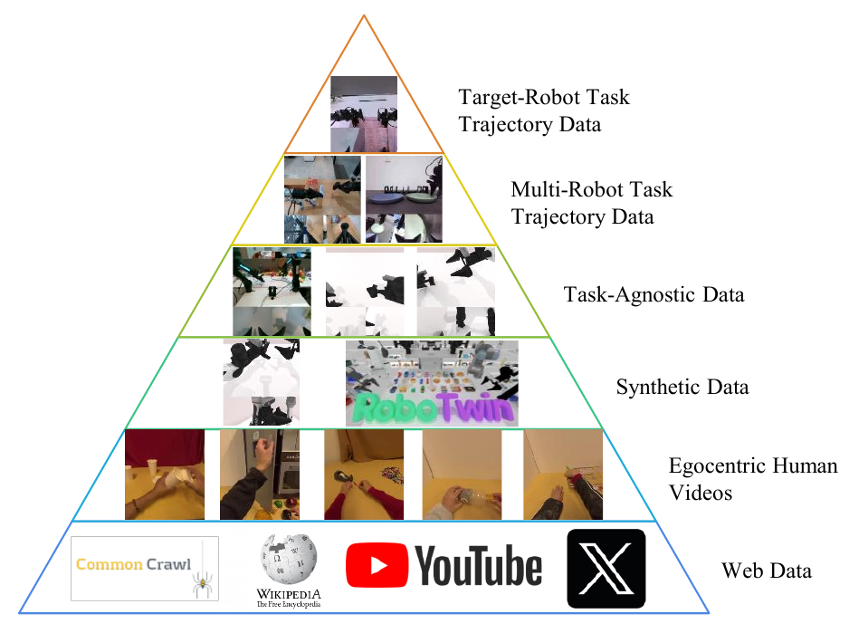
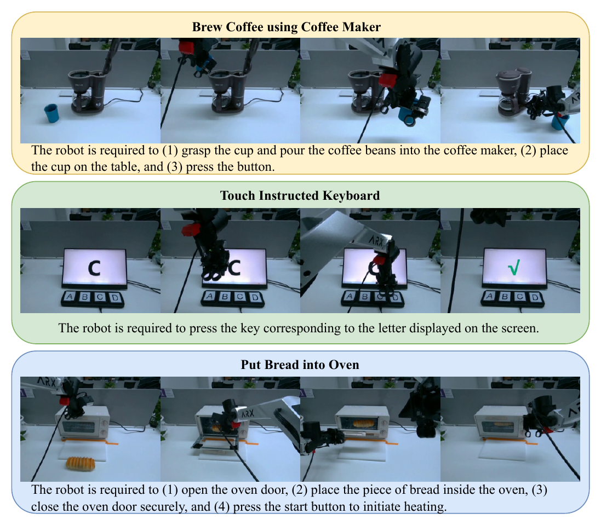
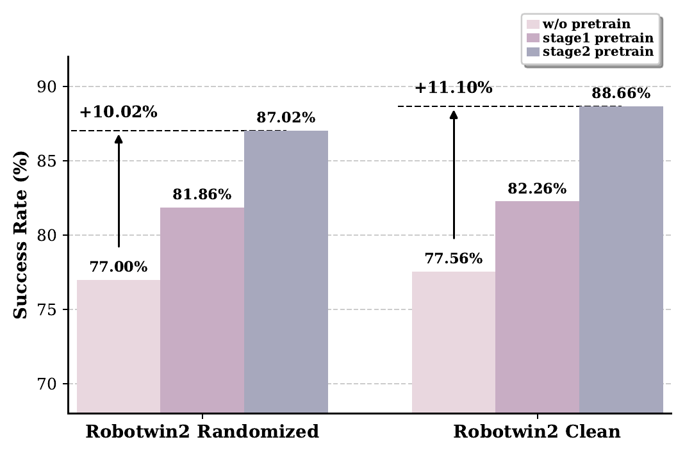

# Motus：把 latent action、世界模型和 VLA 合到一个生成框架

!!! info "论文信息"
    **论文题名：** Motus: A Unified Latent Action World Model。 
    **作者：** Hongzhe Bi、Hengkai Tan、Shenghao Xie、Zeyuan Wang、Shuhe Huang、Haitian Liu、Ruowen Zhao、Yao Feng、Chendong Xiang、Yinze Rong、Hongyan Zhao、Hanyu Liu、Zhizhong Su、Lei Ma、Hang Su、Jun Zhu。 
    **机构：** Tsinghua University；Peking University；Horizon Robotics。项目页另列 Shengshu。 
    **时间 / 主题：** 2025-12；具身智能 / latent action world model / MoT / UniDiffuser-style scheduler。 
    **arXiv / 项目：** arXiv：[2512.13030](https://arxiv.org/abs/2512.13030)；PDF：[2512.13030](https://arxiv.org/pdf/2512.13030)；项目页：[motus-robotics.github.io/motus](https://motus-robotics.github.io/motus)。 
    **GitHub / 模型：** GitHub：[thu-ml/Motus](https://github.com/thu-ml/Motus)；HF 组织：[motus-robotics](https://huggingface.co/motus-robotics)。 
    **元数据来源与核验口径：** 来源：[arXiv](https://arxiv.org/abs/2512.13030)、[项目页](https://motus-robotics.github.io/motus)、[GitHub](https://github.com/thu-ml/Motus)、[HF paper API](https://huggingface.co/api/papers/2512.13030)；Checked Date：2026-06-17；Repro Status：Paper / official code and checkpoints reviewed, independent reproduction not claimed。

## 原论文故事线

### 研究背景

Motus 的背景是 embodied agent 的能力被拆成了多个孤立模型：VLA 负责看图和语言出动作，world model 负责给定动作预测未来，inverse dynamics model 负责从观测轨迹反推动作，video generation model 负责想象未来视频。真实具身智能需要这些能力在同一个系统里协同，但现有方法往往是级联或分别训练，导致数据不能共享、误差会跨模块累积，也难以利用大规模异构视频和机器人数据。

另一个背景是 action data 的稀缺和不统一。互联网视频、第一视角视频和合成视频包含大量运动信息，但没有机器人动作标签；不同机器人动作空间也不同。Motus 试图用 latent action 作为中间桥梁：不直接要求所有数据都有真实控制量，而是先从视觉运动中学习可共享的“delta action”先验，再把它迁移到真实机器人动作。

### 问题（Challenge）

论文要解决的问题是：**如何构建一个统一模型，同时支持 VLA、world model、inverse dynamics、video generation 和 video-action joint prediction，并能从大规模异构数据中预训练动作能力。** 难点在于，这五种任务的条件变量和生成变量不同：有时动作已知要生成视频，有时视频已知要生成动作，有时两者都要生成。

更难的是动作预训练。语言和视觉可以在 web data 上大规模预训练，动作专家却通常只能看机器人数据。若没有可共享动作表示，模型很难从 unlabeled video 中学习“如何动”的先验；若简单级联 VGM 和 IDM，又不能形成真正统一的生成框架。

### Finding

作者的 finding 是：**VLA、WM、IDM、VGM 和 video-action joint prediction 可以被看成同一组视频/动作变量在不同噪声状态和条件化方式下的生成问题；而 optical flow 可以作为像素级 delta action，给动作专家提供跨数据源的 latent action 预训练信号。** 这个洞见把五个任务从孤立模块翻转成统一调度问题。

这个 finding 能解决挑战，是因为 UniDiffuser-style scheduler 可以通过给视频和动作设置不同 timestep / noise level 来切换模式：视频干净、动作加噪就是 IDM；动作干净、视频加噪就是 WM；二者都加噪就是 joint prediction。Optical flow 则让没有真实动作标签的视频也能提供运动监督，使 action expert 不再只能依赖小规模机器人轨迹。

### 方法

Motus 使用 Mixture-of-Transformer（MoT）架构整合三个专家：Video Generation Expert、Action Expert 和 Understanding Expert。Video branch 继承预训练视频生成模型，Understanding branch 接入 VLM 视觉语言理解，Action Expert 负责真实动作或 latent action 的生成。三者通过 Tri-model Joint Attention 交换信息，但保留各自的 Transformer/FFN/normalization 结构。

训练上，Motus 使用 UniDiffuser-style scheduler，为视频侧 \(\tau_v\) 和动作侧 \(\tau_a\) 分配不同 rectified flow timestep，从而统一五种 inference mode。动作预训练阶段，论文用 DPFlow / optical flow 和 DC-AE 学 latent action，把未标注视频里的像素运动压成可迁移的动作先验。整体训练 recipe 分三阶段，并组织六层数据金字塔：从 web data、egocentric video、synthetic data，到 task-agnostic robot data、multi-robot data 和 target-robot demonstrations，逐步提高动作相关性。

### 结论

实验显示 Motus 在仿真和真实机器人任务上优于多个强基线。论文报告在 simulation 中相对 X-VLA 提升约 15%，相对 π0.5 提升约 45%；在真实场景中提升约 11-48%。RoboTwin 等实验和 ablation 表明，三阶段训练、latent action pretraining 和统一模式调度都对性能有贡献。模型还展示了 VLA、WM、IDM、VGM 和 video-action joint prediction 的多模式推理能力。

边界是，optical flow 捕捉的是视觉运动，不等同于真实控制因果和接触力；统一模型是否适合所有 embodiment、高频力控和长 horizon 任务仍需独立验证。Motus 的结论是“用 latent action 和调度器统一多种具身生成任务有明显收益”，不是“一个模型已经完全解决所有机器人世界模型功能”。

### 关键术语

- **Latent Action（潜在动作）**：从视觉运动中学习到的中间动作表示，可在无真实动作标签视频和机器人动作之间搭桥。
- **World Model, WM（世界模型）**：给定当前观测和动作，预测未来观测的模型。
- **Inverse Dynamics Model, IDM（逆动力学模型）**：给定观测轨迹，反推产生该变化的动作。
- **Mixture-of-Transformer, MoT（Transformer 混合架构）**：让理解、视频生成和动作专家通过联合注意力交互的结构。
- **UniDiffuser-Style Scheduler（UniDiffuser 式调度器）**：通过不同模态的噪声/timestep 设置切换条件生成模式。
- **Optical Flow（光流）**：像素在相邻帧间的运动场，本文用作 pixel-level delta action 预训练信号。

Motus 的核心不是“再做一个 VLA”，而是提出一个统一生成框架：同一个模型既能像 VLA 一样从观测和语言出动作，也能像世界模型一样给定动作预测未来观测，还能做 inverse dynamics、video generation，以及 video-action joint prediction。

这篇论文最值得精读的地方在训练配方。它试图回答一个很实际的问题：机器人 action label 稀缺、跨机器人动作空间不统一、互联网视频又没有真实控制量，动作专家怎样像 VLM / VGM 一样获得大规模预训练？Motus 的答案是把 optical flow 当成像素级 delta action，先学 latent action，再用三阶段训练和六层数据金字塔把 web / egocentric / synthetic / task-agnostic / multi-robot / target-robot 数据接起来。

## 它的训练贡献是什么

| 维度 | 贡献 |
| --- | --- |
| 统一对象 | 同时覆盖 VLA、WM、IDM、VGM、Video-Action Joint Prediction 五种分布 |
| 架构抓手 | 用 MoT 连接 Video Gen. Model、Action Expert、Understanding Expert，并通过 Tri-model Joint Attention 交换信息 |
| 训练抓手 | 用 UniDiffuser-style scheduler 给视频和动作分配不同 rectified flow timestep / noise scale |
| 动作预训练抓手 | 用 DPFlow 光流和 DC-AE 学 latent action，把 unlabeled video 的运动压成可转移动作先验 |
| 数据抓手 | 三阶段训练配六层数据金字塔，从 web data 到 target-robot demonstrations 逐步提高动作相关性 |
| 主要风险 | 统一建模和强实验结果来自论文与官方材料；仍要单独验证不同 embodiment、真实闭环安全、长 horizon rollout 漂移和第三方复现 |

## 证据等级与外推边界

| 论文结论 | 主要证据 | 可以吸收 | 不能直接外推 |
| --- | --- | --- | --- |
| 一个模型可以切换五种 embodied modeling mode | 架构图、训练算法、附录五种 inference algorithm、VLA / WM / IDM / VGM / joint 实验 | 用 modality timestep 控制“哪些变量干净、哪些变量要生成”是很强的统一接口 | 不能证明所有任务都适合同一个共享模型，尤其是高频力控或强接触任务 |
| latent action 能提升动作专家预训练 | Stage 2 pretrain、data pyramid、RoboTwin ablation、real-world w/o pretrain 对比 | optical flow 是比 RGB reconstruction 更直接的 motion prior，可作为跨 embodiment 中间动作空间 | 光流不等于真实控制因果，遮挡、接触力、末端约束仍可能丢失 |
| 三阶段训练优于从零或只做 Stage 1 | RoboTwin ablation：Rand. 从 `77.00` 到 `81.86` 再到 `87.02` | 先让 VGM 看机器人动态，再让 action expert 看 latent action，最后对目标机器人 SFT，顺序有工程意义 | 论文没有把所有数据层、所有 loss、所有冻结策略逐项完全消融 |
| Motus 在仿真和真实任务上超过基线 | RoboTwin 50+ tasks、两种真实双臂平台、LIBERO-Long / VLABench 附录 | 结果说明统一预训练对 multi-task manipulation 有收益 | real-world 是 partial success rate，且每任务 `100` trajectories；不能等同于开放家庭长期自主 |
| 官方代码和 checkpoint 已发布 | GitHub、HF 模型、README / TRAINING / INFERENCE 文档 | 可作为工程参考和复现实验起点 | 官方 release 不是 independent reproduction，硬件、数据转换和 checkpoint 匹配仍是门槛 |

## 论文位置

Motus 把现有具身模型拆成五类分布：

| Mode | Distribution | Meaning |
| --- | --- | --- |
| VLA | \(p(a_{t+1:t+k} \mid o_t,\ell)\) | 给当前观测和语言，直接预测动作 chunk |
| WM | \(p(o_{t+1:t+k} \mid o_t,a_{t+1:t+k})\) | 给当前观测和动作，预测未来观测 |
| IDM | \(p(a_{t+1:t+k} \mid o_{t:t+k})\) | 给一段观测轨迹，反推动作 |
| VGM | \(p(o_{t+1:t+k} \mid o_t,\ell)\) | 给当前观测和语言，生成未来视频 |
| Video-Action Joint Prediction | \(p(o_{t+1:t+k},a_{t+1:t+k} \mid o_t,\ell)\) | 同时生成未来视频和动作 |

传统路线通常只覆盖其中一两项。VLA 强在出动作，但未必显式建模未来；视频世界模型强在生成未来，但动作接口弱；IDM 可以从想象视频回推动作，却经常依赖级联结构。Motus 的主张是：这些不是五个孤立模型，而是同一组多模态变量在不同条件化方式下的生成问题。

这也是它和 [Fast-WAM](fast-wam.md) 的关系。Fast-WAM 问“推理时是否必须显式生成未来视频”；Motus 问得更大：“能不能让动作、视频、语言、理解专家在一个模型里用不同模式切换”。前者更像 WAM 部署效率论文，后者更像 unified embodied foundation model 的训练 recipe。

## 总体架构

{ width="860" }

<small>图源：`Motus: A Unified Latent Action World Model`，Figure 1。原论文图意：Motus 由 Video Gen. Model、Action Expert 和 Understanding Expert 三个专家组成，通过 Tri-model Joint Attention 连接；\(\tau_v\) 与 \(\tau_a\) 分别表示视频和动作侧的 rectified flow timestep。</small>

**Figure 1 怎么读。**
中间横跨三列的是 Tri-model Joint Attention。它的作用不是把三个模型简单拼接，而是让每个专家保留自己的 Transformer / FFN / normalization 结构，同时共享 attention 信息流。Video Gen. Model 负责视频 latent 的生成和解码；Action Expert 负责编码/解码动作或 latent action；Understanding Expert 接入预训练 VLM 的视觉语言理解 token。

这个设计有一个现实动机：如果从零训练一个统一 UWM，需要巨量完全对齐的语言、视频、动作数据；Motus 选择继承已有强先验。VGM 采用 `Wan 2.2 5B`，理解分支采用 `Qwen3-VL-2B`，动作专家用与 Wan 同深度的 Transformer block，并用 AdaLN 注入 rectified flow timestep。

| Component | Base / Configuration | Role |
| --- | --- | --- |
| VGM | Wan 2.2 5B | 继承视频生成、物体外观和时序动态先验 |
| VLM | Qwen3-VL-2B | 提供 3D grounding、spatial understanding、object localization 等理解能力 |
| Action Expert | 30 layers, hidden size 1024, 24 heads | 生成 action chunk 或 latent action |
| Understanding Expert | 30 layers, hidden size 512, 24 heads | 把 VLM token 接进统一注意力 |
| Joint Attention | Tri-model Joint Attention | 在三个专家之间交换多模态特征 |

架构表里最重要的是“继承”。Motus 不把视频模型、VLM 和动作头都洗成同一个 backbone，而是在 MoT 结构里保留专家分工。这样做降低了从零训练成本，也减少了统一模型常见的任务互相干扰风险。

## 统一训练目标

Motus 用 rectified flow 同时预测未来动作和未来观测。对训练样本 \((o_{t:t+k}, a_{t+1:t+k}, \ell)\)，分别给动作和观测采样 timestep 与噪声：

$$
l_{\text{action}}^\theta
=
\mathbb{E}
\left[
\left\|v_a^\theta - (\epsilon_a-a_{t+1:t+k})\right\|_2^2
\right],
$$

$$
l_{\text{obs}}^\theta
=
\mathbb{E}
\left[
\left\|v_o^\theta - (\epsilon_o-o_{t+1:t+k})\right\|_2^2
\right],
$$

$$
l^\theta=l_{\text{action}}^\theta+l_{\text{obs}}^\theta.
$$

这里的关键不是公式本身，而是动作和观测可以有不同 timestep：\(\tau_a\) 控制动作侧噪声，\(\tau_o\) 控制视频/观测侧噪声。于是推理时只要设置哪个模态是 clean、哪个模态是 noise，就能切换不同任务。

| Inference Mode | Clean / Conditioned Part | Denoised / Generated Part |
| --- | --- | --- |
| VGM | \(o_t,\ell\) | \(o_{t+1:t+k}\)，action side kept noisy |
| World Model | \(o_t,a_{t+1:t+k},\ell\) | \(o_{t+1:t+k}\) |
| IDM | \(o_{t:t+k},\ell\) | \(a_{t+1:t+k}\) |
| VLA | \(o_t,\ell\) | \(a_{t+1:t+k}\)，future observation side kept noisy |
| Video-Action Joint Prediction | \(o_t,\ell\) | \(o_{t+1:t+k}\) and \(a_{t+1:t+k}\) together |

这种读法很接近 UniDiffuser：同一个联合模型，通过噪声水平和条件化方式切出 marginal、conditional、joint distribution。对具身模型来说，这比“先视频生成，再 IDM 出动作”的级联方案更紧，因为模型内部已经共享了动作、视频和理解特征。

## Action-Dense Video-Sparse Prediction

{ width="760" }

<small>图源：`Motus`，Figure 2。原论文图意：动作和视频的采样频率不同，动作更密集，视频更稀疏。</small>

机器人控制里 action chunk 通常比视频帧密得多。如果模型同时预测 \(k\) 个动作和 \(k\) 帧视频，视频 token 会压倒 action token，Tri-model Joint Attention 容易偏向视频重建，反而削弱动作预测。

Motus 的处理是 Action-Dense Video-Sparse Prediction：训练和推理时下采样视频帧，让视频 token 数和动作 token 数更平衡。论文给的例子是视频帧率设为动作帧率的六分之一。这个设计看似小，但很重要：统一模型不是把所有模态按原始频率粗暴堆在一起，而是先让 token budget 与任务目标匹配。

## Latent Action：把光流变成动作预训练接口

{ width="430" }

<small>图源：`Motus`，Figure 3。原论文图意：用 DPFlow 从相邻帧得到 optical flow，把 flow 转成 RGB 图后经 DC-AE 和轻量 encoder 压缩成 latent action，再解码重建 flow。</small>

**Figure 3 怎么读。**
Motus 把 optical flow 看作像素级 delta action。普通视频里没有机器人关节或末端控制量，但相邻帧之间的像素位移包含运动信息。先用 DPFlow 计算光流，再转成 RGB flow image；DC-AE 负责重建 flow 并编码成 `4 x 512` latent tokens；轻量 encoder 再把拼接后的特征投到 14 维，接近常见机器人动作空间尺度。

这一步解决的是 action pretraining 的入口问题：

| Step | Detail | Why it matters |
| --- | --- | --- |
| Optical flow extraction | DPFlow between adjacent frames, then RGB-format flow image | 避开 RGB 外观重建，把目标放在 motion |
| Compression | DC-AE encodes flow into four 512-dimensional tokens | 保留高容量 motion 表示，同时可接生成模型 |
| Control-level projection | lightweight encoder maps \(4 \times 512\) to 14-dimensional vector | 让 latent action 尺度靠近机器人动作向量 |
| Weak action supervision | `90%` unlabeled reconstruction + `10%` labeled trajectories | 用少量真实动作把 latent space 锚到可执行控制分布 |
| Task-agnostic alignment | Curobo randomly samples target robot action space following AnyPos | 不依赖具体任务，也能看到目标机器人可行动作范围 |

Latent Action VAE 的 loss 是：

$$
\mathcal L
=
\mathcal L_{\text{recon}}
+
\lambda_a\|a_{\text{real}}-a_{\text{pred}}\|^2
+
\beta\mathcal L_{\text{KL}}.
$$

其中 \(\mathcal L_{\text{recon}}\) 约束 flow reconstruction，第二项把 latent action 对齐真实动作，KL 项正则 latent space。附录给出的配置是 \(\lambda_a=1.0\)，\(\beta=1\times10^{-6}\)。

这里最容易误读的是“latent action 就是真动作”。更稳的理解是：latent action 是一个 motion-centric bridge。它能从无动作视频里抽取可共享运动先验，但最后仍要在 Stage 3 用目标机器人真实动作做 SFT，才能接到具体 embodiment。

## 三阶段训练与六层数据金字塔

{ width="760" }

<small>图源：`Motus`，Figure 4。原论文图意：数据从 Level 1 Web Data 到 Level 6 Target-Robot Task Trajectory Data，越往上数量越少、质量和策略相关性越高；论文说明 Level 3 和 Level 4 的顺序有时可能互换。</small>

**Figure 4 怎么读。**
金字塔底部是 web data，数量大但离机器人动作远；中间有 egocentric human videos、synthetic data、task-agnostic data 和 multi-robot task trajectories；顶部是 target-robot demonstrations，数量最少但最能决定具体部署动作。Motus 的训练不是一次性混合所有数据，而是按阶段使用不同层级。

Table 1 from the paper can be redrawn as follows, keeping the original English fields:

| Stage | Data | Training |
| --- | --- | --- |
| Pretrained Foundation Models (Off-the-shelf) | Level 1: Web Data | VGM and VLM |
| Stage 1 (Video Generation) | Level 2: Egocentric Human Videos Level 3: Synthetic Data Level 5: Multi-Robot Task Trajectory Data | Only VGM |
| Stage 2 (Unified Training with Latent Actions) | Level 2: Egocentric Human Videos Level 3: Synthetic Data Level 4: Task-agnostic Data Level 5: Multi-Robot Task Trajectory Data | Motus (all 3 experts, with latent actions) |
| Stage 3 (SFT) | Level 6: Target-Robot Task Trajectory Data | Motus (all 3 experts, with actions) |

<small>表源：`Motus`，Table 1。原表含义：三阶段训练如何对应六层数据金字塔。注意论文正文同时说明 Stage 2 中 VLM frozen，因此这里的 “all 3 experts” 更稳的读法是三条专家分支进入联合训练，但预训练 VLM 主体不参与全量更新。</small>

三阶段可以这样理解：

1. **Stage 1: Learning Visual Dynamics.** 只训练 VGM，让 Wan 2.2 5B 的视频生成能力适应机器人操作视频。它先学“机器人任务未来看起来怎样”，不是直接出动作。
2. **Stage 2: Learning Action Representations.** 用 videos、language、latent actions 预训练 Motus，初始化 action expert。这里最关键的是 latent action：动作专家终于能从大规模无动作或异构动作数据里学 motion prior。
3. **Stage 3: Specializing for the Target Robot.** 用 Level 6 目标机器人轨迹做 SFT，把 latent action 和通用运动先验落到真实 action space。

附录 Table 12 gives the dataset details:

| Dataset | Size | Embodiment | Data Level in the Pyramid |
| --- | --- | --- | --- |
| Egodex | 230,949 | Human | Level 2: Egocentric Human Videos |
| Agibot | 728,209 | Genie-1 Robot | Level 5: Multi-Robot Task Trajectory Data |
| RDT | 6,083 | Aloha Robot | Level 5: Multi-Robot Task Trajectory Data |
| RoboMind Franka | 9,589 | Franka Robot | Level 5: Multi-Robot Task Trajectory Data |
| RoboMind Aloha | 7,272 | Aloha Robot | Level 5: Multi-Robot Task Trajectory Data |
| RoboTwin | 27,500 | Aloha Robot | Level 3: Synthetic Data |
| Task-Agnostic Data | 1,000 | Aloha Robot | Level 4: Task-Agnostic Data |
| In-house Data | 2,000 | Aloha Robot | Level 6: Target-Robot Task Trajectory Data |

<small>表源：`Motus`，Table 12。原表含义：列出预训练和微调数据规模、embodiment 与金字塔层级。这里的 size 按论文表格记录，不代表所有数据都公开可下载。</small>

附录 Table 13 gives the training configuration:

| Stages | Stage 1 | Stage 2 | Stage 3 |
| --- | --- | --- | --- |
| Batch Size | 256 | 256 | 256 |
| Learning Rate | \(8 \times 10^{-5}\) | \(5 \times 10^{-5}\) | \(1\sim5 \times 10^{-5}\) |
| Optimizer | AdamW | AdamW | AdamW |
| Weight Decay | 0.01 | 0.01 | 0.01 |
| GPU Hours | ~8000 | ~10000 | ~400 |

<small>表源：`Motus`，Table 13。原表含义：三阶段训练的 batch size、learning rate、optimizer、weight decay 和 GPU hours。</small>

训练成本读法也要谨慎。Stage 2 的 `~10000` GPU hours 是把 latent action pretraining 做起来的主要成本；Stage 3 的 `~400` GPU hours 则更像目标机器人适配成本。也就是说，Motus 的工程叙事不是“少数据直接成功”，而是“前面用大量跨源 motion prior 预训练，后面用少量目标机器人数据适配”。

## 官方代码口径下的训练和推理

官方 GitHub README / TRAINING / INFERENCE 文档补充了几个工程细节：

| Item | Official Setting |
| --- | --- |
| Training runtime | single-node `torchrun` + DeepSpeed, or SLURM single / multi-node scripts |
| Getting started script | `scripts/train.sh` with `configs/robotwin.yaml` |
| Fine-tune checkpoint | Stage 3 sets `finetune.checkpoint_path: ./pretrained_models/Motus` |
| Resume behavior | when resuming or fine-tuning, WAN and VLM pretrained weights are not reloaded; VAE is still needed |
| From scratch behavior | set both `resume.checkpoint_path` and `finetune.checkpoint_path` to `null`, then load Wan2.2 and Qwen3-VL pretrained weights |
| Training hardware guidance | `> 80 GB` VRAM, recommended A100 80GB / H100 / B200 |
| Inference memory | with pre-encoded T5 `> 24 GB`; without pre-encoded T5 about `41 GB` |
| Real-world input format | three-view concatenated image: head + left/right wrist cameras |

这部分很适合复现前排雷。第一，Motus 不只是一个轻量 policy head，训练需要大显存和分布式脚本。第二，推理时 T5 是否预编码会直接改变显存口径。第三，real-world inference 要求三视角拼接图像，如果输入格式错了，动作预测差不一定是模型能力问题。

官方 checkpoint 也对应三阶段：

| Model | Use Case | Description |
| --- | --- | --- |
| Motus_Wan2_2_5B_pretrain | Pretrain / VGM Backbone | Stage 1 VGM pretrained checkpoint |
| Motus | Fine-Tuning | Stage 2 latent action pretrained checkpoint |
| Motus_robotwin2 | Inference / Fine-Tuning | Stage 3 RoboTwin2 fine-tuned checkpoint |

这里可以把 `Motus` checkpoint 理解成“带 latent action 预训练的统一模型”，把 `Motus_robotwin2` 理解成“已经对 RoboTwin2 动作空间适配过的模型”。如果换真实机器人，最关键的不是直接拿 RoboTwin checkpoint 硬跑，而是数据格式、动作维度、相机拼接和 Stage 3 SFT 是否匹配。

## 实验设置

RoboTwin 2.0 的实验是多任务训练：50 个代表性 manipulation tasks，每个任务 `50` 条 clean demonstrations 和 `500` 条 randomized demonstrations，总计 `2,500` clean + `25,000` randomized。随机化包括背景、桌面杂物、桌高扰动和光照变化。所有模型从预训练 checkpoint 出发，在 RoboTwin 上 finetune `40k` steps，并按每任务 `100` 次执行 trial 统计 success rate。

真实实验覆盖 AC-One 和 Agilex-Aloha-2 两个双臂平台。每个任务使用 `100` trajectories 训练，同一平台上的任务做 multi-task joint training。因为任务多为可分解长时程任务，论文采用 partial success rate：完成子目标给部分分，完整完成给满分。

{ width="860" }

<small>图源：`Motus`，Figure 5。原论文图意：展示 Brew Coffee using Coffee Maker、Touch Instructed Keyboard、Put Bread into Oven 等真实任务的语言指令和子任务定义。</small>

**Figure 5 怎么读。**
这张图解释了为什么论文不用纯 success / failure。比如 Put Bread into Oven 至少包含开门、抓面包、放入、关门、按按钮等步骤；Touch Keyboard 要把屏幕识别和末端定位接起来；Brew Coffee 涉及杯子、咖啡机、放置和开关。partial success rate 更能反映长任务在哪个阶段失败，但也意味着它和一次性任务 success rate 不能直接混用。

## 仿真结果

Table 2 from the paper is very large. The average rows can be redrawn as follows, keeping the original English fields:

| Method | Clean | Rand. |
| --- | ---: | ---: |
| \(\pi_{0.5}\) | 42.98 | 43.84 |
| X-VLA | 72.80 | 72.84 |
| w/o Pretrain | 72.80 | 77.00 |
| Stage1 | 82.86 | 81.86 |
| Motus | 88.66 | 87.02 |

<small>表源：`Motus`，Table 2。原表含义：RoboTwin 2.0 50+ tasks clean / randomized 设置下的平均 success rate。主文表格列出部分任务和平均值，附录 Table 14 给出含 GO-1 的完整 50 任务版本。</small>

这张表支撑两个结论。第一，Motus 在 randomized 平均值上比 X-VLA 高 `14.18` 个点，比 \(\pi_{0.5}\) 高 `43.18` 个点，所以摘要中写成约 `+15%` 和 `+45%`。第二，w/o Pretrain、Stage1 和 Motus 的阶梯差异说明：只做目标数据训练不够，只有视频动态预训练也不够，Stage 2 latent action pretraining 是关键增量。

不过这里也要看边界。所有模型都在 RoboTwin 数据上 finetune `40k` steps；这不是零样本仿真泛化。它测的是预训练如何影响有限 finetune 后的 multi-task success rate。

## 真实机器人结果

Table 3 from the paper can be redrawn as follows, keeping the original English fields:

| Task Description | \(\pi_{0.5}\) | w/o Pretrain | Motus |
| --- | ---: | ---: | ---: |
| **AC-One** |  |  |  |
| Fold Towel | 4 | 1 | **14.5** |
| Brew Coffee using Coffee Maker | 0 | 0 | **62** |
| Get Water from Water Dispenser | 30 | 8 | **36** |
| Place Cube into Plate | 46 | 60 | **100** |
| Place Cube into Plate(OOD) | 28.125 | 18.75 | **75** |
| Grind Coffee Beans with Grinder | 8 | 0 | **92** |
| Pour Water from Kettle to Flowers | 5 | 5 | **65** |
| Touch Instructed Keyboard | 0 | **100** | 82.5 |
| Put Bread into Oven | 12 | 40 | **42** |
| Average | 14.79 | 25.86 | **63.22** |
| **Agilex-Aloha-2** |  |  |  |
| Fold Towel | 27.5 | 0 | **39** |
| Get Water from Water Dispenser | 62 | 8 | **96** |
| Pour Water from Kettle to Flowers | 45 | 40 | **47.5** |
| Touch Instructed Keyboard | 72.5 | **85** | 80 |
| Put Bread into Oven | **36** | 0 | 34 |
| Average | 48.60 | 26.60 | **59.30** |

<small>表源：`Motus`，Table 3。原表含义：两个真实双臂平台上的 partial success rate。AC-One 平均从 \(\pi_{0.5}\) 的 `14.79` 到 Motus 的 `63.22`，Agilex-Aloha-2 平均从 `48.60` 到 `59.30`。</small>

真实任务结果有两个值得保留的细节。第一，Motus 平均值明显更高，尤其 AC-One 上差距很大。第二，Motus 不是每个单项都赢，例如 AC-One 的 Touch Instructed Keyboard 被 w/o Pretrain 超过，Agilex-Aloha-2 的 Put Bread into Oven 被 \(\pi_{0.5}\) 略高。也就是说，论文强证据是平均和多数任务收益，而不是“所有任务无条件碾压”。

## 消融：训练阶段到底带来什么

{ width="760" }

<small>图源：`Motus`，Figure 6。原论文图意：RoboTwin 2.0 randomized multi-task setting 中，w/o pretrain、Stage1 pretrain、Stage2 pretrain 的总 success rate 对比。</small>

**Figure 6 怎么读。**
随机化设置里，w/o pretrain 是 `77.00%`，Stage1 pretrain 是 `81.86%`，Stage2 pretrain 是 `87.02%`；clean 设置里分别是 `77.56%`、`82.26%`、`88.66%`。因此 Stage1 主要说明“让 VGM 先适应机器人视频动态有用”，Stage2 进一步说明“latent action 预训练 action expert 有用”。

这张图比最终 SOTA 表更重要，因为它回答了训练 recipe 的因果问题。Motus 的提升不是只来自模型更大或基线更弱，而是在固定同一套模型家族时，逐步加入预训练阶段会持续提升。

## 附录里的多模式能力

论文附录还单独报告了 Motus 在世界模型、IDM 和 VLA 模式下的结果。

| Platform | FID↓ | FVD↓ | SSIM↑ | LPIPS↓ | PSNR↑ |
| --- | ---: | ---: | ---: | ---: | ---: |
| Agilex-Aloha-2 | 9.4571 | 49.2848 | 0.88618 | 0.05449 | 26.1021 |
| AC-One | 12.9609 | 73.1325 | 0.84605 | 0.07280 | 24.0379 |
| Avg. | 11.209 | 61.20865 | 0.8661 | 0.063645 | 25.0700 |

<small>表源：`Motus`，Table 6。原表含义：World Model mode 在两种真实机器人数据上的生成质量指标。</small>

| ResNet18+MLP | DINOv2+MLP | Motus |
| ---: | ---: | ---: |
| 0.044 | 0.122 | **0.014** |

<small>表源：`Motus`，Table 7。原表含义：IDM mode 在 100 个 RoboTwin 2.0 randomized samples 上的 action MSE。</small>

| Motus (VLA) | Motus (Joint) |
| ---: | ---: |
| 83.90 | 87.02 |

<small>表源：`Motus`，Table 8。原表含义：RoboTwin 2.0 randomized data 上 VLA mode 与 video-action joint prediction mode 的平均 success rate。</small>

这些附录结果说明 Motus 的 unified mode 不是只停留在架构示意。它确实能按不同条件化方式运行。不过也要注意，World Model mode 的图像指标不等同于闭环规划收益；IDM 的 MSE 是 100 samples 上的离线指标；VLA mode 比 joint mode 低 `3.12` 个点，说明联合预测未来视频和动作仍然可能提供额外上下文。

## 训练启发

Motus 给具身智能训练路线的启发可以压成四条。

第一，动作专家也需要预训练。很多 VLA 继承了语言和视觉先验，但 action head 往往只靠机器人数据从头学。Motus 通过 latent action 给 action expert 补了一个 scalable pretraining path。

第二，跨 embodiment 不一定要先统一关节或末端动作格式。Motus 先把不同来源数据对齐到 optical-flow motion space，再在目标机器人上做真实动作 SFT。这条路线适合动作空间很杂、但视觉运动模式有共享性的场景。

第三，统一模型的关键不是“所有任务一个 loss”，而是 scheduler。通过 \(\tau_o,\tau_a\) 控制哪些模态是噪声、哪些模态是条件，统一模型才真的能切换 VLA、WM、IDM、VGM 和 joint prediction。

第四，视频 token 和 action token 的比例会影响学习重心。Action-Dense Video-Sparse Prediction 提醒我们：多模态统一训练首先是 token budget 和采样率设计问题，不只是模型名义上支持多个模态。

## 局限和风险

第一，latent action 以 optical flow 为核心，但光流主要描述像素运动。接触力、关节限位、抓取摩擦、遮挡后的物体状态，不一定能被光流完整表达。因此它适合作为 motion prior，不应被当成完整控制状态。

第二，真实机器人实验使用 partial success rate，且每任务 `100` trajectories。这个指标更适合拆长任务进度，但不等价于工业部署所需的完整成功率、失败恢复率、安全边界或长时间 unattended operation。

第三，数据金字塔里的多源数据并不都等价可获得。论文列出 in-house data 和多个外部数据集，官方代码发布不代表每个数据源、训练混合比例和所有实验细节都能完全复刻。

第四，统一模型会带来工程复杂度。VGM、VLM、action expert、understanding expert、VAE、T5 预编码、三视角拼接和分布式训练脚本都要对齐。对小团队来说，先复现 Stage 3 fine-tuning 或 RoboTwin inference，比直接重训 Stage 1/2 更现实。

## 阅读结论

Motus 是一篇很值得放进具身智能专题的前沿系统论文。它的价值不只在分数，而在把“动作专家如何获得大规模预训练”讲成了一个可执行 recipe：optical flow latent action、三阶段训练、六层数据金字塔、MoT 三专家和 UniDiffuser-style scheduler。最可复用的是训练结构和多模式推理接口；最不能过度外推的是开放真实环境长期自主、第三方复现和光流对接触物理的完整表达。下一步最需要看的证据，是官方代码在不同机器人上的独立复现、更多 Stage 2 数据/损失消融，以及 real-world closed-loop failure trace。

- 站内下一步：[Fast-WAM：训练时学世界，推理时不生成未来](fast-wam.md)。
- 站内下一步：[π0.5：开放世界 VLA](pi05.md)。
- 站内下一步：[VLA 数据、模型与评测路线图](../../embodied-ai/vla-data-model-and-evaluation-roadmap.md)。
