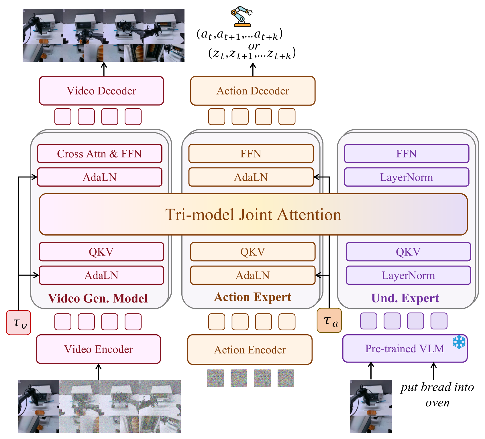
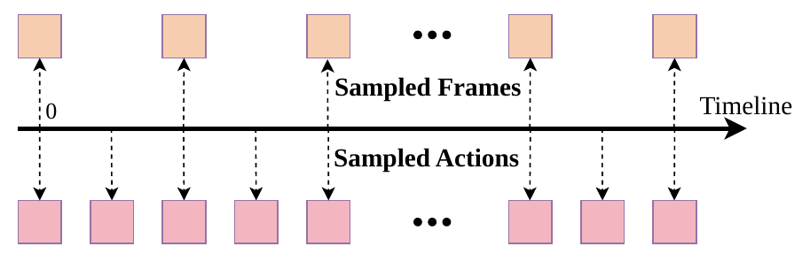
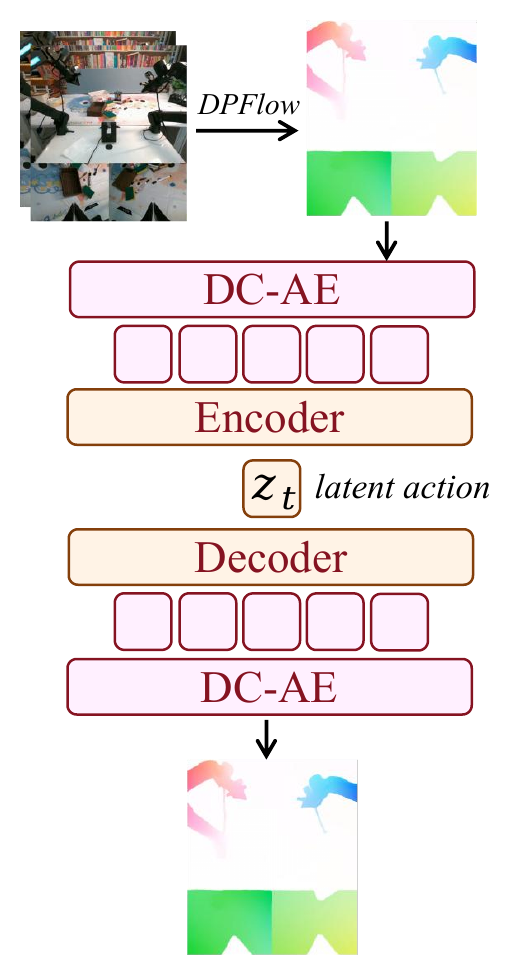
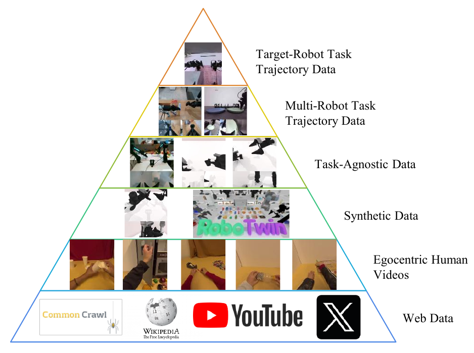
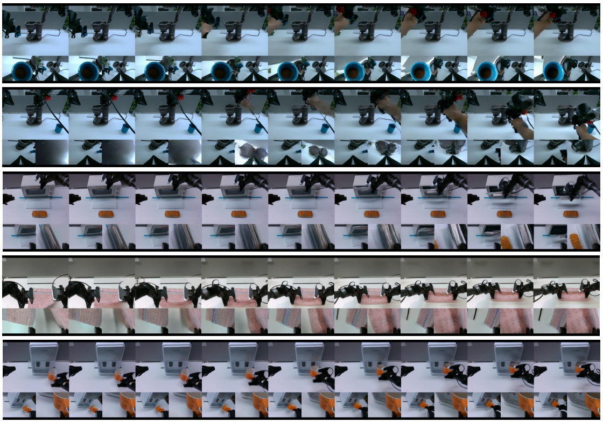
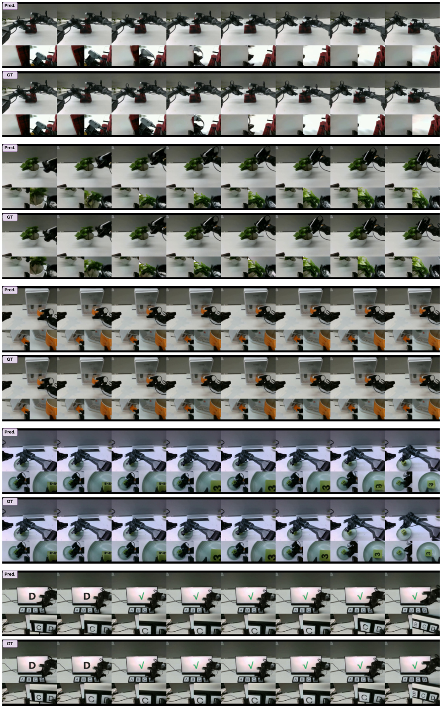
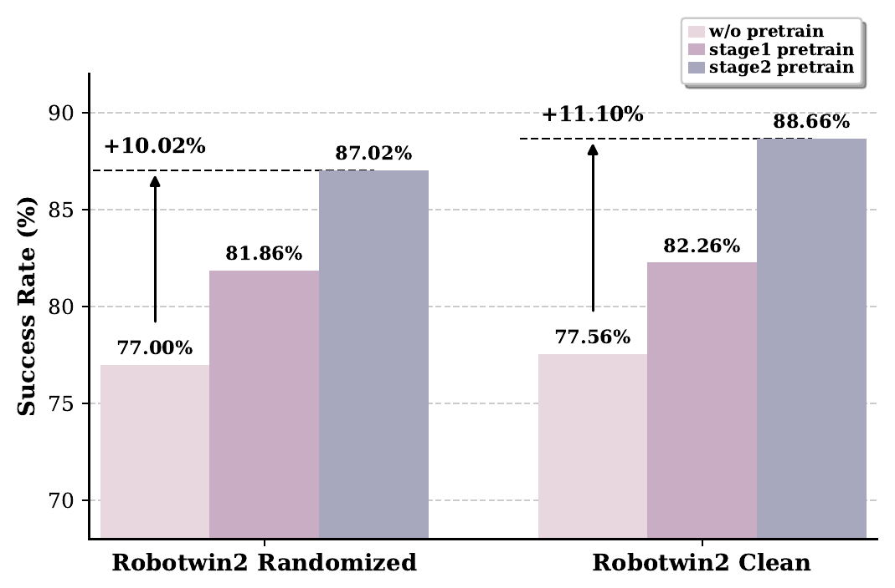
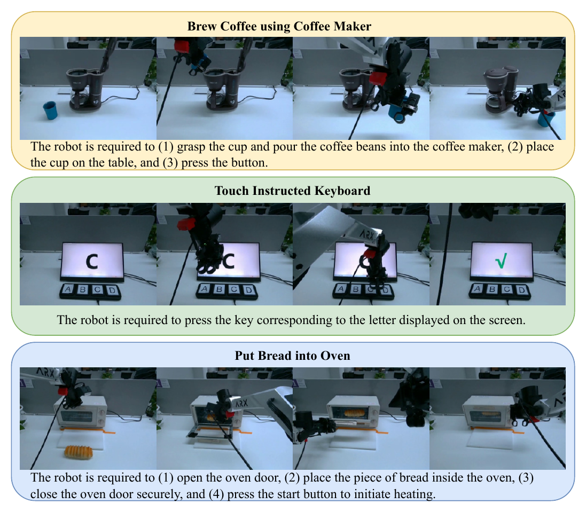
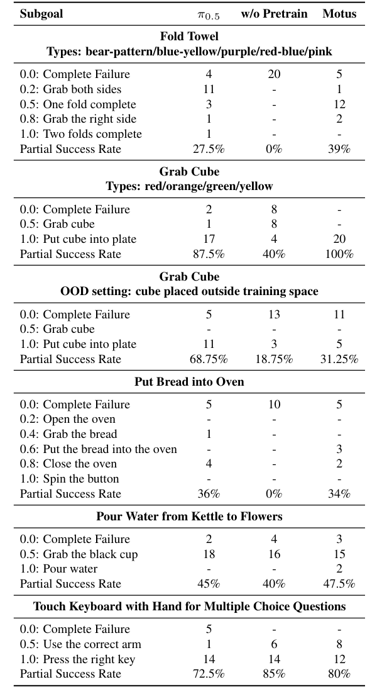

# Motus：把 latent action、世界模型和 VLA 合到一个生成框架

!!! info "论文信息"
    **论文题名：** Motus: A Unified Latent Action World Model。 
    **作者：** Hongzhe Bi、Hengkai Tan、Shenghao Xie、Zeyuan Wang、Shuhe Huang、Haitian Liu、Ruowen Zhao、Yao Feng、Chendong Xiang、Yinze Rong、Hongyan Zhao、Hanyu Liu、Zhizhong Su、Lei Ma、Hang Su、Jun Zhu。 
    **机构：** Tsinghua University；Peking University；Horizon Robotics。项目页另列 Shengshu。 
    **时间 / 主题：** 2025-12；具身智能 / latent action world model / MoT / UniDiffuser-style scheduler。 
    **arXiv / 项目：** arXiv：[2512.13030](https://arxiv.org/abs/2512.13030)；PDF：[2512.13030](https://arxiv.org/pdf/2512.13030)；项目页：[motus-robotics.github.io/motus](https://motus-robotics.github.io/motus)。 
    **GitHub / 模型：** GitHub：[thu-ml/Motus](https://github.com/thu-ml/Motus)；HF 组织：[motus-robotics](https://huggingface.co/motus-robotics)。 
    **元数据来源与核验口径：** 来源：[arXiv](https://arxiv.org/abs/2512.13030)、[项目页](https://motus-robotics.github.io/motus)、[GitHub](https://github.com/thu-ml/Motus)、[HF paper API](https://huggingface.co/api/papers/2512.13030)；Checked Date：2026-06-17；Repro Status：Paper / official code and checkpoints reviewed, independent reproduction not claimed。

## 当世界模型和策略模型需要学习同一批经验

让机器人把面包放进烤箱，需要理解指令、判断门和面包的位置、预测开门之后的状态，再输出一串动作。现有系统往往把这些能力拆成不同模型。VLA 直接从图像与语言预测控制，世界模型在给定动作后预测画面，逆动力学模型从前后状态恢复动作。它们观察的是同一段交互，却各自使用不同训练目标和数据接口。[↗](https://arxiv.org/pdf/2512.13030v2#page=3)

Motus 要处理两处断点。第一处在模型之间，如何让已有视觉语言模型的语义能力、视频模型的动态先验和动作模型的控制能力持续交换信息。第二处在数据之间，人类视频与机器人轨迹都有运动，却没有共同的动作坐标，很多视频甚至没有动作标签。论文分别用 **Mixture-of-Transformers（多专家 Transformer）** 和光流潜在动作处理这两个问题，再用独立的模态噪声时间选择推理任务。[↗](https://arxiv.org/pdf/2512.13030v2#page=4) [↗](https://arxiv.org/pdf/2512.13030v2#page=5)

这里最值得关注的结果，是动作专家也获得了一条利用无动作标签视频进行预训练的路径。它最终仍要用目标机器人轨迹微调，才能把通用运动表示落到具体控制空间。论文的实验既支持这条训练路线，也显示其收益因任务、本体和指标而变化。

## 五个任务，只改变哪些未来变量已知

记当前观测为 $o_t$、语言指令为 $\ell$，未来动作块为 $A=a_{t+1:t+k}$，未来视觉序列为 $O=o_{t+1:t+k}$。论文把以下五种分布放进同一个模型。

| Mode | Distribution | 已知什么，生成什么 |
|---|---|---|
| VLA | $p(A\mid o_t,\ell)$ | 已知当前图像与指令，生成动作 |
| World Model | $p(O\mid o_t,A)$ | 已知要执行的动作，预测视觉后果 |
| IDM | $p(A\mid o_t,O)$ | 已知前后视觉状态，恢复可能的动作 |
| Video Generation Model | $p(O\mid o_t,\ell)$ | 根据初始图像与指令想象未来 |
| Video-Action Joint Prediction | $p(O,A\mid o_t,\ell)$ | 同时生成未来视觉与动作 |

这是论文为了比较接口给出的简写；正式策略定义也允许条件中包含机器人本体状态 $p_t$。未来观测与动作块代表同一时间段，实际采样频率可以不同。世界模型预测的是指定动作的后果，视频生成则没有这组动作约束，两者生成相似画面时，承担的任务仍然不同。[↗](https://arxiv.org/pdf/2512.13030v2#page=3)

与 UWM 把观测、动作 token 拼到一个 Transformer 的思路相比，Motus 保留预训练专家的参数结构，让它们在注意力层交换信息。与先单独生成未来、再用另一套 IDM 解码动作的流水线相比，联合模式让视频与动作在去噪过程中共同变化。后者不自动构成搜索式规划器，论文没有在该接口上再加入候选动作搜索、奖励打分或模型预测控制。[↗](https://arxiv.org/pdf/2512.13030v2#page=3) [↗](https://arxiv.org/pdf/2512.13030v2#page=14)

## 三个专家怎样组成一个约 8B 的模型

Figure 1 应沿三路输入分别向上读。左侧视频编码器把条件帧和待生成视觉序列变成视频 token；中间动作编码器接收真实动作或潜在动作；右侧冻结的 VLM 提取当前图像与语言的最后层特征。三路特征经过各自的归一化和投影，在 Tri-model Joint Attention 中共同交互，再回到各自的前馈网络与输出路径。

{ width="860" }

*原论文 Figure 1。雪花标在预训练 VLM 特征提取器上；其上方的 understanding expert 仍参与统一训练。动作输出在潜在动作预训练和目标机器人微调中具有不同含义。* [↗](https://arxiv.org/pdf/2512.13030v2#page=2)

生成专家采用 Wan2.2-5B，扩展其自注意力上下文以接入其他模态。动作专家采用与 Wan 相同深度的 Transformer，每层包括时间条件 AdaLN、联合注意力与 FFN。理解专家接收 Qwen3-VL-2B 的最后层对应 token，再通过自己的 Transformer 层参与交互；它与冻结的 VLM 是两个不同部分。[↗](https://arxiv.org/pdf/2512.13030v2#page=5)

| Component | Configuration | Parameter count |
|---|---|---:|
| Video generation model | Wan2.2-5B | 5.00B |
| VLM feature extractor | Qwen3-VL-2B | 2.13B |
| Action expert | Hidden size 1024；30 layers；24 attention heads | 641.5M |
| Understanding expert | Hidden size 512；30 layers；24 attention heads | 253.5M |
| Total | 原表以整数规模表示 | ≈8B |

动作与理解专家都使用 GELU，LayerNorm epsilon 为 $10^{-5}$。这里的“专家”按模态分工，并非路由器为每个 token 只选择少数网络执行的稀疏 MoE。各自的 QKV 投影、归一化和 FFN 保留不同表示空间，联合注意力提供跨模态读取通道。因此不能从 MoT 这个名字推导出“每步只激活很少参数”或固定推理加速比。[↗](https://arxiv.org/pdf/2512.13030v2#page=4) [↗](https://arxiv.org/pdf/2512.13030v2#page=16)

这也解释了预训练先验如何保留下来。Wan 不必重新从机器人小数据中学会全部图像生成规律，Qwen 提供语言、空间和物体语义，动作专家则逐步学习如何利用这些信息预测控制。网络结构为融合创造了条件，但“完全没有任务干扰”仍需靠实验检验，不能仅由分支分开推出。

## 独立噪声时间如何实现五种推理模式

### 两条流分别学习恢复动作和视觉

训练为动作与未来观测分别采样高斯噪声 $\epsilon_a,\epsilon_o$ 和噪声时间 $\tau_a,\tau_o$。用归一化到 $[0,1]$ 的时间说明附录 Algorithm 1，干净数据位于 0，纯噪声位于 1，插值为

$$
A^{\tau_a}=(1-\tau_a)A^0+\tau_a\epsilon_a,
\qquad
O^{\tau_o}=(1-\tau_o)O^0+\tau_o\epsilon_o.
$$

当前条件帧 $o_t$ 保持可见。模型同时接收两种带噪序列、各自时间和语言条件，输出速度 $v_a^\theta,v_o^\theta$。两项训练目标相加

$$
\mathcal L=\mathbb E\left[
\|v_a^\theta-(\epsilon_a-A^0)\|_2^2
+\|v_o^\theta-(\epsilon_o-O^0)\|_2^2
\right].
$$

这是沿数据到噪声插值路径的速度目标，视频侧实际经过模型的视频编码表示。独立采样意味着训练能遇到“动作已接近干净、视频仍很噪”以及相反状态，模型不必只学习两个模态同步变清晰的一条路径。[↗](https://arxiv.org/pdf/2512.13030v2#page=4) [↗](https://arxiv.org/pdf/2512.13030v2#page=13)

附录伪代码用 Uniform 表达时间采样，具体超参数 Table 11 列出的 Sampling Strategy 是 Logit Normal。前者适合理解算法，复现训练设置应区分后者，不能把所有实验都描述为均匀时间采样。推理配置给出 10 步，伪代码的 $T_\tau$ 不能直接当作实际网络调用次数。[↗](https://arxiv.org/pdf/2512.13030v2#page=16)

### 固定为干净条件，和固定为纯噪声，有本质区别

在推理过程中，一种模态可以保持已知值，也可以保持纯噪声，或随去噪过程更新。附录 Algorithms 2–6 给出以下完整对应关系。

| Mode | Future video $O$ | Actions $A$ | Returned output |
|---|---|---|---|
| VGM | 从纯噪声逐步去噪 | 一直固定为初始高斯噪声，时间为 1 | 视频 |
| World Model | 从纯噪声逐步去噪 | 固定已知干净动作，时间为 0 | 视频 |
| IDM | 固定已知干净未来视频，时间为 0 | 从纯噪声逐步去噪 | 动作 |
| VLA | 一直固定为初始高斯噪声，时间为 1 | 从纯噪声逐步去噪 | 动作 |
| Joint | 从纯噪声逐步去噪 | 从纯噪声逐步去噪 | 视频与动作 |

纯噪声表示没有可用的该模态内容，干净输入则提供明确约束。VLA 模式虽然在结构中保留未来视频槽位，却没有偷看真实未来；World Model 模式的动作也不能换成全零向量来代表“不提供动作”，因为全零控制本身可能有特定物理含义。VGM 与 VLA 都固定各自不生成的模态为同一份初始噪声，而非每一步重新采样。[↗](https://arxiv.org/pdf/2512.13030v2#page=13) [↗](https://arxiv.org/pdf/2512.13030v2#page=14)

采样从噪声端走回数据端。以动作分支的一步更新为例，按上述时间方向写为

$$
A_{s-1}=A_s+v_a^\theta\,\Delta\tau,
\qquad \Delta\tau<0.
$$

负的时间增量与目标 $\epsilon_a-A^0$ 配合，才能沿逆向恢复动作。Joint 模式每步同时更新两路，附录使用相同的当前去噪时间；这并不与训练独立采样矛盾，前者是一种推理轨迹，后者覆盖更广的模态噪声组合。完成采样后，动作解码器输出相应动作块，视频解码器可把视觉潜变量恢复为未来帧。[↗](https://arxiv.org/pdf/2512.13030v2#page=14)

### 动作稠密、视频稀疏，是时间对齐而非逐步配帧

一张视频帧包含大量空间 token，而一个机器人动作向量很短。如果每个控制时刻都预测完整画面，视觉分支将主导计算与注意力上下文，并产生大量近乎重复的相邻帧。Motus 的 Action-Dense Video-Sparse 策略保留稠密动作，只在较稀疏时间点生成视觉状态。

{ width="760" }

*原论文 Figure 2。先看两路覆盖同一条时间线，再看上下采样间隔；动作步数与视频帧数不必相等。* [↗](https://arxiv.org/pdf/2512.13030v2#page=4)

Table 11 给出 8 帧、5 Hz 的视频和 48 步、30 Hz 的动作配置，采样频率相差六倍。这不代表视觉 token 与动作 token 数严格相等，也不代表系统有六倍实测加速。30 Hz 是动作序列频率，不是整个约 8B 模型完成 10 步去噪的闭环刷新率。另一个需区分的设置是 RoboTwin 的 IDM 实验，附录明确使用 action chunk size 16，不能把 48 步配置无条件套到全部实验。[↗](https://arxiv.org/pdf/2512.13030v2#page=14) [↗](https://arxiv.org/pdf/2512.13030v2#page=16)

## 光流潜在动作让视频进入动作专家

### 从像素运动压缩到 14 维，并不自动得到机器人控制

对缺少动作标签的视频，普通下一帧重建容易把纹理、背景等外观信息也塞进 latent。Motus 先用 DPFlow 估计相邻帧光流，将像素位移转换为 RGB 编码图，再由 DC-AE 压缩成四个 512 维 token。拼接后的 $4\times512$ 特征通过轻量编码器，得到 14 维潜在动作 $z_t$；解码路径再恢复光流。[↗](https://arxiv.org/pdf/2512.13030v2#page=5)

Figure 3 的关键在中间的瓶颈。网络要通过很短的 latent 重建稠密运动，而不是原始画面的全部外观。低维表示因此能作为动作专家的预训练目标，使人类、不同机器人以及仿真视频都提供运动监督。

{ width="430" }

*原论文 Figure 3。DPFlow 产生训练目标，编码器与解码器围绕 $z_t$ 学习光流压缩。动作监督由正文损失补充，图中没有画出一条独立的监督箭头。* [↗](https://arxiv.org/pdf/2512.13030v2#page=5)

14 维与常见双臂动作向量的尺度接近，有利于后续接口对接，却不能仅凭维度一致认定语义一致。二维光流取决于视角、相机运动与可见表面，同一种真实控制在不同摄像机下可能对应不同位移。光流减少了静态外观负担，但不会自动消除背景运动，也不是跨本体共享的完整动力学坐标。

### 少量真动作监督把运动瓶颈拉向可执行行为

潜在动作训练混合 90% 无标签数据与 10% 有动作标签的轨迹。后者既含机器人任务示范，也含 task-agnostic 数据，即用 Curobo 在目标机器人的动作空间随机采样，采集图像—动作对。这些数据不必完成某个复杂任务，却能告诉编码器哪些视觉运动对应机器人可执行的控制。[↗](https://arxiv.org/pdf/2512.13030v2#page=5)

损失写成

$$
\mathcal L_{\mathrm{latent}}
=\mathcal L_{\mathrm{recon}}
+\lambda_a\|a_{\mathrm{real}}-a_{\mathrm{pred}}\|^2
+\beta\mathcal L_{\mathrm{KL}}.
$$

重建项保留光流信息；动作回归项要求潜在表示支持真实动作预测；KL 项约束潜在分布。附录取 $\lambda_a=1.0$、$\beta=10^{-6}$。动作监督只在有标签样本上成立，90/10 也是这一表示学习过程的混合比例，不是整个 Motus 预训练数据金字塔的采样配比。[↗](https://arxiv.org/pdf/2512.13030v2#page=5) [↗](https://arxiv.org/pdf/2512.13030v2#page=16)

这条路径使用了未来帧来离线提取训练标签。部署时的策略无需先获得真实未来才能输出动作，它从当前观测和指令预测动作块；最后的目标机器人微调使用真实控制信号。将“从前后帧学习 latent”与“在线先看见未来才能控制”混为一谈，会误解这种预训练方式的因果顺序。

## 六层数据如何进入三个训练阶段

Figure 4 将数据按与机器人任务的距离组织起来。底层 Web Data 首先为现成 VLM 和 VGM 提供通用先验，顶层目标机器人轨迹则给出最终控制语义。中间几层通过视频或潜在动作参与领域适配；层级表达数据用途，不能当成所有样本质量都严格递增的定律。

{ width="760" }

*原论文 Figure 4。Level 3 与 Level 4 的顺序可以变化；Web Data 主要由现成基础模型继承，不应被误写为作者额外训练了一遍全量互联网视频。* [↗](https://arxiv.org/pdf/2512.13030v2#page=6)

| Stage | Data levels | Trained components / targets |
|---|---|---|
| Foundation models | Level 1，Web Data | 使用现成 VGM 与 VLM |
| Stage 1，Video Generation | Level 2 人类视频；Level 3 合成数据；Level 5 多机器人任务轨迹 | 仅适配 VGM，从初始图像与语言预测机器人交互未来 |
| Stage 2，Unified Training | Level 2 / 3 / 4 / 5 | 三个专家共同训练，动作侧目标为潜在动作；VLM 特征提取器冻结 |
| Stage 3，SFT | Level 6，目标机器人任务轨迹 | 用真实动作微调统一模型，适配目标本体 |

Stage 1 先修正视频基础模型与机器人交互域的差距，Stage 2 再让动作专家读取这些动态知识，Stage 3 最后完成控制空间对接。这个顺序也解释了消融中“w/o Pretraining”的含义，它跳过本文的具身预训练阶段，但仍继承 Wan 与 Qwen 的基础模型先验，不是所有权重随机初始化。[↗](https://arxiv.org/pdf/2512.13030v2#page=6)

Table 12 列出实际使用的数据，下面保留原表 Size 数字。该列没有统一注明时长单位，因此不能直接转换成视频小时或帧数。

| Dataset | Size | Embodiment | Level |
|---|---:|---|---|
| Egodex | 230,949 | Human | 2 |
| Agibot | 728,209 | Genie-1 Robot | 5 |
| RDT | 6,083 | Aloha Robot | 5 |
| RoboMind Franka | 9,589 | Franka Robot | 5 |
| RoboMind Aloha | 7,272 | Aloha Robot | 5 |
| RoboTwin | 27,500 | Aloha Robot | 3 |
| Task-Agnostic Data | 1,000 | Aloha Robot | 4 |
| In-house Data | 2,000 | Aloha Robot | 6 |

人类与 Agibot 数据占据很大的记录规模，但是否对某个下游任务最有效，还取决于混合采样、内容和本体差异，不能仅按表中条数推断贡献。In-house 一行的本体标记也不足以推导两个真机平台的所有细分数据分配。[↗](https://arxiv.org/pdf/2512.13030v2#page=17)

训练预算则比“少量目标数据微调”更完整地反映成本。

| Training configuration | Stage 1 | Stage 2 | Stage 3 |
|---|---:|---:|---:|
| Batch size | 256 | 256 | 256 |
| Learning rate | $8\times10^{-5}$ | $5\times10^{-5}$ | $(1\!\sim\!5)\times10^{-5}$ |
| Optimizer | AdamW | AdamW | AdamW |
| Weight decay | 0.01 | 0.01 | 0.01 |
| GPU hours | ≈8,000 | ≈10,000 | ≈400 |

三阶段合计约 18,400 GPU 小时，是按原表相加得到的量，且不包括现成基础模型最初的训练。论文没有在该表给出 GPU 型号，因此无法据此可靠换算墙钟时间或金钱。它说明作者减少了从零学习通用知识的需求，却仍进行了一次规模可观的具身预训练。[↗](https://arxiv.org/pdf/2512.13030v2#page=17)

## 五个接口分别获得了什么实验支持

### 联合预测对控制有增益，但 VLA 模式也能工作

RoboTwin 2.0 randomized 上，Motus 的 VLA 模式平均成功率为 83.90%，Joint 模式为 87.02%，相差 3.12 个百分点。该对照支持在这个模型和评测设置中，联合生成未来视觉有利于动作控制；同时，固定未来视觉为噪声仍能得到可用策略，说明五模式并非只停留在分布符号上。[↗](https://arxiv.org/pdf/2512.13030v2#page=14)

Figure 12 展示真机联合推理中的视觉序列。应观察机器人和被操作物体的变化是否与任务进展相联系；图中没有单独画出的关节轨迹误差，不能据此估算动作精度，也不能把可视化当作模型已经具备候选未来搜索的证据。

{ width="1000" }

*原论文 Figure 12。联合模式同时生成视频与动作，控制收益应结合 83.90% 对 87.02% 的任务成功率比较。* [↗](https://arxiv.org/pdf/2512.13030v2#page=22)

### 世界模型指标检验画面预测，不直接检验规划可靠性

World Model 模式给定真实动作后预测未来，Table 6 在两个真实机器人平台的数据上评估生成质量。

| Platform | FID ↓ | FVD ↓ | SSIM ↑ | LPIPS ↓ | PSNR ↑ |
|---|---:|---:|---:|---:|---:|
| Agilex-Aloha-2 | 9.4571 | 49.2848 | 0.88618 | 0.05449 | 26.1021 |
| AC-One | 12.9609 | 73.1325 | 0.84605 | 0.07280 | 24.0379 |
| Avg. | 11.209 | 61.20865 | 0.8661 | 0.063645 | 25.0700 |

FID/FVD 提供生成分布层面的比较，SSIM、LPIPS、PSNR 衡量与参考画面的关系。这张表没有放入外部世界模型基线，所以它证明了该模式能被量化评估，不能单独支持“优于现有世界模型”的排名。视觉相似也不等价于长时间滚动预测、接触动力学或基于模型规划已经可靠。[↗](https://arxiv.org/pdf/2512.13030v2#page=14)

Figure 10 将 Pred. 与 GT 成对排放，横向是时间，纵向切换任务。应先固定同一任务比较上下两行，观察末端、杯子或屏幕状态，再看跨帧一致性。VGM 模式的 Figures 7、9 没有已知动作条件，其视频展示不应替代这组动作条件预测。

{ width="950" }

*原论文 Figure 10。Pred. 与 GT 的差异属于给定动作后的预测误差；它与真机执行时策略是否选对动作是两项不同评估。* [↗](https://arxiv.org/pdf/2512.13030v2#page=20)

### IDM 的较低 MSE 要结合输入协议理解

在 100 个 RoboTwin randomized 样本上，ResNet18+MLP、DINOv2+MLP 和 Motus 的 Action MSE 分别为 0.044、0.122、0.014。附录说这些比较使用 16 步动作块，基线通过回归未来动作训练。Motus 在该表中误差最低，但文字将基线输入描述为 current observation，而 IDM 的形式定义使用当前与未来观测，条件是否完全一致没有讲清。[↗](https://arxiv.org/pdf/2512.13030v2#page=14)

因此，这一结果可以说明统一模型的逆动力学接口具有动作恢复能力，却不宜被放大成严格匹配输入、预算和参数量后对所有专用 IDM 的优势。MSE 也未在这里转换成毫米或角度，不能把 0.014 当作物理执行误差。

## RoboTwin 的平均提升来自哪里

### 同样的下游训练步骤，不等于同样的全部训练成本

主实验在 50 个 RoboTwin 2.0 任务上进行多任务训练，使用 2,500 条 clean 示范，每任务 50 条，以及 25,000 条 randomized 示范，每任务 500 条。随机化包含背景、桌面杂物、桌高和光照。各模型从自己的预训练 checkpoint 出发微调 40K 步，每任务测试 100 次。[↗](https://arxiv.org/pdf/2512.13030v2#page=7)

这里测的是一套多任务策略对不同任务的表现，并非为每项任务独立训练一个模型。统一下游数据和步数有助于比较预训练起点，但预训练数据、参数量和总计算量仍不同，不能称为全部资源严格相同的架构实验。

下表采用附录 Table 14 的完整 50 任务汇总，其 Motus 各阶段 Clean 数值也与 Figure 6 一致。

| Model | Clean Success (%) | Randomized Success (%) |
|---|---:|---:|
| GO-1 | 37.80 | 36.24 |
| π0.5 | 42.98 | 43.84 |
| X-VLA | 72.80 | 72.84 |
| Motus w/o Pretraining | 77.56 | 77.00 |
| Motus with Stage 1 | 82.26 | 81.86 |
| Motus | 88.66 | 87.02 |

按原表汇总，Motus 对 X-VLA 的提升是 Clean 15.86、Randomized 14.18 个百分点；对 π0.5 则分别是 45.68 和 43.18 个百分点。因此摘要的“约 +15 / +45”是跨设置的概括，不能写成随机化条件下精确提高 45 个百分点，更不能把百分点差当作相对百分比。[↗](https://arxiv.org/pdf/2512.13030v2#page=18)

原文汇总还存在需要保留的口径差异。正文 Table 2 将 w/o Pretraining 和 Stage 1 的 Clean 平均写成 72.80、82.86，而完整 Table 14 与 Figure 6 是 77.56、82.26；后两者能由完整逐任务记录复算得到。Table 14 的 GO-1、X-VLA Clean 原表汇总为 37.80、72.80，按所列 50 行简单平均则为 37.86、72.88。上表保留作者汇总，不将这些差异隐藏为精确无误的统一账目。[↗](https://arxiv.org/pdf/2512.13030v2#page=7) [↗](https://arxiv.org/pdf/2512.13030v2#page=18)

### 分阶段预训练提供增益，逐任务仍有退化

在 Randomized 条件下，视频领域适配从 77.00% 提升到 81.86%，增加 4.86 个百分点；再进行统一潜在动作预训练后达到 87.02%，增加 5.16 个百分点。Clean 对应从 77.56% 到 82.26% 再到 88.66%，两段增益为 4.70 和 6.40 个百分点。两个环境条件的阶段趋势一致，支持先适配视频动态、再训练动作表示的配方。

{ width="760" }

*原论文 Figure 6。左右两组分别是 Randomized 与 Clean，总增益为 10.02、11.10 个百分点；这些 Clean 数值对应完整附录表。* [↗](https://arxiv.org/pdf/2512.13030v2#page=8)

平均值背后有明显不均匀性。Pick Dual Bottles 的随机化成功率在三个阶段为 68% → 17% → 90%，Pick Diverse Bottles 为 62% → 18% → 91%，视频适配本身一度降低动作表现，统一训练后才恢复并超过原值。反过来，Handover Mic 的随机化结果是 95% → 88% → 63%，完整预训练也没有保证每项技能改善。Adjust Bottle 中 Motus 为 93%，仍低于 X-VLA 的 99%。[↗](https://arxiv.org/pdf/2512.13030v2#page=18)

这些消融分离了训练阶段，尚未分别隔离光流目标、14 维瓶颈、弱动作监督、每一种数据源和 MoT 结构本身。完整 Stage 2 的收益与它新增的数据和训练计算共同出现，不能把全部 5.16 个百分点归给其中一个模块。

## 其他基准把泛化结论缩小到具体任务

LIBERO-Long 的 10 项长时序任务中，Motus 与 X-VLA 都报告 97.6 的平均成功分数；表中的 π0、GR00T-N1、UniVLA、OpenVLA-OFT 分别为 85.2、90.6、94.0、94.5。这支持 Motus 在该基准达到较高水平，结果是与 X-VLA 持平，也不能自动沿用 RoboTwin 的 40K 步协议解释所有这些行。[↗](https://arxiv.org/pdf/2512.13030v2#page=15)

VLABench 更直接暴露跨类别差异。作者对一个 Motus 模型进行多任务微调，在三个任务的 In Distribution 与 Cross Category 两条轨道上测试，π0.5 来自其官方实现。下面保留原表 0–1 的成功率口径。

| Track / Model | Add Condiment | Select Toy | Select Fruit | Avg. |
|---|---:|---:|---:|---:|
| In Distribution / π0.5 | 0.56 | 0.30 | 0.42 | 0.43 |
| In Distribution / Motus | 0.63 | 0.47 | 0.33 | 0.48 |
| Cross Category / π0.5 | 0.06 | 0.24 | 0.36 | 0.22 |
| Cross Category / Motus | 0.14 | 0.40 | 0.20 | 0.25 |

Motus 的报告平均值在两条轨道更高，但 Select Fruit 在分布内从 0.42 降到 0.33，跨类别从 0.36 降到 0.20。跨类别平均值本身也只有 0.25。这一组结果支持有限任务上的平均收益，同时说明视频和潜在动作预训练没有普遍解决语义类别泛化。[↗](https://arxiv.org/pdf/2512.13030v2#page=16)

## 真机结果首先要区分进展分数与完整成功

### 每个平台是一套目标本体多任务模型

真机使用 AC-One 和 Agilex-Aloha-2，每项任务收集 100 条训练轨迹，各平台内部把多个任务共同训练，再逐任务评测。这属于目标机器人数据适配后的表现，不能描述为新本体零样本迁移。任务包括软物折叠、倒水、按键、研磨咖啡和烤箱操作。[↗](https://arxiv.org/pdf/2512.13030v2#page=7)

Figure 5 将任务拆成可评分的步骤。先识别烤箱的开门、取面包、放入、关门、旋钮等过程，再读 partial success rate，才能知道一个中间分数表达多少进展。

{ width="860" }

*原论文 Figure 5。图示帮助理解任务流程，具体分值与成功次数仍应以子任务统计表为准。* [↗](https://arxiv.org/pdf/2512.13030v2#page=8)

Table 3 的关键任务与平均结果如下，数值都是 Partial Success Rate (%)。

| Platform / Task | π0.5 | w/o Pretraining | Motus |
|---|---:|---:|---:|
| AC-One / Fold Towel | 4.0 | 1.0 | 14.5 |
| AC-One / Brew Coffee | 0 | 0 | 62 |
| AC-One / Place Cube into Plate | 46 | 60 | 100 |
| AC-One / Place Cube into Plate (OOD) | 28.125 | 18.75 | 75 |
| AC-One / Grind Coffee Beans | 8 | 0 | 92 |
| AC-One / Touch Instructed Keyboard | 0 | 100 | 82.5 |
| AC-One / Put Bread into Oven | 12 | 40 | 42 |
| **AC-One / Average, 9 tasks** | **14.79** | **25.86** | **63.22** |
| Aloha2 / Fold Towel | 27.5 | 0 | 39 |
| Aloha2 / Get Water from Dispenser | 62 | 8 | 96 |
| Aloha2 / Pour Water to Flowers | 45 | 40 | 47.5 |
| Aloha2 / Touch Instructed Keyboard | 72.5 | 85 | 80 |
| Aloha2 / Put Bread into Oven | 36 | 0 | 34 |
| **Aloha2 / Average, 5 tasks** | **48.60** | **26.60** | **59.30** |

AC-One 平均还包含 Get Water from Dispenser 的 30 / 8 / 36，以及 Pour Water to Flowers 的 5 / 5 / 65。按原表计算，Motus 对 π0.5 的平台平均增益为 48.43 和 10.70 个百分点。两平台任务集合不同，不适合用 63.22 对 59.30 判断哪个机器人整体更强。[↗](https://arxiv.org/pdf/2512.13030v2#page=8)

收益也并非覆盖全部任务。AC-One 键盘从无具身预训练版本的 100 降至 82.5，Aloha2 键盘从 85 降至 80；Aloha2 烤箱低于 π0.5 的 36。正文“所有任务均优于基线”的概括超出了表格支持范围。

### 42 分可以只对应 3 次完整成功

AC-One 烤箱任务在 Table 4 中有 10 次测试。Motus 的结果是 5 次完全失败、1 次停在拿到面包、1 次停在关门、3 次完成旋钮步骤。用相应分值重算

$$
\mathrm{PartialScore}
=\frac{5\times0+1\times0.4+1\times0.8+3\times1}{10}
=0.42.
$$

所以 42% 是平均进展分，完整成功为 $3/10=30\%$。无预训练版本的部分分数为 40%，但完整成功只有 1 次；两者分数接近，不表示完成整条任务链的次数接近。另一方面，Motus 有一半测试完全失败，这也是均值没有直接展示的重要信息。[↗](https://arxiv.org/pdf/2512.13030v2#page=8)

Aloha2 饮水机是另一个例子。Motus 8 次完整成功、2 次停在“杯子装满水”，计算为 $(8+2\times0.8)/10=96\%$，完整成功率则为 80%。π0.5 的 62% 来自 5 次拿到杯子、4 次装满水、1 次完整成功，其完整成功率为 10%。这组实验表明 Motus 确实改善了任务完成，但不能把 96% 原样写成完整成功概率。[↗](https://arxiv.org/pdf/2512.13030v2#page=8)

折毛巾更容易被误读。五种毛巾各测试四次，共 20 次；Motus 在 AC-One 得到 14.5%，在 Aloha2 得到 39%，但两平台都没有完成“两次折叠”的完整目标。Aloha2 的 39% 主要来自 12 次完成一次折叠、2 次到达下一抓取步骤和 1 次抓到两边。该分数说明中间技能出现了，不说明折毛巾任务已经有 39% 完成率。[↗](https://arxiv.org/pdf/2512.13030v2#page=19)

同样，Aloha2 烤箱的 34% 没有一次完整成功；AC-One 冲咖啡的 62% 只有 2/10 次到达最终开关，研磨咖啡的 92% 则有 6/10 次完成。将子目标权重与最终完成次数并列看，才能判断模型距离实际连续使用还差哪一段。

### 跨本体的 OOD 结果方向相反

附录的 OOD 取方块定义很具体，方块摆到训练空间之外。AC-One 上，Motus 在表列 16 次试验中完成 12 次，得到 75%；π0.5 有 4 次完整、1 次半程，为 28.125%。这支持该本体上对新位置的泛化。[↗](https://arxiv.org/pdf/2512.13030v2#page=19)

Aloha2 却是反例。分布内方块任务，Motus 为 20/20 次成功；摆放位置超出训练空间后，只有 5/16 次成功，即 31.25%，π0.5 为 11/16，即 68.75%。预训练带来的运动知识没有在两种平台上转化成同样的空间外推能力，而且这项 Aloha2 OOD 测试没有进入正文 Table 3 的五任务均值。

{ width="680" }

*原论文 Table 16。将分布内与 OOD 的 Grab Cube 两组连起来读，再检查烤箱、毛巾的完整成功行。更高的部分分数和分布内成功不保证空间外推成功。* [↗](https://arxiv.org/pdf/2512.13030v2#page=19)

原文计数还需按表格本身理解。附录文字说每种颜色测试五次，但 OOD 表中三种方法的计数均合计 16 次，所报百分比也对应这个分母。AC-One 分布内方块，Table 3 的 π0.5 分数为 46%，Table 15 按 7 次失败、3 次半程、10 次成功得到 57.5%。前面的平台汇总保留 Table 3 原口径，不用附录单行替换后继续沿用旧平均。这些差异不改变 Motus 在 AC-One 的整体优势，却限制了对精确增益的进一步解释。

## 采用 Motus 时真正可以复用的部分

对已有多种视频和机器人数据的团队，Motus 给出了一条明确顺序。先把视频基础模型适配到交互域，再离线提取光流并用少量真实动作训练潜在动作表示，让动作专家吸收无标签运动，最后用目标本体控制信号微调。潜在动作承担预训练中的共同目标，真实动作监督承担部署时的控制含义，二者职责清楚。

对需要多个接口的系统，独立噪声时间更有直接复用价值。已知动作时固定干净动作做世界预测，已知未来视觉时固定视觉做逆动力学，只需要策略时把未来视觉保持为噪声。这个条件选择机制能减少为不同任务维护完全独立模型的需求，但实际运行仍涉及约 8B 参数和报告中的 10 步去噪；论文没有给出足够的端到端延迟与硬件数据，无法把动作 30 Hz 直接等同于实时闭环性能。[↗](https://arxiv.org/pdf/2512.13030v2#page=13) [↗](https://arxiv.org/pdf/2512.13030v2#page=16)

实验最有力地支持的是多源预训练对目标机器人平均策略表现的改善。它同时留下了清楚的问题，如何避免某些任务预训练后退化，如何让两种本体都获得空间外推收益，以及如何把能推进若干子目标的策略变成可靠完成整条任务链的系统。这些问题都能从逐任务结果和子目标计数中定位，不能仅靠更高的总平均分回答。
