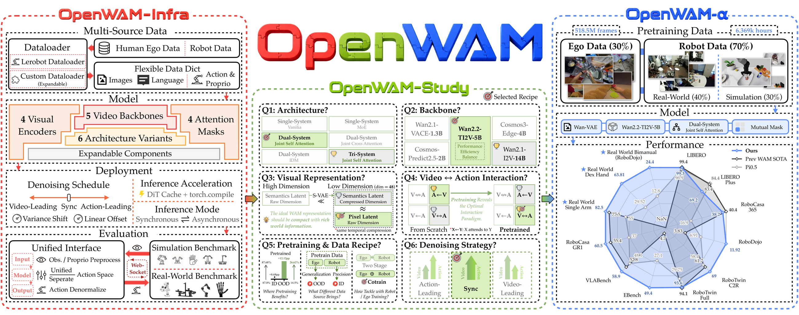
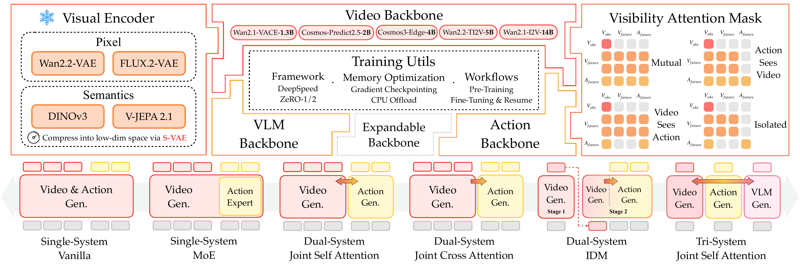
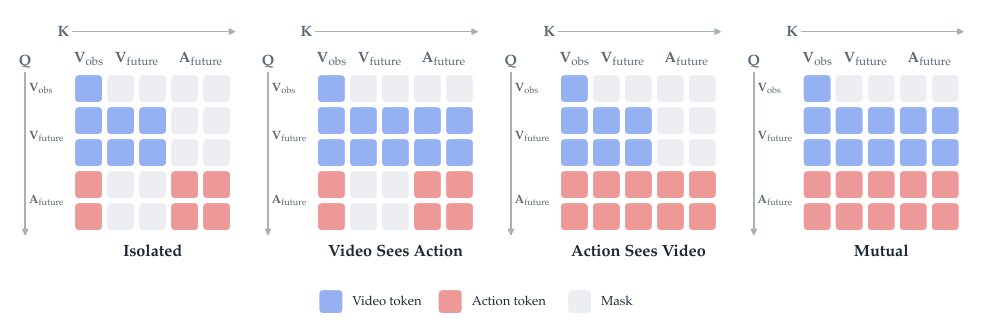
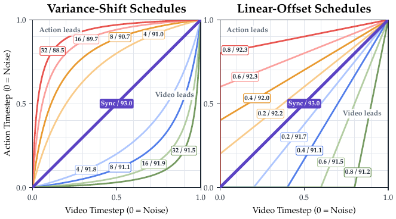
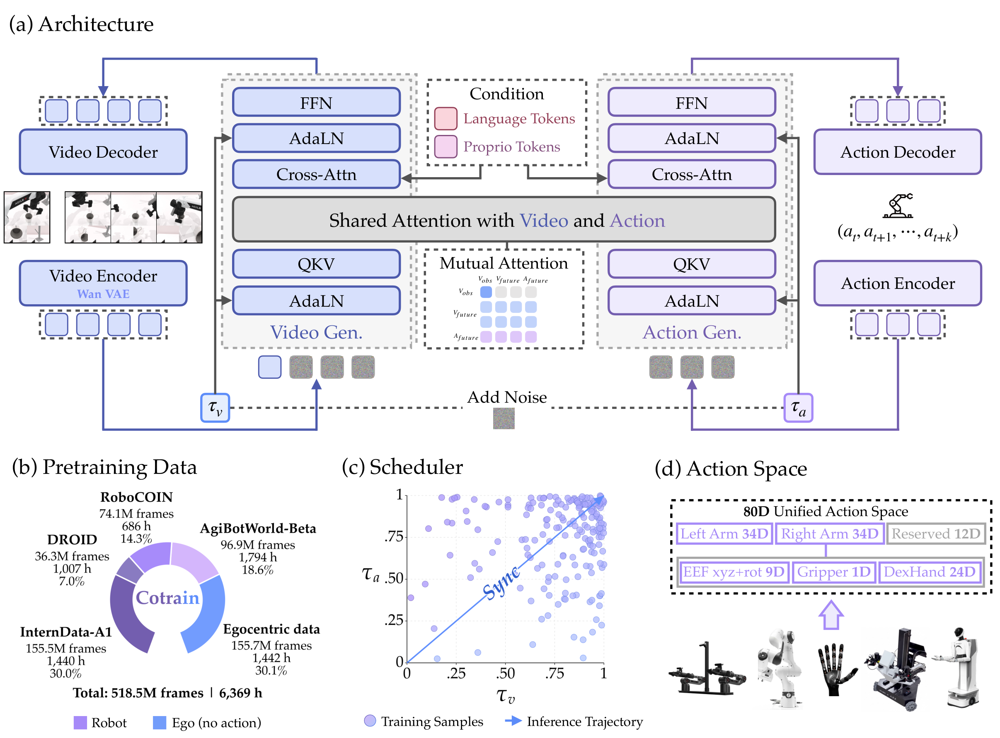
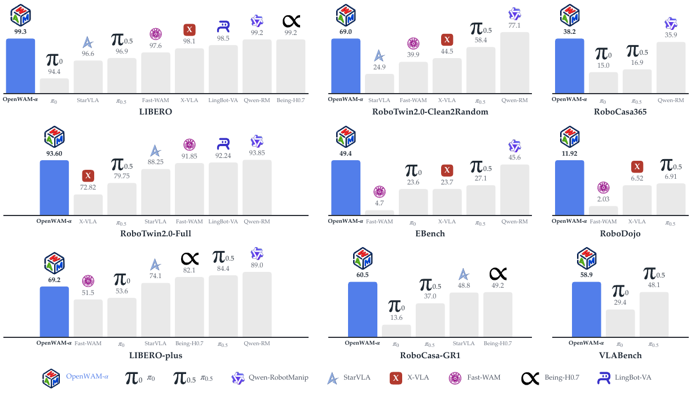

# OpenWAM：把 World–Action Model 变成可控的研究程序

!!! info "论文信息"
    **论文题名：** OpenWAM: An Open, Modular Exploration Towards Systematic World–Action Model Pretraining。<br>
    **作者：** Yuran Wang、Siqiao Huang、Mingleyang Li、Chenhao Zhang、Jiaqi Liang、Weiyang Jin、Yue Chen、Xuemin Chi、Donghao Zhou、Qize Yu、Yu-Kai Wang、Yuhan Rui、Shenzhe Yao、Zhen Yuan、Zhenhao Shen、Kefei Zhu、Zijie Zhu、Ning Gao、Xiaowei Chi、Guanqi He、Shanghang Zhang、Hao Dong、Lin Shao、Hang Zhao。<br>
    **机构：** National University of Singapore、Tsinghua University、Peking University、The University of Hong Kong、Zhejiang University、The Chinese University of Hong Kong、Shanghai Jiao Tong University。<br>
    **时间 / 主题：** 2026-09；具身智能 / World–Action Model / 视频生成先验。<br>
    **arXiv / 项目页：** [arXiv:2609.07398](https://arxiv.org/abs/2609.07398)；[OpenWAM 官方项目页](https://openwam-official.github.io/)。<br>
    **代码 / 模型与数据：** [GitHub](https://github.com/OpenWAM-Official/OpenWAM)；[Hugging Face OpenWAM](https://huggingface.co/OpenWAM)；[XPolicyLab OpenWAM policy](https://github.com/XPolicyLab/XPolicyLab/tree/main/policy/OpenWAM)。<br>
    **元数据来源与核验口径：** 来源为 arXiv、官方项目页、官方代码仓库及论文 TeX source；Checked Date：2026-09-11；Repro Status：Paper / official project / code / model page reviewed, independent reproduction not claimed。

## 原论文故事线

### 研究背景

VLA 通常从视觉语言预训练继承语义知识，再学习从观测到动作的映射。World–Action Model（WAM）走的是另一条 warm start 路线：先从视频生成模型继承“世界如何变化”的视觉与时序先验，再用具身轨迹把这些先验接到可执行动作上。它的基本假设可以写成一句话：视频预训练告诉模型世界长什么样、怎样运动，机器人经验告诉模型哪些变化是由动作造成的。

困难在于，现有 WAM 往往把视频 backbone、视觉表征、动作分支、注意力方向、采样调度、训练数据和评测程序绑定在一个代码库里。一个结果变好时，很难说清楚收益来自更大的视频模型、更好的 latent、更强的 action capacity，还是数据配方变化。OpenWAM 先解决这个科学问题，再推出一个可以被社区复用的模型。

### 问题（Challenge）

论文要回答三个连续问题。

1. WAM 应该继承什么 world knowledge，怎样继承才有效？
2. 视频世界建模和动作学习怎样形成真正的信息互补？
3. 这种 world–action synergy 怎样跨数据域、任务和机器人本体扩展？

这三个问题需要按顺序研究。第二个问题建立在第一个问题选出的视觉先验上，第三个问题再检验前两步在跨域预训练后是否仍然成立。OpenWAM-Study 的价值就在这里：它把模型设计写成一个逐步收紧条件的实验程序，避免把结果简化成一张“组件排行榜”。

### Finding

论文最后收敛出三条原则。

- **继承阶段**：视频生成 backbone 需要有足够容量，视觉 latent 需要同时紧凑且包含丰富世界信息。表征 encoder 经过时间压缩和维度收缩后，也可以成为 WAM 的有效输入。
- **交互阶段**：动作分支需要专用 capacity，训练时必须存在 world-to-action 的显式信息路径，推理时同步去噪比让某一个流领先更可靠。
- **整合阶段**：具身预训练主要改善 OOD 泛化。机器人轨迹提供可执行的 action grounding，第一视角人类视频扩展场景和交互覆盖，一阶段混合训练能把两种优势合在一起。预训练规模上来后，mutual visibility 比单向可见更占优。

这三条原则最终组成 OpenWAM-α。它采用 Wan2.2-TI2V-5B 世界流、独立 ActionDiT、mutual joint self-attention、同步去噪和统一 80 维动作空间，在约 6,400 小时人类第一视角与机器人数据上预训练。

{ width="960" }

<small>图源：OpenWAM 官方项目页的 Overview 图。左侧是 OpenWAM-Infra，中间是 OpenWAM-Study，右侧是 OpenWAM-α。读图重点是研究顺序：先把设计空间拆成模块，再做受控实验，最后把实验结论组合成可发布的预训练模型。</small>

## 论文位置

WAM 和 VLA 都可以看作从观测与指令生成动作，但二者的监督来源不同。VLA 主要优化动作误差，WAM 还要求模型预测未来视觉状态。一个简化的对照如下。

| 路线 | 主要继承的先验 | 训练时的额外信号 | 强项 | 典型风险 |
| --- | --- | --- | --- | --- |
| VLA | 视觉语言语义和指令知识 | action supervision | 语义泛化、推理路径直接 | 缺少未来状态的中间监督 |
| WAM | 视频生成的外观与时序动态 | future visual latent + action supervision | 更贴近训练分布、可学习动作后果 | 长时未来预测误差会累积 |
| OpenWAM | 可替换的视频 backbone 与视觉 encoder | 受控的 world–action 联合 flow matching | 能比较设计变量并开放完整配方 | OOD 鲁棒性仍依赖数据覆盖 |

论文并没有宣称 WAM 在所有场景都胜过 VLA。它的更重要判断是，二者的优势区域不同。论文实验中，WAM 的视频 latent 监督通常带来更好的 ID fitting，VLA 在未见环境的 OOD 泛化上往往更强。真正的研究机会是把两种监督的优点结合起来。

## OpenWAM-Infra：先把耦合拆开

OpenWAM-Infra 把 WAM 写成组合函数

$$
C(\mathcal{E},\mathcal{S},\mathcal{M}),
$$

其中 \(\mathcal{E}\) 是视觉 encoder，\(\mathcal{S}\) 是各个 token stream 的 backbone，\(\mathcal{M}\) 是可见性 attention mask。组合规则只负责安排各个 stream 的 `prepare`、逐层 block 和 `finalize`，不在组合层增加可学习参数。这样一来，换 encoder、换 action backbone 或换信息流方向，不需要重写 trainer 和 policy server。

### 三类可替换模块

**Visual Encoder。** 当前实现支持 Wan2.2-VAE、FLUX.2-VAE 等 reconstructive encoder，也支持 DINOv3、V-JEPA 2.1 等 representation encoder，并可用 S-VAE 把高维表征压到 DiT 更容易处理的维度。encoder 冻结，世界流学习的是 encoder 定义的 latent 动力学。

**Stream Backbones。** 世界流预测未来视频 latent，动作流预测 action chunk，可选 understanding stream 由 VLM 提供语义信息。视频 backbone 覆盖 Wan2.1-VACE-1.3B、Cosmos-Predict2.5-2B、Cosmos3-Edge-4B、Wan2.2-TI2V-5B 和 Wan2.1-I2V-14B。动作流既可以使用独立 ActionDiT，也可以把 action token 放入共享视频 backbone。

**Visibility Attention Mask。** 视频内部使用 first-frame causal attention，干净的当前帧不会读到噪声未来帧；动作 token 在 chunk 内双向可见。跨模态有四种模式。

| Mask | 可见路径 | 研究含义 |
| --- | --- | --- |
| Isolated | 视频和动作互不读取 | 测试联合训练是否只是参数共享 |
| Video Sees Action | 只有视频读取动作 | 测试动作对未来视觉的影响 |
| Action Sees Video | 只有动作读取视频 | 测试 world-to-action 是否是必要条件 |
| Mutual | 两个方向都可见 | 允许未来视觉和动作互相修正 |

{ width="960" }

<small>图源：OpenWAM 论文 `Figure 2`，由 arXiv TeX source 中的 `openwam-infra-model.pdf` 渲染。顶部是可替换的 encoder、stream backbone 与 visibility mask，底部是由组合规则得到的 Single-System、Dual-System 和 Tri-System。</small>

### 三类架构

Single-System 把视频和动作放进一个 backbone，参数共享最多；MoE 版本只给动作 token 分配专用 FFN expert。Dual-System 使用独立视频流与 ActionDiT，可通过 joint self-attention、joint cross-attention 或 IDM 连接。Tri-System 再加入 VLM understanding stream。

这套拆分让实验问题变得可辨认。论文在 RoboTwin2.0-Full 上比较七种设置，平均成功率从 Single-System Vanilla 的 85.50，上升到 Dual-System joint self-attention 的 92.36，再到 Tri-System joint self-attention 的 92.60。后续实验选择 Dual-System joint self-attention，原因是它在性能和复杂度之间更平衡，也能把 VLM 语义能力对结果的影响隔离开。

## 统一训练目标与部署接口

OpenWAM-Infra 对每个样本使用语言指令 \(\ell\)、视频窗口 \(\mathbf{o}_{1:T}\)、动作 chunk \(\mathbf{a}_{1:H}\)、可选本体状态 \(\mathbf{q}\) 和 action validity mask \(\mathbf{m}\)。视觉和动作各自采样噪声时间步

$$
\mathbf{z}^{t_v}=t_v\mathbf{z}+(1-t_v)\boldsymbol{\epsilon}_v,
\qquad
\mathbf{a}^{t_a}=t_a\mathbf{a}+(1-t_a)\boldsymbol{\epsilon}_a.
$$

一次联合前向同时预测视频流和动作流的 velocity，损失为

$$
\mathcal{L}
=\lambda_v\mathbb{E}\left[w(t_v)\left\|\hat{\mathbf{v}}_z-(\mathbf{z}-\boldsymbol{\epsilon}_v)\right\|_2^2\right]
+\lambda_a\mathbb{E}\left[w(t_a)\left\|\mathbf{m}\odot(\hat{\mathbf{v}}_a-(\mathbf{a}-\boldsymbol{\epsilon}_a))\right\|_2^2\right].
$$

这里真正决定行为的是 \(t_v\) 与 \(t_a\) 独立采样，而非公式形式本身。训练覆盖整个二维 joint noise plane，所以推理时同步或异步走哪条路径，都落在训练分布内。OpenWAM-α 最终选择同步路径，沿对角线同时把两个流从噪声推向干净状态。

部署层把模型和 benchmark 解耦。benchmark 是只发送图像、语言和状态的 thin client，policy server 根据 self-contained checkpoint 重建架构、做归一化和动作空间映射，再返回机器人原生单位的一个动作。checkpoint 同时保存权重、完整解析配置、tokenizer / encoder 重建信息与 normalization statistics，缺少归一化记录会直接报错。

## OpenWAM-Study 的三组受控实验

### Q1：WAM 应该继承什么 world knowledge

#### 生成 backbone 的容量

作者固定 Dual-System joint self-attention，只替换视频生成 backbone。比较 Wan2.1-VACE-1.3B、Cosmos-Predict2.5-2B、Wan2.2-TI2V-5B 和 Wan2.1-I2V-14B。成功率随 backbone 容量整体提升，14B 最好，但 5B 与 14B 只差 1.40 个百分点。考虑训练和部署成本，后续实验采用 Wan2.2-TI2V-5B。

这项实验支持“容量重要”，但不能把全部差异归因于参数量，因为四个 backbone 的数据、架构和训练目标也不同。论文把 5B 作为性能与实验可控性的折中点。

#### 视觉 latent 的结构

作者区分 reconstructive encoder 和 representation encoder。直接使用 DINOv3 或 V-JEPA 2.1 的高维特征，会因为 latent 维度和 DiT 处理习惯不匹配而变差。加入 S-VAE 做维度收缩后，DINOv3 / S-VAE 与 V-JEPA 2.1 / S-VAE 明显超过 FLUX.2-VAE，DINOv3 / S-VAE 接近 Wan2.2-VAE。

因此，WAM latent 质量取决于两个操作性质，而不取决于“VAE 或表征 encoder”这个类别标签。

- **Compactness**：时间维和 token 维都要足够紧凑，避免动作学习被过长的视觉序列拖慢。
- **Information richness**：压缩后仍要保留物体、姿态、接触和环境变化等对动作有用的信息。

Wan2.2-VAE 仍被选作 OpenWAM-α 的最终 encoder，因为它原生匹配 Wan2.2 视频 backbone，并且时间压缩是 encoder 学到的，不是简单平均四帧得到的。

### Q2：世界和动作怎样形成 synergy

#### 专用 action capacity

架构消融的平均成功率如下。

| Architecture | Variant | Clean | Randomized | Average |
| --- | --- | ---: | ---: | ---: |
| Single-System | Vanilla | 85.20 | 85.80 | 85.50 |
| Single-System | MoE | 86.22 | 83.04 | 84.63 |
| Dual-System | Joint Self-Attention | 92.34 | 92.38 | 92.36 |
| Dual-System | Joint Cross-Attention | 87.86 | 88.64 | 88.25 |
| Dual-System | Detached Cross-Attention | 92.06 | 91.64 | 91.85 |
| Dual-System | IDM | 87.76 | 88.14 | 87.95 |
| Tri-System | Joint Self-Attention | 92.84 | 92.36 | **92.60** |

独立的 ActionDiT 带来明显收益，说明动作 token 不能只把视频 backbone 当作一个共享回归器。Tri-System 的最高分并不意味着 VLM 必须加入最终模型，因为后续研究要单独观察 world–action 交互，故选择更简洁的 Dual-System。

#### 训练时的信息流

在同一 Dual-System 上，Isolated 平均 87.41，Video Sees Action 为 87.63，Action Sees Video 为 92.39，Mutual 为 92.15。动作流能读到世界流时性能提高约五个百分点，反向路径在从零训练阶段只带来很小变化。

{ width="760" }

<small>图源：OpenWAM 论文 `Figure 8`，由官方 TeX source 渲染。实验把跨模态 attention mask 当成唯一变化量，直接检验动作是否需要读取未来视觉表征。</small>

这项结果支持一个清晰的机制判断。视频流提供了场景动态和动作后果的中间表征，动作流可以据此选择更符合物理变化的 action chunk；只有视频读取动作时，动作学习仍然缺少 world-to-action 的直接路径。

#### 推理时的去噪路径

训练时的 attention mask 是硬信息门，推理时两个流的 denoising schedule 是软信息门。作者固定 mutual visibility，让视频和动作分别从独立噪声时间步开始，比较同步对角线、variance-shift 与 linear-offset 等让某一个流领先的路径。

同步去噪在所有测试的偏移量和领先方向上都最好。异步 schedule 没有带来稳定收益，这说明 WAM 的关键更像共享表征空间，测试时先把未来视频完全生成出来再交给 inverse dynamics model 并没有额外优势。训练时需要显式 world-to-action flow，推理时却不需要人为制造“视频领先”或“动作领先”。

{ width="760" }

<small>图源：OpenWAM 论文 `Figure 10`，由官方 TeX source 渲染。曲线表示动作去噪进度与视频去噪进度，主对角线是同步去噪。</small>

### Q3：怎样跨域整合 world–action knowledge

作者使用 RoboTwin2.0-Clean2Random 区分 ID 与 OOD，并在相同 600 小时预算下比较四种预训练方式。

| Pretraining strategy | Data allocation | 主要观察 |
| --- | --- | --- |
| From scratch | 只做下游监督微调 | ID 基线 |
| Robot-only | 600 h robot | ID 最强，OOD 不如混合数据 |
| Ego then robot | 350 h ego + 250 h robot，分两阶段 | 混合数据带来 OOD 提升 |
| Ego + robot co-train | 350 h ego + 250 h robot，一阶段 | 总体最好，省去阶段切换 |

具身预训练对 ID 的提升较小，对 OOD 的提升明显。机器人轨迹保留了可执行的动作 grounding，第一视角人类视频扩展了视觉和交互变化。两种数据都重要，训练顺序的影响小于是否同时拥有两种数据。

一个很有意思的结果是信息流偏好会随预训练改变。没有具身预训练时，Action Sees Video 略占优；跨域预训练后，Mutual 在 RoboTwin2.0-Clean2Random 和 RoboTwin2.0-Full 上都更好。合理的解释是，小规模从零训练不足以学会稳定的双向对应关系，大规模多域数据让动作反过来帮助世界流建模操作者运动，于是 mutual visibility 的潜力才真正显现。

## OpenWAM-α：把配方推到规模

{ width="960" }

<small>图源：OpenWAM 官方项目页与论文 `Figure 12`。双系统由 Wan2.2-TI2V-5B 视频 DiT 和约 1B 参数的 ActionDiT 组成，通过 30 个 bridge layers 的 joint self-attention 交互。</small>

### 架构细节

- **视觉 encoder**：冻结的 Wan2.2-VAE。第一帧单独编码，后续帧每四帧一组，第一 latent frame 始终是当前观测的干净锚点。
- **世界流**：Wan2.2-TI2V-5B，宽度 3072，使用三维 RoPE，预测未来视频 latent。
- **动作流**：独立 ActionDiT，宽度 1024，每个 action step 对应一个 token，使用一维 RoPE。
- **桥接层**：30 对 paired layers，两个 residual stream 投影到 24 heads × 128 dimensions 的共享 attention 空间。
- **条件信息**：冻结 umT5 把语言映射到 4096 维 context，proprioception 通过额外 token 加入，两条流各自做 cross-attention。
- **动作接口**：80 维统一空间由两个镜像的 34 维 arm block 和 12 个 embodiment-specific slots 组成。每个数据集把自己的 action scatter 到对应 slots，validity mask 只在真实存在的坐标上计算梯度。

### 训练与推理

OpenWAM-α 只冻结 umT5 与 Wan2.2-VAE，视频 DiT、ActionDiT 和 proprioception encoder 都更新。视频与动作独立采样时间步，时间 warp 参数 \(\rho=5\) 把采样偏向高噪声端，损失权重在中等噪声区域更高。

推理时两条流沿同步对角线执行 10 步 Euler 更新。当前观测编码出的第一 latent frame 每一步都被重新钳制，动作 chunk 在逐渐变干净的未来世界表征中同步修正。官方实现使用 CUDA graphs、跨步复用 velocity、缓存 prompt embedding，RTX 5090 上一个 chunk 约 170 ms，且控制路径不需要 VAE decode。

### 预训练数据

原始数据池约 14,300 小时、13.3 亿帧，清洗和按来源预算抽样后保留 518.5M frames，约 6,369 小时。

| 数据类型 | 来源 | 作用 |
| --- | --- | --- |
| Ego human | 71.6K 段第一视角长视频，3,006 类日常操作 | 扩大场景、物体和交互变化，只监督 world stream |
| Real robot | AgiBotWorld-Beta、RoboCOIN、DROID，17 个物理平台 | 提供真实机器人视觉和可执行 action grounding |
| Synthetic robot | InternData-A1 | 补充多环境、单臂与双臂技能覆盖 |

最终帧配比约为 30% egocentric、30% synthetic、40% real robot。清洗分视觉层和信号层。视觉层剔除无法解码、冻结、重复、纯色、曝光异常、模糊和突变帧；ego 数据还要移除手部离开视野、语言标注无效的片段。机器人信号层会检查末端状态与动作相关性、视频与状态对齐、静止段、传感器抖动和异常 jerk。一个 episode 如果超过 70% 帧被清掉，或者 90% 以上时间处于冻结状态，就整体删除。

## 实验与证据边界

### 仿真 benchmark

OpenWAM-α 覆盖八个仿真 benchmark，横跨单臂、双臂、移动操作和灵巧手。代表性结果如下。

| Benchmark | OpenWAM-α | 参照结果 | 读法 |
| --- | ---: | ---: | --- |
| LIBERO Avg | 99.3 | ABot-M0.5 99.4；Qwen-RobotManip 99.2 | 位于第一梯队，Goal 维度 99.8 |
| RoboTwin2.0-Full Avg | 93.60 | ABot-M0.5 94.10；Qwen-RobotManip 93.85 | WAM 第一梯队，略低于最强 VLA |
| EBench Overall | 49.4 SR / 64.7 Score | Qwen-RobotManip 45.6 / 60.0 | 在移动双臂场景领先参照 VLA |
| RoboDojo Avg | 11.92 SR / 17.18 Score | Xiaomi-Robotics-1 13.93 / 20.07 | 强于其他 WAM，但仍落后顶级 VLA |

{ width="960" }

<small>图源：OpenWAM 论文 `Figure 13`，由官方 TeX source 渲染。各 benchmark 的量纲和任务难度不同，柱长只适合在同一 panel 内比较，不能把不同 benchmark 的绝对分数直接横排。</small>

论文结果呈现出清晰的 ID / OOD 分工，并不支持 WAM 全面胜出的判断。

- 在 LIBERO、VLABench、RoboTwin2.0-Full 等 ID 场景，视频 latent supervision 让 WAM 更贴近训练分布。
- 在 LIBERO-Plus、RoboTwin2.0-Clean2Random Randomized、RoboDojo Open 等 OOD 场景，强 VLA 往往更稳。
- OpenWAM-α 在 LIBERO-Plus 的 camera 和 noise 扰动下明显掉分。论文把原因归为单臂预训练数据较少，以及像素级未来预测对视角和噪声变化敏感。

这组结果把一个常见误读拆开了。WAM 的未来预测监督可以帮助拟合，却也让长时 rollout 承担误差累积；VLA 少了一条视频预测损失，ID 拟合可能弱一些，但在分布变化下更轻。数据规模和覆盖最终会改变这条权衡。

### 真实机器人

真实实验覆盖 Franka 单臂、RoboDojo 三种双臂平台，以及预训练从未见过的 Wuji 灵巧手加 Tianji 机械臂。

| 平台 | OpenWAM-α 结果 | 参照 |
| --- | --- | --- |
| Franka 单臂六任务 | 99/120，平均 SR 82.5% | LingBot-VA 77.5%，π₀.₅ 55.0% |
| RoboDojo Real | 18 个任务、ARX X5 / Piper / Piper X，平均 37.6 Score / 24.4 SR | 下一名约 22.9 Score / 12.8 SR |
| Wuji 灵巧手 + Tianji arm | 在四类任务的 ID 与 OOD 设置均超过 π₀.₅ | 动作空间为 9D 末端位姿 + 21D 手部自由度，预训练未出现 |

真实机器人证据支持两点。第一，统一 action space 与模块化 policy server 能把一个模型接到不同本体。第二，跨 embodiment 迁移确实存在，但它发生在 fine-tune 之后，不能读成零样本直接控制一个完全陌生的灵巧手。

RoboDojo 的分数需要按官方协议解读。OpenWAM 代码仓库后续说明，部分导出字段混用了 standard half 与 merged 50-episode value，并提供脚本重新聚合。因此读取榜单时应优先查看 per-task 数据和评测协议，不能只复制一个 summary cell。

## 主要贡献

1. **研究基础设施**。把 encoder、backbone、架构、attention mask、trainer、policy server 与 benchmark adapter 置于统一接口下。
2. **受控设计研究**。围绕继承、交互和跨域整合三个问题逐步做实验，并明确每一步采用什么默认配置。
3. **可复用的 WAM 配方**。专用 ActionDiT、world-to-action visibility、同步 joint denoising、一阶段 ego + robot co-training 和 mutual visibility。
4. **开放的基础模型**。发布 OpenWAM-α 权重、数据配方、评测协议和代码，覆盖八个仿真 benchmark 与三类真实机器人本体。

## 局限与风险

- 论文重点是 embodied pretraining，post-training、RL 和真实部署适配的系统规律还没有被同样完整地研究。
- 当前六类架构主要通过 cross-modality attention 或 hard-routed MoE 融合，tokenization 阶段 early fusion 与 soft-routed MoE 仍是开放方向。
- 数据配方没有纳入 UMI / DexUMI 一类同时提供多样场景和可执行动作的数据，合成数据与自动标注能否替代真实轨迹尚未定论。
- Wan2.2-VAE 的像素重建 latent 对 camera、noise 和 scene variation 不够稳健。紧凑、具备环境信息、又对视角变化鲁棒的视觉表示仍是 WAM 的关键缺口。
- 论文报告的高分主要来自作者统一的训练和评测管线。不同模型的预训练数据、SFT 配置和 benchmark 协议若不完全对齐，横向比较会被夸大。

## 关键术语

- **World–Action Model（世界动作模型）**：同时预测未来视觉状态和可执行动作的具身模型。
- **World Stream（世界流）**：预测未来视频 latent，承载视频生成模型继承的时序与动态先验。
- **Action Stream（动作流）**：预测未来 action chunk，OpenWAM-α 使用独立 ActionDiT。
- **World-to-Action Information Flow（世界到动作信息流）**：动作 token 在 attention 中读取世界 token，使未来视觉表征参与动作选择。
- **Mutual Visibility（双向可见）**：世界流与动作流在 bridge layer 中相互读取。
- **Joint Denoising（联合去噪）**：两个流在同一推理步骤中联合更新，而非先生成完整视频再预测动作。
- **Unified Action Space（统一动作空间）**：用固定 slot 语义承载不同机器人本体的动作和状态，未使用 slot 由 validity mask 屏蔽。
- **In-Domain / Out-of-Domain（域内 / 域外）**：分别表示测试条件与训练分布相近或存在场景、视角、噪声等变化。
- **Self-Contained Checkpoint（自包含检查点）**：权重、完整模块配置和归一化统计一起保存，保证训练、微调、部署使用同一模型定义。
- **Action Grounding（动作落地）**：把视频或语义表征连接到具体机器人动作空间、控制频率和本体约束。

## 阅读结论

OpenWAM 最重要的贡献是改变了 WAM 的研究单位。研究者不必把“视频 backbone、动作头、数据和采样器”当成一个不可拆的黑盒，可以先问清楚是哪一种先验在起作用、哪条信息路径在传递、哪一种数据在扩大泛化。

如果只记住一条工程判断，可以记成这条链：**能力来自视频先验，动作来自专用 capacity，协同来自显式 world-to-action flow，稳定性来自同步去噪，跨域泛化来自 ego 与 robot 数据的共同覆盖。** OpenWAM-α 的高分说明这套组合是一个强 baseline，实验中的 ID / OOD 分裂也提醒我们，WAM 的未来仍取决于更丰富的真实动作数据和更稳健的视觉 latent。

## 外部精读

- [OpenWAM 官方项目页](https://openwam-official.github.io/)
- [arXiv:2609.07398](https://arxiv.org/abs/2609.07398)
- [OpenWAM GitHub](https://github.com/OpenWAM-Official/OpenWAM)
- [OpenWAM 结果页](https://openwam-official.github.io/results/)
- [OpenWAM Hugging Face](https://huggingface.co/OpenWAM)
- [XPolicyLab OpenWAM policy](https://github.com/XPolicyLab/XPolicyLab/tree/main/policy/OpenWAM)

```bibtex
@article{wang2026openwam,
  title   = {OpenWAM: An Open, Modular Exploration Towards Systematic World-Action Model Pretraining},
  author  = {Yuran Wang and Siqiao Huang and Mingleyang Li and Chenhao Zhang and Jiaqi Liang and Weiyang Jin and Yue Chen and Xuemin Chi and Donghao Zhou and Qize Yu and Yu-Kai Wang and Yuhan Rui and Shenzhe Yao and Zhen Yuan and Zhenhao Shen and Kefei Zhu and Zijie Zhu and Ning Gao and Xiaowei Chi and Guanqi He and Shanghang Zhang and Hao Dong and Lin Shao and Hang Zhao},
  year    = {2026},
  journal = {arXiv preprint arXiv:2609.07398}
}
```
