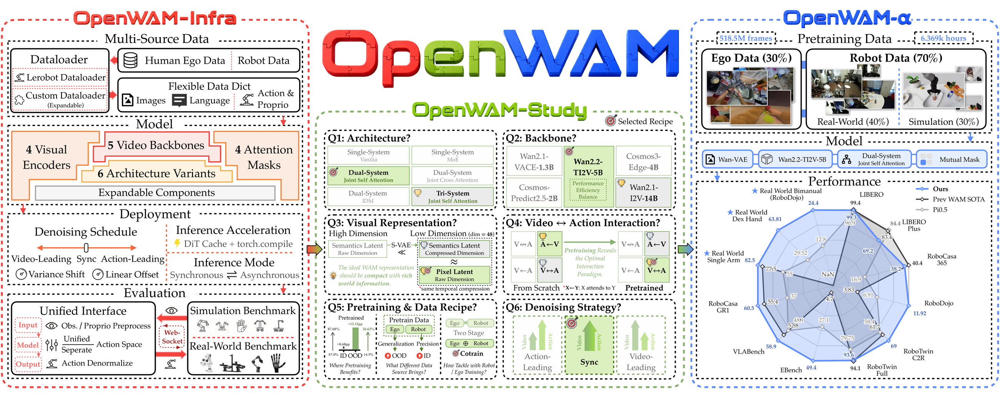
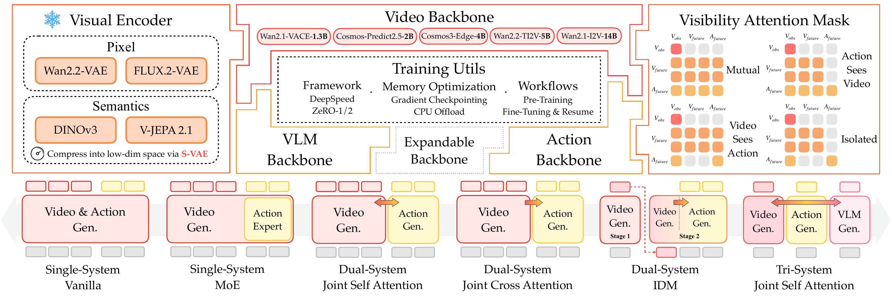
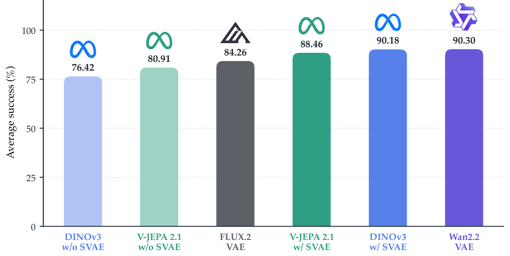
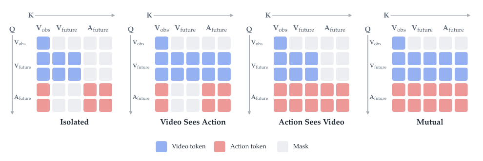
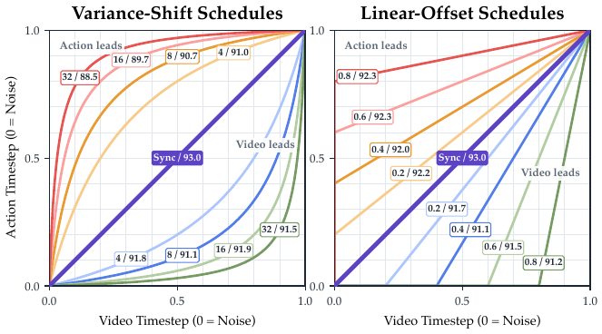
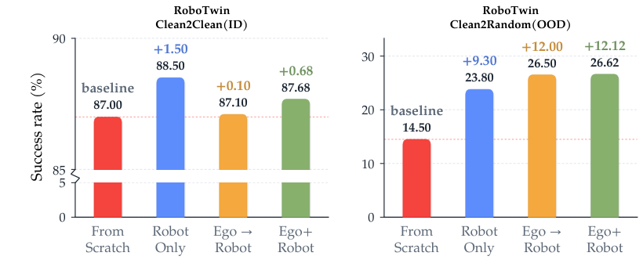
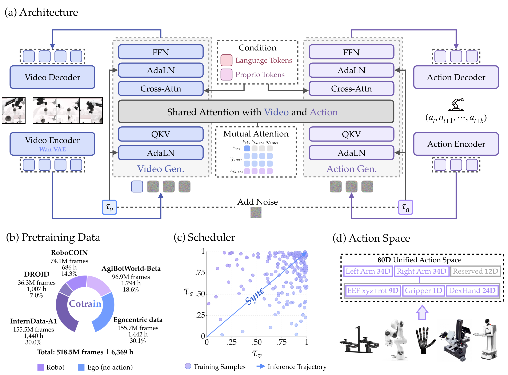
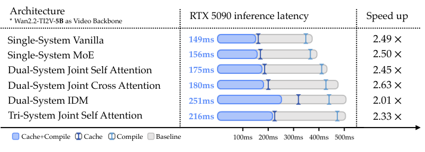
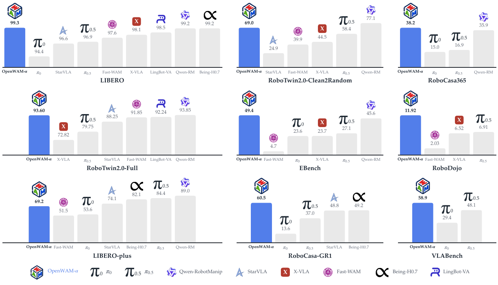
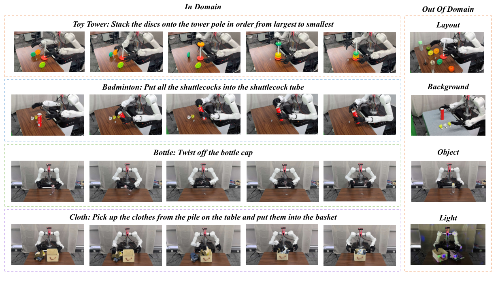

# OpenWAM：把 World–Action Model 变成可控的研究程序

!!! info "论文信息"
    **论文题名：** OpenWAM: An Open, Modular Exploration Towards Systematic World–Action Model Pretraining。 
    **作者：** Yuran Wang、Siqiao Huang、Mingleyang Li、Chenhao Zhang、Jiaqi Liang、Weiyang Jin、Yue Chen、Xuemin Chi、Donghao Zhou、Qize Yu、Yu-Kai Wang、Yuhan Rui、Shenzhe Yao、Zhen Yuan、Zhenhao Shen、Kefei Zhu、Zijie Zhu、Ning Gao、Xiaowei Chi、Guanqi He、Shanghang Zhang、Hao Dong、Lin Shao、Hang Zhao。 
    **机构：** National University of Singapore、Tsinghua University、Peking University、The University of Hong Kong、Zhejiang University、The Chinese University of Hong Kong、Shanghai Jiao Tong University。 
    **时间 / 主题：** 2026-09；具身智能 / World–Action Model / 视频生成先验。 
    **arXiv / 项目页：** [arXiv:2609.07398](https://arxiv.org/abs/2609.07398)；[OpenWAM 官方项目页](https://openwam-official.github.io/)。 
    **代码 / 模型与数据：** [GitHub](https://github.com/OpenWAM-Official/OpenWAM)；[Hugging Face OpenWAM](https://huggingface.co/OpenWAM)；[XPolicyLab OpenWAM policy](https://github.com/XPolicyLab/XPolicyLab/tree/main/policy/OpenWAM)。 
    **元数据来源与核验口径：** 来源为 arXiv、官方项目页、官方代码仓库及论文 TeX source；Checked Date：2026-09-11；Repro Status：Paper / official project / code / model page reviewed, independent reproduction not claimed。

## WAM 的难点，也包括不知道哪个改动真正有效

两个机器人模型都从视频生成器出发，一个使用独立动作专家，另一个把动作直接拼进视频 token；与此同时，它们还换了数据、视觉编码器、动作空间和执行调度。即使最后成功率相差很多，也很难判断是哪一项改动起作用。OpenWAM 把这个问题作为研究对象，提供可替换组件、统一训练与执行接口，再在同一个底座上逐步比较设计。[↗](https://arxiv.org/pdf/2609.07398v1#page=3)

论文包含三个不同层次。**OpenWAM-Infra** 是模块化研究基础设施，负责让实验变量可以被替换；**OpenWAM-Study** 是在共同协议下进行的受控实验，检验继承什么先验、世界与动作如何交互、不同预训练数据有什么价值；**OpenWAM-α** 再把选出的配方扩展到 518.5M 帧、6,369 小时的混合预训练。前两者解释设计理由，最后一者检验这些选择能否在更大数据和更多本体上工作。[↗](https://arxiv.org/pdf/2609.07398v1#page=4)

总览图可以从左到右读。左侧接口提供可控变量，中间问题依次约束模型配方，右侧将配方落到实际预训练模型。它不表示每个选择已经在全部基准上穷举最优，也不表示最终模型无需目标数据微调。

{ width="960" }

*原论文 Figure 1。区分研究底座、受控结论和规模化模型，才能避免把某一项 RoboTwin 消融直接写成所有 WAM 的通用定律。* [↗](https://arxiv.org/pdf/2609.07398v1#page=1)

## 一个模型配置怎样成为可替换的实验对象

### 编码器、骨干和可见性分别控制什么

OpenWAM 用 $C(E,S,M)$ 表示一个配置。$E$ 是始终冻结的视觉编码器，决定世界流预测哪一种潜在表示；$S$ 是视频流、动作流及可选理解流的骨干；$M$ 是注意力可见性，决定哪些 token 能读到哪些信息；$C$ 则负责组织各骨干的执行顺序。[↗](https://arxiv.org/pdf/2609.07398v1#page=5)

各骨干提供三个接口。`prepare` 将原始输入转换为初始 token，逐层 `block` 推进表示，`finalize` 把最终状态还原为预测。每层还可拆成输出 QKV 的前半段和消费注意力结果的后半段，让组合器在中间插入联合注意力。组合规则本身没有学习参数，学习容量仍在各骨干中；因此更换交互方式不必同时重写训练器和部署服务。[↗](https://arxiv.org/pdf/2609.07398v1#page=6)

Figure 2 顶部展示三类可替换模块，底部展示组合结果。先沿纵向确定用了哪个编码器和骨干，再沿横向比较视频与动作共享多少参数。底座支持五种视频骨干，但后文骨干大小实验实际比较四种，支持列表与实验覆盖不能混为一谈。

{ width="960" }

*原论文 Figure 2。视觉空间、模型容量与注意力掩码是不同变量；六种基本架构中，cross-attention 另有梯度分离版本，形成后文七行比较。* [↗](https://arxiv.org/pdf/2609.07398v1#page=5)

| Family / Variant | 参数与信息流组织 | 需要区别的机制 |
|---|---|---|
| Single / Vanilla | 视频、动作和本体状态 token 进入共享 Transformer | 没有专属动作 FFN |
| Single / MoE | 共享序列与注意力，动作 token 硬路由到专属 FFN | 不是可学习软路由选择专家 |
| Dual / Joint Self-Attention | 独立视频骨干与 ActionDiT，在桥接层共同注意 | 交互后回到各自残差流 |
| Dual / Joint Cross-Attention | 动作流查询视频特征 | 动作损失可更新视频流 |
| Dual / Detached Cross-Attention | 与上行相同，但视频特征停止传回动作梯度 | 切断梯度，不等于切断特征读取 |
| Dual / IDM | 训练时使用 teacher-forced 视频状态 | 推理先生成视频，再由 IDM 预测动作 |
| Tri / Joint Self-Attention | 冻结 VLM 提供特征，增加可训练理解流 | 理解流只读自身，另外两流可读取它 |

Tri-System 的只读理解流有明确方向性，不能把三路接入同一注意力机制就理解为所有 token 完全互相可见。同样，Detached Cross-Attention 仍让动作读取视频信息，只是不允许动作回归梯度沿这条边更新视频参数。[↗](https://arxiv.org/pdf/2609.07398v1#page=7)

### 当前观测是干净锚点，未来帧并非逐帧因果

注意力矩阵中的 $M_{X\leftarrow Y}$ 表示 X 的 query 读取 Y 的 key/value。视频内部采用 first-frame causal mask，当前干净帧只读自身，未来带噪帧可以互相读取并读取当前帧；动作块内部则是双向注意力。这里的“causal”保护的是初始条件，没有把整个未来视频改成逐帧自回归。[↗](https://arxiv.org/pdf/2609.07398v1#page=6)

跨模态有四种模式，控制未来视频与动作块之间的连接。Isolated 关闭这两者之间的连接；Video Sees Action 只让未来视频读取动作；Action Sees Video 只让动作读取未来世界特征；Mutual 开放双向连接。按 Figure 8，四种模式下动作都能读取当前干净观测，Isolated 仍保留这一观测条件。图中应按 query 所在行和 key 所在列判断方向，避免把“谁看谁”与图论中的信息传递箭头读反。[↗](https://arxiv.org/pdf/2609.07398v1#page=14)

## 训练目标与动作单位共同构成接口

### 两条独立噪声时间，使用同一个联合目标

统一样本为 $(\ell,o_{1:T},a_{1:H},q,m)$，分别表示语言、视频窗口、动作块、本体状态和有效动作维度掩码。视觉编码器把视频转换为 $z$，语言及可选本体状态构成条件 $c$。OpenWAM 规定 $t=0$ 是纯噪声、$t=1$ 是干净数据，与某些论文相反，不能直接沿用另一篇的时间方向。

$$
z_{t_v}=t_vz+(1-t_v)\epsilon_v,
\qquad
a_{t_a}=t_aa+(1-t_a)\epsilon_a.
$$

视频和动作分别采样 $t_v,t_a$ 与高斯噪声，联合前向预测两路速度。目标为

$$
\begin{aligned}
\mathcal L={}&\lambda_v\mathbb E\left[w(t_v)
\|\hat v_z-(z-\epsilon_v)\|_2^2\right]\\
&+\lambda_a\mathbb E\left[w(t_a)
\|m\odot(\hat v_a-(a-\epsilon_a))\|_2^2\right].
\end{aligned}
$$

$\lambda_v,\lambda_a$ 控制两路权重，$w(t)$ 控制不同噪声时间的权重，$m$ 将动作损失限制到该机器人实际具有的坐标。当前干净条件帧不计入未来视频预测损失。独立时间采样让模型见到整个二维噪声平面的组合，为同步或不同进度的联合采样提供训练基础；它不保证任意采样路径具有相同误差，更不等于生成状态不会偏离真实数据分布。[↗](https://arxiv.org/pdf/2609.07398v1#page=7) [↗](https://arxiv.org/pdf/2609.07398v1#page=8)

### 80 维空间首先统一语义，然后才统一长度

单基准训练可以保留原生动作空间，例如 RoboTwin 的 14 维关节动作或 20 维双臂末端动作，LIBERO 的 10 维末端动作。跨本体预训练则使用 80 维空间，两侧各有 34 维，包括末端位置 3、旋转 6、夹爪 1、灵巧手 24，最后预留 12 维给移动底盘等本体通道。[↗](https://arxiv.org/pdf/2609.07398v1#page=10)

每个数据集声明索引映射 $\pi$，把相同物理含义放到同一槽位。输入先归一化再 scatter，输出先 gather 再反归一化

$$
u=\operatorname{Scatter}_\pi(\operatorname{Norm}(a)),
\qquad
a=\operatorname{Norm}^{-1}(\operatorname{Gather}_\pi(u)).
$$

未占用的槽位没有动作监督，推理时保留在定义的噪声路径上；它们不能被解释为机器人真的需要执行的零动作。状态也沿相同映射进入模型。这个接口的关键在于控制坐标和单位对应正确，并非简单将不同长度向量补齐到 80 维。

服务器收到最多三路相机、指令和原生本体状态后，按 checkpoint 规定裁剪、缩放与拼接视图，缺失腕部相机用黑帧补齐。预测动作块再映射回原生物理单位，进入执行缓冲区，每个客户端请求返回一个动作。这样，训练和评测共用同一套观测布局、动作含义和归一化统计。[↗](https://arxiv.org/pdf/2609.07398v1#page=9) [↗](https://arxiv.org/pdf/2609.07398v1#page=10)

### checkpoint 必须包含足以重建行为的配置

权重之外，checkpoint 还保存完整解析配置、模块重建说明、tokenizer 等资源与动作归一化统计。部署缺失统计是硬错误，resume 发现统计与原运行不一致会拒绝继续；微调则从旧 checkpoint 重建模型，再在保护模块身份的前提下叠加新配置。这些设计避免同一权重因为动作尺度或视觉编码器悄然变化而产生另一种行为。[↗](https://arxiv.org/pdf/2609.07398v1#page=8)

对研究复现，这与统一损失同样重要。如果两个模型在不同相机裁剪、动作归一化或执行窗口下比较，结果仍混入接口差异。OpenWAM 的基础设施贡献，是将这些条件变成可保存、可检查的实验组成部分。

## 第一组实验，先验放在哪里才有用

### 大骨干更好，但这不是纯粹的参数缩放实验

在 RoboTwin2.0-Full 上，训练集含 2,500 条 clean 与 25,000 条 randomized 示范，两种评测场景都属于训练覆盖的条件。固定 Dual-System joint self-attention 后，更换预训练视频骨干得到以下结果。

| Video backbone | Backbone size | Average success (%) |
|---|---:|---:|
| Wan2.1-VACE | 1.3B | 90.14 |
| Cosmos-Predict2.5 | 2B | 91.64 |
| Wan2.2-TI2V | 5B | 92.39 |
| Wan2.1-I2V | 14B | 93.79 |

14B 比 5B 高 1.40 个百分点，参数约为后者的 2.8 倍。作者因此选择 5B 作为后续默认值，在效果与实验成本之间取折中。这些骨干同时存在架构、预训练数据和目标差异，表格证明的是骨干选择影响下游策略，不能将全部增益归给参数数量。[↗](https://arxiv.org/pdf/2609.07398v1#page=11)

### 表示型编码器的问题，部分来自维度与时间结构

下一组实验固定 Wan2.2-5B 的网络结构，但将 DiT 权重随机初始化，以减少原生成器权重对编码器比较的影响。Wan VAE 原生有四倍时间压缩，其他编码器则对每四帧特征取平均，施加相同时间降采样。DINOv3 的原始特征为 768 维，V-JEPA 2.1 为 1024 维；额外训练的 S-VAE 将它们压至与 Wan latent 一致的 48 维。[↗](https://arxiv.org/pdf/2609.07398v1#page=12)

Figure 7 应先比较同一编码器压缩前后，再比较不同编码器。DINOv3 从 76.42% 上升到 90.18%，增加 13.76 个百分点；V-JEPA 2.1 从 80.91% 上升到 88.46%，增加 7.55 个百分点。FLUX.2-VAE 为 84.26%，Wan2.2-VAE 为 90.30%。

{ width="950" }

*原论文 Figure 7。这里重新初始化了生成 DiT，比较的是潜在空间及其适配；不能把这组 90.30% 与前一组预训练 Wan5B 的 92.39% 当作同一条件下的重复实验。* [↗](https://arxiv.org/pdf/2609.07398v1#page=12)

这组实验反驳了“只有像素重建编码器适合 WAM”的简单判断。语义表示经过维度收缩，也能形成有效的预测空间。DINOv3+S-VAE 与 Wan VAE 只差 0.12 个百分点，但不能据此宣称统计等价；额外适配器训练、原生时间压缩与人工平均仍不同。更准确的认识是，语义信息、紧凑维度和时间结构必须一起考虑。[↗](https://arxiv.org/pdf/2609.07398v1#page=13)

## 第二组实验，独立动作容量还需要正确的信息通路

### 增加参数并非处处有效

Table 1 在共同底座上比较七种架构实现，保留 clean、randomized 与两者均值。

| Architecture | Clean (%) | Randomized (%) | Average (%) |
|---|---:|---:|---:|
| Single / Vanilla | 85.20 | 85.80 | 85.50 |
| Single / MoE | 86.22 | 83.04 | 84.63 |
| Dual / Joint Self-Attention | 92.34 | 92.38 | 92.36 |
| Dual / Joint Cross-Attention | 87.86 | 88.64 | 88.25 |
| Dual / Detached Cross-Attention | 92.06 | 91.64 | 91.85 |
| Dual / IDM | 87.76 | 88.14 | 87.95 |
| Tri / Joint Self-Attention | 92.84 | 92.36 | 92.60 |

Dual joint self-attention 比 Single Vanilla 高 6.86 个百分点，支持为动作提供独立容量并持续跨流交互。但 Single MoE 反而比 Vanilla 低 0.87 个百分点，所以“只要加入动作专属参数就会更好”并不成立。Tri-System 的均值再高 0.24 个百分点，同时引入额外理解流；作者为控制复杂度与排除 VLM 特征影响，后续选择 Dual joint self-attention。[↗](https://arxiv.org/pdf/2609.07398v1#page=13)

Cross-attention 的梯度路径很有解释力。端到端版本为 88.25%，分离视频特征上的动作梯度后达到 91.85%，增加 3.60 个百分点。两者都读取世界信息，差异是动作损失能否修改视频流。这支持梯度耦合需要设计，并不证明所有架构都应冻结视频分支；后续最强 Dual 仍采用联合自注意力。

### 动作读取未来世界特征，是主要分界线

固定架构后再改变掩码，才能检验优势来自哪个方向。Figure 8 中当前观测始终保持干净，动作也始终能读取它；变化发生在未来视觉与动作之间。

{ width="760" }

*原论文 Figure 8。行是 query，列是 key；Action Sees Video 表示动作行能够额外读取未来世界特征。* [↗](https://arxiv.org/pdf/2609.07398v1#page=14)

| Mask | Clean (%) | Randomized (%) | Average (%) |
|---|---:|---:|---:|
| Isolated | 88.08 | 86.74 | 87.41 |
| Video Sees Action | 87.92 | 87.34 | 87.63 |
| Action Sees Video | 92.98 | 91.80 | 92.39 |
| Mutual | 92.50 | 91.80 | 92.15 |

允许动作额外读取未来世界流后，平均成功率比 Isolated 高 4.98 个百分点；仅允许未来视频读取动作只高 0.22 个百分点。主要差异因此来自未来世界特征进入动作流，而非两种预测任务被放在同一个程序中。此时再加入反向连接，Mutual 还比单向低 0.24 个百分点，说明双向交互并非在这个数据规模下自动更好。[↗](https://arxiv.org/pdf/2609.07398v1#page=14)

结论的范围应保留在该骨干、数据和任务设置内。实验支持显式 world-to-action 通路有效，但不证明所有世界模型都必须使用同一种注意力结构，也没有将不足一个百分点的差值变成统计显著性结论。

## 推理中的两种“同步”，解决不同问题

### 视频与动作的去噪进度

每次采样沿二维时间平面从 $(0,0)$ 走向 $(1,1)$。同步路径让两路保持相同时间，不同步路径则让其中一条更早变清晰。每一步按各自时间增量更新

$$
\begin{aligned}
z^{i+1}&=z^i+(t_v^{i+1}-t_v^i)\hat v_z,\\
a^{i+1}&=a^i+(t_a^{i+1}-t_a^i)\hat v_a.
\end{aligned}
$$

因此同一次联合前向可以得到两路速度，但其积分步长不同。论文用两种函数控制相对进度

$$
f_\alpha(s)=\frac{\alpha s}{1+(\alpha-1)s},
\qquad
h_o(s)=\max\left\{\frac{s-o}{1-o},0\right\},
\qquad s=i/N.
$$

$\alpha>1$ 让领先流在中间步骤具有更高的干净程度，$h_o$ 则将落后流保持在噪声端直到 $s>o$。前者在终点仍于 $s=1$ 达到 1，并不是提前若干步就完全结束采样。$\alpha=1,o=0$ 恢复对角线。[↗](https://arxiv.org/pdf/2609.07398v1#page=9)

Figure 9 固定 Mutual mask，比较 variance shift 的 $\alpha\in\{4,8,16,32\}$ 与 linear offset 的 $o\in\{0.2,0.4,0.6,0.8\}$。横轴是视频时间，纵轴是动作时间，上方路径意味着动作更早清晰，下方意味着视频领先。

{ width="760" }

*原论文 Figure 9。曲线标签同时给出调度参数和成功率，不能只按“先看见未来”这一解释预判哪条路径更好。* [↗](https://arxiv.org/pdf/2609.07398v1#page=14)

同步路径得到 93.0%。Variance shift 中，视频领先为 91.1%–91.9%，动作领先为 88.5%–91.0%；linear offset 则反过来，动作领先为 92.0%–92.3%，视频领先为 91.1%–91.7%。所有已测试异步路径都低于同步，最好的也低 0.7 个百分点。训练中动作需要世界特征，不等于测试时必须先完整生成画面、再解码动作；结果更支持两种表示共同细化。它仍不足以否定其他数据与训练目标下的显式规划方法。[↗](https://arxiv.org/pdf/2609.07398v1#page=14)

### 模型计算与机器人执行是否重叠

另一种同步指执行缓冲。同步执行在动作缓冲耗尽后暂停，等待根据当前观测预测新动作块，再继续运行。异步执行则在还剩 $d$ 步时启动后台推理，让旧动作继续执行；$d$ 默认是执行窗口 $n$ 的一半。

推理完成后，新的长度 $H$ 动作块先跳过已经被旧缓冲覆盖的 $d$ 步，再取后续执行窗口，其余尾部丢弃。比如在满足窗口长度条件的配置中，设 $H=32,n=16,d=8$，则前 8 步跳过、中间 16 步执行、末尾 8 步丢弃。这是依据论文缓冲规则构造的例子，说明模型预测长度和实际执行长度不同，不是论文测得的默认动作块参数。[↗](https://arxiv.org/pdf/2609.07398v1#page=9)

执行异步和两模态去噪异步是独立选择。OpenWAM-α 后续所有仿真与真机主结果使用同步执行，并使用同步去噪。基础设施支持后台预取，不表示报告的成功率已经包含异步延迟补偿，也不表示动作缓冲耗尽时没有等待。[↗](https://arxiv.org/pdf/2609.07398v1#page=19)

## 第三组实验，600 小时预训练改善的是哪一种泛化

受控迁移研究固定骨干、优化预算、推理程序和下游微调，只改变是否以及如何进行具身预训练。Robot Only 用 600 小时 RoboCOIN；两种混合方案都用 350 小时 EgoDex 与 250 小时 RoboCOIN，分别按先人类后机器人顺序训练，或一次性共同训练。这里的 From Scratch 指未做额外具身预训练，仍使用前面选择的视频基础模型起点。[↗](https://arxiv.org/pdf/2609.07398v1#page=15)

下游 Clean2Random 仅用 clean 示范微调，再分别评测 clean 和 randomized，因此后者才是这组实验的 OOD。它与同时训练过 randomized 数据的 RoboTwin-Full 有不同含义。

| Pretraining | Clean / ID (%) | Randomized / OOD (%) |
|---|---:|---:|
| From Scratch | 87.00 | 14.50 |
| Robot Only | 88.50 | 23.80 |
| Ego → Robot | 87.10 | 26.50 |
| Ego + Robot | 87.68 | 26.62 |

ID 提升为 0.10–1.50 个百分点，OOD 提升为 9.30–12.12 个百分点。机器人数据单独训练有最高 ID 分数，混合人类视频的两种方案则有更高 OOD 分数。它支持机器人轨迹提供精确动作约束、人类视频扩展视觉交互覆盖的解释，但最强 OOD 仍只有 26.62%，并非泛化问题已经解决。[↗](https://arxiv.org/pdf/2609.07398v1#page=15)

{ width="950" }

*原论文 Figure 10。左侧纵轴有断轴，ID 小幅增益不能按柱高与右侧 OOD 增益直接比较；应读取明确数值。* [↗](https://arxiv.org/pdf/2609.07398v1#page=15)

共同训练仅比顺序训练的 OOD 高 0.12 个百分点，ID 高 0.58 个百分点。作者采用共同训练主要因为效果接近且省去课程切换，不宜把微小差距当作顺序训练必然较差的证据。

预训练之后再比较信息流，Figure 11 中 Mutual 相对 Action Sees Video，在 Full 平均、Clean2Random ID、Clean2Random OOD 分别高 0.16、0.70、0.72 个百分点；未做具身预训练时则低 0.24。方向一致地支持最终配方选 Mutual，但差值很小，也没有给出置信区间。该图的 OOD 单向基准为 25.70%，加 0.72 后为 26.42%，与 Figure 10 的 26.62% 不同，不能把两组实验拼成一次完全相同运行的数值链。[↗](https://arxiv.org/pdf/2609.07398v1#page=16)

## OpenWAM-α 把配方落到什么规模

### 6B 双流，30 层持续交互

最终模型采用冻结 Wan2.2-VAE、预训练 Wan2.2-TI2V-5B 与独立 1B ActionDiT。所有摄像机视图拼在同一画布中，当前图像、指令和 80 维本体状态作为条件，未来视频潜变量与 $H\times80$ 动作块联合去噪。[↗](https://arxiv.org/pdf/2609.07398v1#page=18)

Wan VAE 单独编码第一帧，之后每四帧压缩为一个潜在帧。因此 $T$ 帧输入对应 $1+(T-1)/4$ 个潜在帧，训练的 33 帧配置得到 9 个，其中第一帧是干净锚点。视频通过 $(1,2,2)$ patch embedding 得到 3072 维 token，并使用帧、高、宽三维 RoPE；每个动作步映射成 1024 维 token，使用动作块索引的一维 RoPE。[↗](https://arxiv.org/pdf/2609.07398v1#page=18)

冻结 umT5 将语言转换为 4096 维上下文，本体状态投影成额外一个上下文 token，两路各自通过 cross-attention 读取条件。全部 30 层都作桥接，各流自己的投影将不同残差宽度映射到共同的 $24\times128$ 注意力空间。当前观测行不读带噪未来和动作，未来视觉与动作则双向读取。

{ width="960" }

*原论文 Figure 12。沿视频、动作两流找到共享注意力，再区分作为条件的语言／状态与需要去噪的未来变量。图中的统一动作槽位决定训练掩码和执行映射。* [↗](https://arxiv.org/pdf/2609.07398v1#page=17)

AdaLN 分别注入 $t_v,t_a$，第一帧 token 的视频时间固定在干净端 1。训练更新视频 DiT、ActionDiT 与本体状态编码器，仅冻结 VAE 和文本编码器。损失两路权重均为 1，时间权重采用中间噪声较高的钟形函数；不能从“视频基础模型”这一名称推断整个视频骨干冻结。

训练分别采样 $u_v,u_a\sim U[0,1]$，令 $t_v=1-f_5(u_v)$、$t_a=1-f_5(u_a)$，偏向较高噪声。推理使用同样的时间变换

$$
t_i=1-f_5(1-i/10),\qquad i=0,\ldots,10.
$$

两路同步走完 10 步；每步之后重新钳住第一潜在帧，使它始终等于当前观测的编码。动作在逐渐清晰的世界特征条件下细化，世界特征也读取逐渐清晰的动作。[↗](https://arxiv.org/pdf/2609.07398v1#page=18)

### 数据比例按帧数设定，不按时长设定

原始数据池为 1,333.9M 帧、14,348 小时，清洗与整段抽样后实际使用 518.5M 帧、6,369 小时。两者差额包含预算抽样，并不表示所有未使用数据都被判定为坏数据。实际混合如下。

| Source | FPS | Frames used (M) | Hours used | Sample share (%) |
|---|---:|---:|---:|---:|
| Egocentric data (ours) | 30 | 155.7 | 1,442 | 30.1 |
| AgiBotWorld-Beta | 15 | 96.9 | 1,794 | 18.6 |
| RoboCOIN | 30 | 74.1 | 686 | 14.3 |
| DROID | 10 | 36.3 | 1,007 | 7.0 |
| InternData-A1 | 30 | 155.5 | 1,440 | 30.0 |
| Total | — | 518.5 | 6,369 | 100.0 |

目标比例是约 30% 人类帧、30% 合成机器人帧、40% 真实机器人帧，不是三类数据时长的比例。例如 AgiBot 和 DROID 帧率较低，同样帧数对应更长时长。各来源内部先分配预算，以固定随机种子按完整 episode 抽样，再按保留样本的实际数量比例训练。[↗](https://arxiv.org/pdf/2609.07398v1#page=19)

最终模型的人类数据是作者构建的第一视角集合，包含约 71.6K 段、每段 0.25–6 分钟的记录，覆盖 3,006 种日常操作任务，不能直接当成前面 600 小时实验中的 EgoDex。机器人部分覆盖 17 个物理平台和 4 个仿真本体。人类视频没有机器人动作标签，动作和状态通道完全掩蔽，只提供世界预测监督；它没有凭空生成可执行动作标签，也不能由没有直接动作损失推断所有动作参数都绝无间接梯度。

清洗规则同时检查视觉与控制信号。视觉筛查删除解码失败、冻结、异常纯色、曝光、模糊、突然跳变等片段；人类视频还去除手离开视野和无效语言标注。机器人轨迹若动作—状态幅度比至少 3 倍且逐轴相关低于 0.5，或视频与信号错位影响超过 2% 帧，则整段删除。[↗](https://arxiv.org/pdf/2609.07398v1#page=20)

静止检测以状态为主，按各机器人单帧差分的 p99.5 校准阈值，并以平均末端平移低于 2 cm/s、旋转低于 5°/s 复核。只裁掉首尾 idle，不裁中间暂停，因为后者会把本来不相邻的物理时刻拼成连续运动。状态突变使用 median–MAD 筛查，再用各相机交叉判断传感器抖动与采集冻结。丢掉超过 70% 帧、或至少 90% 长度视频冻结的 episode 被整体删除。这些规则说明“对齐视频与动作”不仅是文件格式一致，还要保证视觉时间与控制时间真实对应。

### 预训练成本与下游成本要同时看

| Pretraining setting | Value |
|---|---|
| Compute | 16 nodes，128 张 NVIDIA H200，约 7 天 |
| Batch | 3,072 clips，24 / GPU，无梯度累积 |
| Optimizer | AdamW，LR $10^{-4}$，weight decay 0.01，$\beta=(0.9,0.95)$ |
| LR schedule | Cosine，5% warmup，最低为峰值的 0.01 |
| Steps | 155,862，原表记为 1 epoch |
| Stability / runtime | Global norm clip 1.0，bfloat16，DeepSpeed ZeRO Stage 2 |
| Input | 33 frames，video stride 4，window stride 1，384×320 |
| Augmentation | ColorJitter(0.2, 0.2, 0.2, 0.0) |
| Control | 80-D action 与 80-D proprioception |

按报告硬件和天数相乘，预训练约为 21,504 H200 GPU 小时，不包括 Wan 原始预训练及全部设计消融。一个 epoch 指所定义采样集合的遍历；window stride 1 会形成重叠窗口，不能把它理解为每个原始像素只参与一次训练。[↗](https://arxiv.org/pdf/2609.07398v1#page=33) [↗](https://arxiv.org/pdf/2609.07398v1#page=34)

下游并非同一 checkpoint 直接零样本跑全部任务。各基准从同一预训练起点进行 SFT，LIBERO-Plus 则直接复用 LIBERO 微调模型。

| Benchmark | Batch | SFT steps | ColorJitter |
|---|---:|---:|---|
| LIBERO | 256 | 10,690 | No |
| VLABench | 196 | 6,000 | Yes |
| RoboTwin2.0-Full | 256 | 118,655 | No |
| RoboTwin2.0-Clean2Random | 256 | 10,740 | Yes |
| RoboDojo | 256 | 60,000 | Yes |
| RoboCasa365 | 1,024 | 60,000 | Yes |
| EBench | 256 | 100,000 | Yes |
| RoboCasa-GR1 | 256 | 100,000 | Yes |

因此 Full 与 Clean2Random 同时有数据规模、训练步数和增强设置差异，二者服务不同问题；不能将 Full 的 118,655 步误写为其他论文常用的统一 40K 微调。[↗](https://arxiv.org/pdf/2609.07398v1#page=34)

## 170 ms 从哪些优化得到

部署使用四项优化。提示词嵌入在服务器生命周期内缓存；控制路径不解码未来视频为像素；固定形状联合去噪循环经 `torch.compile` 与 CUDA graphs 降低启动开销；当两路近期速度预测的余弦相似度足够稳定时，跳过下一次联合前向，用缓存速度积分，并限制连续跳过次数。[↗](https://arxiv.org/pdf/2609.07398v1#page=9)

最后一项意味着“10 个采样步骤”不必等于“10 次完整 Transformer 前向”。第一请求还有编译预热，重复提示词缓存也与每次都做文本编码不同。Figure 4 的基线已启用提示词缓存和跳过视频解码，柱图另外比较编译与速度缓存。

{ width="1000" }

*原论文 Figure 4。统一 Wan2.2-5B 与 RTX 5090 条件，读蓝色 Cache+Compile 数值及右侧相对该图基线的加速比；不要把全部收益都归因于模型结构。* [↗](https://arxiv.org/pdf/2609.07398v1#page=9)

图中 Dual joint self-attention 为 175 ms、加速 2.45 倍，Single Vanilla 为 149 ms，Dual IDM 为 251 ms，Tri 为 216 ms。最终 α 章节给出约 170 ms / chunk 的结果。它说明该组合具有可用的动作块生成延迟，但不等同于单动作更新周期；网络传输、机器人控制、执行窗口及同步等待仍决定完整闭环行为。[↗](https://arxiv.org/pdf/2609.07398v1#page=19)

## 大规模评测不能只读挑选过的对比模型

Figure 13 直观展示八套基准的九种设置，因为 RoboTwin 分为 Full 与 Clean2Random。各面板只列一组代表模型，完整附录还有更强基线。先固定面板及指标再比较，不能将不同 benchmark 的成功率当成同一种任务难度。

{ width="960" }

*原论文 Figure 13。Clean2Random 的 69.0 是 Clean 与 Randomized 均值，真正 OOD 单项是 48.7；RoboDojo 此处用 SR，不能换成 progress score。* [↗](https://arxiv.org/pdf/2609.07398v1#page=21)

| Benchmark / metric | OpenWAM-α | 完整表中的关键对照 |
|---|---:|---|
| LIBERO / Avg SR | 99.3 | ABot-M0.5 99.4；Qwen-RobotManip 99.2 |
| LIBERO-Plus / Avg SR | 69.2 | Qwen-RobotManip 89.0；π0.5 84.4 |
| VLABench / Avg SR | 58.9 | Xiaomi-Robotics-1 59.1 |
| RoboTwin-Full / Avg SR | 93.60 | ABot-M0.5 94.10；Qwen-RobotManip 93.85 |
| RoboTwin-C2R / Clean, Randomized | 89.4 / 48.7 | Qwen-RobotManip 84.7 / 69.4 |
| RoboDojo / Avg SR, Score | 11.92 / 17.18 | DM0.5 19.34 / 24.90 |
| EBench / Overall SR, Score | 49.4 / 64.7 | Qwen-RobotManip 45.6 / 60.0 |
| RoboCasa365 / Avg | 38.2 | Xiaomi-Robotics-1 57.4；ABot-M0.5 40.4 |
| RoboCasa-GR1 / SR | 60.5 | PhysBrain 1.0 64.5 |

这组数据支持 α 在多种本体上取得较强结果，但没有支持全部基准最优。RoboCasa365 尤其不能概括为“与最佳仅有微小差距”，38.2 对 57.4 相差 19.2 个百分点。与 Qwen 的 35.9 比较时它更高，换成完整表的最佳模型，判断就明显改变。[↗](https://arxiv.org/pdf/2609.07398v1#page=39) [↗](https://arxiv.org/pdf/2609.07398v1#page=40) [↗](https://arxiv.org/pdf/2609.07398v1#page=41) [↗](https://arxiv.org/pdf/2609.07398v1#page=42) [↗](https://arxiv.org/pdf/2609.07398v1#page=43)

### 观测扰动是明确短板

LIBERO-Plus 复用 LIBERO checkpoint，检验摄像机、机器人、语言、光照、背景、噪声和布局变化。

| Model | Camera | Robot | Language | Light | Background | Noise | Layout | Avg |
|---|---:|---:|---:|---:|---:|---:|---:|---:|
| π0.5 | 78.4 | 73.6 | 80.8 | 96.2 | 94.1 | 89.0 | 84.5 | 84.4 |
| Qwen-RobotManip | 87.2 | 75.5 | 85.6 | 96.6 | 97.7 | 97.7 | 87.3 | 89.0 |
| OpenWAM-α | 33.8 | 76.1 | 88.0 | 97.0 | 87.1 | 39.8 | 77.5 | 69.2 |

α 在语言与光照上仍强，在 Camera、Noise 上明显下降。作者将其联系到单臂预训练只有约 1,100+ 小时、场景和视角覆盖较少，以及像素未来预测对视觉变化的敏感性。ABot-M0.5、Being-H0.7 的单臂预训练则分别为 8,000+、5,700+ 小时；但这些模型同时改变了数据和结构，属于解释线索，不能当成已隔离变量的因果结论。[↗](https://arxiv.org/pdf/2609.07398v1#page=22)

同为 WAM 的 ABot-M0.5、ImageWAM 和 Being-H0.7，在该表平均达到 83.4、83.1、82.1。因此 α 的失败不证明所有 WAM 必然怕视角变化。论文讨论单帧预测、语义潜变量及更丰富数据可能缓解问题，正好呼应前面的表示消融，但尚未在同一骨干、同一数据预算下逐一证明这些原因。[↗](https://arxiv.org/pdf/2609.07398v1#page=23)

### 移动操作、组合任务和记忆显示不同能力缺口

EBench 的总体领先来自 Simple PnP 与 Long Horizon。α 的 SR 分别为 67.5、44.3，Qwen 为 56.5、29.9；但 Table Top 上 α 为 30.0，低于 Qwen 的 50.0。整体 49.4 / 64.7 的 SR / Score 优势是真实的，不能转述为每一类移动操作都更强。[↗](https://arxiv.org/pdf/2609.07398v1#page=42)

RoboCasa365 中，α 的 Atomic、Comp.-Seen、Comp.-Unseen 分别为 69.7、32.1、8.9。它比 Qwen 的总体平均高，却在未见组合上低于 Qwen 的 14.9，更低于 Xiaomi 的 32.1。这把差距定位到组合任务迁移，而非简单用一个平均分描述全部厨房操作能力。

RoboDojo 中，α 的 Gen-Std、Gen-Rand、Precision、Long-Horizon、Memory、Open SR 分别为 25.56、4.11、9.25、25.33、9.11、1.08。它在该表 WAM 中最好，但 Open 仍接近失败，Memory 也远低于 DM0.5 的 47.44。生成未来视频并不会自动赋予策略可靠长期记忆或开放任务能力。[↗](https://arxiv.org/pdf/2609.07398v1#page=41)

VLABench 也有类似差异，α 的 In-dist. SR 为 83.4，Category SR 为 38.1；Xiaomi 对应为 75.6、53.0。整体 58.9 与 59.1 很接近，却掩盖了分布内拟合与类别迁移的相反排序。[↗](https://arxiv.org/pdf/2609.07398v1#page=40)

这些观察支持讨论 VLA 和 WAM 的优势区域，尚不支持“WAM 必然更擅长 ID、VLA 必然更擅长 OOD”的定律。不同模型的基础先验、具身数据、监督目标和微调程序都不同。额外视觉监督可能帮助拟合，也可能对观测变化敏感，机制还需在更严格的配对实验中检验。[↗](https://arxiv.org/pdf/2609.07398v1#page=23) [↗](https://arxiv.org/pdf/2609.07398v1#page=24)

## 真机实验分别检验精细操作、综合任务与新本体适配

### 单臂六任务的优势有明确次数支撑

Franka-Research-3 的每项任务使用 100 条真机示范微调，测试 20 次。堆叠要求物体稳定叠好，悬挂要求保持挂住，抽屉任务则要求放入物体并关上抽屉，不能只以抓取到物体算成功。[↗](https://arxiv.org/pdf/2609.07398v1#page=35) [↗](https://arxiv.org/pdf/2609.07398v1#page=36)

| Method | Stack Jenga | Stack Ring | Chili Drawer | Jenga Drawer | Hang on M | Hang on Cup | Total |
|---|---:|---:|---:|---:|---:|---:|---:|
| π0.5 | 13/20 | 7/20 | 14/20 | 15/20 | 7/20 | 10/20 | 66/120，55.0% |
| LingBot-VA | 16/20 | 15/20 | 17/20 | 17/20 | 13/20 | 15/20 | 93/120，77.5% |
| OpenWAM-α | 17/20 | 12/20 | 20/20 | 20/20 | 13/20 | 17/20 | 99/120，82.5% |

α 的平均值比 LingBot-VA 高 5 个百分点，主要优势来自两个抽屉任务和杯子悬挂；Stack Ring 反而少成功 3 次，Hang on M 持平。20 次测试让每次成败对应 5 个百分点，不能忽略这种样本粒度而宣称所有精细技能稳定领先。[↗](https://arxiv.org/pdf/2609.07398v1#page=25)

### 双臂综合测试依然离可靠完成有距离

RoboDojo-Real 在 ARX X5、Piper、Piper X 三个本体上覆盖 18 个任务，报告 Score / SR。α 的整体值为 37.6 / 24.4，π0.5 为 22.9 / 12.8；三个本体的 α 平均分别是 39.0 / 23.3、46.7 / 36.7、27.2 / 13.3。[↗](https://arxiv.org/pdf/2609.07398v1#page=26)

平均优势并非全部任务成功。ARX 的 cover_blocks 中，α 得到 31.0 分却没有完整成功，π0.5 得到 24.6 分但完整成功率为 20%；make_food 的 α SR 为 0，π0.5 为 10%。Piper 的 insert_charger、Piper X 的 classify_objects 也都为零。进展得分与任务成功可能出现不同排序，这组实验应同时看两列。真机 24.4% 与仿真 RoboDojo 11.92% 的任务集合和协议不同，不能据此计算“从仿真到现实提高了多少”。

### 灵巧手是微调后的新本体适配

Wuji 灵巧手加 Tianji 机械臂没有出现在预训练混合中，其控制包括 9 维末端姿态表示与 21 个手部自由度。作者在目标平台四项任务上进行微调，附录配置为 10,925 步，因此实验验证的是预训练模型能否适配新本体和动作维度，绝非无需该本体数据的直接执行。[↗](https://arxiv.org/pdf/2609.07398v1#page=25) [↗](https://arxiv.org/pdf/2609.07398v1#page=34)

Figure 21 左侧展示 ID 操作过程，右侧展示物体、布局、光照或背景改变。OOD 每次改一个因素并保持任务目标，而非同时改变所有条件。应先识别哪些变化属于任务内的新场景，再读对应成功率。

{ width="1050" }

*原论文 Figure 21。ID/OOD 都发生在已经微调过的 Wuji + Tianji 平台上；新平台适配与新场景泛化是两个连续环节。* [↗](https://arxiv.org/pdf/2609.07398v1#page=38)

| Task / setting | π0.5 Score / SR (%) | OpenWAM-α Score / SR (%) |
|---|---:|---:|
| Stack Toy Tower / ID | 53.3 / 10.0 | 70.0 / 40.0 |
| Stack Toy Tower / OOD | 40.0 / 10.0 | 56.7 / 30.0 |
| Collect Shuttlecocks / ID | 31.4 / 20.0 | 82.9 / 60.0 |
| Collect Shuttlecocks / OOD | 31.5 / 20.0 | 52.6 / 26.7 |
| Put Away Clothes / ID | 86.7 / 60.0 | 100.0 / 100.0 |
| Put Away Clothes / OOD | 75.0 / 45.0 | 91.7 / 85.0 |
| Twist off Bottle Cap / ID | 80.0 / 30.0 | 100.0 / 70.0 |
| Twist off Bottle Cap / OOD | 65.0 / 30.0 | 90.0 / 80.0 |

Score 的定义是所有测试中完成元素总数除以所需元素总数，而非先对每次任务求比例再简单平均

$$
S_{\mathrm{process}}=\frac{\sum_i n_i}{\sum_i m_i}\times100\%,
\qquad
S_{\mathrm{final}}=\frac{N_{\mathrm{success}}}{N_{\mathrm{trial}}}\times100\%.
$$

例如收衣服 OOD，α 放好 55/60 件衣物，得到 91.7 分；完整收好全部衣服的是 17/20 次，即 85%，π0.5 对应 45/60 件和 9/20 次。羽毛球 OOD 的优势小得多，α 完整成功 4/15 次，π0.5 为 3/15；物体级统计分别为 30/57 和 17/54，两个方法对应的总物体数也不同。拧瓶盖的 Score 只要求拧开，最终 SR 还要求稳定抓住瓶子或瓶盖，所以 ID 的 100 分仍只对应 70% 完整成功。[↗](https://arxiv.org/pdf/2609.07398v1#page=26) [↗](https://arxiv.org/pdf/2609.07398v1#page=38) [↗](https://arxiv.org/pdf/2609.07398v1#page=39)

## 这套研究程序最值得怎样使用

OpenWAM 提供的可复用方法，是先保持动作单位、相机布局、训练目标和评测执行一致，再改变一个模型变量。想研究视觉表征，可以固定 DiT 结构并区分是否继承生成权重；想研究世界信息对动作的作用，可以固定骨干只改可见性；想研究人类视频价值，则要固定预算并把 ID 与 OOD 分开。这样得到的结论更容易定位到具体设计。

最终 α 模型说明，独立动作容量、明确的 world-to-action 通路与多源预训练能够形成跨多类本体的强起点。它也保留了直接可见的不足，相机和噪声扰动、未见组合、开放任务以及长期记忆都可能先于普通分布内成功率成为瓶颈。论文未探索完整的后训练方法，也未纳入 UMI 类数据；紧凑而对环境变化稳健的视觉空间仍是开放问题。[↗](https://arxiv.org/pdf/2609.07398v1#page=33)

对实际采用者，优先要判断目标平台与预训练数据在视角、动作语义和任务变化上相隔多远，再决定补充哪些目标示范及扰动测试。更大的视频模型和更高的总均值都不能替代这一步，而 OpenWAM 的模块接口与细分实验正好让这种判断有可操作的落点。

OpenWAM 的视觉、动作和世界模型接口可以先对照[机器人与自动驾驶中的世界模型](../../world-models/applications-in-robotics-and-autonomous-driving.md)，再看[动作表示与接口](../../vla/action-representation-and-interfaces.md)检查坐标、单位和控制周期。若要解释真实执行中的失败，接[闭环恢复与失败分析](../../vla/closed-loop-recovery-and-failure-analysis.md)而不要只看离线 action loss。
## 继续读

继续看[动作表示与接口](../../vla/action-representation-and-interfaces.md)理解跨本体动作单位，再看[闭环恢复与失败分析](../../vla/closed-loop-recovery-and-failure-analysis.md)把离线成功率接到真实执行。
