# π0.5：开放世界 VLA

!!! info "论文信息"
    - 论文：`π0.5: a Vision-Language-Action Model with Open-World Generalization`
    - 团队：Physical Intelligence
    - 链接：[pi.website PDF](https://www.pi.website/download/pi05.pdf) / [arXiv:2504.16054](https://arxiv.org/abs/2504.16054)
    - 博客：[π0.5: a VLA with Open-World Generalization](https://www.pi.website/blog/pi05)
    - 代码：[Physical-Intelligence/openpi](https://github.com/Physical-Intelligence/openpi)
    - 关键词：VLA、open-world generalization、heterogeneous co-training、FAST action tokenizer、flow matching、high-level subtask prediction、mobile manipulation

这篇论文的核心不是“又训练了一个机器人策略模型”，而是回答一个 VLA 领域更硬的问题：**机器人能不能在没有见过的新家庭里，仅凭高层语言目标完成多阶段家务任务？**

π0.5 建立在 π0 VLA 之上，但重点不只是扩大机器人动作数据，而是把多种异构监督放进同一个 VLA 训练框架：多机器人动作数据、移动操作数据、高层语义子任务预测、web 多模态数据、目标检测、以及人类 verbal instruction。论文最值得看的地方，是它把这些数据源分别接到低层动作能力和高层任务分解能力上，并通过新家庭厨房/卧室评测说明：开放世界泛化不能只靠 target robot 的 400 小时数据硬堆。

## 它的效率贡献是什么

| 维度 | 贡献 |
| --- | --- |
| 节省的成本 | 用 heterogeneous co-training 复用 web、多机器人和人类指令数据，减少目标机器人在目标家庭里硬采数据的压力 |
| 核心机制 | FAST action tokenizer、flow matching action expert、高层 subtask prediction 和多源监督共同训练 |
| 对世界模型主线的意义 | π0.5 提供 VLA 侧的状态、动作和失败反馈接口；它说明世界模型训练不能只看视频，还要接入可执行动作、任务分解和真实闭环数据 |
| 主要风险 | 异构数据带来 schema 对齐、动作空间对齐和分布偏移；高层子任务预测错了，低层动作再强也可能执行错误目标 |
| 应接到本站哪里 | [世界模型高效训练技术路线图](../../world-models/efficient-training-roadmap.md)、[VLM/VLA 与世界模型高效训练接口](../../vlm/vlm-vla-for-efficient-world-model-training.md)、[动作条件视频世界模型端到端训练案例](../../world-models/action-conditioned-video-world-model-training-case.md) |

## 证据等级与外推边界

π0.5 的强证据不在“模型名字”，而在评测场景和数据消融：它把开放家庭、新物体、长任务、异构数据混训和真实机器人闭环放到同一篇论文里。读这篇时要把语义泛化证据和低层控制证据分开，否则容易把 web data、跨机器人数据和目标机器人数据的作用混在一起。

!!! info "事实版本"
    | Checked Date | Official Source | Repro Status | Notes |
    | --- | --- | --- | --- |
    | 2026-05-16 | [arXiv:2504.16054](https://arxiv.org/abs/2504.16054) | Author Code / Official Repo | 未见本站记录的第三方独立复现；按当前官方材料保守引用。 |

## Evidence Snapshot

| Claim | Direct Source | Figure/Table/Setting | Evidence Type | Repro Status | Can Support | Cannot Prove |
| --- | --- | --- | --- | --- | --- | --- |
| π0.5 在新家庭长任务上展示开放世界 VLA 能力 | [π0.5 PDF](https://www.pi.website/download/pi05.pdf), [arXiv:2504.16054](https://arxiv.org/abs/2504.16054), [openpi](https://github.com/Physical-Intelligence/openpi) | real-home / mock-room eval, task progress rubric | Closed-loop | Author Code / Official Repo | 长任务 VLA 需要 high-level subtask、异构数据和真实环境评测 | 不证明所有家庭、硬件或开放指令都安全可靠 |
| 本站将其接到世界模型训练中的子任务状态和失败回流 | 本页与 [VLA 全链路案例](../../world-models/vla-world-model-full-chain-case.md) | 工程归纳 | Site Inference | Site Inference | 可启发 episode schema、progress label 和 failure_type 设计 | 不等于世界模型 dynamics 或风险头已复现 |

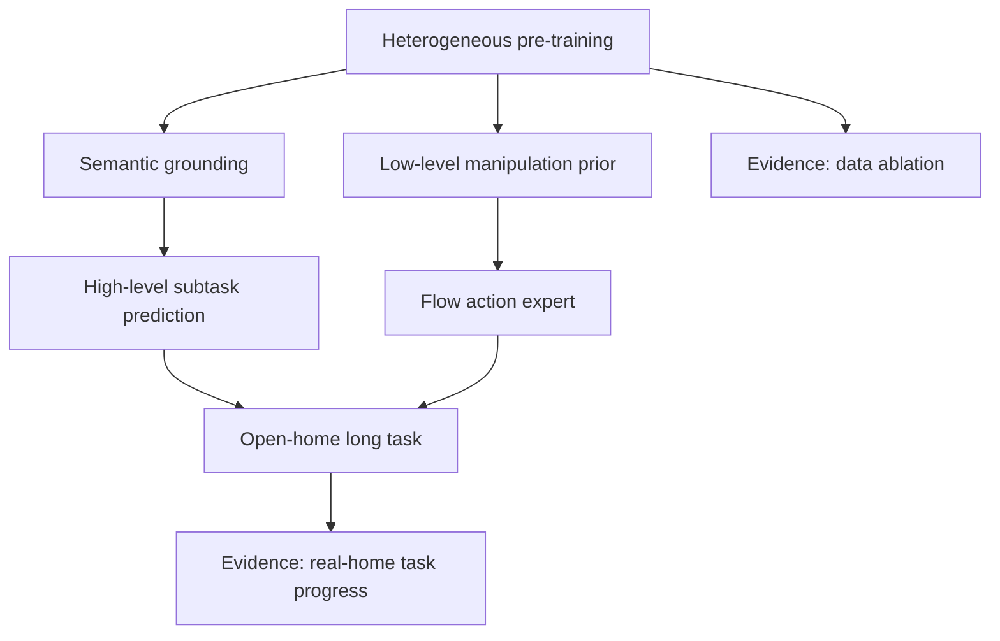

| 论文结论 | 证据来源 | 证据等级 | 可外推到世界模型高效训练 | 不能直接外推 |
| --- | --- | --- | --- | --- |
| 异构数据比单一目标机器人数据更重要 | 数据混合比例、environment scaling、ME/CE/WD 消融 | Ablation + Benchmark | 世界模型 episode 数据也应按语义、动作、失败、环境多样性分层采样 | 不能照搬 π0.5 的数据比例到所有机器人平台 |
| 新家庭长任务需要高层子任务预测 | real-home / mock room 评测、任务进度 rubric、长任务案例 | Closed-loop + Demo | 世界模型要记录 subtask、progress 和失败阶段，而不只是原始视频动作 | 不能证明语言子任务一定是所有长任务的最佳中间表示 |
| FAST + flow matching 是训练效率与控制精度的折中 | 模型结构、pre-training/post-training 设计和动作接口 | Architecture + Ablation | 可借鉴“预训练离散化、部署连续化”的动作接口思路 | 不能说明离散动作 token 在高接触或高频控制中永远稳定 |
| web data 主要补语义和 OOD grounding | WD 消融、语言跟随和 OOD object 评测 | Ablation | 世界模型的开放物体理解不能只靠机器人轨迹，要接 VLM 语义监督 | 不能把 web 语义当作物理可操作性证据 |
| 真实闭环 progress 比 binary success 更有信息量 | mock / real-home 任务进度评分 | Closed-loop metric | 长时世界模型评测应记录阶段性进展、接管和恢复，而不是只记成功/失败 | 不同任务 rubric 难直接横向比较，需要固定任务族 |

对世界模型高效训练来说，π0.5 提醒的是数据账：如果 episode 只记录动作和画面，模型很难知道失败是语义目标选错、物体 grounding 错、动作 chunk 偏，还是底层控制器没跟上。它的证据最适合外推到“episode schema 和数据分层”，而不是直接外推到“某个 VLA 架构一定最优”。

## 论文位置

很多 VLA 论文把问题写成：

\[
\pi_\theta(a_{t:t+H}\mid o_t,\ell)
\]

也就是给定视觉观测 \(o_t\) 和语言指令 \(\ell\)，输出一个动作块 \(a_{t:t+H}\)。这条路线能做拾取、放置、开抽屉、叠衣服等技能，但常见评测仍然贴近训练场景：相似桌面、相似机器人、相似物体、相似指令。

π0.5 把问题改成更接近真实家庭服务：

```text
new home + new objects + high-level prompt
  -> infer semantic subtask
  -> generate low-level action chunk
  -> repeat for 2-15 minutes
```

它关心的不只是“看懂并动作”，而是模型能否在新厨房、新卧室、新物体组合下，自行拆解任务，例如从 `clean the bedroom` 推出 `pick up the pillow`、`put clothes in the laundry basket`、`straighten the blanket`。

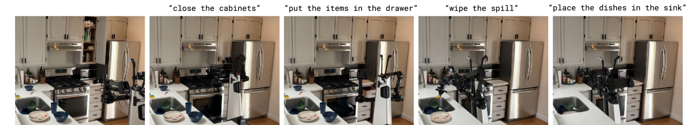{ width="920" }

<small>图源：`π0.5: a Vision-Language-Action Model with Open-World Generalization`，Figure 2。原论文图意：π0.5 在训练集外的新厨房中执行高层清理任务，通过预测子任务和低层动作完成关柜门、放物品、擦拭和把餐具放进水槽等阶段。</small>

!!! note "这张图怎么读"
    这不是单个 primitive skill 的展示，而是一个长链路任务切片。VLA 需要同时解决语义层和控制层：语义层知道现在该处理哪个对象、放到哪里；控制层把这个子任务变成连续机械臂和移动底盘动作。π0.5 的设计就是把这两层放进同一个模型，但用不同输出路径处理。

## 核心问题：为什么只扩机器人数据不够

论文的判断很直接：开放家庭环境的组合空间太大，靠目标机器人在目标任务上收集覆盖所有厨房、卧室、抽屉、餐具、衣物、床品和异常布局的数据并不现实。真实泛化需要转移多种知识：

| Knowledge source | What it contributes |
| --- | --- |
| Mobile manipulator data | 目标机器人在家庭环境中的真实动作闭环经验 |
| Non-mobile robot data | 更多物体、场景和接触行为，帮助低层动作泛化 |
| Cross-embodiment robot data | 从其他机器人和实验室技能转移操作先验 |
| High-level subtask prediction | 学会从场景和任务中推断下一步语义动作 |
| Verbal instruction | 人类像教新员工一样逐步告诉机器人该做什么 |
| Web multimodal data | 物体语义、图像问答、caption、object localization 等开放世界知识 |

论文里一个关键数字是：第一阶段训练中，π0.5 的训练样本有 `97.6%` 并不是目标移动操作机器人在家庭任务上的动作数据，而是来自其他机器人或 web 等其他来源。换句话说，π0.5 的主张不是“只要 target-domain data 更多”，而是 **VLA 要像 VLM 一样吃异构数据，再把这些知识迁移到动作控制里**。

## 总体方案

π0.5 的训练和推理可以压缩成两阶段：

```text
Stage 1: pre-training
  heterogeneous data -> discrete next-token prediction
  text / object locations / FAST action tokens

Stage 2: post-training
  mobile manipulation specialization
  high-level subtask prediction + flow-matching action expert

Inference
  high-level prompt -> subtask text -> 50-step continuous action chunk
```

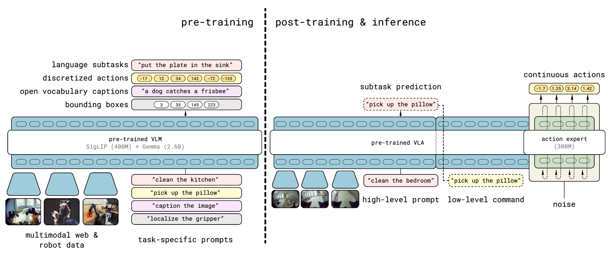{ width="920" }

<small>图源：`π0.5`，Figure 3。原论文图意：左侧 pre-training 用离散 token 统一语言子任务、FAST 动作 token、caption、bounding boxes 和 web/robot 输入；右侧 post-training 与 inference 使用同一 VLA 先输出 high-level subtask，再由 300M action expert 生成连续动作。</small>

!!! note "图解：为什么先离散、再连续"
    FAST 动作 token 让机器人动作在预训练阶段变成类似文本的离散 next-token prediction，训练简单、可扩展、能和 web/VLM 任务混在一起。但真实机器人执行需要连续、细粒度、实时动作，所以 post-training 又引入 flow matching action expert。π0.5 的关键折中是：用离散 token 获得大规模训练效率，再用连续 action expert 恢复控制精度。

## 模型结构

论文把 π0.5 表述成一个既能输出文本、也能输出连续动作的 Transformer VLA。输入包含多视角图像、机器人 proprioceptive state、任务 prompt；输出可以是文本 token、bounding box token、FAST 动作 token，或者 flow matching 的连续 action token。

模型分布可理解为：

\[
p_\theta(\hat \ell, a_{t:t+H}\mid o_t,\ell)
=
p_\theta(\hat \ell\mid o_t,\ell)\,
p_\theta(a_{t:t+H}\mid o_t,\hat\ell)
\]

其中 \(\ell\) 是用户给的高层任务，例如 `clean the kitchen`；\(\hat \ell\) 是模型生成的子任务，例如 `pick up the plate`；\(a_{t:t+H}\) 是低层动作块。

| Component | Role |
| --- | --- |
| Pre-trained VLM | 继承视觉语言知识，作为统一 Transformer 主干 |
| Vision encoder | 编码多视角图像 patch |
| Text tokenizer / head | 输入任务 prompt，输出 caption、QA、subtask、bounding box 等离散 token |
| FAST action tokenizer | pre-training 阶段把动作块压缩成离散 token |
| Action expert (300M) | post-training / inference 阶段用 flow matching 生成连续动作 |
| Attention mask | 控制图像、文本、连续动作 token 的可见性，避免不同 action representation 互相泄漏 |

低层输出不是一步动作，而是 `50-step (1-second)` action chunk。博客和论文都强调：π0.5 先自回归输出高层子任务文本，再用 `10 denoising steps` 的 flow matching 产生连续动作块。这让模型既能以语言形式“告诉自己下一步做什么”，又能以连续控制形式驱动机器人。

## 训练目标：离散 CE 和连续 flow matching 合在一起

论文的训练目标把离散 token loss 和连续动作 flow loss 组合起来：

\[
\mathcal{L}
=
\mathcal{L}_{CE}
+\lambda \mathcal{L}_{FM}
\]

这里 \(\mathcal{L}_{CE}\) 负责文本 token、object location token、FAST action token 等自回归 next-token prediction；\(\mathcal{L}_{FM}\) 负责 action expert 的连续动作向量场预测。

这背后有一个重要工程判断：

| Training choice | Why it matters |
| --- | --- |
| FAST tokens during pre-training | 把动作变成离散序列，便于和 VLM / web / object localization 数据统一训练 |
| Flow matching during post-training | 生成连续动作，适合实时控制和细粒度接触动作 |
| Separate action expert | 让连续动作生成使用较小专家权重，不必让整个 VLM 主干承担高频控制输出 |
| Hybrid loss | 保留语言/视觉语义能力，同时让动作输出能落到真实控制接口 |

如果只用离散动作 token，推理会有自回归解码成本和控制精度问题；如果从头只用 flow matching，训练效率和异构数据混训会更难。π0.5 的训练路线把二者分开：先用 FAST 把大规模混训跑起来，再用 flow matching 专门适配实时机器人控制。

## 数据混合：哪些数据进 pre-training，哪些进 post-training

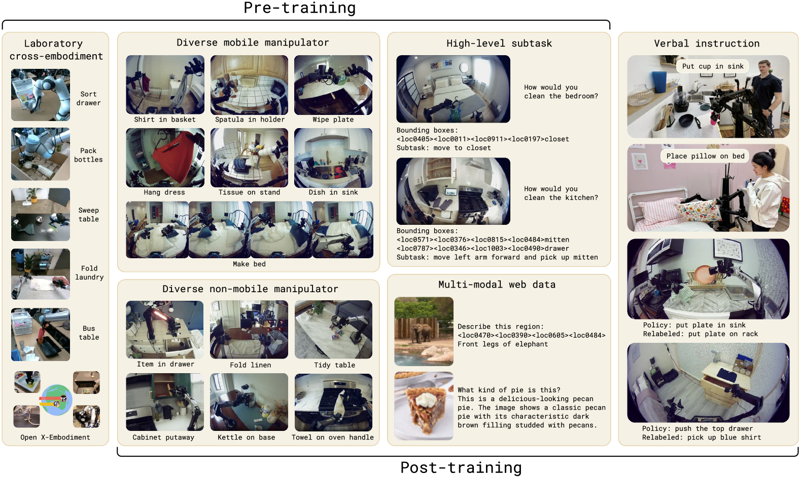{ width="920" }

<small>图源：`π0.5`，Figure 4。原论文图意：π0.5 pre-training 使用 MM、ME、CE、HL、WD 等数据；post-training 加入 VI，并移除实验室 cross-embodiment CE，使模型更聚焦移动操作和多环境泛化。</small>

论文使用的缩写很重要，最好直接按原英文记：

| Abbrev. | Original meaning | Used in pre-training | Used in post-training | Main effect |
| --- | --- | --- | --- | --- |
| MM | Diverse Mobile Manipulator data | Yes | Yes | 目标机器人家庭操作经验，约 400 hours |
| ME | Diverse non-mobile manipulator data | Yes | Yes | 多环境、非移动机器人操作经验 |
| CE | Laboratory cross-embodiment data | Yes | No | 从 π0 / Open X-Embodiment 等跨机器人数据迁移低层技能 |
| HL | High-level subtask prediction | Yes | Yes | 训练模型从观测和任务推断下一步语义动作 |
| WD | Multi-modal web data | Yes | Yes | caption、QA、object localization，提供物体和场景语义知识 |
| VI | Verbal instruction | No | Yes | 人类逐步 coach 机器人完成复杂任务 |

这里的 post-training 不是简单“继续训练一下”。它改变了训练重心：加入 verbal instruction，移除实验室 CE，强调移动操作、多环境和高层子任务推断，最终让模型在新家庭中运行。

## 机器人硬件和观测动作接口

π0.5 在双臂移动操作平台上评测。论文 Figure 5 展示了输入和动作维度的工程接口：4 路图像，前后相机、腕部相机，双 6-DoF 机械臂、夹爪、lift mechanism 和 holonomic base。

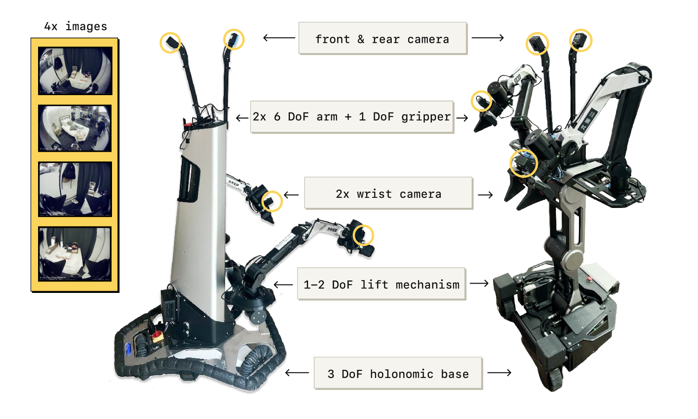{ width="920" }

<small>图源：`π0.5`，Figure 5。原论文图意：评测机器人包含 4 路图像输入、前后相机、2 个腕部相机、双臂、夹爪、升降机构和全向移动底盘。</small>

这个接口决定了 π0.5 不是一个“桌面单臂拾取”模型。它必须同时处理移动底盘、双臂、夹爪、升降和多视角观测。因此 1 秒 action chunk 很关键：模型输出一段动作，而不是每个控制周期重新做完整语言-视觉推理；底层控制器再负责把目标动作执行到硬件。

## 评测设计：新家庭，而不是同分布桌面

论文把评测放在训练集外的新厨房和新卧室中，包括 mock rooms 和 real homes。mock rooms 用来做可重复定量比较，real homes 用来证明真实部署泛化。

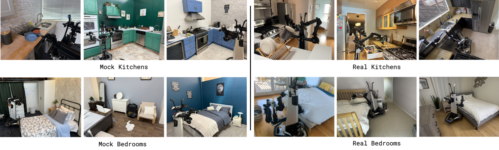{ width="920" }

<small>图源：`π0.5`，Figure 6。原论文图意：左侧是 mock kitchens / bedrooms，右侧是真实 kitchens / bedrooms，均不在训练数据中，用于测试 novel objects、backgrounds 和 layouts。</small>

评测任务并不只看 binary success，而是按任务进度给分。论文附录的 rubric 可以整理成英文表：

| Task | Scoring rubric | Maximum score |
| --- | --- | ---: |
| Dishes in Sink | +1 for each item picked up; +1 for each item placed in the sink | 8 |
| Items in Drawer | +1 picking up the object; +1 opening the drawer; +1 putting the object into the drawer; +1 closing the drawer | 4 |
| Laundry in Basket | +1 navigating to and picking up the clothing; +1 placing clothing into/on basket; +1 clothing fully inside the basket | 3 |
| Make the Bed | +1 straightening blanket; +1 placing one pillow; +1 placing second pillow; +1 blanket very neat; +1 both pillows very neat | 5 |

这个 rubric 比单纯成功率更适合长任务。长任务里模型可能完成 70% 的步骤后失败，binary success 会丢掉很多信息；task progress 可以更细地观察失败发生在哪一段。

### 主要结果

π0.5 在三个训练集外真实家庭中完成 kitchen / bedroom 任务。论文报告每个 policy 约在四个地点、每任务多次 trial 中 interleave 执行，以减少环境变化对比较的影响。

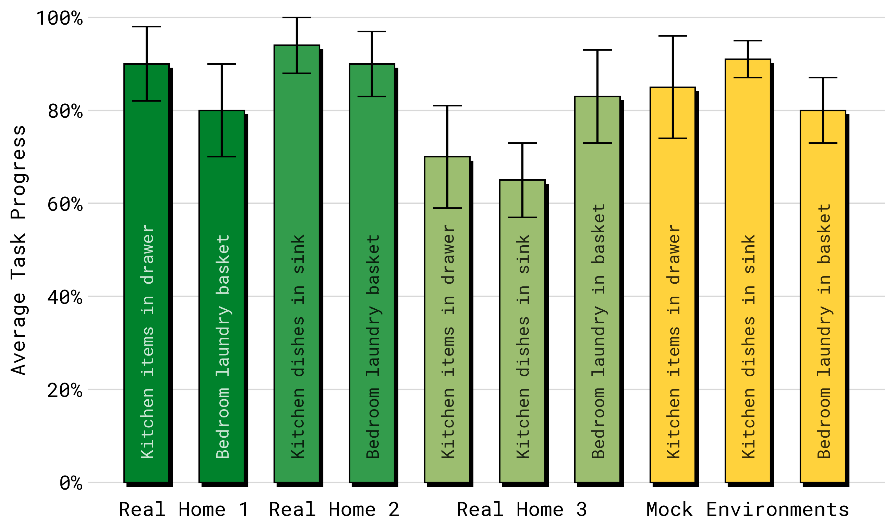{ width="920" }

<small>图源：`π0.5`，Figure 7(b)。原论文图意：在三个真实家庭和 mock environments 中，π0.5 在 items in drawer、dishes in sink、laundry basket 等任务上取得较高 task progress，说明 mock 评测和 real-home 评测具有一定一致性。</small>

论文强调这些任务常常持续 `2 to 5 minutes`，而 Figure 1 / abstract 还展示了 `10 to 15 minutes` 的厨房或卧室清理长行为。这和很多 VLA 论文里的 10-60 秒桌面操作不是一个难度层级：模型要持续闭环、选择下一步对象、处理移动底盘和场景遮挡。

### 泛化如何随环境数增长

论文训练不同版本，只改变 mobile manipulation data 中的环境数量，并测试 unseen environments。核心结论是：环境数量增加会提高泛化，但**有预训练和无预训练差距巨大**。

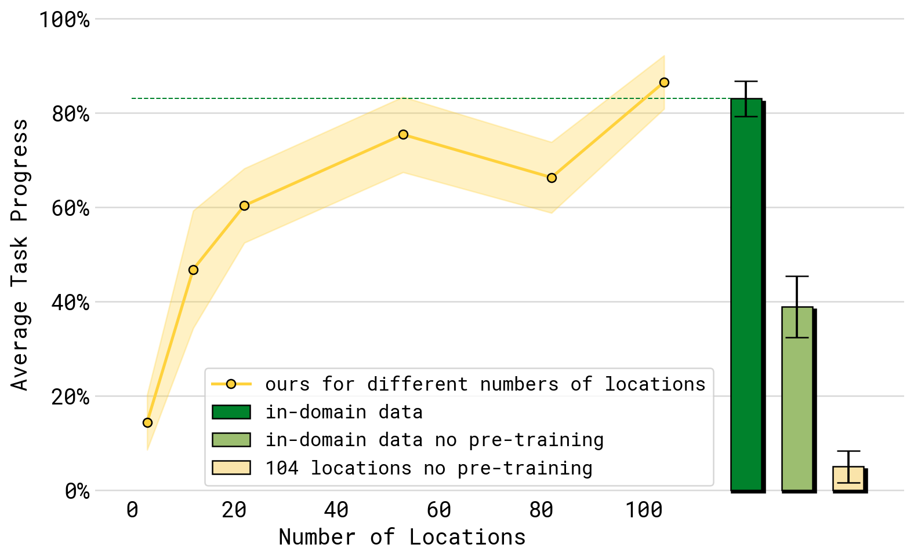{ width="920" }

<small>图源：`π0.5`，Figure 9。原论文图意：随着训练环境数增加，unseen environment 的 average task progress 上升；但只用 in-domain data 且无 pre-training 的模型明显较弱，即使有 104 locations 也远低于完整 π0.5 recipe。</small>

这张图支撑一个很重要的工程判断：不是“收更多目标场景数据”没用，而是 **目标场景数据必须和大规模异构预训练结合**。否则模型可能学会某些房间和物体的局部模式，却难以获得足够的语义和跨机器人迁移能力。

### 数据消融：ME、CE、WD 分别贡献什么

论文最有价值的实验证据之一，是把训练混合中的不同数据源拿掉：

| Ablation | Removed data | Interpretation |
| --- | --- | --- |
| no WD | removes multi-modal web data | 测 web 语义知识对物体/场景理解的贡献 |
| no CE | removes laboratory cross-embodiment data | 测跨机器人实验室技能数据对低层动作的贡献 |
| no ME | removes diverse non-mobile manipulator data | 测多环境非移动机器人数据对泛化的贡献 |
| no CE or ME | removes both cross-embodiment robot sources | 测只靠目标移动操作数据时的上限 |

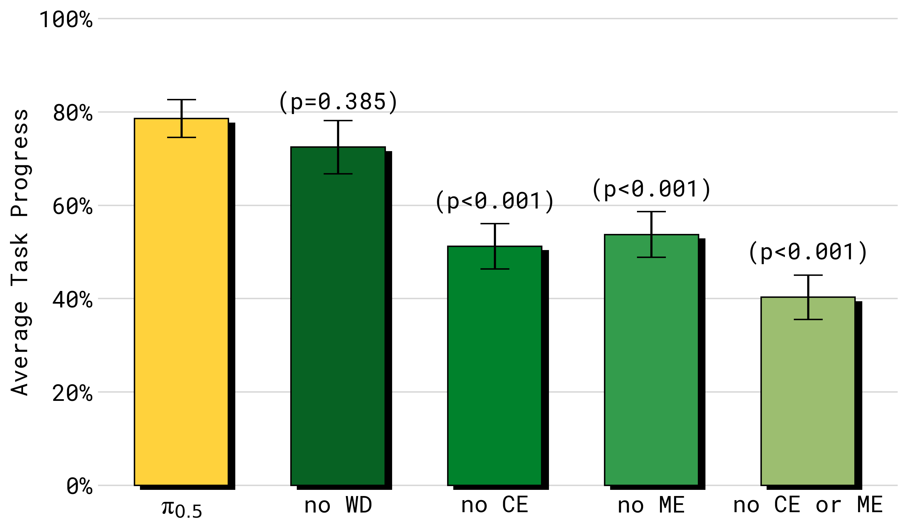{ width="920" }

<small>图源：`π0.5`，Figure 10。原论文图意：去掉 CE、ME 或二者都会显著降低 average task progress；去掉 WD 对总体任务进度影响较小，但在语言和 OOD object 评测中更关键。</small>

对语言跟随和 OOD 物体，WD 的作用更明显。论文专门设计了 in-distribution objects 和 out-of-distribution objects 的语言跟随实验：每次给 5 个物体，目标物体放得更远，避免模型靠近物体 shortcut。

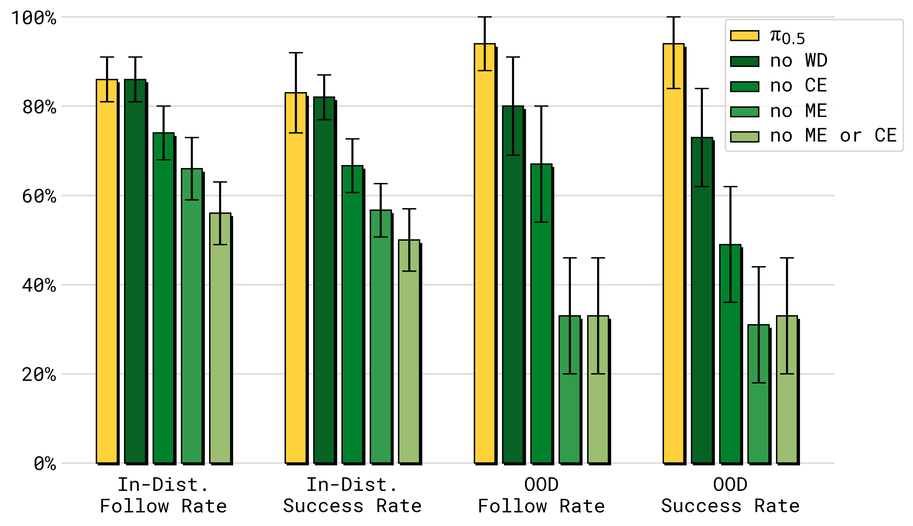{ width="920" }

<small>图源：`π0.5`，Figure 11。原论文图意：在语言跟随和任务成功率上，去掉 ME/CE 明显降低性能；去掉 WD 对 OOD object 的 follow rate / success rate 影响尤其明显，说明 web data 带来的开放物体知识主要帮助高层语义和语言 grounding。</small>

这组消融把不同数据源的分工讲清楚了：

1. ME / CE 更像低层行为和跨场景操作技能迁移；
2. WD 更像开放世界物体语义和语言 grounding；
3. HL / VI 更像高层任务分解和“人类教机器人怎么做”的监督。

### 和 π0 / π0-FAST+Flow 的对比

论文比较了三类模型：

| Model | Training recipe | High-level inference | Action representation |
| --- | --- | --- | --- |
| π0 | 原始 π0 VLA | No explicit π0.5-style HL | Flow matching action expert |
| π0-FAST+Flow | hybrid FAST + flow, action data only | No HL / WD | FAST + flow |
| π0.5 | heterogeneous co-training + hybrid training | Yes | FAST pre-training + flow post-training |

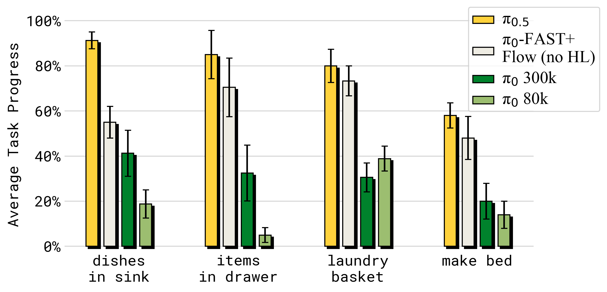{ width="920" }

<small>图源：`π0.5`，Figure 12。原论文图意：π0.5 在 mock home test environments 中显著优于 π0 和 π0-FAST+Flow；即使 π0 训练到 300k steps，仍明显落后，说明异构 co-training 和高层监督不是普通动作数据训练步数可以轻易替代的。</small>

这里要避免一个误读：π0.5 的提升不是单一来自 action expert，也不是单一来自 FAST。π0-FAST+Flow 已经接近 π0.5 的动作表示路线，但没有 HL 和 WD 数据，仍明显落后。论文想说明的是：**模型结构和数据配方必须一起看**。

### 高层推理到底有多重要

π0.5 的推理像一种具身版 chain-of-thought：先生成一个可读的 high-level subtask，再把这个 subtask 作为低层动作条件。论文比较了 no WD、no VI、implicit HL、no HL、GPT-4 HL 和 human HL 等 baseline。

{ width="920" }

<small>图源：`π0.5`，Figure 13。原论文图意：完整 π0.5 的 high-level + low-level inference 最好；implicit HL 也较强，说明训练中包含 HL 数据本身已经有显著帮助；去掉 VI 或 WD 会降低表现；zero-shot GPT-4 high-level policy 表现较弱。</small>

这张图有两个很值得注意的结论。

第一，explicit high-level inference 有用，但不是全部收益来源。`implicit HL` 不在 runtime 输出子任务，却在训练中看过高层子任务数据，因此仍然很强。也就是说，HL 数据不仅提供可解释中间文本，还在训练中塑造了模型的任务结构理解。

第二，GPT-4 作为 zero-shot high-level policy 表现较弱。原因不是 GPT-4 语言能力不够，而是它没有被机器人数据和该任务标签空间适配。对 VLA 来说，“会写步骤”不等于“知道当前机器人、当前相机、当前场景下应该发哪个可执行子任务”。

### 这篇论文的训练细节要点

| Detail | π0.5 choice | Why it matters |
| --- | --- | --- |
| Target mobile manipulation data | about 400 hours | 目标域数据不大，关键在异构迁移 |
| Non-target data ratio | 97.6% in first training phase is not target mobile-manipulator household data | 证明 recipe 依赖跨来源知识，而不是只靠 target-domain collection |
| Pre-training objective | autoregressive next-token prediction | 统一 text、object locations、FAST action tokens |
| Pre-training action format | FAST encoded action tokens | 比连续 diffusion/flow 更适合大规模离散序列训练 |
| Post-training action format | flow matching action expert | 输出细粒度连续动作，适合实时控制 |
| Inference denoising | 10 denoising steps | 在实时控制中折中质量和延迟 |
| Action chunk | 50-step / 1-second continuous action chunk | 降低高层推理频率，让低层动作更平滑 |
| High-level supervision | HL + VI | 学会把长任务拆成可执行语义子任务 |
| Evaluation scenes | unseen kitchens and bedrooms | 直接测开放环境泛化，而不是同分布复现 |

如果要复现或借鉴，这些细节比最终分数更重要。π0.5 不是单纯把 VLM fine-tune 成 policy，而是把训练接口设计成“异构数据都能变成同一序列建模问题”，再在 post-training 阶段把动作接口换回机器人真正需要的连续控制。

### 局限

π0.5 的结果很强，但论文自己的讨论也很克制。

1. 仍会犯错。失败包括陌生把手、难开的柜门、机械臂遮挡 spill、以及高层子任务反复分心。
2. Prompt 复杂度有限。模型主要处理相对简单的高层提示，更复杂偏好和多约束任务需要更多标注或合成数据。
3. 上下文和记忆有限。论文指出当前 context 较 modest，跨房间、记住物品存放位置、处理长期部分可观测任务还不够。
4. 数据源组合还只是一个起点。ME、CE、WD、HL、VI 有效，但并不代表这是最优数据配方。
5. 评测仍以家庭清理任务为主。它证明了新家庭泛化，但不能直接外推到医疗、仓储、户外、工具使用或高风险场景。

### 工程启发

对 VLA 系统设计来说，π0.5 给出几条很实际的经验：

1. 不要把 open-world generalization 简化成“收更多同款机器人数据”。目标机器人数据很贵，而且覆盖不了真实世界组合。
2. VLA 的数据接口要足够通用。只支持动作 imitation 的 policy 很难吸收 web、object detection、QA、caption、verbal instruction 这类知识。
3. 长任务需要显式或隐式的高层语义监督。只输出低层动作会把任务分解压力全部压到 action head 上。
4. 动作表示可以分阶段。训练阶段用离散 token 提升规模和混训效率，部署阶段用 continuous flow matching 提升控制质量。
5. 评测要离开训练环境。没有 unseen homes、novel objects 和 long-horizon rubrics，就很难判断模型是否真的具备开放世界泛化。

### 结论

π0.5 最值得记住的一句话是：**VLA 的泛化来自数据源之间的知识转移，而不是某一种数据或某一个 policy head 的单点胜利。**

它把 VLM 式 web 语义、跨机器人操作数据、目标移动操作数据、高层子任务标签和人类 verbal instruction 组织成统一训练配方；再通过 FAST token 和 flow matching action expert，把“可扩展训练”和“连续实时控制”衔接起来。对后续 VLA 研究来说，这篇论文的价值在于把 open-world generalization 具体化为数据配方、训练阶段、动作接口和真实新家庭评测，而不是停留在泛化口号上。

### 参考链接

1. 论文 PDF：[π0.5: a Vision-Language-Action Model with Open-World Generalization](https://www.pi.website/download/pi05.pdf).
2. arXiv：[arXiv:2504.16054](https://arxiv.org/abs/2504.16054).
3. 论文 HTML 与原图：[ar5iv:2504.16054](https://ar5iv.labs.arxiv.org/html/2504.16054).
4. 官方博客：[π0.5: a VLA with Open-World Generalization](https://www.pi.website/blog/pi05).
5. 官方代码：[Physical-Intelligence/openpi](https://github.com/Physical-Intelligence/openpi).
