# π0.5：开放世界 VLA

!!! info "论文信息"
    **论文题名：** $\pi_{0.5}$: a Vision-Language-Action Model with Open-World Generalization。 
    **作者：** Physical Intelligence、Kevin Black、Noah Brown、James Darpinian、Karan Dhabalia、Danny Driess、Adnan Esmail、Michael Equi、Chelsea Finn、Niccolo Fusai 等（共 36 人）。 
    **机构：** Suraj Nair, Karl Pertsch, Allen Z. Ren, Lucy Xiaoyang Shi, Laura Smith, Jost Tobias Springenberg, Kyle Stachowicz。 
    **时间 / 主题：** 2025-04；具身智能 / VLA。 
    **arXiv / 官方报告：** arXiv：[2504.16054](https://arxiv.org/abs/2504.16054)；官方材料：[www.pi.website/download/pi05.pdf](https://www.pi.website/download/pi05.pdf)。 
    **GitHub / 项目：** GitHub：[github.com/Physical-Intelligence/openpi](https://github.com/Physical-Intelligence/openpi)；项目页：[www.pi.website/download/pi05.pdf](https://www.pi.website/download/pi05.pdf)。 
    **元数据来源与核验口径：** 来源：[arXiv](https://arxiv.org/abs/2504.16054)；[GitHub API / repo](https://github.com/Physical-Intelligence/openpi)；[官方 / 项目材料](https://www.pi.website/download/pi05.pdf)；Checked Date：2026-06-04；Repro Status：Paper / official materials reviewed, independent reproduction not claimed。

## 陌生家庭中的泛化，为什么需要几种不同的经验

π0.5 证明了一种具体的泛化能力：同一个经过训练的 VLA，可以到训练中没有出现过的家庭，执行收纳餐具、整理衣物和铺床等多阶段操作。它的主要贡献是一套知识迁移与训练配方，把其他机器人上的动作经验、不同家庭的视觉变化、web 中的物体概念，以及人类对子任务的选择，共同接到一个能够输出语言和动作的模型上。

这项工作的难点可以从一个厨房理解。机器人需要认出柜台上的餐具，判断哪一件应该先拿、是否需要开抽屉，再根据新厨房的高度、把手形状和物体位置执行动作。识别“哪个是漏斗”、决定“现在先打开抽屉”、控制“手臂怎样拉开它”，分别依赖语义、任务阶段和物理操作经验。只增加某一类训练数据，未必同时补上这三种能力。

Figure 2 将这种组合放进一个实际场景。图上方的四条文本分别是人类给出的高层任务，先看每条命令下面的机器人行为，再区分命令内部由模型自行选择的子步骤。

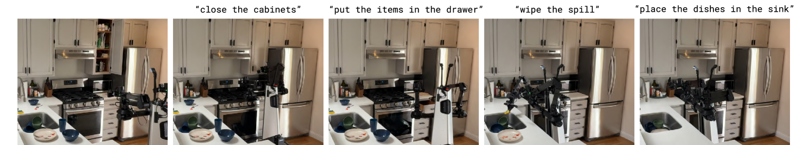{ width="920" }

*Figure 2，新厨房中的任务示例。*

“把餐具放进水槽”可以继续分解为拿盘子、移向水槽、放下，再处理下一个物体；“把物品放进抽屉”还需要判断何时开关抽屉。图中的关柜门、收纳、擦拭和清理餐具，是几条高层命令下的展示，不能把它们当作一次完全不分任务的家庭服务评测。[↗](https://arxiv.org/pdf/2504.16054v1#page=2)

论文的目标移动机器人数据约为 **400 小时、约 100 个家庭环境**，而第一阶段 **97.6% 的训练样本来自其他来源**。这个比例按训练样本计，不是说 97.6% 的数据都是网页，也不是按机器人小时计算。其他来源同时包括固定机械臂、实验室多机器人、语言子任务和视觉语言任务。于是问题变成了，怎样让这些并不具有同一输入输出格式的数据，改善目标机器人在新家庭中的实际行为。

这里的“开放世界”也有具体实验含义。四项定量任务本身出现在训练数据中，留出的是房间、布局、物体实例及部分物体类别。论文展示了约 10–15 分钟的长行为，而真实家庭定量试验中的多阶段任务通常持续约 2–5 分钟。两种证据共同说明可行性，但持续时间与评分口径不能互换。[↗](https://arxiv.org/pdf/2504.16054v1#page=8) [↗](https://arxiv.org/pdf/2504.16054v1#page=17)

## 同一个模型，先决定子任务，再生成动作

### 条件分解给不同来源的知识一个共同接口

普通动作模仿直接学习给定观测与指令后的动作分布。π0.5 在中间加入一个可解释、可监督的语言变量，表示当前应该执行的子任务。

令 $o_t=[I_t^1,\ldots,I_t^n,q_t]$ 为当前观测，包含多个相机图像和机器人本体状态；$\ell$ 是总体指令，例如“把餐具收好”；$\hat\ell$ 是模型选择的子任务，例如“拿起盘子”；$a_{t:t+H}$ 是接下来一段动作。模型采用以下分解。

$$
\pi_\theta(a_{t:t+H},\hat\ell\mid o_t,\ell)
=\pi_\theta(a_{t:t+H}\mid o_t,\hat\ell)
\pi_\theta(\hat\ell\mid o_t,\ell).
$$

右侧第二项回答“在这个场景、这个总目标下，接下来做什么”；第一项回答“怎样把选中的子任务变成运动”。低层分布直接条件于 $\hat\ell$，不再同时条件于原始长任务 $\ell$。因此，动作学习可以集中在语义较明确的局部目标上，而选择顺序、对象和阶段的负担进入高层预测。[↗](https://arxiv.org/pdf/2504.16054v1#page=5)

两项分布由同一套模型表示，但运行时仍是不同推理过程。高层生成文本，低层生成动作块；高层更新频率低于低层动作推理频率。它没有在任务开始时一次写好整条不可修改的计划，也没有让语言模型直接输出 PD 控制器的每一个反馈量。每次高层决策仍结合当时观测，选择接下来适合执行的行为。

这种接口同时解释了非动作数据怎样参与训练。图像问答可以改善“当前看到什么”的表示；子任务标签可以监督“现在该做什么”；机器人示范则监督“执行这个子任务时怎样运动”。它们不必都包含机器人关节值，只需能形成模型可学习的输入与目标序列。

### Figure 3 的两个阶段，分别解决表示与执行问题

先看 Figure 3 左侧的输出类型，再看右侧新增的 action expert。图中语言子任务、物体框和离散动作共享 token 预测接口，连续动作则在后训练时接入另一组专家参数。

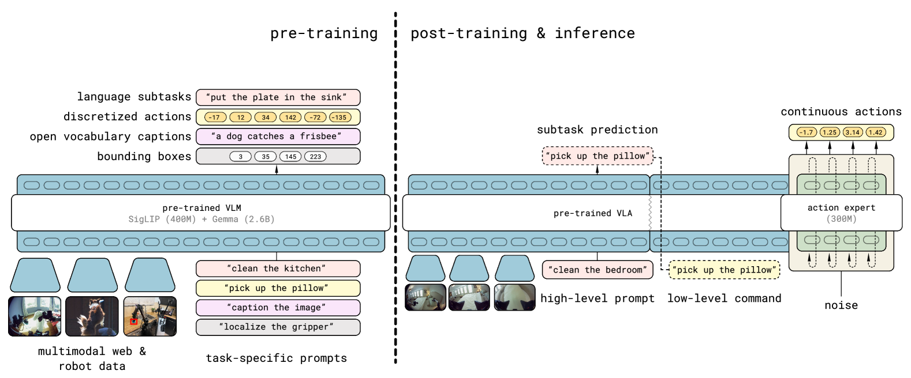{ width="920" }

*Figure 3，离散 token 预训练与连续动作后训练。*

主干由 PaliGemma 视觉语言模型初始化，包括 SigLIP 视觉编码器与 Gemma 语言主干。图像先转为 patch 表示，语言进入文本 embedding，本体状态也离散化后作为文本 token 输入。FAST 将动作块压缩成离散 token，使第一阶段能使用标准 next-token prediction。这里统一的是序列学习接口，图像 patch 并没有因此变成普通词汇表中的离散词。[↗](https://arxiv.org/pdf/2504.16054v1#page=4)

后训练再加入约 **300M 参数的 action expert**。它与语言主干有独立的 Transformer 权重，输入是带噪动作块，输出用于连续动作生成的向量场。它也不是从一个动作专家池中按 token 路由的普通稀疏 MoE；这里的“expert”主要指不同模态的 token 使用不同参数处理，再通过 attention 与主干信息交互。

附录 E 给出的主要结构参数如下。两组 Transformer 深度相同，动作分支缩小了 hidden width 和 MLP width，因此连续动作迭代不需要为每个动作位置使用完整语言主干规模的参数。

| Configuration | VLM Transformer | Action Expert |
| --- | ---: | ---: |
| Width | 2048 | 1024 |
| Depth | 18 | 18 |
| MLP dimension | 16,384 | 4096 |
| Initialization | PaliGemma weights | Random at post-training |
| Main output | Text / FAST token logits | Continuous flow vector field |

这些设计延续了 π0 的视觉语言骨干与连续动作专家，但改变了动作专家何时加入训练，以及不同任务怎样共同监督模型。[↗](https://arxiv.org/pdf/2504.16054v1#page=19)

### 两种动作答案同时存在，怎样防止模型互相抄答案

后训练样本中既有 FAST 编码的动作，又有连续动作的训练目标。若连续分支能直接读到 FAST 动作，模型可能绕过图像与指令，直接利用另一种表示中的答案；部署时没有这份答案，能力就不成立。Figure 18 的 attention mask 专门处理这一点。

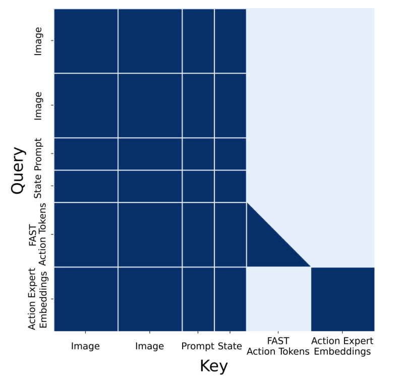{ width="720" }

*Figure 18，深色区域表示允许关注，行是 Query，列是 Key。*

左上角的图像、prompt 与 state 构成共享前缀，内部允许双向 attention。FAST 动作 token 可以读取这个前缀，但在动作序列内部采用因果 mask，只读取此前的动作 token。右下角 action expert 的 token 可以读取前缀，也能在动作块内部互相 attention；它们与 FAST 动作之间的区域是关闭的。前缀同样不反过来读取 action expert。[↗](https://arxiv.org/pdf/2504.16054v1#page=19)

所以，两条动作路径分享的是对观测和指令的理解，学习的是同一条示范动作，但不能读取对方已经编码的目标。连续动作块内部开放 attention，则允许未来多个动作位置共同建模，而不必像 FAST token 那样逐个生成。这种前向信息流限制也不等于“VLM 冻结”或“动作损失被 stop-gradient”；论文没有用这个 mask 定义这样的梯度约束。

## 离散动作负责高效学习，连续动作负责快速执行

### 为什么不从训练到部署始终使用一种动作表示

FAST 的价值在于动作压缩与统一训练。动作块经过编码后形成离散 token，与语言、定位框等输出共享交叉熵目标，能使用成熟的 Transformer 训练流程。它避免了每个预训练步骤都必须加入连续动作去噪专家。

但部署有另一种成本。自回归动作生成需要先得到前一个 token，才能生成下一个 token；即使 token 已经被压缩，生成整块动作仍然需要串行解码。连续 flow matching 则在每轮迭代中同时更新整块动作，适合需要及时发出一串细粒度控制目标的机器人。π0.5 因此将“训练时怎样表示动作”和“推理时怎样生成动作”分开设计。[↗](https://arxiv.org/pdf/2504.16054v1#page=5)

它并没有把 FAST 完成后简单当作一种外部数据预处理，再训练一个完全独立的控制模型。后训练仍保留 token 目标，同时引入连续分支，使已有语言与动作表示继续为新专家提供条件。

### 联合目标中的两项各在学习什么

设真实动作块为 $a_{t:t+H}$，同形状高斯噪声为 $\omega\sim\mathcal N(0,I)$，flow 时间为 $\tau\in[0,1]$。原文先构造带噪动作。

$$
a_{t:t+H}^{\tau,\omega}
=\tau a_{t:t+H}+(1-\tau)\omega.
$$

$\tau$ 接近 0 时，动作输入主要是噪声；接近 1 时，输入接近示范。动作专家需要从不同噪声程度的输入、视觉与语言条件中学习对应向量场。联合目标保留原文式（1）。

$$
\mathbb E_{\mathcal D,\tau,\omega}\left[
\mathcal H\!\left(x_{1:M},f_\theta^\ell(o_t,\ell)\right)
+\alpha\left\|
\omega-a_{t:t+H}
-f_\theta^a\!\left(a_{t:t+H}^{\tau,\omega},o_t,\ell\right)
\right\|^2
\right].
$$

$\mathcal H$ 是目标 token 与预测 logits 的交叉熵，目标可以是子任务语言、视觉问答、定位 token，或 FAST 编码的动作。$f_\theta^a$ 是动作专家输出，平方误差让它逼近式中给定的 $\omega-a_{t:t+H}$。$\alpha$ 控制连续动作项相对 token 项的权重，不能与动作时间 $\tau$ 混淆。不同任务样本提供不同类型的监督，web 问答并不需要凭空补出机器人动作标签。[↗](https://arxiv.org/pdf/2504.16054v1#page=5)

这里有一个需要对齐的符号约定。按上述插值对 $\tau$ 求导得到 $a_{t:t+H}-\omega$，与原文 loss 中的 $\omega-a_{t:t+H}$ 符号相反。本文沿用论文印出的目标；实现时必须将向量场定义与积分方向配套，不能仅凭插值公式就假定采用从 $\tau=0$ 到 $1$ 的正向 Euler 加法更新。

这个目标与前面的层级分解作用在不同问题上。层级分解决定动作应该条件于哪个语义任务；联合 loss 决定模型如何同时学习离散输出与连续输出。在低层动作样本中，作为语言条件的就是相应子任务；高层样本则学习从总任务与当前观测预测子任务。

两阶段安排把这些选择落实为实际训练过程。

| Stage | Steps | Action representation | Main training behavior |
| --- | ---: | --- | --- |
| Pre-training | 280K | FAST discrete tokens | $\alpha=0$，使用异构数据做 token prediction |
| Post-training | 80K | FAST + continuous flow | 随机初始化 action expert，$\alpha=10$，联合训练并聚焦移动操作 |
| Inference | 每次动作生成 10 个去噪步骤 | Continuous action chunk | 先生成高层文本，再条件于文本生成动作 |

因此，第一阶段并不是动作专家已经训练了 280K steps 后再微调；它是在第二阶段才加入。部署时使用十步动作去噪，也不等于每个控制周期都执行十轮高层语言规划。[↗](https://arxiv.org/pdf/2504.16054v1#page=7)

### Action expert 怎样知道当前噪声程度

附录中还有一个容易漏掉的结构变化。π0 将 flow 时间与带噪动作融合后送入 Transformer；π0.5 则先用线性层投影带噪动作，另用 MLP 编码时间，然后通过每层的 adaptive RMSNorm 注入动作专家。

$$
e_\tau=
\operatorname{swish}\!\left(
W_2\operatorname{swish}(W_1\phi(\tau))
\right).
$$

其中 $\phi$ 是正弦位置编码，$W_1,W_2\in\mathbb R^{w\times w}$。时间 embedding 不仅出现在输入层，而是持续影响各层归一化，使同一组动作特征能够根据“现在还多噪”采用不同处理方式。最后一层线性投影再将 expert token 转回动作空间中的向量场。[↗](https://arxiv.org/pdf/2504.16054v1#page=19)

训练也不均匀采样所有 $\tau$。附录使用偏向较低时间步的分布，原文写作 $p(\tau)=\mathrm{Beta}((s-\tau)/s;1.5,1)$，取 $s=0.999$，排除高于 $s$ 的时间步。在前述插值下，低 $\tau$ 对应更接近噪声的输入，因此学习更关注从高噪声状态恢复动作的阶段。这里的 Beta 参数与联合 loss 权重 $\alpha=10$ 是两个不同用途的参数。

动作块包含 50 个动作，原文用包含端点的 $a_{t:t+H}$ 记法，因此 $H=49$。图像增强依次为宽、高各取原尺寸 95% 的 random crop、恢复尺寸、$\pm5^\circ$ 旋转，以及 brightness 0.3、contrast 0.4、saturation 0.5 的 color jitter。这些处理增加视角和外观变化，但不能取代真实家庭中物体、家具与布局的多样性；后面的场景规模实验正是在检验这部分数据差异。

## 异构数据为什么能够相互补充

Figure 4 应同时看上方 pre-training 的覆盖范围和下方 post-training 的范围。两阶段的数据选择并不相同，右侧 verbal instruction 也不是普通动作示范换了一个名字。

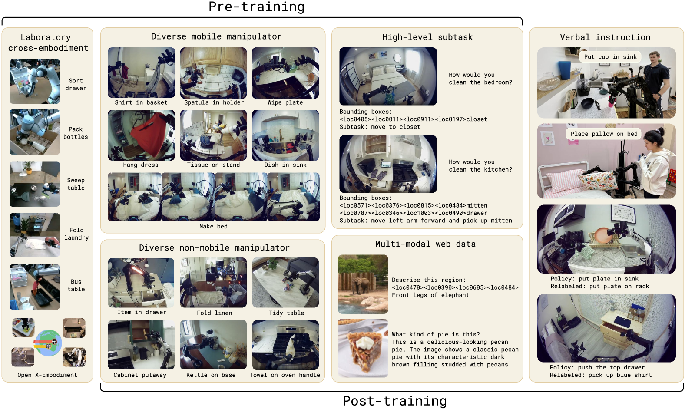{ width="920" }

*Figure 4，不同来源的数据及其监督目标。*

### MM、ME 与 CE 提供不同程度的直接动作经验

**Diverse Mobile Manipulator data（MM）** 是约 400 小时、约 100 个家庭中的目标平台示范。它最直接地教会模型协调双臂、底盘与升降机构，完成衣物、餐具和家具相关任务。新的测试家庭仍有类似任务，所以这些数据承担目标控制行为的基础监督。

**Multi-Environment non-mobile data（ME）** 来自单臂或双臂固定机器人。固定机械臂更轻、更容易搬运，研究团队能够把它带到更广的家庭环境中收集数据。它缺少目标移动底盘的动作，但增加了不同柜台、抽屉、物体与视觉背景下的操作经验。其价值在于更容易扩展场景覆盖，代价是模型必须跨本体迁移。

**Cross-Embodiment laboratory data（CE）** 来自多种机器人、实验室桌面环境与 OXE，扩展了 π0 使用的数据集。它包含与家庭目标直接相关的技能，例如将餐具放入容器，也包含较远的任务，例如磨咖啡豆。CE 未必提供与新家庭相同的背景，却能增加抓取、双手协调、柔性物体等操作模式。[↗](https://arxiv.org/pdf/2504.16054v1#page=6)

这三类数据的差异很有用：MM 提供平台与任务接近性，ME 提供容易扩展的实景覆盖，CE 提供更广的动作和本体覆盖。它们不是按“高质量／低质量”简单排序；是否有帮助，要看目标失败来自场景变化还是动作技能不足。

### 不同机器人动作进入同一模型前，先明确语义

论文的数据同时包含 target joint poses 与 end-effector poses。在 prompt 中加入 control-mode 标识，告诉模型当前是在关节空间还是末端空间输出。否则，即使两个动作向量具有相同长度，其数值也可能代表不同物理量。

每个数据集、每个动作维度分别使用 1% 与 99% 分位数，将动作归一化到 $[-1,1]$；向量再扩展到能够容纳最大动作空间的统一维度，维度较少的平台补零。分位数归一化减少量纲和极端值对训练的干扰，padding 使 tensor 形状兼容，但二者都不会自动让不同平台的第 $i$ 维具有相同意义。平台示范、观测条件与 control-mode 仍然是动作含义的一部分。[↗](https://arxiv.org/pdf/2504.16054v1#page=7)

### HL 监督当前步骤，WD 保留开放物体知识

**High-Level subtask prediction（HL）** 从 MM、ME、CE 中的多阶段轨迹产生。作者人工标注每一段当前执行的语义子任务，例如“调整毯子”“拿起枕头”，也标注观测中相关对象的 bounding boxes。模型先预测相关框，再预测子任务，并在子任务条件下学习动作。

因此，HL 不只是给长轨迹写一个总标题。它使不同时间的视觉状态与任务阶段对应起来，也让“下一步应该涉及哪个物体”得到显式监督。比如总命令一直是“整理卧室”，被子尚未铺好与枕头已经移好时，正确子任务应当不同。

**Multimodal Web Data（WD）** 则包括 CapsFusion、COCO 的 caption，Cambrian-7M、PixMo、VQAv2 的视觉问答，以及物体定位数据；作者额外加入带 bounding boxes 的室内场景与家庭物体数据。WD 不提供接触力或关节轨迹，却能扩大模型对“漏斗”“护目镜”等类别与视觉区域的联系。

同一主干既回答 web 问题，也预测机器人子任务，为这两种知识建立了可迁移的表示。但是否转化成正确动作，仍要经过目标选择和低层执行两个环节。后面的语言实验正好将“选对物体”和“放到正确位置”拆开测量。[↗](https://arxiv.org/pdf/2504.16054v1#page=6)

### VI 学习的是怎样指挥已经训练好的低层策略

后训练将动作数据收缩到 MM 与 ME 中成功、且低于固定长度阈值的轨迹，保留相应 HL 与 WD，移除实验室 CE，再加入 **Verbal Instruction（VI）** 数据。

VI 的采集方式是让熟悉策略的操作者用语言“遥操作”机器人：低层策略根据语言执行，操作者观察当前状态，决定下一条子任务。这与给专家遥操作轨迹补标签不同。离线 HL 描述的是专家示范进行到了哪一步；VI 的高层决策面对的是一个已经训练好、具有实际能力与失败模式的低层策略所到达的状态。

例如 Figure 4 中，原策略提出“把盘子放进水槽”，语言示范将其改为“把盘子放到架子上”；另一处把继续推抽屉改为拿起蓝衬衫。重点在于当前状态下什么命令能让这个策略继续取得进展，而不只是哪个文字计划听起来合理。

VI 仅占移动操作高层样本的约 **11%**，不是全部后训练数据的 11%。移除这部分数据的实验，能够检验少量但贴近部署状态的高层监督是否重要；它并没有将整个训练变成在线强化学习，主体仍是监督学习与 flow matching。[↗](https://arxiv.org/pdf/2504.16054v1#page=7) [↗](https://arxiv.org/pdf/2504.16054v1#page=11)

## 部署时，模型到底控制什么

Figure 5 将两个平台并列。先看双臂和夹爪，再加上底盘与升降机构，就能理解动作空间为何是 18 或 19 维，而不是单臂抓取常见的少数末端参数。

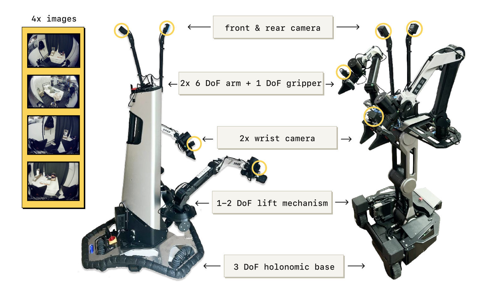{ width="920" }

*Figure 5，双臂移动操作平台与观测接口。*

每个机器人有两只 6-DoF 手臂及各自的一维夹爪，共 14 维；全向底盘使用二维线速度与一维角速度，再加 1–2 维 torso lift，合计 18–19 维。模型控制手臂关节目标、夹爪与升降位置，以及底盘速度。当前本体状态则帮助模型判断关节、夹爪、躯干与底盘所处配置。

相机也按决策层次使用。高层读取前、后与双腕共四路 RGB，低层使用前向与双腕三路。前后视角帮助选择下一阶段与移动方向，腕部视角更直接服务于抓取和局部操作；模型没有因此获得深度图或完整三维场景地图。

目标以 **50 Hz** 发送，由简单 PD 控制器跟踪。50 个动作按这个频率对应约一秒的目标序列，这是由动作数和控制频率计算的时间覆盖，并不意味着模型严格每秒只重规划一次，也不意味着完整 VLA 每秒运行 50 次。论文没有给出高层精确更新频率、部署硬件与每次推理延迟，因而不能据此反推出每任务 GPU 成本。[↗](https://arxiv.org/pdf/2504.16054v1#page=7)

控制系统没有额外轨迹规划或碰撞检测。模型同时产生移动与操作目标，展示了端到端学习控制的可行性；实际采用时，准确的动作归一化、相机布局、控制模式和执行器跟踪条件都会影响行为，不能把模型输出直接接到任意机器人后就假定等效。

## 先看评分规则，才知道“完成了多少”

### Mock homes 也是实机环境

论文用布置好的 mock kitchens / bedrooms 进行可重复对照，再到三个真实家庭检验转移。Figure 6 左侧的 mock rooms 是实机运行的家庭式布置，并非仿真；右侧真实住宅有不同家具、背景与空间结构。除专门标明使用测试家庭数据的控制组外，评测场景都不在训练集中。

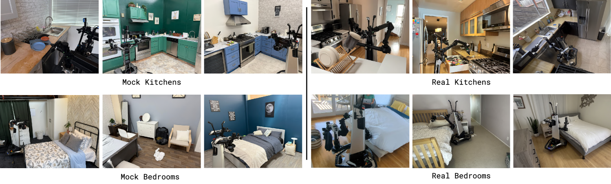{ width="920" }

*Figure 6，用于受控比较的布置房间与用于最终检验的真实家庭。*

同一组方法比较使用相同物品配置，不同地点的物品可以变化。标准对照通常每任务运行 10 次，四个任务合计约 40 次／策略，并交错运行不同策略，降低环境随时间变化的影响。附录说明部分因机器人故障、时间限制等取消的 episode 被移除，尽量保持各组样本量接近，显著性使用双侧 t-test。因此，应把“10 次”理解为协议目标，不能假定每张图每个柱子都严格具有相同有效样本数。[↗](https://arxiv.org/pdf/2504.16054v1#page=17)

纵轴主要是 **Average Task Progress**。每个 episode 先按任务 rubric 得分，再除以该任务满分，而不是只记录整项任务成功或失败。

| Task | Initial setting | Scoring rubric | Maximum |
| --- | --- | --- | ---: |
| Dishes in Sink | 水槽旁有 4 件餐具或器具 | 每件拿起 +1；每件放入水槽 +1 | 8 |
| Items in Drawer | 柜台上有 1 件物品，抽屉在下方 | 拿起 +1；开抽屉 +1；放入 +1；物品已在内时关闭抽屉 +1 | 4 |
| Laundry in Basket | 地上有 1 件衣物 | 移动并拿起 +1；放到篮中或篮上 +1；完全进入篮中 +1 | 3 |
| Make the Bed | 毯子与枕头尚未整理 | 毯子盖住床单 +1；两只枕头各 +1；毯子非常整齐 +1；两只枕头非常整齐 +1 | 5 |

这套评分保留了失败发生在哪里的信息。例如餐具任务若四件都拿起过、只有两件进入水槽，按规则是 $6/8=75\%$ 进度；它并非四件餐具全部收好的成功。铺床也将“基本放到位”与“非常整齐”分开，约 60% 进度可能已经完成基础摆放，却尚未满足整洁要求。将这些数值写成完整任务成功率，会改变论文结果的含义。

### 真实家庭结果说明模型确实能迁移，也保留了家庭差异

Figure 7(b) 应按家庭分组看，再与黄色 mock environments 对照。下面表中的数值按原图柱高读为近似百分比；图中没有逐柱打印的精确数据表，误差线也不用于推算额外成功次数。

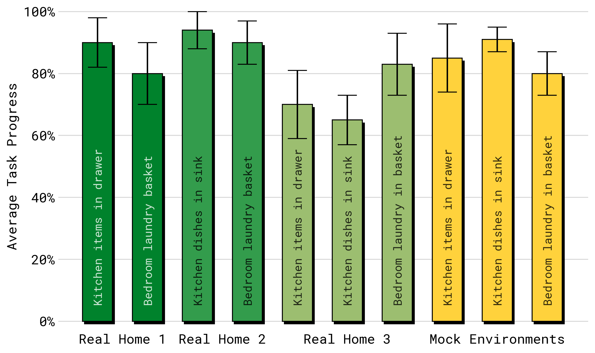{ width="920" }

*Figure 7(b)，每任务、每环境约 10 次试验的平均任务进度。*

| Environment | Items in Drawer | Dishes in Sink | Laundry in Basket |
| --- | ---: | ---: | ---: |
| Real Home 1 | ≈90% | — | ≈80% |
| Real Home 2 | — | ≈94% | ≈90% |
| Real Home 3 | ≈70% | ≈65% | ≈83% |
| Mock Environments | ≈85% | ≈91% | ≈80% |

三个家庭均能推进多阶段任务，真实环境的表现总体落在与 mock 比较相近的范围内，说明受控房间的结果并非完全无法转移。但 Home 3 的厨房任务明显低于 Home 1、2 中对应项目，尤其 Dishes in Sink 约为 65%。因此，“泛化已经出现”与“所有新家庭具有一致可靠性”是不同结论。[↗](https://arxiv.org/pdf/2504.16054v1#page=8)

这些试验只给一句高层命令，之后拿哪个物体、何时放下等子步骤由模型选择。它们支持的不只是陌生背景下的一次抓取，还包括多次动作与阶段选择的持续组合。接下来的实验才进一步询问，这种能力来自家庭数据更多，还是来自共享训练中的其他经验。

## 更多训练地点带来了什么，而不只是更多样本

### 地点规模实验控制了样本量与后训练步数

完整重跑每一种地点规模的预训练很昂贵，作者采用一个专门实验：先在不含 MM 的机器人动作混合上预训练，再分别用来自 **3、12、22、53、82、104 个地点**的移动操作数据做 **40K steps** 后训练。训练安排让每个模型看到相同数量的独特样本，用来减少“地点更多只是因为训练例子更多”的解释。

Figure 8 左侧是训练地点曲线，右侧三根柱子分别回答是否需要见过测试环境、是否需要异构预训练。

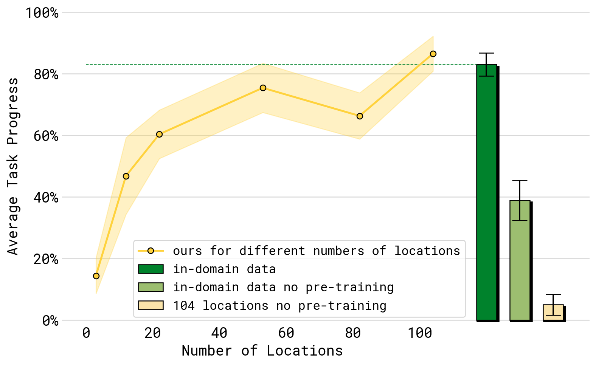{ width="920" }

*Figure 8，地点规模、测试环境内数据与预训练之间的比较。*

| Training locations | 3 | 12 | 22 | 53 | 82 | 104 |
| --- | ---: | ---: | ---: | ---: | ---: | ---: |
| Average Task Progress，图读约值 | 14% | 47% | 60% | 75% | 66% | 87% |

总体趋势非常明确，但不是逐点单调。53 到 82 个地点之间的均值下降，104 个地点再升到约 87%。因此，可以说扩大环境覆盖改善了总体泛化，不能从六个点推导严格 scaling law，更不能把“104 个地点”当作任何平台都适用的最低门槛。

右侧深绿色控制组在训练中包含测试家庭数据，进度约 83%，与 104 个留出训练地点的结果接近。这个比较支持模型缩小了训练内外环境差距，重点在“接近”，而不是黄点略高就证明未见环境反而更容易。

另外两个控制组更能说明数据组合的作用。不使用这套预训练、只用测试环境数据，进度约 39%；不使用预训练、只用 104 个地点的 MM，约为 5%。即使给了测试家庭内的示范，也不足以补上广泛预训练提供的能力。在这组条件下，场景覆盖与此前的动作经验相互配合，而非简单把移动示范采集到更多房子就自然得到相同结果。[↗](https://arxiv.org/pdf/2504.16054v1#page=9)

### 识别用户指定物体，与成功搬运它，是两个指标

完整任务进度还混合了语言、抓取、移动和放置。附录 C 因此设计了更细的语言测试：在两个未见厨房中摆五个物体，要求机器人将指定的一个放进抽屉或水槽。目标物体被故意放得比干扰物更远，减少总拿最近物体这种捷径；不理解指令的随机选择基线约为 20%。

**Follow Rate** 测是否选对指定物体，**Success Rate** 还要求把它放入正确位置。前者高、后者低，说明对象选择已经成立，但运动或放置仍会失败。

训练内类别使用新的实例，例如夹子、木勺、开罐器、剪刀、芥末瓶，以及杯、碗、盘、塑料勺和砧板。OOD 类别则包括漏斗、药瓶、烧烤点火器、打火机和护目镜，这些类别未出现在相应机器人训练数据中。它并不意味着整个预训练 VLM 或 web 数据从未见过这些概念；恰恰是从非机器人语义经验迁移到动作的测试。[↗](https://arxiv.org/pdf/2504.16054v1#page=18)

Figure 9 左图先看选对物体的比例，右图再看最终放置。曲线标出了 12、22、53、82、104 地点的结果，不能将没有显示的 3 地点结果补进去。

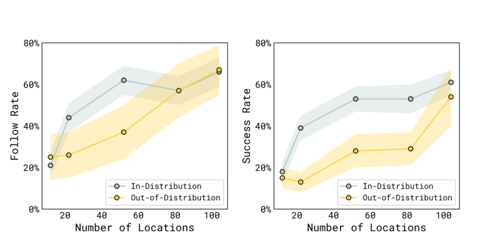{ width="920" }

*Figure 9，环境数量与语言选择、完成率的关系。*

在 12 个地点时，ID 的 Follow / Success 约为 21% / 18%，OOD 约为 25% / 15%；到 104 个地点时，ID 约为 66% / 61%，OOD 约为 67% / 54%。末端的选物率接近，但 OOD 成功放置仍低约 7 个百分点，提示语义定位之外还有操作差距。

中间点同样不是每项都单调。ID Follow 在 53 地点约 62%，82 地点约 57%；OOD Success 从 12 到 22 地点还有小幅下降。论文支持的是总体改善，不是每加入一批家庭都会等比例提升每种能力。更多环境还会同时引入更多物体与交互条件，这组实验控制了样本量，却没有单独剥离“房间外观多样性”与“物体多样性”的贡献。

## 数据消融为何要同时看总体、物体类别和具体任务

### 其他机器人上的经验，大幅影响新家庭操作

数据消融比较完整配方与 no WD、no CE、no ME、no CE or ME。所有结果使用相同的四类 mock-home 任务。Figure 10 的纵轴仍是任务进度，柱上 p 值才说明哪些差异具有这组试验所报告的统计支持。

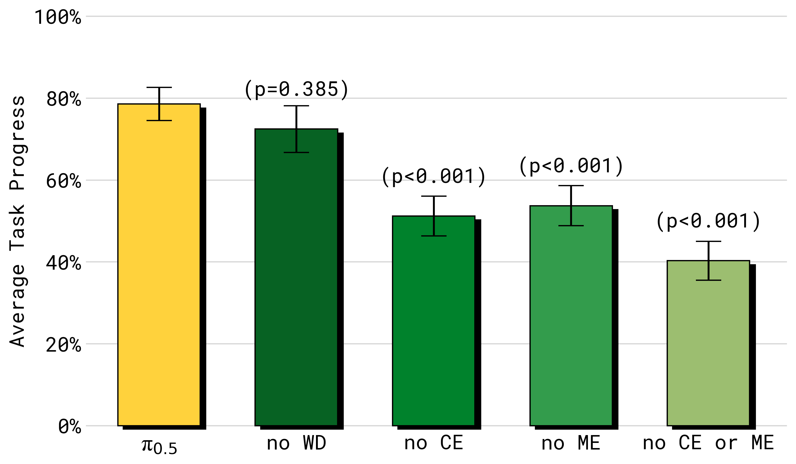{ width="920" }

*Figure 10，删除不同训练数据来源后的总体任务进度。*

| Training mixture | Average Task Progress，约值 | Reported p vs. full model |
| --- | ---: | ---: |
| π0.5 | 79% | — |
| no WD | 73% | 0.385 |
| no CE | 51% | <0.001 |
| no ME | 54% | <0.001 |
| no CE or ME | 40% | <0.001 |

删除实验室 CE 或家庭固定臂 ME，分别损失约 28、25 个百分点；两者都删掉后，模型虽然仍有目标 MM 与 web 数据，总体进度也只有约 40%。因此，目标平台数据最直接相关，不意味着它能替代其他平台提供的动作与环境经验。[↗](https://arxiv.org/pdf/2504.16054v1#page=10)

这些是数据来源删除实验，而非仅改变“是否同一种机器人”、同时严格保持其他分布完全相同的试验。它们支持 CE、ME 在当前训练配方中的贡献，也包含各来源带来的任务、物体和场景变化。将全部收益归因于某一个本体编码模块，会超过实验控制的范围。

### Web 数据的影响，在 OOD 语言测试中更清楚

no WD 的总体差异对应 $p=0.385$，不能据此宣称 web 数据已经显著提高全部长任务进度。Figure 11 换了一把尺，单独检查目标类别与语言理解；先比较黄色完整模型与深绿色 no WD，再看它们在 ID 和 OOD 两组之间的差别。

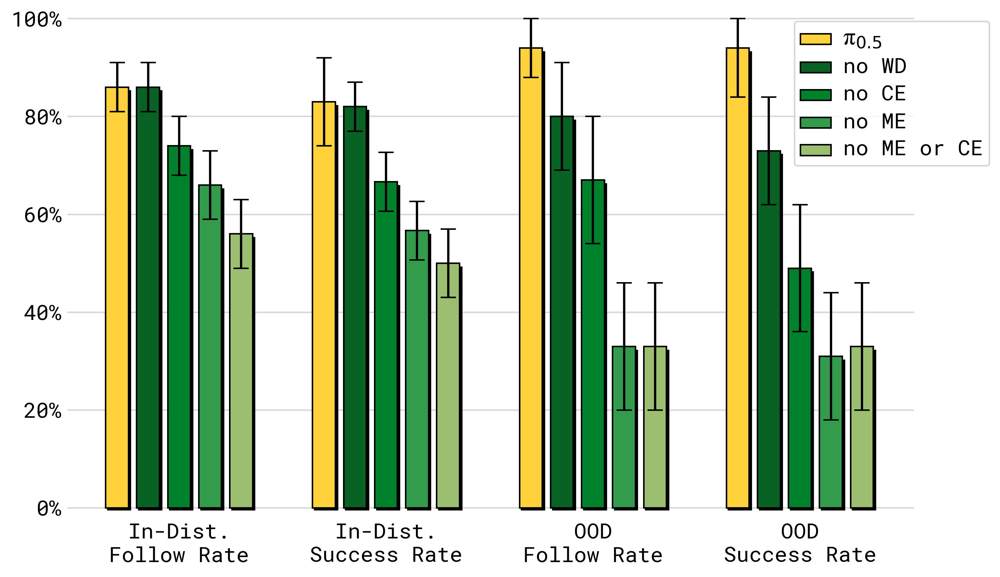{ width="920" }

*Figure 11，数据来源对物体选择与放置的不同影响。*

| Training mixture | In-Dist. Follow Rate | In-Dist. Success Rate | OOD Follow Rate | OOD Success Rate |
| --- | ---: | ---: | ---: | ---: |
| π0.5 | ≈86% | ≈83% | ≈94% | ≈94% |
| no WD | ≈86% | ≈82% | ≈80% | ≈73% |
| no CE | ≈74% | ≈67% | ≈67% | ≈49% |
| no ME | ≈66% | ≈57% | ≈33% | ≈31% |
| no ME or CE | ≈56% | ≈50% | ≈33% | ≈33% |

所有百分比为原图近似读数。去掉 WD 后，训练内类别几乎不变，OOD 的选物率与成功率却分别降低约 14、21 个百分点。这个组合更符合“web 语义补充了新物体概念”的解释，而不是所有动作技能都从网页数据中获得。

CE、ME 删除也损害 OOD，尤其 no ME 的下降较大。这说明识别物体的语言名称还不够，机器人仍需要在复杂家庭视觉条件下选择目标并操作。另一方面，完整模型的 OOD 数值高于 ID，也不意味着陌生类别总体更容易；OOD 只使用一组新的 Items in Drawer 物体，ID 则跨抽屉和水槽场景平均，任务集合和物体不同。[↗](https://arxiv.org/pdf/2504.16054v1#page=10) [↗](https://arxiv.org/pdf/2504.16054v1#page=18)

Figure 9 与 Figure 11 也不是同一训练预算的重复测量。地点规模采用前述简化预训练与 40K 后训练流程，数据消融则研究完整配方的来源变化，因此不能把两张图的满配成绩直接相减，解释成某一个新增数据集的增益。

### 总平均掩盖了“抽屉”和“水槽”的不同变化

附录 Figure 16 按四个任务展开 Figure 10。先看 Items in Drawer，再看 Dishes in Sink，会发现 web 数据的方向并不一致。

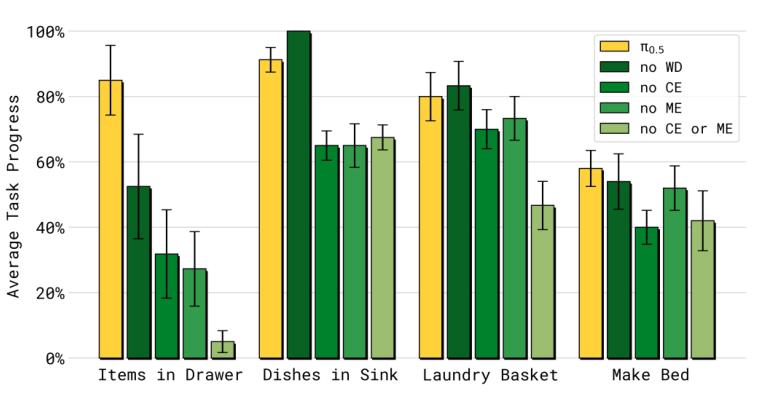{ width="920" }

*Figure 16，数据消融的逐任务结果。*

Items in Drawer 的完整模型约为 85%，no WD 约为 53%，no CE / no ME 约为 32% / 27%，两种跨本体来源都删掉后约为 5%。这个任务同时要求理解较广物体类别、处理抽屉状态和完成取放，对多源知识非常敏感。

Dishes in Sink 则不同。完整模型约为 91%，no WD 在这组试验中约为 100%；删除 CE 或 ME 后才降到约 65%。不能因为 no WD 在该任务的均值更高，就断言 web 数据普遍有害，但它明确否定了“web 数据使每个任务都改善”的读法。

Laundry Basket 约为 80%，no WD 约为 83%，而同时删除 CE、ME 后约为 47%；Make Bed 的完整模型约为 58%，no CE 约为 40%。这些变化更突出动作和本体经验的作用。也正因为各任务依赖不同，总平均中 no WD 不显著，与抽屉和 OOD 物体测试中的明显下降并不矛盾。[↗](https://arxiv.org/pdf/2504.16054v1#page=18)

## 相比 π0，收益来自哪些改变

### 先把基线推到接近 π0.5，再比较语义共训练

原始 π0 已有连续 flow-matching action expert。π0.5 在其基础上同时改变训练表示、训练阶段与语义任务，因此只与原始 π0 比较，难以判断是哪一组变化带来收益。

作者增加了 **π0-FAST+Flow**：采用离散预训练、连续动作后训练的混合路线，但只使用含机器人动作的数据，不加入 HL 与 WD，也不能进行高层子任务推理。所有模型使用相同的跨本体机器人训练集，并尽量保持训练步数可比；原始 π0 还比较了 80K 与延长到 300K 的训练设置。[↗](https://arxiv.org/pdf/2504.16054v1#page=10)

Figure 12 可以分两次比较。先看白色 FAST+Flow 相对绿色原始 π0，判断训练动作表示的作用；再看黄色 π0.5 相对白色，判断完整语义与层级配方还有多少额外收益。

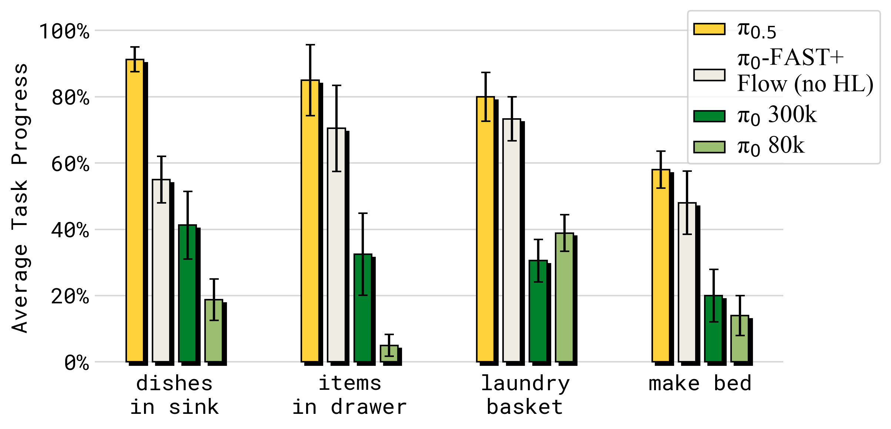{ width="920" }

*Figure 12，相同机器人动作数据基础上的模型路线比较。*

| Model | Dishes in Sink | Items in Drawer | Laundry Basket | Make Bed |
| --- | ---: | ---: | ---: | ---: |
| π0.5 | ≈91% | ≈85% | ≈80% | ≈58% |
| π0-FAST+Flow, no HL | ≈55% | ≈70% | ≈73% | ≈48% |
| π0, 300K | ≈41% | ≈33% | ≈31% | ≈20% |
| π0, 80K | ≈19% | ≈5% | ≈39% | ≈14% |

表中是任务进度的图读近似值。FAST+Flow 已经大幅提高了抽屉和衣物任务的均值，说明混合动作训练路线本身有很大价值。完整 π0.5 在所有四个任务中进一步提高了均值，其中水槽任务从约 55% 到 91% 的差异尤其大；这部分包含 HL、WD 与推理方式的联合改变，不能只归给某一网络层。

延长原始 π0 训练也没有整体追上 FAST+Flow，甚至 Laundry Basket 的 300K 均值低于 80K。作者据此强调 FAST 路线的训练计算效率，但图中没有完整 GPU 小时或每步 FLOPs，不能把步数比直接写成精确的训练成本倍数。

### 语言选择结果支持了动作表示也会影响条件理解

附录 Figure 15 不是另一张整体任务表，而是同一类指定物体测试。黄色 π0.5 与白色 FAST+Flow 比较接近，两者都远高于原始 π0。

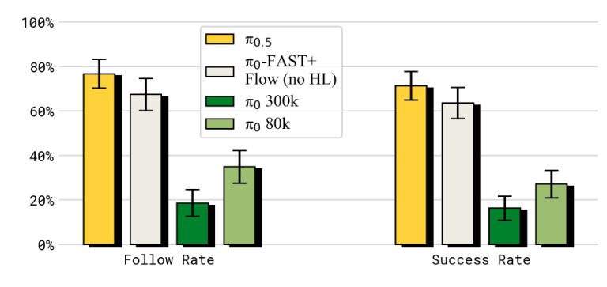{ width="820" }

*Figure 15，不同模型路线的语言跟随与放置成功率。*

按图读值，π0.5 的 Follow / Success 约为 77% / 72%，FAST+Flow 约为 67% / 64%；π0 300K 约为 19% / 16%，π0 80K 约为 35% / 27%。这说明 FAST 训练带来的收益不只表现在动作拟合，也与更强的语言条件跟随共同出现。

不过，图中 π0 300K 比 80K 更低，提醒我们不能将“训练更久”自动等同于“语言能力更好”。完整 π0.5 相对 FAST+Flow 的差异，则继续体现额外语义监督与层级任务训练的价值。[↗](https://arxiv.org/pdf/2504.16054v1#page=18)

## 高层推理有效，训练中的高层监督同样重要

### 显式预测子任务与学习过子任务，是两件事

最后一组实验进一步区分高层决策的作用。作者以完整 π0.5 的低层过程为执行基础，比较不同高层来源或是否执行高层推理。这里最重要的一对是 **implicit HL** 与 **no HL**。

implicit HL 在训练中保留高层子任务监督，推理时直接把任务交给低层，不显式先生成子任务。no HL 则连训练中的高层监督也去掉。因此，两者不能都概括成“关闭高层模块”；一个测试运行时显式分解的增量，另一个还改变了学到的表示。

其他对照包括不使用 web 数据的高层、不使用 VI 的高层、提示 GPT-4 选择子任务，以及专家人类选择子任务。GPT-4 已得到任务描述和常见标签列表，所以对照并非完全不给动作空间提示，但它没有接受同样的机器人状态与策略能力适配训练。[↗](https://arxiv.org/pdf/2504.16054v1#page=10)

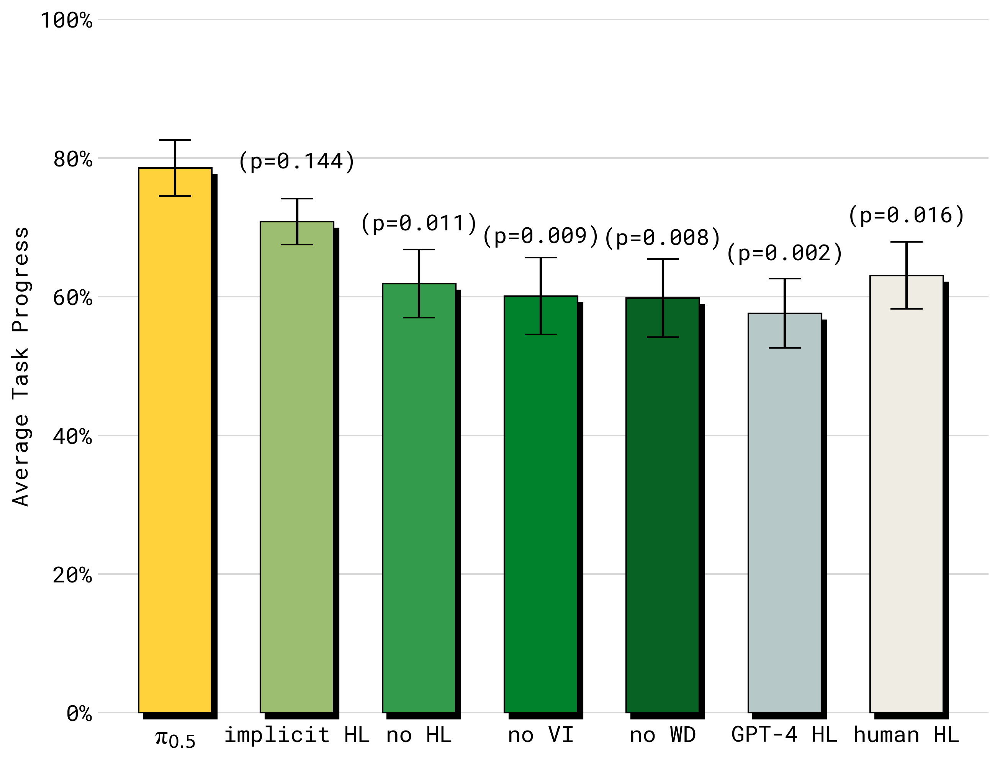{ width="920" }

*Figure 13，高层推理、训练监督与高层来源的区别。*

| High-level setting | Average Task Progress，约值 | Reported p vs. π0.5 |
| --- | ---: | ---: |
| π0.5 | 79% | — |
| implicit HL | 71% | 0.144 |
| no HL | 62% | 0.011 |
| no VI | 60% | 0.009 |
| no WD | 60% | 0.008 |
| GPT-4 HL | 58% | 0.002 |
| human HL | 63% | 0.016 |

完整模型的均值最高，但与 implicit HL 的差异为 **p=0.144**，在通常的 0.05 阈值下不显著。因此，这组结果更有力地支持“高层监督进入训练很重要”，而不能单凭均值断言显式高层推理已经被统计上确定为优于隐式执行。

no HL 相对完整模型显著下降，而 implicit HL 仍保留较高表现，支持了子任务监督所学信息能够被低层执行利用的解释。它的价值不只在推理时多输出一句文字，也可能进入视觉状态、任务阶段和动作条件的共享建模中；实验并未进一步定位是哪一层表示发生了怎样的改变。[↗](https://arxiv.org/pdf/2504.16054v1#page=11)

### 少量 VI 为什么值得单独采集

移除约占 HL-MM 样本 11% 的 VI 后，平均进度从约 79% 降到约 60%，图中 p=0.009。它的数量不大，却与部署时策略实际遇到的状态相联系，因此能教会高层怎样利用已有低层能力。这个解释与采集过程相吻合，而不是仅用“语言更丰富”解释收益。

no WD 在这组高层对照中也降到约 60%，p=0.008。它与前面整体数据删除时 p=0.385 的结果并不矛盾：这组实验聚焦高层策略，表明 web 语义对选择合适对象和步骤尤其有用，而总体动作进度还受各任务、低层操作和其他数据共同影响。

GPT-4 高层最低，说明通用模型在这些提示与低层接口下，并没有自动选出最适合当前策略的命令。这不是对 GPT-4 一般规划能力的全面排名，也不是证明模型越大越差。对照真正改变的是，是否用机器人状态和实际策略行为适配高层决策。

human HL 约为 63%，低于完整 π0.5。人类“oracle”在这里是实验中的参照，并非数学上必然达到的上界：命令由人选择，但执行仍由学习策略完成，子任务措辞与选择时机可能影响低层行为。这个结果说明人类代替高层并没有在此设置下补上全部问题，不能推导为模型总体规划能力超越专家人类。

### 逐任务结果防止把平均优势写成全面优势

Figure 17 将高层结果拆成四项任务。先看抽屉与铺床，再看衣物，可以发现高层来源的作用并不均匀。

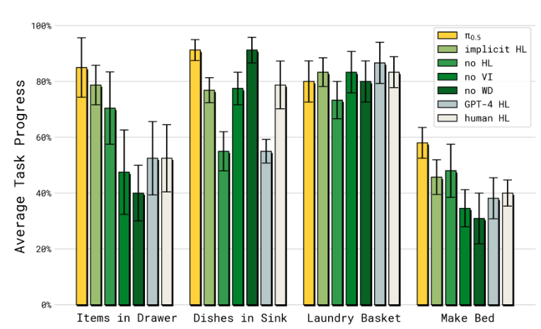{ width="920" }

*Figure 17，不同任务对高层决策的依赖。*

Items in Drawer 中，完整模型约 85%，implicit HL 约 79%，no VI 约 48%，no WD 约 40%。这与抽屉任务需要选择对象、判断门状态和组织阶段的特点一致。Make Bed 的完整模型约 58%，no VI、no WD 分别约 35%、31%，也说明细致整理中的子任务选择会影响进度。

Dishes in Sink 的 no WD 与完整模型都约为 91%，所以 web 对高层的平均贡献也不是逐任务一致。Laundry Basket 更明确：完整模型约 80%，implicit HL、人类高层约 83%，GPT-4 高层约 87%。它们的误差线有重叠，不能据此宣布哪一种在该任务稳定领先；但这些柱子足以表明，完整模型没有在每个任务上都取得最高均值。[↗](https://arxiv.org/pdf/2504.16054v1#page=19)

把这组结果与 Figure 13 放在一起，较稳妥的判断是，高层训练与策略适配对总体效果重要，复杂任务尤其受益；任务较简单、低层行为较固定时，换一种高层来源可能影响较小。所谓“统一模型”的价值体现在多种任务共享一个可训练接口，并不要求每个任务都必须显式使用同样多的高层推理。

## 这套配方怎样影响下一轮机器人数据与系统设计

π0.5 给出的第一项可复用选择，是把数据采集按能力缺口分配。若主要问题是新厨房中的视觉与物体变化，容易搬运的固定机械臂可以增加实景覆盖，再通过共同模型迁移到移动平台；若抓取、接触或双手操作本身不足，实验室 CE 仍有价值。环境规模结果与 CE/ME 消融共同说明，这两种投资不能只按“是否来自目标机器人”判断价值。

第二项是把高层标签视为训练资源。为多阶段轨迹标注当前子任务和相关对象，可以同时训练对象定位、阶段判断与动作条件。等低层策略具有一定能力后，再让操作者通过语言指挥它，收集真实策略状态下的 VI。implicit HL 的结果表明，即使部署时希望简化高层调用，这些监督仍可能有价值；但是否采用显式层级，需要在目标任务上同时测进度、调用成本和执行延迟。

第三项是分开评估识别、选择与执行。任务进度说明做到了哪一步，Follow Rate 说明是否理解了指定对象，Success Rate 说明是否真正完成放置；再按任务和物体类别分组，才看得见 WD、ME 和 CE 的不同作用。只有一个总分，很容易把语义改善误读成运动改善，也容易忽略抽屉与水槽中方向相反的结果。

论文的失败仍然具体。陌生把手或物理上难开的柜门暴露技能与接触边界；手臂遮住待擦区域暴露部分可观测性；反复开关抽屉暴露高层进度判断和注意力问题。当前指令分布相对简单、上下文有限，跨房间导航和记住物品存放位置仍需要更丰富的历史与记忆机制。[↗](https://arxiv.org/pdf/2504.16054v1#page=11)

因此，π0.5 最值得继承的是一种能被实验检验的数据与模型接口：让不同来源的经验承担不同监督角色，再通过共同表示把它们连接到目标平台的动作。新家庭中的成功来自这套组合，而继续提高可靠性，需要沿具体失败环节补数据、补状态信息或调整控制流程。
