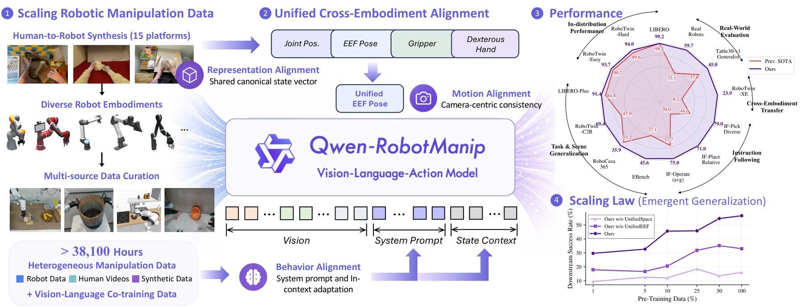
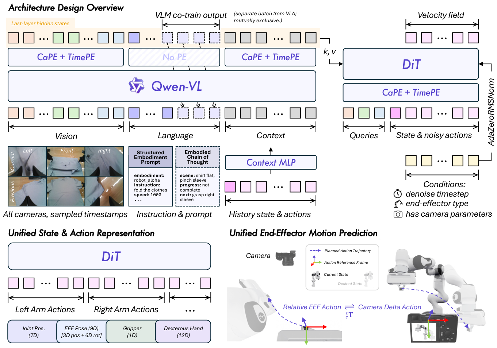
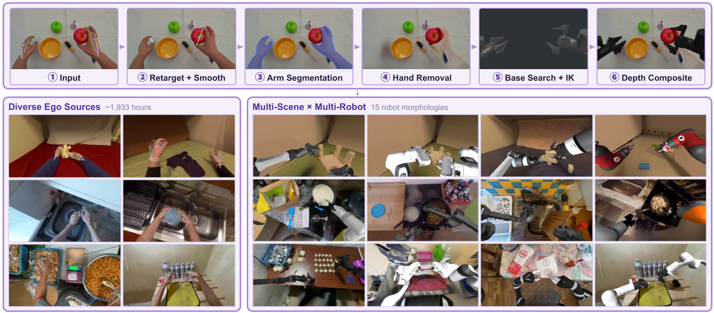
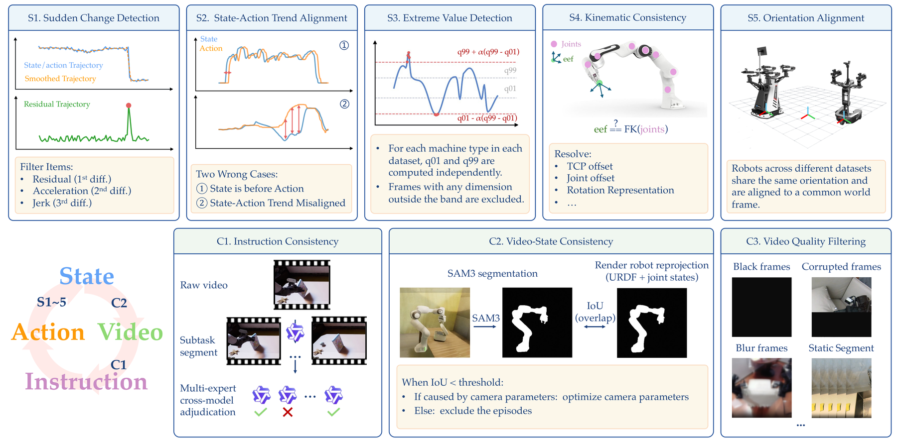
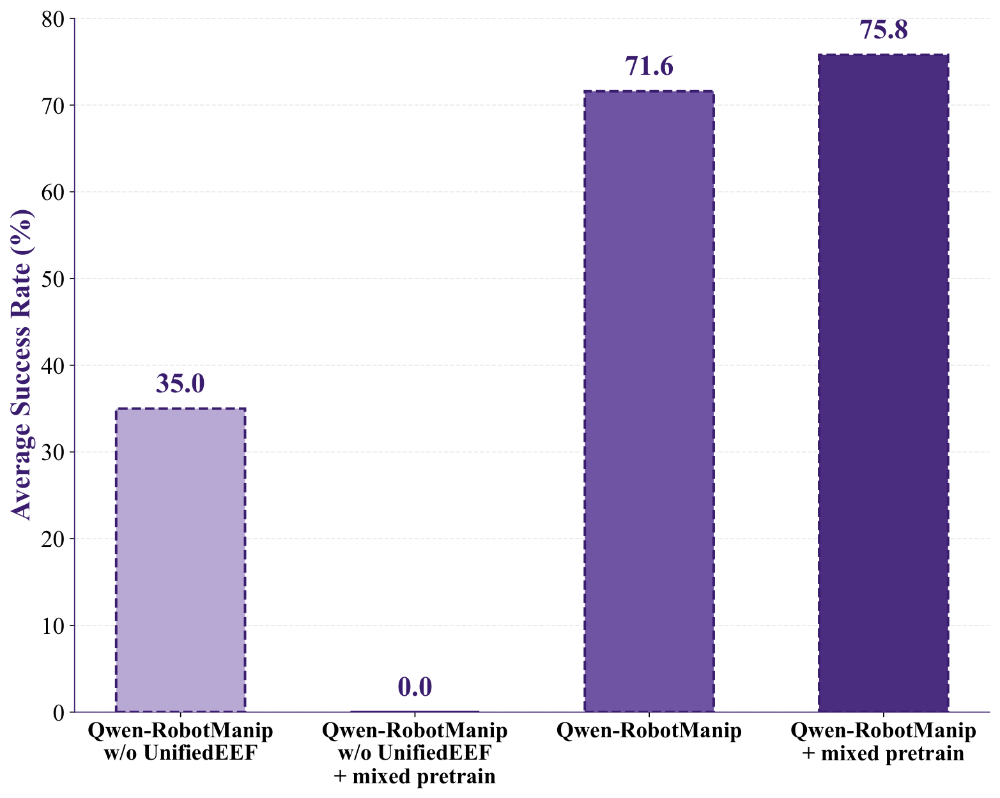
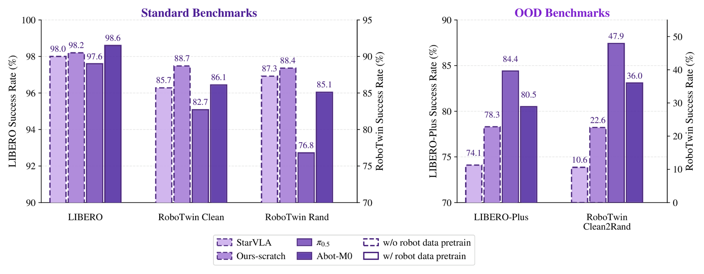
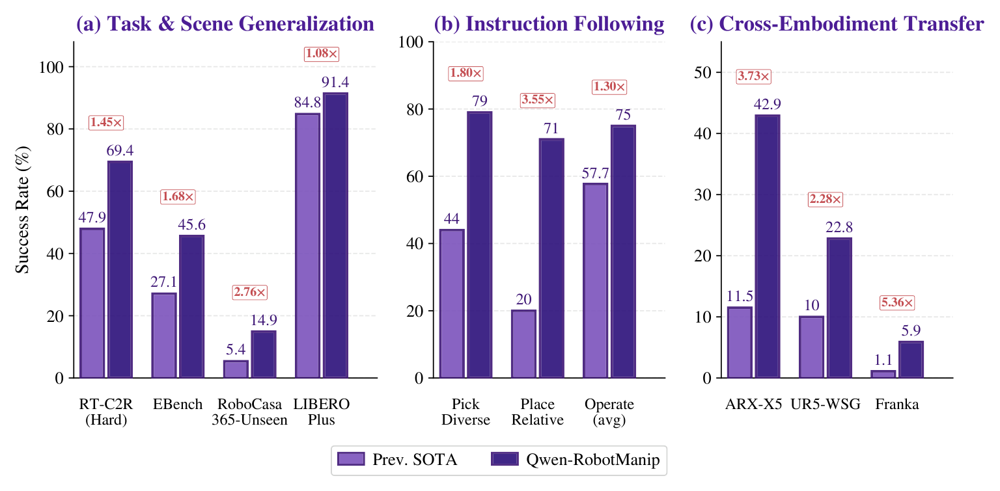
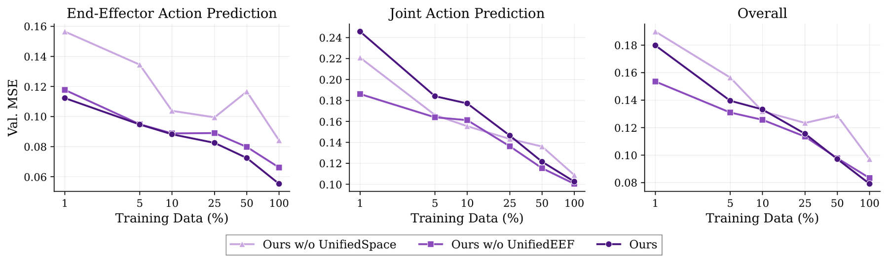
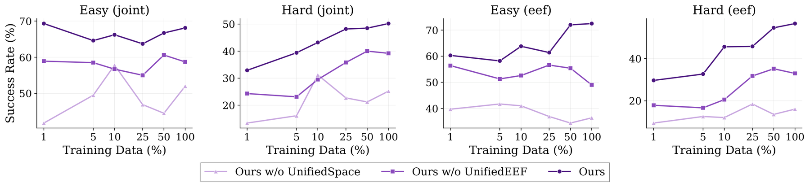
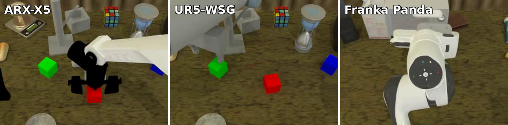

# Qwen-RobotManip：先对齐再扩规模的机器人操作基础模型

!!! info "论文信息"
    **论文题名：** Qwen-RobotManip Technical Report: Alignment Unlocks Scale for Robotic Manipulation Foundation Models。<br>
    **作者：** Qwen Team；Haoqi Yuan、Zhixuan Liang、Anzhe Chen、Ye Wang、Haoyang Li、Pei Lin、Yiyang Huang、Zixing Lei、Tong Zhang、Jiazhao Zhang 等（arXiv v2 列出 23 位作者）。<br>
    **机构：** Qwen Team / Alibaba 相关团队；以 arXiv/PDF author block 为准。<br>
    **时间 / 主题：** 2026-06；具身智能 / VLA / 跨 embodiment 机器人操作基础模型。<br>
    **arXiv / 官方报告：** arXiv：[2606.17846](https://arxiv.org/abs/2606.17846)；PDF：[2606.17846v2](https://arxiv.org/pdf/2606.17846v2)；Qwen 官方页：[qwen.ai/blog?id=qwen-robotmanip](https://qwen.ai/blog?id=qwen-robotmanip)。<br>
    **GitHub / 项目：** GitHub：[QwenLM/Qwen-RobotManip](https://github.com/QwenLM/Qwen-RobotManip)。<br>
    **元数据来源与核验口径：** 来源：[arXiv API / v2](https://export.arxiv.org/api/query?id_list=2606.17846)、[arXiv source](https://arxiv.org/e-print/2606.17846)、[GitHub](https://github.com/QwenLM/Qwen-RobotManip)；Checked Date：2026-07-06；Repro Status：Paper / official source and repo reviewed, independent reproduction not claimed。

## 原论文故事线

### 研究背景

Qwen-RobotManip 属于机器人操作基础模型的 scaling recipe。语言模型可以把不同文本数据自然放进同一个 token space，但机器人数据不一样：不同机器人有不同自由度、相机视角、末端坐标系、动作频率、夹爪/灵巧手接口和遥操作协议。把这些数据直接拼起来，模型看到的“同一个物理动作”可能在数值上完全不同，甚至互相冲突。

已有 VLA 工作证明跨数据训练有用，但标准 in-distribution benchmark 容易高估能力，因为模型可能记住目标 benchmark 的模式，而没有真正学到可迁移结构。Qwen-RobotManip 的背景判断是：如果想让开源机器人数据、第一视角人类视频和合成 human-to-robot 数据形成规模收益，必须先做 representation、motion 和 behavior alignment。

### 问题（Challenge）

论文要解决的问题是：**如何让跨 embodiment、跨数据源的机器人操作数据真正随着规模增长而提升 OOD 泛化。** 难点在于多源数据不仅格式不同，物理语义也不对齐。单臂、双臂、灵巧手、移动底盘等 embodiment 的 state/action 维度不同；同一个末端移动，在世界坐标、相机坐标或机器人局部坐标下数值不同；episode 中的历史行为还会影响当前机器人状态和动作选择。

这个问题的价值在于，机器人 foundation model 的核心不是 IID benchmark 排名，而是用户在自己硬件、自己工作区、少量示教下能否迁移。如果对齐没做好，更多数据会带来负迁移；如果对齐做好，数据规模才可能转化为开放任务、场景、指令和跨机器人能力。

### Finding

作者的 finding 是：**alignment 是 scale 的前提；只有先让跨机器人 state/action、末端运动和 episode 行为上下文处在可共享表示中，扩大数据才会释放泛化能力。** 这个洞见把“多收集数据就能扩模型”的直觉翻转成“先统一物理接口，再扩数据规模”。

这个 finding 能解决挑战，是因为它把多源冲突拆成三层。Canonical state/action representation 让不同 embodiment 投到统一模板；camera-frame EEF delta pose 让相似末端运动在数值上更接近；behavior alignment / in-context adaptation 让模型利用历史 observation-action context 判断当前 embodiment 和任务阶段。这样，模型看到的不是混乱的动作表，而是可以共享的操作结构。

### 方法

Qwen-RobotManip 使用 Qwen-VL backbone 加 flow-matching DiT action head。VLM 编码多视角图像、语言指令、structured embodiment prompt、历史 observation-action context 和 proprioceptive state；Action Expert 是连续动作生成器，通过 alternating cross-attention 读取视觉与语言 hidden states，并用少量 Euler steps 生成 action chunk。state/action 采用统一 80 维 canonical representation。

数据上，论文构建约 38,100 小时 heterogeneous manipulation data，包含开源 robot data、egocentric human videos 和 human-to-robot synthetic data，覆盖 15 个平台。对齐包括 representation alignment、motion alignment 和 behavior alignment。训练时还混入 vision-language co-training，避免动作微调导致 VLA-to-VA degradation。部署上，论文使用 real-time chunking 和远端推理，让当前动作执行与下一 chunk 生成并行。

### 结论

实验把 OOD generalization 作为主评测，包括 LIBERO-Plus、RoboTwin-C2R、RoboTwin-IF、RoboTwin-XE、RoboChallenge 以及 AgileX ALOHA、Franka、UR、ARX 等真实机器人验证。论文报告 Qwen-RobotManip 在多个 OOD 设置中显著超过 π0.5 等 prior models，并在 RoboChallenge 中获得 20% relative improvement。消融表明，对齐、VL co-training、in-context adaptation 和数据规模共同决定泛化表现。

边界是，人类到机器人合成数据会受到 retargeting 和 inpainting artifact 影响；OOD 评测仍有大量仿真成分；固定 action chunk 和推理延迟限制了高反应频率任务。论文的结论不是“scale alone solves manipulation”，而是“alignment-then-scale 才能让机器人多源数据变成 foundation model 的泛化能力”。

### 关键术语

- **Alignment Unlocks Scale（对齐释放规模效应）**：先统一机器人数据的表示和物理语义，再扩大数据规模。
- **Canonical State/Action Representation（规范状态/动作表示）**：把不同 embodiment 的状态和动作映射到共享模板。
- **Motion Alignment（运动对齐）**：让相似物理末端运动在数值表示上接近，例如使用 camera-frame delta pose。
- **Behavior Alignment（行为对齐）**：利用系统提示和历史 context 对齐不同机器人、任务阶段和执行风格。
- **In-Context Policy Adaptation（上下文策略适配）**：通过 episode 历史观测和动作隐式识别 embodiment 与当前任务状态。
- **Human-to-Robot Synthesis（人到机器人合成）**：把人类视频中的操作转成机器人可用训练样本的数据生成流程。
- **VLA-to-VA Degradation（VLA 退化为 VA）**：动作微调后模型语言/视觉理解能力下降，只剩视觉到动作映射的现象。

Qwen-RobotManip 最值得抓住的一句话不是“Qwen 也做 VLA”，而是论文标题里的 **alignment unlocks scale**。作者的判断是：机器人操作数据不像文本那样天然共享同一个 token space。不同机器人有不同自由度、相机位姿、末端坐标系、动作频率和遥操作协议；如果这些数据没有先被对齐，继续扩大数据规模只会让模型同时学习多套互相冲突的坐标约定。

所以这篇技术报告的主线是：先把 state/action 表示、末端运动坐标和 episode 内行为上下文对齐，再用开源机器人数据、第一视角人类视频和 human-to-robot 合成数据把规模推到约 `38,100` 小时。它不是世界模型意义上的未来视频模拟器，但它回答了具身智能里另一个同样核心的问题：**怎样让一个 VLA policy 真正从跨 embodiment 数据规模中受益，而不是只在同分布 benchmark 上记住模式。**

## 证据等级与外推边界

| 论文结论 | 主要证据 | 可吸收为工程判断 | 不能直接外推 |
| --- | --- | --- | --- |
| 对齐是扩规模前提 | scaling curves、action representation ablation、RoboTwin-XE 与 ARX skill transfer | 跨机器人训练不能只 zero-pad action 维度，要让相似物理运动在数值上接近 | 不能证明 80 维模板适合所有移动底盘、灵巧手和力控接口 |
| 约 `38,100 h` 开源数据能形成强 VLA prior | 数据表、H2R pipeline、OOD 结果和真实机器人验证 | 开源 robot data + egocentric human video + synthesis 是可行的数据引擎路线 | 数据公开性、清洗脚本、合成质量和训练预算仍决定能否独立复现 |
| VLA 预训练质量要看 OOD，不只看 IID | IID diagnostic、LIBERO-Plus、RoboTwin-C2R、RoboTwin-IF、RoboTwin-XE | 标准 benchmark 高分可能来自同分布 pattern matching；评测要分语言、场景、机器人和 embodiment shift | 不能把仿真 OOD 直接等同于真实家庭长期部署 |
| 双流 VLA/VLM 共训能保住语言和视觉能力 | VL co-training ablation、RoboTwin-IF、mixed post-training | 纯动作微调会出现 VLA-to-VA degradation，后训练也可能要混入 VL/VLA 数据 | 混数据比例和筛选策略依赖目标域，论文没有给出通用配方 |
| in-context policy adaptation 能补动态 embodiment 信息 | prompt/context ablation、10-step denoising 后的提升 | episode history 可以作为隐式 embodiment identifier，补静态 prompt 不足 | episode 开头 zero context 会导致迟疑；低延迟场景不一定适合 context 版 |

## 论文位置

如果把 [SpatialVLA](spatialvla.md) 看作“显式 3D 空间表征怎样接到 VLA”，把 [π0.5](pi05.md) 看作“开放世界 VLA 怎样组织高层任务和异构数据”，Qwen-RobotManip 则更像一篇 scaling recipe 报告：它关心的不是单点结构创新，而是跨数据源训练时哪些接口必须先统一。

{ width="920" }

<small>图源：`Qwen-RobotManip Technical Report`，teaser figure。原图表达 Qwen-RobotManip 在跨机器人、跨场景、长时程操作、instruction following 和真实机器人任务中的覆盖范围；本站读法是用它定位“通用操作基础模型”的任务版图。它不能单独证明所有能力已被独立复现。</small>

论文的核心问题可以写成一个很简单的矛盾：

```text
更多机器人数据
  如果 action/state/camera/behavior 没对齐 -> 多源冲突、负迁移、IID 高分但 OOD 弱
  如果先做 representation + motion + behavior alignment -> 数据规模开始转成泛化
```

这也是它和很多 VLA 报告的差别。很多论文先展示 benchmark 排名，再讲模型结构；Qwen-RobotManip 先强调评测本身有问题：标准 in-distribution benchmark 可能无法区分“预训练带来的可迁移结构”和“目标 benchmark 上的模式记忆”。因此论文把 OOD generalization 作为主轴。

## 总体架构

{ width="880" }

<small>图源：`Qwen-RobotManip Technical Report`，Figure 1 / method overview。原论文图意：模型由 Qwen-VL backbone 和 flow-matching DiT action head 组成，VLM 编码多视角图像、结构化 embodiment prompt 和历史 context tokens；DiT 通过 alternating cross-attention 接入视觉与语言 hidden states；state/action 使用统一 80 维 canonical representation，末端动作使用 camera-frame delta pose。</small>

**Figure 1 怎么读。**
左侧先看输入：多视角图像、语言指令、结构化 embodiment prompt、历史 observation-action context 和 proprioceptive state。中间看信息流：Qwen3.5-4B VLM 负责多模态理解，最后一层 hidden states 被 action expert 交替 cross-attend；action expert 是 `10` 层 DiT，hidden size `768`，`12` attention heads。右侧看输出：模型不是输出离散 token，而是用 flow matching 生成连续 action chunk。

这张图支撑的是“解耦 VLM 理解和动作生成，但端到端联合训练”。它不能证明模型已经拥有显式动力学世界模型；它更准确地说是一个 **VLM-conditioned continuous-action policy foundation model**。

| Component | Setting | Role |
| --- | --- | --- |
| VLM backbone | Qwen3.5-4B, \(D_{\mathrm{vlm}}=2560\) | 编码多视角视觉、语言和历史 context |
| Action expert | DiT, 10 blocks, hidden size 768, 12 heads | 通过 flow matching 生成连续动作块 |
| Cross-attention | even blocks attend visual tokens, odd blocks attend language tokens | 把空间观察和语言约束分层注入动作生成 |
| Canonical state/action | 80-dimensional template | 统一单臂、双臂、灵巧手、移动底盘等不同 embodiment |
| Inference | 4 Euler integration steps | 面向低延迟真实控制 |
| Deployment | Real-Time Chunking over remote inference | 执行当前 chunk 时异步生成下一段，隐藏 WiFi / server 往返延迟 |

## 三层 alignment

论文所谓 alignment 不是 RLHF 那种偏好对齐，而是机器人数据接口对齐。它可以拆成三层。

| Alignment layer | Mechanism | What it fixes |
| --- | --- | --- |
| Representation alignment | 80-dimensional canonical state-action vector + per-dimension mask | 不同机器人自由度和状态字段不一致 |
| Motion alignment | camera-frame delta pose for end-effector actions + CaPE | 同一视觉运动在不同 base frame / camera frame 下数值不一致 |
| Behavioral alignment | structured embodiment prompt + in-context policy adaptation | 静态机器人标签不足以表达当前 episode 的真实执行风格 |

### 80 维 canonical action space

每个 arm 占 `29` 维：`7` 维 joint positions，`9` 维 end-effector pose，`1` 维 gripper state，`12` 维 dexterous hand joints。双臂合计 `58` 维，剩余 `22` 维保留给移动底盘等额外自由度。训练时不同机器人只填充自己有意义的槽位，其他维度 zero-pad，并用 binary mask 排除 loss。

这个设计的重点不是“80”这个数字本身，而是每个槽位有语义。天真 zero-padding 会让第 10 维在不同机器人里代表不同物理量；canonical template 则尽量保证同一维度代表相似物理含义。

### Camera-frame delta pose

end-effector 动作不直接用 robot base frame 里的绝对 pose，而是把相对末端运动投到参考相机坐标系里。论文给出的实现是：

$$
\mathbf{a}_p =
\begin{bmatrix}
{}^c_e\mathbf R\ {}^e_{e^*}\mathbf R\ {}^e_c\mathbf R
&
{}^c_e\mathbf R\ {}^e\mathbf t_{e^*} \\
\mathbf 0 & 1
\end{bmatrix}
$$

这里 \(c\) 是参考相机坐标系，\(e\) 是当前末端坐标系，\(e^*\) 是未来目标末端坐标系。旋转块通过相机-末端外参做 conjugation，平移块把末端位移投到相机坐标。读法很直接：如果两个机器人在图像里做了视觉上相似的抓取/放置动作，它们的动作数值也应该更接近。

这和 [SpatialVLA](spatialvla.md) 的空间接口形成互补：SpatialVLA 更强调输入侧 3D position encoding 和 action token grids；Qwen-RobotManip 更强调输出侧连续 EEF 动作在相机坐标里统一。

### In-context policy adaptation

模型还接收 episode 内历史 chunk：

$$
(\mathbf{o}_h,\mathbf{s}_h,\mathbf{a}_h)
$$

其中 \(\mathbf{o}_h\) 是历史视觉观测，\(\mathbf{s}_h\) 是 proprioceptive state，\(\mathbf{a}_h\) 是已执行 action chunk。历史图像 prepend 到当前帧进 VLM；历史 state/action 经 MLP 投到 VLM hidden space，再作为 context tokens 串起来。训练时用 stochastic context sampling，随机从 episode 中取历史片段，避免模型只复制最近动作。

这部分很像给 policy 一个“刚才这台机器人实际怎么动”的短期档案。静态 prompt 只能告诉模型“我是 ALOHA / UR / Franka”，context 则能告诉模型“这一局里动作执行偏慢、抓取有偏差、当前 kinematic signature 是什么”。

## 数据：开源机器人数据 + 人类第一视角 + H2R 合成

论文数据表可以保留原英文字段重绘如下：

| Data Type | Embodiment Type | Data Sources | Task Setting | Total Time |
| --- | --- | --- | --- | --- |
| Robot | Single-arm | OXE, RoboMIND, DROID, RH20T, AgibotWorld-Beta, RoboCOIN, RDT, InternData-A1, Galaxea Open-World | Tabletop | 3,808 h |
| Robot | Dual-arm | OXE, RoboMIND, DROID, RH20T, AgibotWorld-Beta, RoboCOIN, RDT, InternData-A1, Galaxea Open-World | Tabletop | 6,744 h |
| Robot | Mobile & humanoid | OXE, RoboMIND, DROID, RH20T, AgibotWorld-Beta, RoboCOIN, RDT, InternData-A1, Galaxea Open-World | Tabletop & indoor | 868 h |
| Human | Human hands | EgoDex, VITRA, EgoVerse | Tabletop & in-the-wild | 1,933 h |
| Human-to-Robot | 15 dual-arm platforms | Synthesized from human data | Tabletop & in-the-wild | 24,808 h |

<small>表源：`Qwen-RobotManip Technical Report`，Table 1。原表含义：训练语料由真实/仿真机器人数据、人类第一视角手部视频，以及从人类视频合成到 15 种双臂机器人形态的数据组成，总规模约 `38,100 h`。这里的时间规模不是全部等价的真实机器人遥操作时长，H2R 是合成扩展。</small>

{ width="920" }

<small>图源：`Qwen-RobotManip Technical Report`，Figure 2。原论文图意：human-to-robot pipeline 从 egocentric video 出发，做 action retargeting / smoothing、SAM3 hand segmentation、ProPainter inpainting、MuJoCo IK base pose search、depth-guided compositing，并把约 `1,933 h` 人类第一视角数据渲染到 15 种机器人形态，得到约 `24,808 h` 合成示范。</small>

**H2R 图怎么读。**
上半部分是动作对齐：从 MANO hand keypoints 提取 thumb 与 virtual finger，中点作为 gripper 位置，指尖距离作为 gripper width，再平滑轨迹并求 IK。下半部分是视觉对齐：把人手/手臂 mask 掉、inpaint 背景、渲染机器人、用 depth 做遮挡合成。这个 pipeline 支撑的是“人类 egocentric data 可以变成机器人预训练数据”，但不能证明合成数据的接触力、闭环恢复和真实机器人动力学完全正确。

数据清洗也很重。论文把 state/action 信号做五阶段过滤：sudden change、state-action trend alignment、extreme value、FK consistency、base-frame / EEF orientation alignment；再做 instruction consistency、video-state consistency 和 video quality filtering。

{ width="920" }

<small>图源：`Qwen-RobotManip Technical Report`，data preprocessing figure。原论文图意：多阶段数据清洗先处理 state-action 信号，再检查 instruction/video/state 的跨模态一致性。它支撑的是大规模异构数据训练前必须做质量控制，不能证明所有来源数据清洗后质量完全一致。</small>

这部分对工程最有启发的是趋势对齐：正确记录的 episode 里，action command 应该领先或同步 state change。论文用 cross-correlation 找 lag，再用 directional agreement 检查 state/action 的一阶差分方向是否一致。它还提到 RoboMIND UR-type data 有 `81%` episodes 在这个检查里失败并被排除，这说明多源机器人数据的“可用小时数”和“可训练小时数”不是一回事。

## 训练 recipe

### Pre-training：VLA/VLM 双流共训

Qwen-RobotManip 同时训练两条数据流：

| Stream | Data | Loss | Purpose |
| --- | --- | --- | --- |
| VLA stream | robot demonstrations, egocentric human-hand manipulation videos, H2R synthesized trajectories | masked flow matching on action chunks | 学连续动作和跨 embodiment 操作 |
| VLM stream | large-scale vision-language supervision | next-token prediction | 保住 Qwen-VL 的视觉、语言、空间和指令理解 |

论文采用 `9:1` 的 robot data : VL data 比例。整体目标是：

$$
\mathcal L = \mathcal L_{\mathrm{FM}} + \lambda \mathcal L_{\mathrm{VLM}}, \quad \lambda=0.1
$$

动作侧 flow matching 给定真实 action chunk \(\mathbf a\in\mathbb R^{T\times D}\)，采样噪声和时间：

$$
\mathbf x_t = (1-t)\boldsymbol\epsilon + t\mathbf a,\quad
\boldsymbol\epsilon\sim\mathcal N(\mathbf 0,\mathbf I),\quad
t\sim\mathrm{Beta}(1,1.5)
$$

模型预测速度场：

$$
\mathcal L_{\mathrm{FM}}
=
\mathbb E
\left\|
f_\theta(\mathbf x_t,t,\mathbf s,\mathbf o)-(\mathbf a-\boldsymbol\epsilon)
\right\|_2^2
$$

由于 80 维模板里不同 embodiment 的有效槽位不同，最终 loss 使用 composed binary mask：per-dimension slot mask、step validity mask、per-hand validity mask 三者 AND-combine，并按每个样本有效 entries 平均。这一点很重要：否则双臂/灵巧手这类有效维度更多的样本会在梯度里天然占更大权重。

训练效率上，action expert 对同一个 VLM forward 做 \(K_{\mathrm{repeat}}=8\) 次独立噪声和 timestep 采样。也就是一个昂贵的 VLM 编码被重复用于 8 个 flow matching denoising 样本，降低数据和前向成本。

### Post-training：SFT 与 mixed post-training

标准 domain-specific SFT 只优化 \(\mathcal L_{\mathrm{FM}}\)，不再使用 VLM next-token loss，并在 benchmark 或真实部署域上做 generalist SFT：把目标域所有 demonstration 合成一个训练集，训练一个统一模型，而不是每个任务一个 specialist policy。

论文提醒了一个容易被忽略的失败模式：**VLA-to-VA degradation**。在狭窄 benchmark 上长期 SFT 后，policy 可能不再真正看语言，而是学成视觉模式到动作的映射。RoboTwin-IF 就是专门为这个现象构造的 instruction-following benchmark。

mixed post-training 是可选增强：在目标域 SFT 时混入 VL data 和分布接近的 pretraining VLA data，缓解 domain overfitting。论文报告在 RoboTwin-IF 上，加入 `10%` VL data 可以减轻后训练后期退化；再加入 auxiliary VLA pretraining data 后，instruction-following 曲线不再随训练步数下降。关键前提是 UnifiedEEF：没有 UnifiedEEF 时混入 VLA 数据会出现 representation collapse。

{ width="760" }

<small>图源：`Qwen-RobotManip Technical Report`，mixed post-training ablation figure。原论文图意：比较 RoboTwin-IF 上不同后训练数据混合策略，并展示 UnifiedEEF 对 mixed post-training 的必要性。它支撑的是“后训练也需要防止语言条件退化”，不能证明所有目标域都应使用相同比例混合。</small>

## 为什么 IID benchmark 不够

{ width="920" }

<small>图源：`Qwen-RobotManip Technical Report`，IID diagnostic figure。原论文图意：左侧在 LIBERO / RoboTwin 这类 in-distribution benchmark 上，scratch 或无大规模机器人预训练模型也能接近甚至超过预训练模型；右侧在 LIBERO-Plus / RoboTwin-Clean2Rand OOD benchmark 上，预训练带来的差距才显现。</small>

**这张诊断图怎么读。**
如果训练和测试都来自同一环境、同一任务结构、同一视觉模式，模型可以靠 in-distribution pattern matching 得到高分。真正要检验 foundation model prior，就要把 evaluation 分布推开：相机、机器人初始状态、背景、光照、物体布局、语言模板、目标 embodiment 都要变化。换句话说，Qwen-RobotManip 的评测哲学是：**IID 排名只能证明目标 benchmark 拟合，OOD transfer 才更接近预训练质量。**

## 主结果：看 OOD 轴，不只看总榜

{ width="900" }

<small>图源：`Qwen-RobotManip Technical Report`，OOD summary figure。原论文图意：总结 Qwen-RobotManip 相对 prior SOTA VLA 在 task/scene generalization、instruction following 和 zero-shot cross-embodiment transfer 三条 OOD 轴上的提升。它支撑的是 OOD 评测优势，不能单独说明真实世界所有任务成功率。</small>

论文报告的几个核心数字如下：

| Benchmark / Setting | Best comparison in paper | Qwen-RobotManip result | Reading |
| --- | --- | --- | --- |
| LIBERO-Plus Total | \(\pi_{0.5}\): 84.4 | Qwen-Context: 91.4 | OOD camera / robot / language / light / background 等扰动下提升 |
| RoboTwin-C2R Hard | \(\pi_{0.5}\): 47.9 | Qwen-Context joint: 69.4 | 从 clean fine-tune 到 randomized hard scene 的抗扰动 |
| RoboCasa365 Total | RLDX-1: 33.2 | Qwen: 35.9 | kitchen manipulation，Composite-Unseen 上 14.9 |
| EBench Overall SR / Score | \(\pi_{0.5}\): 27.1 / 41 | Qwen: 45.6 / 60 | Isaac Sim indoor mobile manipulation |
| RoboTwin-IF Average | \(\pi_{0.5}\): 49.6 | Qwen: 72.2 | held-out instruction templates，检验语言是否真进入控制 |
| RoboTwin-XE Total | \(\pi_{0.5}\) eef: 7.5 | Qwen eef: 23.9 | AgileX 训练，zero-shot 到 ARX-X5 / UR5 / Franka |

这些结果最稳的读法不是“Qwen-RobotManip 已通用解决机器人操作”，而是：在作者构造的 OOD 评测轴上，alignment + scale 的确比只在同分布 benchmark 上训练更能区分 foundation-model prior。

## 跨 embodiment：UnifiedEEF 是关键抓手

论文中最像“机制证明”的部分是 scaling / transfer ablation。

{ width="920" }

<small>图源：`Qwen-RobotManip Technical Report`，data scaling curves。原论文图意：从 1%、5%、10%、25%、50%、100% 数据规模训练不同 action representation 变体，并在 held-out OOD validation set 上比较 MSE；对齐后的 representation 出现更清晰的数据 scaling 曲线。</small>

**Scaling 图怎么读。**
`w/o UnifiedSpace` 只是把各 embodiment 的原始 action 字段拼接/补零，曲线不稳定且 MSE 高；`w/o UnifiedEEF` 有语义槽位，但 EEF 动作还没有用相机坐标统一；完整 Qwen-RobotManip 进一步把 EEF 表成 camera-frame delta pose，end-effector 维度上误差最低。它支撑的不是“模型越大越好”，而是“对齐后的 action space 才能把更多数据转成 OOD 预测收益”。

{ width="920" }

<small>图源：`Qwen-RobotManip Technical Report`，downstream scaling figure。原论文图意：不同数据比例和动作表示预训练后，在 RoboTwin-C2R fine-tuning 后比较 Easy/Hard、joint/EEF 四种设置下的 success rate。关键读数是 OOD Hard 下完整表示随数据规模提升更稳，而 IID Easy 不能清楚体现预训练规模收益。</small>

零样本 cross-embodiment 表格也很直接：

| Method | ARX-X5 | UR5-WSG | Franka Panda | Total |
| --- | --- | --- | --- | --- |
| \(\pi_{0.5}\) (joint) | 24.6 | 2.2 | 0.9 | 9.2 |
| \(\pi_{0.5}\) (eef) | 11.5 | 10.0 | 1.1 | 7.5 |
| Qwen-RobotManip (joint) | 37.6 | 4.1 | 1.8 | 14.5 |
| Qwen-RobotManip (eef) | **42.9** | **22.8** | **5.9** | **23.9** |

<small>表源：`Qwen-RobotManip Technical Report`，RoboTwin-XE table。原表含义：模型只在 AgileX demonstrations 上训练，在 Hard setting 中换到未见机器人 ARX-X5、UR5-WSG、Franka Panda；camera-frame EEF 比 joint-space 更能跨形态迁移。</small>

{ width="840" }

<small>图源：`Qwen-RobotManip Technical Report`，RoboTwin-XE figure。原论文图意：展示 ARX-X5、UR5-WSG 和 Franka Panda 三种未见 embodiment 的 zero-shot evaluation。它支撑的是 camera-frame EEF 的跨形态优势；Franka 绝对成功率仍低，说明 morphology gap 并未完全解决。</small>

## 真实机器人验证

论文真实机器人结果覆盖 AgileX ALOHA / CobotMagic、ARX ALOHA，以及 RoboChallenge Table30-v1 generalist track。几个关键口径：

| Real-world setting | Data / Protocol | Reported result |
| --- | --- | --- |
| CobotMagic ALOHA ID | 22.9 h teleoperated demonstrations, 7 tasks, 5 trials each | Qwen average 88.6%, \(\pi_{0.5}\) 42.9%, StarVLA 20.0% |
| CobotMagic ALOHA OOD | 4 OOD tasks, 10 trials each | Qwen average 87.5%, \(\pi_{0.5}\) 37.5%, StarVLA 0.0% |
| ARX few-shot adaptation | 130 teleoperated demonstrations, 5 tasks | Qwen leads 4/5 tasks; Insert Screw remains unsolved at full insertion |
| ARX cross-embodiment skill transfer | joint SFT on 6K CobotMagic + 130 ARX demos; ARX has zero demos for 4 target tasks | Qwen 55.0%, w/o UnifiedEEF 12.5%, w/o UnifiedSpace 7.5% |
| RoboChallenge Table30-v1 generalist | one generalist policy per embodiment | Qwen / `Lira_generalist`: 45% SR / 59.83 process score |

真实结果的价值在于它们跨了平台和任务，不只是仿真曲线。但也要保留边界：很多真实评测 trial 数较小，部分任务是 sub-step score 或 process score，不能直接和仿真 success rate 混用。

## 消融诊断

| Ablation | Key result | What it proves |
| --- | --- | --- |
| Action representation scaling | aligned variants show clearer log-linear MSE improvement; w/o UnifiedSpace unstable | 数据规模只有在表示对齐后才稳定转成收益 |
| Prompt / context | structured prompt Avg 65.9；context 4 steps Avg 63.3；context 10 steps Avg 70.9；20 steps 71.0 | 静态 prompt 有帮助，但 episode history 是更强的动态 embodiment signal；需要足够 denoising steps |
| H2R data | RoboTwin-C2R Hard: robot-only 54.7, +ego 55.0, +h2r 58.7；LIBERO-Plus Total: 87.1 -> 88.4 -> 89.0 | raw ego 提供视觉多样性，H2R 通过 action/visual alignment 释放更多收益 |
| VL co-training | no VL pretrain causes RT-C2R hard 62.6 -> 54.4, RT-IF 71.6 -> 64.6 | 动作训练会损伤语言/视觉 grounding；VL stream 是正则化和能力保留 |
| Architecture variants | LIBERO-Plus Total: layer-wise self attention 86.4, last-layer self attention 87.0, last-layer cross attention 87.5 | last-layer cross-attention 更省且略好，没必要把全部 VLM 层特征都搬进 DiT |
| Mixed post-training | +VL data improves language-related OOD；+VL + auxiliary VLA reaches 75.8 on RoboTwin-IF in reported setup | 后训练阶段也可能发生 overfitting / language degradation；但混 VLA 依赖 UnifiedEEF |

最值得记的消融是 context 和 denoising steps。论文观察到加入 context 会让 action distribution 更复杂，`4` step denoising 下动作可能抖动，提升 denoising 到 `10` steps 才释放 context 收益。这说明“给模型更多历史”不是免费午餐，action head 的采样预算也要一起调。

## 局限与风险

1. H2R 合成数据仍可能有 retargeting、inpainting 和物理接触误差；合成小时数不能当成真实机器人小时数。
2. OOD benchmark 更强，但大量证据仍来自仿真；真实家庭长期自主、不可控环境和安全恢复需要更多闭环验证。
3. 80 维 canonical representation 和 camera-frame EEF 对桌面 manipulation 很有意义，但对高频力控、软体接触、移动底盘全身控制和灵巧手触觉反馈不一定充分。
4. mixed post-training 和 context 机制带来额外调参维度；尤其 context 版在 episode 开头可能迟疑，低延迟任务需要选择 context-free 或更短 history。
5. 论文和官方 repo 可用不等于独立复现；训练规模、清洗规则、H2R 数据生成和 benchmark 配置都会影响结果。

## 阅读结论

Qwen-RobotManip 的成熟度应读成“前沿技术报告 + 官方开源材料”，不是完全独立复现的工程 recipe。它最可复用的机制是三层 alignment：80 维语义 state/action 模板、camera-frame EEF 动作和 episode context；最可复用的训练判断是 VLA/VLM 双流共训与后训练防止 VLA-to-VA degradation。不能外推的是“只要扩大开源数据就能通用操作”：论文恰恰说明 scale 必须先经过 representation、motion、behavior 和 data curation 对齐。下一步证据应看第三方复现、真实机器人更长时程任务、低延迟控制任务、以及 H2R 合成质量对最终 policy 的定量影响。

## 外部精读

1. [Qwen-RobotManip arXiv](https://arxiv.org/abs/2606.17846)：读完整技术报告、数据表、训练目标、OOD 评测和消融。
2. [Qwen-RobotManip GitHub](https://github.com/QwenLM/Qwen-RobotManip)：核对代码、模型 release、benchmark 复现脚本和数据处理接口。
3. [Qwen 官方页](https://qwen.ai/blog?id=qwen-robotmanip)：看官方发布口径、demo 与资源链接。
4. [RoboTwin 2.0](https://arxiv.org/abs/2506.18088)：理解 RoboTwin-Clean2Rand、RoboTwin-IF 和 RoboTwin-XE 这类仿真评测为什么能诊断 OOD。
5. [π0.5](https://arxiv.org/abs/2504.16054)：作为开放世界 VLA baseline，对比 Qwen-RobotManip 在 action representation、后训练和 OOD 评测上的取舍。
