# Qwen-RobotManip：先对齐再扩规模的机器人操作基础模型

!!! info "论文信息"
    **论文题名：** Qwen-RobotManip Technical Report: Alignment Unlocks Scale for Robotic Manipulation Foundation Models。 
    **作者：** Qwen Team；Haoqi Yuan、Zhixuan Liang、Anzhe Chen、Ye Wang、Haoyang Li、Pei Lin、Yiyang Huang、Zixing Lei、Tong Zhang、Jiazhao Zhang 等（arXiv v2 列出 23 位作者）。 
    **机构：** Qwen Team / Alibaba 相关团队；以 arXiv/PDF author block 为准。 
    **时间 / 主题：** 2026-06；具身智能 / VLA / 跨 embodiment 机器人操作基础模型。 
    **arXiv / 官方报告：** arXiv：[2606.17846](https://arxiv.org/abs/2606.17846)；PDF：[2606.17846v2](https://arxiv.org/pdf/2606.17846v2)；Qwen 官方页：[qwen.ai/blog?id=qwen-robotmanip](https://qwen.ai/blog?id=qwen-robotmanip)。 
    **GitHub / 项目：** GitHub：[QwenLM/Qwen-RobotManip](https://github.com/QwenLM/Qwen-RobotManip)。 
    **元数据来源与核验口径：** 来源：[arXiv API / v2](https://export.arxiv.org/api/query?id_list=2606.17846)、[arXiv source](https://arxiv.org/e-print/2606.17846)、[GitHub](https://github.com/QwenLM/Qwen-RobotManip)；Checked Date：2026-07-06；Repro Status：Paper / official source and repo reviewed, independent reproduction not claimed。

## 这篇报告要证明的，是机器人数据什么时候能够共同训练

跨机器人数据合并时，最先暴露的是动作槽位的含义不一致。机器人 A 的第一个关节和机器人 B 的第一个关节可能控制不同运动；“向画面右侧移动”在不同基座坐标里也可能对应不同方向；相同轨迹还可能用不同帧率记录。把向量补到同样长度，解决不了这些差异，模型仍会先学会辨认数据来源。[↗](https://arxiv.org/pdf/2606.17846v2#page=2)

作者把对齐拆成三个接口。Representation alignment 先规定状态和动作槽位各自表示什么；Motion alignment 把末端增量转换到参考相机坐标，让视觉上相似的运动尽量落在相近数值范围；Behavior alignment 再用结构化提示和 episode 内的上下文告诉策略当前机器人的执行方式。处理完这些接口，公开机器人数据、人类第一视角数据和 Human-to-Robot 合成数据才被放进同一套约 38,100 小时的训练语料，供 Qwen3.5-4B 连续动作策略使用。[↗](https://arxiv.org/pdf/2606.17846v2#page=3)

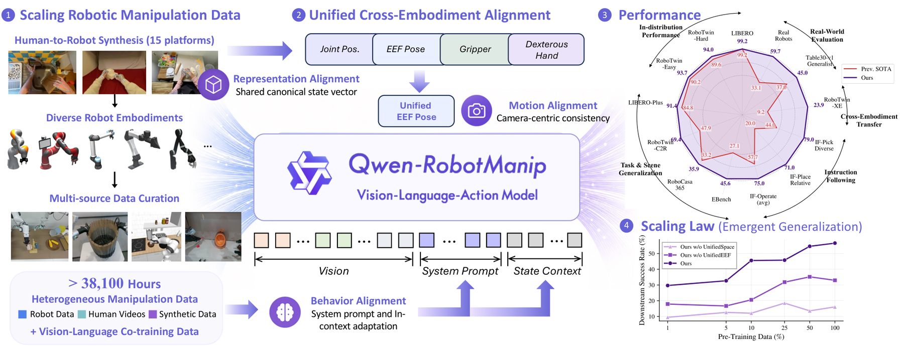{ width="920" }

*原论文首页总览。左侧是数据扩展，中间是表示、运动和行为对齐，右侧是评测结果。图里的顺序对应论文的实验假设，数据先经过三类转换，随后才检验增加数据是否改善 OOD 表现。* [↗](https://arxiv.org/pdf/2606.17846v2#page=1)

标准 LIBERO 和 RoboTwin 上，缺少大规模机器人预训练、但保留预训练 VLM 的 scratch 模型已经很强。作者把主要比较放到分布外条件，包括未见相机、不同初始构型、同一画面中的新指令，以及改变机器人本体。读这篇报告时，应把这些协议和同分布均值分开。

## 从多视角观察到动作块，信息经过哪些模块

Qwen-RobotManip 使用感知语言骨干与动作专家分工的结构，但二者通过动作损失端到端训练。Qwen3.5-4B 接收多视角图像、指令和可选历史上下文，输出宽度为 2560 的最后一层 hidden states。视觉 token 与语言 token 已经在 VLM 内交互过，动作专家随后根据连续控制需要读取这些表示。[↗](https://arxiv.org/pdf/2606.17846v2#page=10)

动作专家是 10 层 Diffusion Transformer，隐藏宽度 768、12 个注意力头。当前本体状态先经过两层 MLP，再与带噪动作 token 拼接。各层通过 self-attention 交换状态、动作与查询 token 的信息，通过 cross-attention 读取 VLM 最后一层特征，再经过 SwiGLU 前馈网络。偶数编号层读取视觉 token，奇数编号层读取语言 token，让空间观察和指令分别参与动作更新。去噪时间、末端类型、相机标定是否可用等信息通过条件归一化进入动作头。[↗](https://arxiv.org/pdf/2606.17846v2#page=10)

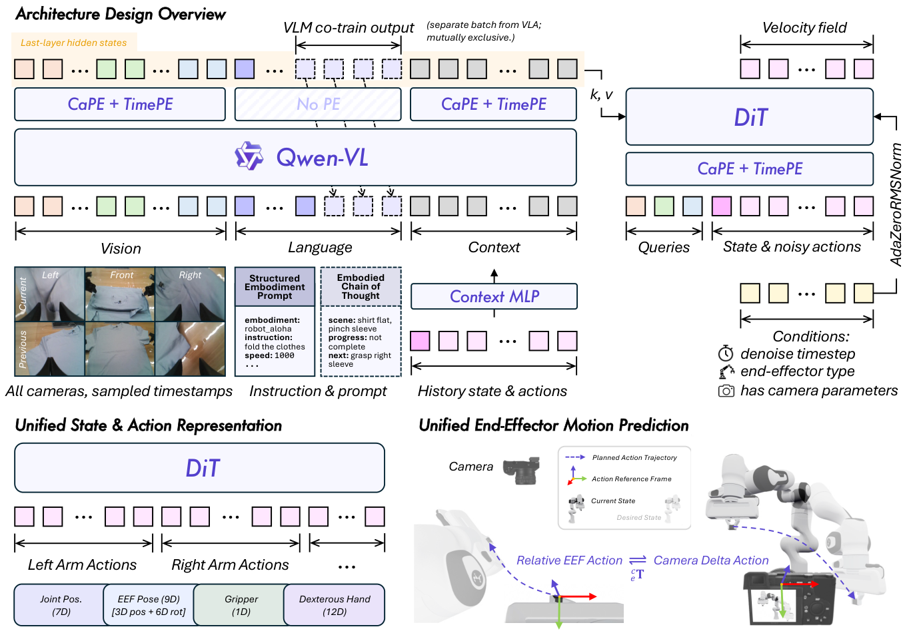{ width="880" }

*原论文 Figure 3。当前状态走右侧动作头的专用路径；历史状态和动作经 Context MLP 进入左侧 VLM；图像与语言的最后层表示作为 DiT 的条件。上方虚线中的语言输出属于另一类训练 batch，不能理解为每次机器人动作前都必须先生成一段解释。* [↗](https://arxiv.org/pdf/2606.17846v2#page=11)

论文还比较了如何连接这两个网络。第一种方案把视觉语言 token 复制到 DiT 内，用 self-attention 处理，并逐层融合 VLM 的对应层特征；第二种只复制最后层特征，取消逐层融合；最终方案保留少量可学习 query，与状态、动作共同计算，在 cross-attention 中读取完整的 VLM 特征，计算结束后丢弃 query 的输出。这样不用把全部视觉语言 token 一直保留为动作网络内的活动序列。[↗](https://arxiv.org/pdf/2606.17846v2#page=34)

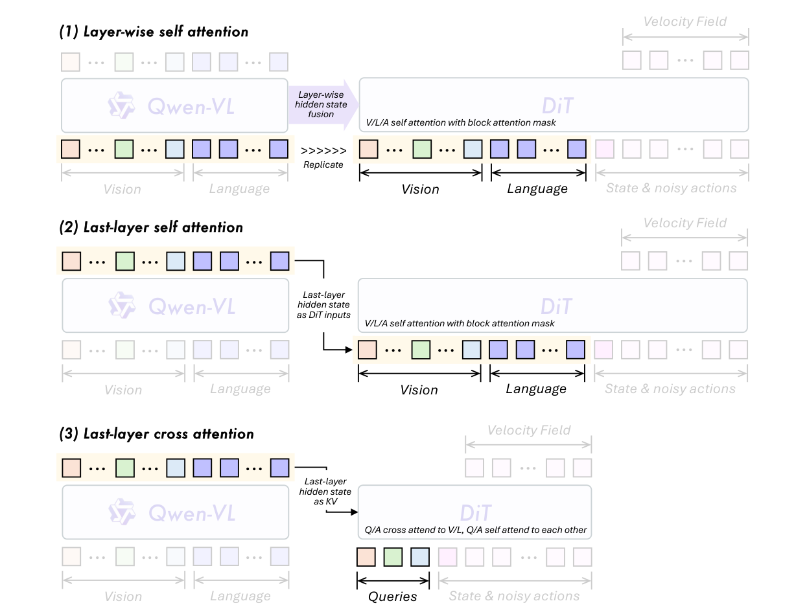{ width="820" }

*原论文 Figure 20。前两行将完整 Vision/Language token 放进 DiT，第三行用 Queries 读取外部 K/V。应比较三种结构中哪些 token 每层都参与动作网络计算，而不只是比较是否存在注意力。* [↗](https://arxiv.org/pdf/2606.17846v2#page=35)

| Architecture | Camera | Robot | Language | Light | Background | Noise | Layout | Total |
|---|---:|---:|---:|---:|---:|---:|---:|---:|
| layer-wise self attention | 74.5 | 74.3 | 86.8 | 98.6 | 96.0 | 94.9 | 86.1 | 86.4 |
| last-layer self attention | 75.5 | 71.4 | 87.2 | 98.3 | 98.9 | 96.1 | 88.1 | 87.0 |
| last-layer cross attention | 76.9 | 73.4 | 86.9 | 98.9 | 97.7 | 97.3 | 87.3 | 87.5 |

*原论文 Table 19，LIBERO-Plus success rate，单位 %。三组都只用机器人数据预训练，保留相机末端表示，去掉结构化 prompt、ECoT 和历史上下文，再在 LIBERO 上微调。* [↗](https://arxiv.org/pdf/2606.17846v2#page=35)

这组控制实验支持最后层 cross-attention 的平均表现和结构效率，但优势只有 0.5–1.1 个百分点，Robot、Background、Layout 等单轴也有其他结构更好。作者报告该方案计算成本最低，表中却没有配套的毫秒或 FLOPs 数据。因此可以复用“让动作查询读取骨干特征”的接口选择，不能据此给出未经测量的速度倍数。

## 80 维空间统一的是语义，零填充本身不构成对齐

状态和动作采用 80 维 canonical vector。它由两个 29 维手臂块和 22 个预留维度组成，每个手臂块具有固定语义。[↗](https://arxiv.org/pdf/2606.17846v2#page=10)

| Semantic group per arm | Dimensions | State / action meaning |
|---|---:|---|
| Joint positions | 7 | 关节状态与关节动作均采用绝对值 |
| End-effector pose | 9 | 状态为位置 3D + 连续旋转 6D；动作使用相对当前末端的增量，旋转增量为 3D rotation vector |
| Gripper state | 1 | 平行夹爪开合通道 |
| Dexterous hand joints | 12 | 灵巧手主动关节通道 |
| Shared reserved dimensions | 22 in total | 两臂之外的扩展通道，例如移动基座速度 |

表中的 9 维是末端字段的模板容量，不能据此把动作旋转也写成 6D。论文明确区分状态旋转与动作旋转增量。单臂机器人只填充一侧相关槽位，双臂填充两侧，有灵巧手再填手指字段；不存在的自由度补零，并用 mask 排除监督。[↗](https://arxiv.org/pdf/2606.17846v2#page=11)

在 DiT 内部，这个向量还要重排为末端 token。每个手臂的 29 个有效字段装入一个 40 维槽位，另留 11 维扩展，得到一个或两个末端 token，再联合做 self-attention。80 维是外部统一表示，40 维是网络按末端处理时的打包方式，两者解决不同层次的问题。[↗](https://arxiv.org/pdf/2606.17846v2#page=12)

统一槽位先解决字段顺序和缺失通道的问题。假设两个数据集都提供关节角、末端和夹爪，统一后夹爪不会因为字段顺序不同而落到另一个机器人的关节槽里；没有右臂的样本也不会因为右臂字段为零，就被当成“命令右臂回到零位”。坐标差异仍然存在，同一位移在不同基座轴中依旧可能有不同数值，后续还需要运动对齐。

### 把 80 维向量写成一条样本

先只看一条单臂样本。左臂的 29 个位置按表中顺序填写，右臂的 29 个位置保留为零，22 个预留维度也保留为零。于是向量长度为

$$
29_{mathrm{left}}+29_{mathrm{right}}+22_{mathrm{reserved}}=80.
$$

真正参与动作损失的是左臂的 29 个槽位，右臂和预留维度的 mask 为 0。双臂样本把左右两组 29 维都打开；如果还控制移动底座，再打开对应的预留槽位。这个 mask 很关键，因为“右臂数值为 0”表示该本体没有右臂时，不能被训练器当成“右臂应该回到零位”。

可以用一个更小的二维投影检查槽位是否被错接。假设某数据集的左臂末端平移为

$$
{}^{e}t_{e^*}=(0.10,0.00)\ \mathrm{m},
$$

而参考相机相对末端的平面旋转为

$$
{}^{c}R_e=egin{bmatrix}0&-1\\1&0\end{bmatrix}.
$$

相乘得到

$$
{}^{c}R_e{}^{e}t_{e^*}=(0.00,0.10)\ \mathrm{m}.
$$

同一个“沿机器人 $x$ 轴前进 10 cm”的动作，在相机坐标中变成沿相机 $y$ 轴前进 10 cm。若另一个机器人原始 $x$ 轴方向不同，却也得到相同的相机坐标增量，策略才有机会把它们视为相似运动。这个二维例子只展示平移旋转，论文实际使用三维旋转和末端位姿；它也没有处理标定误差、控制频率或可达性。

LeRobot 的官方文档可以作为数据工程层面的参照。它把同步视频、state、action、timestamp 和 episode 元数据放进统一的 `LeRobotDataset`，还允许用 `delta_timestamps` 读取历史帧。[↗](https://huggingface.co/docs/lerobot/en/lerobot-dataset-v3) 这解决的是记录、索引和读取问题，不能替代 Qwen-RobotManip 对动作槽位、相机坐标和本体 mask 的语义对齐。本站这里借用的是“字段和时间戳要显式记录”的教程经验，80 维布局与二维算例是针对论文的解释性展开。

## 相机末端增量如何把观察与动作放到相同几何关系中

设 $c$ 为参考相机坐标，$e$ 为当前末端坐标，$e^*$ 为未来目标末端坐标。用 ${}^{c}R_e$ 表示将末端坐标中的向量转换到相机坐标的旋转，${}^{e}R_{e^*}$ 和 ${}^{e}t_{e^*}$ 分别表示目标末端相对当前末端的旋转、平移。论文实际使用的 Eq. 5 为

$$
a_p=
\begin{bmatrix}
{}^{c}R_e\,{}^{e}R_{e^*}\,{}^{e}R_c & {}^{c}R_e\,{}^{e}t_{e^*}\\
0 & 1
\end{bmatrix},
\qquad {}^{e}R_c=({}^{c}R_e)^{\mathsf T}.
$$

左上角通过共轭变换把相对旋转表达在相机轴中；右上角只将末端位移旋转到相机轴。模型因此学习“沿参考画面的空间方向移动多少、转动多少”，而不必把所有数据首先解释成某个特定机器人的基座动作。[↗](https://arxiv.org/pdf/2606.17846v2#page=12)

原文同时比较了完整变换的乘积 $a_p={}^{c}T_{e^*}\,{}^{e}T_c$。这两种写法在平移上不相同。为看清差别，令当前、目标末端在相机中的位姿分别为 $(R,p)$、$(R^*,p^*)$，记 $\Delta R=R^*R^{\mathsf T}$。直接展开矩阵乘法，可得

$$
\begin{aligned}
\text{Eq. 5 translation}&=p^*-p,\\
\text{Eq. 6 translation}&=p^*-\Delta R\,p
=(p^*-p)+(I-\Delta R)p.
\end{aligned}
$$

这是对原式的代数展开。若末端在原地转动，第一种表示的平移增量为零；第二种还包含与末端到相机偏移有关的一项。后一种是完整刚体变换的表达，但会把转动与相机偏移耦合到平移标签中。作者选择 Eq. 5，是为了减轻长尾分布和标定误差敏感性，并未声称所有几何不一致都因此消失。

### 动作采用哪个相机，注意力就需要知道哪个相机

单臂训练随机选择外部相机或腕部相机作为参考；双臂可以共同使用头部、第三人称相机，也可以各自使用对应腕部相机。视觉 token 的 Camera Positional Encoding（CaPE）使用其所属相机外参，状态和动作 token 使用选定参考相机外参。这样，动作查询不同视角时，注意力中含有二者的相对位姿；共同的世界参考在点积计算中抵消，模型不必绑定某个世界原点。[↗](https://arxiv.org/pdf/2606.17846v2#page=12)

每个 attention head 有 64 维，其中 32 维用于 CaPE，另外 32 维用于时间 RoPE。CaPE 不只作用于 Q/K，也作用于 V 和注意力输出；内参信息则通过视觉 patch 的归一化图像平面坐标，经可学习线性映射后加到图像 token。两路几何信息分别说明视角之间如何变换，以及每个图像位置对应怎样的视野。

这一设计有明确的执行条件。相机增量模式在训练和推理都需要标定；缺少标定时，额外二值 flag 让模型改用机器人基座相对模式。另一个末端类型 embedding 区分单臂、双臂左右侧、第一视角头部和移动基座。共享接口因此保留了必要的本体条件，部署时仍需正确地把相机坐标增量交给目标机器人的控制系统。

## 历史上下文怎样提供执行信息，又为什么容易学会抄动作

结构化 prompt 先提供静态背景，包括 `embodiment`、`instruction`、`speed`、`fps` 和 `camera view direction`。其中 speed 是 episode 步数按 500 步分桶的标签，并非传感器测得的瞬时速度；相机方向区分与机械臂同侧或相对侧。训练时以 15% 概率随机丢弃 embodiment、speed、fps 字段，避免策略完全依赖齐全的元信息。[↗](https://arxiv.org/pdf/2606.17846v2#page=13)

静态标签仍不足以描述当前机器人的实际行为。Context 版本将一次历史决策定义为 $(o_h,s_h,a_h)$，分别记录当时的图像、本体状态和执行过的完整 $K$ 步动作块。历史图像与当前图像一起送入视觉编码器，指令中附带图像数量说明；数值状态和动作则由两个 MLP 投影到 VLM 的隐藏空间。

历史状态生成一个 token，历史动作块展平后生成 $K'$ 个 token，并加入时间位置与块内槽位位置编码。

$$
\begin{aligned}
t_h^s&=\operatorname{MLP}_s(s_h)+e_h^{\mathrm{temp}},\\
[t_h^{a,0},\ldots,t_h^{a,K'-1}]&=
\operatorname{reshape}(\operatorname{MLP}_a(\operatorname{flatten}(a_h)))
+e_h^{\mathrm{temp}}+e_{0:K'}^{\mathrm{slot}},\\
C&=[t_0^s,t_0^{a,0:K'},\ldots,t_{H-1}^s,t_{H-1}^{a,0:K'}]
\in\mathbb R^{H(1+K')\times2560}.
\end{aligned}
$$

这里 $H$ 是历史 chunk 数，$K'$ 是动作块编码后的 token 数，不必等于原始动作步数 $K$。默认 unified 模式把 $C$ 放在 VLM 输入末尾，通过 causal self-attention 整合视觉、指令和历史，再把结果传给动作专家。另一种 dual 模式直接把状态动作历史交给 DiT，减少 VLM 上下文增长，但历史与语义的整合较浅。当前状态继续走动作头原有 MLP，不混入历史状态编码路径。[↗](https://arxiv.org/pdf/2606.17846v2#page=14)

这类设计容易产生一个训练捷径。若每次只给最近动作块，模型可以复制它，获得很低的动作误差，却没有识别抓取方式、速度和运动学响应。作者因此在训练时从 episode 内随机位置抽取上下文窗口，使上下文可能远离当前步骤；推理时才使用最近 $H$ 个 chunk 的滚动窗口。其目标是从同一 episode 中提取行为特征，实现不更新参数的策略适配，而非构建跨任务长期记忆。

### 上下文收益必须与动作采样预算一起看

| Configuration | Emb. Tag | FPS | Context | Denoise Steps | Easy | Hard | Avg |
|---|---|---:|---|---:|---:|---:|---:|
| Qwen-RobotManip w/o UnifiedEEF | × | × | × | 4 | 71.2 | 54.2 | 62.7 |
| + Soft-Prompt | soft | × | × | 4 | 70.2 | 52.1 | 61.2 |
| + Language Prompt | lang. | 15 | × | 4 | 71.7 | 55.1 | 63.4 |
| + Structure Prompt | ✓ | 15 | × | 4 | 73.4 | 58.3 | 65.9 |
| Qwen-RobotManip-Context | ✓ | 15 | ✓ | 4 | 72.1 | 54.4 | 63.3 |
| Qwen-RobotManip-Context | ✓ | 15 | ✓ | 10 | 80.1 | 61.6 | 70.9 |
| Qwen-RobotManip-Context | ✓ | 15 | ✓ | 20 | 79.8 | 62.1 | 71.0 |

*原论文 Table 15，RoboTwin-Clean2Rand joint control，success rate 为 %，speed 标签固定为 500。实验使用较小数据子集的早期 checkpoint，历史为单个 observation-action chunk。* [↗](https://arxiv.org/pdf/2606.17846v2#page=33)

最关键的是中间三行。结构化 prompt 的四步结果为 65.9；加入历史后仍用四步，均值降至 63.3，作者观察到动作抖动；增加到十步才达到 70.9，二十步则只有很小变化。历史增加了条件动作分布的复杂程度，动作头需要足够采样预算。表中没有“无历史、十步”的额外控制，因此 70.9 相对 65.9 的差值应理解为历史与增加采样步数的联合收益，不能全部归于历史本身。

Context 还有启动阶段的问题。episode 开始时历史全为零填充，模型容易迟疑后才开始运动。论文因此同时提供基础版和上下文版。后续看到 Context 在部分 OOD 任务上领先时，也应把更多上下文、更多去噪计算和启动行为放在同一张决策表里。

## 38,100 小时来自哪里，Human-to-Robot 增加了什么

操作语料的规模首先要按来源拆开。机器人数据还包含仿真来源，例如 InternData-A1，所以 Robot 这一行也不等于全部真实遥操作小时数。[↗](https://arxiv.org/pdf/2606.17846v2#page=3)

| Data Type | Embodiment Type | Data Sources | Total Time |
|---|---|---|---:|
| Robot | Single-arm | OXE, RoboMIND, DROID, RH20T 等 | 3,808 h |
| Robot | Dual-arm | AgiBotWorld-Beta, RoboCOIN, RDT 等 | 6,744 h |
| Robot | Mobile & humanoid | 与其他 Robot 行共享多来源语料，含 Galaxea Open-World 等 | 868 h |
| Human | Human hands | EgoDex, VITRA, EgoVerse | 1,933 h |
| Human-to-Robot | 15 dual-arm platforms | Synthesized from human data | 24,808 h |

*按原论文 Table 1 重排。原表的机器人数据源跨三个 embodiment 行共享，这里列举来源用于说明构成，不将每个来源排他地归入单一类别。* [↗](https://arxiv.org/pdf/2606.17846v2#page=3)

三类机器人时间相加为 11,420 小时，全部表项相加为 38,161 小时，正文以约 38,100 小时概括。按表中小时数计算，H2R 合成约占 65%，但这只是语料构成，不能直接当成训练采样权重。人类源包括 EgoDex 的 732 小时、VITRA 的 247 小时和 EgoVerse 的 954 小时，统一为 MANO 参数与 21 个手部关键点；没有原生 MANO 标注的来源通过优化拟合得到表示。

### 先产生可控制的轨迹，再替换画面中的手臂

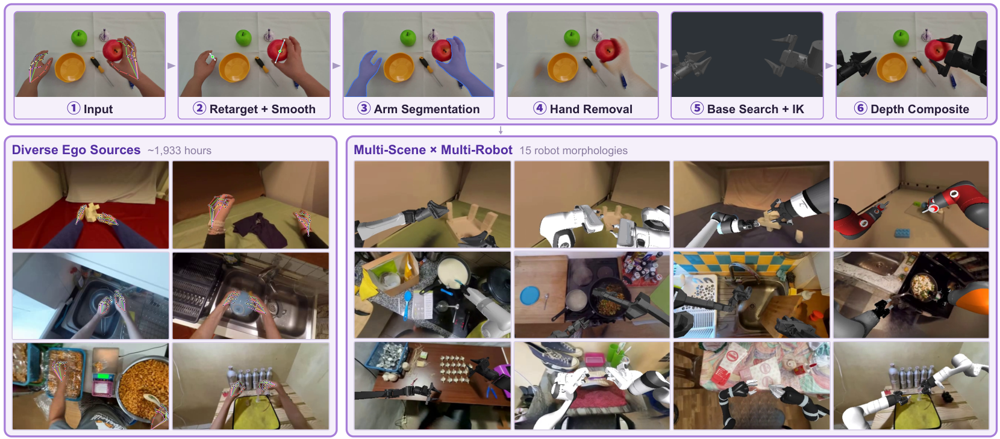{ width="920" }

*原论文 Figure 1。上排从原始人手出发，经动作重定向、分割、补背景、基座搜索和 IK，最后做深度合成；下排展示同一批人类交互被转换成不同机器人形态。动作与外观两路都要转换，单纯替换像素不能提供正确控制标签。* [↗](https://arxiv.org/pdf/2606.17846v2#page=5)

在动作侧，手指关节不直接逐个对应机器人关节。先以食指和中指指尖定义虚拟手指，再用拇指与虚拟手指确定平行夹爪中心和开口。

$$
\begin{aligned}
k_{\mathrm{vf}}&=0.7k_{\mathrm{index}}+0.3k_{\mathrm{middle}},\\
p&=\tfrac12(k_{\mathrm{thumb}}+k_{\mathrm{vf}}),\qquad
w=\|k_{\mathrm{thumb}}-k_{\mathrm{vf}}\|_2,\\
z&=\frac{s(k_{\mathrm{thumb}}-k_{\mathrm{vf}})}{w},\qquad
d=k_{\mathrm{vf}}-k_{\mathrm{wrist}},\\
y&=\frac{z\times d}{\|z\times d\|},\qquad x=y\times z,\qquad R=[x\ y\ z].
\end{aligned}
$$

其中右手 $s=+1$、左手 $s=-1$，使两只手映射后的夹爪轴方向一致。$z$ 沿夹爪开合连线，$y$ 是该连线与腕部方向构成平面的法向，$x$ 为接近方向。逐帧重建容易抖动，位置和开口用 Savitzky–Golay 滤波，旋转用 Gaussian-weighted SLERP 平滑。[↗](https://arxiv.org/pdf/2606.17846v2#page=5)

接下来必须确定机器人基座放在哪里。人手轨迹没有天然的机器人基座，若随便放一个，很多末端点可能不可达。作者从轨迹空间极值中选代表关键帧，在轨迹中心附近、受机械臂最大可达距离约束的网格上搜索候选基座，以关键帧 IK 可解的比例最大为目标。15 种机器人分别搜索，再在 MuJoCo 中求 IK 跟踪平滑轨迹。这里的“跨 15 平台”具体是由 Panda、UR5e、ARX-L5、xArm7、Sawyer、Kinova Gen3、IIWA、Jaco、FR3、UR10e、ViperX、WidowX、Piper、YAM、AgileX ALOHA 构成的双臂配置。[↗](https://arxiv.org/pdf/2606.17846v2#page=6)

视觉侧先由 SAM3 分割人类手臂，用 ProPainter 结合光流补全背景；随后渲染机器人图像和深度，用 Depth Anything 3 的场景深度决定哪一部分机器人应当可见。

$$
M_t^{\mathrm{occ}}=\mathbf1[D_t^{\mathrm{robot}}\leq D_t],\qquad
I_t^{\mathrm{syn}}=M_t^{\mathrm{occ}}\odot I_t^{\mathrm{robot}}
+(1-M_t^{\mathrm{occ}})\odot\hat I_t.
$$

$\hat I_t$ 是去除人手后的背景。这个比较使前景物体能够遮挡合成机械臂，避免简单贴图把机械臂永远盖在物体上；它也意味着场景深度、手部重建和补全误差都会进入训练样本。动作可达与像素合成只覆盖部分物理约束，不能把这些数据当成经过完整接触动力学验证的真实机器人执行。

不同人类来源还做速度分布处理。论文报告 EgoDex、EgoVerse、VITRA 分别按原帧率的 60%、45%、25% 进行训练采样调整，对应作者所称约 1.7、2.2、4 倍减速。这个步骤与 prompt 中的 FPS、speed 字段共同说明，统一几何后仍要处理时间尺度；不能只转换空间坐标而忽略动作变化速度。[↗](https://arxiv.org/pdf/2606.17846v2#page=6)

## 数据清洗不只是删除坏视频，还要修复动作的因果关系

跨来源数据的主要风险，常出现在状态和动作的对应关系里。时间戳错位可能让状态变化看起来早于控制命令；同一机械臂也可能在两个数据集中使用不同关节正负号、TCP 定义和基座原点。论文因此先进行五阶段数值检查，再进行三类跨模态检查。[↗](https://arxiv.org/pdf/2606.17846v2#page=7)

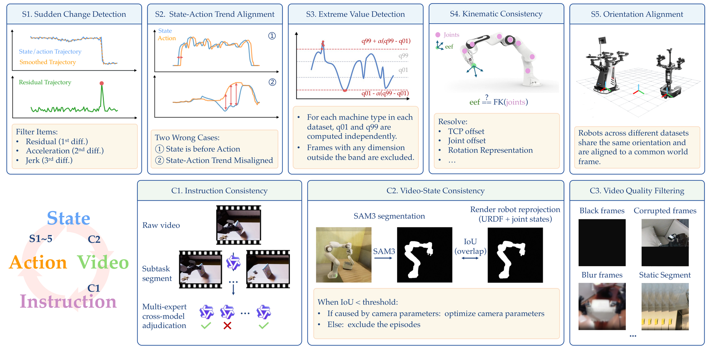{ width="920" }

*原论文 Figure 2。上排检查 State/Action 信号，下排检查指令、画面和机器人状态是否描述同一次行为。第二列中特别区分“状态先于动作”和“状态动作趋势不一致”，右下的掩码重叠检查则把 URDF 几何投影与真实画面连接起来。* [↗](https://arxiv.org/pdf/2606.17846v2#page=6)

1. **Sudden Change Detection**。先用中值滤波与 Savitzky–Golay 提取趋势，再同时看原信号残差、二阶差分和三阶差分。只有残差过阈值，且加速度或 jerk 也过阈值时才标异常，减少把缓慢漂移误当突变。不同来源采用不同阈值和剔除粒度，InternData-A1 的碰撞异常按整个 episode 删除。
2. **State-Action Trend Alignment**。对共享关节维度平滑后，以互相关估计时延，再比较对齐后的一阶差分方向。方向一致性通常要求达到 0.6–0.7；delta action 先积分回绝对值再比较。这一检查发现 RoboMIND 的 UR 类型子集中约 81% episode 不合格并被剔除，比例只适用于该子集与规则。
3. **Extreme Value Filtering**。每种本体按维度计算分位数，剔除超出扩展分位区间的帧，防止异常值扭曲随后 $[q_{01},q_{99}]\rightarrow[-1,1]$ 的归一化。夹爪由于天然双峰分布，不套用这项过滤。
4. **Joint–EEF FK Consistency**。利用 URDF 和 Pinocchio 从关节状态计算 FK，与记录的末端位姿比较。固定位置偏移可通过 TCP 修正，肩部相对双臂位姿可转换到统一世界坐标。这个阶段优先修正定义错误，并非一律丢掉不一致样本。
5. **Orientation Alignment**。校正各数据集的朝向约定，使正 $x$ 轴一致表示机器人前方，避免相同姿态在不同来源中带着隐含旋转。

跨模态检查进一步避免“每路数据各自合理，组合起来却不对应”。语言检查把长 episode 切成局部子任务，要求 VLM 按对象、动作、时序和交互分析，再由多个模型裁决歧义样本。视频—状态检查根据关节和 URDF 渲染机器人投影，与微调 SAM3 得到的真实机器人掩码计算重叠；若问题来自相机参数则修正参数，否则过滤。黑帧、损坏、模糊和冗余静止也会被清理，但夹爪关闭等视觉变化很小的关键帧必须保留。[↗](https://arxiv.org/pdf/2606.17846v2#page=7)

这套流程最可复用的部分是明确区分三件事：突变需要剔除，坐标定义需要转换，标定与 TCP 错误需要修正。把三者统称为低质量数据，只会在过滤时损失可修复的样本，或让仍然错误的动作标签留在训练集里。

## 语言共训怎样进入控制学习，ECoT 又承担什么角色

操作数据之外，作者使用约 28M 条 vision-language 数据，覆盖通用视觉理解、空间感知推理、OCR/文档、专业多模态知识、指令与多语言文本，以及具身相关监督。这部分明确包含专有来源、公开数据和合成数据。因此“无需专有操作数据采集”是关于操作语料的判断，不能扩展为整个训练流程只使用公开数据。[↗](https://arxiv.org/pdf/2606.17846v2#page=8)

具身相关 VL 数据有三条路线。第一条是 Embodied Chain-of-Thought，监督模型描述当前场景、判断任务进度、给出下一步原子动作。第二条把人类第一视角视频切成 1.5–3 秒片段，每段均匀取四帧，描述手臂运动、接触关系与物体状态变化。第三条把末端或人手轨迹投影到图像平面，监督未来 2D 坐标序列，并过滤几乎没有运动的样本。[↗](https://arxiv.org/pdf/2606.17846v2#page=9)

ECoT 的标注过程使用了比模型训练输入更丰富的证据。标注器读取当前多视角图像，还利用过去帧的行为摘要、从当前开始每秒取一帧的六帧未来预览，以及 episode 相对进度。Qwen3.6-Plus thinking mode 据此生成三段文本；训练样本却只把当前多视角图像和指令作为输入，历史摘要与未来预览不进入训练输入。这是一种用轨迹辅助生成更可靠标签的办法，不能理解为部署时模型能够访问未来视频。

ECoT 监督也不意味着控制循环必须先输出语言计划。架构中 VL next-token prediction 和 VLA 动作训练采用互斥 batch。具身文本帮助塑造骨干表示，连续动作仍由 DiT 读取这些表示后生成。这一区分关系到推理成本，也关系到如何判断语言推理究竟是训练信号还是在线控制步骤。

### Flow matching 与有效元素归一化

为避免把动作块内的时间步与 flow time 混淆，下面用 $k$ 表示动作步，用 $\tau$ 表示去噪时间。训练对真值动作块 $a$ 采样高斯噪声和时间，构造

$$
\epsilon\sim\mathcal N(0,I),\qquad
\tau\sim\operatorname{Beta}(1,1.5),\qquad
x_\tau=(1-\tau)\epsilon+\tau a,\qquad
v=a-\epsilon.
$$

动作专家预测速度场 $v$。$\tau=0$ 对应噪声，$\tau=1$ 对应动作；基础版推理从噪声出发做四步 Euler 积分。四步是每个动作块的采样预算，不能换算成四 Hz 控制。一次 VLM 前向还会被复用于八组独立的噪声与时间采样，使动作专家在相同图像、语言与真值动作上获得更多训练信号，不增加新的示范数据。[↗](https://arxiv.org/pdf/2606.17846v2#page=15)

有效 mask 由本体槽位、时间步有效性和人类手部可见性三者相与得到。若动作块内某步异常或超出 episode，之后的步骤也被屏蔽；若人手离开视野，对应整臂槽位从离开时刻起失去监督。最终损失先在每个样本内部对有效元素求平均，再在 batch 内求平均。

$$
\mathcal L_{\mathrm{FM}}=
\frac1B\sum_{i=1}^{B}
\frac{\sum_{k,j}m_{i,k,j}(\hat v_{i,k,j}-v_{i,k,j})^2}
{\sum_{k,j}m_{i,k,j}},\qquad
\mathcal L=\mathcal L_{\mathrm{FM}}+0.1\mathcal L_{\mathrm{VLM}}.
$$

$\mathcal L_{\mathrm{VLM}}$ 是标准自回归 next-token loss。若直接对所有元素求和，双臂、灵巧手等有效维度更多的样本会仅因元素数量更多而获得更大权重；这里的按样本归一化把这种偏置去掉。动作损失更新骨干与动作专家，语言损失更新骨干，VLA 与 VL 训练流按 9∶1 混合。[↗](https://arxiv.org/pdf/2606.17846v2#page=15)

主实验的下游 SFT 为每个 benchmark 或真机部署域训练一个多任务模型，只优化动作损失，不保留 VL loss；关闭预训练的多阶段清洗，使用目标域完整数据，并对图像做 color jitter。混合 VL 或辅助 VLA 的后训练是另行研究的增强方案，不能把它当成所有主表成绩的默认配置。

## 数据扩展实验如何检验“对齐之后才能规模化”

论文没有用不同机器人数据随意拼接成几组大小不同的数据。它从完整混合语料按本体和任务采样，构造嵌套的 1%、5%、10%、25%、50%、100% 子集，让小子集严格包含于大子集；评测固定在 15 种本体、154 个训练未见任务组成的 OOD 集上。三种表示分别是原始字段拼接后补零、固定语义槽位但不采用统一相机 EEF，以及完整表示。[↗](https://arxiv.org/pdf/2606.17846v2#page=31)

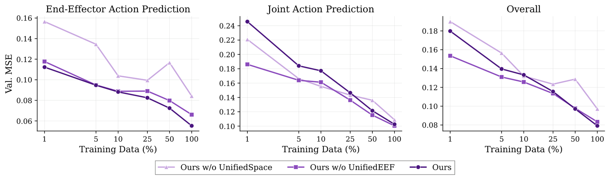{ width="920" }

*原论文 Figure 18。横轴是训练数据比例，纵轴为验证 MSE，越低越好；从左到右分开统计末端动作、关节动作和整体误差。每个点取该配置所有训练 checkpoint 中最佳验证 MSE。* [↗](https://arxiv.org/pdf/2606.17846v2#page=32)

先看左侧末端动作。没有语义槽位的浅色曲线较不稳定，增大数据并不总能降低误差；加入语义对齐后，两个深色版本总体更稳定下降，完整相机表示的平均末端误差最低。关节误差里差距较小，符合相机 EEF 主要直接改变笛卡尔运动监督的设计。这里衡量的是既定训练流程内各数据规模能达到的最佳误差，并未固定所有点的总计算预算，不能拿它直接预测算力翻倍的收益。

离线动作误差还可能与闭环执行脱节，因此作者再把各预训练模型统一在 RoboTwin Clean 上微调 80K 步，检查闭环 rollout 成功率。

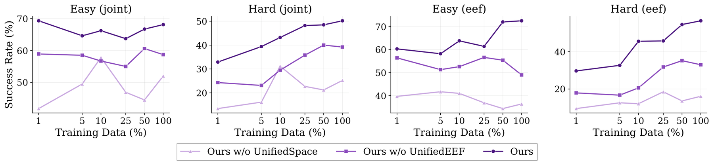{ width="920" }

*原论文 Figure 19。四个面板分别为 joint/EEF 控制在 Easy/Hard 条件下的成功率。应优先比较第二、第四个 Hard 面板，而不是从 Easy 面板寻找同样清晰的增长曲线。* [↗](https://arxiv.org/pdf/2606.17846v2#page=32)

完整对齐在 Hard 条件下随数据增大持续改善，满规模达到 joint 50.2%、EEF 56.6%；相同消融中的 Easy 为 joint 68.1%、EEF 72.5%。去掉统一相机 EEF 后，EEF 控制对应为 Easy 49.0%、Hard 33.0%。它说明对齐的收益不仅表现为数值误差更低，也能转化成更好的 EEF 控制接口。[↗](https://arxiv.org/pdf/2606.17846v2#page=37)

不过 Easy 面板并没有随数据规模出现同样稳定的上升，其他表示在 Hard 上也更波动。这与论文选择 OOD 指标的动机相呼应。上述数据扩展研究属于较低预算消融，50.2/56.6 与主实验中的 62.6/60.8 来自不同配置，不能混成同一训练运行的结果。

### H2R 和 VL 数据分别提供了多少增益

为了区分“有人类视频”和“人类视频经过机器人对齐”两件事，H2R 消融比较 Robot-only、加入原始 Ego、以相同来源的 H2R 替换 Ego。辅助数据配置使用 7∶3 的 robot-to-auxiliary 比例，各组训练步骤、超参数和微调数据相同。[↗](https://arxiv.org/pdf/2606.17846v2#page=33)

| Pretraining data | RT-C2R Easy | RT-C2R Clutter | RT-C2R Hard | LIBERO-Plus Camera | LIBERO-Plus Robot | LIBERO-Plus Total |
|---|---:|---:|---:|---:|---:|---:|
| robot-only | 72.9 | 57.2 | 54.7 | 72.8 | 78.2 | 87.1 |
| +ego | 73.4 | 59.2 | 55.0 | 77.7 | 79.0 | 88.4 |
| +h2r | 74.2 | 58.1 | 58.7 | 80.0 | 80.2 | 89.0 |

*原论文 Tables 16–17 的关键列，success rate 为 %；RT-C2R 采用 EEF 控制。两张表的其他扰动维度仍可由原表查看。* [↗](https://arxiv.org/pdf/2606.17846v2#page=34)

原始 Ego 对 Camera 鲁棒性已经有收益，H2R 在此基础上再提高；组合扰动 Hard 从 robot-only 的 54.7 到 58.7，改善 4.0 个百分点。但 Clutter 下原始 Ego 的 59.2 高于 H2R 的 58.1，LIBERO-Plus 的 Noise 也是 Ego 97.3 高于 H2R 96.6。合理的判断是 H2R 在两项 benchmark 的总体表现上增加了收益，动作重定向与外观替换的联合管线有效；这组实验没有将两条处理分开消融，不能分别量化它们的因果贡献。

| VL co-training setting | LIBERO | LIBERO-Plus | RT-C2R Easy | RT-C2R Hard | RT-IF |
|---|---:|---:|---:|---:|---:|
| Qwen-RobotManip | 99.1 | 90.1 | 73.2 | 62.6 | 71.6 |
| without VL data in pre-training | 98.2 | 88.9 | 66.5 | 54.4 | 64.6 |
| with VL data in post-training | 98.6 | 91.4 | 74.0 | 62.5 | 73.1 |

*原论文 Table 18，单位 %。本表的 LIBERO-Plus 90.1、RT-IF 71.6 与主结果表的 89.0、72.2 不同，比较共训收益时应使用本表自己的基线。* [↗](https://arxiv.org/pdf/2606.17846v2#page=34)

取消预训练中的 VL 数据，LIBERO 仅降低 0.9 个百分点，RT-C2R Hard 却下降 8.2，RT-IF 下降 7.0。这支持保留视觉语言能力对复杂 OOD 控制的作用。反过来，在 SFT 继续加入 VL，IF 提高到 73.1，但 Hard 几乎不变，LIBERO 还略降。不同数据的价值取决于评测究竟改变了语言语义还是视觉、物理条件，不能把共训理解为对所有能力统一加分。

## 标准高分为什么不足以判断预训练价值

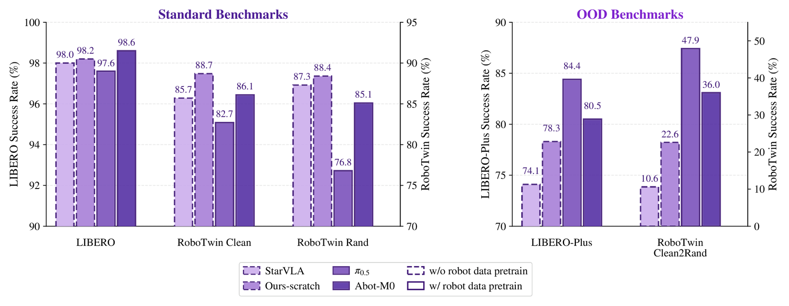{ width="920" }

*原论文 Figure 4。虚线边框表示没有大规模机器人数据预训练；左侧标准测试中，它们可以接近甚至超过预训练模型，右侧的 LIBERO-Plus 和 Clean2Rand 才拉开差距。这里的 scratch 仍以预训练视觉语言骨干为起点。* [↗](https://arxiv.org/pdf/2606.17846v2#page=17)

标准表中，Qwen-RobotManip-scratch 的 LIBERO、RoboTwin Easy/Hard 为 98.2、88.7、88.4；完整基础版为 99.1、93.4、92.5，Context 为 99.2、93.7、94.0。完整预训练确实改善结果，但 scratch 已经很高，因此这些数值无法单独回答模型是否能迁移到不同初始状态和硬件环境。[↗](https://arxiv.org/pdf/2606.17846v2#page=20)

这里还要区分 RoboTwin 默认 Hard 与 RoboTwin-Clean2Rand 的 Hard。后者只在 Clean 数据上微调，再同时改变背景、照明、干扰物和桌面高度；不能把前者的 92.5 与后者的 62.6 当成同一训练配置随意切换测试难度的结果。论文用 Clean2Rand 的目的，就是限制下游训练见过的变化，让预训练先验承担更大的迁移责任。

### 从 LIBERO-Plus 看，机器人预训练主要补了哪些缺口

| Model | Camera | Robot | Language | Light | Background | Noise | Layout | Total |
|---|---:|---:|---:|---:|---:|---:|---:|---:|
| π0.5 | 78.4 | 73.6 | 80.8 | 96.2 | 94.1 | 89.0 | 84.5 | 84.4 |
| Qwen-RobotManip-scratch | 70.4 | 44.9 | 88.1 | 95.8 | 95.5 | 84.4 | 79.1 | 78.3 |
| Qwen-RobotManip | 87.2 | 75.5 | 85.6 | 96.6 | 97.7 | 97.7 | 87.3 | 89.0 |
| Qwen-RobotManip-Context | 89.9 | 83.9 | 86.5 | 98.6 | 99.9 | 97.9 | 87.5 | 91.4 |

*原论文 Table 4 的主要对照行，七类扰动 success rate，单位 %。所有模型在标准 LIBERO 数据上微调，再接受这些变化。* [↗](https://arxiv.org/pdf/2606.17846v2#page=21)

最有解释力的两列是 Robot 和 Camera。Robot 改变初始机器人状态，scratch 只有 44.9，预训练基础版提高至 75.5，Context 再到 83.9；相机变化从 70.4 提高至 87.2，再到 89.9。相比之下，scratch 的 Language 已有 88.1，还高于基础版 85.6。通用 VLM 的语言与外观知识能够提供一部分鲁棒性，机器人预训练更明显地补充了构型、几何与交互经验。总体均值领先也不意味着每个轴都领先，原表中 Being-H0.7 的 Layout 88.5 就高于这两个完整版本。

| Model / Control | Easy | Background | Light | Clutter | Height | Hard |
|---|---:|---:|---:|---:|---:|---:|
| π0.5 | 73.1 | 67.0 | 69.2 | 57.9 | 67.6 | 47.9 |
| Qwen-RobotManip-scratch | 71.6 | 60.6 | 70.7 | 24.6 | 63.6 | 22.6 |
| Qwen-RobotManip / joint | 73.2 | 74.6 | 68.4 | 61.3 | 71.0 | 62.6 |
| Qwen-RobotManip / eef | 74.0 | 75.8 | 70.1 | 59.8 | 69.4 | 60.8 |
| Qwen-RobotManip-Context / joint | 84.7 | 82.4 | 84.2 | 75.4 | 79.5 | 69.4 |
| Qwen-RobotManip-Context / eef | 85.0 | 82.4 | 84.7 | 66.8 | 82.9 | 64.0 |

*原论文 Table 5 的主要对照行，RoboTwin-Clean2Rand success rate，单位 %。* [↗](https://arxiv.org/pdf/2606.17846v2#page=21)

Clean2Rand 进一步说明，Easy 71.6 并不保证加入干扰物后仍能正确选择对象。scratch 的 Clutter 降至 24.6、Hard 降至 22.6，而完整 joint 版本分别为 61.3、62.6。Context 又明显改善 Easy 和多个扰动轴，但 EEF 并未在这里统一胜过 joint。相机 EEF 的主要价值还包括跨本体接口，不能要求它在已知本体的每项控制评测都必然更高。

### 长时程与移动操作暴露了剩余困难

| Model | Atomic | Composite-Seen | Composite-Unseen | Total |
|---|---:|---:|---:|---:|
| π0.5 | 39.6 | 7.1 | 1.2 | 16.9 |
| RLDX-1 | 63.0 | 27.5 | 5.4 | 33.2 |
| Qwen-RobotManip | 68.6 | 20.1 | 14.9 | 35.9 |
| Qwen-RobotManip-Context | 63.9 | 22.6 | 11.2 | 33.8 |

*原论文 Table 6 的关键对照，RoboCasa365 success rate，单位 %。Atomic 覆盖基础操作，Composite-Seen/Unseen 分别测试训练见过和未见的长时程复合任务。* [↗](https://arxiv.org/pdf/2606.17846v2#page=22)

基础版在未见复合任务上从 RLDX-1 的 5.4 提高到 14.9，是明显的相对进步，但绝大多数 rollout 仍未成功。训练见过的复合任务中 RLDX-1 的 27.5 又高于基础版 20.1。Context 的未见任务为 11.2、总体 33.8，都低于基础版，说明历史输入并不会自动解决长任务中的决策与执行累积误差。

| Model | Table Top SR / Score | Simple PnP SR / Score | Long Horizon SR / Score | Overall SR / Score |
|---|---:|---:|---:|---:|
| π0.5 | 12.9 / 32 | 45.0 / 50 | 18.1 / 39 | 27.1 / 41 |
| Qwen-RobotManip | 50.0 / 70 | 56.5 / 60 | 29.9 / 55 | 45.6 / 60 |
| Qwen-RobotManip-Context | 49.3 / 56 | 55.0 / 66 | 26.6 / 55 | 43.6 / 59 |

*原论文 Table 7 的关键行。EBench 基于 Isaac Sim，使用 Lift2 + R5a 双臂移动平台，覆盖 26 类任务、794 个评测实例；SR 为完整成功率 %，Score 是过程得分。* [↗](https://arxiv.org/pdf/2606.17846v2#page=22)

EBench 的基础版在三个分项均超过 π0.5，但 Long Horizon 仍只有 29.9% 完整成功。Context 的 Simple PnP 过程分数从 60 提至 66，完整成功率却从 56.5 降至 55.0。这正说明进展得分和任务成功不能互相替代，也不应从一个总分推断所有操作环节都更可靠。

## RoboTwin-IF 如何排除“看场景猜动作”的捷径

仅换一种说法，并不一定能检验策略是否真正服从语言。如果桌面上每次只有一个可操作目标，模型忽略指令也可能做对。RoboTwin-IF 的关键设计，是在相同或相近画面里保留多个合理动作，让指令决定应该选择哪一个。[↗](https://arxiv.org/pdf/2606.17846v2#page=18)

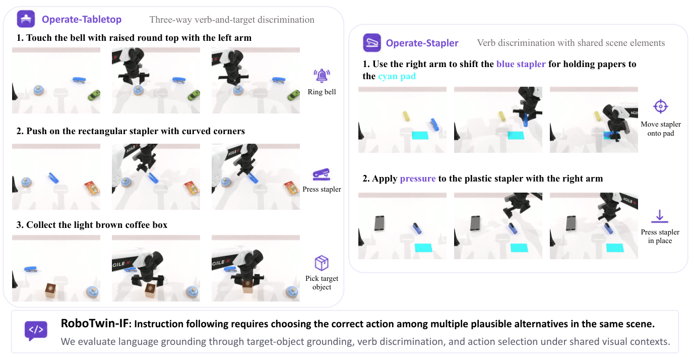{ width="920" }

*原论文 Figure 6。左侧同一桌面同时放铃、订书机和可抓物体，要求根据指令选择；右侧无论是按订书机还是把它移到垫子上，垫子始终存在。测试因此无法仅凭“出现垫子”就猜出应该搬运动作。* [↗](https://arxiv.org/pdf/2606.17846v2#page=19)

五个 suite 分别检查目标对象、空间关系、双臂多步顺序、共享场景下的动词区分，以及多个可交互物体中的动作选择。所有模型只在 RoboTwin Clean 上微调，评测使用保留的未见指令模板，并结合对象描述变化。这里的 zero-shot instruction following 是对这些新指令表达与组合的测试，并不意味着模型没有学习过相应操作原语。

| Model | Pick-Diverse | Place-Rel. | Ope.-Mic-Dr. | Ope.-Stapler | Ope.-Table | Average |
|---|---:|---:|---:|---:|---:|---:|
| StarVLA | 11 | 13 | 0 | 49 | 74 | 29.4 |
| GR00T-N1.7 | 20 | 17 | 0 | 14 | 32 | 16.6 |
| π0.5 | 44 | 20 | 15 | 92 | 66 | 49.6 |
| Qwen-RobotManip | 79 | 57 | 42 | 90 | 93 | 72.2 |
| Qwen-RobotManip-Context | 77 | 71 | 33 | 89 | 90 | 72.0 |

*原论文 Table 8，success rate，单位 %。* [↗](https://arxiv.org/pdf/2606.17846v2#page=23)

基础版在五项中的四项超过 π0.5，最大的改善来自 Pick-Diverse 和 Place-Relative，分别高 35、37 个百分点。这些任务要求区分目标和关系，支持模型确实保留了语言条件控制。Operate-Stapler 则是反例，基础版 90 低于 π0.5 的 92；Context 的 Place-Relative 从 57 提高到 71，却在 Mic-Drawer 从 42 降到 33，最终平均与基础版相近。

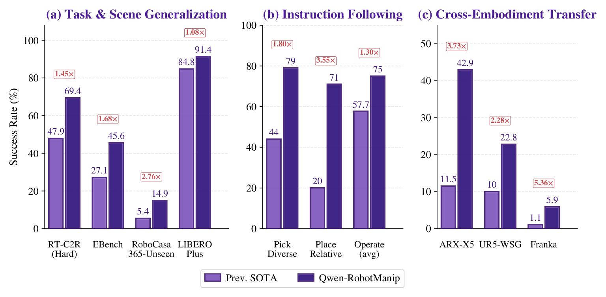{ width="900" }

*原论文 Figure 7。汇总图便于比较不同泛化轴，但部分柱子来自基础版、部分来自 Context，例如 Place-Relative 的 71 来自 Context，Pick-Diverse 的 79 来自基础版；“Prev. SOTA”也按 benchmark 选择不同对照。它是结果摘要，不代表同一固定 checkpoint 在所有列上的分数。* [↗](https://arxiv.org/pdf/2606.17846v2#page=20)

## 跨本体转移需要同时控制视觉、几何与训练口径

RoboTwin-XE 把只用 AgileX ALOHA 示范做下游微调的模型，部署到 ARX-X5、UR5-WSG 和 Franka Panda，并在 Hard 扰动下执行。为尽量把差异集中到机器人本体，初始 EEF 位姿通过 IK 对齐，头部与腕部相机外参保持一致，任务场景、物体位置和扰动种子也共享。改变的是机械臂外观、关节配置、连杆长度与可达空间。[↗](https://arxiv.org/pdf/2606.17846v2#page=19)

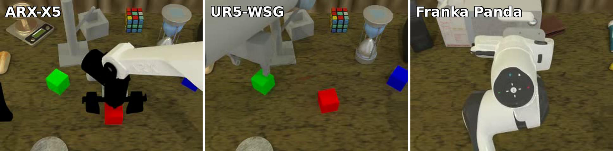{ width="840" }

*原论文 Figure 10。三个目标本体处在对应场景中，模型不能依靠目标本体的下游示范重新适配。相同相机条件也意味着本实验没有同时检验任意未知相机安装方式。* [↗](https://arxiv.org/pdf/2606.17846v2#page=24)

| Method / Action Space | ARX-X5 | UR5-WSG | Franka Panda | Total |
|---|---:|---:|---:|---:|
| π0.5 / joint | 24.6 | 2.2 | 0.9 | 9.2 |
| π0.5 / eef | 11.5 | 10.0 | 1.1 | 7.5 |
| Qwen-RobotManip / joint | 37.6 | 4.1 | 1.8 | 14.5 |
| Qwen-RobotManip / camera eef | 42.9 | 22.8 | 5.9 | 23.9 |

*原论文 Table 9，RoboTwin-XE zero-shot transfer success rate，单位 %。* [↗](https://arxiv.org/pdf/2606.17846v2#page=24)

相机 EEF 比 Qwen 自身 joint 控制平均提高 9.4 个百分点，其中 UR5 从 4.1 到 22.8 最明显。共享笛卡尔动作减少了“同一关节值在另一种机械臂上意义不同”的问题。但 Franka 仍只有 5.9%，外观、运动范围和动力学差异没有消失；π0.5 从 joint 改成 EEF 后平均还从 9.2 降至 7.5，说明 EEF 接口本身不足以保证转移，训练表示与数据也必须配合。

“未见本体”在这里需要限定到评测的下游适配阶段。预训练语料及 H2R 本来就包含 Panda、UR5e 和 ARX 系列等机器人，不能把该实验描述为整个训练历史从未接触这些机器人家族。它证明的是从 ALOHA 目标域示范迁移到其他本体、不增加目标本体 SFT 数据的能力。

### 真机 ARX 组合转移是另一种零样本条件

真实 ARX 实验共同微调 6,000 条 CobotMagic 和 130 条 ARX 示范，再测试四项 ARX 没有目标任务示范的任务。ARX 本体本身已经出现过，需要迁移的是新本体—任务组合中的技能。[↗](https://arxiv.org/pdf/2606.17846v2#page=27)

| Method | Stack Plates | Stack Blocks | Fruits in Plate | Trash in Bucket | Avg. |
|---|---:|---:|---:|---:|---:|
| w/o UnifiedSpace | 0/10 | 0/10 | 3/10 | 0/10 | 7.5% |
| w/o UnifiedEEF | 0/10 | 0/10 | 5/10 | 0/10 | 12.5% |
| Qwen-RobotManip | 3/10 | 5/10 | 7/10 | 7/10 | 55.0% |

*原论文 Table 13。UnifiedSpace 消融采用原始字段拼接补零；UnifiedEEF 消融保留基本槽位、旋转统一与夹爪归一化，但去掉统一末端表示。* [↗](https://arxiv.org/pdf/2606.17846v2#page=27)

完整表示的差距很大，但四项任务仍有明显失败。它提供了比单纯离线动作误差更强的接口证据：同一套数据经过更一致的表示，能让在 CobotMagic 上学到的堆叠、放置和收集技能用于 ARX 的新任务组合。它与 RoboTwin-XE 的“目标本体没有下游示范”是两个不同问题，应分别理解。

## 真机结果要同时看完整成功、步骤进展和试验次数

CobotMagic ALOHA 上使用 22.9 小时遥操作数据做多任务 SFT。ID 评测七项任务，每项五次；OOD 评测四项任务，每项十次。下面保留次数，便于看清均值由多少次执行构成。[↗](https://arxiv.org/pdf/2606.17846v2#page=25)

| Setting | Task | π0.5 | StarVLA | Qwen-RobotManip |
|---|---|---:|---:|---:|
| ID | table-cleanup | 4/5 | 0/5 | 5/5 |
| ID | three-bowl-stacking | 5/5 | 4/5 | 5/5 |
| ID | melon-in-bowl | 2/5 | 0/5 | 5/5 |
| ID | towel-folding | 4/5 | 3/5 | 4/5 |
| ID | block-in-drawer-compartment | 0/5 | 0/5 | 5/5 |
| ID | yellow-disc-insertion | 0/5 | 0/5 | 2/5 |
| ID | three-block-stacking | 0/5 | 0/5 | 5/5 |
| ID | Average success rate | 42.9% | 20.0% | 88.6% |
| OOD | target-object-in-basket | 8/10 | 0/10 | 10/10 |
| OOD | left-right-bowl-stacking | 1/10 | 0/10 | 10/10 |
| OOD | tool-on-towel | 0/10 | 0/10 | 6/10 |
| OOD | banana-on-towel | 6/10 | 0/10 | 9/10 |
| OOD | Average success rate | 37.5% | 0.0% | 87.5% |

*原论文 Tables 10–11。OOD 分别加入新物体与随机目标、左右关系、细小新工具与干扰物、动态灯光变化。* [↗](https://arxiv.org/pdf/2606.17846v2#page=25)

基础版 ID 共完成 31/35 次，OOD 完成 35/40 次。抽屉操作和多步堆叠有明显优势，黄色圆片插入却只有 2/5，细小工具也只完成 6/10。这些试验说明模型能在具体场景内完成多种迁移，但不能把四十次以内的成功均值解释为长时间无人值守可靠性。

### 少样本 ARX 的“平均成功”按子步骤统计

ARX few-shot 对照中，各模型共同使用相同 130 条示范，Unscrew Cap 50 条，其他四项各 20 条；输入包含 joint 与 EEF 状态，输出采用 EEF。这个表的分母需要比 CobotMagic 更仔细地读。[↗](https://arxiv.org/pdf/2606.17846v2#page=26)

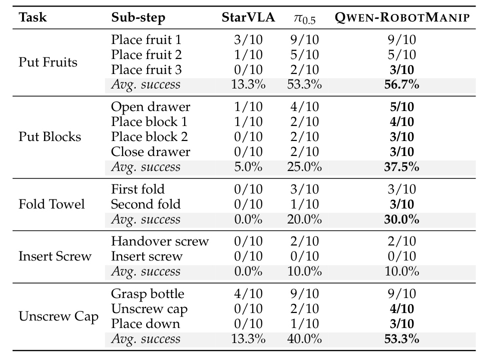{ width="850" }

*原论文 Table 12。每个子步骤各统计十次试验，灰底 Avg. success 对这些步骤求平均；它不是整个任务十次执行的成功率。* [↗](https://arxiv.org/pdf/2606.17846v2#page=27)

例如 Put Blocks 的四步为开抽屉、放第一块、放第二块、关抽屉，Qwen 分别是 5/10、4/10、3/10、3/10，平均进展为 15/40，即 37.5%；最后关抽屉完成为 3/10。Unscrew Cap 的平均为 53.3%，但最后放回完成为 3/10；π0.5 对应 40.0% 与 1/10。最容易误读的是 Insert Screw，双方都能在 2/10 次完成交接，真正插入为 0/10，因此表中的 10.0% 不代表有任何一次完整插入成功。

这组结果支持四项任务的步骤进展优于对照，也保留了精密装配仍失败的事实。它比一句“少样本平均成功率提高”更能说明采用者还需要补哪些示范和控制能力。

### Table30-v1 的整体领先主要体现在哪些本体上

RoboChallenge Table30-v1 generalist track 为每种本体训练一个能处理相关多任务的模型，共四种本体、30 项任务。论文使用 joint control，并以 `Lira_generalist` 提交。这不是同一个未经域适配的 checkpoint 直接控制四种机器人。[↗](https://arxiv.org/pdf/2606.17846v2#page=27)

| Robot / Aggregate | Qwen-RobotManip SR / Score | DM0_generalist SR / Score |
|---|---:|---:|
| Average (all) | 45.0 / 59.83 | 37.0 / 48.43 |
| ARX5 | 46.4 / 66.3 | 45.5 / 61.1 |
| ALOHA | 41.8 / 56.8 | 19.1 / 29.0 |
| UR5 | 51.7 / 60.9 | 58.3 / 66.2 |
| Franka | 35.0 / 37.8 | 25.0 / 32.2 |

*原论文 Table 14 的各本体汇总，SR 为完整成功率 %，Score 为过程分数。* [↗](https://arxiv.org/pdf/2606.17846v2#page=28)

总体 SR 比 DM0 高 8 个百分点、过程分数高 11.40。若按 SR 计算相对增长，$8/37\approx21.6\%$，与摘要中“约 20% relative improvement”属于同一量级，不能写成成功率高 20 个百分点。ALOHA 的收益最明显，UR5 的两个指标却都落后于 DM0。

单任务也有强反例。ARX 的 `open the drawer` 为 0% 完整成功，对照 DM0 是 90%；`wipe the table` 虽有 72.5 过程分，完整成功仍为 0。与此同时，Qwen 在 ALOHA 的 `pour fries into plate` 达到 30%，所列其他模型全部为零，在双臂协调与部分多步任务上确有新能力。将领先与失败按任务类型保留下来，比只摘选六个高难任务的提升更利于判断部署范围。[↗](https://arxiv.org/pdf/2606.17846v2#page=28)

论文还展示抓取滑落后的自主重试。`sort electronic products` 案例中，Qwen 两次抓起后掉落，第三次成功；DM0 也尝试了三次，只是未能稳定抓住。因此这组可视化说明成功策略能够在特定失败后继续尝试，但“尝试次数”本身并非 Qwen 独有，论文也没有独立统计恢复概率。作者将该行为归因于多样数据中包含失败后的修正，这应保留为解释性假设。[↗](https://arxiv.org/pdf/2606.17846v2#page=30)

## 混合后训练为什么依赖对齐，而不是简单加入更多数据

目标域 SFT 可能逐渐把 VLA 变成主要依赖视觉模板的策略。论文称之为 VLA-to-VA degradation，即动作预测越来越由固定场景决定，语言条件被弱化。为了检验并减轻这个问题，作者先在后训练中保留 VL 数据，再加入与目标域较接近的辅助 VLA 示范。[↗](https://arxiv.org/pdf/2606.17846v2#page=16)

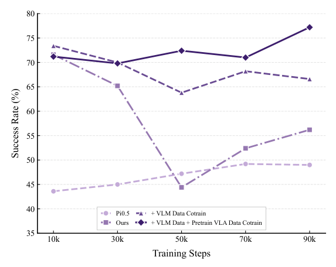{ width="760" }

*原论文 Figure 21，横轴为后训练步数，纵轴为 RoboTwin-IF success rate。只用目标域的 Ours 曲线中途明显下降；加入 VL 的曲线更稳定；再加入辅助 VLA 后，后期成绩更高。图中没有为每个点标精确数值，比较趋势即可。* [↗](https://arxiv.org/pdf/2606.17846v2#page=36)

这里 VL 占整个混合的 10%，辅助 VLA 占 VLA 部分的 75%。如果按互斥数据流直接换算，辅助 VLA、目标 VLA、VL 分别对应总混合的 67.5%、22.5%、10%，这是根据原比例的计算。辅助轨迹来自其他模拟器及形态相近的真实机器人，并在 EEF 空间对齐。图中联合共训曲线仍有局部下降，所以更准确的观察是它抑制了本实验的明显后期退化，而非每一个 checkpoint 都严格单调改善。

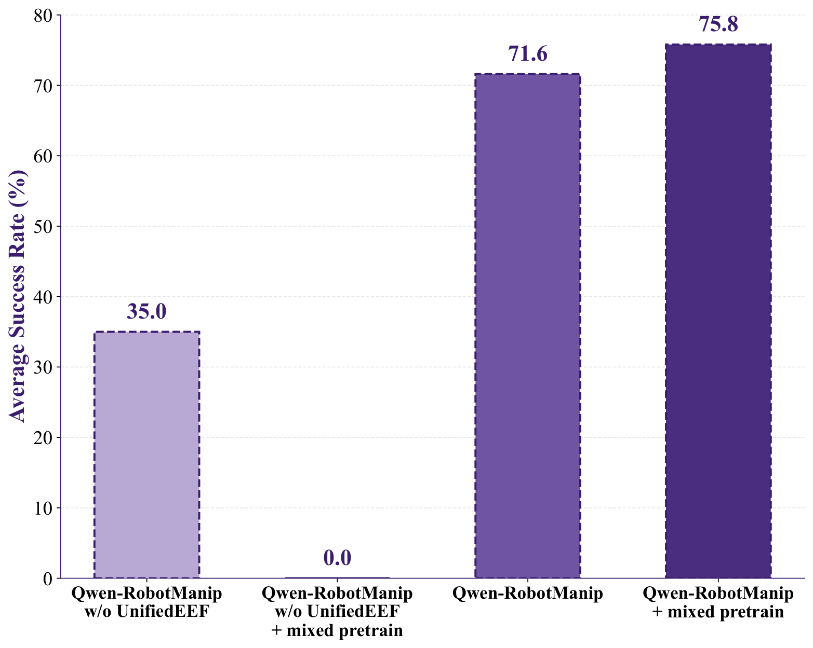{ width="760" }

*原论文 Figure 22。在四个配置中，先比较是否有 UnifiedEEF，再比较加入混合数据的变化。完整表示下 71.6 提高到 75.8；缺少 UnifiedEEF 时 35.0 降到 0。* [↗](https://arxiv.org/pdf/2606.17846v2#page=36)

这是一项有力的失败消融。数据接口不一致时，额外监督可以破坏原有能力；一致后，类似本体和模拟器中的轨迹才更容易提供补充。它支持该配置下的统一 EEF 设计，但不能从一个变体的零分推出“任何模型都不可能自行吸收混合数据”，也不能把混合 VL 与辅助 VLA 的联合改动归结为其中某一种数据的单独效果。

## 从论文到可用系统，最值得先实现哪些接口

Qwen-RobotManip 给出的实施顺序很具体。先审计字段语义、关节方向、TCP、状态动作时延和相机标定，区分可修复错误与需要剔除的样本；再定义共享槽位、末端参考坐标和有效 mask，让训练数值具有一致含义；数据混合放到这些接口稳定以后，并同时观察离线误差和 OOD 闭环成功率。小规模对照就能验证这条顺序，不必把语料堆到论文规模才发现接口冲突。

选择基础版还是 Context 版，则取决于任务需要。新初始构型、部分视觉扰动中，历史行为提供的信息很有价值；对起步响应和计算预算更敏感时，需要计入额外图像、历史 token 与十步采样的代价。Context 在长任务上的反例提醒使用者，更多历史可能改善部分判断，也可能增加动作生成难度，应该保留无历史对照。

部署采用远程服务器推理，通过 WiFi 传输观察与动作，并使用 Real-Time Chunking（实时动作块衔接）在执行当前块时异步生成下一块。这可以重叠通信、推理和执行，但不会消除观测到新动作生效之间的实际延迟。论文也将固定动作块长度与推理时延列为亚秒级快速反应任务的约束。[↗](https://arxiv.org/pdf/2606.17846v2#page=16)

报告给出了模型结构、损失、数据比例和若干采样设置，但没有一套完整的数值训练预算，也没有用于复现总成本的 GPU 小时与部署延迟表。因此实际采用时，可以直接借鉴它的表示和数据检查方法；若要复现完整训练规模或承诺某个控制频率，还需依据具体实现和硬件测量。H2R 的重定向与补全误差、Franka 转移的低成功率、真机插入失败，则界定了当前接口仍无法替代的物理与控制能力。[↗](https://arxiv.org/pdf/2606.17846v2#page=38)

要把这套表示接到自己的闭环，可以继续看[动作表示与接口](../../vla/action-representation-and-interfaces.md)，对齐动作块、单位和时间戳；再看[闭环恢复与失败分析](../../vla/closed-loop-recovery-and-failure-analysis.md)，把 OOD 成功率拆成观测、执行和恢复几类事件。
