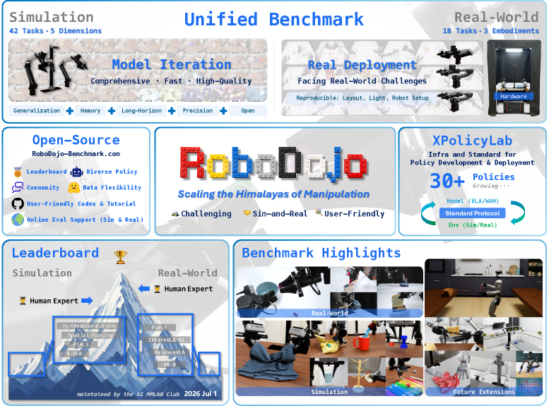
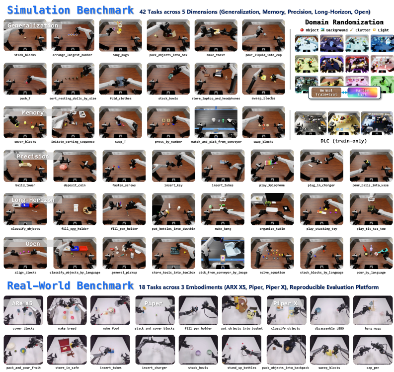
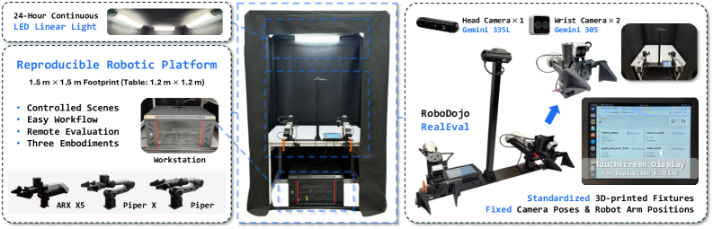

# RoboDojo：把仿真诊断与真实部署放进同一张成绩单

!!! info "论文信息"
    **论文题名：** RoboDojo: A Unified Sim-and-Real Benchmark for Comprehensive Evaluation of Generalist Robot Manipulation Policies。<br>
    **作者：** Tianxing Chen、Yue Chen、Zixuan Li、Junyuan Tang、Kailun Su、Haoran Lu、Weijie Wan 等（共 44 人）。<br>
    **机构：** MMLab@HKU、UC Berkeley、Tsinghua University、Peking University、Stanford University、MIT 等 18 家机构。<br>
    **时间 / 主题：** 2026-07；具身智能 / 机器人操作评测。<br>
    **arXiv / 项目：** arXiv：[2607.04434v3](https://arxiv.org/abs/2607.04434v3)；项目页：[robodojo-benchmark.com](https://robodojo-benchmark.com/)。<br>
    **GitHub / 平台：** [RoboDojo-Benchmark/RoboDojo](https://github.com/RoboDojo-Benchmark/RoboDojo)；[XPolicyLab/XPolicyLab](https://github.com/XPolicyLab/XPolicyLab)；[Leaderboard](https://robodojo-benchmark.com/leaderboard)。<br>
    **元数据来源与核验口径：** 来源：[arXiv](https://arxiv.org/abs/2607.04434v3)、[官方项目页](https://robodojo-benchmark.com/)；Checked Date：2026-07-14；Repro Status：Paper / official project and public code links reviewed, independent reproduction not claimed。

## 原论文故事线

### 研究背景

通用机器人操作策略的论文常用少量任务、单一仿真器或一次真实演示报告成功率。但这种评测很难回答一个更基础的问题：策略究竟是缺少视觉泛化、记忆、精细接触控制、长时程执行，还是只是在真实机器人的标定误差和动作抖动下失效？单个总成功率把这些失败混在一起，既不利于模型诊断，也不利于工程迭代。

仿真和真实评测各自也有缺口。仿真可批量重置、随机化并快速重复，却遗漏接触、感知噪声、执行器延迟和控制器不稳定等物理细节；真实机器人能直接暴露这些问题，但硬件、相机、灯光、场景 reset 和人工打分不一致时，结果又很难复现。RoboDojo 想补的不是又一个 manipulation task collection，而是这条断开的评测闭环。

### 问题（Challenge）

论文要解决的问题是：**如何对 generalist robot manipulation policy 做既可诊断、又能连接真实部署、还可复现的综合评测。** 难点有三层。第一，任务变化不能只停留在物体和背景替换，必须区分 generalization、memory、precision、long-horizon 与 open-vocabulary instruction following 等能力。第二，仿真吞吐和任务异质性通常互相冲突，复制同一环境容易并行，却不能覆盖不同资产和任务结构。第三，真实世界的硬件、场景恢复和评分流程必须标准化，否则 leaderboard 只是不可比较的演示集合。

### Finding

作者的核心判断是：**评测不应试图让仿真替代真实机器人，也不应把真实结果当作孤立 demo；更有效的接口是让二者共享 policy integration 与 evaluation protocol，各自测量互补的失败模式。** 仿真侧用于高频、能力分解的诊断，真实侧用于检查同一类策略能否在感知噪声、接触和执行误差下稳定工作。

这个判断带来两个重要边界。RoboDojo 的 simulation 和 real-world task 并不是一一配对，因此它**不是**测量严格 sim-to-real transfer rate 的基准。相应地，simulation 高分也不应被解读为真实部署高分；论文将两者的排序不完全一致视作真实评测的必要性，而非要求两端数字直接对应。

### 方法

RoboDojo 由三个协作层组成：

1. **RoboDojo Simulation Benchmark**：在 ARX X5 双臂平台上提供 42 个仿真任务，按 Generalization、Memory、Precision、Long-Horizon、Open 五个维度组织；
2. **RoboDojo-RealEval**：在 ARX X5、Piper、Piper X 三种双臂实体上提供 18 个真实任务，并固定硬件、相机、照明、layout replay、终止规则和评分流程；
3. **XPolicyLab**：把异构策略的输入格式、策略服务和动作查询收敛到统一接口，使同一策略能以较少的 adapter 改动接入仿真与真实评测。

仿真平台建立在 Isaac Sim / Isaac Lab 上，任务通过 YAML 描述资产、布局、初始化分布、随机化和成功条件。它的 heterogeneous parallelism 让同一向量化执行接口中的环境拥有不同对象、几何和布局，而不是只复制同一个场景。真实平台则通过固定机器人和相机相对位姿、受控灯光、透明 overlay 引导 layout reset，以及三名盲评者独立打分，降低物理评测中的偶然差异。

### 结论

论文在 XPolicyLab 中接入并评测 30 个策略。以论文冻结日 `2026-07-03` 的 simulation leaderboard 为准，最佳已评测策略 Hy-Embodied-0.5-VLA 的平均 success rate 为 `8.80%`，而专家 VR teleoperation 为 `76.03%`；作者据此强调，当前方法距离均衡的通用双臂操作还有明显差距。真实 leaderboard 中，π0.5 的 overall success rate 为 `12.8%`，也说明实际部署仍远未可靠。

系统层面，异质并行在零动作 rollout 下达到 `77.4 interactions/s`，相对非异质并行的 `40.0 interactions/s` 为 `1.94x`；加入 π0.5 推理后为 `64.0 interactions/s`，相对 `39.2 interactions/s` 为 `1.63x`。这些是特定硬件和配置下的作者报告，不应外推为所有策略或所有 simulator 的固定加速比。

### 关键术语

- **Generalist Robot Manipulation Policy（通用机器人操作策略）**：在多任务、多物体、不同语言条件或不同机器人平台上执行操作的策略，而非只针对一个任务训练的控制器。
- **Capability-Oriented Evaluation（能力导向评测）**：按记忆、精度、长时程等能力轴拆分任务，避免只用一个汇总成功率掩盖失败原因。
- **Heterogeneous Parallel Simulation（异质并行仿真）**：在并行环境中运行不同场景和任务配置，而非克隆同一个环境。
- **RoboDojo-RealEval（RoboDojo 真实评测平台）**：固定硬件、场景恢复、评分和部署协议的实体机器人评测系统。
- **Layout Replay（布局回放）**：使用预先采集的场景 layout 和视觉 overlay 让每个真实试次从一致初始状态开始。
- **XPolicyLab（统一策略实验平台）**：标准化数据转换、策略服务与评测接口的基础设施。

RoboDojo 最值得记的一点是：**benchmark 的价值不在于任务清单有多长，而在于每个结果能否指向一个可行动的失败假设，并在实体机器人上经得起复查。**

## 论文位置

RoboDojo 位于 VLA / world-model / imitation policy 的下游：它不提出新的 action model，而是规定怎样让不同策略在共同任务、共同初始条件和共同评分方式下被比较。对本站已有的 [RT-2](rt2.md)、[π0.5](pi05.md)、[GR-3](gr3.md)、[Fast-WAM](fast-wam.md) 等页面，它提供的是评测坐标系。

{ width="880" }

<small>图源：`RoboDojo`，Figure 1。原论文图意：42 个仿真任务、18 个真实任务、RoboDojo-RealEval、XPolicyLab 和 leaderboard 被组织为一个统一评测闭环。</small>

**Figure 1 怎么读。** 上半部分不是把 simulation 与 real-world 画成互相替代，而是分别标为 model iteration 与 real deployment。下半部分的 XPolicyLab 才是连接点：没有稳定的策略接口，仿真得分和实体得分会来自不同数据适配、动作表示和部署脚本，比较就失去解释力。图中 leaderboard 也不只是排名展示，而是要求受控的评测和可审查证据共同支持结果。

## 任务设计：先问策略缺什么能力

{ width="880" }

<small>图源：`RoboDojo`，Figure 2。原论文图意：42 个仿真任务按五个能力维度组织；18 个真实任务覆盖三种双臂具身与更具物理约束的操作。</small>

| Dimension | Simulation tasks | 主要测量对象 | 代表任务 / 扰动 |
| --- | ---: | --- | --- |
| Generalization | 12 | 未见视觉与场景分布下的鲁棒性 | 背景、光照、目标物、最多 25 个 clutter objects |
| Memory | 6 | 部分可观测与跨帧信息保持 | `match_and_pick_from_conveyor`、`imitate_sorting_sequence` |
| Precision | 8 | 细粒度定位、轨迹平滑与接触稳定 | `insert_tubes`、`plug_in_charger`、`deposit_coin` |
| Long-Horizon | 8 | 子步骤组织与误差累积 | `classify_objects`、双臂 handover、桌面整理 |
| Open | 8 | 未见任务规格的语言 grounding 与技能重组 | `general_pickup` 等不提供 task-specific train data 的任务 |

这五维并非互斥的机器人能力分解。例如插管任务同时依赖视觉定位与动作稳定，长时程任务也可能需要记忆。它们的价值在于把主要压力源显式写进 task design，使错误可以先归类再分析，而不是用单一 success rate 猜测原因。

### 数据与试次协议

| Setting | Training demonstrations | Evaluation protocol | 需要注意的解释边界 |
| --- | --- | --- | --- |
| Simulation | 35 个目录、3,500 条轨迹、20.66 h、25 Hz；Open 维度不含 task-specific demonstration | 42 个任务各 50 episodes，共 2,100；Generalization 分为 25 standard + 25 random episodes | 这衡量既定训练数据下的能力，不是 web-scale foundation policy 的零样本排名 |
| Real world | 1,800 条轨迹、17.91 h、25 Hz；3 个 embodiment 各 6 个任务、600 条轨迹 | 每任务 10 trials；预采 layout replay；三名独立盲评者按最终成功和中间步骤评分 | 每个真实任务只有 10 次试验，单任务方差仍可能较大 |

仿真总分不是对全部任务简单平均，而是先在五个维度内计算，再对维度取均值，避免 12 个 Generalization task 在总体中占据不成比例的权重。论文还为公开 leaderboard 加入三随机种子、hidden layouts、检查点/配置/代码发布和评测视频等要求；因此“公开可见的某次试跑”与“官方 verified leaderboard entry”不是同一证据等级。

## 总体方案：同一策略接口，两个互补评测面

```text
policy package
  -> XPolicyLab adapter: update_obs() / get_action() / reset()
  -> RoboDojo simulation: batched, heterogeneous task rollout
  -> RoboDojo-RealEval: single-policy server, standardized physical trial
  -> task score + success rate + evaluation video + leaderboard evidence
```

### XPolicyLab 接口

XPolicyLab 不要求所有方法使用相同网络或 action representation；它标准化的是策略外层的生命周期。每个方法通过 `update_obs` 接收语言、多视角视觉和 robot state，通过 `get_action` 返回 action chunk，并在 episode 开始时 `reset`。批量仿真额外使用 `update_obs_batch` / `get_action_batch`。这使 diffusion policy、VLA、world-model policy 和传统 imitation baseline 可以在同一任务和 seed 设置下接入。

该抽象有工程价值，但不意味着所有 adapter 都没有损失。观测预处理、动作归一化、控制频率、chunk 长度和机器人运动规划仍可能影响结果；评测页应同时报告这些策略侧配置，而不能把差异完全归因于模型 architecture。

### 异质并行仿真

RoboDojo 的加速不是简单增加 clone 数。每个并行环境可有独立采样的对象类别、资产几何、干扰物数量、关节结构和 task layout，但仍由共享的 vectorized interface 推进。论文在 `8 x RTX 4090` 上报告：

| Evaluation setting | Time for 1,640,000 frames | Avg. speed | 论文可支持的结论 |
| --- | ---: | ---: | --- |
| Heterogeneous, zero action | 5 h 53 m | 77.4 interactions/s | 异质场景不必完全牺牲吞吐 |
| Non-heterogeneous, zero action | 11 h 22 m | 40.0 interactions/s | 本配置下异质调度快 `1.94x` |
| Heterogeneous + π0.5 inference | 7 h 07 m | 64.0 interactions/s | 含远程策略推理时仍有端到端收益 |
| Non-heterogeneous + π0.5 inference | 11 h 38 m | 39.2 interactions/s | 本配置下为 `1.63x`，但受 policy server 与网络条件影响 |

### RoboDojo-RealEval

{ width="880" }

<small>图源：`RoboDojo`，Figure 7。原论文图意：RoboDojo-RealEval 用固定机器人/相机安装、受控照明、touchscreen 操作和三种双臂平台，减少真实评测的不可控变量。</small>

**Figure 7 怎么读。** 这张图的重点不是硬件本身，而是把照明、相机位姿、workspace 和 reset 变成 protocol 的一部分。真实 trial 前使用 overlay 回放初始布局；若出现撞桌、碰撞外框或自碰等风险，管理员可以终止试验并让机器人回到 reset pose。物理评测从而能保留安全终止与失败视频，而不是只在最后记录一个 0/1 标签。

## 实验与结论

### 论文冻结版本的 leaderboards

下表只摘录论文 `2026-07-03` 冻结版本的关键数字，避免把会持续变化的官网 leaderboard 当作论文静态结果。

| Benchmark snapshot | Policy / reference | Overall score | Overall success rate | 该数字说明什么 |
| --- | --- | ---: | ---: | --- |
| Simulation | Hy-Embodied-0.5-VLA | 13.07 | 8.80% | 当时最佳已评测策略仍难以在五维能力上稳定完成任务 |
| Simulation | Human expert teleoperation | 80.42 | 76.03% | 任务对熟练操作者可做，策略差距并非只来自不可行 task design |
| Real world | π0.5 | 22.9 | 12.8% | 在三种实体、18 个任务下，部署成功仍明显受限 |
| Real world | Human expert teleoperation | 100.0 | 100.0% | 是该受控遥操作协议下的参考，不等于日常环境中的人类能力上限 |

论文的主要分析是：不同策略在不同维度上各有相对强项，但没有一个方法在全部能力轴上表现均衡；真实部署还会显露 simulation aggregate score 难以捕捉的抖动、振荡、无效重复动作和接触不稳定。作者观察到 simulation 与实体结果有部分相关性，但排名也会变化，这正是两个评测面要并存的理由。

### 稳定性与成本

作者在跨 GPU 的 simulation 稳定性测试中报告，最大 success-rate 标准差为 `1.1` percentage points、最大 score 标准差为 `1.07`；三种策略的真实重复测评中，overall success-rate 标准差最高为 `1.3` percentage points。真实评测虽不能完全消除单任务波动，但标准化协议能降低 aggregate ranking 对单轮试验的敏感性。

使用 π0.5 测试，完整 18 个真实任务、180 个物理 trials 的作者报告总耗时为 `202.0 minutes`，约 `3.4 hours`。该数字包含 reset、局域网策略推理和机器人执行；它说明真实评测可以被流程化，但不应被误读为任何模型在任意实验室都能在同样时间完成一次 benchmark。

## 主要贡献

| Contribution | 直接证据 | 工程上可吸收的判断 |
| --- | --- | --- |
| 五维仿真任务集 | 42 tasks、公开任务说明、每维独立统计 | 评测应先指定失败假设，再设计任务扰动 |
| 统一 sim-and-real protocol | 同一 policy lifecycle、XPolicyLab、三个真实 embodiment | adapter 与部署接口是 benchmark 的一等公民 |
| 可复现实体验测 | 固定安装、layout replay、盲评、视频和安全终止 | 真实实验不能只写“在真机上测试”，还要报告 reset 与评分机制 |
| 异质并行基础设施 | 8 GPU 吞吐实验 | 评测吞吐可随 task diversity 改善，但要单独报告硬件和 policy inference 条件 |
| 官方 verified leaderboard 规则 | hidden layouts、三 seed、release requirements | 排名要区分作者自报、可复核和独立复现三种证据强度 |

## 局限与风险

- **不是配对 sim-to-real benchmark**：仿真和真实任务不一一对应，不能从两个 leaderboard 计算严格 transfer rate，也不能把相关性解释为因果。
- **任务覆盖仍有限**：论文计划扩展 dexterous hand、humanoid whole-body、tactile 和 mobile manipulation；当前 60 个任务不能代表这些方向。
- **真实数据与评测规模有限**：每实体 6 个任务、每真实任务 10 trials；接触丰富或多阶段任务的单项方差仍可能偏大。
- **结果依赖 adapter 与控制栈**：motion planner、观测预处理、action chunk 与部署频率都可改变表现，模型名本身不是完整解释。
- **尚无独立复现结论**：论文、项目页和代码链接支持“可获取的官方资源”，但本站未运行完整 benchmark，也不把官方 leaderboard 视为第三方验证。
- **leaderboard 会更新**：本页的具体排行保留论文冻结版本；最新官网数字必须以访问当日页面为准。

## 阅读结论

RoboDojo 对具身智能最实际的提醒是：把 VLA 或 world-model 接上真机，不等于已经获得可靠的通用操作能力。评测至少要回答三件事：策略在哪类能力上失败、同一接口下能否在实体机器人运行、以及结果是否能被别人用相同初始条件复查。

因此，读到某个新策略的“总成功率提升”时，可以用 RoboDojo 的框架追问：它在 memory / precision / long-horizon / open grounding 中具体改善哪一项？仿真增益是否经过物理部署的控制稳定性检查？控制器、reset 和评分协议是否被披露？这些问题比单独比较一个 benchmark 分数更接近真实的机器人系统判断。

## 外部精读

- [arXiv HTML v3](https://arxiv.org/html/2607.04434v3)：任务定义、协议、leaderboard snapshot、效率与稳定性实验的原始依据。
- [RoboDojo 项目页](https://robodojo-benchmark.com/)：持续更新的任务、代码入口和 leaderboard；当前排名可能不同于论文冻结版本。
- [XPolicyLab](https://github.com/XPolicyLab/XPolicyLab)：统一策略接口、部署与复现实验实现的官方入口。
