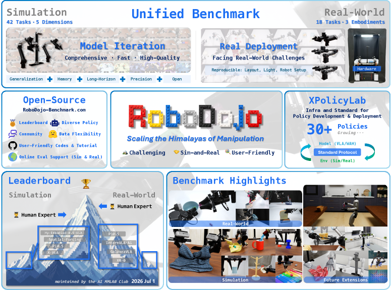
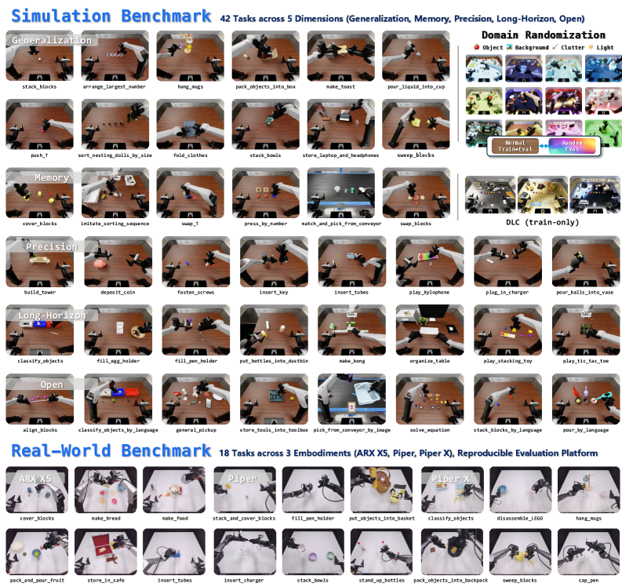
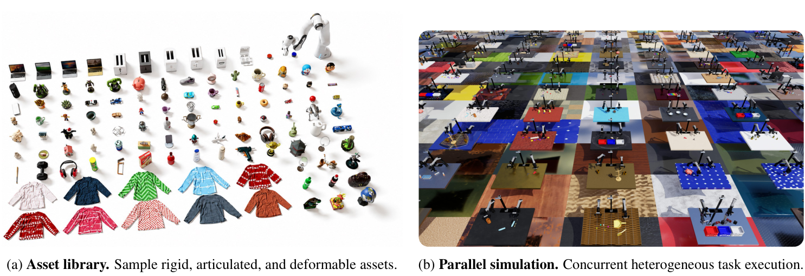
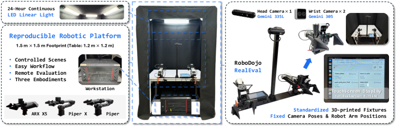
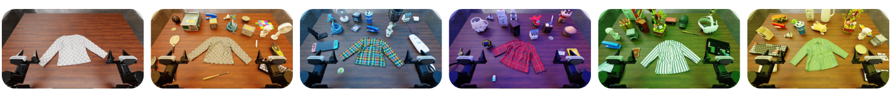
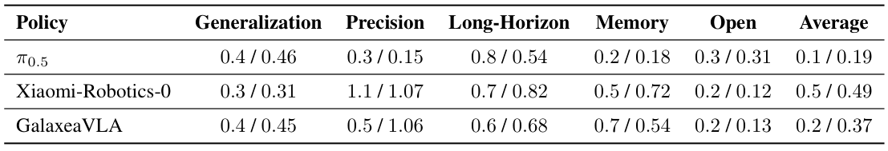

# RoboDojo：把仿真诊断与真实部署放进同一张成绩单

!!! info "论文信息"
    **论文题名：** RoboDojo: A Unified Sim-and-Real Benchmark for Comprehensive Evaluation of Generalist Robot Manipulation Policies。 
    **作者：** Tianxing Chen、Yue Chen、Zixuan Li、Junyuan Tang、Kailun Su、Haoran Lu、Weijie Wan 等（共 44 人）。 
    **机构：** MMLab@HKU、UC Berkeley、Tsinghua University、Peking University、Stanford University、MIT 等 18 家机构。 
    **时间 / 主题：** 2026-07；具身智能 / 机器人操作评测。 
    **arXiv / 项目：** arXiv：[2607.04434v3](https://arxiv.org/abs/2607.04434v3)；项目页：[robodojo-benchmark.com](https://robodojo-benchmark.com/)。 
    **GitHub / 平台：** [RoboDojo-Benchmark/RoboDojo](https://github.com/RoboDojo-Benchmark/RoboDojo)；[XPolicyLab/XPolicyLab](https://github.com/XPolicyLab/XPolicyLab)；[Leaderboard](https://robodojo-benchmark.com/leaderboard)。 
    **元数据来源与核验口径：** 来源：[arXiv](https://arxiv.org/abs/2607.04434v3)、[官方项目页](https://robodojo-benchmark.com/)；Checked Date：2026-07-14；Repro Status：Paper / official project and public code links reviewed, independent reproduction not claimed。

## 总分之外，机器人策略还需要怎样的诊断

RoboDojo 试图解决的是机器人评测中的两个断点。一个是能力断点，模型在熟悉的抓放流程中得分很高，并不说明它能记住离开视野的目标、完成严格对准，或在上一步失败后改变动作。另一个是实验断点，不同工作使用不同机器人、相机、动作接口、任务时限和重置方式，最终成功率混合了策略与部署流程的影响。[↗](https://arxiv.org/pdf/2607.04434v3#page=3)

论文因此把 42 个仿真任务、18 个真实任务与统一策略接入平台 XPolicyLab 连在一起。仿真提供大规模、按能力维度分解的反馈；真实平台固定硬件几何、光照、场景恢复和评分过程，检查策略是否能在物理执行中完成任务。这是一篇 benchmark 与基础设施论文，贡献应当落在测量对象、协议、可重复条件和评测成本上，而不只是新增了多少任务。

{ width="880" }

*原论文 Figure 1。上方两条路线分别承担仿真诊断和真实部署检查，中间的 XPolicyLab 连接策略与环境。两端共享接入方式，但任务不做一一配对。* [↗](https://arxiv.org/pdf/2607.04434v3#page=1)

最后这一点直接影响结论。RoboDojo 不是在数字孪生任务上测量一个 policy 从仿真直接迁移到真实的成功率，而是在互补任务中评价经各自数据训练后的策略。两个榜单可以揭示不同短板，不能拿它们的总分相除得到 sim-to-real transfer rate。[↗](https://arxiv.org/pdf/2607.04434v3#page=8)

论文冻结于 **2026 年 7 月 3 日**的榜单中，30 个仿真策略的最高五维平均 SR 为 8.80%，人类专家为 76.03%；十个真实策略中 π0.5 的最高总体 SR 为 12.8%。这些数字说明本套任务具有明显挑战，但要判断挑战来自哪里，必须先理解任务、数据与分数的含义。

## 五个能力维度各自改变了什么

仿真统一采用 ARX X5 双臂，两个机械臂基座间隔 0.6 m。42 项任务分为五个维度，各维度强调不同困难；它们并不把机器人认知和控制能力严格分离。[↗](https://arxiv.org/pdf/2607.04434v3#page=5)

| Dimension | Tasks | 核心压力 | 代表任务 |
|---|---:|---|---|
| Generalization | 12 | 同一目标在不同物体、背景、照明与杂物条件下执行 | `fold_clothes`, `make_toast`, `pack_objects_into_box` |
| Memory | 6 | 当前图像不足以确定正确动作 | `cover_blocks`, `match_and_pick_from_conveyor`, `imitate_sorting_sequence` |
| Precision | 8 | 定位、轨迹与接触误差会直接阻断成功 | `insert_tubes`, `deposit_coin`, `insert_key` |
| Long-Horizon | 8 | 多阶段依赖、状态跟踪与失败恢复 | `organize_table`, `fill_egg_holder`, `classify_objects` |
| Open | 8 | 没有该任务的专门示范，需要重组已有技能 | `solve_equation`, `general_pickup`, `classify_objects_by_language` |

{ width="880" }

*原论文 Figure 2。前五组是仿真能力轴，右上角给出标准与随机场景，底部是真实机器人的任务集合。先看任务需要保留什么信息、满足什么接触条件，再看物体外观差异。* [↗](https://arxiv.org/pdf/2607.04434v3#page=6)

### Generalization 保持目标，改变完成目标的环境

12 项 Generalization 任务的正式示范在标准场景采集，测试分别采用标准与随机场景。随机化包括背景、照明、任务对象和 clutter，桌面最多放 25 个干扰物；论文对照 RoboTwin 2.0 的最多十个干扰物，强调更密集的遮挡和视觉竞争。这一设置同时影响对象识别、空间定位和动作落点，不能把所有性能下降都归于“认不出物体”。[↗](https://arxiv.org/pdf/2607.04434v3#page=5)

任务本身也不只是简单抓放。例如 `pack_objects_into_box` 要求所有对象正面朝左；`store_laptop_and_headphones` 要先挂耳机、关笔记本，再将电脑插入竖直支架。外观扰动之上还保留了朝向、动作顺序和接触要求，因此它测的是任务执行在环境变化下的整体稳健性。[↗](https://arxiv.org/pdf/2607.04434v3#page=36)

### Memory 让相同的当前画面对应不同的正确动作

`cover_blocks` 先盖住随机排列的红、绿、蓝方块，再要求按颜色顺序揭盖。盖好之后，当前画面不能直接提供盖子下面的颜色，策略需要保留先前的对应关系。传送带任务则让首个目标消失，随后要求从新出现的对象中抓取匹配项；排序模仿任务要求观察另一只机械臂处理五类物体的顺序，然后复现。[↗](https://arxiv.org/pdf/2607.04434v3#page=38)

这些任务迫使历史信息参与决策，但低 SR 仍可能来自抓取、移放或阶段执行错误。论文的分析因此区分“没有保存信息”和“保存了信息却没执行成功”。类似地，`press_by_number` 需要按卡片规定次数按红按钮，最后按蓝按钮立即结束；它同时要求读数、计数、动作可靠性和正确终止，不能被当成纯记忆容量测试。[↗](https://arxiv.org/pdf/2607.04434v3#page=39)

### Precision 与 Long-Horizon 暴露的是两种错误累积

Precision 中，小误差往往不能通过下一个大动作自然修复。`insert_tubes` 需要连续插入三个管子，`deposit_coin` 要把硬币送入窄槽。名称为 `insert_key` 的任务在附录中实际使用厚卡片，要求抓取、交给另一只手调整姿态，再插入卡槽。若交接未成功却继续执行插入，就暴露了动作阶段与真实状态脱节，而不只是目标位置估计偏差。[↗](https://arxiv.org/pdf/2607.04434v3#page=40)

Long-Horizon 则让多个子步骤相互依赖。`fill_egg_holder` 要把四个蛋逐个放入托盘并关盖；`organize_table` 要依次归位鼠标、键盘、摆件和闹钟，再开抽屉收纳杂物。它要求策略确认已完成的工作，并根据当前结果切换子任务。这里也应按任务实际定义判断能力，`play_tic_tac_toe` 的目标是与随机对手交替落子直至填满棋盘，并未要求掌握最优获胜策略；`make_kong` 保证存在可杠牌，也不等于完成整局麻将推理。[↗](https://arxiv.org/pdf/2607.04434v3#page=41)

### Open 测的是没有目标任务示范时的语义到动作迁移

Open 的八项任务不提供 task-specific training demonstrations，但所需抓取、堆叠、搬运等技能会在其他训练任务中出现。`stack_blocks_by_language` 要按指令指定颜色顺序堆叠；`solve_equation` 要选出缺失数字或运算符并放到答案位置；图像指代的传送带任务则要根据板上的目标图片识别对象，先抬起篮子再放入目标。[↗](https://arxiv.org/pdf/2607.04434v3#page=37)

因此，Open 不能简单等同于“词汇没见过”，也不等于没有任何预训练先验。它要求策略把语义理解、对象功能、技能选择和实际运动接起来。任务名称中的开放性只是入口，最终 SR 是整条链路同时成立的结果。

## 示范、试次数和时限怎样决定分数的可比性

仿真提供 35 个训练目录，其中 34 个对应有示范的正式任务，另一个是 train-only DLC。每个目录 100 条轨迹，共 3,500 条、1,859,602 帧、20.66 小时，以 25 Hz 记录。Open 的八项任务没有单独示范。[↗](https://arxiv.org/pdf/2607.04434v3#page=7)

| Category | Frames | Duration | Trajectories | Avg. Duration / Traj. |
|---|---:|---:|---:|---:|
| Generalization | 592,432 | 6.58 h | 1,200 | 19.75 s |
| Memory | 328,975 | 3.66 h | 600 | 21.93 s |
| Precision | 368,459 | 4.09 h | 800 | 18.42 s |
| Long-Horizon | 504,133 | 5.60 h | 800 | 25.21 s |
| Open | 0 | 0.00 h | 0 | — |
| DLC | 65,603 | 0.73 h | 100 | 26.24 s |
| Total | 1,859,602 | 20.66 h | 3,500 | 21.25 s |

*原论文 Table 10 的主要列。DLC 在随机背景、照明和 clutter 下提供辅助数据，附录任务描述为将字母排成 “RoboDojo”。* [↗](https://arxiv.org/pdf/2607.04434v3#page=30) [↗](https://arxiv.org/pdf/2607.04434v3#page=41)

DLC 解释了一个容易忽略的条件。正式 Generalization 任务只在标准环境示范，但训练语料并非完全没有见过随机场景；DLC 提供视觉变化，却不直接给出测试任务在随机环境中的解法。所以标准到随机的下降，更准确地反映随机视觉经验能否迁移到其他操作任务。

每条仿真轨迹含头部和两只腕部相机的同步 RGB-D，分辨率 640 × 480，深度以毫米整数存储；另外记录第三视角 RGB 用于预览。数值数据包括机器人状态和下一帧动作，提供末端位姿、夹爪与关节字段。模型 adapter 可以取用自己的输入形式，数据中有 depth 并不意味着每个基线都使用了深度。[↗](https://arxiv.org/pdf/2607.04434v3#page=29)

每轮仿真评测 42 × 50 = 2,100 个 episode。Generalization 的每任务 50 次进一步分为标准 25 次、随机 25 次。主榜大多数模型训练三个种子，每个种子都完成一轮，对应每任务累计 150 次、整套累计 6,300 次；这与只运行 2,100 次的单轮分数应明确区分。[↗](https://arxiv.org/pdf/2607.04434v3#page=12)

任务允许执行多久也属于协议。仿真的常规时限取该任务示范长度第 90 百分位的 1.2 倍，对较短的自动生成任务采用 1.5 倍；真实任务统一使用第 90 百分位的 1.5 倍。按文字规则可整理为

$$
H_t=\alpha_t Q_{0.9}(L_t),
\qquad
\alpha_t=\begin{cases}
1.2,&\text{ordinary simulation tasks},\\
1.5,&\text{short AutoGen tasks or real-world tasks}.
\end{cases}
$$

$L_t$ 表示用于确定该任务预算的示范轨迹长度，$H_t$ 为最大交互步数；这是协议的解释式，不是模型目标函数。它把执行预算与任务复杂度关联起来，同时为修正和恢复留出余量。实际比较仍须使用每个任务已发布的时限配置，尤其不能从 Open 的零条公开训练轨迹推算其时限。[↗](https://arxiv.org/pdf/2607.04434v3#page=31)

## Score 与 SR 为何必须一起报告

Success Rate 对完整任务是否成功做二值统计，Score 对中间阶段提供部分分数。长任务中，策略可能抓到了物体却没有完成交接，或者摆好了几个对象但没有关盖。此时 Score 能反映已完成的进度，SR 仍然是零。两者的差距有诊断价值，却不能互相换算成一个通用的“成功百分比”。[↗](https://arxiv.org/pdf/2607.04434v3#page=7)

总体仿真分数先在每个维度内对任务求平均，再对五维等权平均。令 $m_t$ 为任务 $t$ 的平均 Score 或 SR，$\mathcal T_d$ 为维度 $d$ 的任务集合，则协议可写为

$$
\operatorname{Overall}(m)=\frac15\sum_{d=1}^{5}
\left(\frac1{|\mathcal T_d|}\sum_{t\in\mathcal T_d}m_t\right).
$$

这不是 42 项任务的直接平均。Generalization 有 12 项，每项占总体的 $1/60$；Memory 有六项，每项占 $1/30$，即单个 Memory 任务权重是单个 Generalization 任务的两倍。这种选择避免任务更多的维度自然支配总榜，但重算结果时也必须沿用相同权重。[↗](https://arxiv.org/pdf/2607.04434v3#page=13)

真实评分则依赖视频中的阶段完成情况。每段视频由三名独立评估者盲评并平均，论文还描述了高分歧样本的筛查与申诉机制。可重复使用时，应同时保存任务的实际 scorer、子步骤定义和评估者评分；仅有一个百分制 Score 无法说明哪些进度获得了多少权重。[↗](https://arxiv.org/pdf/2607.04434v3#page=33)

## 仿真平台如何把多样任务放进同一个并行循环

RoboDojo 基于 Isaac Sim 与 Isaac Lab，并沿用 MagicSim 的 manager 架构、物理对象抽象和环境骨干。场景构建、对象管理、相机、数据采集与机器人控制由可复用组件承担，任务自身则通过 YAML 定义资产、初始分布、随机化范围、成功条件和种子。它新增的主要价值是围绕评测组织这些接口，而不是重新实现底层物理引擎。[↗](https://arxiv.org/pdf/2607.04434v3#page=31)

一次 reset 根据任务配置和确定性种子产生对象类别、位姿、关节状态、杂物、灯光和背景。这样同一个 seed 可以恢复同一采样过程，不同 seed 又能产生不同场景。刚体、带关节物体、可变形物体使用统一载入路径，但分别保留碰撞几何、关节约束或材料参数等物理信息。

{ width="950" }

*原论文 Figure 6。左侧是不同资产类型，右侧是同一批运行中具有不同对象、材质、布局和任务的环境。异构并行的意义在于把不同场景放入共享执行接口，而不只是复制很多份相同桌面。* [↗](https://arxiv.org/pdf/2607.04434v3#page=11)

普通向量化环境经常依赖严格物理复制，多个实例共享场景结构，只改变位姿或随机种子。RoboDojo 关闭这种严格复制限制，让每个环境根据配置独立实例化场景模块，保留自己的任务状态、对象数量、机器人初始化、观察流与成功条件，同时共享批量 stepping 和动作分发。多 GPU 再把任务与 episode seeds 分片给独立进程，结束后汇总结果。[↗](https://arxiv.org/pdf/2607.04434v3#page=32)

这种设计回答的是评测吞吐问题。如果每次只能并行相同拓扑的场景，42 项任务和多样杂物配置容易产生大量分组、启动与调度开销；允许不同场景共用批量接口后，就可以在保留任务差异的同时提高运行效率。它没有把每个场景的物理状态混在一起，也不要求每个 episode 同时结束。

资产来源包括公开资源与 Meshy AI 重建，转为 USD 后人工检查；带关节对象检查运动学、碰撞体、关节限制和稳定性，可变形对象使用估计的材料参数，并补充 ClothesNet 资产。物体还附带抓取区、放置区、功能部位和成功判定标注，既用于评测，也用于示范生成。物理 rollout 校验能减少明显资产错误，但这些流程不能保证每个接触过程都与真实材料完全一致。[↗](https://arxiv.org/pdf/2607.04434v3#page=32)

示范生成有两种路径。可脚本化任务由人工指定有序技能链，再用 cuRobo v2 执行 grasp、handover、insert、open、close 等原语；复杂任务使用 Meta Quest/Pico VR 控制器，将增量 6D 位姿映射到末端，在线求解动作。论文报告单个六自由度 ARX X5 手臂规划可达到约 3 ms/步，这是规划器的局部时延，不能拿来当完整 VLA 推理时延。[↗](https://arxiv.org/pdf/2607.04434v3#page=33)

## 真实平台怎样把“摆回原处”变成可检查的过程

真实评测使用 ARX X5、Piper 和 Piper X，每种本体六个任务。每任务由四名操作者合计采集 100 条示范，全部共 1,800 条、1,611,841 帧、17.91 小时，并非每名操作者各采 100 条。采集采用同构 leader–follower 遥操作，主从机械臂本体相同，以减少命令空间转换造成的额外差异。[↗](https://arxiv.org/pdf/2607.04434v3#page=8)

| Embodiment | Tasks | Trajectories | Frames | Duration | Avg. Duration / Traj. |
|---|---:|---:|---:|---:|---:|
| ARX X5 | 6 | 600 | 665,071 | 7.39 h | 44.34 s |
| Piper | 6 | 600 | 539,737 | 6.00 h | 35.98 s |
| Piper X | 6 | 600 | 407,033 | 4.52 h | 27.14 s |
| Total | 18 | 1,800 | 1,611,841 | 17.91 h | 35.82 s |

*原论文 Table 11。三种本体轨迹数相同，时长不同，来源于各自任务结构与执行速度。* [↗](https://arxiv.org/pdf/2607.04434v3#page=31)

真实数据同样以 25 Hz 记录，提供头部与两只腕部相机的 640 × 480 RGB、关节、末端和语言标注。采集后人工检查完成情况、是否长时间迟疑、桌布是否铺平、灯光和初始场景是否满足协议。三种本体分别训练一个种子，每任务测试十次，完整真实评测为 180 次试验。[↗](https://arxiv.org/pdf/2607.04434v3#page=13)

{ width="880" }

*原论文 Figure 7。固定支架约束机械臂与相机的相对位置，外框与光源约束环境条件，触摸屏界面管理 reset、执行、停止和记录。平台标准化的是这些可控变量。* [↗](https://arxiv.org/pdf/2607.04434v3#page=11)

桌面为 1.2 m × 1.2 m，外框为 1.5 m × 1.5 m × 2.1 m。可替换白色桌布保持视觉背景，左右、前方和上方黑帘削弱外部光照，三个固定线性 LED 提供稳定照明。机械结构固定双臂相对位置及头部相机姿态；头部使用 Gemini 335L，腕部使用 Gemini 305。[↗](https://arxiv.org/pdf/2607.04434v3#page=34)

真正减少人工重置差异的是 layout replay。平台预先保存目标布局图，将它透明叠加到实时图像，操作者对照轮廓调整位置和姿态。五名采集者的测试中，恢复五物体场景平均需要 14 秒。它把“差不多摆好”变为可以目视检查的对齐过程，但并不测量和恢复每个物体内部接触状态、摩擦或细小形变。[↗](https://arxiv.org/pdf/2607.04434v3#page=33)

部署环节也属于被测系统。输出 EEF 目标的策略使用 Pink 将末端命令转换为机器人运动；达到任务步数上限后自动停止并回到 reset pose，撞桌、自碰撞等异常可以人工停止。所有执行录像交给三名盲评者评分，并保留申诉与复查依据。比较模型时，需要同时记录动作表示、规划器、时限与停止事件，不能只把动作网络权重视为全部实验条件。[↗](https://arxiv.org/pdf/2607.04434v3#page=31)

## XPolicyLab 统一了外部契约，保留了模型内部差异

不同策略原本可能使用 HDF5、LeRobot 格式、预计算语言 embedding、不同归一化统计和不同动作表示。XPolicyLab 在 benchmark 数据与模型之间放置 adapter，把同一轨迹转换成各模型要求的训练格式。统一位姿约定是 `[x, y, z, qw, qx, qy, qz]`，四元数以实部在前；若某模型内部使用其他顺序，应由 adapter 明确转换。[↗](https://arxiv.org/pdf/2607.04434v3#page=34)

策略侧实现 `Model` 抽象，环境只调用标准方法，不访问策略内部网络。其作用可以沿一次 episode 读清楚。

| Stage | Single-Environment Deployment | Batched Parallel Deployment |
|---|---|---|
| Initialization | `reset()` 清除上个 episode 的策略状态 | 并行评测开始时重置策略状态 |
| Observation update | `update_obs(obs)` 接收当前观察 | `update_obs_batch(obs_batch)` 接收活动环境的观察 |
| Action prediction | `get_action()` 返回 action chunk | `get_action_batch(active_indices)` 返回对应环境的动作块 |
| Execution | 逐个 `env.step(action)`，直到块耗尽或 episode 终止 | 对活动环境批量执行第 $k$ 个动作，完成者移出活动集合 |
| Next query | 获取新观察，再请求下一块 | 更新活动索引与观察，继续批量请求 |

*按原论文 Table 12 整理。action chunk 的长度由策略设置决定，数据记录的 25 Hz 不代表每个模型都以 25 Hz 重新运行网络。* [↗](https://arxiv.org/pdf/2607.04434v3#page=35)

这个接口同时处理两个常见问题。`reset()` 防止记忆模型把上一回合的信息带进下一回合；活动索引防止已终止环境继续占用动作预测，也让不同长度任务能够共存于同一批次。剩余环境每次执行的仍是自己的动作块，不能把共享 policy server 理解为共享任务状态。

通信使用 WebSocket 的持久双向连接与 MessagePack 二进制序列化，支持图像、状态、嵌套字典和动作。服务器可留在策略所需环境，仿真或真机只运行客户端。离线 debug 模式先生成形状正确的观察，检查模型加载、字段解析、动作维度、参数传递和通信；通过这些检查只证明接口可运行，还需 rollout 验证动作语义和控制结果。[↗](https://arxiv.org/pdf/2607.04434v3#page=34)

包结构也被纳入复现约定，包括安装、数据处理、训练、评测、模型定义和部署脚本，以及 `deploy.yml`。数据集、任务、checkpoint、机器人配置、动作类型和随机种子应在处理、训练、部署间保持对应。实际复用时，统一这些外围信息可以显著减少“训练用一套归一化、部署用另一套”的隐性差异。

### 统一接口不等于统一训练算力

附录 K 对每个模型沿用其适用训练方法，初始化、batch size、训练步数与历史输入并不相同。代表配置如下，步数为论文采用的下游训练预算。

| Policy | Initialization | Batch size | Simulation training | Real-world training | Relevant detail |
|---|---|---:|---|---|---|
| Hy-Embodied-0.5-VLA | Hy-Embodied-0.5-VLA-UMI | 128 | 200K steps | — | 6 张历史图像，每隔 20 步采样 |
| Spatial Forcing | π0.5 base | 256 | 60K steps | — | 与 π0.5 使用同一基础 checkpoint 来源 |
| π0.5 | π0.5 base | 256 | 60K steps | 30K steps | 仿真与真机预算不同 |
| X-VLA | X-VLA-Pt | 256 | 100K steps | 50K steps | 预训练模型微调 |
| X-WAM | Wan2.2-TI2V-5B | 32 | 40K steps | — | 视频模型初始化 |
| EventVLA | Qwen3-VL-4B-Instruct | 128 | 150K steps | — | 记忆策略的训练路线 |
| InternVLA-A1 | InternVLA-A1-3B | 64 | 60K steps | 30K steps | 同一 benchmark 不代表同一 batch |
| ACT (Single Task) | From scratch | 128 | 6K steps | — | 单任务基线 |
| DM0 | DM0-base | 32 | 100K steps | 50K steps | 此表分数对应这一适配配置 |

*原论文 Appendix K 的代表条目。横线表示该处没有对应真实训练结果，不将其解释为模型本身不能上真机。* [↗](https://arxiv.org/pdf/2607.04434v3#page=44) [↗](https://arxiv.org/pdf/2607.04434v3#page=45) [↗](https://arxiv.org/pdf/2607.04434v3#page=46)

另一些方法采用 epoch 口径，例如 GalaxeaVLA 的 batch 为 32、训练四个 epoch；GigaWorld-Policy 先优化视频 50K 步，再优化动作 250K 步。不同初始化和阶段的计算量差别很大。因此主榜适合回答“这些公开策略按所列配置接入后表现如何”，不能单独用于证明某个架构设计比另一个架构更好，也不能仅凭成功率给出计算效率排名。

## 仿真主榜显示了哪些互不替代的强项

下面保留主榜中四个领先策略、两个具有时间或记忆设计的对照，以及人类参考。每格顺序为 **Score / SR**，SR 以 % 表示，Score 按原表百分制；Overall 为五维宏平均。[↗](https://arxiv.org/pdf/2607.04434v3#page=13)

| Policy | Generalization | Precision | Long-Horizon | Memory | Open | Overall |
|---|---:|---:|---:|---:|---:|---:|
| Hy-Embodied-0.5-VLA | 11.77 / 8.39 | 13.81 / 8.00 | 25.74 / 14.92 | 13.37 / 12.11 | 0.65 / 0.58 | 13.07 / 8.80 |
| Spatial Forcing | 14.12 / 9.33 | 17.33 / 10.58 | 23.26 / 14.58 | 5.43 / 4.11 | 1.78 / 1.58 | 12.38 / 8.04 |
| π0.5 | 13.37 / 8.17 | 12.40 / 5.50 | 23.54 / 14.67 | 5.78 / 4.56 | 1.98 / 1.67 | 11.41 / 6.91 |
| X-VLA | 10.48 / 6.78 | 18.32 / 12.00 | 16.53 / 9.75 | 4.76 / 3.56 | 0.55 / 0.50 | 10.13 / 6.52 |
| X-WAM | 7.39 / 3.33 | 6.72 / 1.83 | 17.47 / 9.08 | 6.32 / 4.67 | 0.57 / 0.25 | 7.69 / 3.83 |
| EventVLA | 3.94 / 1.94 | 10.13 / 5.75 | 5.05 / 0.83 | 4.92 / 4.78 | 0.80 / 0.75 | 4.97 / 2.81 |
| Human Expert | 90.05 / 87.83 | 68.06 / 64.00 | 83.63 / 74.25 | 75.25 / 74.33 | 85.13 / 79.75 | 80.42 / 76.03 |

*原论文 Table 1 的代表行，冻结日期 2026-07-03。人类为三名具有超过 1,000 小时仿真遥操作经验、且参与过数据构建的专家，在相同成功条件和执行时限下操作。*

总体领先的 Hy-Embodied-0.5-VLA 没有包揽所有轴。Spatial Forcing 的 Generalization 更强，X-VLA 的 Precision 更强，π0.5 的 Open 最好。选择策略时，这些差别比一个总排名更有信息量；选择研究问题时，它们也表明全局任务能力与局部精细控制不是同一件事。

Long-Horizon 的最高 SR 为 14.92%，Score 为 25.74。它表明策略能完成部分阶段，但这些阶段没有稳定组合成终局成功。论文观察到交接或对准失败后仍继续下一阶段的行为，这给出了一个具体研究入口：策略必须根据观察确认当前状态是否满足下一步的前提，不能仅按训练轨迹的时序推进。[↗](https://arxiv.org/pdf/2607.04434v3#page=16)

Memory 中，EventVLA 的 SR 4.78 稍高于 X-WAM 的 4.67，Score 却是 X-WAM 6.32 高于 EventVLA 4.92。显式保存稀疏历史与通过预测建模时间连续性，可能改善不同环节；但这不是控制训练预算后的机制消融，无法从两行分数得出某一种记忆方式必然更好。更稳妥的结论是，两者都还没把历史证据可靠地转化成完整任务执行。

Open 的最佳 SR 仅 1.67%。即便基础技能在其他任务示范中出现过，新指令下的语义、对象和动作组合仍频繁失败。这一低分揭示了挑战，也提醒解释者不要把近零结果全归咎于语言理解。抓取、双臂协调和局部接触中的任何失败，都可能让“理解了目标”的策略仍得零分。[↗](https://arxiv.org/pdf/2607.04434v3#page=17)

专家参考的作用是证明这些任务在同样时限下具有可操作性，并提供熟练水平的参照。由于他们参与了数据构建且经验丰富，76.03% 不能当成普通用户首次接触时的表现，也不能把模型与专家的差距直接解释成一个单独能力维度的差距。

## 标准场景的领先，为何到了随机场景就消失

{ width="980" }

*原论文 Figure 8。同一类操作在背景、照明、杂物和对象外观改变后，需要重新定位任务相关区域。应比较这些变化如何增加遮挡和空间判断难度，而不只看画面是否更复杂。* [↗](https://arxiv.org/pdf/2607.04434v3#page=15)

Table 3 报告的是 Score，不能把它当成 SR。相对下降由标准场景分数作为分母。

$$
\operatorname{Relative\ drop}
=\frac{\operatorname{Score}_{\mathrm{standard}}-
\operatorname{Score}_{\mathrm{random}}}
{\operatorname{Score}_{\mathrm{standard}}}.
$$

| Policy | Standard Score | Random Score | Relative Drop |
|---|---:|---:|---:|
| Hy-Embodied-0.5-VLA | 21.98 | 1.57 | 92.9% |
| Spatial Forcing | 21.25 | 6.98 | 67.2% |
| π0.5 | 20.92 | 5.82 | 72.2% |
| X-VLA | 17.92 | 3.04 | 83.0% |
| X-WAM | 11.24 | 3.54 | 68.5% |
| RDT-1B | 0.82 | 0.29 | 64.6% |
| OpenVLA-OFT | 0.03 | 0.06 | −100.0% |

*原论文 Table 3 的代表行。标准与随机场景在 Generalization 内各占一半试次。* [↗](https://arxiv.org/pdf/2607.04434v3#page=15)

Hy-Embodied 在标准场景最高，随机化后只剩 1.57；Spatial Forcing 的随机 Score 为 6.98，高于其 π0.5 基础模型的 5.82。论文据此讨论显式空间表示可能有帮助，但随机化同时改变多种因素，表中无法分别量化 3D grounding 对遮挡、光照或运动控制的贡献。

尾部两行说明为什么必须同时读绝对值。RDT-1B 的相对下降 64.6% 小于 Spatial Forcing，随机绝对分却只有 0.29；OpenVLA-OFT 从 0.03 到 0.06 得到负的“下降”，仍处于接近零分的区间。因此相对保留率不能单独作为稳健性排名，近零基线还会放大比例解释。

失败视频提供了比总分更细的定位。`insert_key` 中未完成交接仍开始插入，体现状态检查不足；多种模型的动作抖动同时出现在 EEF 和 joint 接口，说明不能仅凭动作表示判断抖动来源。这些是 rollout 观察，支持进一步检查时间平滑、接触反馈和恢复训练，但并非已经完成这些因素的因果消融。[↗](https://arxiv.org/pdf/2607.04434v3#page=16)

## 真机榜单应当怎样与仿真榜单一起读

真实榜单只覆盖十个模型，仿真前两名 Hy-Embodied 和 Spatial Forcing 不在其中。因此不能直接宣称“仿真冠军上真机输给了 π0.5”，应当只比较两端都出现的模型，再考察具体本体和任务。[↗](https://arxiv.org/pdf/2607.04434v3#page=14)

| Policy | ARX X5 Score / SR | Piper Score / SR | Piper X Score / SR | Overall Score / SR |
|---|---:|---:|---:|---:|
| π0.5 | 27.7 / 13.3 | 32.0 / 21.7 | 9.1 / 3.3 | 22.9 / 12.8 |
| InternVLA-A1 | 10.0 / 3.3 | 23.2 / 18.3 | 2.7 / 0.0 | 12.0 / 7.2 |
| GalaxeaVLA (G0) | 3.4 / 0.0 | 22.0 / 13.3 | 1.7 / 0.0 | 9.0 / 4.4 |
| Xiaomi-Robotics-0 | 15.0 / 8.3 | 7.6 / 3.3 | 1.2 / 0.0 | 7.9 / 3.9 |
| X-VLA | 6.8 / 1.7 | 15.9 / 8.3 | 0.1 / 0.0 | 7.6 / 3.3 |
| GR00T-N1.7 | 9.3 / 1.7 | 6.8 / 3.3 | 1.4 / 0.0 | 5.9 / 1.7 |
| π0 | 8.1 / 0.0 | 9.0 / 5.0 | 0.3 / 0.0 | 5.8 / 1.7 |
| StarVLA-α | 0.0 / 0.0 | 12.0 / 5.0 | 0.5 / 0.0 | 4.1 / 1.7 |
| Spirit v1.5 | 0.0 / 0.0 | 4.0 / 1.7 | 0.7 / 0.0 | 1.6 / 0.6 |
| DM0 | 0.0 / 0.0 | 0.0 / 0.0 | 0.0 / 0.0 | 0.0 / 0.0 |
| Human Expert | 100.0 / 100.0 | 100.0 / 100.0 | 100.0 / 100.0 | 100.0 / 100.0 |

*原论文 Table 2 的本体与总体汇总，冻结日期 2026-07-03。真实人类参考具有超过 1,500 小时遥操作经验，并参与示范采集。* [↗](https://arxiv.org/pdf/2607.04434v3#page=14)

π0.5 总体最好，但不同本体差距很大，Piper SR 为 21.7%，Piper X 仅 3.3%。InternVLA-A1 的仿真总体 SR 为 1.08%，低于 X-VLA 的 6.52%，真实总体却是 7.2% 高于 3.3%。这是共同模型中的排序变化，但两端任务、训练预算和物理条件不同，不能进一步把变化归因于某个模型的纯仿真迁移能力。

任务级结果更适合指导下一步。Piper 的 `stack_bowls` 上，InternVLA-A1 达到 70% SR，高于 π0.5 的 60%；π0.5 的 `fill_pen_holder` 却有 28.0 Score、0% SR，说明进度没有形成完整完成。Piper 的 `insert_charger` 要先插插头、再接充电线，十个模型都为 0/0；Piper X 的套笔帽也没有模型取得完整成功。这些失败比笼统的“真机难”更明确地指向细小接触与多阶段协调。[↗](https://arxiv.org/pdf/2607.04434v3#page=14)

论文还报告真实执行中的抖动、振荡、重复无效动作和不稳定接触，DM0 在本次适配配置下尤其需要密切监控。此类观察不能从总 SR 读出，更不能被解释为该模型所有版本或所有部署条件的性质；它表明在这套 checkpoint、训练与控制接口组合下，动作可执行性本身就是失败来源。[↗](https://arxiv.org/pdf/2607.04434v3#page=18)

## 异构并行节省了多少时间，吞吐又代表什么

效率实验使用八张 RTX 4090，每卡一个 RoboDojo 进程、每进程十个环境，渲染三个 640 × 480 视角。零动作设置排除策略推理开销；加入 π0.5 时，由同局域网中的 A800 服务器提供模型推理。两个条件分别测试仿真本身与远程策略接入后的整套运行成本。[↗](https://arxiv.org/pdf/2607.04434v3#page=18)

| Evaluation Setting | Frames | Time | Avg. Speed |
|---|---:|---:|---:|
| Heterogeneous parallel simulation, zero action | 1,640,000 | 5 h 53 min | 77.4 interactions/s |
| Non-heterogeneous parallel simulation, zero action | 1,640,000 | 11 h 22 min | 40.0 interactions/s |
| Heterogeneous parallel simulation + π0.5 inference | 1,640,000 | 7 h 07 min | 64.0 interactions/s |
| Non-heterogeneous parallel simulation + π0.5 inference | 1,640,000 | 11 h 38 min | 39.2 interactions/s |

*原论文 Table 4 中 RoboDojo 的四行，硬件和渲染条件一致。* [↗](https://arxiv.org/pdf/2607.04434v3#page=18)

零动作吞吐提高约 1.94 倍，加入模型后仍提高约 1.63 倍，但增益受到策略服务开销影响。这里的 64.0 interactions/s 是整组并行环境的聚合吞吐，不是单个机器人以 64 Hz 运行闭环推理，也不是每个环境都获得相同频率。

同表还报告 RoboTwin 2.0 的零动作吞吐为 44.6 interactions/s，3.1M 帧耗时 19 小时 19 分。但它每卡两个进程、三个 320 × 240 视角，任务集合与总帧数也不同。这些数据可用于规划各 benchmark 的运行成本，不能单独证明某个仿真引擎比另一个更快。

真实 π0.5 效率测试使用同局域网 RTX 4090，18 项任务各十次，共 180 次花费 202.0 分钟，约 3.4 小时，平均每任务十次为 11.2 分钟。时间包含场景重置、推理和执行，这组效率运行不进行人工中断或提前结束；这不取消正常评测协议中的异常停止规则。[↗](https://arxiv.org/pdf/2607.04434v3#page=19)

各任务预算差异也很明显，`make_food` 的十次评测为 24.0 分钟，`put_objects_into_basket` 为 20.5 分钟，而 `disassemble_LEGO` 为 5.7 分钟。202 分钟可作为该硬件、模型和试次设置下的运行参考，训练、硬件搭建和后续三人评分等成本仍需另行规划。

## 小方差究竟证明了什么

稳定性研究包含两种不同实验。仿真侧检查同一策略在不同 GPU 上执行是否一致；真实侧检查标准化平台下重复三轮能否得到相近成绩。它们不能被合并为“模型对所有随机因素都稳定”。

{ width="920" }

*原论文 Table 7。每格为跨 GPU 标准差，顺序为 SR / Score，SR 的单位是百分点。使用三张 RTX 4090、每任务固定 layout 0，并在每张卡上运行三个随机种子。* [↗](https://arxiv.org/pdf/2607.04434v3#page=20)

π0.5、Xiaomi-Robotics-0 和 GalaxeaVLA 的 Overall SR 标准差分别为 0.1、0.5、0.2 个百分点，Score 标准差为 0.19、0.49、0.37。所有维度中的最大 SR 标准差为 1.1、最大 Score 标准差为 1.07。这支持在固定布局与协议下，渲染和底层模拟在不同 GPU 上带来的差异较小；它不是三个独立训练种子的收敛稳定性实验，也没有覆盖所有随机布局。[↗](https://arxiv.org/pdf/2607.04434v3#page=19)

| Policy | Overall Std. SR (pp) | Overall Std. Score | Max Task Std. SR (pp) | Max Task Std. Score |
|---|---:|---:|---:|---:|
| π0.5 | 1.0 | 0.5 | 23.1 | 12.9 |
| GalaxeaVLA | 1.2 | 1.0 | 15.3 | 16.6 |
| InternVLA-A1 | 1.3 | 1.2 | 17.3 | 10.4 |

*原论文 Table 6，三个独立真实评测轮次，覆盖全部 18 项任务；单任务明细见 Table 9。* [↗](https://arxiv.org/pdf/2607.04434v3#page=19) [↗](https://arxiv.org/pdf/2607.04434v3#page=30)

真实总体均值相对稳定，但任务级波动很大。π0.5 和 InternVLA-A1 的最大 SR 波动出现在 `store_in_safe`，GalaxeaVLA 的最大波动出现在 `stack_bowls`。每任务每轮只有十次试验，一个成功就改变十个百分点；接触和多阶段执行中的细小差异很容易影响单任务排名。

反过来，某项任务的标准差为零也未必代表可靠，例如充电器任务全体持续失败，同样可以得到零方差。研究一个新方法时，若改进只集中在某个接触任务，增加该任务的重复次数并检查过程视频，比借用整体最大标准差来宣称显著改善更有说服力。

## 公开布局、隐藏验证与可复现发布如何配合

RoboDojo 的主要榜单采用公开 layout，以便开发者复现任务和分数；隐藏随机布局作为额外一致性检查，防止对公开场景手工调参或记忆。隐藏集并非整个榜单的主要测试集。论文规定公开与隐藏表现显著不一致时可判提交无效，但没有在报告中给出统一数值阈值，因此提交时应以对应版本的具体评测规则为准。[↗](https://arxiv.org/pdf/2607.04434v3#page=28)

官方 verified 条目要求经官方在线系统计算成绩，报告三次仿真运行的均值与标准差、覆盖三种真实本体、通过隐藏布局验证，并释放实际使用的 checkpoint、训练与部署代码、配置、复现说明和评测视频。附录明确允许三训练种子 checkpoint，也允许同一 checkpoint 配三个评测种子。前者同时反映训练差异，后者主要反映评测随机性，引用结果时应标明采用哪一种。

私有开发阶段可以通过远程 policy server 运行而不公开代码与权重；没有释放完整实际评测产物的结果进入单独的非官方、未验证轨道。这个安排把日常迭代与可检查发布区分开来，核心是让正式分数可以追溯到具体模型和运行条件，而不是只公布一个最佳均值。[↗](https://arxiv.org/pdf/2607.04434v3#page=9)

## 怎样把 RoboDojo 用成研究工具

一个实用流程是先通过 XPolicyLab 的离线接口检查，再在固定任务、固定 horizon 和动作配置下确认策略能正确执行；随后运行五维仿真，保留 Score、SR、标准／随机场景与各任务分解；最后根据真正改变的能力，选择真实任务复核，并完整报告三本体结果。这样的顺序让接口错误、模型问题与物理执行问题更容易被分别定位。

对接触精度改进，应查看交接、对准和插入前提是否被正确确认；对记忆模型，应查看目标信息是否被检索并转成正确操作；对开放指令方法，应同时检查语义选择和底层动作。近零 SR 只能说明整条链没有完成，过程分和失败视频才可能指出改进发生在哪一环。

目前的真实结论覆盖 ARX X5、Piper 和 Piper X 的双臂桌面操作。灵巧手、人形全身、触觉与移动操作是论文列出的后续扩展，尚不能由本榜推断其性能。RoboDojo 最值得复用的是把场景、时限、动作接口、步骤评分和运行产物都明确化，让一次“失败”能够成为下一轮可检验的研究问题。[↗](https://arxiv.org/pdf/2607.04434v3#page=20)
