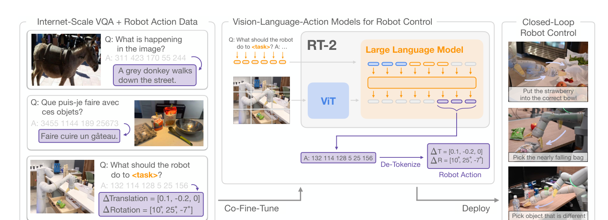
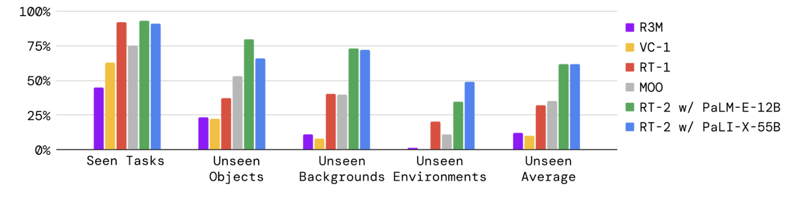
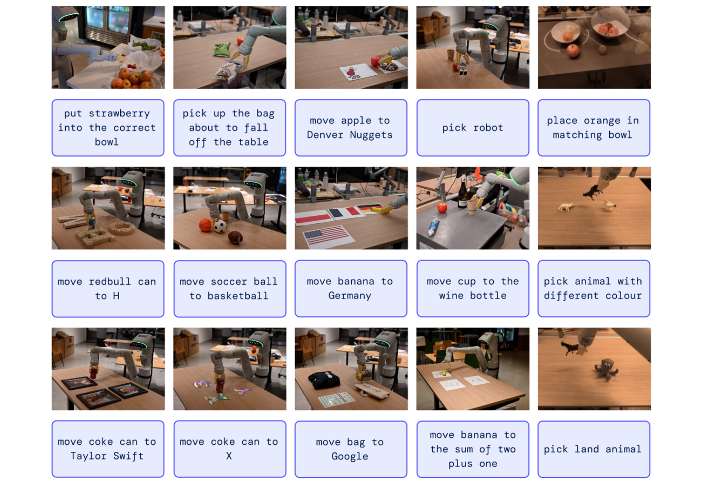
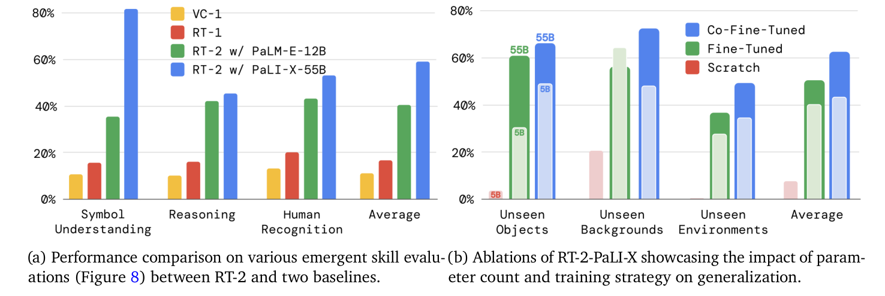
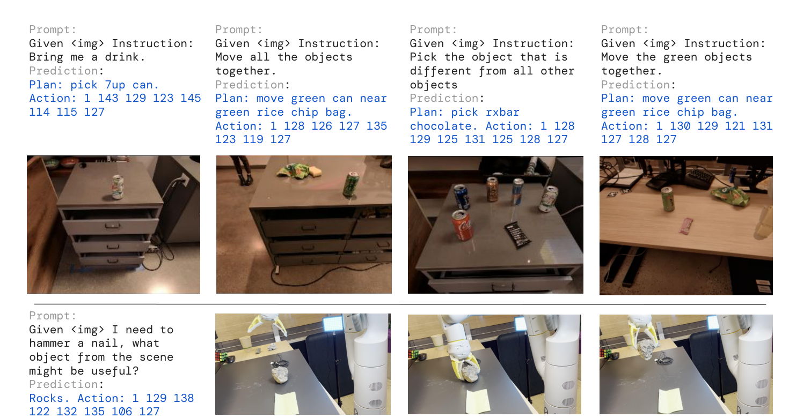
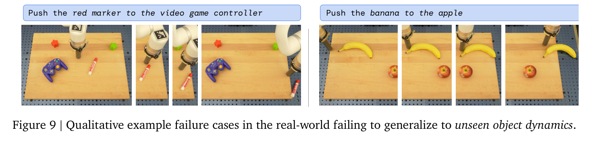

# RT-2：把 web-scale VLM 变成会输出动作的 VLA

!!! info "论文信息"
    **论文题名：** RT-2: Vision-Language-Action Models Transfer Web Knowledge to Robotic Control。<br>
    **作者：** Anthony Brohan、Noah Brown、Justice Carbajal、Yevgen Chebotar、Xi Chen、Krzysztof Choromanski、Tianli Ding、Danny Driess、Avinava Dubey、Chelsea Finn 等（共 54 人）。<br>
    **机构：** 未在公开元数据中稳定解析；以 arXiv/PDF 或官方页 affiliation block 为准。<br>
    **时间 / 主题：** 2023-07；具身智能。<br>
    **arXiv / 官方报告：** arXiv：[2307.15818](https://arxiv.org/abs/2307.15818)；官方材料：[robotics-transformer2.github.io/](https://robotics-transformer2.github.io/)。<br>
    **GitHub / 项目：** GitHub：未找到官方链接；项目页：[robotics-transformer2.github.io/](https://robotics-transformer2.github.io/)。<br>
    **元数据来源与核验口径：** 来源：[arXiv](https://arxiv.org/abs/2307.15818)；[官方 / 项目材料](https://robotics-transformer2.github.io/)；Checked Date：2026-06-04；Repro Status：Paper / official materials reviewed, independent reproduction not claimed。

> **这篇回答的问题。** 如何理解“RT-2”背后的核心机制、适用边界和下一步阅读路径。

RT-2 的核心不是“机器人也用了大模型”，而是一个更具体的问题：互联网图文数据里有大量视觉语义知识，机器人数据却少、贵、分布窄；能不能把 VLM 已经学到的物体、关系、类别和常识，通过一个动作接口迁移到真实机器人控制？

论文给出的接口是 vision-language-action model：输入仍然是图像和语言指令，输出不再只是文本，而是一串代表机器人动作的 token。RT-2 最值得读懂的地方就在这里：**它不是让语言模型直接“理解物理”，而是把动作离散化成模型可以生成的符号，再用真实机器人数据把这些符号绑定到控制后果上。**

## 论文真正解决的问题

RT-1 已经证明 Transformer 可以在大量真实机器人示范上学习多任务策略，但它主要从机器人数据里学。RT-2 往前走了一步：从 PaLI-X、PaLM-E 这类预训练 VLM 出发，把原来的 web vision-language 能力保留下来，再加入机器人 trajectory 数据，让同一个模型既能回答视觉语言任务，也能输出机器人动作。

这个目标听起来像“多加一种输出”，实际有三个难点。第一，动作是连续控制量，语言模型只能生成 token，需要把位姿、旋转、夹爪和终止信号转成离散序列。第二，机器人控制要求每一步都输出有效动作，不能像聊天一样生成任意词。第三，模型如果只在机器人数据上微调，很容易忘掉 web 预训练学到的语义概念，所以训练 recipe 必须同时保留 web data 和 robot data。

## 从主图看 RT-2 的桥在哪里

{ width="920" }

<small>图源：[RT-2: Vision-Language-Action Models Transfer Web Knowledge to Robotic Control](https://arxiv.org/abs/2307.15818)，Figure 1。原图表达 web-scale vision-language data 和 robot trajectory data 共同训练，模型最终输出 action token。本站读法是先看右侧输出：RT-2 的关键桥梁不是多模态输入，而是把动作放进 VLM 的 token 生成接口。</small>

这张图的读法要从“输出”开始。普通 VLM 输出 caption、答案或推理文本；RT-2 输出动作。于是训练样本可以写成类似 VQA 的格式：

```text
Q: what action should the robot take to [task instruction]?
A: terminate dx dy dz drx dry drz gripper
```

这里的 `A` 看起来是一串文本，但每个位置都对应机器人执行空间里的量。这个设计让 RT-2 可以沿用 next-token prediction 框架，同时把机器人动作接到同一个 decoder 上。

## 动作 tokenization：把连续控制量压进 256 个 bin

RT-2 沿用 RT-1 的动作离散化思想。一个动作包含 6-DoF 末端执行器位移、夹爪伸展和一个 episode termination 命令。除 termination 以外的连续维度被均匀离散成 256 个 bin。可以把单步动作写成：

\[
a_t =
\big[
c_t,\Delta x_t,\Delta y_t,\Delta z_t,
\Delta r^x_t,\Delta r^y_t,\Delta r^z_t,g_t
\big]
\]

其中 \(c_t\) 是终止命令，\(g_t\) 是夹爪相关控制量，其余是位姿增量。连续维度会先映射到整数 bin：

\[
b^d_t =
\left\lfloor
255 \cdot
\frac{\mathrm{clip}(a^d_t,l_d,u_d)-l_d}{u_d-l_d}
\right\rceil
\]

然后把这些 bin 写成模型可以生成的 token 序列。论文里 PaLI-X 恰好有整数 token，可以直接把 bin 关联到对应整数；PaLM-E 没有这种方便表示，就覆盖 256 个低频 token 作为动作词表。这个细节很重要，因为它说明 action token 不是自然语言里的“动作描述”，而是机器人控制接口里的离散数值。

动作 tokenization 带来两个收益：训练接口统一，VLM 可以像预测文本一样预测动作；输出空间受控，部署时可以约束模型只生成合法动作 token。但它也带来代价：动作精度受 bin 数和动作范围影响，控制频率受大模型推理延迟影响，坐标系和低层 controller 仍然决定真实执行效果。

## Co-fine-tuning：为什么不能只拿机器人数据微调

RT-2 的训练不是简单地把 VLM 拿来在 robot dataset 上继续训。论文强调 co-fine-tuning：训练 batch 里同时保留原始 web vision-language data 和机器人动作数据。一个简化的目标可以写成：

\[
\mathcal{L}
=
\mathbb{E}_{(I,x,a)\sim D_{\text{robot}}}
\left[-\sum_j \log p_\theta(y_j \mid I,x,y_{<j})\right]
+
\lambda\,
\mathbb{E}_{(I,x,t)\sim D_{\text{web}}}
\left[\mathcal{L}_{\text{VLM}}\right]
\]

第一项让模型学会在机器人图像和任务指令下输出动作 token；第二项继续维护 web-scale VLM 的视觉语言能力。这里的关键不是公式形式，而是训练信号的分工：robot data 绑定动作后果，web data 保住语义概念。论文的 ablation 也说明，co-fine-tuning 在泛化上优于只用 robot data 微调，而从零训练大模型表现很差。

这解释了为什么 RT-2 能做一些机器人数据里没直接出现过的语义任务。它迁移的主要是“看懂物体、类别、关系、标志、人脸或简单推理”的能力，而不是凭空学会新的运动技能。机器人没有示范过擦桌子、折毛巾、复杂工具使用，web pretraining 不会自动变成稳定 motor skill。

## 输出约束和实时控制：系统问题不能被模型名盖住

在普通 VLM 里，输出一个罕见词或多写一句解释通常不是灾难；在机器人控制里，一个非法动作 token 或延迟过大的动作都可能破坏任务状态。RT-2 因此在机器人动作任务上约束输出词表，只允许采样合法 action tokens。

另一个现实问题是推理频率。RT-2 使用的模型可以达到 55B 参数量级，论文通过多 TPU 云服务支持真实机器人闭环控制；55B PaLI-X 版本约 1-3 Hz，较小的 5B 版本约 5 Hz。这个频率提醒我们：RT-2 的动作不是高频电机控制，它更像低频视觉语言策略，再由机器人低层控制器执行和稳定化。

所以 RT-2 的系统边界必须写清楚：VLA 输出动作 token，不等于它替代了安全限幅、坐标变换、控制器、碰撞保护、reset 机制和人工接管。

## 泛化实验：seen 分数不是论文主张的全部

{ width="860" }

<small>图源：[RT-2](https://arxiv.org/abs/2307.15818)，Figure 4。原图比较 RT-2 和 baselines 在 seen tasks、unseen objects、unseen backgrounds、unseen environments 上的表现。本站读法是把 seen 和 unseen 分开：seen tasks 主要检验机器人技能学习，unseen categories 才更接近 web knowledge transfer 的核心 claim。</small>

论文在真实机器人上做了大约 6000 条 evaluation trajectories。seen tasks 延续 RT-1 的任务集合，超过 200 个任务；unseen evaluations 关注新物体、新背景和新环境，超过 280 个任务。图 4 和附录表格显示，RT-2 在 seen tasks 上和 RT-1 接近，但在 unseen average 上明显更强：RT-2-PaLI-X-55B 和 RT-2-PaLM-E-12B 的 unseen average 都约为 62，而 RT-1 约为 32、MOO 约为 35。

这个结果的含义不是“模型更大所以什么都会”，而是：web-scale VLM 的语义和视觉概念，在动作 token 接口和机器人示范绑定之后，能帮助机器人把已学过的操作技能部署到更多未见条件里。技能本身仍然来自 robot data；泛化能力则来自 web data 与 robot data 的组合。

## Emergent eval：迁移的是语义，不是新动作物理

{ width="860" }

<small>图源：[RT-2](https://arxiv.org/abs/2307.15818)，Figure 2。原图展示 RT-2 处理语义理解、关系判断和人类识别相关指令的例子。本站读法是把这些例子当作“语义迁移”证据，而不是当作所有运动能力都泛化的证据。</small>

RT-2 把 emergent capabilities 分成三类：symbol understanding、reasoning、human recognition。比如“把苹果移动到同色杯子旁边”需要视觉关系和颜色匹配；“move X near the sum of two plus one”需要简单数学；“把可乐罐移给戴眼镜的人”需要人类属性识别。附录表格里，RT-2-PaLI-X-55B 的 emergent average 约 60，RT-1 约 17，VC-1 约 11。

这里必须保持克制。emergent 不是说机器人自动学会新运动，而是说 VLM 的语义概念能影响动作选择。论文自己也写得很清楚：transfer 不应被期待为产生新的 robotic motions，而更可能迁移 semantic and visual concepts。

{ width="860" }

<small>图源：[RT-2](https://arxiv.org/abs/2307.15818)，Figure 6。原图左侧比较 emergent skill eval，右侧做模型大小和训练策略 ablation。本站读法是看两个因果线索：更大模型带来更强泛化，co-fine-tuning 比只用机器人数据微调更能保留 web 概念。</small>

图 6 右侧的 ablation 很适合判断“到底是哪里有用”。5B 从零训练在 unseen average 上很低；5B 只微调和 5B co-fine-tuning 有改进；55B co-fine-tuning 最强。这说明 RT-2 的收益来自三件事叠加：预训练 VLM、动作接口、机器人和 web 数据共训练。只拿其中一个词做口号，都会漏掉机制。

## Chain-of-thought：计划文本能帮语义分解，但不是完整规划器

{ width="860" }

<small>图源：[RT-2](https://arxiv.org/abs/2307.15818)，Figure 7。原图展示 RT-2-PaLM-E 在 chain-of-thought prompting 下先生成中间计划，再输出动作相关行为。本站读法是把它看成 VLM 语义分解能力接入动作接口，而不是把它等同于有搜索、有约束、有失败恢复的 classical planner。</small>

CoT 对 RT-2 的意义在于让模型先把指令拆成语义步骤，再落到动作选择。例如“我困了，拿一个能帮我的饮料”可以先推到能量饮料，再执行拿取。这个能力很有启发，但它仍然受限于单步/短程动作接口、训练数据覆盖和环境可观测性。复杂长时任务仍需要显式状态、记忆、检查点、失败恢复和安全约束。

## 失败图比成功图更应该认真读

{ width="860" }

<small>图源：[RT-2](https://arxiv.org/abs/2307.15818)，Figure 9。原图展示模型在未见物体 dynamics 上失败的真实案例。本站读法是把失败归因到动作后果和物理交互：模型可能知道物体是什么，也会选择合理目标，但不一定掌握这个物体如何被推、滚、抓或稳定放置。</small>

论文列出的失败边界包括：按具体部件抓取物体，比如抓把手；机器人数据里没有的新动作类型，比如用毛巾擦拭或工具使用；精细灵巧动作，比如折毛巾；需要多层间接推理的长链任务。这些边界和 RT-2 的主张并不矛盾，反而说明它真正迁移的是视觉语义，而物理技能仍需要真实机器人数据和控制接口来学习。

## 阅读结论

RT-2 的知识含量集中在三个接口。第一，action tokenization 把连续动作变成 VLM 可以生成的离散 token，但也引入精度、频率和控制边界。第二，co-fine-tuning 同时保留 web data 和 robot data，让模型既不忘语义，也能把语义落到动作。第三，评测必须拆成 seen、unseen 和 emergent：seen 检验已有机器人技能，unseen 检验视觉语义迁移，emergent 更偏概念和简单推理，不代表新运动技能凭空出现。

看后续 VLA 论文时，可以沿着 RT-2 这条线追问：动作到底输出在哪一层？连续控制量如何离散或 chunk？web data 和 robot data 怎样混合？模型输出后是否有低层控制器和安全约束？评测有没有把语义泛化、物理技能泛化和长时任务泛化分开？

## 外部精读

- [RT-2 paper](https://arxiv.org/abs/2307.15818)
- [RT-2 project page](https://robotics-transformer2.github.io/)
- [Google DeepMind RT-2 blog](https://deepmind.google/blog/rt-2-new-model-translates-vision-and-language-into-action/)
- [RT-1 paper](https://arxiv.org/abs/2212.06817)
- [PaLM-E paper](https://arxiv.org/abs/2303.03378)
- [Open X-Embodiment / RT-X project page](https://robotics-transformer-x.github.io/)

## 相关阅读与下一步

- 外部材料：[论文标题 arXiv 检索](https://arxiv.org/search/?query=rt2&searchtype=title)。
- 外部材料：[Semantic Scholar 标题检索](https://www.semanticscholar.org/search?q=rt2)。
- 外部材料：[Papers with Code 检索](https://paperswithcode.com/search?q=rt2)。
- 站内下一步：[论文精读专题](../index.md)。
- 站内下一步：[论文专题写作规范](../writing-standard.md)。
- 站内下一步：[外部精读来源台账](../../references/external-reading-ledger.md)。
