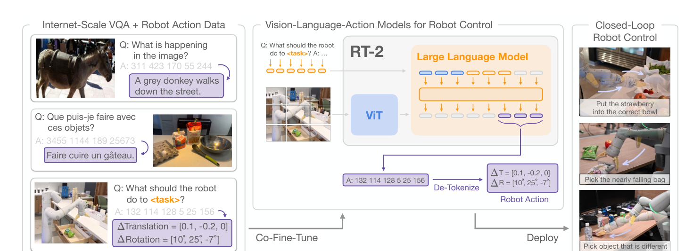
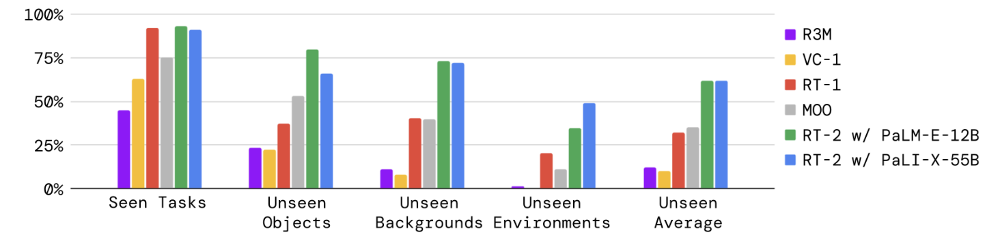
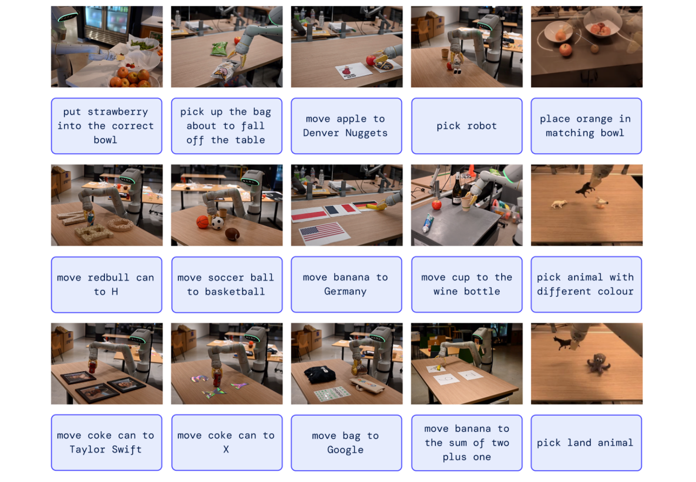
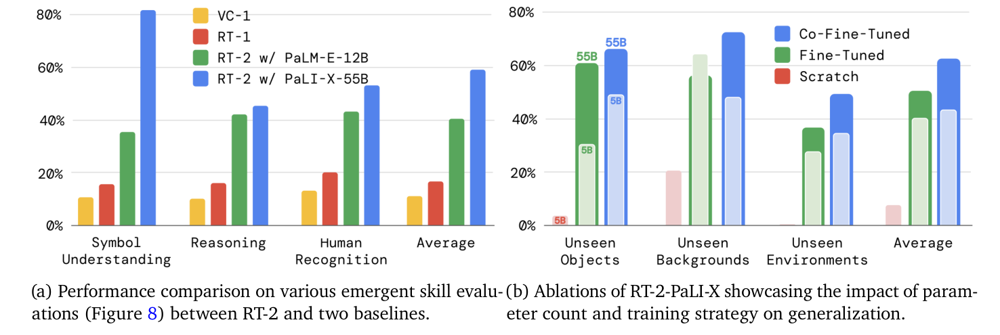
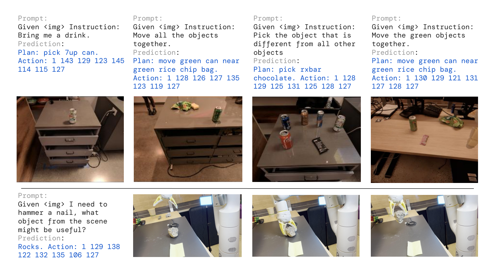
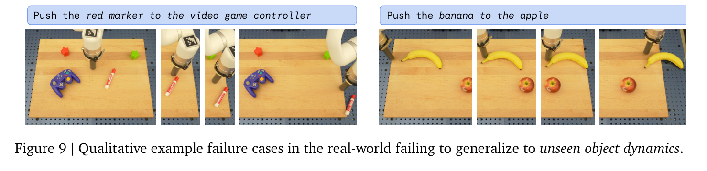

# RT-2：把 web-scale VLM 变成会输出动作的 VLA

!!! info "论文信息"
    **论文题名：** RT-2: Vision-Language-Action Models Transfer Web Knowledge to Robotic Control。 
    **作者：** Anthony Brohan、Noah Brown、Justice Carbajal、Yevgen Chebotar、Xi Chen、Krzysztof Choromanski、Tianli Ding、Danny Driess、Avinava Dubey、Chelsea Finn 等（共 54 人）。 
    **机构：** 未在公开元数据中稳定解析；以 arXiv/PDF 或官方页 affiliation block 为准。 
    **时间 / 主题：** 2023-07；具身智能。 
    **arXiv / 官方报告：** arXiv：[2307.15818](https://arxiv.org/abs/2307.15818)；官方材料：[robotics-transformer2.github.io/](https://robotics-transformer2.github.io/)。 
    **GitHub / 项目：** GitHub：未找到官方链接；项目页：[robotics-transformer2.github.io/](https://robotics-transformer2.github.io/)。 
    **元数据来源与核验口径：** 来源：[arXiv](https://arxiv.org/abs/2307.15818)；[官方 / 项目材料](https://robotics-transformer2.github.io/)；Checked Date：2026-06-15；Repro Status：Paper / official materials reviewed, independent reproduction not claimed。

## 当机器人认识了物体，却还不知道怎样把知识用在动作上

RT-2 给出了一条直接的知识迁移路径。将机器人动作写成视觉语言模型能够预测的 token，再把机器人示范与原有图文任务共同微调，模型就能用在互联网中学到的对象、关系和语言概念，决定已有抓取、移动、放置技能应该用在哪里。论文最有说服力的结果来自这个区别：已见任务上，RT-2 与 RT-1 的成功率相近；面对新物体、背景与环境，两个 RT-2 主模型的平均成绩都达到 62%，RT-1 为 32%。

为什么这不是简单地给机器人加一个会聊天的界面？假设指令是“把草莓放进正确的碗里”，图像中一个碗装着水果，另一个装着其他东西。模型必须认识草莓和碗，还要利用类别关系选择目标位置，最后把这个选择落实为手臂移动和夹爪命令。若视觉语言模型只输出“应该放进水果碗”，后面的控制器仍然需要理解这句话与当前图像的关系。RT-2 尝试让负责理解场景的生成模型本身学会输出动作。

Figure 1 应从左向右读。左侧把普通 VQA 回答和机器人动作放进同一训练接口，中间共享视觉语言主干，右侧将预测 token 还原成动作并再次观察场景。

{ width="920" }

*Figure 1，web 图文任务与机器人示范共同训练一个能够输出动作的模型。*

这里的 **Vision-Language-Action Model（视觉语言动作模型）** 指的是能从图像和指令直接预测动作的模型。RT-2 没有另外增加只服务于动作的网络层，语言与动作任务共享模型权重。它因此可以利用预训练时已经付出的计算投入，再用机器人数据学习如何将语义判断接到控制输出。[↗](https://arxiv.org/pdf/2307.15818v1#page=2)

这条路线的能力边界也从一开始就很明确。互联网图文可以教模型哪个东西像锤子、哪种饮料可能适合困倦的人，却不自动提供挥锤、受力或处理新物体惯性的机器人示范。论文中的新能力，主要是已有动作在新语义条件下的使用方式。[↗](https://arxiv.org/pdf/2307.15818v1#page=3)

## 把动作写成语言模型能够预测的答案

### 八个位置的语义，比数字本身更重要

RT-2 沿用 RT-1 的动作离散化思路。一次动作含一个离散终止命令、三维末端平移增量、三维末端旋转增量，以及夹爪张开程度。用展开形式表示，动作序列具有以下固定顺序。

$$
a_t=\left[
\mathrm{terminate},
\Delta x,\Delta y,\Delta z,
\Delta r_x,\Delta r_y,\Delta r_z,
\mathrm{gripper\_extension}
\right].
$$

连续的七个分量均匀离散为 256 个 bins，终止命令本身已经是离散变量。转换以后，八个位置都可以用整数或与整数对应的 token 表示。这个动作空间描述的是末端运动与夹爪，不应因为实验机器人具有 7-DoF 手臂，就把这些位置理解为七个关节的直接角度。[↗](https://arxiv.org/pdf/2307.15818v1#page=5)

量化的作用是把连续回归问题改成词表分类。假如某个平移维度落入第 128 个区间，模型学习输出的是对应 token；执行端再根据该维度的物理范围还原控制量。同一个“128”出现在平移、旋转或夹爪位置，含义由位置及量化规则共同决定，数字本身没有通用的机器人语义。因此，训练端与执行端必须使用相同的分量顺序、量化范围与反量化规则。

这也说明动作字符串不能被当成随意的自然语言数字。模型需要生成一段有协议含义的序列。语言模型提供的是成熟的条件序列建模能力，机器人示范提供的是这些符号与物理动作之间的对应关系。

### 两种 tokenizer，需要两种接入方式

PaLI-X 与 PaLM-E 的词表不相同，作者没有假设“把数字写出来”就一定得到一个 token。

| Backbone | Action token mapping | Why this mapping is needed |
| --- | --- | --- |
| PaLI-X | 使用对应整数的已有 token | 其 tokenizer 对不超过 1000 的整数已有独立 token，可以直接覆盖 256 个动作 bins |
| PaLM-E | 重定义 256 个最低频 token | 原 tokenizer 没有同样方便的整数表示，需要为动作建立固定词表 |

这一差异关系到序列长度和动作边界。如果一个 bin 编号被拆成数个普通数字 token，动作维度就不再自然对应单个离散类别。RT-2 用已有词表中的固定位置承载动作，因此不需要另建动作输出头；PaLM-E 的做法则要求微调重新赋予那些低频符号动作含义，原文将其与 symbol tuning 联系起来。[↗](https://arxiv.org/pdf/2307.15818v1#page=6)

机器人示范也被改写成 VQA 格式。输入包括相机图像与问题，例如 `Q: what action should the robot take to [task instruction]? A:`；目标答案是按顺序连接的动作 token。模型在普通图文样本中回答“图里发生了什么”，在机器人样本中回答“现在应该输出什么动作”。两种任务可以沿用同一套 next-token prediction 训练流程。

### 输出合法 token，只解决协议问题

部署时，机器人动作请求会约束可采样词表，只允许合法动作 token；普通 VQA 请求仍然允许完整自然语言词表。这使模型不至于在该输出动作时生成一段无法执行的说明文字。

但 **Output Constraint（输出约束）** 不能保证动作物理上正确。词表合法只说明“这个符号是允许的动作类别”，不说明目标选对了、末端方向安全，或者物体接触后的运动可预测。它解决的是语言模型与控制接口之间的格式兼容，动作可靠性仍然需要训练与闭环反馈。

动作分量采用自回归生成，前面的输出可以成为后面分量的条件。为了看清训练信号，可以把论文所说的 next-token objective 写成下面这个等价的解释形式；它不是论文额外提出的一项新损失。

$$
\mathcal L_{\mathrm{seq}}
=-\mathbb E_{(I,\ell,z)\sim\mathcal D_{\mathrm{mix}}}
\sum_{j=1}^{|z|}
\log p_\theta(z_j\mid I,\ell,z_{<j}).
$$

$I$ 是输入图像，$\ell$ 是任务文本，$z$ 是目标答案序列。机器人样本的 $z$ 为动作 token，图文样本的 $z$ 为语言答案。机器人部分因此就是离散形式的 **Behavior Cloning（行为克隆）**，根据示范动作做监督学习；这里没有通过机器人在线试错优化奖励的强化学习阶段。[↗](https://arxiv.org/pdf/2307.15818v1#page=21)

## 共同微调怎样保留知识，同时学会动作

### 数据多，不等于每种监督都能被模型充分看到

RT-2 的机器人数据沿用 RT-1 工作中的示范，来自 13 台机器人、17 个月的办公室厨房采集。每条轨迹有自然语言任务说明，通常由动作动词和对象组成，例如抓取某个罐子、打开抽屉、把物品放进容器。它覆盖抓取、移动、摆正、推倒、开关抽屉以及从容器中取放物品等行为。

这些数据提供真实运动监督，但语义与场景覆盖远小于 web 图文数据。原有视觉语言数据包含 VQA、caption 和交错图文；其中 WebLI 的原始规模约为 100 亿图文对、覆盖 109 种语言，按跨模态相似度筛选前 10% 后形成约 10 亿样本。这个数字描述该数据源的筛选规模，并不等于每个 RT-2 模型在共同微调中完整遍历了同样多样本。[↗](https://arxiv.org/pdf/2307.15818v1#page=19)

**Co-Fine-Tuning（共同微调）** 的具体操作，是在动作适配时继续混合原图文任务，并提高机器人数据的采样权重。PaLI-X 的机器人样本约占训练混合的 50%，PaLM-E 约占 66%。这些是训练抽样比例，不能解释成原始数据集有一半或三分之二来自机器人。

这种权重同时处理两个问题。若按原始数据量混合，机器人动作很容易在大量图文监督中被稀释；若只用机器人数据微调，又可能将模型适配到狭窄的厨房指令分布，损伤先前获得的视觉语言能力。持续保留图文目标，让模型在学习动作符号时仍需要识别、描述和回答更广泛的概念。是否真的改善控制，需要后面的 robot-only fine-tuning 消融来检验，不能仅凭这个训练动机判断。

PaLI-X 的共同微调没有使用其原预训练方案中的 Episodic WebLI。论文提供了数据来源和机器人采样比例，但不能据此把原 VLM 的全部预训练组成不加区别地写成 RT-2 的共同微调数据。[↗](https://arxiv.org/pdf/2307.15818v1#page=20)

### 两个骨干，验证同一接口是否依赖单一架构

RT-2-PaLI-X 使用视觉编码器产生 image tokens，再由 encoder-decoder 主干联合处理图像与文本，最后自回归生成答案。55B 版本的附录结构描述包含 ViT-22B 与约 32B、50 层的 encoder-decoder。RT-2-PaLM-E-12B 则基于 decoder-only 语言模型，图像由 ViT-4B 投影到语言 embedding 空间，与文本一起进入序列。[↗](https://arxiv.org/pdf/2307.15818v1#page=20) [↗](https://arxiv.org/pdf/2307.15818v1#page=21)

两者并不具有相同的预训练任务混合，也不是仅把参数数量从 12B 改成 55B 的一组受控对照。它们的共同点在于已有视觉语言生成接口能够容纳动作输出；不同点则会影响符号、数学、颜色与场景判断的强弱。

训练细节显示，规模比较还同时存在预算差异。

| Model | Learning Rate | Batch Size | Co-fine-tuning Steps | Robotics Sampling Weight |
| --- | ---: | ---: | ---: | ---: |
| RT-2-PaLI-X-55B | $10^{-3}$ | 2048 | 80K | ≈50% |
| RT-2-PaLI-X-5B | $10^{-3}$ | 2048 | 270K | ≈50% |
| RT-2-PaLM-E-12B | $4\times10^{-4}$ | 512 | 1M | ≈66% |
| RT-2-PaLI-3B, Language-Table | $10^{-3}$ | 128 | 300K | — |

作者沿用相应 VLM 的学习率日程与正则设置。表内步数是动作适配阶段的训练设置，不能把它们当成从零训练整个 VLM 的成本，也不能仅用参数量或 steps 比值推算严格的算力效率。[↗](https://arxiv.org/pdf/2307.15818v1#page=21)

## 控制闭环中的大模型，运行在什么地方

运行时，机器人发送图像与任务，云端 VLA 返回动作 token，执行端完成反量化与控制，再用新的图像进入下一轮。网络服务因此位于实际控制闭环内，延迟会直接影响机器人多久能够根据新观察修正动作。

论文通过 multi-TPU 云服务部署大模型，并允许多个机器人查询同一服务。55B PaLI-X 的实际控制频率为约 **1–3 Hz**，5B 约为 **5 Hz**。这说明直接使用较大 VLM 控制机器人在这些任务中可行，但不是说模型在本体 GPU 上运行，也不是每秒数百次的底层关节或力矩伺服。[↗](https://arxiv.org/pdf/2307.15818v1#page=6)

这个成本与动作表示有关。模型要串行生成动作 token，再经网络返回；物体快速滑动、接触突然改变时，控制器必须等下一次观察和推理才有机会调整。论文提出量化与蒸馏作为潜在改进方向，并未给出已经通过这些技术达到更高频率的结果。因而，模型的语义优势与部署频率应一起评估，不能从成功案例直接推论它适用于任何快速操作。

## 泛化实验究竟改变了哪些条件

### 所有基线使用相同机器人数据，但预训练路径不同

论文约 6000 条评测轨迹分布在多组实验中，不是单个测试集每种方法各跑 6000 次。作者选择的基线分别检验不同替代方案。

| Baseline | What enters the policy | Comparison question |
| --- | --- | --- |
| RT-1 | 35M Transformer 策略 | 不使用生成式 VLM 预训练，原有机器人数据能做到什么 |
| VC-1 | 预训练 ViT-L 视觉表示，加语言与 RT-1 策略 | 机器人视觉基础表示是否足够 |
| R3M | Ego4D 预训练的 ResNet50 表示，加语言与 RT-1 策略 | 人类活动中的视觉经验能迁移多少 |
| MOO | VLM 标记目标物体后，将增强图像交给 RT-1 | 用独立语义定位模块是否足够 |

VC-1 和 R3M 使用 Universal Sentence Encoder 提供指令表示，图像与语言 token 经 token learner 后送入 RT-1 decoder；训练时视觉编码器是解冻的，因为作者观察到这优于冻结。它们并不是“固定视觉特征加一个没有充分适配的小头”。MOO 则将 VLM 知识主要用在对象指定，策略本身不继承生成式 VLM 的全部共享表示。[↗](https://arxiv.org/pdf/2307.15818v1#page=20)

这组对照保持了机器人数据一致，有助于比较不同知识接入方式。但模型容量、预训练计算和数据组成仍然不同，不能把所有差异都归结为“动作 token”这一个设计。后面的同骨干消融才进一步区分预训练、共同微调与规模。

### Seen Tasks 仍有环境扰动，Unseen 又分三个轴

已见任务测试包含超过 200 种任务配置，覆盖拾取、推倒、摆正、移动和抽屉操作。即使指令见过，物体摆放、时间和机器人位置仍会变化。因此 Seen Tasks 测的是训练任务范围内的实际执行能力，并非重放原示范。

未见测试包含超过 280 种任务，重点是各种场景中的拾取和放置。Unseen Objects 改变对象实例与类别，hard 组含更难抓和形状更特殊的玩具等；Unseen Backgrounds 改变视觉背景，hard 组还加入新物体；Unseen Environments 的 easy 为新的水槽环境，hard 为带显示器和办公用品的办公桌。easy 与 hard 是不同任务集合，不能假定每一个方法都必须在 hard 上得到更低数值。[↗](https://arxiv.org/pdf/2307.15818v1#page=7) [↗](https://arxiv.org/pdf/2307.15818v1#page=8)

附录给出全部指令，每条在普通泛化测试中运行 1–5 次，取决于该评测集合的指令数。它不是每个物体或每种条件具有相同次数的大规模独立重复实验；表中平均也需要结合具体任务组成理解。[↗](https://arxiv.org/pdf/2307.15818v1#page=21)

### 已见表现相近，优势集中在分布变化之后

Figure 4 先比较最左侧 Seen Tasks，再看三个 Unseen 轴。这个顺序有助于判断，RT-2 的主要收益是原任务动作精度更高，还是已有能力在新条件下更容易保持。

{ width="860" }

*Figure 4，已见任务与新物体、新背景、新环境中的成功率。*

下表按原 Appendix Table 4 保留全部模型与数值，单位为百分比；成对列按 Easy / Hard 顺序排列。

| Model | Seen Tasks | Unseen Objects, Easy / Hard | Unseen Backgrounds, Easy / Hard | Unseen Environments, Easy / Hard | Unseen Average |
| --- | ---: | --- | --- | --- | ---: |
| R3M | 45 | 32 / 14 | 13 / 9 | 0 / 2 | 12 |
| VC-1 | 63 | 34 / 10 | 13 / 3 | 0 / 0 | 10 |
| RT-1 | 92 | 31 / 43 | 71 / 9 | 26 / 14 | 32 |
| MOO | 75 | 58 / 48 | 38 / 41 | 19 / 3 | 35 |
| RT-2-PaLI-X-55B | 91 | 70 / 62 | 96 / 48 | 63 / 35 | 62 |
| RT-2-PaLM-E-12B | 93 | 84 / 76 | 75 / 71 | 36 / 33 | 62 |

RT-1 的 Seen Tasks 已达 92%，两个 RT-2 为 91% 和 93%，并没有显示大模型在已见技能上数量级更强。变化发生在未见条件：平均从 RT-1 的 32%、MOO 的 35%，提高到两个 RT-2 的 62%。这与共享视觉语言知识帮助目标识别和场景理解的动机相符。[↗](https://arxiv.org/pdf/2307.15818v1#page=23)

两个 RT-2 同为 62%，内部却不同。PaLM-E 在未见物体上达到 84% / 76%，高于 PaLI-X 的 70% / 62%；hard 背景也有 71% 对 48% 的优势。PaLI-X 在 easy 新环境中达到 63%，PaLM-E 为 36%。因此，平均相等并不表示模型可在所有场景中互相替换，参数更多也没有保证逐列领先。

还有一个与“未见”定义直接相关的附注。PaLM-E 原预训练中包含机器人图像的高层 VQA 规划任务，这些图像可能与泛化场景相似；作者明确说明其中没有本实验评测的低层动作监督。这仍然支持从非低层动作经验到控制的迁移，但不能将结果描述为模型从未接触过任何类似机器人图像。[↗](https://arxiv.org/pdf/2307.15818v1#page=24)

## 新语义怎样改变旧动作的使用方式

### 定性展示把问题暴露出来，定量测试才比较稳定性

Figure 2 中有“把草莓放入正确的碗”“拿起快掉下桌子的袋子”“将香蕉移到德国标志”等指令。它们改变了目标选择所需要的知识，而执行端仍以抓取、移动、放置为主。

{ width="860" }

*Figure 2，关系、符号与常识概念进入对象和目标位置选择。*

例如“快掉下桌子的袋子”要求比较两个对象与桌沿的关系；“正确的碗”要求利用场景中的类别匹配。一次演示可以显示这种组合存在，却不能说明在任意摆放、任意物体和任意语句下都可靠。作者因此另设三类定量测试，并让四个模型在相同条件下依次运行，以 A/B 方式减少初始场景差异；每条指令测试五次。

**Symbol Understanding（符号理解）** 要求将物体移向字母、数字或图标，如 X、3、心形；**Reasoning（推理）** 包括算术、logo、营养概念、颜色关系与多语言指令；**Person Recognition（人物识别）** 则在给定人物图像中按名字或外观描述选择目标位置。这里的人物任务评测的是所用图片与指令集合中的匹配，不是开放场景身份识别可靠性的证明。[↗](https://arxiv.org/pdf/2307.15818v1#page=9) [↗](https://arxiv.org/pdf/2307.15818v1#page=22)

Figure 6 左侧汇总三类语义任务，右侧是另一组规模与训练消融。先看左侧不同颜色，才能把“语义能力迁移多少”与“训练配方为何有效”两个问题分开。

{ width="860" }

*Figure 6，左图为新语义任务成功率，右图为 PaLI-X 的模型规模与训练方式消融。*

### 总体提升很大，但数学与符号并不是同一种能力

Appendix Table 5 的类别平均如下，单位为百分比。

| Model | Symbol Understanding | Reasoning | Person Recognition | Average |
| --- | ---: | ---: | ---: | ---: |
| VC-1 | 11 | 10 | 13 | 11 |
| RT-1 | 16 | 16 | 20 | 17 |
| RT-2-PaLI-X-55B | 82 | 46 | 53 | 60 |
| RT-2-PaLM-E-12B | 36 | 43 | 43 | 40 |

PaLI-X 的总体 60% 相对 RT-1 的 17% 超过三倍，PaLM-E 的 40% 也明显更高。其中最突出的差距是符号理解，PaLI-X 达到 82%，RT-1 只有 16%。这符合“机器人示范没有教过这些符号，但 VLM 图文经验可能包含它们”的知识迁移解释。

然而，三类均值还会掩盖能力差异。将推理一栏继续拆开，结果并不随模型大小一致排序。

| Model | Math | Logos | Nutrition | Color / Multilingual |
| --- | ---: | ---: | ---: | ---: |
| VC-1 | 0 | 8 | 20 | 13 |
| RT-1 | 5 | 0 | 32 | 28 |
| RT-2-PaLI-X-55B | 25 | 52 | 48 | 58 |
| RT-2-PaLM-E-12B | 35 | 56 | 44 | 35 |

PaLM-E 的 Math 为 35%，高于 PaLI-X 的 25%；Logos 也略高。PaLI-X 在颜色与多语言组达到 58%，PaLM-E 为 35%。作者将数学差异联系到两种骨干的预训练数据混合，但这仍是解释，论文没有进一步把数学预训练数据单独增删来证明因果。[↗](https://arxiv.org/pdf/2307.15818v1#page=24)

符号子组的跨度也很大。PaLI-X 在 Symbol 1 / 2 / 3 分别为 93% / 60% / 93%；PaLM-E 则为 67% / 20% / 20%。一个“符号理解”标签内部已经包含不同视觉符号、任务表达与匹配难度。RT-2 因此展示了可迁移的语义能力，也暴露了这种能力远未均匀覆盖各种指令。

## 预训练、共同微调与规模，各贡献了什么

只看 RT-2 对 RT-1，会把模型容量、预训练知识和共同微调混在一起。作者在 PaLI-X 内比较 5B 与 55B，并区分 from scratch、只用机器人数据 fine-tuning、继续混合图文的 co-fine-tuning。该实验排除 Seen Tasks，专门观察未见条件。

Appendix Table 6 的完整数值如下，单位为百分比。Easy / Hard 的顺序与前表一致。

| Model | Size | Training | Unseen Objects | Unseen Backgrounds | Unseen Environments | Average |
| --- | --- | --- | --- | --- | --- | ---: |
| RT-2-PaLI-X | 5B | from scratch | 0 / 10 | 46 / 0 | 0 / 0 | 9 |
| RT-2-PaLI-X | 5B | fine-tuning | 24 / 38 | 79 / 50 | 36 / 23 | 42 |
| RT-2-PaLI-X | 5B | co-fine-tuning | 60 / 38 | 67 / 29 | 44 / 24 | 44 |
| RT-2-PaLI-X | 55B | fine-tuning | 60 / 62 | 75 / 38 | 57 / 19 | 52 |
| RT-2-PaLI-X | 55B | co-fine-tuning | 70 / 62 | 96 / 48 | 63 / 35 | 63 |

第一层比较是 5B 从零训练与从 VLM 初始化。平均由 9% 变为 42%，说明在当前机器人数据规模下，大模型容量本身不足以产生泛化，预训练经验具有实质作用。作者因为 5B 从零训练已经很弱，没有继续评测 55B from scratch；不能将缺失的 55B 零训练结果补成一个推测值。

第二层比较是同尺度下的微调方式。55B 从 52% 提高到 63%，背景与环境各列都提升，支持共同微调对保留泛化能力有帮助。5B 却只有 42% 到 44% 的平均改善：easy 新物体从 24% 提到 60%，背景的 easy / hard 则从 79% / 50% 降至 67% / 29%。因此，配方对整体均值的好处不代表每个分布变化都改善；也不能把两点差距直接称作统计显著提升。

第三层比较是共同微调的 5B 与 55B，平均从 44% 到 63%。这支持较大模型在该配方下表现更好，但两者训练步数分别为 270K 与 80K，骨干容量和计算预算并未严格控制成同一个变量。它是一组实用训练设置的比较，不是精确的参数 scaling law。[↗](https://arxiv.org/pdf/2307.15818v1#page=10) [↗](https://arxiv.org/pdf/2307.15818v1#page=24)

原文 Table 4 将 PaLI-X-55B 的 Unseen Average 写为 62%，Table 6 对应行的 Average 写为 63%，六个分项相同。上面分别保留各表印出的值；一百分点的表内差异不影响主结论，也不宜自行改写后当成一套精确一致的统计汇总。

## Language-Table 检查接口能否迁移到另一种动作空间

主实验使用移动操作机器人，Language-Table 则提供一个公开二维推物体环境。作者共同微调一个较小的 RT-2-PaLI-3B，并将动作改为 `X Y` 两个整数，每个取值在 $\{-10,-9,\ldots,9,10\}$，表示末端二维笛卡尔增量。这个任务没有直接复用主机器人八维动作协议。[↗](https://arxiv.org/pdf/2307.15818v1#page=8)

训练也不只是二维动作克隆。输入两帧与指令预测动作之外，模型还学习从图像预测指令、机器人手臂位置、给定帧间的时间步数，以及给定图像和指令判断任务是否成功。这五类监督把行为、状态与语言都放进可生成的答案空间，体现了统一输出接口的扩展方式。[↗](https://arxiv.org/pdf/2307.15818v1#page=20)

| Model | Language-Table |
| --- | ---: |
| BC-Zero | $72\pm3$ |
| RT-1 | $74\pm13$ |
| LAVA | $77\pm4$ |
| RT-2-PaLI-3B | $90\pm10$ |

Table 1 给出的是仿真评测结果，保留原文的 $\pm$ 标法。该模型约以 5 Hz 运行，与这组基线频率相近；模型获得更高均值，说明 VLM 适配路线并不局限于主实验机器人。但训练包含额外预测任务，不能只把改善归给动作量化或某一个模块。[↗](https://arxiv.org/pdf/2307.15818v1#page=9)

论文还用相同 checkpoint 展示真实 Language-Table 的新物体推移行为。它们提供跨到真实场景的定性证据，却不应与上表仿真数值合并为一个真实机器人成功率。下一节的动力学失败恰好说明，理解新对象与控制新对象不是同一件事。

## Plan 接到 Action 前面，显式推理改变了什么

基础 RT-2 直接生成动作。作者进一步用 PaLM-E 变体额外微调数百个梯度步，在训练答案中插入自然语言 `Plan`，随后再接 `Action`。例如“我饿了”先生成“拿起巧克力能量棒”，再输出八个动作分量对应的 token。

这个设计为模型提供了可见的中间决策。原来的 VQA 任务训练视觉推理，动作任务训练控制；Plan 先将意图转换为具体对象或子任务，再由后续动作 token 继续生成。由于两部分都在同一输出序列中，计划文本能够成为动作预测的条件，不需要外部另建一个独立的语言规划器。

Figure 7 中，上排应同时检查“选了什么对象”和“动作是否朝对象执行”，下排石头例子则需要区分工具选择与工具使用。

{ width="860" }

*Figure 7，PaLM-E 变体先产生计划，再生成动作的示例。*

“需要锤钉子，什么物体有用”得到石头，并执行抓取石头；这展示了常识与对象选择进入控制，却没有展示完整锤击技能已经学会。“把绿色物体放在一起”则要求先选出两个绿色物体，再调用已有移动行为。附录还展示“我困了，拿一杯有帮助的饮料”时选择能量饮料。[↗](https://arxiv.org/pdf/2307.15818v1#page=10) [↗](https://arxiv.org/pdf/2307.15818v1#page=25)

这些是 Chain-of-Thought 变体的定性结果。论文没有给出严格匹配场景、预算与重复次数的 CoT 对非 CoT 成功率表，也没有证明输出的计划在所有情况下都准确反映模型内部决策。因此，最稳妥的结论是这个统一接口能够容纳语言中间步骤，并展现更复杂的语义任务组合；可靠性收益还需要额外定量评估。

## 语义正确以后，动力学仍可能让任务失败

Figure 9 来自真实 Language-Table。左侧机器人确实找到了红笔，右侧也接触了香蕉，但后续轨迹没有完成指令。

{ width="860" }

*Figure 9，语言目标被正确选中后，新物体动力学仍然造成失败。*

笔具有滚动趋势，最终滚出桌面；香蕉的质心离接触位置较远，推动结果不同于训练中的小积木。模型从图文数据获得“哪个是香蕉”的知识，并不等于获得“从这个接触点推动香蕉会怎样转动”的控制经验。两者在同一次执行中相遇，只有后者也成立，语义决策才能转为任务成功。[↗](https://arxiv.org/pdf/2307.15818v1#page=23)

附录还报告了几类困难：按物体指定部位抓取，例如把手；训练中未见的新动作，例如擦拭与工具使用；折叠毛巾等灵巧精确操作；需要多层间接关系的长推理。这些失败分别落在接触位置、技能覆盖、精度和推理链长度上，不能用继续扩大语言词表统一解决。

RT-2 给后续系统设计留下了三个可以具体检验的选择。首先，动作能进入生成式模型的既有 token 接口，减少另建动作专用网络的必要，但量化语义与执行协议必须完全对齐。其次，动作微调时保留图文监督有助于维持泛化，但采样比例和模型容量会改变受益条件，不能把共同微调看成无需验证的固定配方。最后，评测应拆分目标理解与物理执行，并把新物体的动力学、控制延迟和已有技能范围一起记录。这样才能判断下一轮需要补的是语言与视觉知识，还是机器人真实交互经验。
