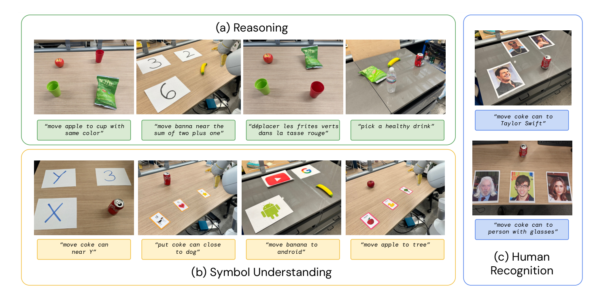
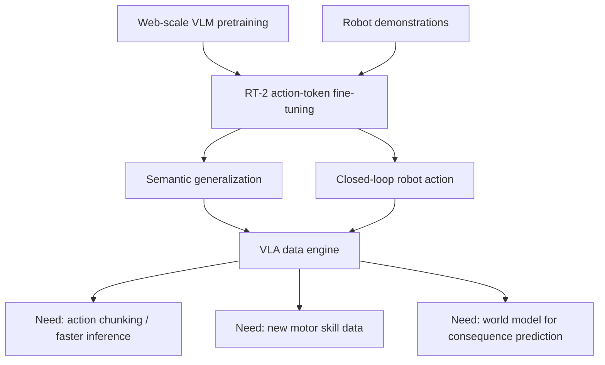

# RT-2：把 VLM 变成机器人动作模型

!!! info "论文信息"
    - 论文：`RT-2: Vision-Language-Action Models Transfer Web Knowledge to Robotic Control`
    - 团队：Google DeepMind
    - 链接：[arXiv:2307.15818](https://arxiv.org/abs/2307.15818) / [PDF](https://arxiv.org/pdf/2307.15818)
    - 项目页：[robotics-transformer2.github.io](https://robotics-transformer2.github.io/)
    - 关键词：VLA、RT-2、PaLI-X、PaLM-E、robot action token、co-fine-tuning、web-scale VLM、behavior cloning、chain-of-thought robotics

RT-2 的核心不是“又做了一个机器人策略”，而是把一个非常直接的问题推到台前：**已经在网页图文数据上学到语义、符号和常识推理的 VLM，能不能直接输出机器人低层动作？**

论文的答案很干脆：把机器人动作也写成“语言 token”。视觉语言任务的答案是文本，机器人任务的答案是动作 token 字符串；两者都用同一个 next-token prediction 目标训练。这样，模型既能继续在 web VQA / caption 数据上保持语义能力，也能在机器人轨迹数据上学会闭环控制。

## 它在主线里负责什么

| 维度 | 贡献 |
| --- | --- |
| 降低的数据成本 | 用 web-scale VLM 预训练知识补机器人数据中缺失的物体语义、符号、关系和语言多样性 |
| 降低的语义泛化成本 | 让机器人不必在真实轨迹里见过 `Taylor Swift`、`Google`、数字、图标、多语言指令，仍能把这些语义映射到已会的 pick/place 技能 |
| 没有降低的成本 | 没有凭空学会新 motor skill；擦拭、工具使用、精细抓取和复杂动力学仍需要机器人数据 |
| 核心机制 | 动作离散成 256-bin token，和自然语言 token 一起做 autoregressive cross-entropy；co-fine-tune robot data 与原 VLM web data |
| 对世界模型高效训练的意义 | RT-2 给出一个动作条件接口：世界模型若要服务具身闭环，不能只预测未来画面，还要知道 VLA 输出的动作 token 会怎样改变状态 |
| 主要风险 | 大模型推理慢、依赖云端服务；web 语义迁移不等于物理可执行性；动作离散化会把连续控制误差藏进 token 分类误差里 |

## 论文位置

RT-1 证明了大规模真实机器人数据可以训练一个 Transformer policy，但它本质上仍是机器人数据内的行为克隆。RT-2 往前推进了一步：不只把语言当条件，而是把动作也塞进 VLM 的输出空间。

{ width="920" }

<small>图源：`RT-2: Vision-Language-Action Models Transfer Web Knowledge to Robotic Control`，Figure 1。原论文图意：RT-2 把 robot action 表示成另一种语言 token，与 Internet-scale VQA 和 robot action data 一起 co-fine-tune；部署时再把输出 token de-tokenize 成机器人动作，形成闭环控制。</small>

!!! note "这张图支撑的判断"
    RT-2 的关键判断是：VLM 的输出头不必只说自然语言，也可以说动作。真正发生迁移的不是“语言模型做高层规划，另一个 controller 执行”，而是同一个 VLM backbone 既在 web 图文任务上预测文本，也在机器人任务上预测动作 token。

这条路线和 SayCan / PaLM-E 的差别很重要。SayCan 更像“LLM 规划 + affordance 打分 + skill library”，PaLM-E 强调把多模态输入接进 embodied language model；RT-2 则把低层控制动作也放进同一个 token 输出空间，让模型直接成为 closed-loop policy。

## 数学逻辑：为什么动作能被当成语言

普通 VLM 做的是条件文本生成：

\[
p_\theta(y_{1:m}\mid I,q)
=\prod_{i=1}^{m}p_\theta(y_i\mid I,q,y_{<i})
\]

其中 \(I\) 是图像，\(q\) 是问题或 prompt，\(y_i\) 是输出文本 token。RT-2 把机器人 policy 也写成同一种形式：

\[
\pi_\theta(a_t\mid o_t,\ell)
\quad \Longrightarrow \quad
p_\theta(\tau(a_t)\mid I_t,\ell)
\]

这里 \(o_t\) 是机器人观测，论文里主要是相机图像；\(\ell\) 是语言指令；\(a_t\) 是一步机器人动作；\(\tau(a_t)\) 是把动作变成 token 字符串的编码函数。

论文沿用 RT-1 的动作空间：end-effector 的 `6-DoF` 位移和旋转、gripper extension，以及一个用于表示任务完成的 termination command。除 termination 之外，连续维度统一离散成 `256` 个 bin。可以把第 \(j\) 个连续动作维度理解成：

\[
b_j =
\operatorname{clip}
\left(
\left\lfloor
255 \cdot {a_j-l_j \over u_j-l_j}
\right\rfloor,
0,255
\right)
\]

再把离散动作拼成字符串：

```text
terminate delta_pos_x delta_pos_y delta_pos_z delta_rot_x delta_rot_y delta_rot_z gripper_extension
```

论文给出的 target 形式类似：

```text
Q: what action should the robot take to <task instruction>? A:
1 128 91 241 5 101 127 ...
```

PaLI-X 的 tokenizer 中 `0-1000` 的整数各有独立 token，所以可以直接把 action bin 映射到对应整数 token。PaLM-E 没有这么方便的数字 token 覆盖，论文做法是覆盖 `256` 个最低频 token 作为动作词表。这件事表面像工程细节，实际很关键：**动作 token 必须可被模型稳定生成，也必须能被严格反解回控制量**。

## 训练目标：VQA、caption 和动作都是 next token prediction

RT-2 没有单独发明一个机器人 loss。机器人行为克隆被写成 next-token prediction：

\[
\mathcal L_{\text{robot}}
=
- \mathbb E_{(I_t,\ell,a_t)\sim D_{\text{robot}}}
\sum_{k=1}^{|\tau(a_t)|}
\log p_\theta(\tau(a_t)_k\mid I_t,\ell,\tau(a_t)_{<k})
\]

web 图文任务也是同一个目标：

\[
\mathcal L_{\text{vl}}
=
- \mathbb E_{(I,q,y)\sim D_{\text{vl}}}
\sum_{i=1}^{|y|}
\log p_\theta(y_i\mid I,q,y_{<i})
\]

co-fine-tuning 可以理解成在同一个 batch mixture 上优化：

\[
\mathcal L
=
\mathcal L_{\text{vl}}
+
\lambda \mathcal L_{\text{robot}}
\]

论文实现里不是显式强调一个固定公式里的 \(\lambda\)，而是通过采样权重控制 robot/web 数据比例：`RT-2-PaLI-X` 让机器人数据约占训练混合的 `50%`，`RT-2-PaLM-E` 让机器人数据约占 `66%`。这比“只拿 robot data 微调 VLM”更稳，因为模型在学习动作时仍然不断接触 web 视觉语言任务，不容易把原来的语义概念忘掉。

!!! warning "输出约束不是小细节"
    机器人闭环里，模型输出一个非法 token 就不是“答错一个字”，而是控制器无法执行。RT-2 在机器人动作 prompt 下约束 decoding 只采样合法 action token；在普通 VQA / caption 任务上仍允许完整自然语言词表。这是把 VLM 放进真实控制回路必须做的接口约束。

## 训练数据和模型细节

RT-2 实验使用两个已有 VLM 家族：

| Model family | RT-2 instantiation | Backbone detail in paper | Role |
| --- | --- | --- | --- |
| PaLI-X | `RT-2-PaLI-X-5B`, `RT-2-PaLI-X-55B` | PaLI-X 使用 ViT-22B 处理图像，并用 32B、50-layer encoder-decoder backbone 生成 token | 主实验模型，55B 版本语义和符号泛化最强 |
| PaLM-E | `RT-2-PaLM-E-12B` | PaLM-E-12B 使用 ViT-4B 把图像投影到语言 embedding space | 在部分数学推理任务上表现更好 |
| PaLI | `RT-2-PaLI-3B` | Language-Table 实验使用更小的 PaLI 3B | 开源仿真环境对照实验 |

web 数据来自 PaLI-X / PaLM-E 原训练混合，包括 VQA、captioning、interwoven image-text。附录写到 WebLI 约有 `10B` image-text pairs，覆盖 `109` 种语言，过滤 top `10%` cross-modal similarity 后得到约 `1B` training examples。机器人数据来自 RT-1 数据集：`13` 台机器人在 `17` 个月内于 office kitchen 环境采集，每条 demonstration 带自然语言指令，覆盖 pick、move near、upright、knock、open/close drawer、place into receptacle 等技能。

论文给出的训练超参如下：

| Model | Learning rate | Batch size | Gradient steps | Objective |
| --- | ---: | ---: | ---: | --- |
| RT-2-PaLI-X-55B | `1e-3` | `2048` | `80K` | next-token prediction / behavior cloning |
| RT-2-PaLI-X-5B | `1e-3` | `2048` | `270K` | next-token prediction / behavior cloning |
| RT-2-PaLM-E-12B | `4e-4` | `512` | `1M` | next-token prediction / behavior cloning |
| RT-2-PaLI-3B for Language-Table | `1e-3` | `128` | `300K` | next-token prediction / behavior cloning |

这里最值得学的不是某个学习率，而是训练配方的形状：

```text
web VLM pretraining
  -> keep VQA / caption / web image-text tasks in the mixture
  -> add robot image + instruction -> action-token target
  -> constrain robot decoding to valid action tokens
  -> closed-loop deploy: observe, decode, de-tokenize, execute, repeat
```

## 算一遍：动作 token 很少，真正贵的是大 VLM 前向

RT-2 每次控制输出大约是 termination、6-DoF displacement 和 gripper 等离散槽，量级可以按 `8` 个 action token 理解。即使 `3 Hz` 控制频率，每秒动作输出也只有约：

\[
3 \times 8 = 24 \text{ action tokens/s}
\]

所以 RT-2 的吞吐瓶颈不是动作 token 长，而是每个控制周期都要跑一次大 VLM 的图像编码和语言解码。论文也明确给出部署压力：`RT-2-PaLI-X-55B` 需要 multi-TPU cloud service，闭环频率约 `1-3 Hz`；较小的 `5B` 版本约 `5 Hz`。如果只按 FP16/BF16 权重粗算，`55B` 参数模型的权重就约：

\[
55 \times 10^9 \times 2 \text{ bytes}
\approx 110 \text{ GB}
\]

这还没算 KV cache、activation、服务冗余和图像编码开销。因此论文的“动作当语言”降低的是接口复杂度和语义泛化数据成本，不是推理计算成本。后续 VLA 论文做 action chunking、distillation、quantization 和小 action expert，很大程度上就是在补 RT-2 这条路线的部署成本。

## 能力样例：web 知识怎么迁移到动作

{ width="920" }

<small>图源：RT-2，Figure 2。原论文图意：RT-2 能把 pick/place 等机器人数据里已有的物理技能，用到未在机器人数据中出现的符号、关系、人名、图标、多语言和常识指令上。</small>

!!! note "这张图支撑的判断"
    RT-2 的 emergent 不是“突然会了新动作”，而是“把旧动作部署到新语义条件下”。例如把物体放到 `Google`、`X`、某个数字或匹配类别旁边，低层仍是 pick/place，新增的是视觉语言 grounding 和关系判断。

论文把 emergent capabilities 分成三类：

| Category | What is tested | Example instruction |
| --- | --- | --- |
| Symbol Understanding | 数字、图标、logo、符号位置等机器人数据中没有的概念 | `move coke can near X`, `move banana to android` |
| Reasoning | 颜色关系、数学、多语言、营养常识等组合判断 | `move banana near the sum of two plus one`, `pick a healthy drink` |
| Human Recognition | 名人、人脸属性和人物指代 | `move coke can to Taylor Swift`, `move coke can to person with glasses` |

## 主要结果：seen 持平，unseen 拉开差距

RT-2 的实证重点是 `6k` 条机器人 evaluation trajectories。总体结果不是“所有任务都碾压”，而是一个更有工程含义的形状：在 seen tasks 上 RT-2 和 RT-1 接近；在 unseen objects / backgrounds / environments 上，RT-2 明显拉开。

{ width="920" }

<small>图源：RT-2，Figure 4。原论文图意：RT-2-PaLI-X-55B 与 RT-2-PaLM-E-12B 在 seen tasks 保持与 RT-1 接近的表现，但在 unseen objects、backgrounds、environments 与 unseen average 上明显优于 R3M、VC-1、RT-1 和 MOO。</small>

按附录 Table 4 重绘结果如下，表头保留英文：

| Model | Seen Tasks | Unseen Objects Easy | Unseen Objects Hard | Unseen Backgrounds Easy | Unseen Backgrounds Hard | Unseen Environments Easy | Unseen Environments Hard | Unseen Average |
| --- | ---: | ---: | ---: | ---: | ---: | ---: | ---: | ---: |
| [R3M (Nair et al., 2022)](https://arxiv.org/abs/2203.12601) | 45 | 32 | 14 | 13 | 9 | 0 | 2 | 12 |
| [VC-1 (Majumdar et al., 2023)](https://arxiv.org/abs/2303.18240) | 63 | 34 | 10 | 13 | 3 | 0 | 0 | 10 |
| [RT-1 (Brohan et al., 2022)](https://arxiv.org/abs/2212.06817) | 92 | 31 | 43 | 71 | 9 | 26 | 14 | 32 |
| [MOO (Stone et al., 2023)](https://arxiv.org/abs/2303.00905) | 75 | 58 | 48 | 38 | 41 | 19 | 3 | 35 |
| RT-2-PaLI-X-55B (ours) | 91 | 70 | 62 | 96 | 48 | 63 | 35 | 62 |
| RT-2-PaLM-E-12B (ours) | 93 | 84 | 76 | 75 | 71 | 36 | 33 | 62 |

这张表的读法是：RT-2 没有牺牲 seen task，`91/93` 与 RT-1 的 `92` 基本同级；但 unseen average 从 RT-1 的 `32` 提到 `62`。这说明 web VLM 预训练最有价值的位置不是替代机器人动作数据，而是补机器人数据覆盖不到的语义和视觉分布。

## Emergent 评测：不是配图，而是证据

{ width="920" }

<small>图源：RT-2，Figure 8。原论文图意：emergent evaluation 包含 reasoning、symbol understanding 和 human recognition 三组场景，用来测试 RT-2 是否能把 web 视觉语言知识迁移到机器人动作。</small>

论文在 Appendix Table 5 中给出完整数值。这里按原表结构重绘：

<table>
  <thead>
    <tr>
      <th rowspan="2">Model</th>
      <th colspan="4">Symbol Understanding</th>
      <th colspan="5">Reasoning</th>
      <th colspan="3">Person Recognition</th>
      <th rowspan="2">Average</th>
    </tr>
    <tr>
      <th>Symbol 1</th>
      <th>Symbol 2</th>
      <th>Symbol 3</th>
      <th>Average</th>
      <th>Math</th>
      <th>Logos</th>
      <th>Nutrition</th>
      <th>Color/Multilingual</th>
      <th>Average</th>
      <th>Celebrities</th>
      <th>CelebA</th>
      <th>Average</th>
    </tr>
  </thead>
  <tbody>
    <tr>
      <td><a href="https://arxiv.org/abs/2303.18240">VC-1 (Majumdar et al., 2023)</a></td>
      <td>7</td><td>25</td><td>0</td><td>11</td>
      <td>0</td><td>8</td><td>20</td><td>13</td><td>10</td>
      <td>20</td><td>7</td><td>13</td><td>11</td>
    </tr>
    <tr>
      <td><a href="https://arxiv.org/abs/2212.06817">RT-1 (Brohan et al., 2022)</a></td>
      <td>27</td><td>20</td><td>0</td><td>16</td>
      <td>5</td><td>0</td><td>32</td><td>28</td><td>16</td>
      <td>20</td><td>20</td><td>20</td><td>17</td>
    </tr>
    <tr>
      <td>RT-2-PaLI-X-55B (ours)</td>
      <td>93</td><td>60</td><td>93</td><td>82</td>
      <td>25</td><td>52</td><td>48</td><td>58</td><td>46</td>
      <td>53</td><td>53</td><td>53</td><td>60</td>
    </tr>
    <tr>
      <td>RT-2-PaLM-E-12B (ours)</td>
      <td>67</td><td>20</td><td>20</td><td>36</td>
      <td>35</td><td>56</td><td>44</td><td>35</td><td>43</td>
      <td>33</td><td>53</td><td>43</td><td>40</td>
    </tr>
  </tbody>
</table>

这个结果的论证链是：

```text
症状：机器人数据里没有很多符号、logo、人名、多语言和常识组合。
指标：emergent evaluation 的 Average，RT-1 为 17，RT-2-PaLI-X-55B 为 60。
机制：web VLM 预训练提供语义和视觉概念，action token fine-tuning 把这些概念接到 pick/place 动作上。
取舍：更强语义泛化需要更大 VLM，推理成本和部署复杂度也随之上升。
边界：动作本身仍来自机器人数据分布，不能把常识推理误读成新 motor skill。
```

## Ablation：为什么必须 co-fine-tune，而不是只 fine-tune

{ width="920" }

<small>图源：RT-2，Figure 6。原论文图意：左图比较 RT-2 与 baselines 在 emergent skills 上的表现；右图比较参数规模和训练策略，显示 co-fine-tuning 与更大模型都会提升泛化。</small>

Appendix Table 6 的结果按原格式重绘如下：

| Model | Size | Training | Unseen Objects Easy | Unseen Objects Hard | Unseen Backgrounds Easy | Unseen Backgrounds Hard | Unseen Environments Easy | Unseen Environments Hard | Average |
| --- | ---: | --- | ---: | ---: | ---: | ---: | ---: | ---: | ---: |
| RT-2-PaLI-X | 5B | from scratch | 0 | 10 | 46 | 0 | 0 | 0 | 9 |
| RT-2-PaLI-X | 5B | fine-tuning | 24 | 38 | 79 | 50 | 36 | 23 | 42 |
| RT-2-PaLI-X | 5B | co-fine-tuning | 60 | 38 | 67 | 29 | 44 | 24 | 44 |
| RT-2-PaLI-X | 55B | fine-tuning | 60 | 62 | 75 | 38 | 57 | 19 | 52 |
| RT-2-PaLI-X | 55B | co-fine-tuning | 70 | 62 | 96 | 48 | 63 | 35 | 63 |

这张表给出两个判断：

1. 从零训练不现实。`5B from scratch` 的 average 只有 `9`，说明机器人数据规模不足以让大模型自己学出开放语义。
2. co-fine-tuning 的收益在大模型上更明显。`55B fine-tuning` 是 `52`，`55B co-fine-tuning` 到 `63`。也就是说，保留 web 任务不是装饰，而是防止模型在机器人微调中丢掉原来的视觉语言能力。

## Chain-of-thought：Plan token 连接推理和动作

论文还做了一个很早期但有启发的 CoT 版本：用 PaLM-E 对 RT-2 变体再 fine-tune 几百个 gradient steps，在输出中增加 `Plan` 字段，然后再输出 `Action` token。例如：

```text
Instruction: I'm hungry.
Plan: pick rxbar chocolate.
Action: 1 128 124 136 121 158 111 255.
```

{ width="920" }

<small>图源：RT-2，Figure 7。原论文图意：RT-2 with chain-of-thought 先生成自然语言 plan，再生成 action token，可处理 `Bring me a drink`、`I need to hammer a nail` 等需要语义推理的指令。</small>

数学上，这只是把目标序列从动作 token 扩展为：

\[
z =
[\text{Plan tokens},\text{Action tokens}]
\]

训练目标仍是：

\[
-\sum_i \log p_\theta(z_i\mid I,\ell,z_{<i})
\]

但含义变了：模型在动作前有一个显式语言中间变量。这个中间变量可以让 VLM 的常识推理先落到“要拿哪个物体”上，再落到动作 token。不过论文这里主要是 qualitative evidence，不能把它当作严格证明 CoT 一定提高机器人成功率。

## Language-Table：小模型仿真对照

为了和开源环境对照，论文还在 Language-Table 上 co-fine-tune 一个 `RT-2-PaLI-3B`。动作是二维 delta setpoint，编码成 `X Y`，其中 \(X,Y\in\{-10,-9,\dots,10\}\)。结果如下：

| Model | Language-Table |
| --- | ---: |
| [BC-Z (Jang et al., 2022)](https://arxiv.org/abs/2202.02005) | 72 ± 3 |
| [RT-1 (Brohan et al., 2022)](https://arxiv.org/abs/2212.06817) | 74 ± 13 |
| [LAVA (Lynch et al., 2022)](https://arxiv.org/abs/2210.06407) | 77 ± 4 |
| RT-2-PaLI-3B (ours) | 90 ± 10 |

这组实验说明“动作当文本 token”的接口不只适用于 Google 的移动机械臂，也能迁移到一个不同机器人和仿真环境。但它仍是相对简单的 2D table manipulation，不应直接外推到高频、强接触、长时程家庭任务。

## 失败反例和适用边界

RT-2 最容易被误读的地方，是把“语义泛化”读成“物理能力泛化”。论文自己在 Limitations 和 Appendix G 里把边界说得很清楚：web-scale pretraining 不会让机器人凭空学会新 motion。

{ width="920" }

<small>图源：RT-2，Figure 9。原论文图意：RT-2 在 Language Table 真实环境中能关注正确目标，但遇到未见 object dynamics 时失败，例如笔和香蕉的推动动力学与训练环境中的 block objects 差异很大。</small>

论文列出的失败类型包括：

| Failure boundary | Why RT-2 struggles | Engineering implication |
| --- | --- | --- |
| unseen object dynamics | 能看懂目标，不代表会控制陌生动力学，例如香蕉的接触点和质心问题 | 数据要覆盖物体形状、摩擦、接触和失败恢复，而不只是语义标签 |
| novel motions | web 数据没有机器人 action label，不能教会擦拭、工具使用等新低层技能 | 新技能仍要真机/仿真/人类视频到动作的额外监督 |
| dexterous or precise motions | 离散 action token 和低频 VLM 闭环难支撑高精度接触 | 需要局部控制器、动作 chunk、diffusion/flow action head 或更高频策略 |
| extended reasoning | 多层间接推理容易在 plan 阶段选错目标 | CoT 需要可验证中间状态，而不是只生成一段看似合理的 plan |
| inference cost | 55B VLM 需要云端 multi-TPU，频率约 1-3 Hz | 部署前要评估延迟、网络抖动、fallback policy 和安全停止 |

## 和后续 VLA / 世界模型路线的关系

RT-2 是 VLA 路线的一个分水岭：它证明 VLM 的语义知识可以通过 action token 接到真实机器人闭环里。但它也留下了后续路线要补的缺口。



对世界模型高效训练来说，RT-2 的启发是：动作条件不能停在抽象 label。世界模型需要知道 VLA 输出的离散动作或动作块对应什么物理后果，否则只能生成“看起来合理”的未来视频，无法指导闭环选择。

更具体地说，RT-2 负责降低语义和数据覆盖成本；后续世界模型或 WAM 负责降低 rollout 成本和真实试错成本；部署系统负责降低延迟和安全成本。把这几件事混成“一个大模型端到端解决机器人”，就会错过 RT-2 真正有价值的工程边界。

## 阅读结论

RT-2 值得精读的点有三条：

1. **动作 token 化的数学等价**：把 behavior cloning 改写成 VLM 的 next-token prediction，让文本答案和动作答案共享一个输出空间。
2. **co-fine-tuning 的训练策略**：机器人数据负责低层动作，web 数据负责语义概念，二者混训比单纯 robot fine-tuning 更抗遗忘。
3. **证据和边界同样重要**：RT-2 在 unseen semantic/generalization 上显著更强，但不产生新物理技能，且 55B 级模型的闭环推理成本很高。

如果只记一句话：**RT-2 不是让 VLM “想一想再调用机器人技能”，而是让 VLM 直接说出机器人动作 token；这打开了 VLA 路线，也暴露了后续必须解决的推理成本、动作精度和物理技能数据问题。**

## 参考

- [RT-2: Vision-Language-Action Models Transfer Web Knowledge to Robotic Control](https://arxiv.org/abs/2307.15818)
- [RT-2 project page](https://robotics-transformer2.github.io/)
- [RT-1: Robotics Transformer for Real-World Control at Scale](https://arxiv.org/abs/2212.06817)
- [PaLM-E: An Embodied Multimodal Language Model](https://arxiv.org/abs/2303.03378)
