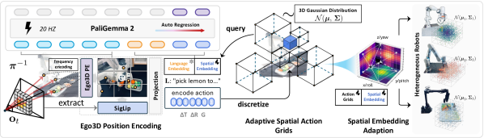
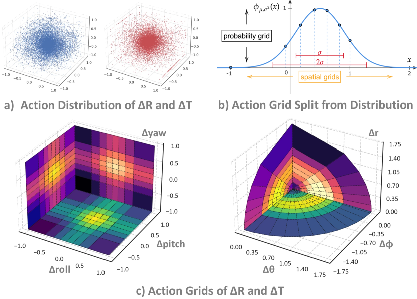
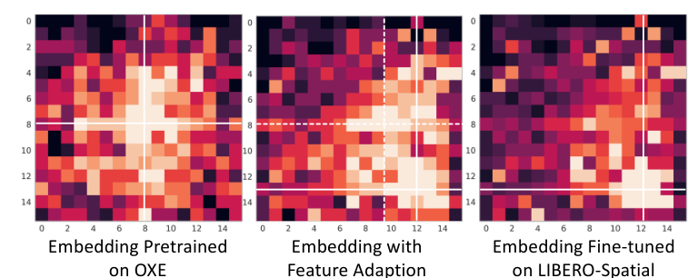
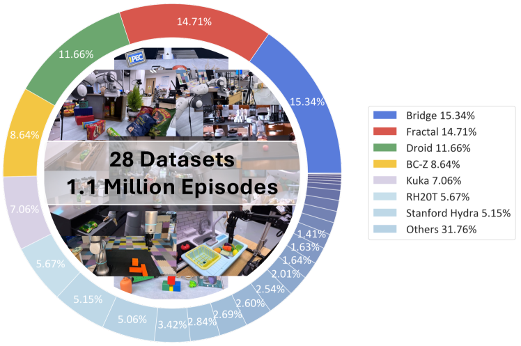
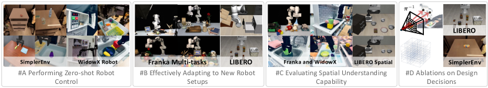
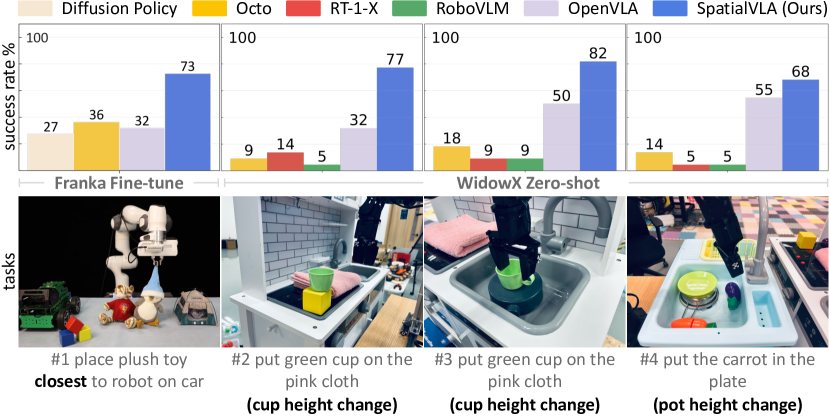
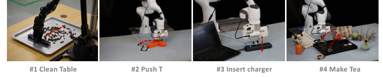
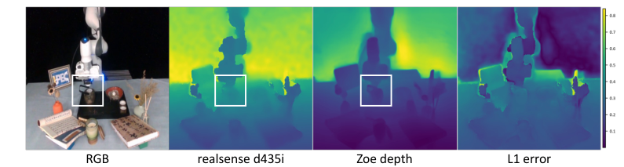

# SpatialVLA：3D 空间表征接入 VLA

!!! info "论文信息"
    **论文题名：** SpatialVLA: Exploring Spatial Representations for Visual-Language-Action Model。 
    **作者：** Delin Qu、Haoming Song、Qizhi Chen、Yuanqi Yao、Xinyi Ye、Yan Ding、Zhigang Wang、JiaYuan Gu、Bin Zhao、Dong Wang 等（共 11 人）。 
    **机构：** Shanghai AI Laboratory,、Fudan University,、Shanghai Jiao Tong University,、Zhejiang University,。 
    **时间 / 主题：** 2025-01；具身智能 / VLA。 
    **arXiv / 官方报告：** arXiv：[2501.15830](https://arxiv.org/abs/2501.15830)；官方材料：[spatialvla.github.io/](https://spatialvla.github.io/)。 
    **GitHub / 项目：** GitHub：[github.com/SpatialVLA/SpatialVLA](https://github.com/SpatialVLA/SpatialVLA)；项目页：[spatialvla.github.io/](https://spatialvla.github.io/)。 
    **元数据来源与核验口径：** 来源：[arXiv](https://arxiv.org/abs/2501.15830)；[GitHub API / repo](https://github.com/SpatialVLA/SpatialVLA)；[官方 / 项目材料](https://spatialvla.github.io/)；Checked Date：2026-06-15；Repro Status：Paper / official materials reviewed, independent reproduction not claimed。

## 空间理解为什么要同时进入观察与动作

SpatialVLA 的主要贡献是将空间表示放到 VLA 的两端。输入端利用估计深度，为视觉 patch 加上相机坐标中的三维位置；输出端根据动作数据分布建立三维网格，用一个 token 表示整组平移、另一个表示整组旋转。新机器人适配时，模型还会重划网格，并将旧动作嵌入迁移到新网格上。

这三项设计处理的是相互关联但不同的问题。图像中的杯子向上移动几个像素，可能来自杯子被垫高，也可能来自相机变化；一个动作向量中的“小幅向前”，在不同机器人、控制器与任务分布中也可能具有不同统计范围。只增加模型容量，不会自动使图像位置、物理距离与动作 token 的含义对齐。

Figure 2 左侧展示观测如何变成带三维位置的视觉特征，中间展示动作网格，右侧展示新环境中的网格与嵌入适配。这里应把输入几何、输出量化和后训练迁移视为三条相接的数据路径。

{ width="490" .atlas-figure-compact }

*Figure 2，Ego3D 视觉表示、Adaptive Action Grids 与 Spatial Embedding Adaption。*

模型基于 PaliGemma 2，在 OXE 子集与 RH20T 的约 110 万条真实机器人轨迹上进行动作预训练。它的“零样本”结果主要针对与预训练机器人及环境配置匹配的任务；LIBERO 与新的 Franka 任务则使用后训练。这一边界决定了结果应如何比较，不能把所有表中的成功率都理解为模型来到任意新机器人后直接执行。[↗](https://arxiv.org/pdf/2501.15830v5#page=3) [↗](https://arxiv.org/pdf/2501.15830v5#page=5)

## Ego3D 如何把二维语义与三维位置放进同一个 token

### 相机坐标免去了外参标定，但仍然需要内参和深度

**Egocentric 3D Position Encoding（自我中心三维位置编码，Ego3D）** 使用相机自身的坐标系。RGB 图像经过两条分支：SigLIP 提取原有视觉语义特征，固定的 ZoeDepth 估计每个像素的深度。深度与相机内参一起将像素反投影成三维点。

为了说明反投影的含义，可以将原文的 $\pi^{-1}$ 操作展开为常见针孔相机形式。

$$
p(u,v)=D(u,v)K^{-1}
\begin{bmatrix}u\\v\\1\end{bmatrix}.
$$

$D(u,v)$ 是对应像素的深度，$K$ 是相机内参矩阵，$p$ 是相机坐标下的位置。这是对原文几何操作的展开，不是新增训练目标。同一像素若来自近处杯子或远处背景，会获得不同三维位置；二维 patch 的语义因而可以与空间位置一起进入模型。

作者强调不需要机器人到相机的外参，是因为不必再将这些点转换到每一种机器人基座坐标。这个选择降低了异构数据的标定要求，却没有把所有相机统一成一个全局世界坐标，也没有使输入天然对任意视角变化不变。内参、深度预测和训练视角仍然影响得到的空间特征。[↗](https://arxiv.org/pdf/2501.15830v5#page=3) [↗](https://arxiv.org/pdf/2501.15830v5#page=4)

### 几何编码与视觉特征相加，而不是重新训练一个点云模型

令 $X\in\mathbb R^{d\times h\times w}$ 表示 SigLIP 的 patch 特征，$P$ 表示相应空间位置。论文使用正弦频率编码 $\gamma$，再由可学习 MLP 投影到视觉特征维度，得到式（2）。

$$
O^{3d}=X+P'=X+\operatorname{MLP}(\gamma(P)).
$$

$X$ 负责保留预训练视觉语言模型对对象、颜色和图像区域的理解；位置分支提供这些区域的三维几何信息。相加以后，后续 Transformer 接收到的每个视觉 token 同时携带两类信息，动作监督可以学习何时需要利用深度差异。

附录进一步说明，输入图像为 $224\times224$，先对反投影点进行高频位置编码，再在各 sub-patch 内平均，送入 Ego3D MLP。它并不是简单取某个 patch 中央像素的深度，也不应将“先平均三维点再做正弦编码”视为完全相同的实现，因为正弦是非线性操作。

| Module | Relevant input / output | Role |
| --- | --- | --- |
| SigLIP Vision Tower | patch size 14，视觉维度 1152 | 保留二维语义表示 |
| Vision Zoe Model | RGB → 单通道深度图 | 产生反投影所需深度，训练中固定 |
| Ego3D Position Embedding MLP | 204 → 1152，含 LayerNorm、ReLU | 将频率编码映射到视觉 patch 维度 |
| MultiModal Projector | 1152 → 2304 | 接入语言模型 hidden space |
| Gemma2Model | 26 个 decoder layers，width 2304 | 联合处理图像、指令并预测动作 token |

在上述分辨率和 patch size 下，图像对应 $16\times16=256$ 个视觉 patch。这是由结构参数直接计算的数量。模型既没有要求全部训练数据具备原生深度传感器，也没有另设一套完整三维点云基础模型；它通过较小的几何分支补充已有 VLM。[↗](https://arxiv.org/pdf/2501.15830v5#page=14) [↗](https://arxiv.org/pdf/2501.15830v5#page=15)

这项设计的可用性取决于估计深度能否保留任务所需的相对布局。后面的 sensor depth 与 ZoeDepth 消融会检验这一点，不能仅凭反投影公式就假定单目估计与精确三维测量等效。

## Adaptive Action Grids 怎样把七维动作变成三个 token

### 先将方向与距离分开，再分配离散精度

机器人单步动作由七个连续或离散控制量构成，论文将它分成三组。

$$
a=\{a_{\mathrm{trans}},a_{\mathrm{rot}},a_{\mathrm{grip}}\},
\qquad
a_{\mathrm{trans}}=(x,y,z),\quad
 a_{\mathrm{rot}}=(\mathrm{roll},\mathrm{pitch},\mathrm{yaw}).
$$

平移在相应机器人环境中归一化后，从笛卡尔坐标改成方向与距离 $(\theta,\phi,r)$；旋转仍以 roll、pitch、yaw 表示；夹爪分为开、合两类。这里的 $\theta$ 与 $\phi$ 共同指定方向，$r$ 表示平移幅度，使方向精度和位移幅度精度能够分别配置。

**Adaptive Action Grids（自适应动作网格）** 没有对每个变量简单等宽切分。作者先在训练混合上统计动作分布，拟合高斯，再按概率质量划分区间。常见小运动附近的数据密集，就分配较窄区间；少见的大运动区域使用较宽区间，让有限 token 优先区分高频动作。[↗](https://arxiv.org/pdf/2501.15830v5#page=4)

Figure 3 应从上方散点与密度曲线读到下方网格。上方说明数据没有均匀填满动作空间，下方则显示按概率划分后，网格中心区域更密集。

{ width="690" }

*Figure 3，动作数据分布与由此构建的平移、旋转网格。*

### 有界 CDF 与 PPF，给出了可实现的网格构造

正文式（4）表达每个变量的区间具有相同概率这一目标。附录 Algorithm 1 则使用 Gaussian CDF 与 PPF 实现。若某个变量的合法范围为 $[l,u]$、CDF 为 $F$，需要 $M$ 个区间，可以把算法中的边界计算展开为

$$
b_k=F^{-1}\!\left(
F(l)+\frac{k}{M}\big[F(u)-F(l)\big]
\right),\qquad k=0,\ldots,M.
$$

这是一种对附录伪代码的明确写法。$F^{-1}$ 即 PPF，把均匀排列的累计概率反映射为空间边界。每个区间在限定范围内具有相同条件概率，区间宽度则随密度变化。这样也避免了把无限支撑高斯的全部概率质量，错误地要求落入有限动作范围。

构造是在各变量上分别进行，再组合成三维格子。它没有自动拟合所有维度之间的复杂相关结构，也不是一个可以表达任意多峰动作分布的高斯混合模型。相关动作如何搭配，仍要由训练后 token 表示与 Transformer 条件预测来学习。

附录给出的配置如下。

| Action group | Variables / bins | Number of spatial classes |
| --- | --- | ---: |
| Translation | $\theta$: 16；$\phi$: 32；$r$: 8 | $16\times32\times8=4096$ |
| Rotation | roll、pitch、yaw 各 16 | $16^3=4096$ |
| Gripper | open / close | 2 |
| Total vocabulary | 三组词表合计 | 8194 |

其中 $\theta\in[0,\pi]$、$\phi\in[-\pi,\pi]$、$r\in[0,\sqrt3]$。半径上界来自归一化笛卡尔分量的取值范围。方向分了更多 bins，距离分了较少 bins，体现模型优先细分移动方向的选择。[↗](https://arxiv.org/pdf/2501.15830v5#page=14)

### 一个 token 指向一个三维格子，输出没有降成三自由度

编码时，训练动作先找到各变量所在区间，形成三维索引，再将索引线性化为一个平移类别 ID 或旋转类别 ID。例如，方向与距离所在的三个区间共同指定一个平移网格，模型只需要预测这一个 ID；解码时再把 ID 还原为格子坐标，得到连续动作并反归一化。夹爪另由一个二分类 token 表示。[↗](https://arxiv.org/pdf/2501.15830v5#page=15)

所以“一步三个 token”仍表达原来的七维控制。减少的是自回归输出位置，而不是机器人自由度。对应代价是每个平移或旋转 token 需要从 4096 个组合类别中选择，词表和嵌入规模扩大了。

这是一项序列长度、量化精度与词表成本之间的交换。网格太粗可能无法区分小幅修正，均匀网格又可能把大量类别用在罕见区域；继续提高分辨率也会增加参数和分类难度。因此，后面的分辨率实验不仅比较“有无网格”，还需要检查增加类别是否始终改善真实控制。

## 新机器人适配，为什么连动作词表也要一起改变

### 原 token 的空间含义未必适合新分布

预训练覆盖多种机器人，某个平移 token 学到的是旧动作分布中的一块区域。到了新机器人，新任务可能集中在很小的位移范围，也可能更常沿某个方向运动。直接微调 Transformer，仍然保留旧网格的分辨率分配；新数据中的大量不同动作可能落在同一个旧格子里。

**Spatial Embedding Adaption（空间嵌入适配）** 先根据后训练数据重新拟合各变量分布，重建平移与旋转网格。然后依据新格子中心在旧网格中的位置，使用邻近旧嵌入做三线性插值，初始化新 token。

$$
e^i_{\mathrm{new}}=\sum_{j=1}^{K}w_j e_j.
$$

$e_j$ 为邻近预训练动作格子的 embedding，$w_j$ 根据新旧中心的相对位置确定。插值的意义是保留局部动作表示的连续关系，而不是把每个新类别重新随机初始化。随后，新动作 embedding 与允许更新的模型参数继续使用 next-token cross-entropy 训练。[↗](https://arxiv.org/pdf/2501.15830v5#page=5)

需要区分“网格更换”与“控制语义对齐”。重新拟合适应的是归一化动作分布，不能凭空解决机器人关节结构、末端定义或控制器差异；这些差异仍依赖一致的数据处理与示范监督。它为后训练增加了一项可操作的自由度，即除了修改网络权重，也修改离散动作表示的物理划分。

Figure 8 比较旧 embedding、插值适配后 embedding 与 LIBERO-Spatial 微调后 embedding 的截面。中图的变化提供初始化迁移的直观解释，但图中相似的颜色结构本身不等于已经证明动作在所有机器人上具有相同物理语义。

{ width="820" }

*Figure 8，动作网格重划以后，旧空间嵌入怎样为新词表提供初始化。*

### 冻结文本 embedding，不等于冻结语言模型

预训练时，动作 embedding、Ego3D 分支、视觉编码器与语言模型骨干参与学习；原文本 token embedding 被冻结，用来保留语言 token 的表示基础。ZoeDepth 固定，提供深度估计。这里需要分清三个参数组，不能把“冻结文本嵌入”误写成整个 VLM 不更新。

这种训练仍是监督动作预测。模型输入当前图像与语言指令，学习自回归生成动作类别；没有加入通过环境奖励优化网格的强化学习目标。后训练可以采用全参数微调或 LoRA，再结合网格与 embedding 适配。不同数据规模下哪种更合适，由专门消融比较。[↗](https://arxiv.org/pdf/2501.15830v5#page=5)

## 数据配比同时影响模型经验与网格形状

Figure 9 给出 28 个数据源构成的混合。由于动作网格来自训练动作统计，采样来源不只是影响模型见过哪些场景，也影响哪些运动获得更多离散精度。

{ width="620" }

*Figure 9，约 110 万条轨迹的数据来源与混合权重。*

| Dataset | Mixture weight |
| --- | ---: |
| Bridge | 15.34% |
| Fractal | 14.71% |
| DROID | 11.66% |
| BC-Z | 8.64% |
| Kuka | 7.06% |
| RH20T | 5.67% |
| Stanford Hydra | 5.15% |
| Language Table | 5.06% |

这些是混合权重，不是原始轨迹条数比例。比如 Language Table 的轨迹很多，但其采样权重不按轨迹总量直接分配。作者以 OpenVLA 配方为起点加入 RH20T，并根据单数据源的实机行为调整 Kuka、Toto、Fanuc 和 FMB 等来源的权重。附录报告 FMB 占比过高时出现明显向右运动偏置，Kuka 的语言 prompt 不够明确，因此进行下调。[↗](https://arxiv.org/pdf/2501.15830v5#page=14)

这说明“跨机器人数据越多越好”不能脱离分布与标注质量。动作偏置会进入网格统计，也会进入监督策略；语言提示质量则影响指令与动作能否建立清楚对应。数据配比是这套空间表示的一部分，不能在复现时仅保留网络结构。

主模型使用 64 张 A100、batch size 2048，训练约十天。附录 D 给出 AdamW、学习率 $2\times10^{-5}$、linear scheduler、weight decay 0、warm-up ratio 0.005，以及 DeepSpeed ZeRO stage 1。随机裁剪与 color jitter 用于提高视觉变化下的泛化。

训练日程在主文与附录存在一处差异。主文说最后三分之一移除 DROID；附录给出的具体执行步数是先用完整混合训练 160K steps，再移除 DROID 训练 40K steps。若按可执行日程理解，应保留这组明确步数，不能同时将 40K/200K 写成三分之一。附录训练曲线中的约 90% 到超过 95% 是训练预测准确率，也不能替换成机器人任务成功率。[↗](https://arxiv.org/pdf/2501.15830v5#page=16)

## 执行成本包括动作生成，也包括深度和控制安排

实际策略只使用一路第三人称相机的当前图像，预测四步动作块，即 12 个空间 token。论文报告单张 RTX 4090 上约 20 Hz、8.5 GB 显存；附录还描述按需要采用 horizon 1 或 4 的动作集成，并将 gripper stick step 从 1 调到 15。夹爪保持步数这样的执行细节会影响抓取稳定性，不能只拿 token 生成结果当作完整部署方案。

另一个需要保留的计时边界是，附录单独报告 ZoeDepth 占约 8.6% 参数、每次动作相关处理约 0.06 秒。文中没有完整解释这个计时与约 20 Hz 策略速率之间如何重叠、缓存或统计。因此，20 Hz 应作为论文所报告设置下的运行指标，不能直接换算成包含每一步深度估计、网络、控制与动作执行的统一端到端延迟。[↗](https://arxiv.org/pdf/2501.15830v5#page=16)

WidowX 实机按 BridgeData V2 规格放置静态 RealSense D435 相机，机器人在工作区中的位置也参考训练场景进行匹配。Franka 使用阻抗控制，示范通过 Spacemouse 遥操作，以 10 Hz 采集。由此可见，“不需要机器人—相机外参”降低了几何输入的要求，却没有取消零样本部署对相机与场景分布的依赖。

## 先分清零样本、域内微调与新任务适配

Figure 4 将三类证据并列。左侧测与预训练配置接近的 SimplerEnv 与真实 WidowX，中央测 LIBERO 与 Franka 的后训练，右侧再专门改变高度与空间关系。

{ width="690" .atlas-figure-compact }

*Figure 4，控制泛化、机器人适配和空间理解的不同评测设置。*

SimplerEnv 的 **Visual Matching** 尽量匹配训练中的真实场景外观；**Variant Aggregation** 则汇总光照、纹理、颜色和相机姿态等变化。Google Robot 的域内微调使用 Fractal，WidowX 的域内微调使用 BridgeData V2。它们已经是目标平台分布上的进一步适配，不能与只使用预训练 checkpoint 的 zero-shot 行混为一谈。

### Google Robot 的总体优势没有覆盖每个任务

下表保留 Table I 中最能说明比较条件的模型，数值为论文报告的整体成功率，单位百分比。

| Model | Visual Matching, #Average | Variant Aggregation, #Average |
| --- | ---: | ---: |
| RT-1, Converged | 74.6 | 63.3 |
| RT-2-X | 60.7 | 64.3 |
| OpenVLA | 27.7 | 39.8 |
| RoboVLM, zero-shot | 56.3 | 46.3 |
| RoboVLM, fine-tuning | 63.4 | 51.3 |
| SpatialVLA, zero-shot | 71.9 | 68.8 |
| SpatialVLA, fine-tuning | 75.1 | 70.7 |

SpatialVLA 零样本在两种指标上高于 RT-2-X，并在 Variant Aggregation 中达到表内较高表现。但 Visual Matching 的 71.9% 低于目标 Google 数据训练的 RT-1 Converged 74.6%；微调后才达到 75.1%。因此不能把零样本行概括成“所有比较中最高”。

任务分项也有明显差异。零样本 SpatialVLA 的 Visual Matching 在 Pick Coke Can、Move Near、Open/Close Drawer 上分别为 81.0%、69.6%、59.3%；RT-2-X 为 78.7%、77.9%、25.0%。抽屉操作是 SpatialVLA 的突出优势，而 Move Near 是 RT-2-X 更高。微调后的抽屉平均反而从 59.3% 降至 57.4%，整体提升并非来自所有任务同时改善。[↗](https://arxiv.org/pdf/2501.15830v5#page=6)

原表还列出引用自 open-pi-zero 的 π0 结果，Visual Matching 平均为 70.1%。它来自单独注明的实现来源，不能把这一行当成在相同数据、预算和训练条件下只替换动作解码器的受控实验。更直接的机制证据来自后面的组件消融。

### WidowX 的 100% 来自微调后的一个任务

Table II 同时报告 grasp 与最终 success。下表只列最终任务成功率，避免把抓住物体当成完成放置。

| Model | Put Spoon on Towel | Put Carrot on Plate | Stack Green Block on Yellow Block | Put Eggplant in Yellow Basket | Overall Average |
| --- | ---: | ---: | ---: | ---: | ---: |
| Octo-Small | 47.2 | 9.7 | 4.2 | 56.9 | 30.0 |
| OpenVLA | 0.0 | 0.0 | 0.0 | 4.1 | 1.0 |
| RoboVLM, zero-shot | 20.8 | 25.0 | 8.3 | 0.0 | 13.5 |
| RoboVLM, fine-tuning | 29.2 | 25.0 | 12.5 | 58.3 | 31.3 |
| SpatialVLA, zero-shot | 20.8 | 20.8 | 25.0 | 70.8 | 34.4 |
| SpatialVLA, fine-tuning | 16.7 | 25.0 | 29.2 | 100.0 | 42.7 |

SpatialVLA 的整体成绩由 34.4% 提到 42.7%，茄子放入篮子任务从 70.8% 到 100%。这个 100% 明确属于 BridgeData V2 微调后设置。与此同时，勺子放到毛巾上的成功率从 20.8% 降至 16.7%，还低于 Octo-Small 的 47.2%；自适应动作表示没有保证在每个对象和接触条件下都领先。[↗](https://arxiv.org/pdf/2501.15830v5#page=6)

### 真实 WidowX 可以看见“抓取”和“放置”的分离

实机测试共七类任务，每类 11 次，合计 77 次 rollout。它包含关微波炉门、抬起辣椒、搬运茄子和胡萝卜，以及根据颜色指令选择杯子与放置位置。部分任务中人会移动对象，用于观察动态扰动下的行为。

Appendix Table XI 中，SpatialVLA 与 OpenVLA 在关微波炉上同为 100%，抬辣椒同为 72.72%；在“绿杯放到粉布上”是 81.81% 对 36.36%，在“紫杯放到粉布上”是 90.90% 对 54.54%。这些结果支持语言与布局条件下的改善，但前两项是并列，不是严格超过每个基线。

胡萝卜任务尤其值得看两种指标。SpatialVLA 的 grasp 为 54.54%，低于 OpenVLA 的 63.63%；最终 success 却为 45.45%，高于 OpenVLA 的 18.18%。模型优势在该设置中更多体现为抓住以后能否正确完成放置，而不只是目标检测或抓取率。[↗](https://arxiv.org/pdf/2501.15830v5#page=19)

## 新环境微调后，空间任务改善多少

### LIBERO 平均领先，但 Object、Goal 各有更强方法

LIBERO 的四套任务分别考查空间布局、对象、目标与长时序组合，每套十个任务、每任务 50 条示范。SpatialVLA 用 LoRA $r=32,\alpha=32$ 微调 200 epochs，并进行空间 embedding 适配。Table III 的成功率与 standard error 按原文三随机种子、500 trials 的评测口径报告。

| Method | LIBERO-Spatial | LIBERO-Object | LIBERO-Goal | LIBERO-Long | Average |
| --- | ---: | ---: | ---: | ---: | ---: |
| Diffusion Policy from scratch | 78.3 ± 1.1 | 92.5 ± 0.7 | 68.3 ± 1.2 | 50.5 ± 1.3 | 72.4 ± 0.7 |
| Octo fine-tuned | 78.9 ± 1.0 | 85.7 ± 0.9 | 84.6 ± 0.9 | 51.1 ± 1.3 | 75.1 ± 0.6 |
| OpenVLA fine-tuned | 84.7 ± 0.9 | 88.4 ± 0.8 | 79.2 ± 1.0 | 53.7 ± 1.3 | 76.5 ± 0.6 |
| TraceVLA fine-tuned | 84.6 ± 0.2 | 85.2 ± 0.4 | 75.1 ± 0.3 | 54.1 ± 1.0 | 74.8 ± 0.5 |
| SpatialVLA fine-tuned | 88.2 ± 0.5 | 89.9 ± 0.7 | 78.6 ± 0.6 | 55.5 ± 1.0 | 78.1 ± 0.7 |

单位为百分比。SpatialVLA 平均比 OpenVLA 高 1.6 个百分点，Spatial 从 84.7% 到 88.2% 的改善最符合空间编码的目标。但 Object 最好的是从零训练的 Diffusion Policy，Goal 最好的是 Octo；SpatialVLA 的 Goal 甚至略低于 OpenVLA。

Long 虽在这张表中最高，也只有 55.5%。当前单帧输入与动作 token 历史并没有形成充分的长期观测记忆，空间位置表示不能自动解决多阶段任务中的历史状态维护。因而，平均排名与各任务能力边界应同时保留。[↗](https://arxiv.org/pdf/2501.15830v5#page=8)

### Franka 将单任务、混合任务和指令选择分开

Franka 有 13 项任务，每项 11 次测试。单任务包括推茶壶把手、将白锅放到砧板、将香蕉放入篮子、关抽屉；对应训练示范量为 50、100、50、100 条。多任务设置混合这四类示范；指令设置则在相同场景中按颜色选择积木，或选择橙子与牛角包。Diffusion Policy 从零训练，其他基础策略在这些数据上微调。[↗](https://arxiv.org/pdf/2501.15830v5#page=17)

下表从 Tables XII、XIII 提取最终 success，显示单任务与多任务之间并不只是一个总体均值的变化。

| Setting / Model | Push Teapot Handle | Place White Pot | Put Banana in Basket | Close Drawer |
| --- | ---: | ---: | ---: | ---: |
| Single / Diffusion Policy | 72.72 | 72.72 | 72.72 | 100.00 |
| Single / OpenVLA | 100.00 | 54.54 | 54.54 | 81.81 |
| Single / SpatialVLA | 81.81 | 72.72 | 100.00 | 72.72 |
| Multi / Diffusion Policy | 18.18 | 27.27 | 27.27 | 27.27 |
| Multi / OpenVLA | 54.54 | 54.54 | 63.63 | 36.36 |
| Multi / SpatialVLA | 63.63 | 36.36 | 81.81 | 45.45 |

SpatialVLA 在单任务香蕉上达到 100%，但关抽屉低于 Diffusion Policy；在多任务四项中有三项高于 OpenVLA，白锅放砧板却从 OpenVLA 的 54.54% 降到 36.36%。这说明共享预训练对混合任务有价值，也保留了特定动作组合中的不足。

指令跟随同样有具体差异。红、绿、蓝积木放到绿车上的 success，SpatialVLA 分别为 54.54%、45.45%、63.63%；OpenVLA 为 54.54%、36.36%、27.27%。红色任务并列，蓝色任务差距较大。橙子、牛角包任务中，SpatialVLA 都为 54.54%，OpenVLA 为 27.27%、36.36%。这些数值来自 Table XIV，说明收益集中在哪些选择与执行条件，而不是只用“语言理解更强”概括全部行为。[↗](https://arxiv.org/pdf/2501.15830v5#page=20)

## 专门改变高度和空间关系，才能检验 Ego3D 的目标

空间评测包括一个 Franka 微调任务和三个 WidowX 零样本任务。前者要求将离机器人最近的玩偶放到小车上；后者改变杯子或盘子所在高度，例如把杯子垫在黄色积木上、把水槽里的杯子垫高，或将目标盘子从水槽底部移到锅上。

Figure 7 的下排说明每个场景究竟改变了什么。它同时包含语言中的距离关系和视觉中的高度变化，二者不应混成同一种“空间理解”。

{ width="690" }

*Figure 7，最近对象选择与对象、目标容器高度变化。*

图中概览数字与 Appendix Table XV 的详细结果存在不一致。特别是最近玩偶任务，详细表将 72.72% 列为 grasp，完整任务 success 为 63.63%。下面统一采用 Table XV 的 Success 列，避免将抓取率写成完成率。

| Model | Closest Plush Toy, Fine-tuning | Green Cup / Stove, Zero-shot | Green Cup / Sink, Zero-shot | Carrot / Elevated Plate, Zero-shot |
| --- | ---: | ---: | ---: | ---: |
| Diffusion Policy | 27.27 | — | — | — |
| RT-1-X | — | 9.09 | 0.00 | 0.00 |
| Octo-Base | 27.27 | 9.09 | 18.18 | 9.09 |
| RoboVLM | — | 0.00 | 9.09 | 0.00 |
| OpenVLA | 45.45 | 27.27 | 45.45 | 54.54 |
| SpatialVLA | 63.63 | 72.72 | 81.81 | 63.63 |

SpatialVLA 在这四项任务上均达到最高完成率。杯子高度变化中的优势较大，符合加入深度有助于区分二维图像中外观相似但高度不同状态的动机。抬高盘子的胡萝卜任务则只有 63.63% 对 54.54%，在每项 11 次的协议下相当于一次额外成功，不能把这个小样本差距写成已经建立了普遍可靠的三维控制规律。[↗](https://arxiv.org/pdf/2501.15830v5#page=18) [↗](https://arxiv.org/pdf/2501.15830v5#page=20)

这些仍然是整套模型比较，包含不同预训练数据、骨干和动作表示。要把观察归因于 Ego3D 本身，还需要看相同训练配方下移除该模块的实验。

## 消融把空间输入、动作分布与词表精度拆开检验

### 较低动作误差，不一定带来更高机器人成功率

预训练消融只使用 Fractal 与 BridgeData V2 混合，在 8 张 A100 上以 batch 128 训练 120K steps。它与主模型 110 万轨迹、64 卡的完整配方不同，因此不能直接拿消融完整模型的分数替代主模型分数。

下表摘录 Table IV 中具有代表性的列，Carrot 与 Eggplant 采用最终 success。

| Setting | Pick Coke, Variant Aggregation | Pick Coke, Visual Matching | Move Near, Visual Matching | Put Carrot, Success | Put Eggplant, Success |
| --- | ---: | ---: | ---: | ---: | ---: |
| SpatialVLA | 81.6 | 70.7 | 85.4 | 33.3 | 87.5 |
| Linear 256 bins | 40.7 | 19.0 | 52.9 | 33.3 | 70.8 |
| Uniform distribution | 77.9 | 28.0 | 55.0 | 12.5 | 54.2 |
| Without Ego3D | 68.9 | 70.3 | 62.0 | 12.5 | 37.5 |
| Unfreeze LLM embedding | 70.2 | 50.7 | 62.5 | 20.8 | 79.2 |

从逐维 linear bins 换为空间网格后，Pick Coke 的 Variant Aggregation 从 40.7% 到 81.6%，Visual Matching 从 19.0% 到 70.7%，但 Carrot success 同为 33.3%。所以网格总体有帮助，也不是每项都有增益。作者还观察到线性量化模型的 L1 loss 较低、收敛更慢、实际控制却更弱，这提醒读者不能只靠离线动作误差判断闭环能力。

Uniform distribution 保留了组合网格，却移除概率自适应划分。它在 Pick Coke 的 Variant Aggregation 上只低 3.7 个百分点，在 Visual Matching 上却低 42.7 个百分点。两种评测分布对量化方案的敏感性不同，不能只选一个数字说明效果。

移除 Ego3D 后，Eggplant success 从 87.5% 降到 37.5%；Carrot 的 grasp 反而从 41.7% 提到 54.2%，success 却从 33.3% 降到 12.5%。这再次提示，深度信息在某些任务中的主要作用可能是支持后续放置和轨迹调整，而非简单提高抓取召回。这个解释与指标组合相符，但论文没有进一步通过中间状态干预唯一定位失败机制。[↗](https://arxiv.org/pdf/2501.15830v5#page=9)

### 更多格子改善总体能力，却不是逐点单调规律

Table IV / VIII 比较总词表分辨率 1026、4610、6166 与 8194。低分辨率模型容易产生较小动作，出现慢运动；从 1026 到 8194，Move Near Visual Matching 从 54.2% 到 85.4%，Eggplant success 从 54.2% 到 87.5%。这支持增加动作分辨率能够保留必要的细粒度控制区别。

但 6166 在 Pick Coke Visual Matching 为 74.0%，高于 8194 的 70.7%；两者 Eggplant success 同为 87.5%。提高词表大小已经出现平台期和局部回落。空间 token 的优势因而不是“类别越多越好”，而是让分辨率与数据密度、动作复杂度相匹配。[↗](https://arxiv.org/pdf/2501.15830v5#page=16)

### 后训练收益来自重划网格，而不只是继续优化权重

Table V 在相同后训练任务中对比普通微调与空间适配。大规模 Fractal / Bridge 数据上，Move Near Visual Matching 从 75.0% 到 77.9%，Eggplant success 从 91.7% 到 100%。作者认为这类目标数据分布与预训练较接近，因此网格重划的空间相对有限。

LIBERO 的小数据适配中，作用更稳定。

| Setting | LIBERO-Spatial | LIBERO-Object | LIBERO-Goal | LIBERO-Long |
| --- | ---: | ---: | ---: | ---: |
| Full parameters tuning | 77.7 ± 0.4 | 73.3 ± 0.4 | 78.5 ± 0.5 | 43.9 ± 0.8 |
| LoRA tuning | 83.6 ± 0.7 | 84.8 ± 0.9 | 76.4 ± 0.2 | 50.1 ± 0.3 |
| LoRA + Spatial embedding adaption | 88.2 ± 0.5 | 89.9 ± 0.7 | 78.6 ± 0.6 | 55.5 ± 1.0 |

相对普通 LoRA，加入空间 embedding 适配分别增加 4.6、5.1、2.2、5.4 个百分点。这比跨模型排名更直接地支持新网格与插值初始化的价值。普通 LoRA 相比全参数微调总体更好，但 Goal 的 76.4% 低于全参数的 78.5%，仍不能推广为任何小数据任务都应机械选择 LoRA。[↗](https://arxiv.org/pdf/2501.15830v5#page=9)

## 深度与精细操作的补充实验，说明了什么仍未解决

新版附录增加清理桌面、Push-T、插充电器和泡茶四项任务，以检验离散动作是否只能做简单抓放。Figure 10 显示不同接触与精度要求，尤其插充电器需要非常准确的位置与姿态配合。

{ width="920" }

*Figure 10，四种超出基本抓放的操作设置。*

Table IX 同时比较无深度、传感器深度和 ZoeDepth。

| Setting | Clean Table | Push-T | Insert Charger | Make Tea | Average |
| --- | ---: | ---: | ---: | ---: | ---: |
| OpenVLA | 72.7 | 72.7 | 18.2 | 54.5 | 54.5 |
| SpatialVLA without depth | 63.6 | 54.5 | 9.1 | 54.5 | 45.4 |
| SpatialVLA with sensor depth | 90.9 | 81.8 | 27.3 | 81.8 | 70.5 |
| SpatialVLA with ZoeDepth | 90.9 | 90.9 | 27.3 | 81.8 | 72.7 |

深度分支在这组设置中很有用，ZoeDepth 的平均 72.7% 明显高于无深度的 45.4%。但传感器深度与 ZoeDepth 的区别仅出现在 Push-T，其余三项相同；不能据此宣称单目估计普遍比深度传感器更准确。

Figure 11 给出了可能原因的可视化入口。传感器图在部分表面存在噪声和不连续，ZoeDepth 较平滑，模型可能更容易利用稳定的相对布局。这里比较的是对控制有用的输入，不是用一个示例证明全场景绝对深度精度。

{ width="920" }

*Figure 11，RGB、传感器深度、ZoeDepth 与二者差异的示例。*

插充电器在两种深度输入下都只有 27.3%。这个结果是对“精细操作已经解决”最直接的限制：网格能表达更细动作、深度能改善几何观察，并不保证接触过程、误差修正和精确插入已经可靠。平均提升与具体高难任务仍弱可以同时成立。[↗](https://arxiv.org/pdf/2501.15830v5#page=16)

## 哪些设计可以复用，哪些假设需要重新验证

SpatialVLA 把动作离散化变成了可适配的模型接口。迁移到新机器人时，可以先检查目标动作在旧词表中的覆盖，判断是否大量集中在少数格子，再决定重新拟合边界与插值初始化。这比只调学习率多了一条直接针对动作表示的路径，但效果应以最终操作成功率验证，不能只看 token accuracy 或 L1 loss。

输入端的做法适合深度标注不齐全的跨机器人数据，通过固定估计器补充相对三维位置。不过高斯拟合、相机几何和深度噪声都有具体失败方式。单轴运动占比过高时，网格可能向某些轴聚集，损失其他方向的表达能力；数据噪声会扭曲概率划分；新的相机与表面材质可能改变深度误差。作者也承认高斯并非最优分布模型。

输出端缩短到三个 token，降低了自回归串行长度，但更高维机器人会继续扩大组合词表；它也没有自动获得扩散模型那样的整块连续动作并行生成方式。长期任务则仍受当前帧观察与历史建模能力限制。最值得延续的是同时检查观测几何、动作统计与目标任务三者的对应关系，并用分开的抓取、放置、空间变化和接触精度测试，判断下一步究竟该改表示、改数据，还是改控制过程。[↗](https://arxiv.org/pdf/2501.15830v5#page=10)
