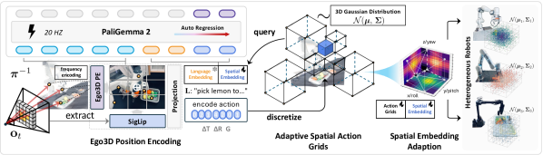
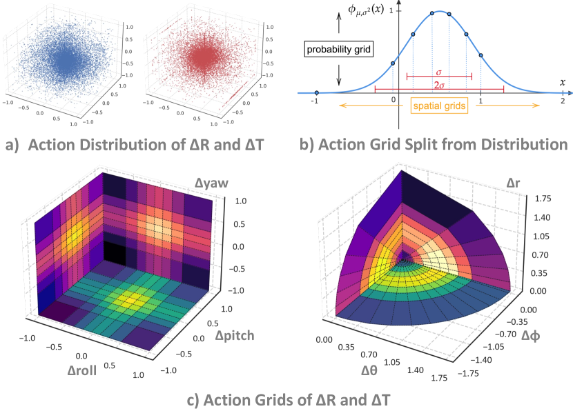
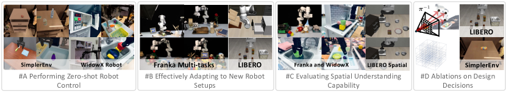
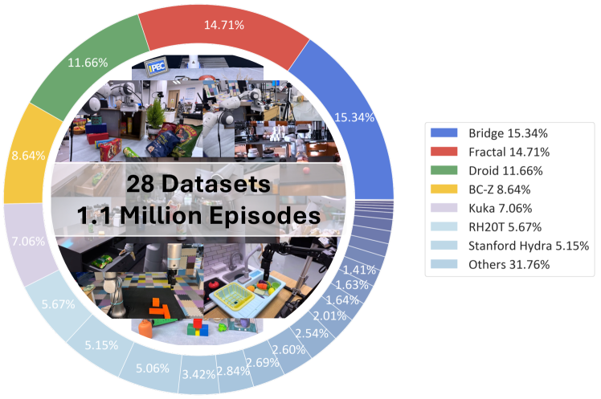
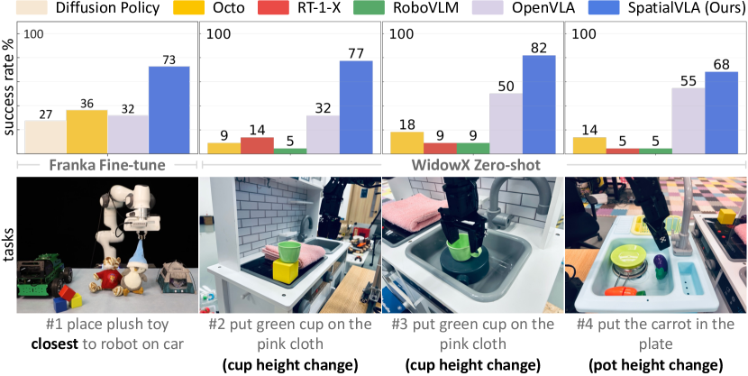

# SpatialVLA：3D 空间表征接入 VLA

!!! note "读法定位"
    这页先按“论文证据节点”读：先问它解决哪一个瓶颈，再看核心图表、实验 setting 和不能外推的边界。背景概念先回 [论文专题讲解](../index.md) 和 [具身智能](../../embodied-ai/index.md)。
    **前置**：不必先读完所有相关论文，但要知道本篇的输入、训练/推理路径和评测口径分别对应什么。
    **主线关系**：读完后把结论回填到「具身智能」路线里，判断它改变的是机制、成本、数据配方、评测口径，还是仍停留在前沿假设。

!!! info "论文信息"
    - 论文：`SpatialVLA: Exploring Spatial Representations for Visual-Language-Action Models`
    - 链接：[arXiv:2501.15830](https://arxiv.org/abs/2501.15830)
    - 项目页：[spatialvla.github.io](https://spatialvla.github.io/)
    - 关键词：Ego3D Position Encoding、Adaptive Action Grids、spatial action tokens、cross-embodiment VLA


SpatialVLA 适合放在具身智能专题里的原因很明确：它不是单纯把 VLM 做大，而是问 VLA 最根本的空间问题：**不同机器人相机安装不同、动作空间不同，模型怎样学到可迁移的 3D 空间动作知识？**

## 论文位置

很多 VLA 方法把图像 token、语言 token 和动作 token 接起来，但 RGB 图像本身是 2D 投影。对抓取、放置、插入、避障来说，模型需要知道物体在 3D 空间里在哪里，动作又要把末端执行器带到哪里。

SpatialVLA 的方案是两边一起改：

1. 输入侧加入 `Ego3D Position Encoding`；
2. 输出侧用 `Adaptive Action Grids` 把连续动作离散成空间 action tokens。

{ width="590" }

<small>Figure source: `SpatialVLA`, Figure 1. 原论文图意：SpatialVLA 在视觉语言模型上加入 Ego3D position encoding 和 adaptive action grids，把 3D 空间上下文和动作 token 接入 VLA。</small>

!!! note "这张图怎么读"
    **输入输出**：输入是视觉语言观测、空间表征和动作网格，输出是 VLA 控制动作。  
    **效率机制**：把 3D 空间先验显式接入动作预测，降低纯图像 token 学空间关系的负担。  
    **对主线意义**：它连接 VLA 动作接口和具身几何状态。  
    **不能证明什么**：空间表征收益不能证明跨机器人平台或长时安全任务通用。

## Ego3D Position Encoding

Ego3D 的直觉是：不要先追求全局世界坐标一致，而是在每个相机自己的 egocentric coordinate system 里恢复 3D 位置。这样可以减轻不同机器人相机外参不一致的问题。

流程可以写成：

```text
RGB image
  -> depth estimation
  -> back-project with camera intrinsics
  -> per-pixel 3D positions in egocentric camera frame
  -> sinusoidal encoding + MLP
  -> add to 2D visual tokens
```

论文使用 ZoeDepth 估计 depth，再用相机内参反投影得到像素的 3D position。注意这里仍然需要 intrinsics，但不依赖跨机器人统一的 camera extrinsics。这一点和具身智能里的相机标定章节正好衔接：内参用于像素到相机坐标反投影，外参则在跨机器人泛化时往往难以统一。

## Adaptive Action Grids

动作侧，SpatialVLA 不直接预测连续 \(\Delta x,\Delta y,\Delta z,\Delta R\)，而是根据数据集中动作分布，把 translation / rotation movement 离散成 adaptive spatial grids。

{ width="760" }

<small>Figure source: `SpatialVLA`, Figure 2. 原论文图意：Adaptive action grids 先统计 translation 和 rotation action movement 的分布，再根据 Gaussian fitting 对每个动作变量划分等概率区间，形成空间动作 token。</small>

| Design | Why it matters |
| --- | --- |
| Normalize action variables to `[-1, 1]` | 消除不同机器人动作尺度差异 |
| Fit Gaussian distribution over action movement | 让网格跟真实动作分布对齐 |
| Split grids with equal probability | 高频动作区域更细，低频区域更粗 |
| Generate only 3 tokens per step | 比 RT-1 / RT-2 / OpenVLA 常见 7-token 动作更轻 |
| Re-discretize for new robots | 方便 post-training 适配新 embodiment |

这条路线的关键不是“离散化一定比连续动作好”，而是让动作 token 与物理空间统计对齐，减少跨 embodiment 动作空间错位。

## 训练数据和评测设置

论文先在约 `1.1M real-world robot dataset` 上预训练，数据混合由 OXE 和 RH20T 子集组成，并参考 OpenVLA 的 mixture weight 做修改。

{ width="720" }

<small>Figure source: `SpatialVLA`, Figure 3. 原论文图意：评测覆盖 7 robot learning scenarios、24 real-robot tasks 和 3 simulation environments，关注 zero-shot control、new setup adaptation 和 spatial understanding。</small>

论文附录还给出了 dataset mixture 可视化：

{ width="740" }

<small>Figure source: `SpatialVLA`, Figure 8. 原论文图意：展示 SpatialVLA 训练数据混合的来源分布。</small>

## 实验结论

SpatialVLA 的评测不是只看一个 benchmark，而是分三类：

1. zero-shot control：SimplerEnv 和 real-world WidowX；
2. new setup adaptation：LIBERO 和 Franka 新设置；
3. spatial understanding：需要空间关系理解的真实任务和 LIBERO-Spatial。

Table III from the paper can be redrawn as follows, keeping the original English fields:

| Method | LIBERO-Spatial SR ↑ | LIBERO-Spatial Rank ↓ | LIBERO-Object SR ↑ | LIBERO-Object Rank ↓ | LIBERO-Goal SR ↑ | LIBERO-Goal Rank ↓ | LIBERO-Long SR ↑ | LIBERO-Long Rank ↓ | Average SR ↑ | Average Rank ↓ |
| --- | --- | --- | --- | --- | --- | --- | --- | --- | --- | --- |
| Diffusion Policy from scratch | 78.3 ± 1.1% | 5 | 92.5 ± 0.7% | 1 | 68.3 ± 1.2% | 5 | 50.5 ± 1.3% | 5 | 72.4 ± 0.7% | 5 |
| Octo fine-tuned | 78.9 ± 1.0% | 4 | 85.7 ± 0.9% | 4 | 84.6 ± 0.9% | 1 | 51.1 ± 1.3% | 4 | 75.1 ± 0.6% | 3 |
| OpenVLA fine-tuned | 84.7 ± 0.9% | 2 | 88.4 ± 0.8% | 3 | 79.2 ± 1.0% | 2 | 53.7 ± 1.3% | 3 | 76.5 ± 0.6% | 2 |
| TraceVLA fine-tuned | 84.6 ± 0.2% | 3 | 85.2 ± 0.4% | 5 | 75.1 ± 0.3% | 4 | 54.1 ± 1.0% | 2 | 74.8 ± 0.5% | 4 |
| SpatialVLA fine-tuned | 88.2 ± 0.5% | 1 | 89.9 ± 0.7% | 2 | 78.6 ± 0.6% | 3 | 55.5 ± 1.0% | 1 | 78.1 ± 0.7% | 1 |

<small>表源：`SpatialVLA`，Table III。原表含义：LIBERO Simulation Benchmark Results，汇报四个 task suites 的 success rate 和 rank，并对三次随机种子、500 trials 求均值。关键点是 SpatialVLA 的平均成功率最高，尤其在 LIBERO-Spatial 和 LIBERO-Long 上排名第一；这比单纯“加深度”更具体地说明 3D spatial encoding 对空间关系和长链任务都有帮助。</small>

{ width="760" }

<small>Figure source: `SpatialVLA`, Figure 6. 原论文图意：展示 SpatialVLA 在空间提示和复杂空间布局任务上的评测，说明 Ego3D position encoding 对 spatial understanding 有帮助。</small>

论文里几个关键结论：

| Question | Reported takeaway |
| --- | --- |
| Does 3D spatial input help? | Ego3D improves spatial prompt following and object-layout tasks |
| Does adaptive action tokenization help? | Spatial action grids improve transfer and action representation |
| Can it adapt to new robots? | Re-discretizing spatial grids helps new robot setup adaptation |
| Is LoRA useful? | In small-data LIBERO tasks, LoRA fine-tuning outperforms full fine-tuning |

附录提到的训练消融也很实用：pre-training ablations 在 Google Fractal + BridgeData V2 mixture 上从 scratch 训练，使用 `8 A100 GPUs`、`batch size 128`、`120K steps`。这说明论文并不只是在大型模型上报结果，也尝试拆分空间表示和动作网格的贡献。

## 对具身智能的启发

SpatialVLA 提醒我们：VLA 的泛化问题不只是语言模型大小问题。跨机器人泛化至少有三层错位：

1. 观测错位：相机位置、视角、内外参不同；
2. 动作错位：自由度、控制器、工作空间不同；
3. 数据错位：任务分布、采集协议和动作统计不同。

Ego3D 和 adaptive action grids 分别处理前两层。它不是最终答案，但给后续 VLA 设计一个明确方向：**把 3D 空间和动作坐标系当成模型接口的一部分，而不是后处理细节。**

## 局限

SpatialVLA 仍然依赖深度估计质量。单目深度在透明、反光、低纹理或尺度异常物体上会偏；长时任务也不是它的主要强项。论文里 LIBERO-Long 表现仍受限，说明空间表示能补几何，但不能自动解决长时记忆和任务规划。

## 参考链接

1. [arXiv:2501.15830](https://arxiv.org/abs/2501.15830)
2. [SpatialVLA project page](https://spatialvla.github.io/)
3. [ar5iv HTML and figures](https://ar5iv.labs.arxiv.org/html/2501.15830)

!!! tip "下一站"
    - 回到论文总入口：[论文专题讲解](../index.md)，用同一套 claim / 图表 / 边界口径横向比较。
    - 把本篇结论接回主题：[具身智能](../../embodied-ai/index.md)。
    - 按导航顺序继续：[Depth Anything：大规模无标注单目深度](depth-anything.md)。
