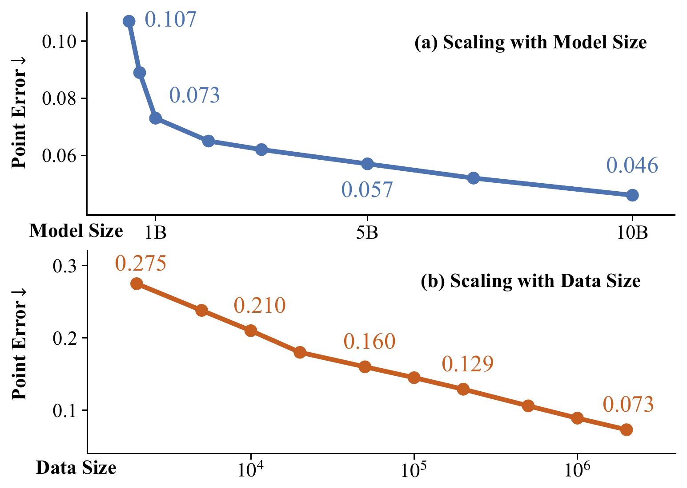
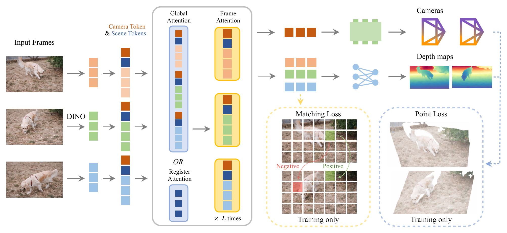
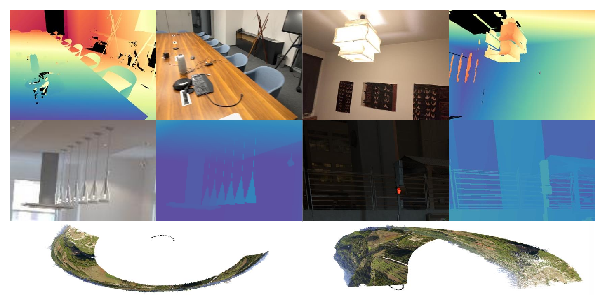
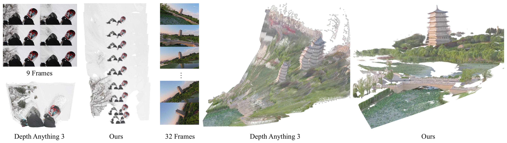
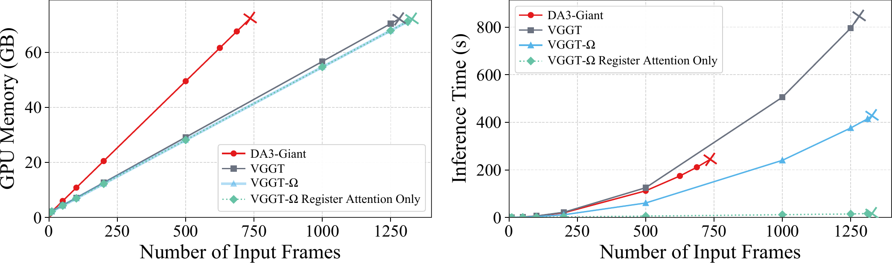
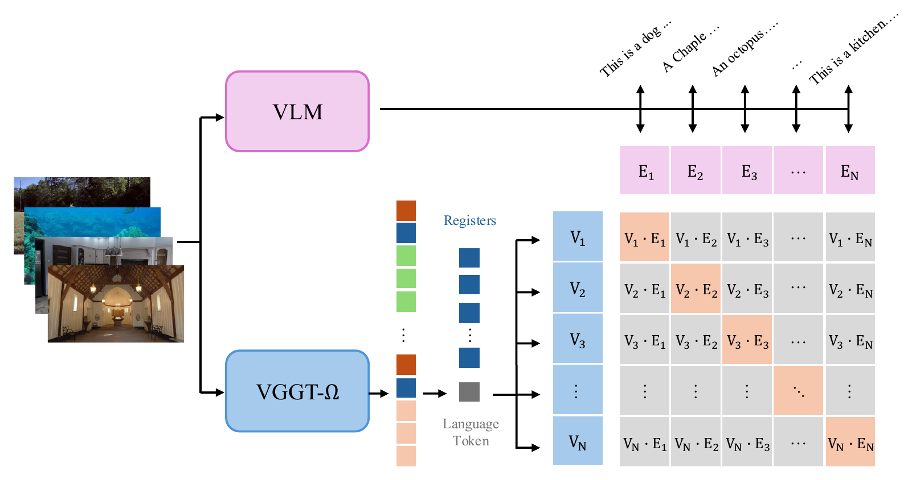
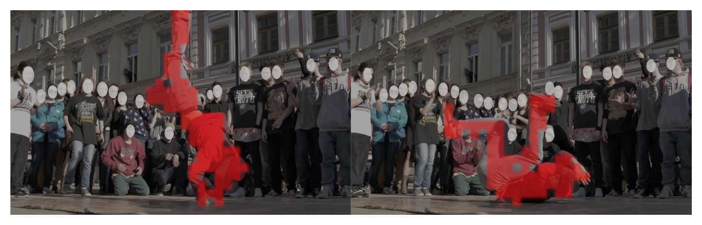

# VGGT-Ω：几何重建怎样变成具身空间表征

!!! info "论文信息"
    **论文题名：** VGGT-Ω。 
    **作者：** Jianyuan Wang、Minghao Chen、Shangzhan Zhang、Nikita Karaev、Johannes Schönberger、Patrick Labatut、Piotr Bojanowski、David Novotny、Andrea Vedaldi、Christian Rupprecht。 
    **机构：** Visual Geometry Group, University of Oxford；Meta AI。 
    **时间 / 主题：** 2026-05；具身智能 / feed-forward 3D reconstruction / VLA spatial representation。 
    **arXiv / 官方报告：** arXiv：[2605.15195](https://arxiv.org/abs/2605.15195)；官方材料：[vggt-omega.github.io](https://vggt-omega.github.io/)。 
    **GitHub / 项目：** GitHub：[facebookresearch/vggt-omega](https://github.com/facebookresearch/vggt-omega)；Demo / Model：[Hugging Face demo](https://huggingface.co/spaces/facebook/vggt-omega-demo)、[model page](https://huggingface.co/facebook/VGGT-Omega-1B-512)。 
    **元数据来源与核验口径：** 来源：[arXiv](https://arxiv.org/abs/2605.15195)、[项目页](https://vggt-omega.github.io/)、[官方 GitHub](https://github.com/facebookresearch/vggt-omega)；Checked Date：2026-06-20；Repro Status：Paper / official materials / official code reviewed, independent reproduction not claimed。

## 几何模型扩大之前，先让每个训练样本更便宜

VGGT-Ω 要回答两个相互关联的问题。前馈三维重建能否像其他视觉基础模型那样，持续从更多参数和数据中获益；如果重建确实能训练出可靠的空间表示，这些表示能否用于相机、深度之外的任务。前一个问题需要扩展训练，后一个问题需要从网络内部拿出可直接接入下游的特征。[↗](https://arxiv.org/pdf/2605.15195v1#page=1)

原 VGGT 已经把多视图重建变成一次前向计算，但其训练成本仍有两个明显来源。跨所有图像 token 的 global attention 随输入总长度平方增长；深度、点图和跟踪等稠密预测头还要保存高分辨率中间激活。参数量很小的卷积头，也可能占用大量训练显存。因此，只扩大 Transformer 或继续增加序列数，并不能自动解决可训练性。

Ω 同时改变通信、输出与数据。它用每帧十六个 scene registers 承担一部分跨帧信息交换，删除独立的点图和跟踪稠密头，并把高分辨率卷积替换成轻量上采样。点图和对应关系仍参与监督，只是不再需要各自一套输出网络。这些修改使训练显存约为原 VGGT 的 30%，为约四百万条带几何监督的序列和额外无标签视频训练腾出空间。[↗](https://arxiv.org/pdf/2605.15195v1#page=2)

{ width="760" }

*原论文 Figure 1。上图改变参数规模，下图改变不同训练序列的数量；纵轴都是越低越好的 point error，横轴及刻度并不相同。模型和数据扩展应分别解读，不能把两条曲线合并为一个训练预算。* [↗](https://arxiv.org/pdf/2605.15195v1#page=1)

这篇论文的主张因此有三个层次。重建结果检验扩大后的模型是否更准确，受控消融检验哪些精简保住了精度，下游策略和语言实验检验 registers 是否携带可复用信息。三类证据互相补充，但任何一类都不能代替另外两类。尤其是下游成功率提高，并不意味着几何模型自身已经成为机器人策略。

## 一组图像怎样变成深度、相机与场景表示

模型接收一组 RGB 图像，不要求输入相机内外参，也不把帧序号作为时间编码。其显式输出可写成原文的形式。

$$
((g_1,D_1),\ldots,(g_N,D_N))=f(I_1,\ldots,I_N),
\qquad g_i=(q_i,t_i,f_i)\in\mathbb R^9.
$$

$N$ 是输入图像数，$D_i$ 是与第 $i$ 张图对应的稠密深度；$q_i\in\mathbb R^4$ 表示旋转四元数，$t_i\in\mathbb R^3$ 表示平移，$f_i\in\mathbb R^2$ 表示两个方向的视场角。主点被假设在图像中心。这个接口同时用于静态多视图和动态视频的采样帧，输出本身没有物体速度、运动分割或未来轨迹。[↗](https://arxiv.org/pdf/2605.15195v1#page=4)

首先，DINOv3 初始化的视觉 Transformer 把每张图变成 patch tokens。设 patch 边长为 $r$，则一帧有 $P=(H/r)(W/r)$ 个图像 token。Ω 默认使用 16 像素 patch，每帧再附加一个 camera token 和十六个 scene tokens，形成 $(P+17)\times C$ 的表示。前者用于相机预测，后者用于整组场景信息的聚合。

这些特殊 token 有 reference 与 non-reference 两套可学习初值，用于区分参考图与其余图像；它们没有为每个时间位置设置独立编码。因此，网络知道哪张图承担坐标参考，却不把“第三张”固定解释成某个时刻。对非参考输入的排列，注意力结构可以保持相应的置换关系；改变参考图则还涉及输出坐标的重新表达。

{ width="920" }

*原论文 Figure 2。沿左到右看，DINO 特征与 camera、scene tokens 一起进入交替注意力；右侧只有相机和深度预测，虚线区域的 matching、point 约束只用于训练。图中的 “OR” 表示部分跨帧层换成 register attention，并非每一层都同时执行两种全局操作。* [↗](https://arxiv.org/pdf/2605.15195v1#page=3)

骨干处理后的 tokens 有两种去向。图像 tokens 进入深度头；camera tokens 与 registers 一起进入轻量相机 Transformer，再由每帧 camera token 的 MLP 输出相机参数。Registers 还可以直接取出，交给机器人策略或语言对齐模块。这个分支接口是理解后续应用的关键，几何预测与下游表示共享骨干，但下游未必需要先生成点云。

## 十六个 registers 怎样传递跨视图信息

原 VGGT 的 alternating attention 交替执行两种操作。Frame attention 在每张图内部处理所有 token，使局部视觉、camera token 与 registers 可以交换信息；global attention 则让全部图像的全部 token 共同参与自注意力，建立跨视图联系。

如果每帧有 $P+17$ 个 token，全局层的注意力交互规模与 $[N(P+17)]^2$ 同阶。Ω 观察到部分 global attention 的注意力权重较稀疏，于是在默认模型中将 25% 的这类层换成 register attention。替换层只更新各帧的十六个 registers，参与跨帧自注意力的长度变为 $16N$。[↗](https://arxiv.org/pdf/2605.15195v1#page=4) [↗](https://arxiv.org/pdf/2605.15195v1#page=5)

按照原文操作，把第 $i$ 帧 registers 记为 $z_i^{\mathrm{scene}}$，有

$$
\bigl(z_1^{\mathrm{scene}\prime},\ldots,
      z_N^{\mathrm{scene}\prime}\bigr)
=\operatorname{Attn}
 \bigl(z_1^{\mathrm{scene}},\ldots,z_N^{\mathrm{scene}}\bigr).
$$

这里没有让每个图像 patch 在替换层中再次查询全部其他帧的 patch。跨帧传播分成了可辨认的过程：图内注意力先让 registers 接触本帧信息，register attention 在各帧 registers 之间交换，再由后续图内注意力把汇集的信息分发给本帧图像 tokens。低维通信通道迫使 registers 保存对整组场景有用的内容。

这种瓶颈仍有代价。细小遮挡、重复纹理和精确对应可能需要直接比较图像局部，因此默认模型保留了其余 75% 的完整 global attention。消融中，全局注意力版本 point error 为 0.071，替换四分之一后为 0.073，接近原精度；如果全部替换，FLOPs 可以降到原来的约 6%，但精度退回原 VGGT 的水平。[↗](https://arxiv.org/pdf/2605.15195v1#page=10) [↗](https://arxiv.org/pdf/2605.15195v1#page=13)

默认替换带来的骨干训练收益约为 23% FLOPs 和 16% 显存。它们与完整模型约 70% 的训练显存节省不是同一个量，后者还包括稠密头和上采样结构的改变。也不能由注意力交互规模的平方项，直接推断峰值显存会按同样比例下降，因为实际注意力实现可能不保存完整矩阵。

## 为何减少高分辨率卷积，却保留低分辨率卷积

VGGT 的 DPT 稠密解码器需要逐级恢复空间分辨率。越接近输出分辨率，特征图的像素越多，训练时保留这些卷积激活便越昂贵。Ω 保留早期低分辨率的 DPT 卷积，把高于输入四分之一分辨率的卷积块替换为一个 MLP 加 pixel shuffle。[↗](https://arxiv.org/pdf/2605.15195v1#page=5)

用 $h\times w$ 表示上采样前的中间特征分辨率，MLP 为每个位置预测 $2u^2$ 个通道，$u=4$；pixel shuffle 再把通道重新排列成 $(uh)\times(uw)\times2$。两个输出通道分别是深度与置信度。这里的 $h,w$ 指已经过低分辨率解码器的空间尺寸，不应直接把 DINO 的 patch 网格当成四倍上采样的起点。

Pixel shuffle 本身主要做重排，学习负担在前面的 MLP 及骨干特征上。这个结构能减少昂贵的高分辨率中间表示，但保持逐像素输出。相机侧也进行简化，使用一次预测，不再采用原 VGGT 的迭代 refinement。

作者确实试过完全去掉卷积。纯 MLP 头在某些定量指标上甚至更好，也更快、更省显存、梯度更稳定，却会产生肉眼明显的块状深度不连续，尤其是在天空、山体等远距离室外区域。论文将其与几何量取值范围很大联系起来，但这仍是解释性假说。保留少量低分辨率卷积，是为改善空间平滑性作出的经验取舍。[↗](https://arxiv.org/pdf/2605.15195v1#page=14)

这个例子也解释了为什么模型选择不能只看平均深度误差。局部块状伪影可能对平均指标影响很小，却会在点云、表面重建或机器人近距离感知中成为明显问题。Ω 的最终结构同时考虑数值准确率、视觉连续性和训练成本。

## 删除点图头以后，几何约束怎样回到网络

输出变少并不等于监督变少。原论文保留四类训练约束，并在附录给出对应权重。

$$
\mathcal L=
5\mathcal L_{\mathrm{cam}}+
\mathcal L_{\mathrm{depth}}+
0.5\mathcal L_{\mathrm{point}}+
0.1\mathcal L_{\mathrm{match}}.
$$

相机、深度负责直接输出的准确性，点图约束相机和深度组合后的三维结果，匹配损失约束不同视图中特征的对应关系。四个系数是本文训练配置中的数值，不能不经调整地当成所有数据集的统一配方。[↗](https://arxiv.org/pdf/2605.15195v1#page=6) [↗](https://arxiv.org/pdf/2605.15195v1#page=24)

训练前先把 GT 相机与几何变换到第一台相机的坐标系，再用所有三维点到原点的平均距离归一化深度和平移。这样，不同数据源的场景尺寸不会直接支配误差。归一化只作用于 GT，预测本身不在线强制归一化。这也意味着基础输出遵循场景归一化约定，不能把网络吐出的深度直接解释成已标定的米制距离。

相机损失为预测 $\hat g_i$ 与目标 $g_i$ 的 L1 距离之和。深度损失则更细，既要匹配数值，也要保留局部变化，并允许网络降低不可靠位置的权重。设 $e_i=\hat D_i-D_i$，原文写为

$$
\begin{aligned}
\mathcal L_{\mathrm{depth}}
={}&\sum_{i=1}^{N}
\left[
\left\|c_i^D\odot(1+D_i^{-1})\odot e_i\right\|
+\left\|c_i^D\odot\nabla e_i\right\|
\right]
-\alpha\sum_{i=1}^{N}\log c_i^D.
\end{aligned}
$$

$c_i^D$ 为网络预测的逐像素置信度权重，$\odot$ 表示逐元素乘法，$\nabla e_i$ 表示空间梯度残差；范数及对数项在有效像素上汇总。第一项的 $1+D_i^{-1}$ 同时包含绝对误差与相对尺度成分，使远处大深度不至于单凭数值幅度压过近处结构。梯度项约束边缘和局部形状，负对数项避免模型简单地把所有置信度降到零来逃避误差。[↗](https://arxiv.org/pdf/2605.15195v1#page=6)

点图不再由另一套网络直接回归，而是把预测深度与相机做几何反投影，得到参考相机坐标系中的三维点。其残差为

$$
e_i^{\mathrm{point}}
=\pi^{-1}(\hat D_i,\hat g_i)-P_i,
$$

其中 $P_i$ 是 GT 点图，$\pi^{-1}$ 表示利用内参、外参和深度完成反投影及坐标变换。这个残差再进入与深度相同类型的损失。因而，一个像素深度正确但相机姿态错误时，三维点仍会产生误差；点损失的梯度可以同时约束深度和相机，而无需保存独立点图头的高分辨率激活。

这一做法恢复了多任务监督的主要作用。其目标并非让几个输出各自“看起来合理”，而是让相机与深度组合以后也得到合理几何。后面的消融比较的正是这种训练约束与额外解码头之间的区别。

## 匹配损失为何要特别防止错误负样本

最后一层图像 tokens 还接受跨视图匹配监督。对同一三维位置对应的特征，希望相似度更高；对可信的不对应位置，希望相似度更低。原论文使用归一化特征的余弦相似度 $s$，通过 sigmoid 构造正负配对的二元交叉熵。

$$
\mathcal L_{\mathrm{match}}
=\mathbb E_{\mathrm{pos}}[-\log\sigma(s)]
+\mathbb E_{\mathrm{neg}}[-\log(1-\sigma(s))].
$$

这里 $\mathbb E$ 表示对所采样配对求平均。真正决定监督是否可信的，是正负样本怎么构造，不能只用“拉近正样本、推远负样本”概括。[↗](https://arxiv.org/pdf/2605.15195v1#page=6)

正样本从 GT 深度与相机出发。在 query 图像中采有效像素，将其三维点投影到其他图；投影必须落在图内，与目标图深度满足约 1% 的相对一致性，并排除四像素的边界带。然后统计 query patch 的投影有多少落入各个 target patch，形成软重叠比例。重叠超过 10% 的目标 patch 可以与 query patch 构成正配对，query 的抽样概率还与可用对应数量有关。[↗](https://arxiv.org/pdf/2605.15195v1#page=24)

一块区域没有满足这些条件，可能只是被遮挡、深度无效或物体发生了运动。特别在动态视频中，“没找到正对应”不等于“确定是不同物体位置”。因此，负样本单独随机提出候选，再同时检查两个条件：目标 patch 中心应当远离 query 所诱导的极线，且两个 patch 的平均 RGB 也有足够大差异。满足几何与外观双重排除后才作为负配对，最终再平衡正负样本数量。

这个设计的用途是让骨干特征保留可匹配性，训练约束直接作用在 tokens 上。它并没有恢复一个显式跟踪输出头，也没有给出任意像素随时间运动的完整轨迹。若下游需要点跟踪，仍需额外的读取或解码机制。

## 动态场景为何仍能用深度加相机表示

假设相机固定，一名舞者在画面中大幅移动。图像变化很强，但相机外参应当保持不变，每帧深度则随人体姿态变化。把全部变化都交给一个要求静态一致的点图，再从点图恢复相机，容易把物体运动与观察者运动混在一起。Ω 选择直接预测每帧深度和相机，给这两类变化留下不同的表达通道。[↗](https://arxiv.org/pdf/2605.15195v1#page=6)

这种输出选择减少了额外密集 ray map 或显式运动 mask 的成本，但它没有消除动态重建的欠约束性。单帧观测本来就可能对应多种形状与运动，模型仍要依赖训练数据中的统计先验。论文的改进是用更广的静态、动态监督学习这个先验，而非通过架构保证任何非刚性场景都能唯一恢复。

输入也没有时间顺序编码。模型可以根据跨视图一致与不一致的信息识别运动相关区域，却不能仅凭这个接口保证理解动作方向、速度或事件先后。把每帧动态几何重建与视频预测、动作规划区分开，才能准确理解后面的运动特征可视化。

## 互联网视频怎样变成可靠的几何监督

数据规模首先要分清三个口径。公开与内部几何数据约有 3M 条序列，每条包含十到两万张图像；作者另从约 40M 条内部互联网风格视频中生成约 0.8M 条高质量标注，包含 600K 静态、200K 动态场景，两部分合计约 4M 监督序列。另有 18M 无标签视频用于自监督。原始视频数、成功标注序列数和无标签训练量不能相互替代。[↗](https://arxiv.org/pdf/2605.15195v1#page=2) [↗](https://arxiv.org/pdf/2605.15195v1#page=7)

几何数据覆盖室内、室外、物体、自动驾驶、人体及合成动态环境。对于非合成数据，作者还会检查跨视图深度一致性，去掉噪声像素，并过滤有效深度太少的序列。新视频标注采用更保守的多阶段过程。

| Stage | 操作 | 要排除的具体问题 |
|---|---|---|
| VLM pre-filtering | 判断剪辑、画面质量、视差与纹理，记录场景是否动态 | 切镜、重度模糊、水印、低视差、重复纹理与反光主导画面 |
| Dynamic mask extraction | 用 Grounding DINO 检测人、车等可能运动类别的框 | 让移动物体参与静态相机估计与三角化 |
| Feature matching and tracking | 组合 SIFT、SuperPoint/SuperGlue、ALIKED/LightGlue、VGGSfM Tracker | 单一匹配器覆盖不足或错误对应 |
| Reconstruction and filtering | 必要时由 VGGT 初始化相机，再运行 COLMAP BA 与几何过滤 | 相机注册不完整、异常 FOV、退化运动与畸变 |
| Multi-view consistency | MVS 估计深度，反投影到其他视图检查一致性 | 不被多视图支持的深度与过低有效覆盖 |
| Supervised geometric filtering | 用人工标注训练多个质量分类器 | 轨迹、点云与尺度的系统性异常 |

*原论文 §3.5.2 与附录 A.3–A.4。这里的动态 mask 用于离线标注管线，不是 Ω 推理时必须输入或输出的运动分割。* [↗](https://arxiv.org/pdf/2605.15195v1#page=7) [↗](https://arxiv.org/pdf/2605.15195v1#page=25)

在严格标注预筛选中，VLM 将约 50% 视频判为明显不适合，40% 判为可能重建但质量风险较高，剩余 10% 进入后续过程。这套比例对应高质量标注筛选，不应据此反算自监督只能使用四百万条视频。不同训练阶段对视频是否可用的要求不同。

后续过滤也有明确阈值。例如相机注册比例低于 99.5%、视场角超出 30°–120°、畸变比超过 0.1 的序列会被去除；跨视图检查后有效深度像素不足 5% 的序列也被丢弃。最后的质量分类器由 500 条静态与 500 条动态人工标注序列训练，组合 XGBoost、random forest 与 CatBoost。

分类器看的不只是重投影误差。相机平移、旋转的二阶变化可以暴露轨迹抖动；可见点在相机间的最大视差角用于检查基线是否足够；点云 PCA 的线性、平面性和散布程度可以发现退化形状；深度覆盖率与近邻离群点比例分别反映重建稀疏和浮点噪声。这些指标合用，是因为一个局部误差很低的重建，也可能具有错误的整体形状。[↗](https://arxiv.org/pdf/2605.15195v1#page=25) [↗](https://arxiv.org/pdf/2605.15195v1#page=26)

最关键的边界在像素层面。视频可以包含动态物体，但自动标注管线会排除可能运动的区域，可靠深度仍主要来自刚性像素。运动物体的深度学习需要合成动态数据补足。因此，“200K 动态场景经过标注”不能改写成“200K 视频中的所有运动像素都有可信几何 GT”。

## 高质量标注的证据与筛选代价

作者在有真值的 Sintel 上比较自己的标注管线与 MegaSaM，但只评价两边共同通过过滤的序列和像素。23 条序列中排除了八条，全部动态区域也被排除。该条件下的结果如下。

| Annotation Pipeline | Camera AUC@30° ↑ | Depth δ1.25 (%) ↑ |
|---|---:|---:|
| MegaSaM | 62.1 | 77.2 |
| Ours | 96.4 | 99.3 |

*原论文 §4.3，过滤后的共同有效范围。此表检验保留下来的伪标签是否准确，不能读成对全部视频、全部像素的标注成功率。* [↗](https://arxiv.org/pdf/2605.15195v1#page=11)

这种选择体现了监督学习中的实际取舍。更激进地收集标注可以增加样本数，也会引入一批难以由平均 loss 识别的系统性错误；保守过滤减少覆盖，却可以避免模型把这些错误学成稳定先验。论文尤其强调，部分问题不会明显拉低标准基准分数，只会在与错误训练样本相似的新场景中暴露。

{ width="820" }

*原论文 Figure 10。上排看传感器标注怎样把椅背或灯具混入背景，中排看可见细杆在深度里怎样消失，下排看整体地形被弯成穹顶。这张图展示标注故障类型，并非筛选前后准确率的可视化。* [↗](https://arxiv.org/pdf/2605.15195v1#page=27)

传感器数据可能存在前后景泄漏，某些 ScanNet++ 椅背像素的深度实际上落到墙或地面，灯具附近也会出现碎片。合成数据同样有缺陷，细栅栏虽然在 RGB 中可见，深度却可能被平滑成后面的墙面；渲染使用的 HDRI dome 或地板代理，还可能为背景提供视觉上不合理的深度。作者因此排除 Kubric、PointOdyssey 等相关数据，并对能明确分离前景的 BEDLAM 过滤背景深度。

BA 生成的标注也不能仅凭低重投影误差判定可靠。小视差、近乎平行的观察方向、缺乏回环或错误径向畸变都可能产生 doming effect，局部图像匹配尚可，整体相机与场景却弯曲。这样的标注会教模型接受错误的全局形状。

另一种故障是人在墙里。照片旅游类数据中的行人边缘可能被静态 MVS 错配到建筑，模型随后也会把人体估计成背景。作者观察到，排除 MegaDepth 或重新估计其深度能减轻这一现象。窗户同样可能有标注语义冲突，一类合成数据把窗外景色贴在窗面上，另一类则标出真正窗外物体的距离。模型面对的并非随机噪声，而是两种互相矛盾的监督定义。[↗](https://arxiv.org/pdf/2605.15195v1#page=27)

这些例子提供了具体的数据排错方法。遇到稳定而奇怪的深度错误，应先检查同类训练样本的几何定义和有效 mask，再决定是否需要改网络。单纯增加同分布数据，甚至可能更牢固地学习错误。

## 自监督扩展了哪些信息，又保留了哪些依赖

Ω 的自监督不是从随机初始化出发学习三维。学生与教师都从已经完成监督训练的 Ω checkpoint 初始化，随后接收同一组帧的不同随机增强，包括颜色变化、模糊、90° 旋转、局部遮挡和帧重排。模型要在外观或排列改变后给出相容的表示与几何。[↗](https://arxiv.org/pdf/2605.15195v1#page=6)

监督分为两部分。多层 tokens 通过 L2 损失与教师特征对齐；相机和深度输出通过回归约束保持一致。两路结果必须恢复共同帧序后比较，帧重排改变参考相机时，相机及几何比较还需遵守同一坐标约定，不能直接对不同参考系的平移向量求差。原文强调对齐后的预测一致性，并未把参考图身份本身当成不变量。

学生由梯度更新，教师采用 EMA。

$$
\theta_T\leftarrow m\theta_T+(1-m)\theta_S,
\qquad m=0.999.
$$

$\theta_T,\theta_S$ 分别是教师与学生参数。自监督时冻结相机和深度头，以限制输出端与特征一起任意漂移造成的塌缩；更新主要作用于表示网络。教师不通过同一回归损失直接反向传播，而是提供平滑变化的目标。[↗](https://arxiv.org/pdf/2605.15195v1#page=24)

完整训练是 160K 监督 steps、50K 自监督 steps、再加 30K 监督 steps，总计 240K。AdamW 在监督阶段的峰值学习率为 $2\times10^{-4}$，自监督为 $10^{-4}$，采用 5% 线性 warm-up 与后续 cosine decay。DINOv3 初始化后继续训练，并非冻结的通用视觉提取器。[↗](https://arxiv.org/pdf/2605.15195v1#page=8)

| Model Variant | Alternating-Attention Blocks | Hidden Size |
|---|---:|---:|
| 200M | 12 | 384 |
| 500M | 12 | 768 |
| 1B | 24 | 1024 |
| 10B | 16 | 4096 |

*原论文 §4.1 的四个重点配置。每个 block 含一个 frame attention 和一个 global 或 register attention；10B 主要通过宽度扩展，不能把 block 数直接当成参数量排序。*

训练使用 128 张 96GB H100、bfloat16、FSDP 和梯度检查点。每次输入帧数在 1–24 中随机选择，batch size 随帧数调整以利用显存；图像面积约为 $512^2$，纵横比在 0.33–1.33 内变化。另有 QKNorm、阈值 1.0 的梯度裁剪，以及每帧概率 0.05 的矩形遮挡，遮挡区域对应深度被标为无效。[↗](https://arxiv.org/pdf/2605.15195v1#page=24)

视频帧从局部时间窗口中采样，不要求它们都具有充分共视。这会产生语义相关、却几乎没有重叠的困难输入，迫使模型学习超出直接匹配的先验。但训练采样使用时间窗口，仍不同于把时间顺序编码提供给网络。

作者还报告，从随机初始化训练可以收敛到相近表现，但通常需要多 4–8 倍 iterations；DINO 的主要价值因此包括优化效率。合成与真实数据则有互补作用，作者经验上推荐每个 epoch 约 80% 合成、20% 真实采样，合成标签足够干净时可进一步提高合成比例。这是采样建议，不能把它当成四百万序列的原始数量比例，也不能认为真实与合成数据可以任意互换。[↗](https://arxiv.org/pdf/2605.15195v1#page=13)

自监督的收益也应按实测幅度理解。在统一消融预算下，用自监督替换 10% 的监督 steps，point error 从 0.073 降到 0.070。作者认为它主要改善分布外泛化，对多数基准的影响较小，且不构成获得主表优势的必要条件。其他新视角合成、token 生成等自监督尝试在其实现中未得到同样收益，这不能外推成这些路线普遍无效。[↗](https://arxiv.org/pdf/2605.15195v1#page=10) [↗](https://arxiv.org/pdf/2605.15195v1#page=13) [↗](https://arxiv.org/pdf/2605.15195v1#page=14)

## 规模曲线与消融分别证明了什么

规模研究用 point error 同时衡量深度与相机。预测深度经预测相机反投影到三维，再与有对应关系的 GT 点计算 L2 距离，并在六个数据集上平均。采用对应点误差而非无序 Chamfer，是为了避免最近邻匹配被墙、地面等大表面主导，以致某些错误几何仍得到较好的集合距离。[↗](https://arxiv.org/pdf/2605.15195v1#page=10)

图 1 中，参数从 0.2B 增至 10B，point error 从 0.107 降到 0.046，1B 和 5B 的标注值分别为 0.073、0.057；训练序列数从 2K 增至 2M，误差从 0.275 降到 0.073。曲线支持扩大数据与容量可以持续改善这一重建任务，但论文称其为 power-law-like，没有给出足以可靠外推任意规模的计算最优定律。

这里匹配的是大致相同的训练 token 数。大模型处理同样多 tokens 所需计算更多，因此它不是固定 FLOPs 下扩大参数一定更划算的证明。同样，数据轴改变的是不同序列的丰富程度，不能把最终完整配方的约 4M 数据、240K steps 与图中消融条件混为一谈。

默认消融采用 1B 模型、2M 序列、64 张 GPU、150K 监督 steps，除非某项实验另作说明。结构消融把因果问题缩小到特定设计，而主榜比较的是各方法发布的整体模型。

| Ablation Setting | Point Error ↓ | 可以支持的判断 |
|---|---:|---|
| Global attention only | 0.071 | 保留全部跨图像 token 交互的精度参照 |
| Default, 25% register attention | 0.073 | 以很小误差差异换取训练计算与显存收益 |
| Remove point and matching losses | 0.078 | 联合几何与特征监督仍有价值 |
| Original VGGT multi-head setup | 0.070 | 增加稠密头略好，但训练成本更高 |
| Replace 10% steps with self-supervision | 0.070 | 少量无标签训练可以补充监督数据 |

*原论文 §4.3。移除 point 与 matching 是联合消融，不能分别读出两个损失各自贡献了多少；self-supervision 行也不是完整 50K 自监督阶段的单独复现。* [↗](https://arxiv.org/pdf/2605.15195v1#page=10)

这张表支持的核心取舍很明确。独立点图、跟踪头并非保留多任务收益的唯一方式；全局 token 交互也不必在每个跨帧层都执行。但把二者完全取消，并未被证明是无损的。Ω 选择了一个能继续扩大训练、同时保持重建质量的中间位置。

## 静态与动态主结果怎样互相补充

主结果在三套静态数据 7 Scenes、NRGBD、ETH3D，以及三套动态数据 DyCheck、Sintel、TUM-Dynamic 上评价，每场景或序列随机采十帧。各基线使用发布模型，DA3 采用 Giant 1B。相机指标是相对旋转、平移角误差阈值内正确图像对比例的曲线面积 AUC，越高越好。[↗](https://arxiv.org/pdf/2605.15195v1#page=8)

| Method | 7 Scenes | NRGBD | ETH3D | DyCheck | Sintel | TUM-Dynamic |
|---|---:|---:|---:|---:|---:|---:|
| MegaSaM | 10.6 / 71.8 | 17.2 / 83.1 | 5.9 / 38.1 | 26.8 / 53.1 | 22.5 / 58.3 | 15.4 / 59.0 |
| VGGT | 10.9 / 74.4 | 81.7 / 97.7 | 18.8 / 62.1 | 21.0 / 78.7 | 15.0 / 50.0 | 16.6 / 61.2 |
| PI3 | 13.3 / 77.0 | 83.8 / 98.2 | 35.3 / 79.6 | 23.3 / 81.0 | 14.8 / 53.5 | 16.1 / 59.2 |
| DA3 | 18.7 / 78.2 | 86.4 / 98.4 | 46.1 / 87.0 | 32.1 / 83.9 | 16.2 / 52.7 | 20.8 / 62.7 |
| Ours-1B | 29.6 / 83.1 | 89.7 / 98.8 | 49.8 / 88.5 | 38.4 / 87.3 | 35.3 / 73.0 | 30.2 / 82.3 |
| Ours-10B | 36.4 / 88.2 | 92.5 / 99.1 | 56.3 / 90.4 | 43.7 / 90.9 | 40.0 / 79.1 | 36.4 / 87.5 |

*原论文 Table 1 的代表行。每格为 AUC@3° / AUC@30°，两项均越高越好。前三列为静态数据，后三列为动态数据。*

两个阈值承担不同判断。NRGBD 的宽松 AUC@30° 已接近饱和，DA3 为 98.4，10B Ω 为 99.1；严格 AUC@3° 则仍从 86.4 提高到 92.5。只读宽松阈值容易低估相机精度的改进。

Sintel 展示了另一类困难。MegaSaM 在严格阈值下优于之前的前馈模型，AUC@3° 为 22.5，而 Ω-1B 已达到 35.3，10B 达到 40.0。摘要中的约 77% 是按 $(40.0-22.5)/22.5$ 计算的相对提高，绝对增加为 17.5 个 AUC 点，并非提高 77 个百分点。相反，在宽基线 ETH3D 上，MegaSaM 的 AUC@30° 仅为 38.1，说明动态优化方法的强项不能直接转移到所有静态多视图条件。

深度指标也需要和相机分开看。$\delta_{1.25}$ 衡量预测与 GT 深度的对称比值落在 1.25 阈值内的像素比例，AbsRel 是平均绝对相对误差。下面同时保留相对困难的数据和已经接近饱和的数据。

| Method | 7 Scenes | ETH3D | DyCheck | Sintel | TUM-Dynamic |
|---|---:|---:|---:|---:|---:|
| DA3 | 93.0 / 0.063 | 99.6 / 0.015 | 97.7 / 0.039 | 86.1 / 0.118 | 94.3 / 0.049 |
| Ours-1B | 94.6 / 0.058 | 99.8 / 0.012 | 98.4 / 0.038 | 89.5 / 0.097 | 97.4 / 0.041 |
| Ours-10B | 96.3 / 0.050 | 99.8 / 0.009 | 98.7 / 0.030 | 93.5 / 0.081 | 98.3 / 0.035 |

*原论文 Table 2 的代表行列。每格为 δ1.25 (%) ↑ / AbsRel ↓；相机与深度都在各自评价协议中比较，表中数值本身不构成额外的米制尺度保证。* [↗](https://arxiv.org/pdf/2605.15195v1#page=8)

ETH3D 的 1B 与 10B 在阈值准确率上同为 99.8，但 AbsRel 仍从 0.012 降到 0.009；Sintel 则两项都有明显变化，10B 相比 DA3 的 AbsRel 从 0.118 降到 0.081。严格与连续误差指标共同说明，扩大模型并非只把少量样本刚好推过阈值。

这些结果支持完整 Ω 配方在静态、动态任务上的广泛改善。它们不能单独把收益归因于 registers，毕竟训练数据、DINO 初始化、输出结构和容量都有变化。要判断某个组件的贡献，应回到前面的受控消融。

{ width="920" }

*原论文 Figure 6。左侧重复雪地纹理使 DA3 估计出很少相机移动；右侧相机滚转时，塔身被重复重建。Ω 的对应结果保持更一致的轨迹与整体结构。实例说明错误怎样出现，不表示这些失败在所有测试视频中的发生比例。* [↗](https://arxiv.org/pdf/2605.15195v1#page=10)

## 训练显存减少七成，为何推理显存没有同比下降

推理效率比较首先修正了一个实现问题。原 VGGT 在推理时缓存全部 24 层的中间特征，但预测头只需要其中四层。作者先去掉不必要缓存，再比较 VGGT、DA3 与 Ω，以免把可以直接修复的实现开销算作新架构优势。[↗](https://arxiv.org/pdf/2605.15195v1#page=9)

实验使用一张 80GB A100、PyTorch scaled dot product attention 与 Flash Attention v2。VGGT 和 DA3 的输入为 518 × 336、patch size 14；Ω 为 512 × 336、patch size 16。输入分辨率相近，但 Ω 图像 token 数减少约四分之一，这也是推理加速的重要来源。

{ width="860" }

*原论文 Figure 7。左图读取峰值显存，右图读取整组输入的推理时间；叉号标出首次显存不足的设置。注意全 register 变体在时间上与默认模型分离很大，在显存上却接近。* [↗](https://arxiv.org/pdf/2605.15195v1#page=10)

修正后的 VGGT 和 Ω 都能处理约 1,250 帧，DA3 在约 750 帧时耗尽显存。Ω 的默认 register attention 还提供约 20%–25% 加速，但这不意味着它在相同设置下只消耗原 VGGT 三成推理显存。七成节省主要针对训练中高分辨率激活、多个稠密头和骨干保存的成本。

Flash Attention 不显式物化完整的注意力矩阵，而是分块计算、在线维护 softmax 归一化并累加输出。因此，减少全局两两交互会明显减少计算，推理峰值显存却可能仍由随 token 数近似线性增长的 frame-attention 或 FFN 中间张量主导。图中近线性的显存曲线与平方级交互计算并不矛盾。

全部使用 register attention 时，1,000 帧推理从 240.2 秒降到 11.7 秒，但精度也退化。不能把 11.7 秒与标准模型的主表准确率拼成同一个性能点。更不能把可一次接收 1,250 帧解释成在线流式处理或实时控制频率，这里的测试是给定一组帧后执行完整前向计算。[↗](https://arxiv.org/pdf/2605.15195v1#page=9) [↗](https://arxiv.org/pdf/2605.15195v1#page=13)

## Scene tokens 接入机器人策略时，究竟训练了什么

机器人实验把 Ω 当作冻结的几何编码器。输入图像经 Ω 得到 scene tokens，再与 OpenVLA-OFT 原有输入 tokens 拼接，按照后者的标准协议训练策略。几何编码器保持不变，动作仍由已有 VLA 输出，因此实验检验的是增加空间表示是否能改善控制，而非把重建损失直接变成动作监督。[↗](https://arxiv.org/pdf/2605.15195v1#page=11)

| Method | Spatial SR (%) | Object SR (%) | Goal SR (%) | Long SR (%) | Average SR (%) |
|---|---:|---:|---:|---:|---:|
| Diffusion Policy | 78.3 | 92.5 | 68.3 | 50.5 | 72.4 |
| OpenVLA | 84.7 | 88.4 | 79.2 | 53.7 | 76.5 |
| π0 | 96.8 | 98.8 | 95.8 | 85.2 | 94.2 |
| OpenVLA-OFT | 97.6 | 98.4 | 97.9 | 94.5 | 97.1 |
| OpenVLA-OFT + Our Frozen Scene Tokens | 99.3 | 99.2 | 99.0 | 96.7 | 98.5 |

*原论文 Table 3 的代表行。最直接的对照是最后两行，前面的其他策略用于提供该 LIBERO 设置下的性能背景。*

平均成功率从 97.1% 到 98.5%，增加 1.4 个百分点；Spatial 增加 1.7 个百分点，Long 增加 2.2 个百分点，四个套件都改善。基线已经很高，因此绝对增幅不大仍可能减少可观的失败，但本表没有给出额外编码器的延迟或完整训练方差，不能继续推导成本收益比或统计显著性。

Registers 的实用价值在接口紧凑。一帧十六个 tokens 就能为下游提供经过多视图聚合的场景信息，不需要把所有图像 patch 特征都送进动作模型。不过，输出 token 少不代表生成它们免费，Ω 骨干本身仍需运行。部署时应分别测量几何编码器耗时、VLA 额外上下文耗时和端到端动作频率。

实验覆盖 LIBERO 仿真控制，并未提供这套接法的真实机器人成功率。表中的提升支持“冻结几何表示可以帮助现有策略”，尚不足以证明任何 VLA、任何本体都能得到同样收益，也没有隔离更多输入 tokens 本身与特定空间信息的贡献。

## 语言对齐怎样检验 registers 里的场景信息

语言实验采用了与机器人不同的冻结方式。VLM 保持冻结，Ω 则端到端微调，学习率为 $10^{-5}$，训练 10K iterations。它检验 scene tokens 能否被对齐到语言空间，不能误写成原始冻结 registers 已经拥有相同的语言检索能力。[↗](https://arxiv.org/pdf/2605.15195v1#page=11)

{ width="760" }

*原论文 Figure 8。上路从 VLM 生成的文本取得语言表示，下路的新增 language token 只读取 scene registers。相似度矩阵对角线为同一序列及其描述，非对角项提供批内负样本。* [↗](https://arxiv.org/pdf/2605.15195v1#page=11)

VLM 接收无序的多视图图像，把整组内容描述成一个场景，关注场景类别、主要物体与粗空间布局、稳定外观。附录提示词明确排除动作、运动、帧序和逐帧变化。随后只汇总新生成文本 tokens 的隐藏状态，排除输入提示词与图像 tokens，最多生成 128 tokens，并形成归一化的语言向量。[↗](https://arxiv.org/pdf/2605.15195v1#page=26)

Ω 一侧把全部 registers 与一个新增的可学习 language token 交给小型自注意力堆栈，再投影、归一化该 language token 的输出。这个 token 不直接读取 image patch tokens，因此对齐成功可以说明 registers 中保存的信息足以支持场景级语言匹配。

优化使用双向 InfoNCE。同一图像序列与其描述要接近，不同序列要远离；跨 GPU 收集 embeddings，使全局 batch 提供负样本。相较单向回归，这同时约束从视觉表示检索语言、从语言表示检索视觉的相对区分性，但仍不等同于生成自然语言答案。

在人工整理的 100 条互联网视频上，模型按余弦相似度检索配对描述，结果为

| Language Embedding at Evaluation | Top-1 (%) | Top-3 (%) |
|---|---:|---:|
| VLM embedding used in alignment | 76.8 | 97.0 |
| Qwen3 text-only LLM embedding, no additional training | 47.5 | 77.8 |

*原论文 §4.4。第二行仍使用 VLM 生成的描述，只将文本送入 Qwen3 取得文本侧 embedding，不额外训练 Ω。* [↗](https://arxiv.org/pdf/2605.15195v1#page=12)

第二行说明对齐并非完全依赖原先的目标向量，但性能下降也表明更换语言表示会影响匹配。小规模人工整理的视频检索支持场景级语义可对齐，不直接验证精确三维语言定位、任意指令理解或复杂时序推理。作者还报告对齐后几何任务没有退化，不过没有据此提供一套新的全任务能力榜单。

## 从运动特征可视化到可用模型，还差哪些判断

{ width="820" }

*原论文 Figure 9。中间特征经跨空间、时间归一化，再做 PCA 和 k-means；红色响应能够区分运动舞者与静态人群。该过程未使用光流、运动标签或训练出的探针。* [↗](https://arxiv.org/pdf/2605.15195v1#page=12)

作者观察到早层如 layer 4 更清楚地隔离舞者，中层如 layer 13 仍保留较弱运动信号，深层如 layer 23 则倾向突出场景中的所有人。这支持网络内部同时形成局部运动相关与更全局语义的表示，也提醒下游选择特征层时不能只默认最后一层最好。[↗](https://arxiv.org/pdf/2605.15195v1#page=13)

但这里展示的是定性聚类，没有运动分割准确率，也不提供动作方向。输入帧无时间编码，特征能区分“与静态场景不一致的区域”，并不自动获得完整的时间因果模型。用于运动估计之前，还要按目标任务验证特征读取方法。

论文的 model souping 探针也属于经验观察。作者把 VGGT 某些权重以 50%–50% 平均融入 Ω，发现 frame-attention FFN 的融合能修正部分人体被吸入地面的错误，而融合 Q/K/V 没有相同效果，据此讨论深度与 FOV 信息可能较多存于 FFN。它是理解网络的线索，不能当作已经严格定位知识存储位置的因果证明。[↗](https://arxiv.org/pdf/2605.15195v1#page=12)

对于实际采用，最清楚的选择是先确定自己需要显式几何还是隐式特征。需要相机和深度时，先处理坐标、尺度、有效像素与畸变约定；需要策略空间信息时，可以像 LIBERO 实验一样冻结 Ω、拼接 scene tokens，再测额外推理开销。需要语言语义时，论文给的是进一步对齐训练的范例，而不是开箱即用的语言接口。

几何微调方面，作者推荐小峰值学习率、完整 warm-up 加 cosine decay，而非只用恒定学习率短训。很小数据集上置信度损失可能不稳定，可先去掉 aleatoric uncertainty 部分，确需置信度时再单独微调相应头。非重建任务则建议把 warm-up 比例从 5% 增至 10%–15%。这些是作者经验建议，应与数据量和损失变化一起验证。[↗](https://arxiv.org/pdf/2605.15195v1#page=13)

强运动模糊、视场角剧烈变化、重畸变以及包含大量显示器的办公室场景，仍是作者报告的失败来源；训练数据中遮挡或模糊的敏感区域也可能产生局部不平滑。高精度应用还可以把前馈预测作为 BA 初值，在条件良好的图像集上继续优化。论文承认传统优化在这种设置中仍能达到很高的相机精度，两种路线可以衔接。[↗](https://arxiv.org/pdf/2605.15195v1#page=15) [↗](https://arxiv.org/pdf/2605.15195v1#page=28)

Ω 最可复用的设计是把几何约束留在训练中，把推理接口做得清楚：相机与深度负责显式重建，registers 负责提供紧凑场景表示。扩大训练所需的代价则落在高质量数据、计算资源与困难分布覆盖上。沿着这个接口构建下游系统，比仅复制更大的参数规模更容易知道改进来自哪里。
