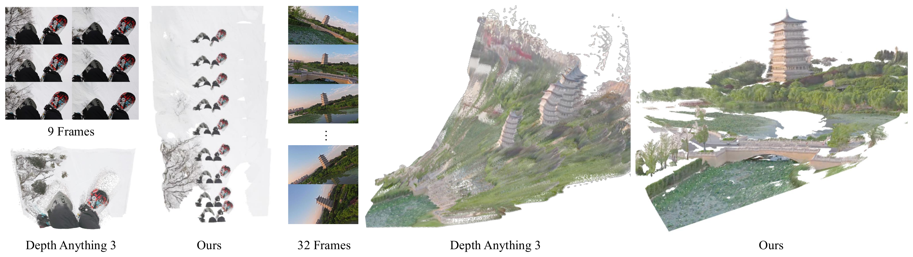
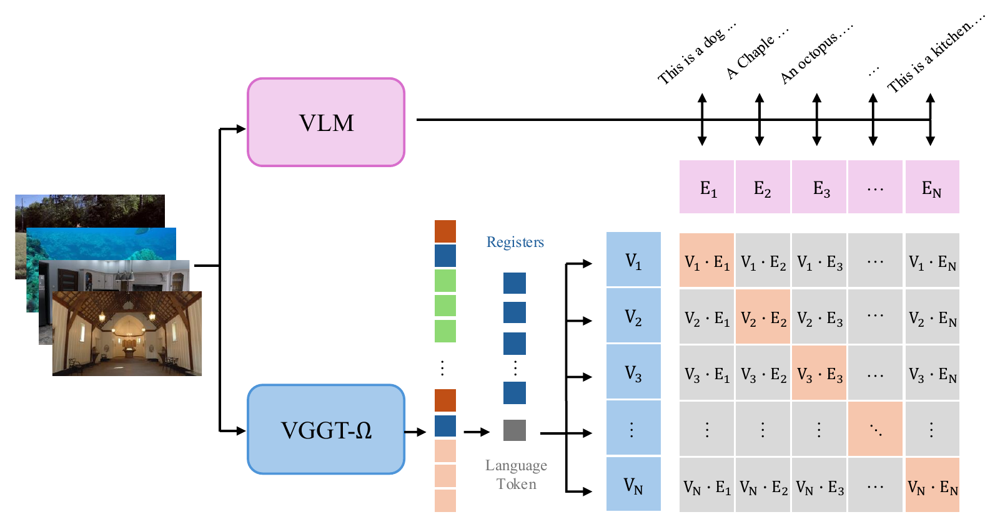
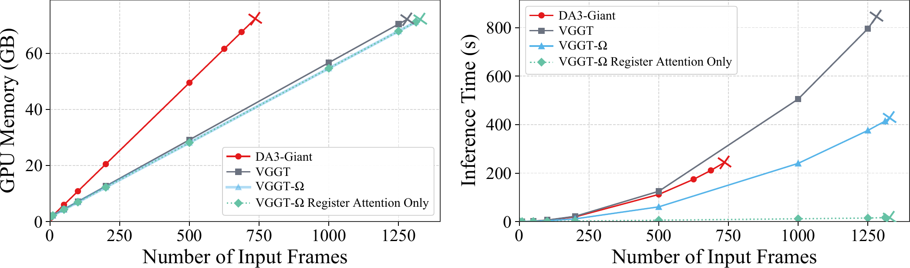

# VGGT-Ω：几何重建怎样变成具身空间表征

!!! info "论文信息"
    **论文题名：** VGGT-Ω。<br>
    **作者：** Jianyuan Wang、Minghao Chen、Shangzhan Zhang、Nikita Karaev、Johannes Schönberger、Patrick Labatut、Piotr Bojanowski、David Novotny、Andrea Vedaldi、Christian Rupprecht。<br>
    **机构：** Visual Geometry Group, University of Oxford；Meta AI。<br>
    **时间 / 主题：** 2026-05；具身智能 / feed-forward 3D reconstruction / VLA spatial representation。<br>
    **arXiv / 官方报告：** arXiv：[2605.15195](https://arxiv.org/abs/2605.15195)；官方材料：[vggt-omega.github.io](https://vggt-omega.github.io/)。<br>
    **GitHub / 项目：** GitHub：[facebookresearch/vggt-omega](https://github.com/facebookresearch/vggt-omega)；Demo / Model：[Hugging Face demo](https://huggingface.co/spaces/facebook/vggt-omega-demo)、[model page](https://huggingface.co/facebook/VGGT-Omega-1B-512)。<br>
    **元数据来源与核验口径：** 来源：[arXiv](https://arxiv.org/abs/2605.15195)、[项目页](https://vggt-omega.github.io/)、[官方 GitHub](https://github.com/facebookresearch/vggt-omega)；Checked Date：2026-06-20；Repro Status：Paper / official materials / official code reviewed, independent reproduction not claimed。

VGGT-Ω 适合接在 [VGGT](vggt.md)、[Depth Anything 3](depth-anything-3.md) 和 [MapAnything](mapanything.md) 后面读。它不是把原 VGGT 简单做大，而是回答一个更有工程味的问题：**如果 feed-forward reconstruction 要继续 scale，模型、数据、loss 和 attention 都要怎么改，才能把几何重建变成可复用的空间表征？**

原 VGGT 的核心是一次前向输出 camera、depth、point map 和 tracks。VGGT-Ω 做了一个看似保守、实则关键的减法：部署输出只保留 camera 和 depth，point map / matching 不再作为昂贵 dense head 直接预测，而是变成训练时的监督信号。再加上 scene registers 和 register attention，模型把跨帧几何信息压到少量全局 token 里。这件事对具身智能有直接意义：机器人策略不一定要吃完整点云，但需要一个稳定、可迁移、可接到 VLA 的空间状态接口。

## 讲解入口：从 SfM 管线到空间表征

讲 VGGT-Ω 时，最好先把它放在传统三维重建和通用空间表征之间，而不是只把它看成 VGGT 的大模型版本。

传统 SfM，也就是 Structure from Motion，目标是从多张二维图像里同时恢复相机运动和三维结构。一个典型流程是：图像输入、特征提取、特征匹配、相对位姿估计、三角化生成 3D 点，再通过 bundle adjustment 联合优化相机参数和三维点位置。MVS 通常接在 SfM 之后，用估计好的相机进一步恢复稠密点云。这个路线的强项是几何约束明确、误差可解释；弱项是流程长、场景级优化贵，并且动态物体、弱纹理、重复纹理和模糊视频都会让匹配与优化变脆。

Feed-forward reconstruction 的变化是把这条优化 pipeline 压进一次网络前向推理：输入一张、少量或大量视角，模型直接预测相机、深度、点云或轨迹等几何属性。VGGT 证明了这条路线可以在多个 3D 任务上接近甚至竞争传统优化方法；VGGT-Ω 进一步问的是：如果要把这种模型扩大到更多数据、更长视频和动态场景，架构、监督和数据标注要怎样改才不会先被显存和标注噪声卡住。

这也是 geometry-aware features 的意义。普通视觉特征更关心物体类别、纹理、边缘和语义；几何感知特征还隐含相机视角、深度、尺度、遮挡、跨视角对应和 3D 运动关系。因此 VGGT-Ω 的重建目标不只是为了输出一张更准的深度图，而是在训练一个可迁移的空间表征：它可以给 VLA、机器人策略、world model 或新视角合成提供比纯 2D 图像 token 更稳定的空间先验。

## 它的效率贡献是什么

| 维度 | 贡献 |
| --- | --- |
| 节省的成本 | 训练时使用约原 VGGT 30% 的 GPU memory；通过单 dense head、training-only multi-task losses 和 register attention 支持更大模型与更多数据 |
| 核心机制 | DINOv3 初始化、camera token、16 个 scene registers、25% global attention 替换成 register attention、MLP + pixel shuffle depth head |
| 训练贡献 | 160K supervised + 50K self-supervised + 30K supervised 的三阶段训练；3M supervised sequences；40M videos 中筛出高质量自监督/伪标注数据 |
| 具身意义 | 冻结 VGGT-Ω scene tokens 后接入 OpenVLA-OFT，在 LIBERO 平均 SR 从 97.1 提到 98.5，说明几何重建 token 能补 VLA 空间理解 |
| 主要风险 | 它不是 policy，不输出动作；LIBERO 结果证明 scene tokens 有用，但不能直接外推到真实机器人长时闭环、接触动力学或安全恢复 |

## 论文位置

传统 SfM / MVS 依赖 feature matching、RANSAC、bundle adjustment 和稠密深度优化。VGGT 系列的路线是把这条 pipeline 压进一个前向模型里，让模型直接从多视角图像预测相机和几何。

VGGT-Ω 继续推进的是三件事：

1. **scale law**：证明 reconstruction model 的质量会随模型参数和数据规模稳定改善；
2. **training efficiency**：把昂贵的 dense multi-head 改成单 dense head + 多任务 loss，降低训练显存；
3. **representation reuse**：把 registers 当成 scene-level geometry tokens，给 VLA 和 language alignment 使用。

{ width="760" }

<small>图源：`VGGT-Ω`，Figure 1。原图表达 model size 从 0.2B 到 10B、data size 从 2K 到 2M sequences 时，3D point error 单调下降。</small>

**Figure 1 先看 scaling 不是单点刷榜。**
上半图说明参数规模变大时，point error 从 0.107 下降到 0.046；下半图说明数据从 2K sequences 增加到 2M sequences 时，point error 从 0.275 降到 0.073。这里最重要的不是某个 benchmark 数字，而是趋势：3D reconstruction 这类几何感知任务也开始呈现“模型和数据越大，表示越稳”的 scaling 形态。

对具身智能来说，这个结果有两个启发。第一，几何状态估计不只是传统优化问题，也可以成为 foundation model proxy task。第二，scale 的前提是训练配方能承受更大数据，否则多任务 dense head 和全局 attention 会先把显存打爆。

## 方法总图

VGGT-Ω 学的是：

\[
((\mathbf g_1,D_1),\dots,(\mathbf g_N,D_N))
= f(I_1,\dots,I_N)
\]

其中 \(I_i\) 是第 \(i\) 张输入图像，\(D_i\) 是深度图，\(\mathbf g_i=(\mathbf q_i,\mathbf t_i,\mathbf f_i)\) 包含 rotation quaternion、translation 和 field of view。它假设 principal point 在图像中心。

这里的 depth 不是“多预测一个通道”这么简单。RGB 图像只给颜色和纹理，深度图 \(D(u,v)\) 给出像素到相机的距离；在已知相机内参 \(K\) 和外参的情况下，每个像素都可以反投影成三维点。多帧 depth 再按相机位姿融合，就能形成点云或更完整的场景几何。对机器人来说，这个接口直接对应“目标离机械臂多远、桌面在哪里、是否可能碰撞”这类控制前需要的空间状态。

和 VGGT 的区别是：VGGT-Ω 不直接输出 point maps 和 tracking features，但仍然用 point loss 与 matching loss 训练 backbone。也就是说，它把“输出接口”做薄，把“训练监督”保留厚。

{ width="920" }

<small>图源：`VGGT-Ω`，Architecture Overview。原图表达模型把 camera token 与 scene tokens 接到 image tokens 后，交替执行 global/register attention 与 frame attention；部署输出 cameras 和 depth maps，matching loss 与 point loss 只在训练时使用。</small>

**这张图怎么读：部署头变少，训练信号没有变弱。**
左侧每帧先经 DINOv3 得到 image tokens，再附加一个 camera token 和 16 个 scene tokens。中间的 alternating attention 仍负责跨帧几何沟通，但部分 global attention 可以换成 register attention：只有 scene tokens 跨帧通信，后续 frame attention 再把全局信息分发回图像 token。

右侧是这篇论文最值得注意的减法。最终显式输出只有 cameras 和 depth maps；point loss 与 matching loss 虽然仍然存在，却是 training only。这避免了原 VGGT 那种多个 dense heads 同时存高分辨率 activation 的显存成本。换句话说，VGGT-Ω 不是不学 point / correspondence，而是不把它们作为部署时必须吐出的昂贵结果。

## Register attention：为什么 scene tokens 有用

原 VGGT 的 alternating attention 在 frame-wise attention 和 global attention 之间切换。global attention 让不同帧的 image tokens 互相看见，是多视角几何形成的地方，但成本随所有帧 token 总数近似二次增长。

VGGT-Ω 的观察是：global attention map 往往很稀疏，跨帧交换不一定需要所有 image tokens 两两通信。因此它引入 registers，也叫 scene tokens：

这里容易混淆的一点是：VGGT 已经有按帧附加的 register tokens，Ω 的新意不是“第一次加 registers”，而是进一步改变一部分 attention 层里的跨帧通信方式。每帧的 patch tokens 仍然负责局部图像内容，camera token 负责相机参数预测，scene registers 则像一组可学习的全局槽位，负责吸收和压缩场景级信息。Register attention 把一部分原本所有帧所有 patch token 互相通信的路径，改成主要通过这些 registers 交换信息。

```text
image tokens + camera token + 16 scene tokens
  -> frame-wise attention: 每帧内部更新局部视觉和深度细节
  -> global attention: 所有 token 跨帧通信
  -> register attention: 只让 scene tokens 跨帧通信
  -> 后续 frame-wise attention 把 scene-level 信息再分发给 image tokens
```

论文默认把 25% global attention layers 替换为 register attention。消融里，全 global attention 的 point error 是 0.071；替换 25% 后是 0.073，几乎不掉点，但训练时 backbone FLOPs 降约 23%、memory 降约 16%。如果激进到所有 global attention 都换成 register attention，FLOPs 可降到原来的 6%，但效果会退回接近原 VGGT 水平，说明 scene tokens 可以做瓶颈，但不能完全替代细粒度跨帧 token 交互。

这里的具身意义很直接：VLA 不一定需要所有视觉 token 的 dense map；如果 registers 真能聚合 scene-level spatial information，就可以作为轻量几何 token 接到 policy 里。

## 解码头：为什么只保留 camera 和 depth

VGGT-Ω 的 depth head 保留 DPT 的低分辨率卷积层，但把高分辨率、最吃显存的卷积块替换成一个 MLP 加 pixel shuffle。MLP 输出 \(2u^2\) 个通道，论文实现里 \(u=4\)，pixel shuffle 后得到 depth 和 confidence 两个通道。

它没有完全使用 MLP-only dense decoder。原因很实用：MLP-only 在 benchmark 上有时可以很好，但会在 outdoor scene 的远景、天空、山体等无界深度区域产生 block artifacts。论文最后选择保留低分辨率浅层卷积，因为它们成本低，却能明显改善深度图的空间平滑性。

Camera head 则更轻：它只读取 camera tokens 和 registers，经一个 lightweight transformer 和 MLP 直接预测 camera parameters。和原 VGGT 不同，VGGT-Ω 不做 iterative refinement。作者在讨论里说，迭代 refinement 和 raw RGB 注入 dense head 能进一步提升若干指标，但他们为了保持 base model 简洁，优先训练一个更干净的几何表示 backbone。

## 训练目标

总 loss 可以简化为：

\[
\mathcal L
=
\lambda_{\text{cam}}\mathcal L_{\text{cam}}
+\lambda_{\text{depth}}\mathcal L_{\text{depth}}
+\lambda_{\text{point}}\mathcal L_{\text{point}}
+\lambda_{\text{match}}\mathcal L_{\text{match}}
\]

附录给出的权重是：

| Loss | Weight | 作用 |
| --- | --- | --- |
| \(\mathcal L_{\text{cam}}\) | 5.0 | 用 L1 监督 camera parameter，论文认为比 VGGT 的 Huber 更稳 |
| \(\mathcal L_{\text{depth}}\) | 1.0 | depth residual、gradient consistency 和 aleatoric uncertainty |
| \(\mathcal L_{\text{point}}\) | 0.5 | 通过 depth + camera unprojection 得到 point map residual，不需要单独 point head |
| \(\mathcal L_{\text{match}}\) | 0.1 | 对最后一层 token 做 positive / negative patch correspondence 监督 |

这组 loss 的关键是 \(\mathcal L_{\text{point}}\) 和 \(\mathcal L_{\text{match}}\)。它们让模型仍然学习公共 3D 空间和跨帧对应，但不需要在推理时显式输出 point maps 和 tracks。

### Matching loss 的数据构造

positive pairs 不是靠语义相似，而是靠几何投影。论文先用 depth 和 camera 把 query frame 的像素反投影到 3D，再投到其他帧；如果投影落在图内、深度一致，且同一 query patch 与 target patch 有足够 overlap，就构成 positive token pair。

negative pairs 更谨慎。动态视频里，“不是 positive”不等于一定 negative，因为物体可能动了。论文要求负样本同时满足：

1. target patch center 离 query patch 诱导的 epipolar line 足够远；
2. 两个 patch 的平均 RGB 差异足够大。

这说明 matching loss 不是普通 contrastive pretraining，而是在尽量避免动态场景误标的几何监督。

## 训练配方

论文训练了 200M、500M、1B、10B 四个模型，alternating-attention blocks 分别是 12 / 12 / 24 / 16，hidden size 分别是 384 / 768 / 1024 / 4096。视觉 Transformer 从 DINOv3 初始化，并且训练时不冻结。

训练主配方如下：

| Setting | Value |
| --- | --- |
| Optimizer | AdamW |
| Total iterations | 240K |
| Stages | 160K supervised + 50K self-supervised + 30K supervised |
| Learning rate | supervised peak \(2\times10^{-4}\)，self-supervised peak \(1\times10^{-4}\) |
| Schedule | 5% linear warm-up + 95% cosine decay |
| Frames per batch item | uniform sample from [1, 24] |
| Image augmentation | aspect ratio [0.33, 1.33] with area about \(512\times512\), color jitter, grayscale, random patch masking |
| Hardware | 128 x 96GB H100 GPUs |
| Precision / parallelism | bfloat16 mixed precision, gradient checkpointing, FSDP |
| Stability | gradient-norm clipping 1.0, QKNorm inside attention layers |

还有几个很实用的训练细节：

1. ground truth 会归一化到第一相机坐标系下的 unit space，但只归一化 GT，不归一化 prediction；
2. 每帧有 0.05 概率被一个 32 到 128 像素高宽的随机矩形 mask，mask 内像素置黑，对应 depth 标为 invalid；
3. temporally ordered sequences 不是按 covisibility 抽帧，而是在局部 temporal window 中抽帧，让模型看到语义相关但几乎无重叠的困难样本；
4. DINOv3 初始化不是装饰：作者报告从 scratch 也能收敛到相近性能，但需要 4 到 8 倍更多训练迭代；
5. synthetic / real data 的实践建议是每个 epoch 约 80% synthetic + 20% real；如果 synthetic annotation 足够干净，可以提高到约 90% synthetic。

这部分对具身项目很有价值。很多机器人视觉模型失败不是因为架构不够时髦，而是 depth / pose / correspondence 的监督噪声太大，或者真实数据太少、合成数据太单一。VGGT-Ω 的训练配方实际给出的是：几何模型要 scale，必须同时控制目标表示、loss 权重、数据质量和 attention 成本。

## 数据引擎

VGGT-Ω 的 supervised data 由公开数据、内部合成/真实数据和新的视频标注 pipeline 组成。

公开数据覆盖 Aria series、Bedlam、BEHAVIOR-1K、Co3Dv2、uCo3D、DL3DV、Dynamic Replica、EDEN、EFM3D、HOT3D、Habitat、Hypersim、Mapfree、Mapillary Metropolis、Megadepth、MegaSynth、Replica、ScanNet series、TartanAirV2、Taskonomy、Virtual KITTI、Waymo、WildRGBD 等。作者明确排除了 VGGT 使用过的 Kubric 和 PointOdyssey，因为它们的 fake background geometry 会产生无效 depth。

总量上，监督数据约 3M sequences，每个 sequence 含 10 到 20,000 张图像。额外的视频数据来自约 40M Internet-style videos。论文不是把这些视频全塞进去，而是用非常保守的过滤和标注流程：

动态视频难点在于，错误匹配不只是来自纹理或模糊，还来自场景本身在动。人、车、手臂和其他运动物体会破坏“同一个 3D 点在多帧中只由相机运动解释”的假设。VGGT-Ω 的数据 pipeline 因此先用 VLM 过滤明显不适合重建的视频，再用 Grounding DINO 之类的检测器给人和车等区域生成动态 mask，让后续 SIFT、SuperPoint/SuperGlue、ALIKED/LightGlue、VGGSfM Tracker、VGGT 初始化和 COLMAP bundle adjustment 尽量在静态或可验证区域上工作。最终进入训练的不是原始 40M videos，而是通过多层几何一致性和质量分类筛出的高质量静态 / 动态序列。

```text
40M videos
  -> VLM pre-filtering
  -> dynamic mask extraction
  -> feature matching and tracking ensemble
  -> VGGT init + COLMAP bundle adjustment
  -> MVS dense depth
  -> multi-view consistency check
  -> supervised geometric filtering
  -> about 200K dynamic scenes + 600K static scenes
```

VLM pre-filtering 很硬：约 50% 视频被判为太难重建，例如多段剪辑、极端 motion blur、水印或 overlay；约 40% 可能可重建但精度低，例如 parallax 不足或纹理不够；只有剩下约 10% 进入后续流程。

{ width="820" }

<small>图源：`VGGT-Ω`，Common Data Issues。原图展示 ScanNet++ sensor artifact、synthetic thin structure error 和 doming effect 等训练数据问题。</small>

**这张图怎么读：数据噪声会变成模型习惯。**
上排是传感器或重建造成的 foreground-background leakage；中排是合成数据里的 thin structure 深度缺失或错位；下排是 COLMAP / BA 类伪标注可能出现的 doming effect。论文强调，这些错误不一定会在标准 benchmark 上暴露，但会在相似样本上变成推理时的稳定失败模式。

这一点很适合迁移到具身数据工厂：如果桌面机器人数据里的透明杯、细杆、反光盘、手臂遮挡和人类演示边界被错误标注，模型不只是“平均掉误差”，还可能把错误几何记成规律。

## 自监督训练

VGGT-Ω 的 self-supervised training 用 teacher-student。两者都从 supervised checkpoint 初始化；student 用梯度更新，teacher 用 EMA 更新，附录给出 EMA decay 为 0.999。

对同一组视频帧，teacher 和 student 接收独立增强，包括 color jitter、blur、随机 90° 旋转、random patch masking 和 random frame reordering。恢复到共同顺序后，student 需要匹配 teacher：

1. 多层 token feature 用 \(\ell_2\) feature-matching loss 对齐；
2. camera 和 depth 使用 regression losses；
3. self-supervised 阶段冻结 camera / depth heads，防止 collapse。

论文结果很克制：把 10% supervised steps 替换为 self-supervised steps，point error 从 0.073 降到 0.070，主要提升多样性和 OOD generalization；它并不是主 benchmark 的必要条件。作者还试过 new view synthesis、token generation、NeRF / Gaussian Splatting 表示、mask image tokens、跨帧对象区分、temporal order 等方案，只有 student-teacher 路线在他们实现里有帮助。

这说明自监督几何还不是“给无限视频就自动变强”。至少在这篇论文里，自监督要依赖已有 supervised geometry checkpoint，且要非常小心筛掉剪辑跳变、动态过强、标注不可验证的视频。

## 实验结果

论文主实验分三类：camera pose、depth estimation、register application。

Camera pose 和 depth 覆盖 3 个 static datasets（7 Scenes、NRGBD、ETH3D）和 3 个 dynamic datasets（DyCheck、Sintel、TUM-Dynamic）。每个 scene / sequence 随机采 10 帧。主结论是 Ours-1B 和 Ours-10B 在静态与动态 benchmark 上都超过 VGGT、DA3、PI3、MegaSaM、MonST3R、MapAnything 等 baseline。最醒目的例子是 Sintel camera AUC@3° 从之前最佳 22.5 提到 40.0，相对提升 77%；Sintel depth 的 \(\delta_{1.25}\) 从 DA3 的 86.1 提到 93.5，AbsRel 从 0.118 降到 0.081。

{ width="920" }

<small>图源：`VGGT-Ω`，Qualitative Comparison to Depth Anything 3。原图展示 DA3 在重复雪地纹理和强 camera roll 场景中出现相机运动估计不足或 tower ghosting，而 VGGT-Ω 重建更一致。</small>

**定性图不要读成“DA3 不行”。**
这张图支撑的是 VGGT-Ω 在某些多视角相机轨迹和全局一致性上更稳，尤其是重复纹理、强 roll、稀疏室内和动态/航拍场景。它不能证明所有单目或多视角几何任务都优于 DA3，也不能替代标准表格里的同口径 benchmark。

### VLA：scene tokens 接入 OpenVLA-OFT

最贴近具身智能的是 LIBERO 表。实验做法很干净：冻结 VGGT-Ω，取它的 registers / scene tokens，作为额外输入拼到 OpenVLA-OFT 的原始 input tokens 上，然后按 OpenVLA-OFT 标准协议训练。

Table from the paper can be redrawn as follows, keeping the original English fields:

| Method | Spatial SR (%) | Object SR (%) | Goal SR (%) | Long SR (%) | Average SR (%) |
| --- | ---: | ---: | ---: | ---: | ---: |
| Diffusion Policy | 78.3 | 92.5 | 68.3 | 50.5 | 72.4 |
| TraceVLA | 84.6 | 85.2 | 75.1 | 54.1 | 74.8 |
| Octo | 78.9 | 85.7 | 84.6 | 51.1 | 75.1 |
| OpenVLA | 84.7 | 88.4 | 79.2 | 53.7 | 76.5 |
| Dita | 84.2 | 96.3 | 85.4 | 63.8 | 82.4 |
| CoT-VLA | 87.5 | 91.6 | 87.6 | 69.0 | 83.9 |
| π0-FAST | 96.4 | 96.8 | 88.6 | 60.2 | 85.5 |
| π0 | 96.8 | 98.8 | 95.8 | 85.2 | 94.2 |
| UniVLA | 96.5 | 96.8 | 95.6 | 92.0 | 95.2 |
| OpenVLA-OFT | 97.6 | 98.4 | 97.9 | 94.5 | 97.1 |
| OpenVLA-OFT + Our Frozen Scene Tokens | **99.3** | **99.2** | **99.0** | **96.7** | **98.5** |

<small>表源：`VGGT-Ω`，Table 3。原表含义：Performance on the LIBERO benchmark；作者冻结预训练 VGGT-Ω，将 scene tokens 作为额外输入送入 OpenVLA-OFT，并报告 success rate。</small>

**Table 3 的读数边界。**
这张表支撑的是“reconstruction registers 对 VLA spatial understanding 有帮助”，而不是“VGGT-Ω 本身会控制机器人”。它的证据强在：VGGT-Ω frozen、不直接改 policy 主干，仍在四个 LIBERO suites 上有一致提升；证据弱在：这是 LIBERO 仿真 benchmark，不覆盖真实硬件延迟、感知噪声、接触失败恢复和安全约束。

### Language alignment：registers 不是只有几何

论文还做了一个很有意思的实验：用 VLM 生成每个 image sequence 的场景描述，把生成文本的 hidden states mean-pool 成 language embedding；VGGT-Ω 侧只让一个新 learnable language token 读取 registers，经 projection 得到 register-derived embedding。两者用 symmetric InfoNCE 对齐。

{ width="760" }

<small>图源：`VGGT-Ω`，Language Alignment。原图表达 VLM 生成场景描述并形成 language embedding，VGGT-Ω 从 registers 读出 embedding，二者用 InfoNCE 对齐。</small>

**这张图怎么读：scene tokens 可能已经带语义。**
language token 不能直接看 image patch tokens，只能读 registers。如果它能和文本描述对齐，说明 registers 不只是相机/深度的数值缓存，而是聚合了 scene-level 信息。论文报告在 100 个手工整理互联网视频的 retrieval benchmark 上，用 VLM embedding 做 top-1 / top-3 分别是 76.8% / 97.0%；换成 text-only Qwen3 LLM embedding、不额外训练，也有 47.5% / 77.8%。

这个结果适合和 VLA 联系起来：具身系统需要的空间状态不是纯几何，也不是纯语言，而是“哪个物体、在哪里、和场景布局有什么关系”。VGGT-Ω registers 可能正好位于这个接口。

## 推理速度与显存

论文的训练效率和推理效率要分开看。训练端最重要的是：单 dense head、training-only losses、register attention 让大规模训练可承受。推理端，作者在单张 80GB A100 上比较 VGGT、DA3 和 VGGT-Ω，并修正了 VGGT 原实现中不必要缓存所有 24 层中间张量的问题。

{ width="860" }

<small>图源：`VGGT-Ω`，Memory and Speed Comparison。原图比较 VGGT、DA3 和 VGGT-Ω 在 80GB A100、flash attention v2 下的 inference memory 与 runtime；cross marker 表示 OOM 设置。</small>

**Figure 的重点是速度瓶颈，不只是显存。**
VGGT 和 VGGT-Ω 在修正缓存后都能处理超过 1000 frames，DA3 约在 750 frames 附近 OOM。VGGT-Ω 更快，主要来自 DINOv3 patch size 16 相比 VGGT / DA3 patch size 14 少约 25% image tokens，以及默认 25% global attention 被 register attention 替换。论文还提到全 register attention 变体可把 1000 frames runtime 从 240.2s 降到 11.7s，但会牺牲重建精度。

所以部署时要看任务：如果是离线建图或数据质检，精度更重要；如果是 on-device 或近实时场景，register-only 或更强的 token pruning 可能值得探索，但不能默认保持同等几何质量。

## 动态场景和 motion-aware 表征

VGGT-Ω 支持 dynamic scenes 的一个关键选择是：仍然只预测 camera + depth，不显式预测 motion mask、dynamic point map 或 ray map。论文认为 point map 在 dynamic scene 里会把 camera motion 和 scene motion 耦合得更复杂；depth + camera 反而更清楚，动态区域主要通过数据和 prior 学出来。

{ width="820" }

<small>图源：`VGGT-Ω`，Motion-Aware Representations。原图表达作者对中间 image tokens 做 PCA 和 k-means 后，某些 cluster 能自动分离移动 dancer 与静态 crowd / background。</small>

这张图不是强监督 segmentation 结果。作者没有用 motion label、optical flow 或 learned probe，只对中间 token 做 PCA + k-means；早层最容易分出移动 dancer，中层保留较弱 motion signal，深层更偏全局语义。这说明 reconstruction objective 可能让模型自发学到 motion-aware features，但还不能把它当作可部署的动态物体检测器。

## 消融和诊断

几个消融对理解这篇论文很关键。

| Ablation / diagnostic | Reported result | 说明 |
| --- | --- | --- |
| Data scale | 训练数据按 10x 增加时，point error 从 0.275 单调降到 0.073 | 几何重建质量随数据规模稳定改善 |
| Model scale | 0.2B 到 10B 时，point error 从 0.107 降到 0.046 | reconstruction model 同样吃模型规模 |
| Register attention 25% | 全 global attention point error 0.071；25% register attention 为 0.073 | 大幅省成本，几何精度几乎不掉 |
| Register attention only | FLOPs 降到 6%，但性能退到接近原 VGGT | registers 能做瓶颈，但不能完全替代细粒度跨帧交互 |
| Remove point + matching losses | point error 从 0.073 升到 0.078 | training-only 几何监督仍然重要 |
| Original multi-head setup | point error 0.070，但需要多个 dense heads | 多头稍强但不利于 scale |
| Self-supervised replacement 10% steps | point error 从 0.073 降到 0.070 | 自监督有用，但不是主 benchmark 的决定因素 |
| Annotation quality check | 在严格过滤的 Sintel 协议下，pipeline 达到 AUC@30° 96.4%、\(\delta_{1.25}\) 99.3% | 小而干净的伪标签优于大而脏的伪标签 |

最重要的读法是：VGGT-Ω 的提升不是来自某一个魔法模块，而是来自一组一致的工程取舍。dense head 减少显存，loss 保留多任务几何监督；register attention 降低跨帧成本，scene tokens 又能被下游 VLA 消费；数据 pipeline 保守过滤，减少模型记住伪标注噪声。

## 对具身智能的启发

VGGT-Ω 给具身系统的启发主要有四条。

第一，几何重建可以作为空间理解的 proxy task。VLA 需要知道物体、相机、桌面、遮挡和可达区域之间的关系；这些关系不一定要通过手写 3D pipeline 提供，也可以由大规模 reconstruction backbone 的 registers 表达。

第二，策略模型不一定需要显式 dense geometry。OpenVLA-OFT 的实验说明，冻结的 scene tokens 已经能改善 LIBERO。这和 [VO-DP](vodp.md) 借 VGGT 中间特征做 RGB-only policy 的思路一致：几何可以通过 feature interface 进入策略，而不一定作为点云或深度图直接输入。

第三，数据质量比数量更容易决定几何模型的失败形态。薄结构、fake background、doming effect、人体边界伪深度，都会在机器人任务里变成风险：夹爪可能避不开细杆，移动机器人可能相信弯曲地图，VLA 可能把人或物体边界当成背景。

第四，registers 是一个值得关注的统一接口。它们可以给 sequence-level prediction、frame-level prediction、language alignment、metric scale、gravity direction、人类存在检测等任务添加 task token。这像是把“几何 backbone”做成了一个可查询的空间记忆层。

## 局限

VGGT-Ω 仍是 reconstruction / representation model，不是完整具身 agent。它不预测动作，不建模接触动力学，不处理安全停机，也不保证闭环恢复。LIBERO 表说明 frozen scene tokens 对 VLA 有帮助，但没有证明真实机器人上长时任务、工具使用、透明/反光物体、强遮挡、手眼相机切换都能稳定提升。

训练数据也有不可复现边界。论文使用内部数据、内部 40M videos 和内部标注 pipeline；公开读者可以复现代码调用和模型推理，但很难完整复现数据规模和过滤流程。作者自己也列出 failure cases：强 motion blur、field of view 突变、camera distortion、多显示器办公室场景、隐私/商标 mask 区域等都会造成不稳定预测。

最后，self-supervised reconstruction 还没有完全成熟。论文试了很多方案，最终有效的是从 supervised checkpoint 出发的 teacher-student，而不是从无标注视频中直接学出强几何。把 reconstruction 作为统一多模态模型的一部分，仍然是后续问题。

## 阅读结论

VGGT-Ω 的核心不是“VGGT 又大了一版”，而是把 feed-forward 3D reconstruction 变成更可 scale、更可复用的空间表征训练任务。方法上要抓住三个减法和一个接口：少 dense head、少 full global attention、少推理输出，但保留 point / matching training signal，并把 registers 当成 scene-level token。实验上最重要的是 scaling、training memory、camera/depth benchmark 和 frozen scene tokens 接入 OpenVLA-OFT。

它适合作为具身系统的几何状态层或 VLA 空间 token provider，不适合作为完整 policy。下一步最需要的证据，是真实机器人闭环下的 scene-token ablation、噪声相机/动态遮挡下的失败恢复、低延迟部署 trace，以及公开数据规模下能否复现相近的 representation benefit。

## 外部精读

1. [VGGT-Ω arXiv](https://arxiv.org/abs/2605.15195)：读 architecture、training losses、data pipeline、scaling 和 VLA table。
2. [VGGT-Ω project page](https://vggt-omega.github.io/)：看 demo、qualitative reconstruction 和作者总结的 key takeaways。
3. [facebookresearch/vggt-omega](https://github.com/facebookresearch/vggt-omega)：核对官方代码、模型调用接口、runtime memory 表和 `camera_and_register_tokens` 输出。
4. [VGGT](vggt.md)：理解 camera、depth、point map、tracks 的原始 VGGT 接口。
5. [Depth Anything 3](depth-anything-3.md)：对比另一条 feed-forward visual geometry 路线，尤其是 depth + ray 表示和 streaming 几何。
6. [MapAnything](mapanything.md)：对比可选几何输入和 metric reconstruction，理解真实系统已有 intrinsics / poses / depth 时应该怎样接入。
7. [VO-DP](vodp.md)：看 VGGT 中间特征如何作为语义-几何视觉 backbone 进入 diffusion policy。

## 相关阅读与下一步

- 站内下一步：[VGGT：一次前向推理怎样恢复相机、深度、点云与轨迹](vggt.md)。
- 站内下一步：[VO-DP：语义-几何自适应扩散策略](vodp.md)。
- 站内下一步：[论文精读专题](../index.md)。
- 站内下一步：[论文专题写作规范](../writing-standard.md)。
