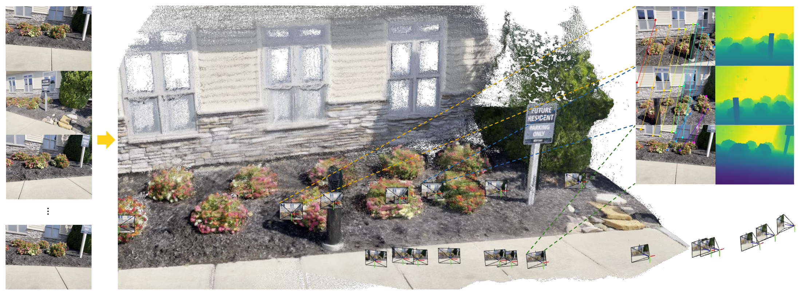
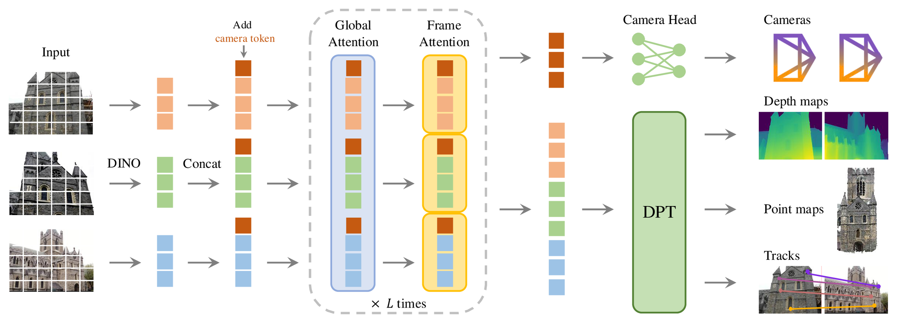
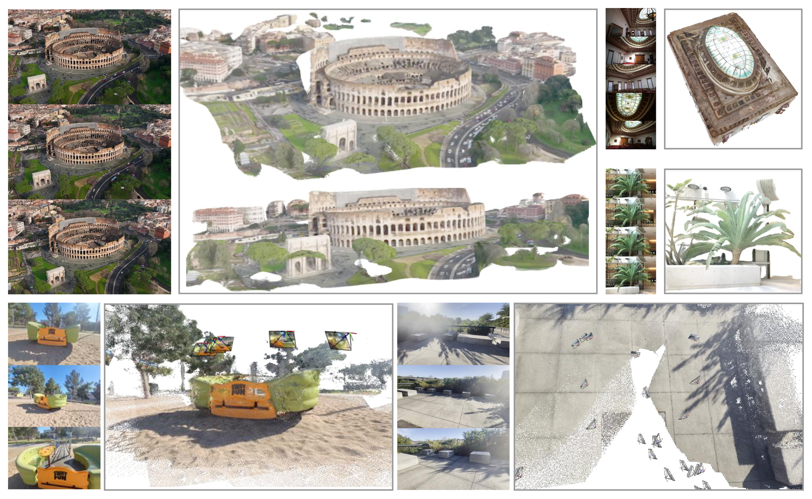
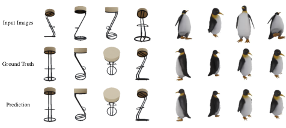
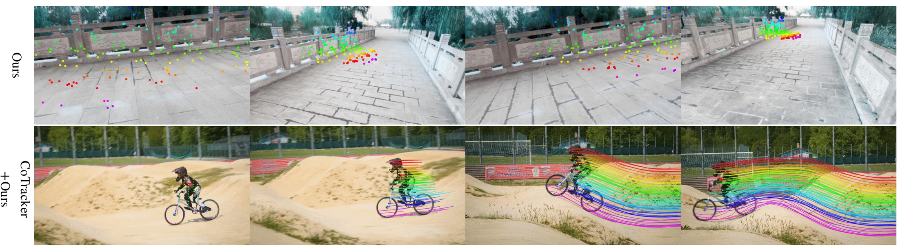
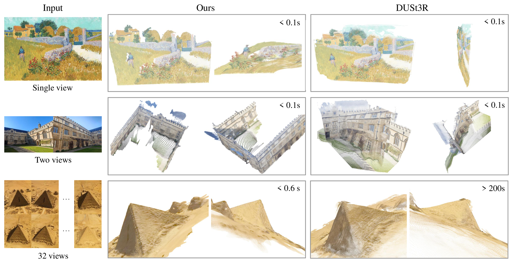
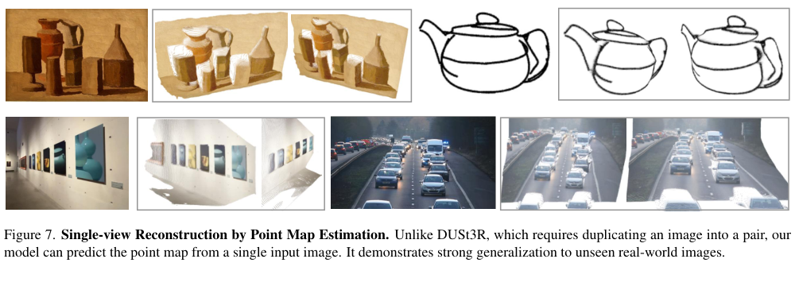

# VGGT：一次前向推理怎样恢复相机、深度、点云与轨迹

!!! info "论文信息"
    **论文题名：** VGGT: Visual Geometry Grounded Transformer。 
    **作者：** Jianyuan Wang、Minghao Chen、Nikita Karaev、Andrea Vedaldi、Christian Rupprecht、David Novotny。 
    **机构：** Visual Geometry Group, University of Oxford、Meta AI。 
    **时间 / 主题：** 2025-03；具身智能。 
    **arXiv / 官方报告：** arXiv：[2503.11651](https://arxiv.org/abs/2503.11651)；官方材料：[vgg-t.github.io/](https://vgg-t.github.io/)。 
    **GitHub / 项目：** GitHub：[github.com/facebookresearch/vggt](https://github.com/facebookresearch/vggt)；项目页：[vgg-t.github.io/](https://vgg-t.github.io/)。 
    **元数据来源与核验口径：** 来源：[arXiv](https://arxiv.org/abs/2503.11651)；[GitHub API / repo](https://github.com/facebookresearch/vggt)；[官方 / 项目材料](https://vgg-t.github.io/)；Checked Date：2026-06-15；Repro Status：Paper / official materials reviewed, independent reproduction not claimed。

## 一次前向计算，改变了三维重建的哪一段流程

VGGT 的关键变化是让多张图像一起进入一个共享模型，直接预测相机和场景几何。传统 SfM 要先找到跨图像对应，再恢复相机、三角化三维点，并用 bundle adjustment（BA）反复修正；DUSt3R、MASt3R 已经用网络预测成对图像的几何，但多于两张图时，仍需把不同图像对的结果进行全局对齐。[↗](https://arxiv.org/pdf/2503.11651v1#page=1) [↗](https://arxiv.org/pdf/2503.11651v1#page=2)

VGGT 把联合多视图信息的过程放进 Transformer 骨干。所有图像共享上下文，模型为每张图生成相机、深度、点图和用于跟踪的稠密特征。一组图像的输出因此天然处在同一参考约定下，常见场景可以直接使用，不必先拼接一系列局部重建。

{ width="920" }

*原论文 Figure 1。左侧为同一场景的不同视图，中间显示统一重建，右侧显示逐帧深度，底部相机位置属于同一个坐标参考。图中几何、相机和深度是同一组输入的关联结果。* [↗](https://arxiv.org/pdf/2503.11651v1#page=1)

这种改变主要体现在两点。首先，网络可以在一次前向中处理多于两帧的信息，而不用把每对图像视为独立问题。其次，相机、深度与对应关系共同训练，骨干可以学习它们之间的约束。模型采用约 1.2B 参数和大量带三维标注的数据，不是仅靠一个轻量输出头替代全部几何计算。

测试时仍可以接 BA。论文将纯前向和前向加优化作为两个不同成本档位，后者在严格相机精度要求下继续提高结果。理解 VGGT 时，既要看到直接可用预测带来的效率，也要保留“网络估计可以作为优化初值”的接口，而不是把论文解释为所有场景都不再需要几何优化。

## 四类输出各自表示什么

原论文将骨干及预测网络写为

$$
f\bigl((I_i)_{i=1}^{N}\bigr)
=(g_i,D_i,P_i,T_i)_{i=1}^{N}.
$$

这里 $I_i\in\mathbb R^{3\times H\times W}$ 是第 $i$ 张 RGB 图像。四类输出虽然都与三维有关，却不处在同一种表示空间中。[↗](https://arxiv.org/pdf/2503.11651v1#page=3)

| Output | Shape | 几何含义 |
|---|---|---|
| Camera $g_i=[q_i,t_i,f_i]$ | $9$ | 四元数旋转、三维平移、两个方向的视场角 |
| Depth $D_i$ | $H\times W$ | 每个像素从本帧相机观察到的深度 |
| Point map $P_i$ | $3\times H\times W$ | 每个像素对应表面点在统一参考坐标系中的三维位置 |
| Tracking features $T_i$ | $C\times H\times W$ | 供跟踪模块查询与匹配的稠密描述子 |

相机参数假设主点在图像中心。第一张图的相机坐标系被选为世界参考，第一相机旋转为单位旋转，论文所用四元数写作 $[0,0,0,1]$，平移为零。其他相机和点图都相对于这一参考表示。深度则仍是在本帧相机坐标中定义的逐像素深度，不能把深度图的一个数直接当成统一世界坐标中的某一分量。[↗](https://arxiv.org/pdf/2503.11651v1#page=5)

Point map 可以理解为给每个可见像素附上一个三维地址。不同图像中看到同一物理点的像素，其理想点图值应落到同一世界位置；这些像素的深度却可能不同，因为观察它们的相机不同。这个区别解释了为什么模型同时预测深度与点图，以及为什么两者能互相提供训练信号。

$T_i$ 尤其容易被误读。它是特征图，不是已经完成的轨迹。给定 query 图像中的若干二维坐标，还需要单独的跟踪模块 $\mathcal T$，才能得到这些点在其他图像中的二维对应位置。论文将这些输出与三维几何共同使用，但不能把接口写成骨干直接输出任意物体的三维运动轨迹。

输入图像可以任意排列，第一张承担参考角色，其余帧保持置换等变关系。这个设计面向无序图像集合，不依赖“相邻输入一定是相邻时刻”。于是，一组旅游照片也能输入网络，但原模型没有由此获得连续时间的动作或动力学模型。

## 统一坐标以后，为什么仍不能直接得到米制尺度

从单目图像重建场景有一个基本自由度。如果把整个场景和相机平移同时缩放，图像投影仍可保持不变。选择第一台相机作为参考可以固定全局姿态，却不能仅靠这一选择固定物理尺度。

VGGT 在训练数据上作出统一约定。先将所有几何变换到第一相机坐标系，再计算 GT 点图中所有三维点到原点的平均欧氏距离，用它归一化相机平移、点图和深度。这个过程把不同来源、不同物理尺寸的场景放到相近数值范围。[↗](https://arxiv.org/pdf/2503.11651v1#page=6)

预测输出不再做同样的在线归一化，网络被要求学习训练目标采用的约定。作者比较过同时归一化预测的做法，发现它既不是收敛所必需，也没有改善最终表现，反而更易带来训练不稳定。[↗](https://arxiv.org/pdf/2503.11651v1#page=11)

对使用者而言，统一坐标与米制标定是两个问题。前者使不同视图的几何可以组合，后者仍需要真实距离、已知基线或其他尺度信息。ETH3D 的点云评测还会对预测与 GT 做对齐，因此其中较低的误差不能直接解释为未经标定就恢复了真实物体尺寸。

## 图内注意力与全局注意力怎样配合

输入图像由 DINOv2 以 14 × 14 patch 产生 tokens，并加入图像位置编码。每帧附加一个 camera token 与四个 register tokens。参考帧使用一套特殊 token 初值，其他帧共享另一套；它们在注意力计算后吸收各自图像信息，成为帧相关的表示。[↗](https://arxiv.org/pdf/2503.11651v1#page=4) [↗](https://arxiv.org/pdf/2503.11651v1#page=11)

{ width="920" }

*原论文 Figure 2。全局层让不同图像交换信息，图内层将本帧图像、camera 与 registers 重新组织；右侧相机头读取 camera tokens，DPT 读取图像特征。图中的 “Tracks” 还需经过正文所述跟踪模块，不是把一个 DPT 输出通道直接当作轨迹。* [↗](https://arxiv.org/pdf/2503.11651v1#page=3)

Frame-wise self-attention 分别在每帧 tokens 内计算。它保留了“这些 patches 和这个 camera token 属于同一张图”的分组，使相机 token 能吸收本帧的观测特征。Global self-attention 则把所有帧 tokens 拼在一起，使同一物体的不同视图、相机关系及跨图像对应可以共同参与计算。

默认网络有 24 个 alternating-attention blocks，每个 block 各含一个图内层和一个全局层，总计 48 个注意力层。隐藏维度为 1024，16 个 heads，并采用 QKNorm 和初值 0.01 的 LayerScale 稳定训练。全部是 self-attention，原架构没有另设跨帧 cross-attention 模块。[↗](https://arxiv.org/pdf/2503.11651v1#page=11)

四个 registers 是辅助计算位置，原版 VGGT 在预测时丢弃它们的最终输出。相机和图像 tokens 用于任务解码，因此不能把后来采用 registers 作为紧凑场景接口的设计，直接归到本篇原始 VGGT 的实验中。

交替结构也有可检查的实验支持。作者保持参数量、总注意力层数、隐藏维度与 heads 相同，比较三种注意力安排，使用 ETH3D 点图误差作为评价。

| Backbone | Accuracy ↓ | Completeness ↓ | Overall ↓ |
|---|---:|---:|---:|
| Cross-Attention | 1.287 | 0.835 | 1.061 |
| Global Self-Attention Only | 1.032 | 0.621 | 0.827 |
| Alternating-Attention | 0.901 | 0.518 | 0.709 |

*原论文 Table 5。Cross-Attention 对照让每帧独立查询其他帧 tokens；三个模型使用相同数量的注意力层。* [↗](https://arxiv.org/pdf/2503.11651v1#page=8) [↗](https://arxiv.org/pdf/2503.11651v1#page=9)

如果跨帧信息越多就一定越好，纯全局或强 cross-attention 应当占优，实际却是交替结构最好。这支持在跨图像融合之间保留图内处理的价值。论文将它理解为跨帧信息整合与帧内激活组织之间的平衡，但没有进一步把收益严格分解为匹配、归一化或其他单一因素的贡献。

## 相机头、稠密头与跟踪头如何读取同一个骨干

相机头在最终 camera tokens 上增加四层 self-attention，再通过线性层预测每帧内外参。稠密分支则使用第 4、11、17、23 个 block 的图像特征，由 DPT 逐级恢复空间分辨率，再以 3 × 3 卷积映射到深度和点图。不同层的特征提供不同程度的局部与全局信息，不需要只依赖最后一层。[↗](https://arxiv.org/pdf/2503.11651v1#page=5) [↗](https://arxiv.org/pdf/2503.11651v1#page=11)

深度与点图还分别预测逐像素的不确定性相关权重。它们在训练 loss 中用于分配误差权重，训练后可作为可靠性线索。论文的符号虽然写作 $\Sigma$，却不能直接将其当成数值越大越不可靠的统计方差，因为它在损失中是乘在残差前面的权重。

跟踪分支使用 DPT 输出的稠密特征 $T_i$，结合 CoTracker2 风格结构进行读取。给定 query 帧 $I_q$ 中一个点 $y_j$，先在 $T_q$ 上做双线性采样，取得该位置的特征；再与其他帧的特征图计算相关性，得到“这个点可能落在哪里”的相关图；最后通过自注意力层预测各图像中的二维对应位置及可见性。[↗](https://arxiv.org/pdf/2503.11651v1#page=5) [↗](https://arxiv.org/pdf/2503.11651v1#page=6)

这种查询方式把几何编码和具体查询分开。骨干先为整组图像计算共享表示，跟踪器再读取用户指定点，不必为每个 query 重新理解全部场景。原训练总把第一帧作为 query，而模块形式可以接受其他 query 帧；正文没有把后者当成一项单独验证过的泛化成绩。

原跟踪器不依赖输入时间顺序，主要在无序静态多视图中建立同一三维点的二维对应。后面的动态视频跟踪实验会换用适合顺序视频的跟踪系统并整体微调，不能把两种设置混在一起。

## 冗余输出怎样通过损失相互帮助

相机、深度和点图存在解析关系，理论上可以只预测其中一部分，再推导其余量。VGGT 却在训练时显式监督多个输出，原论文总目标为

$$
\mathcal L=
\mathcal L_{\mathrm{camera}}+
\mathcal L_{\mathrm{depth}}+
\mathcal L_{\mathrm{pmap}}+
0.05\mathcal L_{\mathrm{track}}.
$$

作者发现前三项数值范围相近，无需额外相对加权；跟踪项乘以 0.05。这里的相机监督采用 Huber loss，比较预测与 GT 的相机参数，不能与后来采用 L1 相机损失的变体混淆。[↗](https://arxiv.org/pdf/2503.11651v1#page=6)

深度损失除了像素值，还约束局部梯度。把原式按每帧分组，可写为

$$
\mathcal L_{\mathrm{depth}}
=\sum_i\left[
\left\|\Sigma_i^D\odot(\hat D_i-D_i)\right\|
+\left\|\Sigma_i^D\odot(\nabla\hat D_i-\nabla D_i)\right\|
-\alpha\log\Sigma_i^D
\right].
$$

$\hat D_i,D_i$ 是预测与目标，$\Sigma_i^D$ 是预测的逐像素权重，$\nabla$ 为空间梯度，$\odot$ 表示逐元素乘法，各项在有效像素上汇总。第一项修正深度值，第二项保留局部形状变化与边缘，负对数项防止网络把所有权重压到零。点图损失形式相同，只把深度与深度权重替换为三维点图及其权重 $\Sigma_i^P$。

跟踪损失比较各个 query 在所有图中的预测坐标与 GT 对应。

$$
\mathcal L_{\mathrm{track}}
=\sum_{j=1}^{M}\sum_{i=1}^{N}
\left\|y_{j,i}-\hat y_{j,i}\right\|.
$$

$M$ 是 query 点数，$N$ 是图像数。另有二元交叉熵用于可见性，避免把没有可见对应的情形仅当成坐标误差。训练对应来自 GT 深度反投影和目标视图重投影，只保留重投影深度与目标深度一致的位置；抽 batch 时去除与 query 相似度太低的帧，极少数完全没有有效对应的样本跳过 tracking loss。[↗](https://arxiv.org/pdf/2503.11651v1#page=12)

多任务监督的作用可从点图分支的消融看清。下表中点图损失始终存在，分别移除相机、深度或跟踪约束。

| Camera Loss | Depth Loss | Track Loss | Accuracy ↓ | Completeness ↓ | Overall ↓ |
|---|---|---|---:|---:|---:|
| ✗ | ✓ | ✓ | 1.042 | 0.627 | 0.834 |
| ✓ | ✗ | ✓ | 0.920 | 0.534 | 0.727 |
| ✓ | ✓ | ✗ | 0.976 | 0.603 | 0.790 |
| ✓ | ✓ | ✓ | 0.901 | 0.518 | 0.709 |

*原论文 Table 6，ETH3D 点图评价。它检验其他任务的监督能否改善点图，不是在比较四个完全独立训练的单任务模型。* [↗](https://arxiv.org/pdf/2503.11651v1#page=9)

去掉相机监督后 Overall 从 0.709 恶化到 0.834，去掉跟踪后为 0.790，去掉深度后为 0.727。三项作用并不相同，相机与跨视图对应的辅助作用更明显，深度带来的额外改善较小。结果说明，即使几何量在数学上可互推，直接监督不同表示仍能改变骨干学到的内容。

训练使用冗余目标，与部署选择较少分支并不矛盾。一个分支可以在训练中帮助共享表示，而在推理时不成为最终输出的最佳路径；下一节的点图比较正是这种情况。

## 直接点图与深度反投影，哪条路径更准确

点图头直接输出每个像素的三维坐标，深度加相机则先解决两个相对低维的问题，再通过几何组合得到点云。为说明后一条路径，约定 $R_i,t_i$ 将世界坐标变换到第 $i$ 相机坐标，$K_i$ 为由预测相机构造的内参，$\tilde y$ 为齐次像素坐标，反投影关系可写成

$$
\hat P_i^{\mathrm{unproj}}(y)
=\hat R_i^{\mathsf T}
\left(\hat D_i(y)\hat K_i^{-1}\tilde y-\hat t_i\right).
$$

这是对论文反投影操作的解释性写法。先由像素射线与深度得到相机坐标中的点，再施加逆外参返回统一参考系；若代码采用相反的外参约定，应相应改变变换方向，不能直接照搬符号。

论文在 ETH3D 每场景随机采十帧，利用 Umeyama 将预测点云与 GT 对齐，并使用官方 mask 去掉无效点。Accuracy 衡量预测点到 GT 的距离，Completeness 衡量 GT 到预测点的距离，Overall 为两者平均的 Chamfer 口径。[↗](https://arxiv.org/pdf/2503.11651v1#page=8)

| Method | Accuracy ↓ | Completeness ↓ | Overall ↓ | Time |
|---|---:|---:|---:|---:|
| DUSt3R | 1.167 | 0.842 | 1.005 | ∼7 s |
| MASt3R | 0.968 | 0.684 | 0.826 | ∼9 s |
| Ours (Point) | 0.901 | 0.518 | 0.709 | ∼0.2 s |
| Ours (Depth + Cam) | 0.873 | 0.482 | 0.677 | ∼0.2 s |

*原论文 Table 3。DUSt3R 与 MASt3R 使用 global alignment，VGGT 两行都使用同一个多任务训练体系的前馈输出。数值保留原表口径，不与其他数据集的距离分数直接混排。* [↗](https://arxiv.org/pdf/2503.11651v1#page=7)

Depth + Cam 的 Overall 比直接点图低 0.032，约为后者的 4.5%。两个分项都改善，说明这里不只是用更多不准确点换取覆盖，而是分解预测后得到更好的整体几何。作者将其归因于深度和相机子问题比直接回归每像素三维坐标更容易，但表格本身并没有把这个解释变成严格的因果分解。

最直接的使用方式是根据任务读取相机和深度，再反投影点云；若只需点图或使用已有分支接口，也可以直接读取点图头。不能由这张推理表得出“训练时去掉点图监督同样好”的结论，因为比较没有改变训练目标。

{ width="920" }

*原论文 Figure 4。图中相机视锥与点云属于共同参考系，可同时观察建筑、物体和室外场景的重建结构。它展示结果的空间一致性，定量精度仍应由前面的对齐评测判断。* [↗](https://arxiv.org/pdf/2503.11651v1#page=5)

## 相机主榜的优势与 IMC 的反例

相机估计在 CO3Dv2 与 RealEstate10K 上使用每场景随机十帧。AUC@30 综合相对旋转和相对平移方向的角误差，阈值放宽时正确图像对比例上升，AUC 汇总这一过程。测试比较中，学习方法使用过 CO3Dv2，而所有方法都未在 RealEstate10K 上训练，后者因此提供了具体的跨数据集泛化检验。[↗](https://arxiv.org/pdf/2503.11651v1#page=6) [↗](https://arxiv.org/pdf/2503.11651v1#page=7)

| Method | Re10K AUC@30 ↑ | CO3Dv2 AUC@30 ↑ | Time |
|---|---:|---:|---:|
| COLMAP + SPSG | 45.2 | 25.3 | ∼15 s |
| DUSt3R | 67.7 | 76.7 | ∼7 s |
| MASt3R | 76.4 | 81.8 | ∼9 s |
| VGGSfM v2 | 78.9 | 83.4 | ∼10 s |
| Fast3R | 72.7 | 82.5 | ∼0.2 s |
| Ours (Feed-Forward) | 85.3 | 88.2 | ∼0.2 s |
| Ours (with BA) | 93.5 | 91.8 | ∼1.8 s |

*原论文 Table 1 的代表行；耗时在单张 H100 上测量，Fast3R 为论文标注的同期工作。*

纯前向 VGGT 在两套数据上都超过这里列出的基线，同时维持约 0.2 秒耗时。Re10K 相比 VGGSfM v2 提高 6.4 个 AUC 点，CO3Dv2 提高 4.8 点；这表明优势并不只出现在训练过的数据集。

BA 又将 Re10K 从 85.3 提高到 93.5，CO3Dv2 从 88.2 提高到 91.8。VGGT 的相机、点图与 tracks 给出较好的初始化，使后续优化无需从很弱的匹配和三角化结果开始。这里省去的是复杂初始化和较多前期修正，不是说 BA 本身不再执行迭代优化。

附录的 IMC phototourism 结果则更适合检验严格精度。它展示了一个不能被主表平均优势覆盖的反例。

| Method | Test-time Optimization | AUC@3° ↑ | AUC@5° ↑ | AUC@10° ↑ | Time |
|---|---|---:|---:|---:|---:|
| MASt3R | ✓ | 30.25 | 46.79 | 57.42 | ∼9 s |
| VGGSfM v2 | ✓ | 59.32 | 67.78 | 76.82 | ∼10 s |
| VGGT | ✗ | 39.23 | 52.74 | 71.26 | 0.2 s |
| VGGT + BA | ✓ | 66.37 | 75.16 | 84.91 | 1.8 s |

*原论文 Table 10 的代表行。纯前向版本仍落后于 VGGSfM v2，接 BA 后才在这些阈值上取得表中最优。* [↗](https://arxiv.org/pdf/2503.11651v1#page=12)

AUC@3° 下，纯前向与 VGGSfM v2 相差 20.09 点，远比宽松阈值下的差距明显。接上 BA 后则从 39.23 升到 66.37。这说明前馈预测虽然已经快速且可用，但传统优化在高精度对应约束中仍有明确价值。应用若只需粗几何初始化，可以选择前馈；若需要严格位姿精度，应为后续几何修正保留预算。

IMC 也不能叫作完全未见场景泛化。VGGT 为与 DUSt3R、MASt3R 一致，采用相同 MegaDepth 划分，排除场景 0015、0022，但训练集与 IMC 仍可能出现同一地标的不同图像。论文明确区分了场景重叠和图像不同。这个条件与 Re10K 未参与训练不同，引用时应保留。

## DTU 需要先分清哪些方法知道相机

多视图深度评价使用 DTU，指标仍是预测点到 GT 的 Accuracy、反方向的 Completeness，以及两者平均。这里最重要的列并非某个误差小数，而是测试时是否提供 GT 相机。[↗](https://arxiv.org/pdf/2503.11651v1#page=7)

| Known GT Camera | Method | Accuracy ↓ | Completeness ↓ | Overall ↓ |
|---|---|---:|---:|---:|
| ✓ | MVSNet | 0.396 | 0.527 | 0.462 |
| ✓ | PatchmatchNet | 0.427 | 0.377 | 0.417 |
| ✓ | MASt3R | 0.403 | 0.344 | 0.374 |
| ✓ | GeoMVSNet | 0.331 | 0.259 | 0.295 |
| ✗ | DUSt3R | 2.677 | 0.805 | 1.741 |
| ✗ | Ours | 0.389 | 0.374 | 0.382 |

*原论文 Table 2 的代表行。MASt3R 在该设置用 GT 相机对匹配点三角化，MVS 方法也利用已知相机构造几何约束。*

在同样不提供相机的两行中，VGGT 的 Overall 从 DUSt3R 的 1.741 降到 0.382，差距很大。它也接近使用 GT 相机的 MASt3R 0.374，但仍落后于 GeoMVSNet 0.295。因此，恰当的结论是“未知相机条件下达到有竞争力的稠密重建”，不能概括为打败所有已知标定的 MVS 系统。

这项实验验证了共享网络能否把相机估计的不确定性与深度估计一起处理。与直接提供正确相机相比，它承担了更完整的问题；与仅从图像对对齐的系统相比，它又能在多个视角间直接融合信息。两组比较各回答一个问题，不应只挑最低数字构造单一排名。

## 跟踪特征如何转化为两视图匹配

ScanNet-1500 的匹配实验没有直接读取 VGGT 的相机头。作者先用 ALIKED 检测 query 关键点，再通过跟踪分支找到第二张图中的对应，随后由匹配估计 essential matrix，并分解成相对相机位姿。匹配数量、RANSAC 阈值等评价参数沿用 RoMa 的协议。[↗](https://arxiv.org/pdf/2503.11651v1#page=8)

| Method | AUC@5° ↑ | AUC@10° ↑ | AUC@20° ↑ |
|---|---:|---:|---:|
| SuperGlue | 16.2 | 33.8 | 51.8 |
| LoFTR | 22.1 | 40.8 | 57.6 |
| DKM | 29.4 | 50.7 | 68.3 |
| RoMa | 31.8 | 53.4 | 70.9 |
| Ours | 33.9 | 55.2 | 73.4 |

*原论文 Table 4。AUC 评价的是由匹配恢复的相对位姿，越高越好；相应 ScanNet 评价场景从训练中排除。* [↗](https://arxiv.org/pdf/2503.11651v1#page=7) [↗](https://arxiv.org/pdf/2503.11651v1#page=12)

VGGT 在三个阈值上都超过表中的匹配方法，说明一个多任务模型的 tracking features 能支持专门的两视图对应任务。但这不证明该实验完全没有几何后处理，essential matrix 与 RANSAC 仍在评价流程中。它与前面的“直接相机头约 0.2 秒”是不同接口，不能把两种结果的精度和成本交叉组合。

## 算力与数据怎样支撑这个模型

训练使用 AdamW 共 160K iterations，峰值学习率为 $2\times10^{-4}$，8K iterations warm-up 后按 cosine 衰减；在 64 张 A100 上运行九天，使用 bfloat16、梯度检查点与阈值 1.0 的梯度范数裁剪。这个预算是建立多任务几何骨干的成本，不应与推理耗时混淆。[↗](https://arxiv.org/pdf/2503.11651v1#page=6)

采样先选数据集，各数据源权重大致相近但不完全相同，再均匀选场景。训练序列不足 24 帧的会被排除；每个场景随机取 2–24 帧，同时维持每个 batch 共 48 帧。输入帧数变化意味着 batch 中可容纳的场景数也变化，不能把 48 解读为每个场景固定拥有的上下文长度。[↗](https://arxiv.org/pdf/2503.11651v1#page=12)

RGB、深度、点图共同缩放到长边 518 像素，再围绕主点裁剪短边，范围为 168–518 且保持 14 的倍数。颜色增强在同一场景的不同帧间独立执行，并包括模糊、灰度等扰动，防止网络仅凭统一曝光或颜色找到对应。

数据覆盖 CO3Dv2、BlendMVS、DL3DV、MegaDepth、ScanNet、HyperSim、Mapillary、Habitat、Replica、PointOdyssey、Virtual KITTI、Aria 等不同来源，同时包含类似 Objaverse 的内部艺术资产合成数据。几何标注来自传感器、渲染或 SfM，这使网络接触多种场景和视角分布，但也意味着论文配方不等同于一份完全由单个公开数据集复现的训练作业。

作者比较过直接使用 14 × 14 卷积 patchify 和 DINOv2 初始化，后者不仅精度更好，训练早期更稳定，对学习率和动量变化也较不敏感。另一个没有进入最终训练的选项是可微 BA。用 Theseus 接入后，每个训练 step 约慢四倍，作者因此没有把它纳入大规模训练；这与测试时可选 BA 是不同的成本决策。[↗](https://arxiv.org/pdf/2503.11651v1#page=10) [↗](https://arxiv.org/pdf/2503.11651v1#page=11)

## 两百帧的真实预算，应把骨干与预测头分开

论文的详细效率实验在单张 H100、Flash Attention v3、336 × 518 分辨率下测量骨干。帧数增多时，所有图像仍在骨干中共同处理。

| Input Frames | Backbone Time (s) | Peak GPU Memory (GB) |
|---:|---:|---:|
| 1 | 0.04 | 1.88 |
| 2 | 0.05 | 2.07 |
| 4 | 0.07 | 2.45 |
| 8 | 0.11 | 3.23 |
| 10 | 0.14 | 3.63 |
| 20 | 0.31 | 5.58 |
| 50 | 1.04 | 11.41 |
| 100 | 3.12 | 21.15 |
| 200 | 8.75 | 40.63 |

*原论文 Table 9，统计对象为 feature backbone。完整推理还要加所选的相机、深度、点图或跟踪分支。* [↗](https://arxiv.org/pdf/2503.11651v1#page=10)

十帧骨干 0.14 秒与前面相机实验约 0.2 秒并不冲突，后者包含任务输出；二百帧骨干已经需要 8.75 秒，所以不能把“可处理数百帧”和“亚秒完成”不加条件地写成同一句部署承诺。

相机头较轻，约增加骨干 5% 的运行时间和 2% 的显存。一个 DPT 头平均每帧约耗时 0.03 秒、占用 0.2 GB 显存；实际峰值与调度、并行程度和同时启用的分支有关，不能把平均单帧数字机械累加成所有部署方式的峰值。

跨帧关系集中在骨干，DPT 解码则按帧独立进行。因此，在共同编码后可以逐帧运行稠密头，以时间换显存。这里逐帧的是解码器，不是把骨干逐张独立运行后仍宣称得到同样的多视图结果，也不是自动获得无限长度的在线 streaming 能力。

实际预算可以从这个接口出发。仅需相机时不运行所有稠密头；需要点云时考虑深度加相机路径；需要多次关键点查询时复用已经计算的 tracking features。优化的对象应是使用场景所需的分支组合，而非只引用一个最小输入下的速度数字。

## 新视角合成怎样复用几何骨干

下游新视角合成借鉴 LVSM，把 VGGT 改为直接输出目标 RGB。四张 source images 仍由 DINO 转成 tokens；目标视角则以 Plücker ray images 表示，用卷积编码成 target tokens。两类 tokens 拼接后进入 alternating attention，再由 DPT 解码目标图像。[↗](https://arxiv.org/pdf/2503.11651v1#page=9)

Source images 不提供相机或 Plücker rays，模型需要从图像中推断它们之间的关系；target view 则必须指定射线表示。因此，这项应用省去的是输入图像相机标定，不能说整个视图合成系统不需要任何相机信息。若目标位置没有定义，系统也无从确定应渲染哪一个新视角。

{ width="800" }

*原论文 Figure 6。上排是输入，中排为目标视角真值，下排为预测；凳子的细杆与企鹅侧面可以帮助观察视角变化是否保持形状一致。* [↗](https://arxiv.org/pdf/2503.11651v1#page=9)

| Method | Known Input Camera | Size | PSNR ↑ | SSIM ↑ | LPIPS ↓ |
|---|---|---:|---:|---:|---:|
| LGM | ✓ | 256 | 21.44 | 0.832 | 0.122 |
| GS-LRM | ✓ | 256 | 29.59 | 0.944 | 0.051 |
| LVSM | ✓ | 256 | 31.71 | 0.957 | 0.027 |
| Ours-NVS | ✗ | 224 | 30.41 | 0.949 | 0.033 |

*原论文 Table 7，GSO 评价。Ours-NVS 使用规模约为 Objaverse 20% 的类似内部资产数据，并非从同一 Objaverse 训练集抽出的受控 20% 子集。*

VGGT 的适配版本接近 LVSM，但三项指标仍略差，而且分辨率、输入相机条件和训练数据不同。此表支持几何预训练表示能以简单接口迁移到图像生成，不能证明它在同预算下超过专门视图合成模型。图中目标图像是适配后网络的输出，也不是原重建 checkpoint 无需训练便具备的功能。

## 动态点跟踪为何需要另一套适配

原 VGGT 面向无序图像，动态视频跟踪则需要处理有时间顺序的非刚性运动。作者因此用 VGGT 预训练的特征骨干替换 CoTracker 风格跟踪器的特征提取部分，让 $T_i$ 进入后续跟踪结构，再在 Kubric 上微调整个修改后的网络。[↗](https://arxiv.org/pdf/2503.11651v1#page=10)

{ width="920" }

*原论文 Figure 5。上排是原 VGGT 在无序静态视图间的对应点，下排是与 CoTracker 结合并微调后的动态视频跟踪。两排使用的任务结构与训练设置不同。* [↗](https://arxiv.org/pdf/2503.11651v1#page=8)

评价使用 TAP-Vid。Occlusion Accuracy（OA）衡量可见性判断，$\delta_{\mathrm{avg}}^{\mathrm{vis}}$ 反映可见点在若干像素阈值内被准确跟踪的比例，Average Jaccard（AJ）联合考察跟踪与遮挡判断，三项均越高越好。

| Method | Kinetics AJ / δvis / OA | RGB-S AJ / δvis / OA | DAVIS AJ / δvis / OA |
|---|---:|---:|---:|
| TAPTR | 49.0 / 64.4 / 85.2 | 60.8 / 76.2 / 87.0 | 63.0 / 76.1 / 91.1 |
| LocoTrack | 52.9 / 66.8 / 85.3 | 69.7 / 83.2 / 89.5 | 62.9 / 75.3 / 87.2 |
| BootsTAPIR | 54.6 / 68.4 / 86.5 | 70.8 / 83.0 / 89.9 | 61.4 / 73.6 / 88.7 |
| CoTracker | 49.6 / 64.3 / 83.3 | 67.4 / 78.9 / 85.2 | 61.8 / 76.1 / 88.3 |
| CoTracker + Ours | 57.2 / 69.0 / 88.9 | 72.1 / 84.0 / 91.6 | 64.7 / 77.5 / 91.4 |

*原论文 Table 8，表头 δvis 为 $\delta_{\mathrm{avg}}^{\mathrm{vis}}$ 的简写。最直接的迁移对照是最后两行。* [↗](https://arxiv.org/pdf/2503.11651v1#page=10)

RGB-S 的可见点准确率从 78.9 升至 84.0，Kinetics AJ 从 49.6 升至 57.2，改善不只体现在可见性分类。它说明静态多视图几何预训练提供了能迁移到动态运动的特征，但实际得到这些结果的是经过动态数据整体微调的跟踪器。

这与原模型对大幅非刚性形变重建较弱并不矛盾。一个任务要求恢复整个场景的相机与稠密三维几何，另一个要求在序列中定位查询点；任务输出不同，适配训练也不同。不能把后者的高分转写成原 VGGT 已经解决一般动态三维重建。

## 单图与低重叠结果说明了什么

{ width="920" }

*原论文 Figure 3。依次观察油画单图、没有重叠的两视图，以及重复纹理的 32 视图。VGGT 给出更连贯的几何，图中时间属于这些具体样本和设置，不应替代完整效率表。* [↗](https://arxiv.org/pdf/2503.11651v1#page=4)

油画或没有重叠的视图缺少传统三角化所需的充分约束，模型仍能生成视觉上合理的三维结构，说明它不仅在执行匹配，也利用数据学到的形状与场景先验。但在这些例子中，“合理”并不等同于“唯一正确”，论文没有为油画背后的真实三维世界提供可验证 GT。

单图输入在架构上也成立，此时 global attention 退化为图内注意力。训练实际采样为 2–24 帧，没有单独为单图重建设计训练任务；因此单图结果体现了结构的输入适应性与学到的先验，而不能当作单视图已消除几何歧义的证明。[↗](https://arxiv.org/pdf/2503.11651v1#page=11)

{ width="960" }

*原论文 Figure 7。绘画、线稿、室内和街道图像都可产生点图；应观察可见表面的形状与前后层次，而非从展示角度推断不可见部分已被精确恢复。* [↗](https://arxiv.org/pdf/2503.11651v1#page=13)

原论文明确报告鱼眼与全景图像不受支持，极端图像旋转会降低重建质量，大幅非刚性形变仍会失败。针对性微调是作者提出的适配方向，并不是已经对这些条件逐一验证通过的修复。[↗](https://arxiv.org/pdf/2503.11651v1#page=10)

使用 VGGT 的有效起点，是先决定需要哪个可检查的输出：快速相机初始化、经深度反投影得到的点云、可查询的匹配特征，或为新任务微调的骨干。随后按输出处理坐标尺度、有效像素和计算预算，再决定是否接 BA。这样，一次前向的价值落在可复用的几何接口上，而不是一个脱离输入帧数与任务条件的速度口号。
