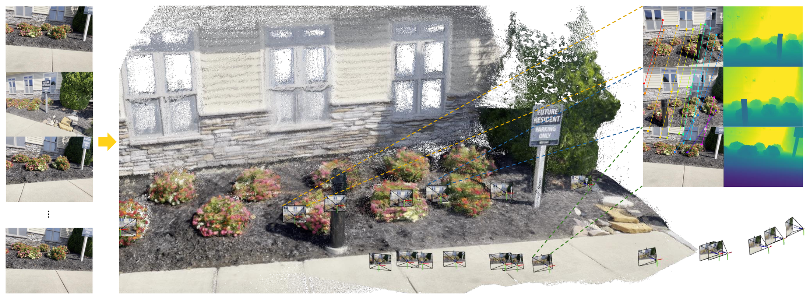
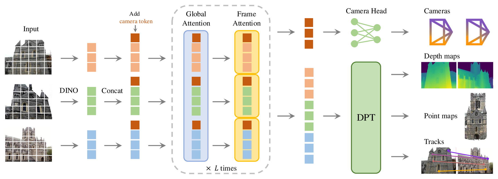
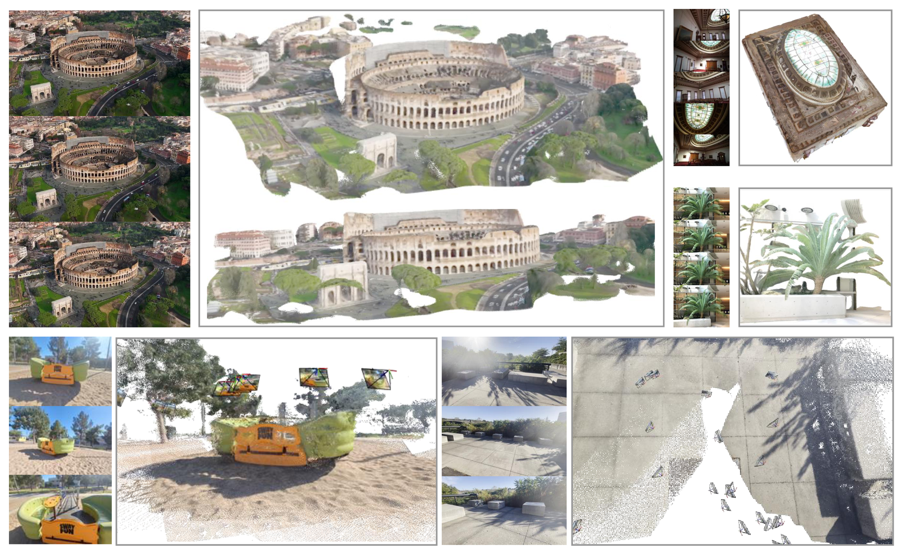
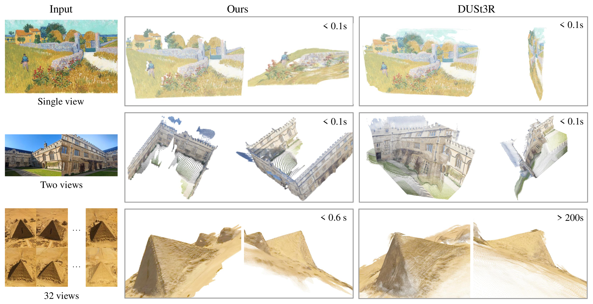
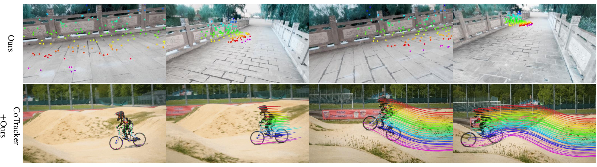

# VGGT：一次前向推理怎样恢复相机、深度、点云与轨迹

!!! info "论文信息"
    **论文题名：** VGGT: Visual Geometry Grounded Transformer。 
    **作者：** Jianyuan Wang、Minghao Chen、Nikita Karaev、Andrea Vedaldi、Christian Rupprecht、David Novotny。 
    **机构：** Visual Geometry Group, University of Oxford、Meta AI。 
    **时间 / 主题：** 2025-03；具身智能。 
    **arXiv / 官方报告：** arXiv：[2503.11651](https://arxiv.org/abs/2503.11651)；官方材料：[vgg-t.github.io/](https://vgg-t.github.io/)。 
    **GitHub / 项目：** GitHub：[github.com/facebookresearch/vggt](https://github.com/facebookresearch/vggt)；项目页：[vgg-t.github.io/](https://vgg-t.github.io/)。 
    **元数据来源与核验口径：** 来源：[arXiv](https://arxiv.org/abs/2503.11651)；[GitHub API / repo](https://github.com/facebookresearch/vggt)；[官方 / 项目材料](https://vgg-t.github.io/)；Checked Date：2026-06-15；Repro Status：Paper / official materials reviewed, independent reproduction not claimed。

VGGT 最值得读的地方，不是它又预测了一个 depth map，而是它把传统视觉几何里一整条复杂管线改成了一个多任务 Transformer 的前向推理问题。

传统 SfM / MVS 通常要经历特征匹配、几何验证、相机位姿优化、三角化、bundle adjustment、稠密重建等步骤。VGGT 的问题设定更激进：给一张、几张或上百张图，模型直接输出 camera parameters、depth maps、point maps 和 point tracks。它不声称几何约束消失了，而是把几何约束吸收到大规模监督和网络结构里。

## 一句话核心

VGGT 学的是一个从多视角图像到完整几何状态的函数：

\[
G_\theta(I_1,\ldots,I_N)
\rightarrow
\{C_i, D_i, P_i, T_i\}_{i=1}^{N}
\]

其中 \(I_i\) 表示第 \(i\) 张输入图像，\(C_i\) 是相机参数，\(D_i\) 是深度图，\(P_i\) 是每个像素对应的 3D point map，\(T_i\) 是点跟踪相关输出。这个式子要读成“同一个 backbone 同时解释相机、深度、三维点和跨帧对应”，而不是四个任务简单并排。

{ width="920" }

<small>图源：`VGGT`，Figure 1。原图表达 VGGT 输入多张图像，一次前向输出 cameras、point maps、depth maps 和 tracks。本站读法：先看输出对象的完整性，再看它没有把几何优化当成必需后处理。</small>

## 它替代了传统几何管线里的什么

在经典视觉几何里，相机和 3D 点通常互相依赖：你需要可靠匹配估计相机，需要相机三角化 3D 点，又需要 3D 点继续优化相机。这个循环很强，但也脆弱：纹理少、重复纹理、动态物体、输入视角少时，传统管线会卡在匹配或优化上。

VGGT 的策略不是显式展开这个循环，而是用大模型学习一个“几何状态层”。它输出的每一项都可以单独用，但它们真正的价值在联合一致性：

- camera head 让模型知道每张图从哪里看。
- depth head 给每个视角一个稠密距离估计。
- point map head 把像素直接放到公共 3D 坐标里。
- track head 让不同图像中的点建立对应关系。

如果只预测深度，模型可能学成强单目估计器；如果只预测相机，模型可能缺少稠密几何细节。VGGT 的多任务监督让这些输出互相约束，形成更稳定的场景表征。

## 架构：交替注意力让跨帧和帧内都能沟通

VGGT 的输入图像先被 DINO 风格视觉 backbone patchify 成 tokens，再加入 camera token。Transformer 主体使用 alternating attention：一部分层做跨所有图像的 global attention，另一部分层做每帧内部的 frame attention。

{ width="920" }

<small>图源：`VGGT`，Architecture Overview。原图表达图像 token、camera token、alternating attention，以及 camera / DPT 多头输出。本站读法：重点看 attention 如何在“跨视角关联”和“单帧细节”之间切换。</small>

这个设计解决两个冲突。跨视角几何需要全局沟通，否则相机和点云无法对齐；但每张图的深度、边界和局部纹理又需要保留高分辨率细节。如果每层都全局注意力，显存和计算会随帧数迅速上升；如果只做帧内注意力，多视角约束又不够。Alternating attention 是一个折中：让全局几何和局部视觉在同一 backbone 中轮流更新。

可以把一层更新粗略看成：

\[
X^{(k+1)}
=
\mathrm{FrameAttn}(\mathrm{GlobalAttn}(X^{(k)}))
\]

其中 \(X^{(k)}\) 表示第 \(k\) 层所有图像 token 和 camera token 的集合。这里的公式只是结构读法：`GlobalAttn` 负责跨图像建立几何关系，`FrameAttn` 负责回到每帧内部恢复局部细节。

## 输出不是一个深度图，而是一组冗余几何描述

VGGT 同时预测 depth map 和 point map，看起来有点重复。其实这正是它的优势。深度图是相机坐标下每个像素的距离，point map 是公共 3D 坐标下每个像素的位置。二者可以通过相机内外参互相转换，但模型让它们都显式成为监督对象。

对第 \(i\) 张图像，一个像素 \(u\) 的 3D 点可以写成：

\[
P_i(u)
=
R_i^\top
\left(
D_i(u) K_i^{-1} \tilde{u} - t_i
\right)
\]

其中 \(K_i\) 是相机内参，\(R_i,t_i\) 是外参，\(\tilde{u}\) 是齐次像素坐标，\(D_i(u)\) 是该像素深度。这个公式说明 depth、camera 和 point map 本来就有几何关系；VGGT 同时预测它们，是为了让网络在训练中学习这种关系，而不是只在后处理里强行投影。

{ width="920" }

<small>图源：`VGGT`，Additional Visualizations of Point Map Estimation。原图表达不同输入帧数和场景下的 point maps 与相机视锥。本站读法：观察 point map 是否形成同一公共空间，而不是每张图各自预测一张孤立深度。</small>

## 训练：多任务损失让几何头互相补课

VGGT 的训练目标把 camera、depth、point map、tracking 等监督合在一起。可以把总损失简化写成：

\[
\mathcal{L}
=
\mathcal{L}_{cam}
+
\mathcal{L}_{depth}
+
\mathcal{L}_{point}
+
\lambda_{track}\mathcal{L}_{track}
\]

其中前三个 loss 范围接近，论文不需要复杂重加权；\(\lambda_{track}\) 用于控制 tracking supervision 的影响。这个式子的重要含义是：VGGT 不是先学相机再学深度，也不是先重建再跟踪，而是在同一个几何表征里同时学这些输出。

论文的消融显示，同时训练 camera、depth 和 track 对 point map estimation 最好；去掉任一任务都会伤害最终几何质量。这个结果解释了为什么 VGGT 可以作为下游任务 backbone：它学到的不是单一任务捷径，而是多种几何任务共享的表征。

## 为什么它快

VGGT 快，不是因为它发现了新的几何定理，而是因为它把传统的迭代优化替换成了固定深度的前向网络。传统管线里的匹配、RANSAC、bundle adjustment、MVS optimization 会随图像数量和匹配质量发生复杂变化；VGGT 的主要成本集中在 Transformer backbone。

但“快”有边界。输入帧数越多，global attention 仍然会带来显存增长；camera head 本身很轻，DPT 输出头也不是主要瓶颈，真正重的是跨帧 feature backbone。因此 VGGT 适合快速给出几何初值或 feed-forward reconstruction，不代表它在所有大规模场景中都免费替代 SfM / SLAM。

{ width="920" }

<small>图源：`VGGT`，Qualitative comparison figure。原图表达 VGGT 在 in-the-wild 图像上比 DUSt3R 更稳，包括低重叠、重复纹理和特殊平面场景。本站读法：把它看成 feed-forward 几何先验的优势展示，而不是所有真实场景的完备证明。</small>

## 对机器人视觉有什么意义

机器人需要的不只是“这张图像有什么物体”，还需要可操作的空间状态：物体在什么位置，桌面法向大概怎样，夹爪靠近时是否会碰撞，视角变化后目标是否仍可追踪。VGGT 这样的 feed-forward geometry model 可以为 VLA、diffusion policy 或 world model 提供更强的 3D 表征。

不过它不是机器人 policy。VGGT 不输出动作，不处理接触动力学，也不决定控制频率。它更像一个几何感知底座：把 RGB 图像变成相机、深度、点云和 tracks，供后续策略使用。后面的 VO-DP 就是一个典型例子：不直接用 VGGT 输出的深度或点云，而是借用 VGGT 中间特征作为 RGB policy 的语义-几何输入。

{ width="920" }

<small>图源：`VGGT`，Visualization of Rigid and Dynamic Point Tracking。原图表达 VGGT tracking module 在静态图像集合和动态视频中的点跟踪能力。本站读法：tracking 是机器人闭环里很有价值的接口，但仍需要策略和控制器把它转成动作。</small>

## 实验应该怎样读

VGGT 的结果主要回答四个问题。

第一，camera pose estimation 能不能靠前向网络超过需要优化的传统或半传统方法。论文在多个设置中显示 VGGT feed-forward 已经很强，加 BA 后还能继续提高。这说明它可以给传统优化提供强初值，也可以在不允许迭代的场景中直接使用。

第二，dense MVS 和 point map estimation 能不能在没有 GT camera 的情况下做好。这个问题很关键，因为真实数据里相机并不总是可靠。VGGT 的结果说明多任务几何监督确实提升了无相机场景下的重建能力。

第三，runtime 和 memory 是否随帧数可控。论文展示单张 H100 上从少量帧到大量帧的运行情况，但也暴露了 global attention 的成本增长。读这组结果时不要只看最快速度，还要看输入帧数、分辨率和后处理是否一致。

第四，pretrained feature 能否迁移到 dynamic point tracking 和 novel view synthesis。这个结果说明 VGGT 学到的几何表征不只服务原始输出头，也能作为其他视觉任务的 backbone。

## 边界与误解

最常见的误解是把 VGGT 说成“传统几何被淘汰”。更准确的说法是：VGGT 把很多场景中的几何估计改成了强 feed-forward prior；当场景很大、时间很长、需要全局一致地图或需要严格可解释误差时，传统优化、SLAM 和 bundle adjustment 仍然重要。

第二个误解是把它当成 3D 世界模型。VGGT 预测几何状态，但不预测未来，不建模动作，不处理物理接触。它可以成为世界模型或机器人 policy 的感知层，却不是完整的动态模型。

第三个边界是数据分布。VGGT 的泛化来自大规模多源 3D 数据和多任务监督；如果遇到训练分布外的透明物体、镜面、高动态场景或严重遮挡，它仍可能给出看似合理但错误的几何。

## 证据链快照

| 论文主张 | 主要证据 | 读数边界 |
| --- | --- | --- |
| 一次前向可以恢复多类几何状态 | Figure 1/2、camera/depth/pointmap/track 多头输出 | 不等于所有场景都无需 BA 或 SLAM |
| 交替注意力能处理多帧几何关系 | 架构图和多视图任务表现 | global attention 成本随帧数增长，长序列仍要看显存 |
| 多任务监督让几何头互相补强 | pose、depth、point map、tracking benchmark | 不能证明任意下游机器人任务都会提升 |
| feed-forward geometry 有速度优势 | runtime / memory 表和项目 demo | 输入分辨率、帧数和后处理设置会改变收益 |

## 阅读结论

VGGT 的主要内容是把相机、深度、点云和 tracks 这条传统几何管线压进一个 feed-forward Transformer。方法要抓 alternating frame/global attention、多任务几何头和统一 3D 输出；实验要看 camera pose、dense MVS、point tracking、runtime/memory 和是否需要 BA 后处理。它的可复用机制是“强几何先验 + 一次前向状态估计”，不是动作策略。

落到具身智能时，VGGT 更适合作为几何感知层：给 VLA、diffusion policy、planner 或 world model 提供相机/深度/点云/tracking 状态。它不能证明机器人闭环成功率，也不能替代 SLAM、bundle adjustment、安全碰撞检查或接触动力学模型；这些都需要在具体机器人任务里再验。

## 外部精读

- [VGGT: Visual Geometry Grounded Transformer](https://arxiv.org/abs/2503.11651)：论文原文，建议重点读 architecture、training objectives、ablation 和 runtime。
- [VGGT project page](https://vgg-t.github.io/)：项目页有可视化 demo，适合直观看 feed-forward 3D reconstruction 的效果。
- [facebookresearch/vggt](https://github.com/facebookresearch/vggt)：代码和模型发布页面，适合核对输入输出接口。
- [DUSt3R project](https://dust3r.europe.naverlabs.com/)：作为对照，帮助理解 VGGT 和 pairwise 3D reconstruction 路线的差异。

## 相关阅读与下一步

- 外部材料：[论文标题 arXiv 检索](https://arxiv.org/search/?query=vggt&searchtype=title)。
- 外部材料：[Semantic Scholar 标题检索](https://www.semanticscholar.org/search?q=vggt)。
- 外部材料：[Papers with Code 检索](https://paperswithcode.com/search?q=vggt)。
- 站内下一步：[论文精读专题](../index.md)。
- 站内下一步：[论文专题写作规范](../writing-standard.md)。
- 站内下一步：[外部精读来源台账](../../references/external-reading-ledger.md)。
