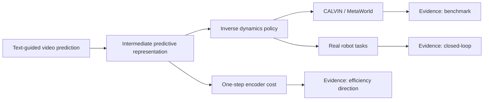

# Video Prediction Policy：预测视觉表征训练机器人策略

!!! info "论文信息"
    - 论文：`Video Prediction Policy: A Generalist Robot Policy with Predictive Visual Representations`
    - 链接：[arXiv:2412.14803](https://arxiv.org/abs/2412.14803)
    - 代码：[roboterax/video-prediction-policy](https://github.com/roboterax/video-prediction-policy)
    - 关键词：predictive visual representations、text-guided video prediction、inverse dynamics、CALVIN、MetaWorld、real-world robots

VPP 的核心观点很漂亮：很多视觉策略只编码当前图像，而视频扩散模型内部包含“未来会怎样”的预测表征。把这些 predictive visual representations 拿来当 policy 的视觉条件，可以让机器人从视频模型的动态先验中受益。

## 证据等级与外推边界

VPP 的证据结构比较清楚：核心 claim 由 CALVIN / MetaWorld benchmark、真实机器人实验和表征可视化共同支撑；效率 claim 主要来自“single forward step 取中间表征”，而不是完整系统吞吐表。因此它适合作为“预测表征能帮 policy”的证据，不适合直接当成“完整视频 rollout world model 已经足够便宜”的证据。



| 论文结论 | 证据来源 | 证据等级 | 可外推到世界模型高效训练 | 不能直接外推 |
| --- | --- | --- | --- | --- |
| 预测视觉表征比静态表征更适合策略 | CALVIN、MetaWorld、真实机器人结果 | Benchmark + Closed-loop | 世界模型中间 latent 可以作为 policy state，而不必每次生成完整未来视频 | 不能证明所有 video latent 都天然对动作有用 |
| one-step TVP 表征已经包含运动趋势 | one-step prediction 可视化和 policy 性能 | Qualitative + Benchmark | 训练时可把“未来感”压进状态表示，降低完整视频生成成本 | 不能把模糊 one-step 图像当作可靠物理仿真 |
| 互联网人类/机器人操作视频能补动态先验 | 数据规模、采样比例和下游结果 | Dataset evidence + Benchmark | 世界模型数据引擎应混合人类视频、机器人视频和目标任务轨迹 | 不能说明无动作标注视频足以学习动作因果性 |
| inverse dynamics 能把预测表征接到动作 | diffusion action model 和机器人实验 | Benchmark + Closed-loop | 可借鉴“视频预测表征 + 动作解码器”的模块分工 | 不能替代 action-conditioned rollout 和反事实动作评测 |
| 真实机器人验证覆盖多平台任务 | Panda、xArm + XHand 任务集合 | Closed-loop signal | 论文不是纯仿真结果，适合作为具身表征迁移参考 | 不能外推到开放家庭长时任务和安全拒绝执行 |

对本站主线，VPP 最值得吸收的是：世界模型训练不一定每一步都生成清晰视频；有时只需要一个含未来动态的 latent state，再由 policy 或 action head 使用它。它最需要补的证据是动作反事实：同一历史下改变候选动作时，中间表征是否足够区分未来后果。

## 论文位置

GR-2 是“视频预训练 + 机器人轨迹微调”；DreamZero 是“joint video-action prediction”；VPP 介于两者之间：它先训练文本引导的视频预测模型，然后用视频模型的中间表征训练逆动力学 policy。

{ width="920" }

<small>Figure source: `Video Prediction Policy`, Figure 1. 原论文图意：视频 diffusion model 内部表征同时包含当前信息和未来预测信息；VPP 基于这些表征在多个 benchmark 上提升机器人策略表现。</small>

## 两阶段训练

论文流程很清晰：

```text
Stage 1: train Text-guided Video Prediction (TVP)
  pre-trained video foundation model
  + internet human/robot manipulation data
  + CALVIN / MetaWorld / real robot data

Stage 2: train inverse dynamics policy
  TVP intermediate predictive representation
  -> diffusion action model
  -> robot actions
```

{ width="760" }

<small>Figure source: `Video Prediction Policy`, Figure 3. 原论文图意：VPP 先从预训练视频 foundation model 出发训练 text-guided video prediction model，再基于 TVP 内部预测表征学习机器人动作。</small>

## 为什么用中间表征，而不是完整生成视频

论文的关键工程选择是：VPP 把视频 diffusion model 主要当作 vision encoder，而不是完整 denoiser。它只做 single forward step，得到并不清晰但含有未来运动趋势的中间表征。

{ width="720" }

<small>Figure source: `Video Prediction Policy`, Figure 5. 原论文图意：比较 ground-truth video、完整 denoised video 和 one-step forward predictions；one-step 纹理不清晰，但已经包含物理演化信息。</small>

这个选择非常具身：机器人 policy 不需要每次生成好看的未来视频，它需要低延迟、对动作有用的表示。中间表征比完整视频便宜，也比普通静态视觉 encoder 更有动态信息。

## 数据与训练细节

VPP 的 TVP 训练数据包括：

| Data source | Scale / role |
| --- | --- |
| Something-Something-V2 human manipulation | 193,690 human manipulation trajectories |
| Internet robotic manipulation datasets | 179,074 high-quality trajectories |
| CALVIN ABC | downstream long-horizon robot data |
| MetaWorld | 50 tasks, oracle trajectories |
| Real-world robot datasets | Panda arm and xArm + XHand tasks |

论文记录 TVP 训练约 `two days on eight NVIDIA A100 GPUs`。动作策略阶段再用 TVP 的中间预测表征训练 diffusion action model。

英文原表中 Table 9 给出 dataset scales and sample ratios；这里不逐项全文搬表，但保留一个工程重点：VPP 不是把所有数据均匀混合，而是根据数据规模和质量设置采样概率。

## 实验结果

VPP 在 CALVIN 和 MetaWorld 上验证了 predictive visual representations 的价值。

| Benchmark | Setup | Main claim |
| --- | --- | --- |
| CALVIN | ABC→D, five chained tasks | VPP improves average task completion length |
| MetaWorld | 50 tasks with language-conditioned policy | VPP improves average success rate over strong baselines |
| Real-world Panda | 30+ tasks, 6 skills, about 2000 trajectories | predictive representations transfer to real robot |
| xArm + XHand | 100+ tasks, 13 skills, about 4000 trajectories | dexterous manipulation and tool-use settings |

Table 1 from the paper can be redrawn as follows, keeping the original English fields:

| Category | Method | Annotated Data | 1 | 2 | 3 | 4 | 5 | Avg. Len ↑ |
| --- | --- | --- | --- | --- | --- | --- | --- | --- |
| Direct Action Learning Method | RT-1 | 100%ABC | 0.533 | 0.222 | 0.094 | 0.038 | 0.013 | 0.90 |
| Direct Action Learning Method | Diffusion Policy | 100%ABC | 0.402 | 0.123 | 0.026 | 0.008 | 0.00 | 0.56 |
| Direct Action Learning Method | Robo-Flamingo | 100%ABC | 0.824 | 0.619 | 0.466 | 0.331 | 0.235 | 2.47 |
| Future Prediction Related Method | Uni-Pi | 100%ABC | 0.560 | 0.160 | 0.080 | 0.080 | 0.040 | 0.92 |
| Future Prediction Related Method | MDT | 100%ABC | 0.631 | 0.429 | 0.247 | 0.151 | 0.091 | 1.55 |
| Future Prediction Related Method | Susie | 100%ABC | 0.870 | 0.690 | 0.490 | 0.380 | 0.260 | 2.69 |
| Future Prediction Related Method | GR-1 | 100%ABC | 0.854 | 0.712 | 0.596 | 0.497 | 0.401 | 3.06 |
| 3D Method | 3D Diffuser Actor | 100%ABC | 0.938 | 0.803 | 0.662 | 0.533 | 0.412 | 3.35 |
| Ours | VPP (ours) | 100%ABC | 0.957 | 0.912 | 0.863 | 0.810 | 0.750 | 4.29 |
| Data Efficiency | MDT | 10%ABC | 0.408 | 0.131 | 0.034 | 0.008 | 0.001 | 0.58 |
| Data Efficiency | GR-1 | 10%ABC | 0.672 | 0.371 | 0.198 | 0.108 | 0.069 | 1.41 |
| Data Efficiency | VPP (ours) | 10%ABC | 0.878 | 0.746 | 0.632 | 0.540 | 0.453 | 3.25 |

<small>表源：`Video Prediction Policy`，Table 1。原表含义：CALVIN ABC→D zero-shot long-horizon evaluation，`1` 到 `5` 表示连续完成第 1 到第 5 个任务的比例，`Avg. Len` 是平均完成链长。最值得注意的是，VPP 不用 depth / point cloud，仍把平均链长从 3D Diffuser Actor 的 `3.35` 推到 `4.29`；只用 `10%ABC` 标注数据时也达到 `3.25`。</small>

{ width="760" }

<small>Figure source: `Video Prediction Policy`, Figure 7. 原论文图意：展示 Panda arm 和 xArm + 12-DoF XHand 两个真实硬件平台及任务可视化。</small>

论文还可视化了 predictive representations：

{ width="920" }

<small>Figure source: `Video Prediction Policy`, Figure 12. 原论文图意：绿色是真实未来，红色是预测未来，蓝色是 predictive representations 的可视化；即便细节不精确，运动趋势已经出现。</small>

## 训练细节要点

| Detail | VPP choice | Why it matters |
| --- | --- | --- |
| Video backbone | Stable Video Diffusion + CLIP text features | 从视频 foundation model 继承动态先验 |
| TVP objective | text-guided video prediction | 让模型按语言预测操作未来 |
| Policy input | intermediate predictive representation | 避免完整视频生成成本 |
| Inference | single forward step as encoder | 低延迟，适合控制 |
| Action model | diffusion inverse dynamics | 从预测表征生成动作 |
| Training compute | two days on 8 A100 for TVP | 说明路线相对可复现 |
| Real robots | Panda 30+ tasks / xArm + XHand 100+ tasks | 验证不是只在仿真有效 |

## 和 GR-2、DreamZero 的区别

| Dimension | GR-2 | VPP | DreamZero |
| --- | --- | --- | --- |
| Video role | pre-training and future video prediction | predictive representation encoder | joint video-action generation |
| Action learning | robot trajectory fine-tuning | inverse dynamics from TVP features | action latent co-denoising |
| Deployment | trajectory + WBC | policy from visual representation | WAM as closed-loop policy |
| Main insight | web video helps robot manipulation | future-aware visual features help policy | world-action model can be zero-shot policy |

VPP 的独特位置在于：它不要求每次部署都生成高质量未来视频，也不把视频和动作完全合并到一个大生成器里，而是把视频模型内部的“未来感”抽出来给策略用。

## 局限

VPP 的表征依赖 TVP 的预测质量。若 TVP 在新场景里预测错误动态，policy 也会被误导。另外，它的真实机器人数据仍以可控平台和任务集合为主，开放家庭长时任务、无效指令拒绝、跨房间记忆等问题还需要其他机制。

## 参考链接

1. [arXiv:2412.14803](https://arxiv.org/abs/2412.14803)
2. [GitHub: roboterax/video-prediction-policy](https://github.com/roboterax/video-prediction-policy)
3. [ar5iv HTML and figures](https://ar5iv.labs.arxiv.org/html/2412.14803)
