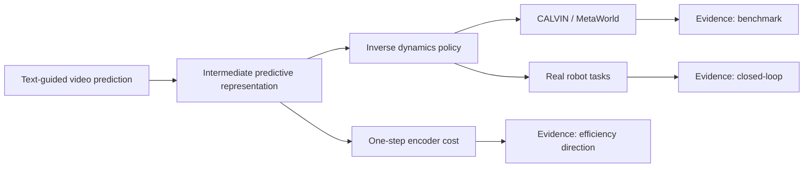
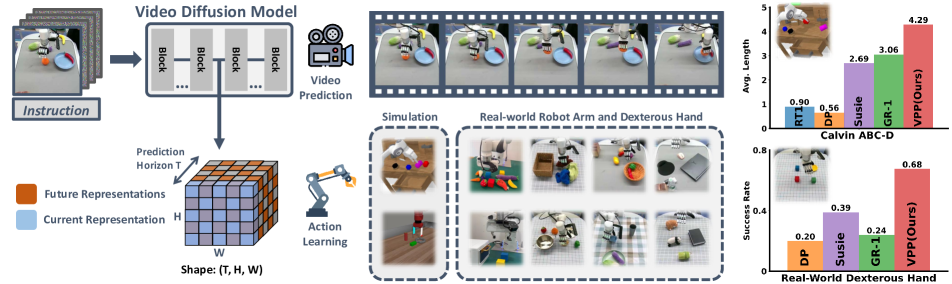
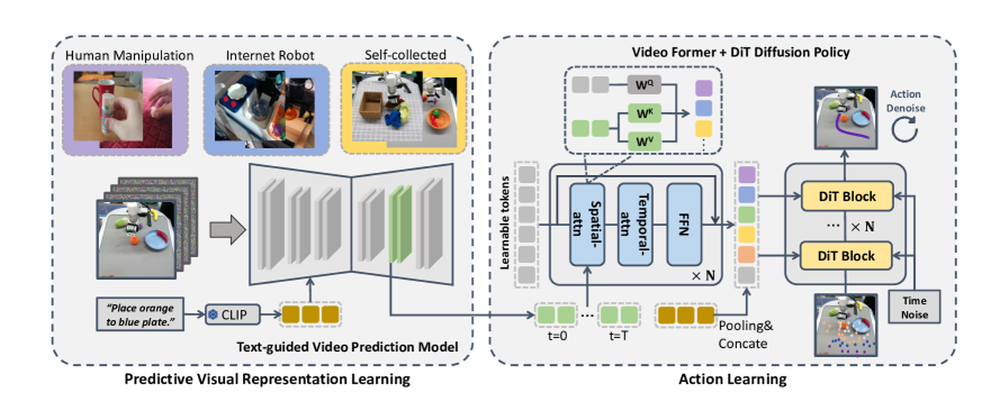
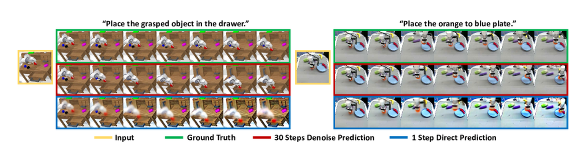
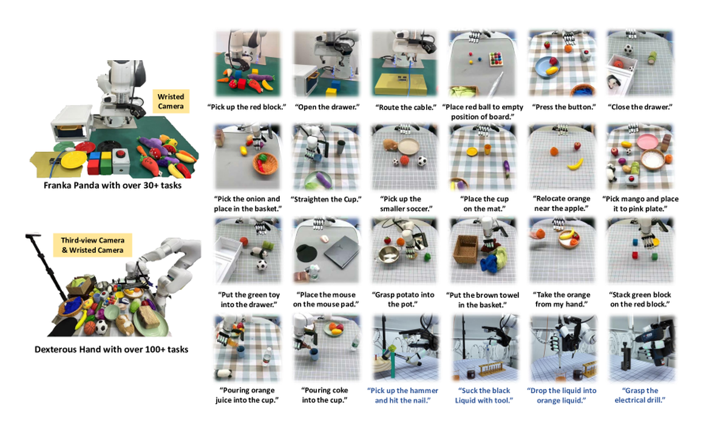
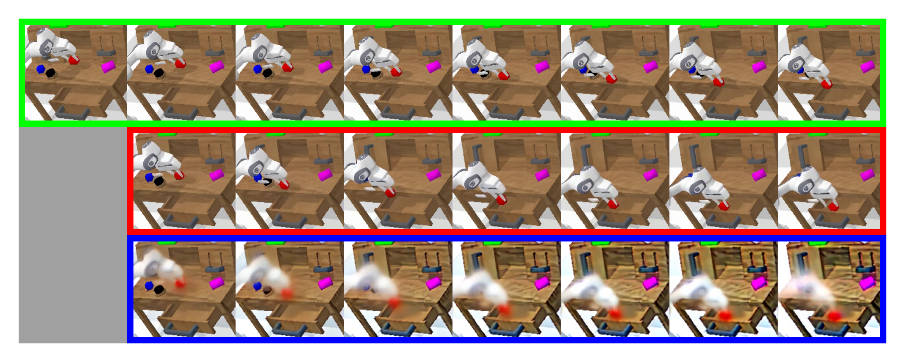

# Video Prediction Policy：预测视觉表征训练机器人策略

!!! info "论文信息"
    **论文题名：** Video Prediction Policy: A Generalist Robot Policy with Predictive Visual Representations。<br>
    **作者：** Yucheng Hu、Yanjiang Guo、Pengchao Wang、Xiaoyu Chen、Yen-Jen Wang、Jianke Zhang、Koushil Sreenath、Chaochao Lu、Jianyu Chen。<br>
    **机构：** 未在公开元数据中稳定解析；以 arXiv/PDF 或官方页 affiliation block 为准。<br>
    **时间 / 主题：** 2024-12；具身智能 / VLA。<br>
    **arXiv / 官方报告：** arXiv：[2412.14803](https://arxiv.org/abs/2412.14803)；官方材料：[video-prediction-policy.github.io/](https://video-prediction-policy.github.io/)。<br>
    **GitHub / 项目：** GitHub：[github.com/roboterax/video-prediction-policy](https://github.com/roboterax/video-prediction-policy)；项目页：[video-prediction-policy.github.io/](https://video-prediction-policy.github.io/)。<br>
    **元数据来源与核验口径：** 来源：[arXiv](https://arxiv.org/abs/2412.14803)；[GitHub API / repo](https://github.com/roboterax/video-prediction-policy)；[官方 / 项目材料](https://video-prediction-policy.github.io/)；Checked Date：2026-06-04；Repro Status：Paper / official materials reviewed, independent reproduction not claimed。

## 原论文故事线

### 研究背景

Video Prediction Policy（VPP）讨论的是机器人策略视觉表征的问题。许多 generalist robot policies 使用单图重建、对比学习或静态图像 encoder 作为视觉输入，这些表示能捕捉当前场景语义和空间布局，但不显式表示“接下来会发生什么”。机器人操作却天然依赖未来动态：物体会被推开、夹爪会接触、遮挡会改变、任务状态会演化。

视频扩散模型和文本引导视频预测模型在训练中必须预测未来帧，因此内部 latent 不只包含当前图像信息，也包含未来视觉变化的表征。VPP 的背景判断是：这些 predictive visual representations 可能比静态视觉特征更适合动作学习，因为它们把物理动态和未来状态提前压进了表示。

### 问题（Challenge）

论文要解决的问题是：**如何利用视频预测模型内部的未来表征来训练 generalist robot policy。** 难点在于，直接在部署时生成完整未来视频成本高，也未必需要；而只拿普通视觉 encoder，又缺少动态先验。模型需要一种中间路线：从视频模型中抽取未来感 latent，再让动作模型利用它。

这个问题的价值在于连接 world model 和 policy。如果中间 predictive representation 足够有用，机器人不必每步显式 rollout 清晰视频，也能获得视频模型学到的物理动态知识。这对高效世界模型训练和机器人控制都很关键。

### Finding

作者的 finding 是：**视频预测模型的中间表示显式包含当前帧和预测未来帧的信息；策略可以把这些 predictive visual representations 当作条件，隐式学习 inverse dynamics。** 这个洞见把视频模型从“生成未来画面”的工具翻转成“提供未来感视觉状态”的表征模型。

这个 finding 能解决挑战，是因为动作学习需要知道“为了让未来变成这样，现在该怎么动”。VPP 不要求部署时生成完整高质量视频，而是取视频扩散模型内部的 future representations，再训练 diffusion action model / inverse dynamics policy 根据这些表征输出动作。这样，未来动态先验以 latent 形式进入策略。

### 方法

VPP 采用两阶段流程。第一阶段训练 Text-guided Video Prediction（TVP）模型：以预训练视频 foundation model 为基础，在机器人数据、互联网人类 manipulation 视频和目标 benchmark 数据上微调，使模型能根据当前观测和语言预测未来。第二阶段训练 inverse dynamics policy：从 TVP 中抽取中间 predictive visual representations，条件化一个 diffusion action model 来生成机器人动作。

输入包括当前/历史图像和语言指令；TVP 内部表示具有 \((T,H,W)\) 结构，包含当前 step 和未来 step 的 latent。策略不直接以像素未来视频为输入，而是使用这些 latent 表征。论文还分析不同视频模型层的表示效果、视频预训练和互联网 manipulation data 的贡献。

### 结论

实验覆盖 CALVIN ABC-D generalization benchmark、MetaWorld 50-task multi-task setting 和真实机器人 dexterous manipulation。论文报告 VPP 在 CALVIN ABC-D 上相比此前 SOTA 获得 18.6% relative improvement，在复杂真实灵巧手任务上成功率提升 31.6%。MetaWorld 中，VPP 的平均成功率达到 0.682，高于 RT-1、Diffusion Policy、Susie 和 GR-1 等基线。

消融显示，video pretraining、internet manipulation data 和 predictive representations 都对策略表现有贡献。边界是，VPP 主要证明“预测 latent 有助于动作学习”，没有证明完整 action-conditioned world model 已经解决；同一历史下改变动作的反事实未来、长时恢复和真实安全仍需额外评估。

### 关键术语

- **Predictive Visual Representations（预测视觉表征）**：视频预测模型内部同时编码当前和未来视觉信息的 latent。
- **Text-Guided Video Prediction, TVP（文本引导视频预测）**：根据当前观测和语言预测未来视频的模型。
- **Inverse Dynamics Policy（逆动力学策略）**：根据当前/未来表征推断应执行动作的策略。
- **Video Diffusion Model, VDM（视频扩散模型）**：通过扩散/去噪过程生成或预测视频的模型。
- **Diffusion Action Model（扩散动作模型）**：用扩散生成方式输出连续机器人动作序列。
- **CALVIN ABC-D（CALVIN 泛化基准）**：训练环境 A/B/C 到未见环境 D 的长序列机器人任务评测。

VPP 的核心观点很漂亮：很多视觉策略只编码当前图像，而视频扩散模型内部包含“未来会怎样”的预测表征。把这些 predictive visual representations 拿来当 policy 的视觉条件，可以让机器人从视频模型的动态先验中受益。

举个桌面操作例子。只看当前图像时，policy 能知道“杯子、海绵、机械臂在哪里”，但不一定知道下一步接触后会发生什么：海绵会不会碰到杯沿，杯子会不会被推歪，手爪继续下压会不会卡住。视频预测模型在训练中被迫学习“当前画面往后如何演化”，它的中间表征会更关注物体即将移动、接触和状态变化的区域。VPP 的想法不是让机器人每次都生成一段漂亮未来视频，而是把这种未来感抽成低延迟 latent，再让 inverse dynamics policy 从 latent 里解码动作。

## 证据等级与外推边界

VPP 的证据结构比较清楚：核心 claim 由 CALVIN / MetaWorld benchmark、真实机器人实验和表征可视化共同支撑；效率 claim 主要来自“single forward step 取中间表征”，而不是完整系统吞吐表。因此它适合作为“预测表征能帮 policy”的证据，不适合直接当成“完整视频 rollout world model 已经足够便宜”的证据。



| 论文结论 | 证据来源 | 证据等级 | 可外推到世界模型高效训练 | 不能直接外推 |
| --- | --- | --- | --- | --- |
| 预测视觉表征比静态表征更适合策略 | CALVIN、MetaWorld、真实机器人结果 | Benchmark + Closed-loop | 世界模型中间 latent 可以作为 policy state，而不必每次生成完整未来视频 | 不能证明所有 video latent 都天然对动作有用 |
| one-step TVP 表征已经包含运动趋势 | one-step prediction 可视化和 policy 性能 | Qualitative + Benchmark | 训练时可把“未来感”压进状态表示，降低完整视频生成成本 | 不能把模糊 one-step 图像当作可靠物理仿真 |
| 互联网人类/机器人操作视频能补动态先验 | 数据规模、采样比例和下游结果 | Dataset evidence + Benchmark | 世界模型数据引擎应混合人类视频、机器人视频和目标任务轨迹 | 不能说明无动作标注视频足以学习动作因果性 |
| inverse dynamics 能把预测表征接到动作 | diffusion action model 和机器人实验 | Benchmark + Closed-loop | 可借鉴“视频预测表征 + 动作解码器”的模块分工 | 不能替代 action-conditioned rollout 和反事实动作评测 |
| 真实机器人验证覆盖多平台任务 | Panda、xArm + XHand 任务集合 | Closed-loop signal | 论文不是纯仿真结果，适合作为具身表征迁移参考 | 不能外推到开放家庭长时任务和安全拒绝执行 |

对本站主线，VPP 最值得吸收的是：世界模型训练不一定每一步都生成清晰视频；有时只需要一个含未来动态的 latent state，再由 policy 或 action head 使用它。它最需要补的证据是动作反事实：同一历史下改变候选动作时，中间表征是否足够区分未来后果。

## 论文位置

GR-2 是“视频预训练 + 机器人轨迹微调”；DreamZero 是“joint video-action prediction”；VPP 介于两者之间：它先训练文本引导的视频预测模型，然后用视频模型的中间表征训练逆动力学 policy。

{ width="920" }

<small>Figure source: `Video Prediction Policy`, Figure 1. 原论文图意：视频 diffusion model 内部表征同时包含当前信息和未来预测信息；VPP 基于这些表征在多个 benchmark 上提升机器人策略表现。</small>

**总览图先看表示流向。**
左侧视频预测模型不是部署时的画面生成器，而是 future-aware encoder：它从历史观测和语言中抽取中间预测表征。右侧 policy 不直接问“未来视频长什么样”，而是问“这个未来表征暗示我现在该怎么动”。这张图支撑的是“预测 latent 能服务策略”，还不能证明显式世界模型、反事实动作规划或长期恢复能力已经成立。

## 两阶段训练

论文流程很清晰：

```text
Stage 1: train Text-guided Video Prediction (TVP)
  pre-trained video foundation model
  + internet human/robot manipulation data
  + CALVIN / MetaWorld / real robot data

Stage 2: train inverse dynamics policy
  TVP intermediate predictive representation
  -> diffusion action model
  -> robot actions
```

{ width="760" }

<small>Figure source: `Video Prediction Policy`, Figure 3. 原论文图意：VPP 先从预训练视频 foundation model 出发训练 text-guided video prediction model，再基于 TVP 内部预测表征学习机器人动作。</small>

### Stage 1：Text-guided Video Prediction

VPP 的第一阶段不是直接训练机器人策略，而是把预训练视频扩散模型调成一个文本条件未来预测模型。给定当前/历史视频帧 \(o_{\le t}\) 和语言 \(l\)，TVP 学习预测未来帧：

$$
p_\theta(o_{t+1:t+H} \mid o_{\le t}, l)
$$

在扩散模型里，它实际学习的是去噪目标。若 \(\mathbf{z}_0\) 是未来视频 latent，\(\mathbf{z}_\tau\) 是加噪后的 latent，模型学习预测噪声或速度：

$$
\mathcal{L}_{\mathrm{TVP}}
= \mathbb{E}_{\tau,\epsilon}
\left[
\left\|
\epsilon_\theta(\mathbf{z}_\tau, \tau, o_{\le t}, l)
- \epsilon
\right\|_2^2
\right]
$$

这里最重要的是条件：模型不只是做通用视频生成，而是在操作视频和机器人数据上学习“给定任务语言和当前观测，未来该往哪个方向演化”。这就是 predictive visual representation 的来源。

### Stage 2：Inverse Dynamics Policy

第二阶段把 TVP 当成 future-aware encoder。VPP 从视频扩散模型中取中间表征 \(\mathbf{h}_{\mathrm{pred}}\)，再训练一个动作扩散/DiT 策略：

$$
\pi_\phi(a_{t:t+K}\mid o_{\le t}, l, \mathbf{h}_{\mathrm{pred}})
$$

这可以看成 implicit inverse dynamics：TVP 内部表征暗示“未来视觉会怎样变”，policy 学“要让未来这样变，现在该怎么动”。注意它不是显式规划器，没有枚举候选动作并 rollout；它把未来预测压缩进视觉表征，再用动作模型直接解码。

## 为什么用中间表征，而不是完整生成视频

论文的关键工程选择是：VPP 把视频 diffusion model 主要当作 vision encoder，而不是完整 denoiser。它只做 single forward step，得到并不清晰但含有未来运动趋势的中间表征。

{ width="720" }

<small>Figure source: `Video Prediction Policy`, Figure 5. 原论文图意：比较 ground-truth video、完整 denoised video 和 one-step forward predictions；one-step 纹理不清晰，但已经包含物理演化信息。</small>

这个选择非常具身：机器人 policy 不需要每次生成好看的未来视频，它需要低延迟、对动作有用的表示。中间表征比完整视频便宜，也比普通静态视觉 encoder 更有动态信息。

**Figure 5 怎么读。**
这张图要反着读：one-step prediction 画面模糊，正是它的工程价值。若策略每个控制周期都要完整 denoise 出高清视频，延迟会压垮 closed-loop 控制；VPP 只取 single forward step 的内部表示，让纹理不完整但运动方向、物体接触趋势和目标变化已经进入 latent。它支撑的是“预测表征可用”，不是“单步图像可当真实模拟器”。

## 数据与训练细节

VPP 的 TVP 训练数据包括：

| Data source | Scale / role |
| --- | --- |
| Something-Something-V2 human manipulation | 193,690 human manipulation trajectories |
| Internet robotic manipulation datasets | 179,074 high-quality trajectories |
| CALVIN ABC | downstream long-horizon robot data |
| MetaWorld | 50 tasks, oracle trajectories |
| Real-world robot datasets | Panda arm and xArm + XHand tasks |

论文记录 TVP 训练约 `two days on eight NVIDIA A100 GPUs`。动作策略阶段再用 TVP 的中间预测表征训练 diffusion action model。

英文原表中 Table 9 给出 dataset scales and sample ratios；这里不逐项全文搬表，但保留一个工程重点：VPP 不是把所有数据均匀混合，而是根据数据规模和质量设置采样概率。

几个训练细节对复用很关键：

| Detail | Why it matters |
| --- | --- |
| Stable Video Diffusion initialization | 让 TVP 从已有视频动态先验出发，而不是从机器人小数据冷启动 |
| CLIP text features | 语言条件进入视频预测，避免只学无条件未来 |
| Human manipulation + robot video mixture | 人类视频补丰富动态，机器人视频补相机和任务分布 |
| Single forward representation | 控制侧只取中间表征，不承担完整视频生成延迟 |
| Diffusion inverse dynamics policy | 用生成式动作头处理多模态动作分布 |

这也解释了为什么 VPP 和 GR-2 相似但不一样：GR-2 同时生成未来视频和动作轨迹，VPP 则更激进地把视频生成压成“取中间表示”，让部署时不必真的生成完整未来。

## 实验结果

VPP 在 CALVIN 和 MetaWorld 上验证了 predictive visual representations 的价值。

| Benchmark | Setup | Main claim |
| --- | --- | --- |
| CALVIN | ABC→D, five chained tasks | VPP improves average task completion length |
| MetaWorld | 50 tasks with language-conditioned policy | VPP improves average success rate over strong baselines |
| Real-world Panda | 30+ tasks, 6 skills, about 2000 trajectories | predictive representations transfer to real robot |
| xArm + XHand | 100+ tasks, 13 skills, about 4000 trajectories | dexterous manipulation and tool-use settings |

Table 1 from the paper can be redrawn as follows, keeping the original English fields:

| Category | Method | Annotated Data | 1 | 2 | 3 | 4 | 5 | Avg. Len ↑ |
| --- | --- | --- | --- | --- | --- | --- | --- | --- |
| Direct Action Learning Method | RT-1 | 100%ABC | 0.533 | 0.222 | 0.094 | 0.038 | 0.013 | 0.90 |
| Direct Action Learning Method | Diffusion Policy | 100%ABC | 0.402 | 0.123 | 0.026 | 0.008 | 0.00 | 0.56 |
| Direct Action Learning Method | Robo-Flamingo | 100%ABC | 0.824 | 0.619 | 0.466 | 0.331 | 0.235 | 2.47 |
| Future Prediction Related Method | Uni-Pi | 100%ABC | 0.560 | 0.160 | 0.080 | 0.080 | 0.040 | 0.92 |
| Future Prediction Related Method | MDT | 100%ABC | 0.631 | 0.429 | 0.247 | 0.151 | 0.091 | 1.55 |
| Future Prediction Related Method | Susie | 100%ABC | 0.870 | 0.690 | 0.490 | 0.380 | 0.260 | 2.69 |
| Future Prediction Related Method | GR-1 | 100%ABC | 0.854 | 0.712 | 0.596 | 0.497 | 0.401 | 3.06 |
| 3D Method | 3D Diffuser Actor | 100%ABC | 0.938 | 0.803 | 0.662 | 0.533 | 0.412 | 3.35 |
| Ours | VPP (ours) | 100%ABC | 0.957 | 0.912 | 0.863 | 0.810 | 0.750 | 4.29 |
| Data Efficiency | MDT | 10%ABC | 0.408 | 0.131 | 0.034 | 0.008 | 0.001 | 0.58 |
| Data Efficiency | GR-1 | 10%ABC | 0.672 | 0.371 | 0.198 | 0.108 | 0.069 | 1.41 |
| Data Efficiency | VPP (ours) | 10%ABC | 0.878 | 0.746 | 0.632 | 0.540 | 0.453 | 3.25 |

<small>表源：`Video Prediction Policy`，Table 1。原表含义：CALVIN ABC→D zero-shot long-horizon evaluation，`1` 到 `5` 表示连续完成第 1 到第 5 个任务的比例，`Avg. Len` 是平均完成链长。最值得注意的是，VPP 不用 depth / point cloud，仍把平均链长从 3D Diffuser Actor 的 `3.35` 推到 `4.29`；只用 `10%ABC` 标注数据时也达到 `3.25`。</small>

**Table 1 怎么读。**
CALVIN 不是单任务成功率，而是连续 5 个语言任务的链式完成。`1` 到 `5` 的数字越往右越难，因为前一步失败会阻断后续任务。VPP 最突出的不是第一个任务 `0.957`，而是第 5 个任务仍有 `0.750`，说明预测表征对状态保持和长链执行有帮助。`10%ABC` 设置更关键：只用十分之一标注数据时，VPP 的 `Avg. Len=3.25` 接近强 3D baseline 的完整数据表现，说明动态先验确实缓解了机器人标注稀缺。

{ width="760" }

<small>Figure source: `Video Prediction Policy`, Figure 7. 原论文图意：展示 Panda arm 和 xArm + 12-DoF XHand 两个真实硬件平台及任务可视化。</small>

真实机器人结果的读法要分平台。Panda arm 覆盖 `30+` tasks、`6` skills、约 `2000` trajectories，主要验证普通机械臂桌面操作；xArm + XHand 覆盖 `100+` tasks、`13` skills、约 `4000` trajectories，强调灵巧手、工具和更复杂接触。论文摘要报告复杂真实灵巧操作成功率相对提升约 `31.6%`，这说明 predictive representation 不只在仿真里有效，但仍属于受控任务集合，而不是开放家庭环境。

论文还可视化了 predictive representations：

{ width="920" }

<small>Figure source: `Video Prediction Policy`, Figure 12. 原论文图意：绿色是真实未来，红色是预测未来，蓝色是 predictive representations 的可视化；即便细节不精确，运动趋势已经出现。</small>

**Figure 12 怎么读。**
这张图是 VPP 的机制诊断。绿色真实未来、红色预测未来和蓝色表征可视化不是为了证明图像生成很漂亮，而是说明中间 representation 已经朝未来物体运动、手部接触或目标状态变化聚焦。如果蓝色区域只响应当前静态纹理，它就和普通视觉 encoder 没太大区别；如果它开始响应即将发生变化的区域，才说明 TVP 给 policy 提供了未来感。

### Ablation：预测表征到底贡献在哪里

VPP 的实验可以压成三个对照问题：

| Question | Evidence | Takeaway |
| --- | --- | --- |
| 只用静态视觉 encoder 够不够 | CALVIN / MetaWorld 与 RT-1、Diffusion Policy、Robo-Flamingo 等对比 | 静态表征能识别物体，但对长链状态变化和动作趋势不够 |
| 显式未来预测是否有用 | Uni-Pi、Susie、GR-1 等 future-prediction 方法对照 | 未来预测类方法整体更强，VPP 进一步把中间表征直接接入 policy |
| 需要完整生成视频吗 | one-step representation 与完整 denoising 可视化 | policy 需要低延迟 future-aware latent，不需要每步生成清晰视频 |

最重要的消融结论是：VPP 的收益来自“视频预测模型的内部表示”，不是来自额外深度、点云或真实 3D 几何。它说明 future-aware latent 可以补足静态视觉，但也留下一个问题：这个 latent 是否能处理反事实动作，例如同一状态下往左推和往右推会导致不同未来？原论文主要证明表征有用，还没有完全证明它是 action-conditioned simulator。

## 训练细节要点

| Detail | VPP choice | Why it matters |
| --- | --- | --- |
| Video backbone | Stable Video Diffusion + CLIP text features | 从视频 foundation model 继承动态先验 |
| TVP objective | text-guided video prediction | 让模型按语言预测操作未来 |
| Policy input | intermediate predictive representation | 避免完整视频生成成本 |
| Inference | single forward step as encoder | 低延迟，适合控制 |
| Action model | diffusion inverse dynamics | 从预测表征生成动作 |
| Training compute | two days on 8 A100 for TVP | 说明路线相对可复现 |
| Real robots | Panda 30+ tasks / xArm + XHand 100+ tasks | 验证不是只在仿真有效 |

## 和 GR-2、DreamZero 的区别

| Dimension | GR-2 | VPP | DreamZero |
| --- | --- | --- | --- |
| Video role | pre-training and future video prediction | predictive representation encoder | joint video-action generation |
| Action learning | robot trajectory fine-tuning | inverse dynamics from TVP features | action latent co-denoising |
| Deployment | trajectory + WBC | policy from visual representation | WAM as closed-loop policy |
| Main insight | web video helps robot manipulation | future-aware visual features help policy | world-action model can be zero-shot policy |

VPP 的独特位置在于：它不要求每次部署都生成高质量未来视频，也不把视频和动作完全合并到一个大生成器里，而是把视频模型内部的“未来感”抽出来给策略用。

## 局限

VPP 的表征依赖 TVP 的预测质量。若 TVP 在新场景里预测错误动态，policy 也会被误导。另外，它的真实机器人数据仍以可控平台和任务集合为主，开放家庭长时任务、无效指令拒绝、跨房间记忆等问题还需要其他机制。

## 阅读结论

VPP 最值得记住的是“未来视频不一定要生成出来，未来信息可以先变成策略表征”。它把视频扩散模型当作带动态先验的视觉编码器，只取 single forward step 的中间表征，再用 inverse dynamics policy 解码动作。这样做把视频世界模型的一个昂贵能力压缩成控制侧能用的 latent。

因此，VPP 支持的结论是：动态预测能改进机器人策略的状态表示，尤其在长链任务和标注数据较少时有帮助。它不等于完整 action-conditioned world model，也没有证明开放环境里的反事实规划已经解决；真正部署还要看同一状态下不同动作是否能导致可区分的未来表征，以及真机闭环中错误能否被恢复。

## 外部精读

1. [Video Prediction Policy](https://arxiv.org/abs/2412.14803)：原论文；重点读 Section 3 的 TVP 表征提取和 inverse dynamics policy。
2. [VPP project page](https://video-prediction-policy.github.io/)：看真实机器人视频、可视化和论文图的上下文。
3. [GitHub: roboterax/video-prediction-policy](https://github.com/roboterax/video-prediction-policy)：核对代码、模型入口和实验复现说明。
4. [ar5iv HTML and figures](https://ar5iv.labs.arxiv.org/html/2412.14803)：适合逐图阅读，尤其 Figure 5 与 Figure 12。

## 相关阅读与下一步

- 外部材料：[论文标题 arXiv 检索](https://arxiv.org/search/?query=Video+Prediction+Policy%3A+A+Generalist+Robot+Policy+with+Predictive+Visual+Representations&searchtype=title)。
- 外部材料：[Semantic Scholar 标题检索](https://www.semanticscholar.org/search?q=Video+Prediction+Policy%3A+A+Generalist+Robot+Policy+with+Predictive+Visual+Representations)。
- 外部材料：[Papers with Code 检索](https://paperswithcode.com/search?q=Video+Prediction+Policy%3A+A+Generalist+Robot+Policy+with+Predictive+Visual+Representations)。
- 站内下一步：[论文精读专题](../index.md)。
- 站内下一步：[论文专题写作规范](../writing-standard.md)。
- 站内下一步：[外部精读来源台账](../../references/external-reading-ledger.md)。
