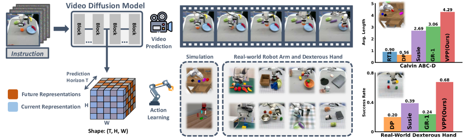
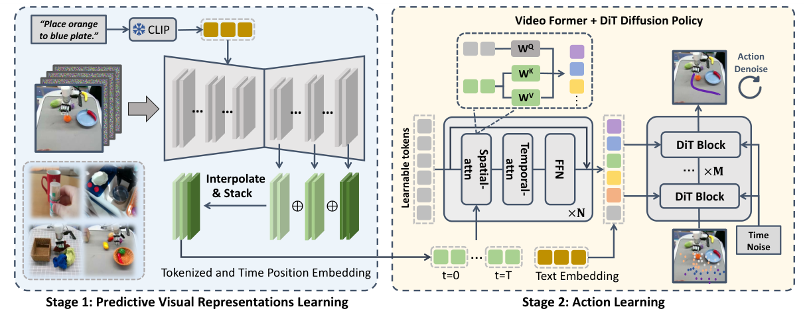
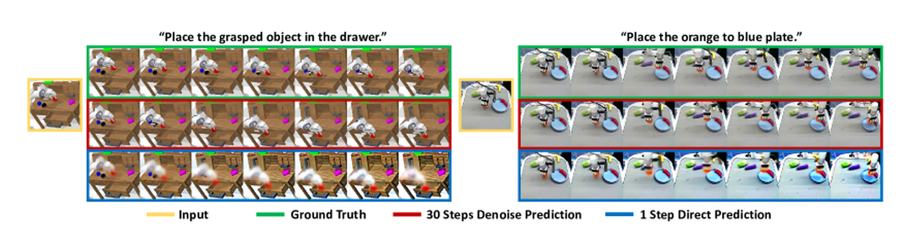
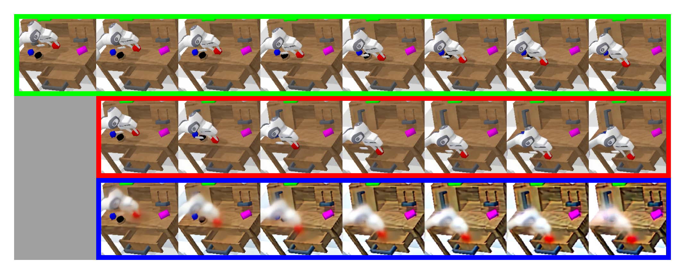
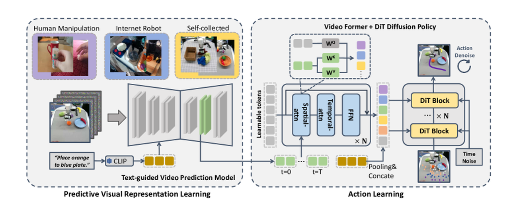
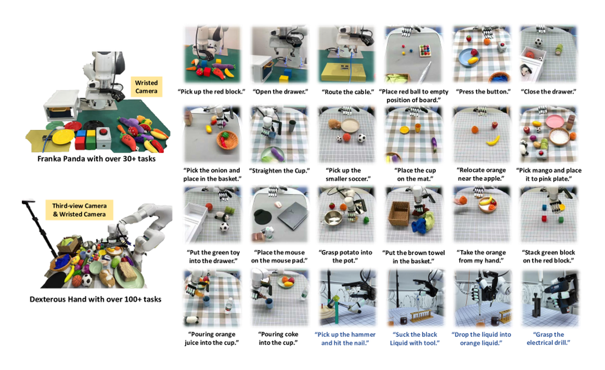

# Video Prediction Policy：预测视觉表征训练机器人策略

!!! info "论文信息"
    **论文题名：** Video Prediction Policy: A Generalist Robot Policy with Predictive Visual Representations。 
    **作者：** Yucheng Hu、Yanjiang Guo、Pengchao Wang、Xiaoyu Chen、Yen-Jen Wang、Jianke Zhang、Koushil Sreenath、Chaochao Lu、Jianyu Chen。 
    **机构：** 未在公开元数据中稳定解析；以 arXiv/PDF 或官方页 affiliation block 为准。 
    **时间 / 主题：** 2024-12；具身智能 / VLA。 
    **arXiv / 官方报告：** arXiv：[2412.14803](https://arxiv.org/abs/2412.14803)；官方材料：[video-prediction-policy.github.io/](https://video-prediction-policy.github.io/)。 
    **GitHub / 项目：** GitHub：[github.com/roboterax/video-prediction-policy](https://github.com/roboterax/video-prediction-policy)；项目页：[video-prediction-policy.github.io/](https://video-prediction-policy.github.io/)。 
    **元数据来源与核验口径：** 来源：[arXiv](https://arxiv.org/abs/2412.14803)；[GitHub API / repo](https://github.com/roboterax/video-prediction-policy)；[官方 / 项目材料](https://video-prediction-policy.github.io/)；Checked Date：2026-06-04；Repro Status：Paper / official materials reviewed, independent reproduction not claimed。

## 视频模型的未来表示，能不能比一张图更适合控制

Video Prediction Policy（VPP）的核心选择，是把经过操作视频训练的扩散模型用作视觉编码器。每次收到当前图像和语言指令，模型只运行一次前向，就从内部读取带有未来运动信息的特征；Video Former 压缩这些特征，再由动作扩散模型生成控制序列。机器人因此不必等一段清晰视频全部生成完，才开始决定动作。

这项工作提出的问题与普通物体识别不同。当前画面中的机械臂、杯子和抽屉分别是什么，只说明场景里有什么；“接下来手臂将朝哪里移动、物体将被放到哪里”，才更直接地接近动作预测所需信息。视频预测训练必须处理前后帧的变化，因此其内部表示可能包含静态编码器没有显式学习的运动趋势。

下图将这条思路放在一起。左侧视频网络产生沿时间排列的表示，中间将其交给动作学习；阅读重点是未来时间维度怎样进入控制条件。

{ width="920" }

*VPP 总体示意。图中 CALVIN 概览成绩为 4.29；下文定量比较采用论文 v2 Table 1 的完整结果 4.33。*

作者将这些特征称为 **Predictive Visual Representations（预测性视觉表示）**。这里的“未来”是模型根据当前观测与指令推断的状态，并非部署时可以读取真实未来图像。方法的有效性取决于预测中保留下来的信息是否有助于控制，而不取决于一次前向就能否产生可播放、纹理逼真的视频。[↗](https://arxiv.org/pdf/2412.14803v2#page=2)

主要结果支持这条路线。在 CALVIN ABC→D 五任务链中，VPP 的平均连续完成长度达到 4.33，完整五任务成功率为 76.9%；MetaWorld 50 任务平均成功率为 68.2%。但理解这些数字之前，需要先分清视频模型训练、视频特征提取与动作采样三个环节，它们的目标和计算次数并不相同。

## 两阶段训练，先学习画面如何变化，再学习怎样发出动作

Figure 2 左侧是视频域适配，右侧是动作学习。最值得看的是中间向下的多层特征出口，以及右侧仍然存在的 action denoise 回路。

{ width="920" }

*Figure 2，多层预测特征经过 Video Former 后，成为动作 diffusion policy 的条件。*

第一阶段将通用 Stable Video Diffusion 适配到人类与机器人操作视频，并加入语言控制。第二阶段冻结这个视频网络，利用机器人示范训练 Video Former 与动作头。没有机器人动作标签的人类视频可以进入第一阶段；第二阶段则需要示范动作，学习从视觉变化意图到具体机器人的控制量。

这就是论文所说的 **Implicit Inverse Dynamics（隐式逆动力学）**。给定模型内部表示的当前与未来状态变化，策略学习“什么动作能够对应这种变化”。它不显式提取手臂轨迹后运行几何求解器，也没有先生成完整视频再把两帧交给一个独立逆动力学模块。动作监督通过下游网络直接利用预测特征。[↗](https://arxiv.org/pdf/2412.14803v2#page=3)

这个概念也不意味着 VPP 建成了可以任意输入候选动作、预测接触结果并搜索最优计划的世界模型。视频分支的条件是当前图像与语言，动作头学习跟随其条件表示；论文没有在执行时枚举大量动作候选并通过视频打分选择。

## 把 SVD 变成语言可控的操作视频预测器

### 原有视频先验与目标域数据分别补什么

基础 SVD 约 1.5B 参数，原本以首帧图像为主要条件。VPP 增加 CLIP 语言特征 $\ell_{\mathrm{emb}}$ 的 cross-attention，使同一场景下不同指令能够对应不同未来；还将视频输出调整为通常 16 帧、$256\times256$，降低训练和推理成本。

当前观测 $s_0$ 沿通道与各待预测帧拼接，作为持续可见的条件。这样模型不只依赖一次输入的语言，也始终能够结合当前机器人和物体的位置生成相应未来。通用 SVD 提供视频生成的初始化，操作视频微调则把这个能力集中到手、机械臂、抓取与放置等变化上。

设干净视频序列为 $x_0$，扩散时间为 $t$，加入高斯噪声后的输入按原文式（1）写为

$$
x_t=\sqrt{\bar\alpha_t}\,x_0+
\sqrt{1-\bar\alpha_t}\,\epsilon,
\qquad \epsilon\sim\mathcal N(0,I).
$$

$\bar\alpha_t$ 决定干净信号与噪声的比例。视频模型在不同噪声程度下，利用首帧和语言条件恢复完整视频。原文式（3）的目标直接写为回归干净视频 $x_0$。

$$
\mathcal L_D=
\mathbb E_{x_0\sim D,\epsilon,t}
\left\|V_\theta(x_t,\ell_{\mathrm{emb}},s_0)-x_0\right\|^2.
$$

这里保留的是论文的 clean-sample 目标，不能仅因为模型属于 diffusion，就把右侧监督擅自改成噪声 $\epsilon$。损失让网络理解在给定图像、指令条件下，视频序列应具有怎样的结构和变化。[↗](https://arxiv.org/pdf/2412.14803v2#page=3)

### 视频提供共同监督接口，不要求人手和机械臂共享动作维度

第一阶段将人类操作视频 $D_H$、机器人视频 $D_R$ 与自采视频 $D_C$ 加权混合。

$$
\mathcal L_{\mathrm{video}}
=\lambda_H\mathcal L_{D_H}
+\lambda_R\mathcal L_{D_R}
+\lambda_C\mathcal L_{D_C}.
$$

各项都学习图像序列预测，因此人手与不同机械臂无需具有相同动作向量。$\lambda$ 或对应采样比例控制来源影响，避免某个规模特别大的数据集主导所有更新。它不是让人类视频直接给机器人的关节数值提供标签，而是先迁移可观察的操作变化。

Appendix Table 8 给出具体混合。

| Dataset | Trajectory Numbers | Sample Ratio |
| --- | ---: | ---: |
| Something-Something-v2 | 191,642 | 0.30 |
| RT-1 | 87,212 | 0.15 |
| Bridge | 23,377 | 0.15 |
| BC-Z | 43,264 | 0.08 |
| Taco-Play | 3,603 | 0.01 |
| Jaco-Play | 1,085 | 0.01 |
| CALVIN-ABC | 18,033 | 0.10 |
| MetaWorld | 2,500 | 0.05 |
| Panda Arm | 2,000 | 0.05 |
| Dexterous Hand | 2,476 | 0.10 |
| Total | 375,192 | 1.00 |

采样比例不按轨迹数量简单分配。自采灵巧手视频只占较小数量，却有 0.10 的采样权重，与 CALVIN 相同；这使模型更充分地适配目标机器人和动作模式。表中还将目标任务 CALVIN、MetaWorld 视频纳入训练，所以 VPP 的视频表示并非只来自与下游无关的互联网数据。

作者留出 5,558 条 Bridge 与 2,048 条 Something-Something-v2 轨迹做验证，其余来源按 3% 留出。正文使用的人类视频总数 193,690，与表中的 191,642 相差的正是 2,048 条验证轨迹。相比之下，灵巧手数据规模在正文、附录的描述不一致，后面讨论实机设置时需要单独说明，不能把所有数字机械相加。[↗](https://arxiv.org/pdf/2412.14803v2#page=14)

## 一次视频前向怎样产生可用的未来条件

### 读取的是上采样层特征，不是已经生成好的视频

动作训练与执行时，TVP 参数固定。输入为当前图像、语言和高噪声未来 latent，通常为白噪声；执行端不需要、也无法获取真实未来 $x_0$。一次前向虽然不足以把所有纹理去噪干净，却可能已经形成手臂与物体大致移动的特征。

第 $m$ 个上采样层的输出记为

$$
L_m=V_\theta(x_{t'},\ell_{\mathrm{emb}},s_0)^{(m)},
\qquad
L_m\in\mathbb R^{T\times C_m\times W_m\times H_m}.
$$

$T$ 是时间位置数，包含当前与预测未来；$C_m$、$W_m$、$H_m$ 是该层通道与空间尺寸。这里的时间维来自模型对未来的表示，不是一段已经发生的机器人历史。把两者混淆，会错误地认为 VPP 自动拥有长期观测记忆。

各上采样层具有不同分辨率和内容。VPP 将它们插值到共同的 $W_p\times H_p$，再沿通道维拼接。

$$
L'_m=\operatorname{Interpolation}(L_m),\qquad
F_p=\operatorname{Concat}_{\mathrm{channel}}(L'_0,\ldots,L'_m),
$$

$$
F_p\in\mathbb R^{T\times(\sum_m C_m)\times W_p\times H_p}.
$$

拼接保留不同层对场景和运动的描述，后续模块再学习哪些部分与动作有关。它避免只能使用最终层偏重像素细节的输出，也减少人工挑一个层的需求。静态相机与腕部相机先分别得到预测特征，再在 Video Former 中合并；视频模型没有直接要求两路图像共享一个显式三维重建。[↗](https://arxiv.org/pdf/2412.14803v2#page=4)

### 粗糙图像的意义是展示信息存在，不是直接证明控制成功

Figure 4 同时给出真实未来、30 步去噪后的未来与一次前向的直接预测。先跟踪机械臂和目标物体的位置，再比较纹理，可以看到两类变化并不同步。

{ width="720" }

*Figure 4，一次前向的蓝框结果更粗糙，但已经呈现部分手臂和物体的运动趋势。*

这张图支持“有用运动信息可能早于精细纹理出现”的解释。它没有证明一次前向预测完全符合物理规律，也不能证明所有任务都只需要同样粗略的未来。是否足以控制，仍须看相同动作头更换视觉表示、改变特征层与增加去噪次数后的结果。

附录的局部放大更容易看到这一点。蓝框中画面存在模糊和失真，但仍能辨认手臂与抽屉关系随时间的变化；VPP 将内部特征交给策略，并不要求机器人先从这张模糊图中显式识别所有物体。

{ width="920" }

*预测性表示可视化的局部，绿色为真实序列，红色为生成未来，蓝色为一次前向结果。*[↗](https://arxiv.org/pdf/2412.14803v2#page=17)

## Video Former 把多帧、多层、多视角压成有限条件

即使省去完整视频生成，$F_p$ 仍然很大。若将所有帧、所有位置与所有层直接送入动作 Transformer，每轮动作去噪都要处理大量条件信息，延迟仍可能过高。

Video Former 为每个时间位置设置一组可学习 query。空间注意力先让第 $i$ 帧 query 读取该帧各相机的视觉特征；时间注意力再让不同帧的 query 交换信息，随后经过 FFN。用原文式（5）的操作表示为

$$
Q'=
\left\{\operatorname{SpatAttn}
\left(Q[i],\left(F_p^{\mathrm{static}}[i],F_p^{\mathrm{wrist}}[i]\right)\right)\right\}_i,
$$

$$
Q''=\operatorname{FFN}\left(\operatorname{TempAttn}(Q')\right).
$$

空间分支在每帧中选择与任务相关的位置，时间分支连接这些位置在未来序列中的变化。query 数量固定，输出条件大小便不再随原始视觉特征数量无限增长。这个模块同时承担信息提取与计算压缩，不能只把它理解为对特征做一次平均池化。

下面的结构示意把这两个注意力方向与右侧动作去噪分开。读取时可沿 query 到空间特征、再到时间关系的路径，追踪最终条件怎样进入动作头。

{ width="760" }

*Video Former 的空间、时间聚合及动作 DiT 条件接口。*

附录 Table 13 的 Video Former 使用 6 层、8 个 attention heads、latent dimension 512。CALVIN 的 token shape 为 $16\times14\times384$，MetaWorld 为 $8\times28\times384$，二者都对应 224 个 384 维输出 token。动作 DiT 的 condition shape 列为 $225\times384$。应按表保留这个接口规模，不宜在缺少实现说明时自行给额外位置添加未经证实的语义。[↗](https://arxiv.org/pdf/2412.14803v2#page=16)

## 动作头仍然进行多步扩散采样

Video Former 得到的 $Q''$ 经 cross-attention 进入动作 Diffusion Transformer。训练时，示范动作块 $a_0$ 被加入噪声。

$$
a_k=\sqrt{\bar\beta_k}\,a_0+
\sqrt{1-\bar\beta_k}\,\epsilon.
$$

其中 $k$ 为动作扩散时间，与视频扩散的 $t'$ 是不同过程。原文式（6）给出的训练目标为

$$
\mathcal L_{\mathrm{diff}}=
\mathbb E_{a_0,\epsilon,k}
\left\|D_\psi(a_k,\ell_{\mathrm{emb}},Q'')-a_0\right\|^2.
$$

尽管附近文字使用了估计 noise 的说法，印出的公式监督是干净动作 $a_0$。这里沿用原公式，避免将两种扩散参数化混写。视频分支提供未来条件，动作分支学习在该条件下的控制分布；它仍然需要机器人示范来确定不同平台动作的数值含义。[↗](https://arxiv.org/pdf/2412.14803v2#page=5)

| Setting | Video length | Action chunk shape | Action sampling steps |
| --- | ---: | --- | ---: |
| CALVIN | 16 | $10\times7$ | 10 |
| MetaWorld | 8 | $4\times4$ | 10 |
| Franka Panda | 16 | $10\times7$ | 10 |
| Xhand | 16 | $10\times18$ | 10 |

“视频一次前向”“动作十步去噪”“输出十个动作”描述三件不同的事。MetaWorld 就以十步采样生成四个动作。Xhand 的动作向量有 18 维，包含该平台的整体控制；它不能被理解成论文所用灵巧手本身有 18 个关节，因为硬件描述中的手是 12 自由度。

DiT 使用 width 384、8 heads、4 个 encoder layers 与 4 个 decoder layers。Table 13 列出的 policy batch size 为 CALVIN 76、MetaWorld 64、Panda 128、Xhand 128；epochs 分别为 12、30、30、40，学习率分别为 $10^{-4}$、$5\times10^{-5}$、$10^{-4}$、$10^{-4}$，TVP batch size 列为 4。表中没有展开所有优化器和 batch 分配细节，不能据此反推出严格相同的训练计算量。[↗](https://arxiv.org/pdf/2412.14803v2#page=16)

第一阶段微调视频模型约需 8 张 A100、2–3 天，第二阶段策略训练约需 4 张 A100、6–12 小时。RTX 4090 部署报告约 7–10 Hz；Table 4 的完整 VPP 延迟约 140 ms。方法节还报告每个观测的视频前向少于 160 ms，这些近似计时不应与动作块长度相乘后当成新测得的控制频率。VPP 避免的是每次执行前的完整视频去噪，仍然承担大视频网络和动作扩散头的成本。[↗](https://arxiv.org/pdf/2412.14803v2#page=6)

## CALVIN 的长任务指标，为什么不能只看第一步

### ABC→D 测场景迁移，五任务链测连续执行

CALVIN ABC→D 在 A、B、C 环境训练，在未见 D 环境测试。策略按语言指令连续完成五项任务，前一项成功后才能继续后面的任务。第一列回答能否完成第一项，第五列回答能否连做五项；它们不是五个互相独立任务的单项成功率。

令 $L\in\{0,1,\ldots,5\}$ 为一条链连续成功的任务数，则表中的平均长度可理解为

$$
\mathbb E[L]=\sum_{j=1}^{5}P(L\ge j).
$$

例如 VPP 的五列相加为 $0.965+0.909+0.866+0.820+0.769=4.329$，按原表显示为 4.33。这是指标的等价解释，说明较高的第一步成功率若伴随后续快速衰减，仍无法得到高平均长度。

| Method | Annotated Data | 1 | 2 | 3 | 4 | 5 | Avg. Len |
| --- | --- | ---: | ---: | ---: | ---: | ---: | ---: |
| RT-1 | 100% ABC | 0.533 | 0.222 | 0.094 | 0.038 | 0.013 | 0.90 |
| Diffusion Policy | 100% ABC | 0.402 | 0.123 | 0.026 | 0.008 | 0.000 | 0.56 |
| Robo-Flamingo | 100% ABC | 0.824 | 0.619 | 0.466 | 0.331 | 0.235 | 2.47 |
| Uni-Pi | 100% ABC | 0.560 | 0.160 | 0.080 | 0.080 | 0.040 | 0.92 |
| MDT | 100% ABC | 0.631 | 0.429 | 0.247 | 0.151 | 0.091 | 1.55 |
| Susie | 100% ABC | 0.870 | 0.690 | 0.490 | 0.380 | 0.260 | 2.69 |
| GR-1 | 100% ABC | 0.854 | 0.712 | 0.596 | 0.497 | 0.401 | 3.06 |
| Vidman | 100% ABC | 0.915 | 0.764 | 0.682 | 0.592 | 0.467 | 3.42 |
| RoboUniview | 100% ABC | 0.942 | 0.842 | 0.734 | 0.622 | 0.507 | 3.65 |
| VPP | 100% ABC | 0.965 | 0.909 | 0.866 | 0.820 | 0.769 | 4.33 |
| GR-1 | 10% ABC | 0.672 | 0.371 | 0.198 | 0.108 | 0.069 | 1.41 |
| VPP | 10% ABC | 0.878 | 0.746 | 0.632 | 0.540 | 0.453 | 3.25 |

VPP 相对 RoboUniview 的第一步只从 94.2% 到 96.5%，第五步却从 50.7% 到 76.9%。优势并非仅体现在起始场景识别，还体现在连续执行时保持较高完成概率。Avg. Len 从 3.65 到 4.33，相对提高约 18.6%；若改与 GR-1 的 3.06 比较，相对提高约 41.5%。这两个百分比使用不同基线，不能混成同一个“对前代 SOTA”的提升口径。[↗](https://arxiv.org/pdf/2412.14803v2#page=5)

### 10% 标注结果没有取消视频先验与目标域视频

使用 10% 标注 ABC 数据时，VPP 仍达到 3.25，GR-1 为 1.41。它说明动作监督减少时，预测性表示能提供有用先验。但 10% 指该行策略学习使用的标注数据比例，模型仍继承 SVD 预训练与操作视频适配，不能解释成整个系统只用了完整方案 10% 的所有训练资源。

同时，表中基线来源并非全部由作者按同一预算重训。有些采用原论文成绩，有些运行官方实现，Diffusion Policy 等也进行了语言条件适配。这张表支持方法的整体竞争力，不能唯一证明“未来表示”是所有跨方法差异的原因；相同条件下替换表示的实验更适合回答因果更窄的问题。[↗](https://arxiv.org/pdf/2412.14803v2#page=6)

## MetaWorld 检查单个策略能否处理不同难度的五十个任务

MetaWorld 使用 Sawyer，作者以官方 oracle policy 为每个任务收集 50 条示范，共 2500 条，训练一个语言条件策略处理全部 50 个任务。Table 2 将它们划分为 28 个 easy、11 个 middle、11 个 hard。

| Method | Easy, 28 tasks | Middle, 11 tasks | Hard, 11 tasks | Average, 50 tasks |
| --- | ---: | ---: | ---: | ---: |
| RT-1 | 0.605 | 0.042 | 0.015 | 0.346 |
| Diffusion Policy | 0.442 | 0.062 | 0.095 | 0.279 |
| Susie | 0.560 | 0.196 | 0.255 | 0.410 |
| GR-1 | 0.725 | 0.327 | 0.451 | 0.574 |
| VPP | 0.818 | 0.493 | 0.526 | 0.682 |

VPP 整体从 GR-1 的 57.4% 提高到 68.2%，差值为 **10.8 个百分点**。Middle 从 32.7% 到 49.3%，Hard 从 45.1% 到 52.6%，说明优势不限于容易任务；但 hard 仍只有约一半成功，也没有因使用视频预测就达到稳定完成。

难度分组由不同任务组成，因此 Middle 数值低于 Hard 并不矛盾。表内结果不能被读成同一个任务从 easy 逐级加难后的严格曲线。[↗](https://arxiv.org/pdf/2412.14803v2#page=5)

## 控制消融怎样检验预测性表示，而不只检验更大模型

### 替换视觉编码器后，保持下游接口与动作学习

Table 3 替换 VDM 视觉编码器，其余组件与设置保持一致。Stable-VAE 使用图像重建表示；VC-1 使用 MAE 表示；Voltron 结合重建与语言生成。VC-1 和 Voltron 还在与 VPP 相同的视频数据上适配，再重采样成固定 token 后接动作头。它们并非完全没有目标域训练的弱基线。

| Encoder | Pre-training Type | Avg. Length |
| --- | --- | ---: |
| VDM | Video Generation | 4.33 |
| Stable-VAE | VAE Reconstruction | 2.58 |
| VC-1 | MAE Reconstruction | 1.23 |
| Voltron | MAE Reconstruction + Language Generation | 1.54 |

预测表示在这个相同下游接口中表现更好，支持视频预训练所得特征适合动作学习。不过编码器的容量、架构与预训练目标也不同，因此这仍不是只把一个模型中的“未来信息”单独删除的实验。可以肯定这套 VDM 表示有效，不能据此精确计算所有增益中有多少来自某一种内部物理知识。[↗](https://arxiv.org/pdf/2412.14803v2#page=7)

### 目标域视频适配的重要性，不低于额外互联网数据

| Ablation Type | Avg. Length | Latency |
| --- | ---: | ---: |
| VPP | 4.33 | ≈140 ms |
| Without Internet data | 3.97 | ≈140 ms |
| Without CALVIN video | 3.31 | ≈140 ms |
| Without Internet data and SVD pretraining | 1.63 | ≈140 ms |
| Without Video Former | 3.86 | ≈450 ms |
| Without Feature Aggregation | 3.60 | ≈140 ms |

删除额外互联网操作数据后，平均长度降低 0.36；删除 CALVIN 视频适配后，降低 1.02。当前任务的视频预测能力对这组结果尤其重要，不能将 4.33 全部归因于互联网视频中的通用物理先验。

同时删除互联网数据与 SVD 初始化，降到 1.63。它说明仅在目标域小数据上从头学习视频模型不足以复现完整效果，但这一行改变了两个因素，不能把 4.33 到 1.63 的全部差距当成单独的“SVD 预训练增益”。

移除 Video Former、直接把高维特征接入动作头后，延迟从约 140 ms 变成约 450 ms，平均长度也从 4.33 降到 3.86。这是对压缩模块双重作用的直接证据：它既减少反复动作去噪时的条件处理成本，也改善对任务相关信息的提取。[↗](https://arxiv.org/pdf/2412.14803v2#page=7)

### 聚合优于最终层，但不明显超过最佳单层

主消融中的 Without Feature Aggregation 使用最终层特征，平均长度为 3.60。附录进一步选择不同中间层。

| Feature selection | Layer 3 | Layer 6 | Layer 9 | Layer 12 | VPP aggregation |
| --- | ---: | ---: | ---: | ---: | ---: |
| Avg. Len | 3.72 | 3.88 | 4.29 | 4.05 | 4.33 |

第九层已经达到 4.29，距离完整聚合只有 0.04。多层方案显著降低了依赖最终层的风险，也省去手工挑层，但这张表没有支持“多层聚合比任何单层都大幅更强”。更有用的认识是，控制所需信息在中间层很丰富，最终像素细节不是唯一、更不是必然最好的接口。[↗](https://arxiv.org/pdf/2412.14803v2#page=15)

### 一次前向并非近似方案的无奈下限

附录还将视频前向增加为两步。若更清晰的视频表示一定带来更好控制，两步应该优于一步；实际结果没有出现这种关系。

| Setting | Five tasks completed | Avg. Len |
| --- | ---: | ---: |
| VPP | 0.769 | 4.33 |
| Single-view | 0.518 | 3.58 |
| Without temporal attention | 0.714 | 4.18 |
| Two TVP denoising steps | 0.718 | 4.19 |

两步平均长度为 4.19，低于一步的 4.33，同时接近翻倍视频端成本。它支持在当前设置中粗预测已经足够有用，而不是越接近最终像素视频就越适合控制。移除时间注意力降到 4.18，说明按时间组织和交互这些特征也有贡献。

单视角仍能达到 3.58，但五任务全成功率是 0.518。原文附近文字将 3.58 写成“Task 5 success rate”，与 Table 12 不一致；这里按表中的指标列解释，避免混用任务数与概率。

另一个消融比较读取特征时的扩散时间索引 10、20、30，平均长度分别为 4.21、4.33、4.25。这是在改变噪声位置，不是在分别执行 10、20、30 次视频前向。时间索引、去噪步数与动作块长度是三个需要保持独立的参数。[↗](https://arxiv.org/pdf/2412.14803v2#page=15)

## 视频生成质量与机器人成功率，需要两套证据

除了控制结果，作者在 Bridge 验证集上评价 TVP 的视频生成质量。

| Model | Bridge FVD ↓ |
| --- | ---: |
| VideoFusion | 501.2 |
| Tune-A-Video | 515.7 |
| Seer | 246.3 |
| VPP | 41.4 |

Table 9 的比较方法成绩取自 Seer 的实验，VPP 的低 FVD 表明其操作视频分布预测更接近验证数据。这个结果支持视频域适配有效，但 FVD 不直接测量末端接触正确性，也不等价于机器人执行成功率。

附录完整视频展示使用 30 个去噪步骤、classifier-free guidance 7.5，预测 16 帧并隔帧展示其中 8 帧。它与策略使用的一次前向特征不是相同采样预算。因此不能将 FVD 41.4 直接描述成“一步视频生成达到的质量”，更不能从生成质量排序推导任意控制任务的可靠性。[↗](https://arxiv.org/pdf/2412.14803v2#page=14)

## 真机结果应同时看平均、具体技能和试验次数

### 两个平台使用不同采集与动作接口

Franka Panda 通过 Spacemouse 遥操作收集约 2000 条示范，覆盖 30 多项任务，包含拾取、放置、按压、布线、开关等六类技能。另一平台为 Xarm 搭配 12 自由度 Xhand，使用 Vision Pro 捕获手指运动后重定向到机器人手，低层 PD 控制器平滑策略轨迹。

{ width="760" }

*真实机器人平台与对象、场景、工具使用任务示例。*

灵巧手数据规模的报告存在差异：正文写 4000 条、13 类技能，附录 A.2 写约 2500 条、10 类技能，视频训练配方表则列 2476 条。可以确认平台包含 100 多项任务，但不能把不同位置的数字合成一个精确统一的采集规模。[↗](https://arxiv.org/pdf/2412.14803v2#page=8) [↗](https://arxiv.org/pdf/2412.14803v2#page=12)

这里的 unseen 是操作对象或背景场景未在相应训练数据中出现。它主要测试已学操作在新对象、新场景中的使用，不能扩大成任意未见技能零示范执行。作者的网球、可乐和勺子案例也只明确说这些对象没有出现在自采集合中，不代表通用 SVD 或其他互联网数据从未见过相关概念。

### 平均成功率还要与类别及测试次数相互核对

下表以 Appendix Tables 6、7 的细分结果为基础，数值为成功概率。Susie 的灵巧手 unseen 一项采用主文 Table 5 的 0.28；附录该项存在需要单独说明的汇总差异。

| Platform / Setting | Diffusion Policy | Susie | GR-1 | VPP |
| --- | ---: | ---: | ---: | ---: |
| Panda / Seen | 0.425 | 0.563 | 0.519 | 0.856 |
| Panda / Unseen | 0.250 | 0.463 | 0.388 | 0.737 |
| Dexterous / Seen | 0.287 | 0.450 | 0.319 | 0.749 |
| Dexterous / Unseen | 0.110 | 0.28 | 0.159 | 0.605 |
| Dexterous / Tool-use | 0.05 | 0.23 | 0.15 | 0.68 |

这些平均不是将每一类别成功率不加权相加。Panda 已见的 Pick、Place 各测试 50 次，其他类别各 20 次；未见的 Pick、Place 各 25 次，其他各 10 次。灵巧手已见 Pick、Pick&Place 各 100 次，其余各 25 次；附录对未见设置给出前两类各 50 次、其余各 20 次。不同任务重复数不同，平均更受抓取和放置类别影响。[↗](https://arxiv.org/pdf/2412.14803v2#page=12) [↗](https://arxiv.org/pdf/2412.14803v2#page=13)

Susie 在附录 Table 7 的未见平均印为 0.328，但按该表列出的各类别成功率和上述次数加权，得到约 0.281，与主文的 0.28 接近。因此不能仅因附录更详细就优先采用 0.328。这个重算值只是对表格内部一致性的检查；部分单项概率也不能直接还原为所述次数下的整数成功数，例如 20 次试验中的 0.76。论文没有充分说明这些口径差异，故不进一步重构原始成功计数。

Panda 中 VPP 的总体明显更高，但已见 Press 只有 0.85，Susie 为 0.90；因此“总体最好”不等于每项技能都最好。未见时 VPP 的 Pick、Place、Press、Route、Drawer 分别为 0.80、0.72、0.80、0.70、0.60，抽屉仍弱于其他几类。

灵巧手的能力跨度更大。VPP 未见 Relocate 为 0.76，Press 为 0.88，Stack 为 0.56，而 Pass 只有 0.32、Unplug 只有 0.20。将这组结果只写成“复杂灵巧操作成功率 60.5%”，会掩盖接触精度、协调与任务结构带来的差异。已见 Press 中 VPP 和 Susie 同为 0.96，也不是每个任务都有提升。

### 工具使用有实际执行证据，但每项只有十次测试

| Tool-use Task | Diffusion Policy | Susie | GR-1 | VPP |
| --- | ---: | ---: | ---: | ---: |
| Spoon | 0.0 | 0.4 | 0.3 | 0.9 |
| Hammer | 0.2 | 0.2 | 0.1 | 0.6 |
| Drill | 0.0 | 0.1 | 0.2 | 0.8 |
| Pipette | 0.0 | 0.0 | 0.0 | 0.4 |

VPP 在四类工具任务中都有非零成功，并高于这组基线。这里测试的是实际工具操作，证据强于仅根据常识选择合适工具。不过每项只有十次，Spoon 的 0.9 对应九次成功，Pipette 的 0.4 对应四次；不能把整体 0.68 写成在任何工具、液体或装配条件下的稳定水平。[↗](https://arxiv.org/pdf/2412.14803v2#page=13)

## 这条路线最值得迁移的是预测任务与控制接口的分离

VPP 的实验共同支持一项具体判断。视频生成训练可以让视觉网络学习未来变化，而下游控制不一定需要等待这个网络把全部纹理生成完。读取中间特征、聚合多层信息、压缩时空条件，再用机器人动作监督学习对应关系，是一个可以分环节测量成本与收益的方案。

“隐式追踪机械臂运动”是作者对泛化机制的解释。预测视频与真实轨迹相似的案例为它提供直观支持，但论文没有直接证明动作头只跟踪机械臂、完全忽略新对象动力学。接触、摩擦与工具姿态仍然决定实际任务能否完成，Pass、Unplug 和 Pipette 的低成功率也显示，合理的视觉未来不等于所有控制细节已经可靠。

复用这项方法时，最有价值的检查顺序是先确认目标域视频能否预测与任务相关的变化，再比较中间层、最终层和多层聚合对动作的实际收益，最后单独测 Video Former、视频前向与动作采样的延迟。数据效率也应分开报告视频资源和动作标注比例。这样既能保留视频基础模型的作用，也能识别真正的瓶颈究竟在未来预测、表示压缩，还是机器人动作学习。[↗](https://arxiv.org/pdf/2412.14803v2#page=9)
