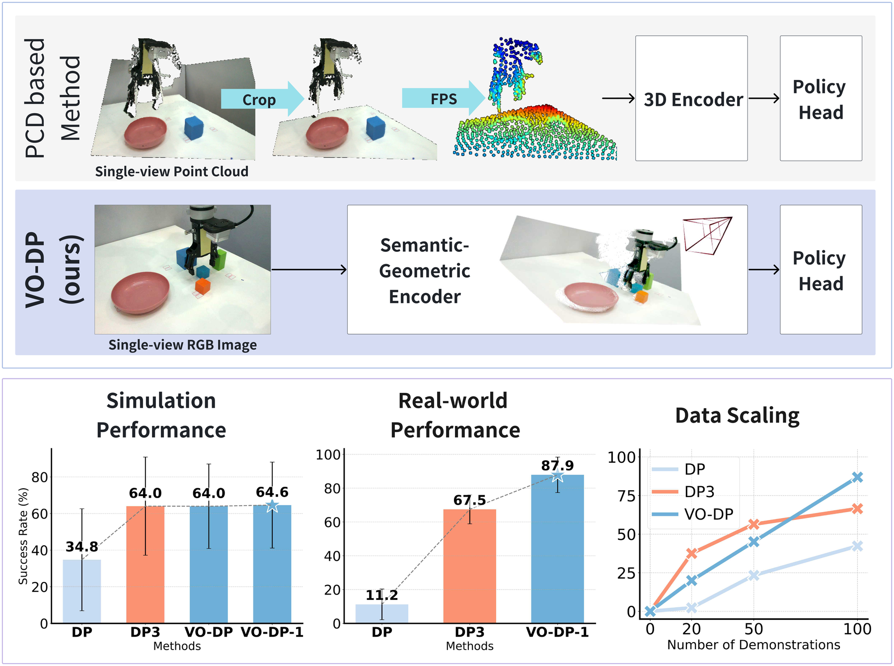
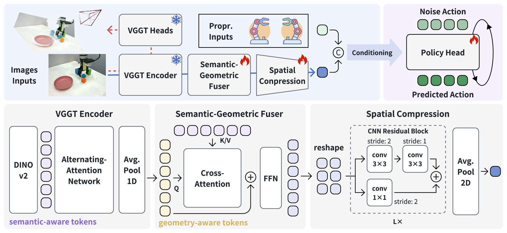
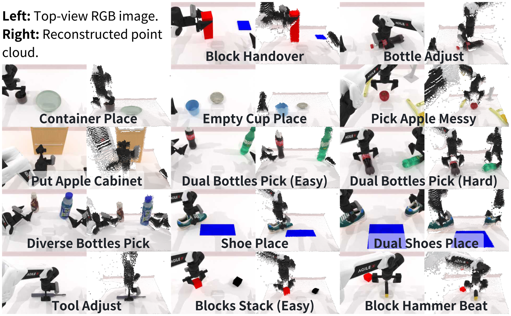
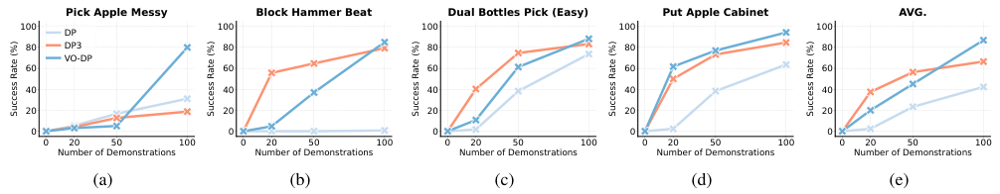
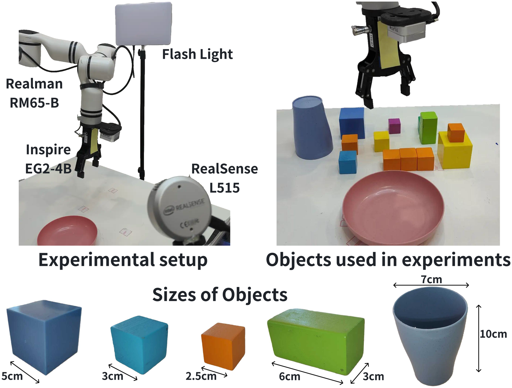
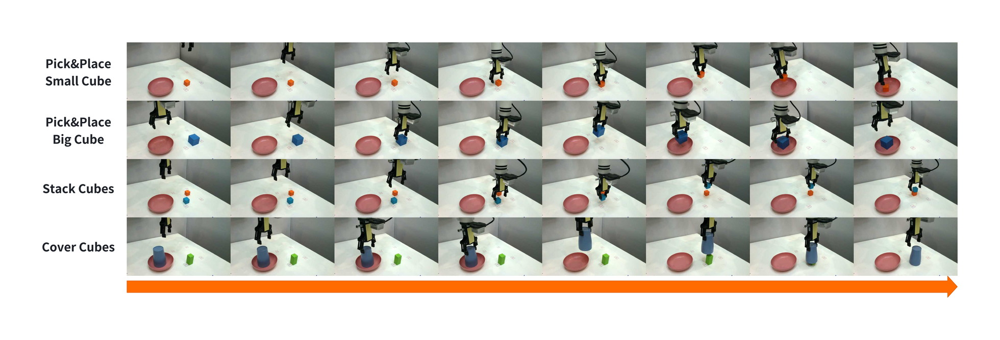
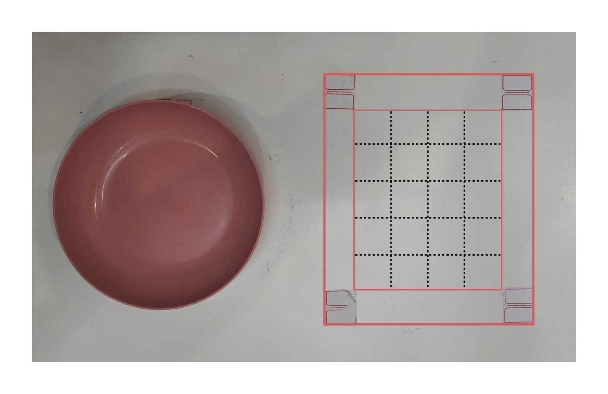
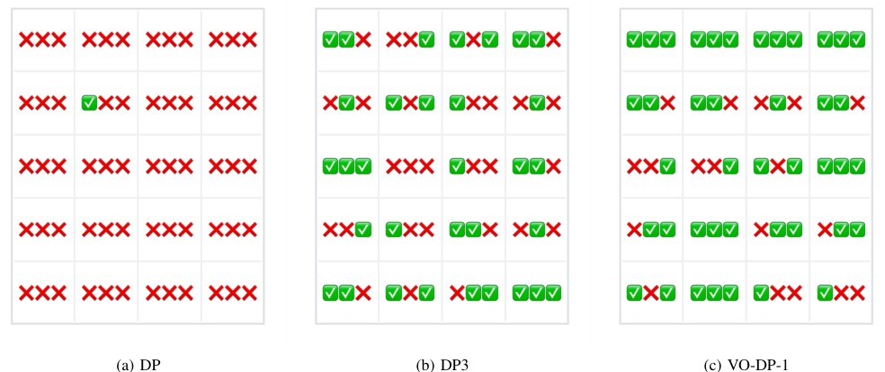
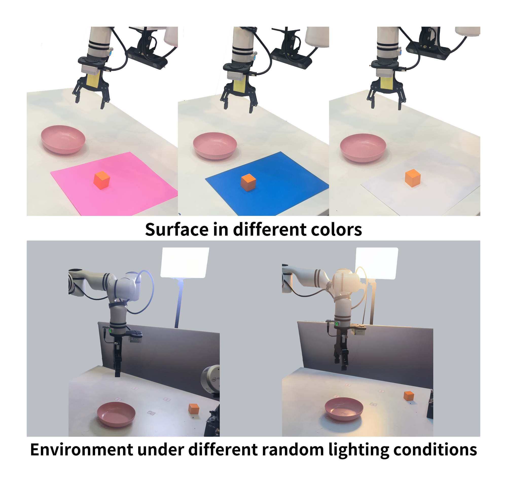
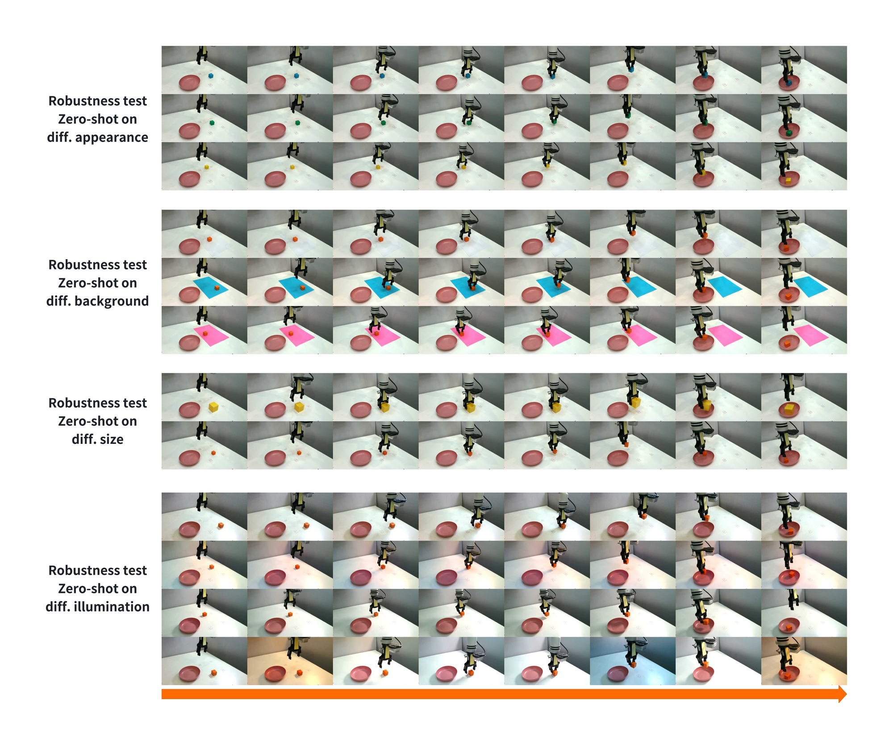

# VO-DP：RGB-only 扩散策略怎样借用语义和几何特征

!!! info "论文信息"
    **论文题名：** VO-DP: Semantic-Geometric Adaptive Diffusion Policy for Vision-Only Robotic Manipulation。 
    **作者：** Zehao Ni、Yonghao He、Lingfeng Qian、Jilei Mao、Fa Fu、Wei Sui、Hu Su、Junran Peng、Zhipeng Wang、Bin He。 
    **机构：** National Key Laboratory of Autonomous Intelligent Unmanned Systems、University of Science and Technology Beijing、State Key Laboratory of Multimodal Artificial Intelligence System (MAIS)、Institute of Automation of Chinese Academy of Sciences。 
    **时间 / 主题：** 2025-10；具身智能。 
    **arXiv / 官方报告：** arXiv：[2510.15530](https://arxiv.org/abs/2510.15530)；官方材料：[d-robotics-ai-lab.github.io/vodp/](https://d-robotics-ai-lab.github.io/vodp/)。 
    **GitHub / 项目：** GitHub：[github.com/D-Robotics-AI-Lab/DRRM](https://github.com/D-Robotics-AI-Lab/DRRM)；项目页：[d-robotics-ai-lab.github.io/vodp/](https://d-robotics-ai-lab.github.io/vodp/)。 
    **元数据来源与核验口径：** 来源：[arXiv](https://arxiv.org/abs/2510.15530)；[GitHub API / repo](https://github.com/D-Robotics-AI-Lab/DRRM)；[官方 / 项目材料](https://d-robotics-ai-lab.github.io/vodp/)；Checked Date：2026-06-15；Repro Status：Paper / official materials reviewed, independent reproduction not claimed。

## 单视角 RGB 策略的短板，究竟在动作模型还是视觉表示

VO-DP 研究的是一个明确的接口选择。机器人已经可以用 diffusion policy 从观测生成连续动作，但视觉输入应该如何表示？点云策略 DP3 先把场景变成显式三维点，再提取低维特征；VO-DP 则保留单视角 RGB 输入，借用预训练视觉模型内部的语义与几何特征，为同类扩散动作头提供条件。[↗](https://arxiv.org/pdf/2510.15530v4#page=1) [↗](https://arxiv.org/pdf/2510.15530v4#page=2)

论文的主要贡献发生在感知到策略之间。它没有提出新的扩散生成目标，而是将冻结 VGGT 的两级特征通过 cross-attention 融合，再用卷积网络压缩成动作模型能使用的场景表示。这样可以检查，传统 RGB 策略表现较差是否部分源于视觉表示不够好，而非 RGB 输入本身必然不适合精细操作。

{ width="920" }

*原论文 Figure 1。上方对比点云裁剪、采样、编码与 RGB 特征编码两条路径，下方展示仿真、真机和数据量实验。具体数字以对应结果表为准，尤其要区分三帧 VO-DP 与单帧 VO-DP-1。* [↗](https://arxiv.org/pdf/2510.15530v4#page=1)

结果并非在所有任务上都胜过点云。RoboTwin 的十四项任务中，三帧 VO-DP 平均成功率为 63.9%，单帧版本为 64.6%，DP3 为 64.0%；四项真机任务中，单帧版本达到 87.9%，高于 DP3 的 67.5%。前一组说明平均表现接近，但任务强项不同；后一组说明在本文的真实数据、硬件和控制条件下，强 RGB 表示能够发挥优势。[↗](https://arxiv.org/pdf/2510.15530v4#page=6) [↗](https://arxiv.org/pdf/2510.15530v4#page=7)

“Vision-only” 在这里限定的是环境感知输入，不意味着策略只看到图像而完全不知道机器人自身状态。模型还使用关节观测，也没有语言指令输入。论文中的“semantic” 指视觉特征携带的对象与外观信息，不能直接解释成已经验证了开放语言指令理解。

## 输入是一台相机的历史，输出是一段关节动作

论文将时刻 $t$ 的观测定义为

$$
O_t=\{I_t\in\mathbb R^{T\times H\times W\times3},
S_t\in\mathbb R^{T\times J}\},
\qquad A_t\in\mathbb R^{N\times J}.
$$

$I_t$ 是长度为 $T$ 的 RGB 图像历史，$S_t$ 是同期的 $J$ 维关节状态，$A_t$ 是未来 $N$ 步的动作块。仿真中双臂各有六个自由度和夹爪，$J=14$，预测长度 $N=8$。[↗](https://arxiv.org/pdf/2510.15530v4#page=3) [↗](https://arxiv.org/pdf/2510.15530v4#page=4)

默认仿真模型使用 $T=3$，称为 VO-DP；$T=1$ 的消融版本称为 VO-DP-1。三帧是同一相机的时间历史，不是三台相机或三个空间视角。真机部分根据仿真结果选用单帧版本，后文未特别说明时的真机 VO-DP 都指 VO-DP-1。

这个接口将问题限制在给定任务示范后的模仿学习。模型学习从图像和自身状态到动作的映射，任务差异通过训练数据体现。它不接收文本任务 token，也没有增加语言规划、显式物体检测或手工重建点云作为策略输入。

## 冻结 VGGT 后，究竟从哪里取特征

VO-DP 使用 VGGT 的中间表示，保留其已经学到的几何先验。图 2 的雪花标在 VGGT encoder 与原有 heads 上，火焰标在新融合模块、空间压缩模块和 policy head 上，区分了冻结的预训练部分与学习动作任务的部分。

{ width="920" }

*原论文 Figure 2。先沿上方主线读冻结编码器、特征融合、空间压缩与动作去噪，再看下方展开。几何特征担任 query，DINOv2 特征担任 key/value；关节状态在空间压缩之后拼入，原 VGGT 的几何输出头不在主动作条件路径上。* [↗](https://arxiv.org/pdf/2510.15530v4#page=4)

第一路来自 DINOv2 对图像的 token 化。设每帧有 $P$ 个 patch，每个 token 宽度为 $C$，则语义特征为 $h_t^{\mathrm{sem}}\in\mathbb R^{T\times P\times C}$。论文将它称为 semantics-aware features，因为它保留较丰富的对象、纹理与外观信息。

第二路继续经过 VGGT 的 24 个 alternating-attention blocks。VO-DP 读取第 24 个 block，并将其中 frame-wise 与 global self-attention 的特征沿通道拼接，得到 $h_t^{\mathrm{geo}}\in\mathbb R^{T\times P\times2C}$。本文使用的 $C=1024$，几何特征宽度因此为 2048。[↗](https://arxiv.org/pdf/2510.15530v4#page=3) [↗](https://arxiv.org/pdf/2510.15530v4#page=5)

这里的“几何”是隐式表征，不是每个 token 已经对应可直接读取的 XYZ 坐标。它经历了三维重建预训练，但策略并不先生成点云、再把点云送入 DP3。论文展示的 VGGT 重建结果用于说明几何编码的能力，不能据此改变实际策略的信息流。

两路特征也不是相互独立的传感器模态。它们来自同一 RGB 输入，AA 特征又建立在 DINOv2 特征之上。因此，去掉其中一路并不是严格移除了全部语义或全部几何信息；后面的消融应理解为不同特征来源和处理深度的比较。

## Cross-attention 怎样把语义信息补回几何特征

对于历史中的第 $i$ 帧，记几何特征为 $g\in\mathbb R^{P\times2C}$，语义特征为 $s\in\mathbb R^{P\times C}$。两者 token 数相同，但通道宽度不同。VO-DP 先把 $g$ 沿特征维度作一维平均池化，kernel size 和 stride 均为 2，将 $2C$ 压为 $C$。

$$
\begin{aligned}
h'&=\operatorname{AvgPool}(g),\\
h''&=h'+\operatorname{CrossAttn}
(h'W_Q,sW_K,sW_V),\\
h_t^{\mathrm{sg}}[i]&=h''+\operatorname{FFN}(h'').
\end{aligned}
$$

$W_Q,W_K,W_V\in\mathbb R^{C\times C}$ 是投影矩阵。这里池化的是相邻通道，patch 数 $P$ 和历史长度 $T$ 都没有减半；它也不是对两张图像求平均。这个维度区别会直接影响实现是否与论文一致。[↗](https://arxiv.org/pdf/2510.15530v4#page=3)

压缩后的几何特征作为 query，根据自身内容从语义 key/value 中取信息，再通过残差加回原几何表示。后续 FFN 也采用残差形式。这样，融合模块不必完全覆盖已有几何特征，可以学习哪些对象、颜色或局部外观信息对当前动作任务有帮助。

“Adaptive” 指这种数据驱动的特征读取与组合，不代表模型还有一个显式任务分类器、语言开关或按规则选择模态的门控。模块的训练信号来自动作去噪误差，论文没有为“语义应该占多少、几何应该占多少”提供单独标签。

这种方向选择也有含义。Query 的位置仍对应几何 token 的空间网格，融合结果可以继续排回图像平面；语义信息被注入空间特征，而非把两个向量无条件拼成更长通道后直接交给动作头。是否值得保留复杂融合，要看其相对于单路特征的实际增益，而不能由结构图直接断定。

## 为什么先做卷积压缩，再拼接机器人状态

融合结果 $h_t^{\mathrm{sg}}$ 被重排为 $T\times C\times H_P\times W_P$，其中 $H_PW_P=P$。这一步恢复了 patch 网格的空间邻接关系。随后三个轻量残差块逐级下采样，每个块以 stride 2 的卷积降低空间分辨率，再经过 adaptive 2D average pooling 得到每帧的空间向量 $h_t^{\mathrm{sp}}$。[↗](https://arxiv.org/pdf/2510.15530v4#page=3)

图 2 展开了残差块，主支路先做 stride 2 的 3 × 3 卷积，再做 stride 1 的 3 × 3 卷积，跳连用 stride 2 的 1 × 1 卷积匹配尺寸。因此，“三个 stride 2 残差块”不意味着块中每个卷积都再次减半。

压缩后通过 MLP 映射到 $C'$ 维，再与关节状态拼接。

$$
h_t^{\mathrm{sc}}=
[\operatorname{MLP}(h_t^{\mathrm{sp}}),S_t]
\in\mathbb R^{T\times(C'+J)}.
$$

卷积在汇总之前处理邻近 patches，可以保留对象边界、夹爪与目标相对布局等局部组合线索。最后再加入状态，使扩散策略同时获得“场景里有什么、在哪里”和“机器人当前处于什么姿态”的条件。论文没有给出一个可据此通用套用的 $C'$ 数值，实际实现需要与配置对齐。

这种压缩降低的是送入动作模型的特征规模。被冻结的 VGGT 仍要完成前向计算，因此不能把“训练参数少”或“策略输入紧凑”直接解释成端到端推理很轻。论文后面的限制部分也明确指出 VGGT 推理速度可能影响机器人实时响应。

## 动作生成沿用 diffusion policy 的噪声学习

VO-DP 的 policy head 沿用 DP，用场景条件 $h_t^{\mathrm{sc}}$ 指导动作块去噪。原论文把反向一步写作

$$
A_t^{k-1}=\alpha
\left(A_t^k-\gamma\epsilon_\theta
(h_t^{\mathrm{sc}},A_t^k,k)
+\mathcal N(0,\sigma^2I)\right).
$$

$k$ 是扩散步，$A_t^k$ 是该步的带噪动作序列，$\epsilon_\theta$ 预测条件噪声。$\alpha,\sigma$ 由噪声调度决定，原式中的 $\gamma$ 控制去噪修正幅度；它不应与训练优化器的学习率 $10^{-4}$ 混为同一个超参数。[↗](https://arxiv.org/pdf/2510.15530v4#page=3)

训练对专家动作块加入已知噪声 $\epsilon^k$，最小化

$$
\mathcal L(\theta)=
\operatorname{MSE}\left(
\epsilon^k,
\epsilon_\theta(h_t^{\mathrm{sc}},A_t^k,k)
\right).
$$

去噪误差经可训练的融合与压缩模块传播，让它们学习为动作生成提供有用条件。冻结的视觉编码器贡献的是预训练表示，新模块学习的是怎样读取这些表示。本文没有另加新的动作规划损失或重建监督来共同训练 VGGT。

推理从噪声动作块迭代生成长度为八步的轨迹，但论文没有报告可独立核对的去噪步数、每次实际执行的前缀长度或端到端控制 Hz。因此，八步动作块只是输出形状，不能直接换算成八次机器人控制所需的墙钟时间。

## RoboTwin 比较固定了什么

仿真实验使用 RoboTwin 1.0 的十四项双臂任务，平台由 SAPIEN 仿真和 Cobot Magic 双臂组成。环境提供 240 × 320 的 RGB-D 观测及点云，VO-DP 读取 RGB 与机器人状态，DP3 读取其所需点云。共享相同任务环境不代表模型拥有相同输入信息。[↗](https://arxiv.org/pdf/2510.15530v4#page=4)

{ width="920" }

*原论文 Figure 3。每个任务左侧为 RGB 观测，右侧为 VGGT 重建示意，涵盖交接、抓瓶、工具调整和堆叠。图中点云用于展示预训练模型的空间表示能力，不是 VO-DP 动作头的显式输入。* [↗](https://arxiv.org/pdf/2510.15530v4#page=4)

每项任务从 seed 0 开始收集 100 个有效随机初始化场景的示范；测试从 seed 10000 开始取 100 个有效场景，每个场景重复三次，即每任务 300 次 rollout。成功要求最终目标位姿满足约束，并且执行过程无碰撞。这不是三个独立训练种子各自训练模型的实验。

所有模型训练 300 epochs，使用相同采样种子以统一样本生成条件。训练运行在八张 A100 上，采用 bfloat16；主要超参数如下。

| Hyperparameter | Value |
|---|---:|
| Batch size | 128 |
| Learning rate | 1e-4 |
| LR scheduler / warm-up ratio | Cosine / 0.05 |
| Adam β1 / β2 | 0.95 / 0.99 |
| Adam weight decay / ε | 1e-6 / 1e-8 |
| EMA inv gamma / power | 1.0 / 0.75 |
| Action horizon $N$ | 8 |
| Observation history $T$ | 3, or 1 for VO-DP-1 |

*原论文 Table I 与训练设置。相同 epochs 并不保证不同规模视觉编码器具有相同 FLOPs 或墙钟成本。* [↗](https://arxiv.org/pdf/2510.15530v4#page=4) [↗](https://arxiv.org/pdf/2510.15530v4#page=5)

## 平均分接近，为什么任务层面的差别仍然很大

下表把原 Table II 的十四项任务放到同一表中，保留平均成功率。DP 是原 RGB diffusion policy 基线，DP3 使用点云，VO-DP 和 VO-DP-1 分别使用三帧与单帧历史。

| Task | DP | DP3 | VO-DP (T=3) | VO-DP-1 (T=1) |
|---|---:|---:|---:|---:|
| Block Hammer Beat | 0.7 | 79.3 | 85.0 | 78.7 |
| Block Handover | 77.7 | 97.7 | 89.7 | 94.7 |
| Bottle Adjust | 39.3 | 85.3 | 63.3 | 69.3 |
| Container Place | 14.0 | 83.7 | 43.0 | 31.3 |
| Empty Cup Place | 69.3 | 88.7 | 82.0 | 77.3 |
| Pick Apple Messy | 31.0 | 18.7 | 80.0 | 81.7 |
| Put Apple Cabinet | 63.6 | 84.7 | 94.3 | 98.0 |
| Dual Bottles Pick (Easy) | 73.7 | 83.3 | 88.3 | 86.3 |
| Dual Bottle Pick (Hard) | 63.3 | 64.0 | 67.3 | 60.3 |
| Diverse Bottles Pick | 7.3 | 60.7 | 32.3 | 31.3 |
| Shoe Place | 19.3 | 56.3 | 43.0 | 52.0 |
| Dual Shoes Place | 4.7 | 13.7 | 17.0 | 19.3 |
| Tool Adjust | 20.0 | 58.3 | 58.3 | 55.3 |
| Blocks Stack (Easy) | 3.7 | 22.0 | 52.3 | 69.3 |
| AVG. | 34.8 | 64.0 | 63.9 | 64.6 |

*原论文 Table II，单位为成功率 %，均越高越好。原表同时报告各任务重复评测的波动，此处聚焦均值与任务差异，不将它们解读为独立训练种子的置信区间。* [↗](https://arxiv.org/pdf/2510.15530v4#page=6)

相对 DP，改善相当明确。Pick Apple Messy 从 31.0 提高到 80.0 或 81.7，Block Hammer Beat 从 0.7 提高到 85.0 或 78.7，原来几乎无法完成的任务变得可执行。这支持“更强感知表示能显著改善 RGB 策略”这一主张，不过比较同时改变了预训练基础模型与新适配模块，不能把全部收益都归给 cross-attention。

相对 DP3，则是不同任务优势的交换。单帧模型在 Pick Apple Messy 比 DP3 高 $81.7-18.7=63.0$ 个百分点，这个差值不能写成“相对提高 63%”。Blocks Stack (Easy) 也从 DP3 的 22.0 提高到 69.3，说明本文 RGB 路线在这些设置下有明显收益。

但 Container Place 上，DP3 为 83.7，VO-DP-1 只有 31.3，相差 52.4 个百分点；Diverse Bottles Pick 也从 60.7 降到 31.3。显式三维输入在一些几何或接触要求不同的任务上仍有优势。十四任务平均只差 0.6 个百分点，无法代表具体应用中可忽略的差异。

历史长度的结论也应保留任务条件。三帧在 Block Hammer Beat 上较好，85.0 对 78.7；单帧在 Blocks Stack (Easy) 上较好，69.3 对 52.3。单帧平均略高只是本文选择后续真机配置的依据，不能证明时间历史普遍无用，也没有充分证据说明 0.7 个百分点的平均差异来自稳定的泛化规律。

## 语义与几何消融并不支持“每项任务都要融合”

作者选出五项任务检查特征来源，其中 PAM 为 Pick Apple Messy，BHB 为 Block Hammer Beat，DBPE 为 Dual Bottles Pick (Easy)，PAC 为 Put Apple Cabinet，BSE 为 Blocks Stack (Easy)。完整模型使用三帧配置。

| Feature Setting | PAM | BHB | DBPE | PAC | BSE | AVG. |
|---|---:|---:|---:|---:|---:|---:|
| w/o geo. | 44.3 | 59.3 | 95.3 | 98.0 | 58.7 | 71.12 |
| w/o sem. | 38.7 | 60.7 | 81.3 | 93.7 | 45.3 | 63.9 |
| VO-DP | 80.0 | 85.0 | 88.3 | 94.3 | 52.3 | 80.0 |

*原论文 Table III，单位为成功率 %。w/o geo. 只保留 DINOv2 一路，w/o sem. 只保留 AA 几何特征一路。* [↗](https://arxiv.org/pdf/2510.15530v4#page=6)

完整融合的五任务均值最高，相比语义单路提高约 8.9 个百分点，相比几何单路提高 16.1 个百分点。PAM 和 BHB 的增益尤其大，说明两级表示在这些任务中提供了有效互补。

但 DBPE 的语义单路为 95.3，高于融合后的 88.3；PAC 是 98.0 对 94.3，BSE 是 58.7 对 52.3。语义单路在五项中的三项反而更强。原文将 DBPE 描述为移除几何后性能下降，但表格数字并不支持这一说法，应以实际结果为准。

这使结论更具体。融合改善了所选任务的平均表现，较大收益集中在两项任务，不是每个任务都同时从两路特征中获益。仅凭任务名称将某任务归为“语义密集”或“几何密集”，再把分数变化解释成对应能力的因果证据，也超出了这个消融能回答的范围。

## 通道池化为何是合理默认，却不一定处处优于 MLP

几何特征从 2048 压到 1024 时，可以用无参数平均池化，也可以学习 MLP 投影。作者比较如下。

| Downsampling Strategy | PAM | BHB | DBPE | PAC | BSE | AVG. |
|---|---:|---:|---:|---:|---:|---:|
| MLP | 82.0 | 66.3 | 88.7 | 99.3 | 62.3 | 79.7 |
| Average pooling | 80.0 | 85.0 | 88.3 | 94.3 | 52.3 | 80.0 |

*原论文 Table IV。这里压缩的是通道宽度，与后面 CNN 压缩空间 patch 的操作不同。* [↗](https://arxiv.org/pdf/2510.15530v4#page=6)

平均分仅相差 0.3 个百分点，没有显示增加投影参数带来稳定的整体优势，因此选择更简单的池化有依据。但 MLP 在五项中的四项更高，池化的均值优势主要来自 BHB 的 18.7 个百分点提升。不能从均值差异推导池化在各种任务上都优于可学习投影。

这张表也提示适配模块有任务依赖。若部署对象主要是 PAC 或 BSE，原结果中的 MLP 值得作为配置候选；若目标是维持跨任务的简单默认，池化减少了参数与调节负担。论文没有提供专门的计算量表来量化这一小模块节省了多少端到端时间。

## 更多示范带来明显收益，但少样本并非始终领先

{ width="980" }

*原论文 Figure 4。前四个面板是 PAM、BHB、DBPE、PAC，最后一个是这四项的平均，不包括 BSE。横轴为 20、50、100 条示范；应比较低数据区间与高数据区间的排序，而不只看终点。* [↗](https://arxiv.org/pdf/2510.15530v4#page=6)

从 20 条增加到 100 条示范时，VO-DP 在 PAM 从 3.0% 提高到 80.0%，BHB 从 4.7% 提高到 85.0%。这说明强预训练特征与动作数据结合后，能够获得较大的学习收益；仅有视觉先验、缺乏动作示范时，成功率仍可能很低。[↗](https://arxiv.org/pdf/2510.15530v4#page=5)

尤其在 BHB 的 20 条示范处，图中 DP3 已达到约 55%，明显高于 VO-DP 的 4.7%。VO-DP 在示范增多后追上并超过 DP3，并不意味着它从最少数据开始就更高效。把整条曲线压成“few-shot 总是更好”，会丢失最有用的任务选择信息。

这组实验也没有给出固定总更新次数或固定 FLOPs 的规模对照。在统一 epochs 配置下，增加示范通常还会增加优化样本与更新量。因此结果支持在本文训练流程下增加示范有用，不能单独确定数据多样性与额外训练计算各贡献了多少，更不是一条可外推的 scaling law。

## 真机实验采用了哪些数据与硬件条件

{ width="780" }

*原论文 Figure 6。左侧为 Realman RM65-B、Inspire 夹爪与 RealSense L515，右侧和下方展示不同大小、颜色的方块与容器；可调灯光用于单独的扰动实验。* [↗](https://arxiv.org/pdf/2510.15530v4#page=7)

L515 同时提供 RGB 和点云，VO-DP 只使用 RGB 与机器人状态，DP3 使用其点云输入。因此实验验证了策略不依赖在线深度输入，却没有实际比较廉价 RGB 相机与不同价格深度相机的整套系统成本。

四项任务分别是把 3 cm 方块放到盘中心、把 5 cm 方块放到盘中心、拿起杯子覆盖竖立的 3 × 3 × 6 cm 长方体，以及把蓝色 3 cm 方块叠到橙色方块上。最后一项要求区分颜色和上下关系，作者因此选用带颜色的 DP3 版本作为对照，不能把其失败简单解释成完全看不到颜色。[↗](https://arxiv.org/pdf/2510.15530v4#page=6) [↗](https://arxiv.org/pdf/2510.15530v4#page=7)

{ width="920" }

*原论文 Figure 5。逐行展示抓放大小方块、堆叠和覆盖动作，区别在抓取尺度、放置精度与对象关系。需要结合任务终点理解成功率，不能仅从机器人曾经接触目标判断完成。* [↗](https://arxiv.org/pdf/2510.15530v4#page=7)

每任务收集 200 条真机遥操作示范，四项共 800 条。采集时按桌面网格安排物体位置，在各格内随机放置；堆叠任务还改变两块方块的组合位置。测试也使用相同思路覆盖操作区域，避免只在少数便利位置评价。

{ width="780" }

*原论文 Figure 7。盘子位于左侧，右侧为划分位置的操作区。网格用于组织示范与评测采样，成功次数则由附录逐位置结果给出。* [↗](https://arxiv.org/pdf/2510.15530v4#page=7)

这是在真机示范上学习后的真实部署实验。它没有证明仅在仿真训练一个 checkpoint，再无真机训练直接迁移成功。仿真是双臂十四任务，真机是另一平台的四项桌面任务，两边总分也不能相除得到 sim-to-real transfer rate。

DP3 还使用人工定义的操作区域进行点云处理。这个条件属于基线部署流程的一部分，但它既不等于 DP3 理论上必然需要完全人工的所有预处理，也不能单独证明真实性能差距来自某一个点云处理步骤。

## 真机平均成功率应当连同分母一起读

附录逐位置结果为每任务 60 次试验，即二十个位置各重复三次。四项成功率与对应次数如下。

| Method | PPSC | PPBC | Cover Cuboid | Stack Cubes | AVG. SR (%) |
|---|---:|---:|---:|---:|---:|
| DP | 14/60, 23.3% | 10/60, 16.7% | 2/60, 3.3% | 1/60, 1.7% | 11.2 |
| DP3 | 44/60, 73.3% | 41/60, 68.3% | 45/60, 75.0% | 32/60, 53.3% | 67.5 |
| VO-DP-1 | 58/60, 96.7% | 55/60, 91.7% | 56/60, 93.3% | 42/60, 70.0% | 87.9 |

*原论文 Table V 与 Figures 10–13。DP 堆叠的 1/60 对应约 1.7%，采用 Table V 与成功次数一致的值；附录 Figure 13 图注的 3.3% 是算术不一致。* [↗](https://arxiv.org/pdf/2510.15530v4#page=7) [↗](https://arxiv.org/pdf/2510.15530v4#page=11) [↗](https://arxiv.org/pdf/2510.15530v4#page=12)

VO-DP-1 四项均高于基线，合计 211/240 次成功。其 87.9% 平均比 DP3 高 20.4 个百分点，最弱的堆叠任务仍有 30% 失败，不能被其余任务超过 90% 的成绩掩盖。

原 Table V 的均值后列有 ±9.1、±8.5、±10.5，这些数值与各方法四个任务成功率的标准差一致。它们描述任务间表现的分散，不能当成重复训练得到的模型方差或总体均值的置信区间。不同任务之间的表现分散，与同一训练配置重跑能否复现，是两个问题。

{ width="960" }

*原论文 Figure 13 的逐位置结果。每格三个符号对应三次试验，左至右为 DP、DP3、VO-DP-1。VO-DP-1 的成功覆盖更多位置，但仍存在一格中成功与失败混合的情况，提示总体均值没有消除局部执行不稳定。* [↗](https://arxiv.org/pdf/2510.15530v4#page=12)

作者认为真实点云的噪声、标定误差、视角依赖与预处理伪影可能导致 DP3 的困难，这是合理的待检验解释。本实验没有分别控制这些因素，因此不能从模型间分数差确定哪一种传感误差造成了多少失败。尤其仿真 DP3 平均 64.0%、真机 67.5% 来自不同任务，不能直接把两者称作同一测试上的性能下降。

## 尺寸与颜色变化仍会带来明显退化

鲁棒性实验基于小方块抓放，训练使用 3 cm 橙色方块、普通桌面和正常光照，再分别改变尺寸、颜色、背景或灯光。各实验的正常条件参考值是 85.0%，应在该组内比较，而不是借用主任务表中 96.7% 作为同一轮基线。[↗](https://arxiv.org/pdf/2510.15530v4#page=8)

| Object Size | 3.0 cm, training size | 2.5 cm | 5.0 cm | AVG. |
|---|---:|---:|---:|---:|
| Success Rate (%) | 85.0 | 60.0 | 50.0 | 65.0 |

*原论文 Table VI，在操作区二十个位置进行随机化评价。*

模型能够对训练外大小取得一定成功，但 2.5 cm 比训练大小低 25 个百分点，5 cm 低 35 个百分点。这支持有限的尺寸迁移，不足以宣称已经学会强尺度不变性。物体尺寸改变同时影响抓取宽度、视觉外观与放置容差，表中没有隔离哪一环导致失败。

| Object Color | Orange, training color | Blue | Green | Yellow | AVG. |
|---|---:|---:|---:|---:|---:|
| Success Rate (%) | 85.0 | 50.0 | 40.0 | 90.0 | 66.3 |

*原论文 Table VII，根据原表彩色方块对应颜色列。* [↗](https://arxiv.org/pdf/2510.15530v4#page=8)

黄色表现较好，蓝色和绿色则分别下降 35、45 个百分点。预训练特征并没有让策略自动忽略所有与任务无关的颜色变化。即使策略融合了“语义特征”，仍可能依赖示范中目标外观；这与能区分训练颜色关系的堆叠能力是不同泛化问题。

这两张表也没有 DP、DP3 的同条件结果。它们可以描述 VO-DP-1 自身的退化幅度，不能进一步给出三种策略在未知颜色或未知大小上的稳健性排名。

## 光照与背景变化为什么呈现另一种结果

{ width="820" }

*原论文 Figure 8。上排用不同颜色纸覆盖操作区域，下排改变照明强度与色温。这里主要改变外观条件，没有同时引入新的操作目标或显著改变桌面几何。* [↗](https://arxiv.org/pdf/2510.15530v4#page=8)

| Lighting Condition | Normal | Light Switch | Blinking | AVG. |
|---|---:|---:|---:|---:|
| Success Rate (%) | 85.0 | 80.0 | 85.0 | 83.3 |

Light Switch 在每个测试位置随机配置亮度与色温；Blinking 采用低频闪烁，持续改变环境照明。与正常条件相比，成功率只降低五个百分点或保持相同。它说明这些光照扰动下任务仍大体可执行，但不是对任意频率、曝光或强反射条件的保证。

| Background | Original desktop | White paper | Pink paper | Blue paper | AVG. |
|---|---:|---:|---:|---:|---:|
| Success Rate (%) | 85.0 | 90.0 | 80.0 | 95.0 | 87.5 |

*原论文 Tables VIII–IX。背景列按原表颜色标记与正文说明对应。* [↗](https://arxiv.org/pdf/2510.15530v4#page=8)

这些纸面颜色变化没有造成像蓝绿方块那样的大幅退化，说明目标外观改变与背景改变对当前策略的影响并不相同。模型可能已能较好地关注目标区域，但不能仅凭成功率断定它学到了完全背景不变的表示；测试仍在同一桌面任务、同一工作区域内。

{ width="920" }

*原论文 Figure 9。四组画面分别展示颜色、背景、大小与照明测试，应与各组成功率一起阅读。视频中的成功片段说明能完成哪些变体，不能替代所有试次的分母。* [↗](https://arxiv.org/pdf/2510.15530v4#page=9)

原表的各组 ± 数字与不同条件之间的标准差相符，例如尺寸组 65.0±14.7、颜色组 66.3±21.6、光照组 83.3±2.4、背景组 87.5±5.6。它们突出不同扰动维度的差异，不是重复训练不确定性的统一度量。四类测试也是分别改变条件，并未证明颜色、尺寸、背景和闪烁同时变化时仍能保持这些成绩。

## 复用这条路线时，最值得保留哪些选择

VO-DP 提供了一个可直接理解的适配结构：冻结已有几何预训练编码器，分别读取早期视觉与后期几何特征，沿通道对齐后用 cross-attention 融合，再保留网格结构进行卷积压缩，最后接入已有 diffusion policy。动作目标沿用原方法，因此改进主要集中在如何为策略提供更好的条件。[↗](https://arxiv.org/pdf/2510.15530v4#page=3)

适配到新任务时，单路特征与融合特征都值得保留为对照。本文的几何分支在部分任务有帮助，在另外三项消融任务中却不如语义单路；MLP 与池化也呈现任务依赖。按照目标任务选特征和压缩方式，比把完整模块组合视为必然最优更有依据。

工程配套是 DRRM。论文将 VO-DP 集成进基于 Accelerate 的训练库，同时支持 DP、DP3、RoboTwin、多机多 GPU 和 bf16/fp16。它减少的是训练与评测接入工作，论文没有给出据此可以保证的线性扩展倍率，也没有把训练库本身作为成功率提升的独立因素。[↗](https://arxiv.org/pdf/2510.15530v4#page=1) [↗](https://arxiv.org/pdf/2510.15530v4#page=2)

部署边界则很具体。在线观测可以不使用深度，但仍需关节状态、稳定的动作接口以及承担 VGGT 前向计算的设备；低传感器要求不自动等于低总成本。论文承认通用 VGGT 在具身场景中的几何准确率、特征分布与推理速度仍可能限制策略，多视角和更复杂动态操作留待后续研究。[↗](https://arxiv.org/pdf/2510.15530v4#page=9)

这篇工作的有效结论是，强几何预训练特征能让单视角 RGB 策略在若干操作任务中接近或超过显式点云路线。下一步应检查目标任务所需的外观与几何信息、示范量和端到端延迟，再决定是否值得加入更重的视觉骨干；仅凭一项平均成功率，无法替代这些选择。

## 继续阅读

VO-DP 的语义与几何条件最终要进入动作扩散过程，可以继续读[扩散模型训练](../../diffusion/training.md)；动作坐标和控制频率见[规划、控制与安全](../../embodied-ai/planning-control-and-safety.md)。
