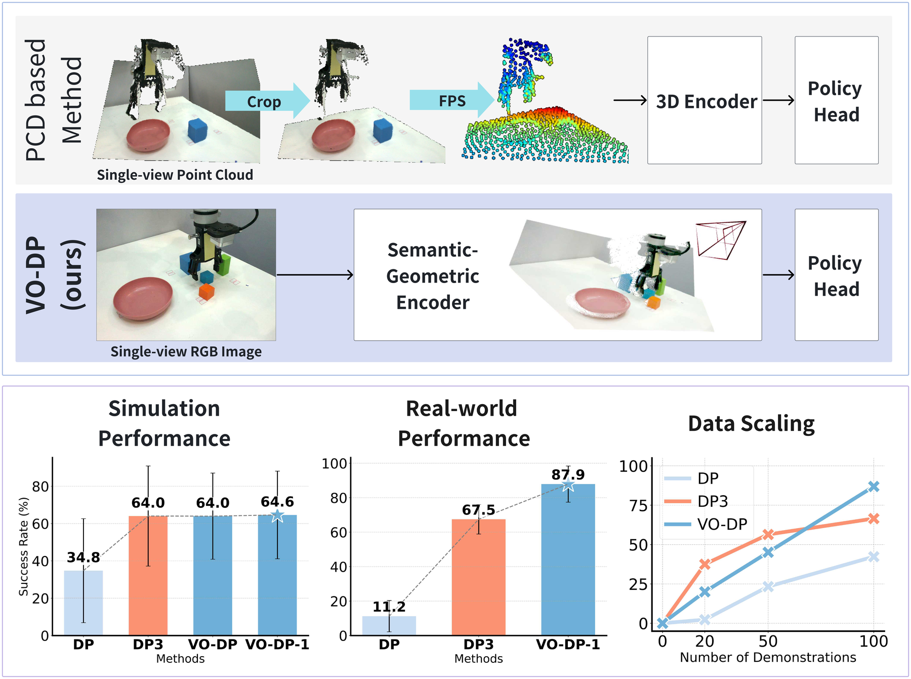
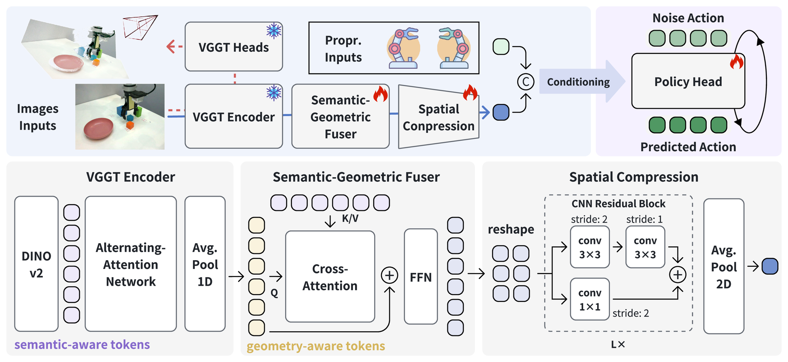
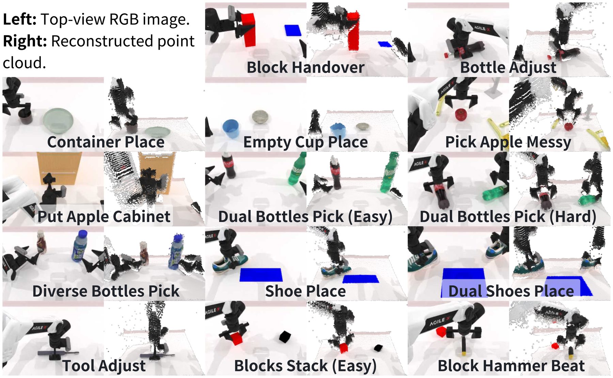
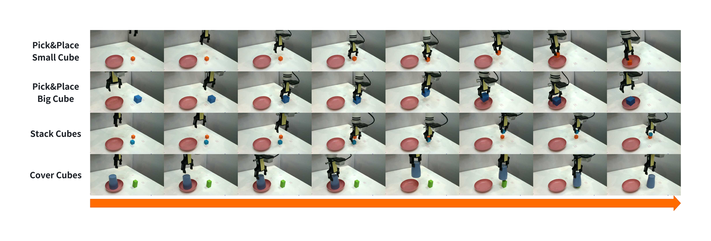
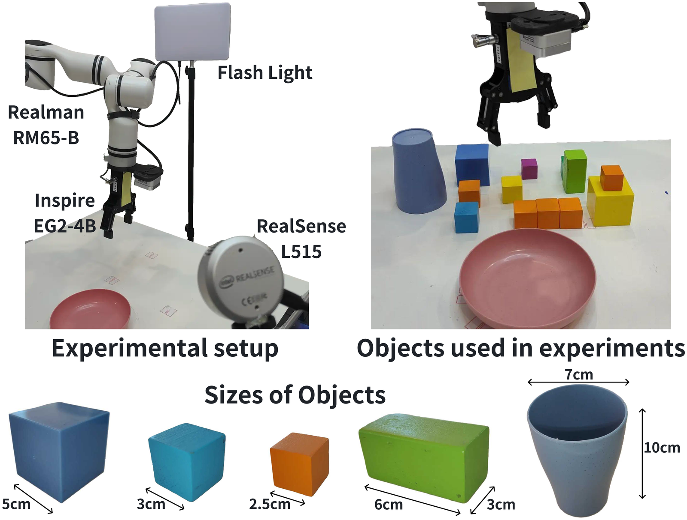
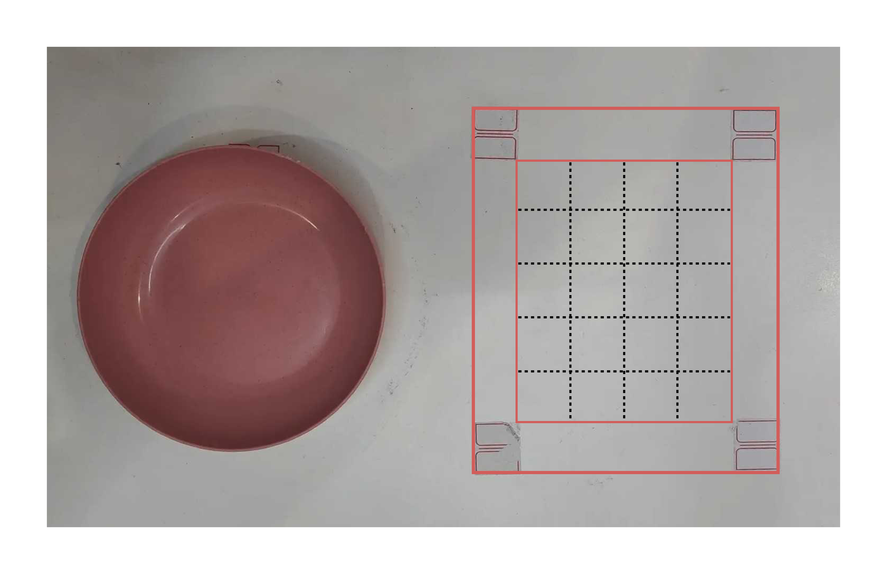
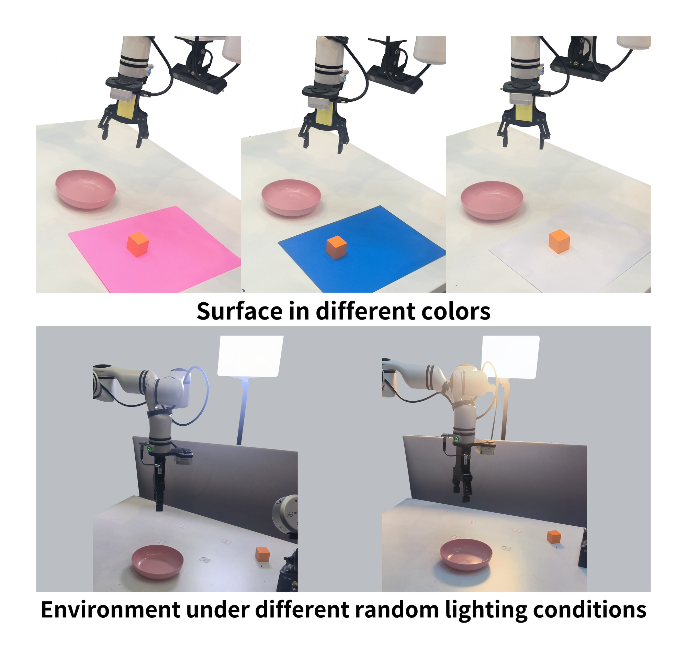
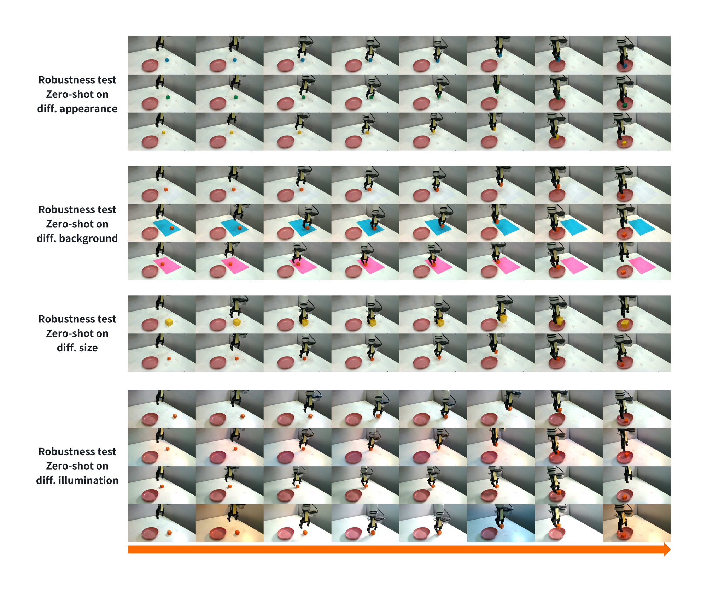

# VO-DP：纯视觉语义-几何自适应扩散策略

!!! note "阅读位置"
    这页先按“论文证据节点”读：先问它解决哪一个瓶颈，再看核心图表、实验 setting 和不能外推的边界。背景概念先回 [论文专题讲解](../index.md) 和 [具身智能](../../embodied-ai/index.md)。

    **主线关系**：VO-DP 接在 [VGGT](vggt.md)、[Depth Anything 3](depth-anything-3.md) 和 Diffusion Policy 之后看最顺。它不是把 VLA 做大，而是问一个很工程的问题：如果真实机器人不想依赖点云、深度图和繁琐的点云裁剪，单视角 RGB 能不能靠 3D foundation model 的中间表征追上点云策略？

!!! info "论文信息"
    - 论文：`VO-DP: Semantic-Geometric Adaptive Diffusion Policy for Vision-Only Robotic Manipulation`
    - arXiv：[2510.15530](https://arxiv.org/abs/2510.15530)，首版 2025-10-17，v4 2025-11-03
    - 项目页：[VO-DP](https://d-robotics-ai-lab.github.io/vodp/)
    - 代码：[D-Robotics-AI-Lab/DRRM](https://github.com/D-Robotics-AI-Lab/DRRM)
    - 关键词：`vision-only policy`、`VGGT`、`semantic-geometric fusion`、`diffusion policy`、`RoboTwin`、`real-world manipulation`

## 一句话读懂

VO-DP 的核心主张是：**单视角 RGB 并不一定只能学到 2D 外观；如果把 VGGT 里 DINOv2 的语义 token 和 Alternating-Attention 的几何 token 取出来融合，再接 DDPM policy head，纯视觉策略可以在仿真上逼近点云 DP3，在真实机器人上显著超过 DP3。**

这篇论文最值得读的不是“又一个 diffusion policy”，而是它把三个通常分开的东西接起来了：

1. `VGGT` 负责把单张或少量 RGB 图像变成带 3D 先验的中间表征。
2. `Semantic-Geometric Fuser` 负责让任务自适应选择语义与几何信息。
3. `DDPM policy head` 负责生成 action chunk，让输出仍保持 Diffusion Policy 的多模态动作建模能力。

{ width="920" }

<small>Figure source: `VO-DP`, overview figure. 读这张图：上半部分对比点云方法与 VO-DP；下半部分汇总仿真、真实机器人和数据规模扩展结果。</small>

## 它解决什么问题

机器人 manipulation 里，DP3 这类点云策略很强，因为 point cloud 直接提供 3D 几何。但点云在真实部署里有几个麻烦：深度传感器贵，标定和裁剪依赖人工区域，真实点云有噪声和缺失，视角改变后 preprocessing 很容易变脆。

传统视觉 DP 则相反：硬件简单，只要 RGB，但纯 2D CNN/ViT 表征经常缺少稳定几何，遇到空间关系、遮挡、双臂协调和物体尺寸变化时不够稳。

VO-DP 的问题定义很清楚：只输入单视角 RGB history 和机器人 proprioception，输出未来 `N` 步动作块：

\[
O_t = \{ I_t \in \mathbb{R}^{T \times H \times W \times 3}, S_t \in \mathbb{R}^{T \times J} \}, \quad
A_t \in \mathbb{R}^{N \times J}
\]

这里的关键不是完全不需要状态，论文仍使用 joint states \(S_t\)。它的“vision-only”主要指视觉端只用 RGB，不用 depth、RGB-D 或 point cloud。

## 方法结构

{ width="920" }

<small>Figure source: `VO-DP`, Figure 2. 读这张图：VO-DP 由 VGGT Encoder、Semantic-Geometric Fuser、Spatial Compression 和 DDPM policy head 四部分组成；雪花表示冻结 VGGT，火焰表示训练模块。</small>

### 1. VGGT Encoder：从 RGB 中取语义与几何

论文使用预训练 `VGGT` 作为视觉编码器。VGGT 原本是 feed-forward 3D 几何模型，可以从一张或少量图像预测 camera、point map、depth map 和 point tracks。VO-DP 不直接使用这些输出头，而是拿中间特征：

| Feature | Source in VGGT | Shape | Meaning in VO-DP |
|---|---|---:|---|
| semantic-aware tokens | DINOv2 patchified image tokens | \(T \times P \times C\) | object identity, appearance, local semantics |
| geometry-aware tokens | 24th Alternating-Attention block output | \(T \times P \times 2C\) | implicit 3D spatial structure and cross-frame geometry |

这个选择很重要：VO-DP 不把 RGB 先显式重建成点云再喂给 DP3，而是把 VGGT 学到的隐式几何表征拿来训练 policy。这样保留了低成本 RGB 输入，又绕开了真实点云裁剪、噪声和视角依赖。

### 2. Semantic-Geometric Fuser：让几何 token 去读语义 token

VGGT 的几何特征通道是 \(2C\)，语义特征是 \(C\)。论文先用 `1D average pooling` 把几何通道压回 \(C\)，然后用 residual cross-attention 融合：

\[
\begin{aligned}
\mathbf{h^\prime} &= \mathrm{AvgPool}(\mathbf{g}) \\
\mathbf{h^{\prime\prime}} &= \mathbf{h^\prime} + \mathrm{CrossAttn}(\mathbf{h^\prime}\mathbf{W_Q}, \mathbf{s}\mathbf{W_K}, \mathbf{s}\mathbf{W_V}) \\
\mathbf{h^{sg}_t[i]} &= \mathbf{h^{\prime\prime}} + \mathrm{FFN}(\mathbf{h^{\prime\prime}})
\end{aligned}
\]

其中 \(\mathbf{g}\) 是几何 token，作为 query；\(\mathbf{s}\) 是语义 token，作为 key/value。直觉上，策略先用几何结构提出“我要看哪里、什么空间关系重要”，再从语义 token 里取物体和任务相关信息。

### 3. Spatial Compression：把 dense token 压成场景表征

融合后的 token 被 reshape 回 patch grid：

\[
\mathbf{h^{sg}_t} \in \mathbb{R}^{T \times C \times H_P \times W_P}
\]

然后通过三个 `kernel size 3, stride 2` 的 residual blocks 降采样，再用 adaptive 2D average pooling 压成空间特征。最后把空间特征通过 MLP 投影到低维，并和 joint states 拼接：

\[
\mathbf{h^{sc}_t} = [\mathrm{MLP}(\mathbf{h^{sp}_t}), \mathbf{S_t}]
\]

这一步的作用是把 “每个 patch 上的语义-几何信息” 变成 policy head 可消费的 compact scenario representation。

### 4. DDPM Policy Head：条件动作去噪

VO-DP 的动作头沿用 Diffusion Policy / DDPM 思路，学习条件分布 \(p(A_t | O_t)\)。给定 noisy action \(A_t^k\)、去噪步 \(k\) 和场景表征 \(h_t^{sc}\)，网络预测动作噪声：

\[
A_t^{k-1}=\alpha(A_t^k-\gamma\epsilon_\theta(h_t^{sc},A_t^k,k)+\mathcal{N}(0,\sigma^2 I))
\]

训练目标是标准 MSE noise prediction loss：

\[
\mathcal{L}(\theta)=\mathrm{MSE}(\epsilon^k,\epsilon_\theta(h_t^{sc},A_t^k,k))
\]

所以 VO-DP 的“新东西”不在 diffusion objective，而在视觉条件：它把普通 RGB policy 的视觉 encoder 换成了语义-几何融合后的 VGGT 表征。

## 训练细节

!!! important "模型训练配置要点"
    论文的训练细节比较完整，尤其值得注意三点：动作长度 `N=8`；标准 VO-DP 用 history length `T=3`，消融版 `VO-DP-1` 用 `T=1`；所有模型训练 `300 epochs`，在 `8 NVIDIA A100 GPUs` 上使用 `bfloat16`。

| Hyperparam. | Value | Hyperparam. | Value |
|---|---:|---|---:|
| batch size | 128 | adam beta1 | 0.95 |
| mixed_precision | bf16 | adam beta2 | 0.99 |
| learning rate | 1e-4 | adam_weight_decay | 1e-6 |
| lr scheduler | cosine | adam_epsilon | 1e-8 |
| lr_warmup_ratio | 0.05 | ema: inv_gamma | 1.0 |
|  |  | ema: power | 0.75 |

<small>Table source: `VO-DP`, Training Hyperparameter Settings. 这里保留原论文英文列名与参数名。</small>

训练数据与评测口径：

| Setting | Details |
|---|---|
| action trajectory length | \(N=8\) |
| observation history | \(T=3\) for VO-DP, \(T=1\) for VO-DP-1 |
| epochs | 300 |
| precision / hardware | bfloat16, 8 NVIDIA A100 GPUs |
| simulation train data | 100 valid scenes per task, initialized from seed 0 |
| simulation test data | 100 valid scenes per task, initialized from seed 10000, each repeated 3 times |
| real-world data | 200 demonstrations per task via Realman teleoperation device |
| library | DRRM, built on Accelerate; supports multi-machine/multi-GPU, mixed precision, DP / DP3 / VO-DP and RoboTwin |

注意 `VO-DP-1` 并不是小模型，而是单帧观测消融。仿真里它的平均成功率略高于 `T=3` 版本，所以真实机器人实验默认使用 `VO-DP-1`。

## 仿真实验：RoboTwin

{ width="920" }

<small>Figure source: `VO-DP`, Figure 3. 读这张图：RoboTwin 的 14 个双臂任务；左侧是 top-view RGB，右侧是 VGGT 重建的 point cloud，用来展示单视角 RGB 中确实包含可恢复的空间结构。</small>

仿真在 `RoboTwin` benchmark 上做，底层是 `SAPIEN`，包含 14 个双臂 manipulation 任务。平台是 Cobot Magic，一对 6-DoF 机械臂加夹爪，动作维度 \(J=14\)。RoboTwin 原始输入提供 RGB-D 和 point cloud，分辨率为 \(240 \times 320\)，但 VO-DP 只使用单视角 RGB。

成功率的判断同时看目标位姿约束和执行过程是否 collision-free。这个口径比“抓起来一下”更严格，尤其对双臂协同和堆叠任务更重要。

### RoboTwin Benchmark Results

| Method | Block Hammer Beat | Block Handover | Bottle Adjust | Container Place | Empty Cup Place |
|---|---:|---:|---:|---:|---:|
| DP | 0.7±0.9 | 77.7±4.5 | 39.3±0.5 | 14.0±6.9 | 69.3±2.5 |
| DP3 | 79.3±1.2 | **97.7±1.2** | **85.3±0.5** | **83.7±1.7** | **88.7±1.7** |
| VO-DP | **85.0±1.4** | 89.7±0.5 | 63.3±1.2 | 43.0±3.7 | 82.0±2.2 |
| VO-DP-1 | 78.7±5.2 | **94.7±0.5** | 69.3±2.5 | 31.3±2.6 | 77.3±1.7 |

| Method | Pick Apple Messy | Put Apple Cabinet | Dual Bottles Pick (Easy) | Dual Bottle Pick (Hard) | Diverse Bottles Pick |
|---|---:|---:|---:|---:|---:|
| DP | 31.0±0.8 | 63.6±1.9 | 73.7±1.2 | 63.3±0.5 | 7.3±1.2 |
| DP3 | 18.7±2.9 | 84.7±0.5 | 83.3±0.5 | 64.0±0.8 | **60.7±0.5** |
| VO-DP | **80.0±0.8** | **94.3±2.3** | **88.3±0.9** | **67.3±3.3** | 32.3±3.3 |
| VO-DP-1 | **81.7±0.9** | **98.0±0.8** | **86.3±0.5** | 60.3±1.2 | 31.3±1.7 |

| Method | Shoe Place | Dual Shoes Place | Tool Adjust | Blocks Stack (Easy) | AVG. (↑) |
|---|---:|---:|---:|---:|---:|
| DP | 19.3±1.2 | 4.7±0.5 | 20.0±2.9 | 3.7±1.2 | 34.8 |
| DP3 | **56.3±1.7** | 13.7±1.7 | **58.3±0.5** | 22.0±2.2 | **64.0** |
| VO-DP | 43.0±0.8 | **17.0±0.8** | **58.3±3.9** | **52.3±2.5** | **63.9** |
| VO-DP-1 | 52.0±0.8 | **19.3±0.9** | 55.3±2.6 | **69.3±2.5** | **64.6** |

<small>Table source: `VO-DP`, RoboTwin Benchmark Results. DP is vision-only Diffusion Policy; DP3 is point-cloud 3D Diffusion Policy; VO-DP uses \(T=3\); VO-DP-1 uses \(T=1\)。</small>

这个表的读法：

- 对传统视觉 DP：VO-DP 的提升非常大，平均从 `34.8` 到 `63.9 / 64.6`。最典型的是 `Block Hammer Beat`，DP 只有 `0.7±0.9`，VO-DP 到 `85.0±1.4`。
- 对点云 DP3：VO-DP 平均几乎持平，`63.9` vs `64.0`；VO-DP-1 还略高，`64.6`。这说明 VGGT 中间表征确实能补上不少几何信息。
- 但 VO-DP 不总赢 DP3。`Diverse Bottles Pick`、`Bottle Adjust`、`Container Place` 这类更依赖精细几何和结构化点云的任务，DP3 仍明显更强。

## 消融实验

### Ablation study on different modality features

| Module | PAM | BHB | DBPE |
|---|---:|---:|---:|
| w/o geo. | 44.3±0.9 | 59.3±0.5 | **95.3±0.9** |
| w/o sem. | 38.7±1.7 | 60.7±4.9 | 81.3±0.5 |
| VO-DP | **80.0±0.8** | **85.0±1.4** | **88.3±0.9** |

| Module | PAC | BSE | AVG. (↑) |
|---|---:|---:|---:|
| w/o geo. | **98.0±0.8** | **58.7±0.9** | 71.12 |
| w/o sem. | 93.7±2.0 | 45.3±2.5 | 63.9 |
| VO-DP | **94.3±2.3** | **52.3±2.5** | **80.0** |

<small>Table source: `VO-DP`, Ablation study on different modality features. PAM、BHB、DBPE、PAC、BSE 分别对应五个 RoboTwin 任务缩写。</small>

这组消融很关键。只保留语义或只保留几何都能做一些任务，但平均都不如融合。`w/o sem.` 在 `PAM` 上掉得很明显，说明杂乱苹果场景里目标识别和语义区分很重要；`w/o geo.` 在不少空间/接触任务上也掉，说明只靠 DINOv2 语义 token 仍不足。

### Ablation on different strategy for geometry token downsampling

| Strategy | PAM | BHB | DBPE |
|---|---:|---:|---:|
| mlp | **82.0±1.6** | 66.3±1.7 | 88.7±1.2 |
| pool | 80.0±0.8 | **85.0±1.4** | **88.3±0.9** |

| Strategy | PAC | BSE | AVG. (↑) |
|---|---:|---:|---:|
| mlp | **99.3±0.9** | **62.3±3.3** | 79.7 |
| pool | 94.3±2.3 | 52.3±2.5 | **80.0** |

<small>Table source: `VO-DP`, Ablation on different strategy for geometry token downsampling.</small>

MLP 投影参数更多，但平均并没有胜出。论文最终采用 average pooling，理由很工程：它更简单，也更稳。对这种低数据 imitation learning，额外参数不一定等于更强表达，反而可能让 policy 更依赖训练分布。

## 真实机器人实验

{ width="920" }

<small>Figure source: `VO-DP`, real-world task visualization. 读这张图：四个真实任务分别是 Pick&Place Small Cube、Pick&Place Big Cube、Stack Cubes 和 Cover Cubes。</small>

{ width="780" }

<small>Figure source: `VO-DP`, experiment setup. 读这张图：真实机器人、RealSense L515、可控扰动光源、不同颜色/尺寸物体与容器。</small>

真实机器人平台使用 `Realman RM65-B`，末端是 `Inspire EG2-4C2` 夹爪，一个 `RealSense L515` 提供视觉观测。论文环境里传感器可获取 RGB 与点云，但 VO-DP 仍只使用 RGB；DP3 baseline 使用点云，并需要手工定义 operational region。

四个真实任务：

| Task | Description |
|---|---|
| Pick&Place Small Cube (PPSC) | grasp a 3 cm cube and place it at the center of the plate |
| Pick&Place Big Cube (PPBC) | grasp a 5 cm cube and place it at the center of the plate |
| Cover Cuboid (CC) | pick up a cup from the plate and cover a 3cm×3cm×6cm cuboid |
| Stack Cubes (SC) | stack a blue 3 cm cube on top of an orange 3 cm cube |

{ width="680" }

<small>Figure source: `VO-DP`, desktop layout. 读这张图：盘子在左，物体放置区在右；右侧区域按约 3 cm 网格划分，用于均匀覆盖训练和测试位置。</small>

数据采集每个任务 `200 demonstrations`，用 Realman 机器人自带遥操作设备采集。操作区域被均匀划成网格，训练和测试都按相同空间分布覆盖。这个细节很重要：真实机器人结果不是只测几个固定点，而是覆盖了平面位置变化。

### Real-world Performance

| Method | PPSC | PPBC | CC | SC | AVG. (↑) |
|---|---:|---:|---:|---:|---:|
| DP | 23.3 | 16.7 | 3.3 | 1.7 | 11.2±9.1 |
| DP3 | 73.3 | 68.3 | 75.0 | 53.3 | 67.5±8.5 |
| VO-DP-1 | **96.7** | **91.7** | **93.3** | **70.0** | **87.9±10.5** |

<small>Table source: `VO-DP`, Real-world Performance. 真实实验默认使用 VO-DP-1。</small>

真实机器人结果比仿真更有意思：VO-DP-1 平均 `87.9`，明显高于 DP3 的 `67.5`。论文解释是，仿真中点云接近完美，真实世界里的深度噪声、标定误差、视角依赖和点云 preprocessing 会让 DP3 掉得更厉害；而 VO-DP 使用的是预训练 RGB 表征，部署链路更短。

## 鲁棒性测试

{ width="820" }

<small>Figure source: `VO-DP`, robustness environment figure. 读这张图：通过不同颜色桌面纸张和不同随机光照条件测试背景与光照鲁棒性。</small>

{ width="920" }

<small>Figure source: `VO-DP`, robustness test visualization. 读这张图：展示外观、背景、尺寸和光照四类 zero-shot robustness test 的执行序列。</small>

鲁棒性测试都基于 `Pick&Place Small Cube`，训练分布是 3 cm 橙色方块、正常桌面、正常光照。测试时改变尺寸、颜色、背景或光照。

### Size Robustness

| 3.0 cm | 2.5 cm | 5.0 cm | AVG. |
|---:|---:|---:|---:|
| 85.0 | 60.0 | 50.0 | **65.0±14.7** |

### Appearance Robustness

| orange | blue | green | yellow | AVG. |
|---:|---:|---:|---:|---:|
| 85.0 | 50.0 | 40.0 | 90.0 | **66.3±21.6** |

### Illumination Robustness

| Normal | Light Switch | Blinking | AVG. |
|---:|---:|---:|---:|
| 85.0 | 80.0 | 85.0 | **83.3±2.4** |

### Background Robustness

| desktop surface | lightgray | pink | blue | AVG. |
|---:|---:|---:|---:|---:|
| 85.0 | 90.0 | 80.0 | 95.0 | **87.5±5.6** |

<small>Tables source: `VO-DP`, robustness tables. 表头保留原论文英文格式，颜色色块在 Markdown 中用文字表示。</small>

最强的是背景和光照鲁棒性：背景变化平均 `87.5`，光照变化平均 `83.3`，几乎不掉。尺寸和外观则更脆，尤其蓝色/绿色方块和 5 cm 方块会明显下降。这说明 VO-DP 的视觉表征确实比普通 DP 更稳，但还不是完全开放集对象策略；它仍然会受训练对象分布影响。

## 和 DP、DP3、VGGT 的关系

| Method | Visual input | Geometry source | Policy head | Main trade-off |
|---|---|---|---|---|
| DP | RGB | learned implicitly from task data | DDPM action head | cheapest input, but weak spatial prior |
| DP3 | point cloud | explicit 3D sensor input | 3D diffusion policy | strong in simulation, but real-world point cloud preprocessing is brittle |
| VO-DP | single-view RGB | implicit geometry from VGGT AA features | DDPM action head | lower hardware cost than DP3, stronger geometry than DP |

可以把 VO-DP 看成 “DP 的视觉前端升级版”，也可以看成 “DP3 的低硬件成本替代路线”。它真正证明的不是“RGB 一定比点云强”，而是：**如果 RGB encoder 本身已经被大规模 3D reconstruction 任务预训练过，它的中间 token 可以成为机器人 policy 的几何条件。**

这也给 [VGGT](vggt.md) 一个很好的下游解释：VGGT 不只适合做离线三维重建，它的 AA features 可以作为 policy perception backbone，给动作生成模型提供隐式空间状态。

## 局限与工程风险

第一，VO-DP 仍然是 imitation learning policy，不是大规模语言条件 VLA。论文任务没有强调开放语言指令、长时程任务分解或新任务组合。

第二，虽然叫 vision-only，它仍依赖机器人 proprioceptive states。实际部署中，关节状态、控制频率、末端标定和相机安装仍要稳定。

第三，纯 RGB 的优势不是无条件成立。仿真里 `Diverse Bottles Pick`、`Container Place` 等任务 DP3 更强，说明显式点云在某些精细几何任务上仍有价值。

第四，真实机器人任务规模还比较小：4 个基础空间任务、每任务 200 demos，鲁棒性测试也围绕 PPSC 展开。它证明了强方向，但还不能直接外推到杂物抓取、透明物体、柔性物体或移动操作。

## 读完记住什么

VO-DP 的关键价值是把 3D foundation model 的中间表征接入 diffusion policy，让单视角 RGB 策略得到可用的几何先验。仿真平均成功率上，它从视觉 DP 的 `34.8` 提升到 `63.9 / 64.6`，接近 DP3 的 `64.0`；真实机器人上，它用 VO-DP-1 达到 `87.9±10.5`，明显高于 DP3 的 `67.5±8.5`。

如果要把这篇放进具身智能路线图里，它回答的是一个很具体的问题：**机器人策略不一定非要等完美点云；RGB + 3D 预训练表征 + diffusion action head，已经能成为一条现实可部署的中间路线。**

## 参考资料

1. [VO-DP arXiv paper](https://arxiv.org/abs/2510.15530)
2. [VO-DP project page](https://d-robotics-ai-lab.github.io/vodp/)
3. [DRRM GitHub repository](https://github.com/D-Robotics-AI-Lab/DRRM)
4. [Hugging Face paper page](https://huggingface.co/papers/2510.15530)

!!! tip "下一站"
    - 回到论文总入口：[论文专题讲解](../index.md)，用同一套 claim / 图表 / 边界口径横向比较。
    - 把本篇结论接回主题：[具身智能](../../embodied-ai/index.md)。
    - 如果要补前置概念，先读 [VGGT：feed-forward 3D 几何](vggt.md) 和 [Depth Anything 3：任意视角的 3D 几何底座](depth-anything-3.md)。
