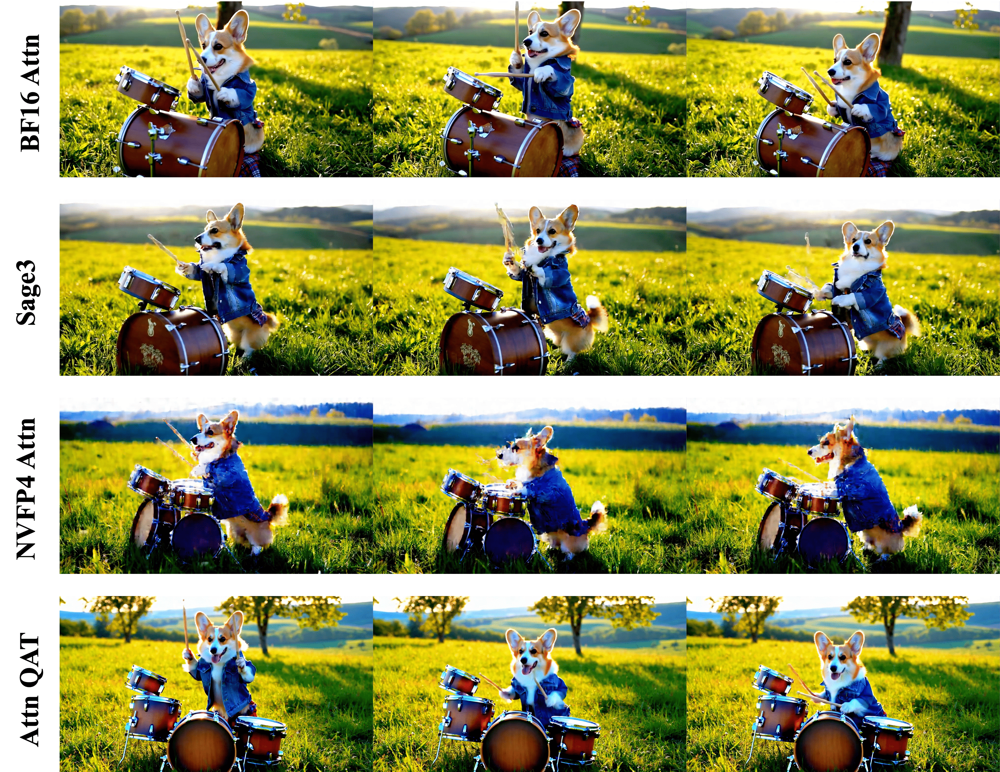
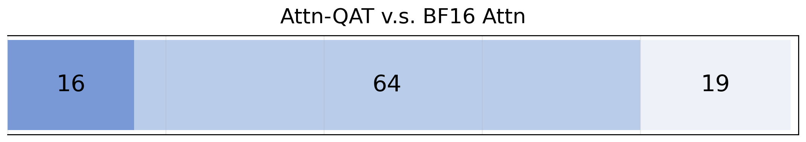
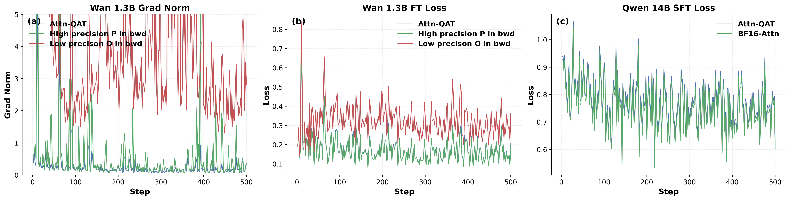
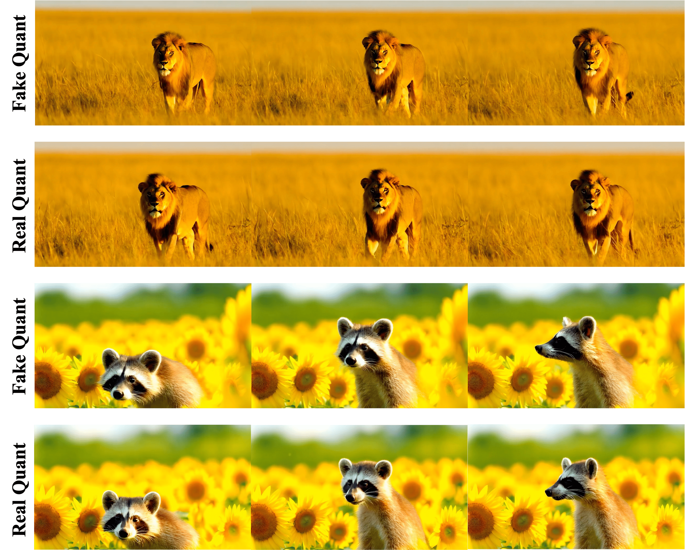
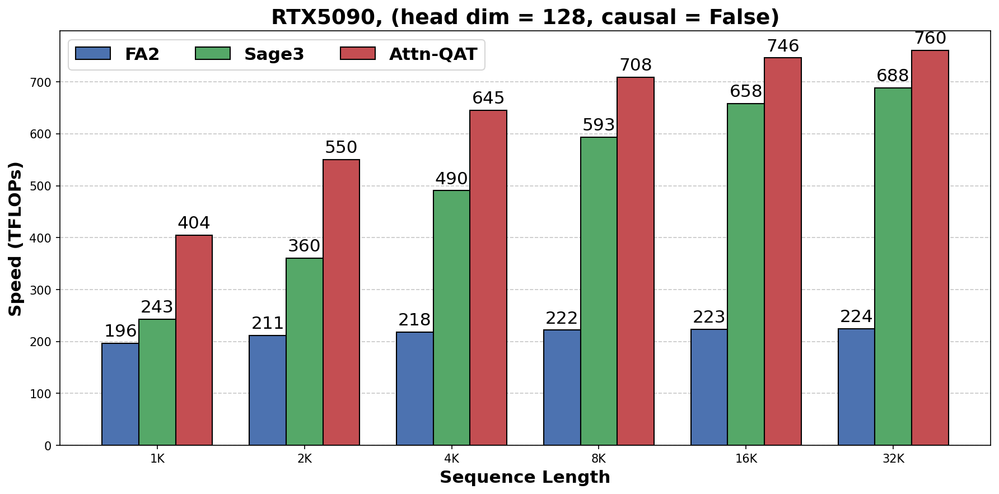
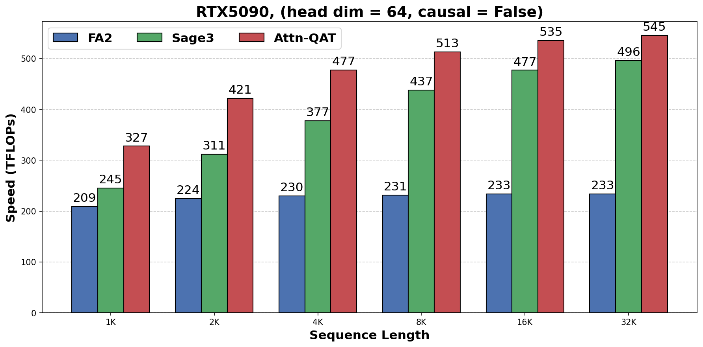

# Attn-QAT：4-bit Attention 量化感知训练


<!-- [补充] -->
| 读者 | 建议读法 | 工程落点 |
| --- | --- | --- |
| 初学者 | 先抓“Attn-QAT：4-bit Attention 量化感知训练”要解决的问题、关键术语和最小例子；公式只看变量方向。 | 能说清输入、输出和常见失败信号。 |
| 工程师 | 直接对照结构、指标、成本和边界条件，必要时回到前置页补概念。 | 落到数据、算力、延迟、显存、评测和回滚检查。 |

!!! note "合并提示"
    **note · 读法定位**

    这页先按“论文证据节点”读：先问它解决哪一个瓶颈，再看核心图表、实验 setting 和不能外推的边界。背景概念先回 [论文专题讲解](../index.md) 和 [训练与基础系统](../../training/index.md)。
    **前置**：不必先读完所有相关论文，但要知道本篇的输入、训练/推理路径和评测口径分别对应什么。
    **主线关系**：读完后把结论回填到「训练与基础系统」路线里，判断它改变的是机制、成本、数据配方、评测口径，还是仍停留在前沿假设。

    **info · 论文信息**

    - 论文：`Attn-QAT: 4-Bit Attention With Quantization-Aware Training`
    - 链接：[arXiv:2603.00040](https://arxiv.org/abs/2603.00040)
    - 团队：UC San Diego、Stanford University、University of Wisconsin-Madison、Georgia Institute of Technology 等
    - 关键词：FP4 attention、NVFP4、QAT、FlashAttention backward、fake quantization、Triton kernel、CUDA kernel、Wan 2.1、Qwen3、Llama 3.1

这篇论文解决的是一个很窄但很关键的问题：**如果 Blackwell 这类硬件已经开始支持 FP4 tensor core，为什么 attention 还不能可靠地 4-bit 化？**

论文的答案不是“再加一个 outlier trick”，而是把问题推进到训练和 kernel 的交界处：attention 是融合算子，FlashAttention backward 会重算中间量并使用一些默认的高精度恒等式。普通 QAT 只把 forward 做成 FP4，再沿用 BF16 backward，会破坏这些隐含假设，导致梯度不稳。Attn-QAT 的核心贡献，就是把 4-bit attention 的 forward、backward 重计算、softmax 梯度和推理 kernel 放到同一套精度约束里重新设计。

## 它的效率贡献是什么

<!-- [融合：算法基础] 来源：llm-algo-leetcode《20. Quantization W8A16 | 模型量化基础: INT8 绝对最大值量化与反量化 (Quantization)》-->
> **算法视角**：量化可以看成在权重或激活旁边维护 scale / zero-point，把高精度矩阵乘改写成“低比特存储 + 反量化或融合计算”的数据布局问题。
>
> 延伸阅读：[20. Quantization W8A16 | 模型量化基础: INT8 绝对最大值量化与反量化 (Quantization)](https://datawhalechina.github.io/llm-algo-leetcode/02_PyTorch_Algorithms/20_Quantization_W8A16.html)

<!-- [融合：复杂度分析] 来源：llm-algo-leetcode《20. Quantization W8A16 | 模型量化基础: INT8 绝对最大值量化与反量化 (Quantization)》-->
| 操作 | 时间复杂度 | 空间复杂度 | 说明 |
|------|-----------|-----------|------|
| 逐元素量化 / 反量化 | $O(N)$ | $O(N)$ 或按 block 存 scale | 关键收益通常来自带宽和存储减少，而不是渐进复杂度下降；参考：[对应章节](https://datawhalechina.github.io/llm-algo-leetcode/02_PyTorch_Algorithms/20_Quantization_W8A16.html) |
| 量化 GEMM | $O(MNK)$ | 权重侧约按 bit-width 缩放 | 反量化若能融合进 matmul epilogue，才更容易转成端到端收益。 |

| 维度 | 贡献 |
| --- | --- |
| 节省的成本 | 降低 attention 的激活、带宽和推理 kernel 成本，为视频 DiT / 长序列世界模型进入 FP4 训练和部署提供路径 |
| 核心机制 | forward 中模拟 FP4 attention，backward 重算也对齐低精度语义，并修正 FlashAttention softmax 梯度中的高精度恒等式假设 |
| 对世界模型主线的意义 | 世界模型常被视频 token 和长序列 attention 卡住；Attn-QAT 展示低比特不能只压 GEMM，必须理解 fused attention 的 forward/backward/kernel 闭环 |
| 主要风险 | 方法依赖专项 kernel 和 QAT 训练；视觉连接器、动作头、risk head 等敏感模块仍需保守精度，不能简单全模型 FP4 |
| 应接到本站哪里 | [世界模型高效训练技术路线图](../../world-models/efficient-training-roadmap.md)、[低比特训练与数值格式](../../training/low-bit-training-and-numerics.md)、[动作条件视频世界模型端到端训练案例](../../world-models/action-conditioned-video-world-model-training-case.md) |

## 证据等级与外推边界

Attn-QAT 的证据强在“训练路径、kernel 路径和视频生成结果对齐”，但它证明的是 4-bit attention 可以被 QAT 修复，不是证明整套世界模型都能全 FP4。读这篇时要把 attention kernel 证据和端到端机器人/世界模型风险分开。

| 论文结论 | 证据来源 | 证据等级 | 可外推到世界模型高效训练 | 不能直接外推 |
| --- | --- | --- | --- | --- |
| FP4 attention 不能只做 naive PTQ | Wan、Qwen、Llama 等实验中的质量退化 | Benchmark + Qualitative | 视频 DiT / world model attention 低比特化需要训练适配 | 不能说明所有模块都需要 QAT |
| backward 必须和 FP4 forward 语义一致 | FlashAttention backward 推导和梯度爆炸现象 | Algorithm + Ablation | fused attention 的 forward/backward/kernel 要一起设计 | 不能把这个结论照搬到普通 MLP GEMM |
| Attn-QAT 能恢复视频质量 | Wan 2.1 1.3B / 14B 生成评测和 VBench | Benchmark | 视频 latent 模型可尝试局部低比特 attention | 不能证明动作头、risk head 和 connector 也能 FP4 |
| 推理 kernel 与 fake quant 要对齐 | Triton training kernel、CUDA inference kernel 对照 | System throughput + Reproducibility | QAT 方案必须绑定可落地 kernel，否则训练收益不会兑现 | 不能保证其他硬件、group size、layout 下同样快 |
| QAT 训练仍有显存成本 | 额外保存 fake-quant 中间量、checkpointing、分布式配置 | System evidence | 低比特训练不等于训练显存天然下降，要算额外 buffer | 不能只拿推理低比特收益估训练成本 |

对世界模型来说，Attn-QAT 最适合外推到“长视频/长上下文 attention 的低比特训练方法”。它不能替代 VLA 闭环验收：action head、risk head、当前接触窗口和长时一致性仍需要单独保高精或分桶验证。

## 论文位置

低比特训练和推理通常先从线性层开始。原因很直接：线性层就是矩阵乘，QAT 可以在 forward 里插入 fake quantization，用高精度 backward 近似梯度，再让权重适应低比特误差。

attention 更麻烦。标准 attention 包含两次矩阵乘和一次 softmax：

\[
\operatorname{Attn}(Q,K,V)=\operatorname{softmax}\left(\frac{QK^\top}{\sqrt d}\right)V
\]

<!-- [补充：符号说明] -->
| 符号 | 含义 | 取值范围 / 常见值 |
| --- | --- | --- |
| \(Q\) | 公式中的变量或中间量 | 按上下文定义 |
| \(K\) | 时间步、索引或计数 | 整数索引或归一化时间区间，见正文 |
| \(V\) | value、速度场或向量量 | 实数标量/向量，依上下文而定 |
| \(d\) | 公式中的变量或中间量 | 按上下文定义 |


第一步 \(QK^\top\) 会受到 \(Q,K\) outlier 影响，第二步 \(PV\) 又受 attention probability \(P\) 的分布影响。论文特别强调，FP4 只有很少的离散可表示值，动态范围也窄；在 attention 这种 heavy-tailed activation 明显的算子上，训练后校准很容易不够用。

论文把现有路线分成三类：

| Route | Basic idea | Limitation for 4-bit attention |
| --- | --- | --- |
| PTQ / calibration | 训练后量化，再用尺度校准或 outlier 处理补误差 | 对 FP4 attention 不够稳，尤其是视频生成质量会明显掉 |
| SageAttention3-style heuristics | Q/K smoothing、two-level quantization of \(P\) 等 attention 专项技巧 | 能缓解但不能完全恢复 BF16 质量，也增加 preprocessing 开销 |
| Attn-QAT | 在训练时模拟 FP4 attention，让模型权重适应 attention quantization error | 需要重写 forward/backward kernel，并处理 FlashAttention 的精度假设 |

论文 Figure 1 直接展示了这个问题：在 Wan 2.1 14B 上，NVFP4 attention 和 SageAttention3 都会产生明显视觉质量下降，而 Attn-QAT 通过训练把质量拉回接近 BF16 attention。

{ width="760" }

<small>图源：`Attn-QAT`，Figure 1。原论文图意：在 Wan 2.1 14B 上比较 BF16 attention、NVFP4 attention、SageAttention3 和 Attn-QAT 的视频生成样例；Attn-QAT 通过 QAT 恢复 FP4 attention 带来的质量损失。</small>

!!! note "这张图怎么读"
    它不是在比较整模型 FP4，而是把注意力部分替换成不同精度或不同 FP4 attention 方案，其他非 attention 组件仍保持高精度。这个设置很重要：论文要证明的是 attention 这个最难的算子可以 4-bit 化，而不是宣称已经完成端到端全 FP4 训练。

## 核心问题

普通 QAT 对矩阵乘很自然。给定矩阵 \(A,B\)，训练时可以用 fake quantization 模拟真实 FP4 GEMM：

\[
C=\operatorname{BF16MM}\left(\phi^{-1}(\phi(A)),\phi^{-1}(\phi(B))\right)
\]

<!-- [补充：符号说明] -->
| 符号 | 含义 | 取值范围 / 常见值 |
| --- | --- | --- |
| \(\phi\) | 概率、转移分布或预测量 | 概率分布或任务定义的张量 |
| \(C\) | 公式中的变量或中间量 | 按上下文定义 |
| \(A\) | 动作、优势或系数 | 动作空间/实数标量，依上下文而定 |
| \(B\) | 公式中的变量或中间量 | 按上下文定义 |


其中 \(\phi\) 是 NVFP4 quantizer，\(\phi^{-1}(\phi(\cdot))\) 表示先量化再反量化。backward 时用 straight-through estimator 近似梯度。对普通 GEMM 来说，这个近似相对直接。

attention 的 QAT 不直接成立，因为 FlashAttention 风格实现并不会保存完整 \(P\)。它为了把显存复杂度从 \(O(N^2)\) 降到 \(O(N)\)，会在 backward 里重算 attention score 和 probability，并使用 softmax backward 的恒等式：

\[
P_i^\top dP_i = dO_i^\top O_i
\]

<!-- [补充：符号说明] -->
| 符号 | 含义 | 取值范围 / 常见值 |
| --- | --- | --- |
| \(P_i\) | 概率、转移分布或预测量 | 概率分布或任务定义的张量 |
| \(d\) | 公式中的变量或中间量 | 按上下文定义 |
| \(O_i\) | 公式中的变量或中间量 | 按上下文定义 |


这在高精度 attention 里没问题，因为 forward 中的 \(O_i\) 就是：

\[
O_i=\sum_j P_{ij}V_j
\]

<!-- [补充：符号说明] -->
| 符号 | 含义 | 取值范围 / 常见值 |
| --- | --- | --- |
| \(O_i\) | 公式中的变量或中间量 | 按上下文定义 |
| \(P_{ij}\) | 概率、转移分布或预测量 | 概率分布或任务定义的张量 |
| \(V_j\) | value、速度场或向量量 | 实数标量/向量，依上下文而定 |


但是 FP4 QAT forward 的输出实际是：

\[
O_i=\sum_j P^F_{ij}V^F_j
\]

<!-- [补充：符号说明] -->
| 符号 | 含义 | 取值范围 / 常见值 |
| --- | --- | --- |
| \(O_i\) | 公式中的变量或中间量 | 按上下文定义 |
| \(P^F\) | 概率、转移分布或预测量 | 概率分布或任务定义的张量 |
| \(i\) | 时间步、索引或计数 | 整数索引或归一化时间区间，见正文 |
| \(V^F\) | value、速度场或向量量 | 实数标量/向量，依上下文而定 |


这里 \(P^F,V^F\) 是 fake-quantized activation。也就是说，forward 输出 \(O\) 已经包含 FP4 误差；如果 backward 继续把它当成高精度 softmax identity 里的 \(O\)，梯度项就不再对应同一个数学对象。论文观察到，naive FP4 forward + BF16 FlashAttention backward 会导致 exploding gradients。

Attn-QAT 的两个修正非常关键：

| Problem | Attn-QAT fix | Why it matters |
| --- | --- | --- |
| backward 重算的 \(P\) 和 forward 使用的 \(P^F\) 精度不一致 | backward 里显式 fake-quantize 重算得到的 \(P\) | 让 \(dV\) 等梯度看到和 forward 一致的低精度 activation |
| FlashAttention 使用 \(P_i^\top dP_i=dO_i^\top O_i\)，但 FP4 forward 的 \(O\) 已经是 \(P^F V^F\) | forward 额外计算并保存高精度辅助输出 \(O'_i=\sum_j P_{ij}V^F_j\) | softmax backward 的标量项使用 \(dO_i^\top O'_i\)，避免把低精度输出误用为高精度恒等式 |

一句话概括：**Attn-QAT 不是只让 forward 像 FP4；它还要让 backward 重算和 softmax 梯度知道 forward 里到底哪些中间量被量化了。**

## 方法结构

### NVFP4 和 fake quantization

论文采用 NVIDIA NVFP4。它属于 microscaling FP4：tensor 被切成小 block，每个 block 共享 scale。论文沿用 SageAttention3 的设定，block size 为 `16`，每个 block 的 scale 根据最大绝对值决定：

\[
s_{ij}=\frac{\max(|X_{ij}|)}{6}
\]

<!-- [补充：符号说明] -->
| 符号 | 含义 | 取值范围 / 常见值 |
| --- | --- | --- |
| \(s_{ij}\) | 状态、序列长度或分数 | 状态空间/正整数/实数标量，依上下文而定 |
| \(X_{ij}\) | 样本、状态或 latent 变量 | 张量空间，形状由数据表示决定 |


训练时不直接执行真实 FP4 GEMM，而是用 fake quantization 模拟：

```text
high precision X
  -> quantize to NVFP4 representable values
  -> dequantize back to high precision tensor
  -> use BF16 GEMM for training forward/backward
```

推理时则使用真实 FP4 quantization 和 FP4 GEMM。论文后面专门验证了 fake quant training kernel 和 real quant inference kernel 的输出是否一致。

### Attn-QAT forward

训练 forward 可以拆成五步：

1. 对 \(Q,K,V\) 做 fake quantization，得到 \(Q^F,K^F,V^F\)；
2. 用 \(Q^F(K^F)^\top/\sqrt d\) 计算 score；
3. softmax 本身仍在高精度中计算，得到 \(P\)；
4. 对 \(P\) 做 fake quantization，得到 \(P^F\)，模型实际输出使用 \(O=P^F V^F\)；
5. 额外计算 \(O'=PV^F\)，只供 backward 里的 softmax 梯度使用。

这一步会增加训练显存，因为需要保留 fake-quantized \(Q,K,V\) 和辅助的高精度 \(O'\)。论文的 diffusion 实验因此使用 full gradient checkpointing 来避免 OOM。

### Attn-QAT backward

backward 的重点是保持两个一致性：

| Backward quantity | Uses | Precision rule |
| --- | --- | --- |
| \(S=Q^F(K^F)^\top/\sqrt d\) | 重算 attention score | 与 forward 的 \(Q,K\) fake quant 后精度一致 |
| \(P=\exp(S-L)\) | softmax 梯度里的高精度 probability | softmax 路径保持高精度，避免数值不稳 |
| \(P^F=\phi^{-1}(\phi(P))\) | \(dV=(P^F)^\top dO\) | 与 forward 的 \(PV\) 低精度路径一致 |
| \(D=\operatorname{rowsum}(dO\odot O')\) | softmax backward 标量项 | 使用 \(O'\)，而不是低精度输出 \(O\) |

因此 Attn-QAT 的 backward 不是“全部低精度”，而是更细：和 FP4 matmul 对应的 activation 要保持低精度一致；softmax 数值稳定性和 softmax Jacobian 的关键标量项则保留高精度语义。

### 推理 kernel

论文实现了两类 kernel：

| Kernel | Purpose | Implementation note |
| --- | --- | --- |
| Triton training kernel | 插入 fake quantization，支持 Attn-QAT forward/backward | 在 Blackwell 上用 inline PTX 调 NVFP4 转换指令；非 Blackwell 上用 bitwise emulation |
| CUDA inference kernel | 真实 FP4 quantization 和 FP4 GEMM | 基于 SageAttention3 CUDA kernel 改造，去掉 Q/K smoothing 和 two-level \(P\) quantization 等额外 heuristics |

这也是论文的工程价值所在：它不是只给一个训练目标，而是把训练模拟和推理 kernel 对齐。否则 QAT 可能学到的是 fake quant 行为，真正部署到 FP4 GEMM 时又出现 train-test mismatch。

## 训练细节

这篇论文的训练细节很值得单独看，因为 Attn-QAT 的成本主要不在损失函数，而在 attention kernel、额外 buffer 和分布式显存压力。

### Diffusion model: Wan 2.1

论文在 Wan 2.1 的 1.3B 和 14B 规模上评估 Attn-QAT。训练数据不是简单使用原始 prompt，而是用 Wan-2.1-14B 生成 synthetic latents 做 Attn-QAT。实验设置里，除了 attention 之外的组件保持高精度，评测则覆盖 VBench 的各个视频质量子项，并使用 Qwen2.5-3B-Instruct 做 prompt augmentation。

| Item | Wan 2.1 1.3B | Wan 2.1 14B |
| --- | --- | --- |
| Data | 81K examples | 13K examples |
| Resolution | 480P | 720P |
| Hardware | GB200 NVL72, 16 B200s | 64 H200s, 8 nodes x 8 GPUs |
| Precision | bf16 mixed precision | bf16 mixed precision |
| Optimizer | AdamW, \(\beta_1=0.9,\beta_2=0.999\) | same as 1.3B |
| Learning rate | \(1\times10^{-6}\) | same as 1.3B |
| Weight decay | 0.01 | 0.01 |
| Objective | rectified flow matching loss | rectified flow matching loss |
| Parallelism | 16 data-parallel groups | HSDP with replication dim 8 and sharding dim 8; Ulysses sequence parallelism with 2 groups |
| Batch | global batch size 16 | global batch size 32 |
| Training length | 4000 steps, about 12.5 hours; checkpoint around 3000 steps used for inference | 400 steps, about 1 day |

这里有两个细节很重要。

第一，Attn-QAT 并没有改 Wan 的主训练目标，仍然是 rectified flow matching。它改的是 attention 计算路径，所以更像一个低比特 attention adaptation 阶段，而不是重新定义视频生成模型。

第二，14B 实验原本想使用 global batch size 64，但因为显存压力改成 batch size 32，并加入 Ulysses sequence parallelism。这说明 4-bit attention 的训练并不会自动更省显存：QAT 需要保存或重算额外中间量，训练侧显存压力仍然很现实。

论文还报告了一个很有警示意义的失败设置：用 SageAttention3 做 FP4 forward、但沿用 naive BF16 backward 的 Wan-2.1-1.3B 预实验，在 4 张 RTX 5090 上配合 gradient accumulation、Ulysses sequence parallelism 和 data parallelism，第一次 validation 前后就遇到 OOM 和训练不稳。这个实验没有进入主表，但它解释了为什么论文要重写 backward，而不是只替换 forward kernel。

### LLM continued training

语言模型实验从 base model 出发，在 C4 English 子集上继续训练，用来验证 Attn-QAT 能否恢复 FP4 attention 引入的质量损失。

| Item | Setting |
| --- | --- |
| Models | Qwen3-14B and Llama 3.1-70B in main tables |
| Dataset | English subset of C4, 10% shard |
| Hardware | 4 NVIDIA B200 GPUs |
| Precision | bf16 mixed precision |
| Optimizer | AdamW |
| Learning rate | \(5\times10^{-6}\) |
| Qwen3 run | maximum sequence length 8192, per-device batch size 4, up to 2000 optimization steps |
| Llama 3.1 70B run | per-device batch size 1, gradient accumulation 2, 4000 steps |
| Memory tricks | activation checkpointing for all runs; sharded token embedding and output layers for 70B |

论文明确说 LLM 实验没有做充分超参搜索，70B 最大一次运行约 6 小时。这一点会影响结果解释：Qwen3 上接近 BF16，Llama 70B 上是部分恢复而不是完全恢复。

### Supervised fine-tuning

论文还测试了 Attn-QAT 能否直接作为 SFT 里的 attention 替代项，而不是先单独做一个 QAT 阶段。

| Item | Qwen3-14B | Llama 3.1-70B |
| --- | --- | --- |
| Dataset | Dolci-Instruct-SFT | Dolci-Instruct-SFT |
| Hardware | 4 B200 GPUs | 4 B200 GPUs |
| Sequence length | 8192 | 4096 |
| Per-device batch size | 8 | 2 |
| Gradient accumulation | 4 | 4 |
| Training length | 1 epoch, max 2000 optimization steps | 1 epoch, max 2000 optimization steps |
| Optimizer / LR | AdamW, \(5\times10^{-6}\) | AdamW, \(5\times10^{-6}\) |
| Memory tricks | activation checkpointing | activation checkpointing plus activation offloading |

这个实验的意义在工程上很直接：如果 Attn-QAT 只能作为单独校准阶段使用，训练管线会复杂很多；如果它能在 SFT 中直接替换 BF16 attention，就更像一个可集成的训练系统组件。

## Diffusion 结果

<!-- [补充] -->
> **这个实验说明了什么**：这一节主要检查论文主张是否在作者设定的数据、模型和评测口径下成立；阅读时要把指标提升、消融贡献和未覆盖场景分开看。


Wan 2.1 14B 的主结果如下，表头保留原英文格式。

| Exp. | Wan 2.1 14B | Imaging Quality | Aesthetic Quality | Subject Consistency | Background Consistency | Temporal Flickering | Motion Smoothness | Dynamic Degree | Overall Quality |
| ---: | --- | ---: | ---: | ---: | ---: | ---: | ---: | ---: | ---: |
| 1 | BF16 | 0.6869 | 0.6692 | 0.9572 | 0.9635 | 0.9759 | 0.9878 | 0.5193 | 0.8335 |
| 2 | FP4 | 0.6324 | 0.6271 | 0.9412 | 0.9548 | 0.9783 | 0.9855 | 0.2983 | 0.7968 |
| 3 | SageAttention3 | 0.6604 | 0.6510 | 0.9517 | 0.9584 | 0.9758 | 0.9862 | 0.4751 | 0.8203 |
| 4 | **Attn-QAT** | 0.6745 | 0.6712 | 0.9685 | 0.9716 | 0.9828 | 0.9902 | 0.3646 | 0.8279 |

<small>表源：`Attn-QAT`，Wan 2.1 14B VBench evaluation。原论文表意：Experiments 1-3 是 training-free inference baselines，Experiment 4 使用 Attn-QAT 并需要额外训练。</small>

这个表要谨慎读。Attn-QAT 的 `Overall Quality` 接近 BF16，并明显高于 naive FP4；但 `Dynamic Degree` 不是最高，SageAttention3 在这个子项上更接近 BF16。论文的核心主张不是每个 VBench 子项全胜，而是整体质量和主观质量可以恢复到接近 BF16，同时不需要 SageAttention3 那些额外 outlier-mitigation heuristics。

Wan 2.1 1.3B 的消融更能说明方法设计。

| Exp. | Wan 2.1 1.3B | Imaging Quality | Aesthetic Quality | Subject Consistency | Background Consistency | Temporal Flickering | Motion Smoothness | Dynamic Degree | Overall Quality |
| ---: | --- | ---: | ---: | ---: | ---: | ---: | ---: | ---: | ---: |
| 1 | BF16 | 0.6728 | 0.6657 | 0.9647 | 0.9646 | 0.9832 | 0.9897 | 0.3923 | 0.8267 |
| 2 | FP4 | 0.5592 | 0.6109 | 0.9601 | 0.9605 | 0.9854 | 0.9892 | 0.1160 | 0.7785 |
| 3 | SageAttention3 | 0.5507 | 0.6163 | 0.9583 | 0.9582 | 0.9836 | 0.9886 | 0.2099 | 0.7834 |
| 4 | Attn-QAT | 0.6775 | 0.6764 | 0.9709 | 0.9706 | 0.9839 | 0.9902 | 0.3039 | 0.8252 |
| 5 | + SmoothK | 0.6738 | 0.6699 | 0.9664 | 0.9676 | 0.9811 | 0.9887 | 0.3425 | 0.8232 |
| 6 | + Two-level quant P | 0.6801 | 0.6782 | 0.9749 | 0.9749 | 0.9867 | 0.9918 | 0.2541 | 0.8257 |
| 7 | -- High prec. O in BWD | 0.5660 | 0.4373 | 0.8709 | 0.9384 | 0.9761 | 0.9827 | 0.0331 | 0.7185 |
| 8 | -- Fake quantization of P in BWD | 0.6837 | 0.6798 | 0.9727 | 0.9729 | 0.9851 | 0.9912 | 0.2652 | 0.8254 |

<small>表源：`Attn-QAT`，Wan 2.1 1.3B VBench ablation table。原论文表意：Experiments 1-3 是 training-free inference baselines，Experiments 4-8 是 Attn-QAT 及其消融。</small>

消融结论有三条。

第一，naive FP4 和 SageAttention3 在 1.3B 上整体质量都明显低于 BF16；Attn-QAT 几乎恢复到 BF16。

第二，把 SageAttention3 的 K smoothing 或 two-level \(P\) quantization 加进 Attn-QAT 后，收益不稳定，说明训练已经能让模型适应量化误差，额外 heuristic 不再是关键。

第三，去掉 backward 里的 high-precision \(O'\) 会严重崩质量，这直接支持论文的核心分析。去掉 backward 的 \(P\) fake quantization 后，最终分数仍接近，但训练曲线里的梯度更 noisy，说明它主要影响稳定性而不一定立刻体现在最终 VBench 分数上。

论文还做了 99 个 VBench prompt 的盲测。主观评价里 Attn-QAT 接近 BF16 attention。

{ width="720" }

<small>图源：`Attn-QAT`，Figure 2。原论文图意：对 99 个随机 VBench prompts 做 Win-Tie-Lose blind human evaluation；Attn-QAT 在感知视频质量上接近 BF16 attention。</small>

训练曲线进一步解释了消融结果。

{ width="820" }

<small>图源：`Attn-QAT`，Figure 3。原论文图意：(a-b) 展示 Wan 2.1 1.3B 在不同 Attn-QAT 配置下的 gradient norm 和 loss；(c) 展示 Qwen3-14B 中 BF16 attention 与 Attn-QAT 的 SFT loss curves。</small>

!!! note "训练曲线怎么读"
    左侧最重要的是梯度范数。没有 high-precision \(O'\) 的配置会出现梯度爆炸和更高 loss；没有 backward \(P\) fake quantization 的配置最终 loss 可以接近，但梯度更抖。这说明 4-bit attention 的难点不是损失函数，而是 fused attention backward 的内部数值一致性。

## LLM 结果

语言模型继续训练结果如下。

LLM 实验没有纳入 SageAttention3 baseline。论文给出的原因是开源 SageAttention3 kernel 在 causal attention 上存在显著数值误差，会导致语言模型精度下降；因此 LLM 部分主要比较 BF16 attention、未训练 FP4 attention 和 Attn-QAT。

| Exp. | Model | Precision | MMLU | WinoGrande | ARC-c | HellaSwag | PIQA | WikiText↓ |
| ---: | --- | --- | ---: | ---: | ---: | ---: | ---: | ---: |
| 1 | Qwen3-14B | BF16 | 0.8044 | 0.7403 | 0.5922 | 0.8140 | 0.8215 | 0.5700 |
| 2 | Qwen3-14B | FP4 | 0.7965 | 0.7214 | 0.5734 | 0.8050 | 0.8052 | 0.5763 |
| 3 | Qwen3-14B | Attn-QAT | 0.7984 | 0.7585 | 0.6084 | 0.8034 | 0.8188 | 0.5778 |
| 4 | Llama 3.1-70B | BF16 | 0.7881 | 0.8161 | 0.6135 | 0.8575 | 0.8422 | 0.2838 |
| 5 | Llama 3.1-70B | FP4 | 0.7577 | 0.7656 | 0.6015 | 0.8463 | 0.8308 | 0.3275 |
| 6 | Llama 3.1-70B | Attn-QAT | 0.7773 | 0.7940 | 0.6153 | 0.8557 | 0.8351 | 0.3076 |

<small>表源：`Attn-QAT`，Benchmark results for LLM continued training。原论文表意：从 base LLM 出发继续训练，比较 BF16 attention、未训练 FP4 attention 和 Attn-QAT。</small>

Qwen3-14B 上，Attn-QAT 基本恢复 FP4 带来的掉点，WinoGrande 和 ARC-c 还高于 BF16 baseline。Llama 3.1-70B 上，Attn-QAT 明显优于 naive FP4，但仍未完全追上 BF16。论文把这个 gap 主要归因于训练预算和超参调优不足。

SFT 结果如下。

| Exp | Model | Precision | MMLU-Redux | IFeval | GPQA-Diamond | MATH-500 | GSM8K |
| ---: | --- | --- | ---: | ---: | ---: | ---: | ---: |
| 1 | Qwen3-14B | BF16 | 0.8316 | 0.7107 | 0.4495 | 0.8060 | 0.9295 |
| 2 | Qwen3-14B | FP4 w. Attn-QAT | 0.8392 | 0.7306 | 0.4394 | 0.7840 | 0.9098 |
| 3 | Llama3.1-70B | BF16 | 0.7928 | 0.8637 | 0.4091 | 0.5300 | 0.8840 |
| 4 | Llama3.1-70B | FP4 w. Attn-QAT | 0.7823 | 0.8532 | 0.3838 | 0.5120 | 0.8673 |

<small>表源：`Attn-QAT`，LLM Finetuning Results。原论文表意：在 Dolci-Instruct-SFT 上比较 BF16 attention 与 FP4 w. Attn-QAT，测试 Attn-QAT 是否能作为 SFT 中的 attention 替代项。</small>

这个表给出的工程信号是：Attn-QAT 可以直接进入 SFT 流程，但大模型上仍可能有小幅质量差距。对训练系统来说，它更像“可用但需要预算和 kernel 配套”的路线，而不是无条件 drop-in。

## Kernel 结果

论文专门验证了 fake quant training forward 和 real quant inference forward 的一致性。

{ width="760" }

<small>图源：`Attn-QAT`，Figure 4。原论文图意：Triton forward pass 使用 BF16 GEMM + FP4 emulation，CUDA forward pass 使用真实 FP4 quantization 和 FP4 GEMM；两者生成的视频视觉上接近，说明 fake quant 和 real quant 的行为基本对齐。</small>

速度评测在 RTX 5090 上进行，batch size 为 16，attention heads 为 16，分别测 head dimension 128 和 64。

{ width="680" }

{ width="680" }

<small>图源：`Attn-QAT`，Figure 5。原论文图意：在 RTX 5090 上比较 FlashAttention2、SageAttention3 和 Attn-QAT CUDA inference kernel 的 attention throughput；由于去掉 smoothing 和 two-level \(P\) quantization 等额外 preprocessing，Attn-QAT 相对 SageAttention3 获得约 `1.1x-1.5x` throughput speedup。</small>

这里要注意速度收益的口径：论文测的是 attention kernel throughput，不是完整模型端到端吞吐。完整系统里还会有 MLP、VAE、sampling loop、KV cache、调度和显存带宽等其他瓶颈。

## 和 SLA2、SageAttention 的关系

Attn-QAT 很适合和前面的 [SLA / SLA2](sla-sparse-linear-attention.md) 放在一起看。

| Method family | Primary goal | Training role | Attention change |
| --- | --- | --- | --- |
| SageAttention3 | training-free FP4 attention inference | 不更新模型权重 | 通过 Q/K smoothing 和 \(P\) quantization heuristics 缓解 FP4 误差 |
| SLA2 | sparse-linear attention + low-bit attention | 用 QAT 适配 sparse / low-bit attention | 改 attention 的结构和计算路径，追求高稀疏率和质量保持 |
| Attn-QAT | reliable 4-bit attention QAT | 专门修正 attention QAT 的 forward/backward 精度一致性 | 不依赖 outlier heuristics，让模型通过训练适应 NVFP4 attention |

SLA2 更像“把 attention 结构改轻”，Attn-QAT 更像“让原 attention 的 FP4 版本可训练、可部署”。如果未来要把两者组合，关键问题会是：sparse/linear 分支、low-bit \(Q,K,V,P\)、FlashAttention-style backward、以及 paged attention / KV cache 能否在同一套 kernel 里稳定对齐。

## 项目启发

这篇论文最值得带走的是三点。

第一，低比特 attention 不能只看 forward。FlashAttention 这类融合算子的 backward 有很多“默认高精度成立”的恒等式；一旦 forward 引入 fake quantization，backward 的重算路径也要一起改。

第二，QAT 可以替代一部分 outlier heuristics。SageAttention3 靠 Q/K smoothing 和两级 \(P\) quantization 修补 FP4 attention；Attn-QAT 的实验说明，只要训练让模型适应低比特误差，这些额外处理未必是必要的。好处是 inference kernel 更简洁，preprocessing 开销更低。

第三，训练显存不会因为目标是 FP4 就自然下降。Attn-QAT 训练阶段仍使用 bf16 mixed precision，还需要保存 fake-quantized \(Q,K,V\)、high-precision \(O'\) 等额外中间量。真正省的是推理 attention 计算和内存带宽；训练侧则需要 checkpointing、sequence parallelism 和 sharding 配套。

## 局限和风险

论文也有几个边界不能忽略。

1. **不是端到端全 FP4 模型**：实验中非 attention 组件仍保持高精度，论文主要证明 attention 这个难点可以 4-bit 化。
2. **训练成本和显存压力仍然存在**：Attn-QAT 需要额外训练，且高精度 \(O'\) 和 fake-quantized buffers 会增加训练侧显存压力。
3. **LLM 70B 仍有质量差距**：Llama 3.1-70B 上 Attn-QAT 明显恢复 naive FP4 的掉点，但没有完全追上 BF16。
4. **kernel 支持仍在演进**：论文当前实现主要围绕 RTX 5090 / SageAttention3 kernel，结论部分也提到未来要做 SM100 上的 native FP4 attention kernel。
5. **评测覆盖还有限**：视频侧主要是 Wan 2.1 和 VBench，人类盲测为 99 prompts；语言侧是继续训练和 SFT 的代表性 benchmark，还不足以说明所有任务都无损。

## 本页结论

Attn-QAT 的贡献可以压缩成一句话：**它把 4-bit attention 的问题从“怎么量化 forward”推进到“怎么让 forward、backward 重算、softmax 梯度和 inference kernel 在同一套低比特语义下闭合”。**

这也是为什么它应该放在“高效训练”里。它表面上是量化论文，实际给出的经验更像训练系统原则：当一个算子已经被高度融合和数值优化后，低比特训练不能只在外面包一层 fake quantization。真正稳定的方案必须理解这个算子的内部计算图，并重新定义哪些中间量低精度、哪些中间量必须保持高精度，以及这些选择如何落到 kernel 和分布式训练里。

这一页最后回到三个验收点：方法上，Attn-QAT 的方法点是让 fake-quant forward 与 FlashAttention-style backward 重算语义一致，而不是只给 QKV 套量化。实验上，视频质量、人评、training dynamics 和 kernel throughput 分别对应质量、主观偏好、稳定性和系统收益。诊断上，fake vs real quant 图很关键，它说明 QAT 的训练语义必须贴近最终 kernel。

!!! note "合并提示"
    **info · 本站判断**

    Attn-QAT 的重点不是“4-bit attention”口号，而是 forward/backward/fake-quant/kernel 语义闭合。实验要看视频质量、人评、训练动态和 kernel throughput；采用时同时验非 attention 模块、显存峰值、数值稳定和任务质量回归。

    **tip · 下一站**

    - 回到论文总入口：[论文专题讲解](../index.md)，用同一套 claim / 图表 / 边界口径横向比较。
    - 把本篇结论接回主题：[训练与基础系统](../../training/index.md)。
    - 按导航顺序继续：[EAGLE：Feature-level Draft](../inference/eagle.md)。
