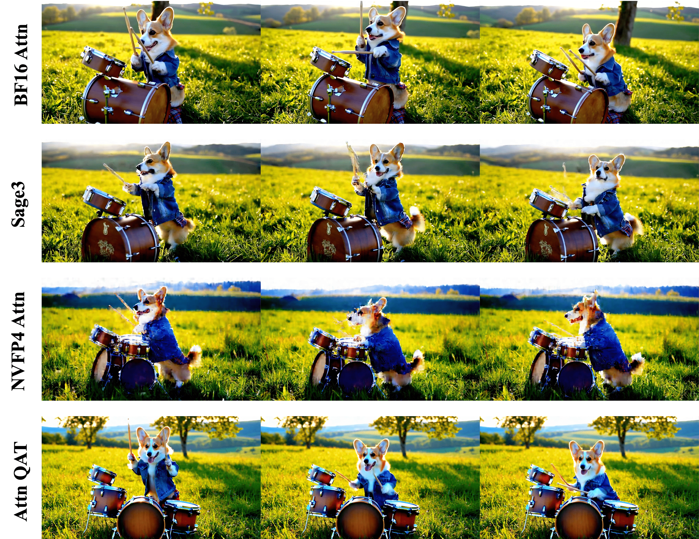
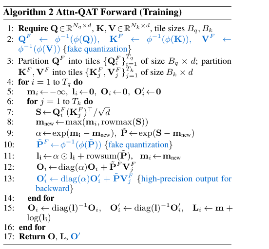
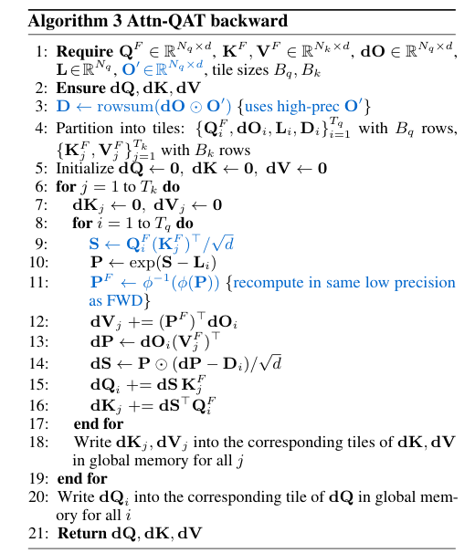
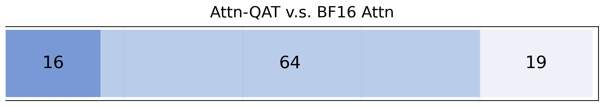
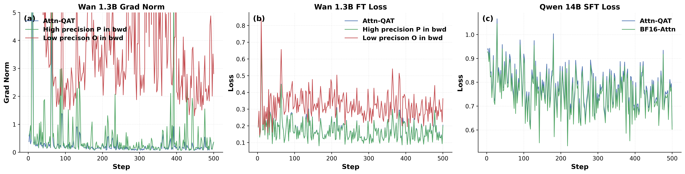
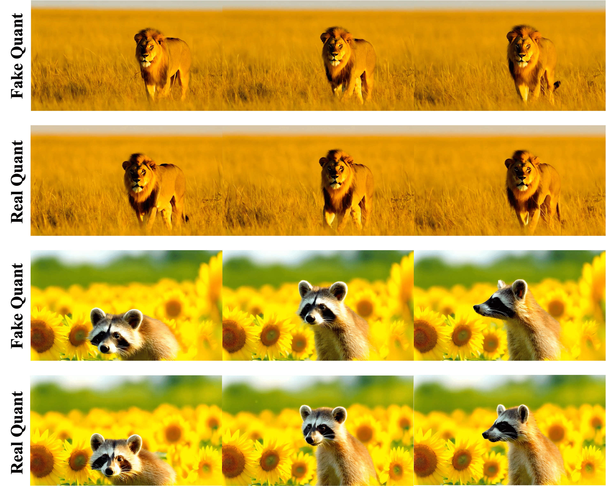
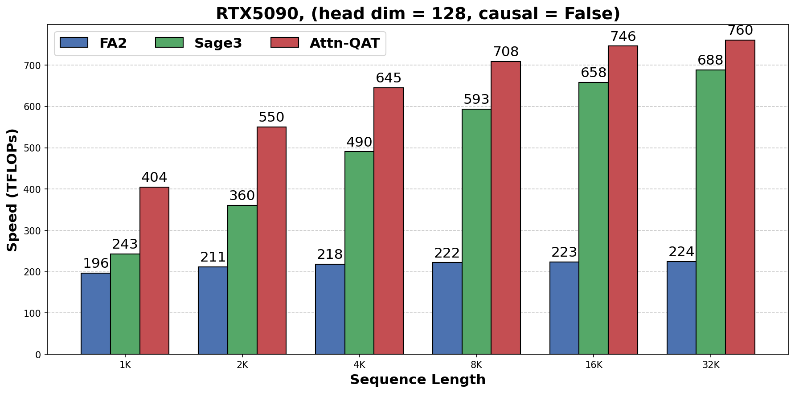
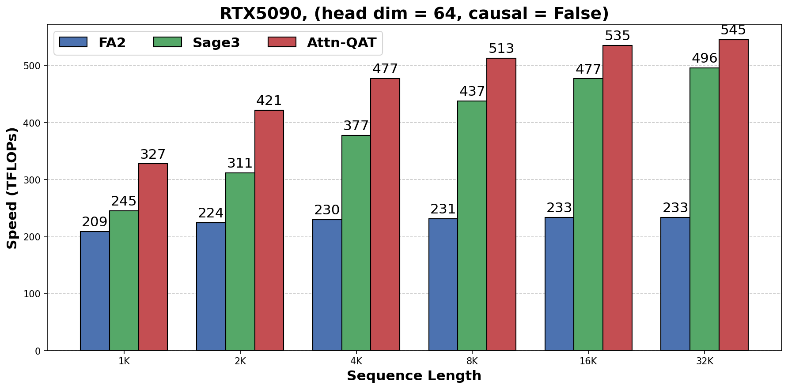

# Attn-QAT：4-bit Attention 量化感知训练

!!! info "论文信息"
    **论文题名：** Attn-QAT: 4-Bit Attention With Quantization-Aware Training。 
    **作者：** Peiyuan Zhang、Matthew Noto、Wenxuan Tan、Chengquan Jiang、Will Lin、Wei Zhou、Hao Zhang。 
    **机构：** 未在公开元数据中稳定解析；以 arXiv/PDF 或官方页 affiliation block 为准。 
    **时间 / 主题：** 2026-02；高效训练。 
    **arXiv / 官方报告：** arXiv：[2603.00040](https://arxiv.org/abs/2603.00040)。 
    **GitHub / 项目：** GitHub：未找到官方链接。 
    **元数据来源与核验口径：** 来源：[arXiv](https://arxiv.org/abs/2603.00040)；Checked Date：2026-06-04；Repro Status：Paper / official materials reviewed, independent reproduction not claimed。

## 4-bit attention 的难点藏在反向重计算里

Attn-QAT 要解决的是 attention 内两次矩阵乘法的 NVFP4 执行。第一步 $QK^\top$ 决定关注哪些 token，第二步 $PV$ 按概率聚合信息；前者的误差会改变注意力分布，后者的误差又会改变模型收到的输出。即使其他层都保持高精度，这两处误差也可能破坏画面、运动与语言任务表现。

作者先观察到，直接用 FP4 attention 替换 BF16，视频质量明显下降；已有 SageAttention3 的平滑与两级量化只能恢复部分质量。于是选择 quantization-aware training（QAT，量化感知训练），让模型参数适应低比特执行的误差。真正的障碍随之出现：**FP4 前向直接接上现成 FlashAttention 的 BF16 反向，并不能自动得到正确的 QAT**。[↗](https://arxiv.org/pdf/2603.00040v2#page=2)

原因不只在于反向精度够不够高。FlashAttention 为节省显存，会重计算中间概率，并用一个代数恒等式避免保存完整注意力矩阵。低精度前向改变了这些中间量，旧恒等式的适用条件也随之改变。Attn-QAT 的主要贡献，是指出两个具体不一致，并分别修正：重建 P 时匹配其量化路径；额外保存一个辅助输出 $O'$，供 Softmax 反向使用。

原图先把问题摆出来。沿同一提示比较 BF16、SageAttention3、直接 NVFP4 和 Attn-QAT，直接 NVFP4 的主体形状与细节损坏尤其明显。静态帧只能显示部分问题，运动是否恢复还需要后面的 Dynamic Degree 与人工视频评价共同判断。

{ width="760" }

*原论文 Figure 1。Attn-QAT 使用额外训练恢复低精度 attention 的质量，其他三行是训练前模型上的推理配置。*

这份结果有明确范围：本文始终让非 attention 组件保持高精度，QAT 本身也主要使用 BF16 矩阵乘法。它为原生 FP4 推理补上了 attention 环节，并未证明整个模型、训练梯度或完整 KV cache 系统都已经端到端运行在 4 bit。

## NVFP4 的块缩放能缓解范围问题，却不能消除粗糙舍入

NVFP4 将每 16 个元素划为一块，元素使用 FP4 E2M1 表示，共享一个 E4M3 scale。作为对照，MXFP4 的块大小为 32，scale 为 E8M0。因而“FP4”并不是唯一确定的数值接口，分块大小和 scale 格式同样影响误差。

论文对一块 $X_{ij}\in\mathbb R^{1\times16}$ 使用如下量化定义：

$$
s_{ij}=\frac{\max|X_{ij}|}{6},\qquad
\hat X_{ij}=\operatorname{round}_{\mathrm{FP4}}\left(\frac{X_{ij}}{s_{ij}}\right),\qquad
X^F_{ij}=s_{ij}\hat X_{ij}.
$$

6 是 E2M1 的最大有限幅值。$\hat X$ 是低比特离散值，$X^F$ 是反量化回高精度载体后的近似值；原文将量化与反量化分别记为 $\phi$ 和 $\phi^{-1}$。实际 NVFP4 还要让 scale 本身服从其格式，不能把示意式里的实数 $s$ 当成无限精度的免费参数。[↗](https://arxiv.org/pdf/2603.00040v2#page=2)

块缩放让大值不至于立刻超出范围，却也让同块的小值面对较粗的相对分辨率。FP4 只有很少的可表示数值；attention 中的重尾激活和离群值尤其容易占据一块的大部分范围。量化 Q/K 后，softmax 前的分数可能偏移；量化 P/V 后，某些概率和聚合贡献又会被舍入。这两类误差发生在不同位置，不能只检查最终输出的平均误差就认为前后向都一致。

可以先用两个 key 看清第一种误差。若某个 query 的原始分数是 $[2,1]$，softmax 约为 $[0.731,0.269]$；量化后变成 $[1.5,1]$，概率约为 $[0.622,0.378]$。最大注意力从 0.731 降到 0.622，第二个 key 的权重明显上升。这个四舍五入例子不是论文的 kernel 结果，却说明 $QK^\top$ 的小偏移会先改掉信息路由，后面的 $PV$ 再把这份改变写进输出。

### SageAttention3 用显式预处理减轻误差

论文介绍的 SageAttention3 对 query 使用块均值平滑，对 key 使用全局 token 均值平滑。写成 $Q_i=\bar q_i+\gamma(Q_i)$、$K_j=\bar k+\gamma(K_j)$ 后，未经 $1/\sqrt d$ 缩放的分数可分解为

$$
Q_iK_j^\top
=\gamma(Q_i)\gamma(K_j)^\top
+\bar q_i\gamma(K_j)^\top+b.
$$

$b=\bar q_i\bar k^\top+\gamma(Q_i)\bar k^\top$ 对每个 query 的所有 key 是共同偏移，而中间的修正项仍随 key 改变。中心化后的主矩阵乘法更容易量化，但需要额外计算与恢复这些结构。[↗](https://arxiv.org/pdf/2603.00040v2#page=3)

对于 P，SageAttention3 还先做逐行缩放，再进行块量化。原文描述其将范围映射到 $[0,448\times6]$，其中 448 是 E4M3 scale 的最大有限值，6 是 E2M1 的最大值。两级缩放的目的，是让概率更有效地利用表示范围。

Attn-QAT 的选择是用额外训练代替这些显式缓解技巧，让部署路径更简单。它仍然保留 NVFP4 必需的分块缩放和量化，删除的是额外 Q/K smoothing 与 P 两级处理。因此不能把“没有 outlier mitigation”理解为完全没有 scale、归一化或数值稳定操作。

## Fake quantization 与 STE 各自改变哪一部分

训练中定义 $X^F=\phi^{-1}(\phi(X))$，使张量数值落到低比特可表达的近似集合，但仍用 BF16 等格式保存并参与矩阵乘法。对于 $C=A^F B^F$，原文采用 straight-through estimator（STE，直通估计），近似将舍入操作的反向当作恒等映射，于是

$$
\mathrm dA\approx \mathrm dC\,(B^F)^\top,
\qquad
\mathrm dB\approx (A^F)^\top\mathrm dC.
$$

这使模型能在前向不断看到量化误差，同时通过高精度梯度更新参数。舍入函数本身没有在这里使用精确数学导数，QAT 采用的是直通估计这一代理梯度。正确实现要忠实于这套代理计算图，并保留低精度前向对参数更新的影响。[↗](https://arxiv.org/pdf/2603.00040v2#page=3)

先忽略分块细节，attention 可以写成：

$$
S=\frac{Q^F(K^F)^\top}{\sqrt d},\qquad
P=\operatorname{softmax}(S),\qquad
O=P^F V^F.
$$

$d$ 是 head dimension。Softmax 仍以 FP32 计算，$P$ 表示该高精度概率，$P^F$ 表示给第二次矩阵乘法的量化近似。两者都需要存在于正确位置：不能因为 attention 叫 FP4，就把 Softmax 本身或所有导数也换成 FP4。

训练 kernel 用 BF16 GEMM 配合 fake quantization 模拟 NVFP4 的输入误差；视频推理 kernel 才使用原生 FP4 GEMM。论文把二者作为同一量化算子的两条实现路径，并通过样例检查接近程度，但不同累加与舍入过程不构成无条件的逐 bit 等价保证。

## 融合前向怎样同时生成真实输出和辅助输出

FlashAttention 不把完整 $N_q\times N_k$ 的 P 写入显存。它按 query 和 key/value tiles 计算，在遍历 key blocks 时维护每个 query 的运行最大值 $m$、归一化分母 $l$ 和输出累加器。

对于新一块分数 S，Algorithm 2 先更新

$$
\begin{aligned}
m_{\mathrm{new}}&=\max(m,\operatorname{rowmax}(S)),\\
\alpha&=\exp(m-m_{\mathrm{new}}),\\
\widetilde P&=\exp(S-m_{\mathrm{new}}),\\
l&\leftarrow\alpha\odot l+\operatorname{rowsum}(\widetilde P).
\end{aligned}
$$

新的最大值改变指数基准，因此旧累加器必须乘 $\alpha$，才能与当前块相加。$\widetilde P$ 是尚未除以最终分母的指数权重，并非完整归一化后的概率。实际前向在这个位置对其做 fake quantization，再推进输出。

*原论文 Algorithm 2。蓝色行标出低精度模拟与额外辅助输出；第 12、13 行使用同一个 $V^F$，区别只在 $\widetilde P$ 是否量化。*

真实输出累加器使用 $\widetilde P^F V^F$，模型随后接收的就是这个低精度路径结果。同时，辅助累加器使用 $\widetilde P V^F$，保留未量化的 softmax 权重。遍历完成后，两个累加器都除以最终 $l$，并保存 $L=m+\log l$ 供反向重建概率。[↗](https://arxiv.org/pdf/2603.00040v2#page=3)

在完整归一化记号下，可以把辅助输出理解为 $O'=PV^F$。它不是 BF16 原模型输出，因为 Q/K 已经量化、V 也仍为 $V^F$；它只去掉 P 处的那次量化，用于下面特定的梯度恒等式。$O'$ 不会替换模型实际收到的 O，否则训练便不再让后续层适应低精度输出。

另外，实际前向量化的是逐 tile 的 $\widetilde P$，而前面的概念式使用归一化 P。复现时需要连同分组、在线缩放和归一化位置一起对齐，不能仅在普通 attention 最后任意插一个 fake-quant 函数，就认为复现了融合 kernel 的数值行为。

## 反向的第一个修正：dV 需要前向真正使用的量化概率

反向收到上层传来的 $\mathrm dO$ 后，从保存的 $Q^F,K^F,L$ 逐块恢复分数与概率。原文 Algorithm 3 用 $P=\exp(S-L)$ 重建归一化概率，再做对应的 fake quantization。

对于 $O=P^F V^F$ 这条代理计算图，梯度包含

$$
\mathrm dV=(P^F)^\top\mathrm dO,
\qquad
\mathrm dP=\mathrm dO(V^F)^\top.
$$

$dV$ 必须使用 $P^F$，因为前向聚合 V 的系数就是低精度概率。若直接复用标准 BF16 FlashAttention 的反向，它可能重建一个未经量化的 P，再据此计算 $dV$，梯度就对应了另一个前向。

这项修正保留了逐块重计算的结构。无需把整张 P 存下来，但重计算出来的量必须遵循同一低精度定义。分块重算省的是持久化注意力矩阵的显存，不是允许前后向任意使用两套不同激活。[↗](https://arxiv.org/pdf/2603.00040v2#page=4)

## 第二个修正：Softmax 的行归约不能再从低精度 O 取巧

### 为什么 dV 用 Pᶠ，Softmax 导数却用 P

STE 让 $\mathrm dP^F$ 近似传回 $\mathrm dP$，但 P 本身仍由高精度 Softmax 产生。对一行 $P_i$，其 Jacobian 给出

$$
\mathrm dS_i
=P_i\odot\mathrm dP_i
-\left(P_i^\top\mathrm dP_i\right)P_i.
$$

因此导数使用未量化的 $P_i$。把这里也换成 $P_i^F$，并不会因为“与前向同样低精度”就更正确，而是改变了原 Softmax 的代理梯度。不同位置的精度由计算图决定，不能一律量化或一律升精度。

难点集中在标量 $D_i=P_i^\top\mathrm dP_i$。标准 FlashAttention 利用 $O=PV$，将它改写成输出与上游梯度的内积，避免保存完整概率行。对本文的 $V^F$，推导为

$$
\begin{aligned}
D_i
&=\sum_jP_{ij}\left(\mathrm dO_i^\top V_j^F\right)\\
&=\mathrm dO_i^\top\left(\sum_jP_{ij}V_j^F\right)\\
&=\mathrm dO_i^\top O'_i.
\end{aligned}
$$

第一步来自 $\mathrm dP_{ij}=\mathrm dO_i^\top V_j^F$，第二步只是交换求和与内积。所需的正是 $O'_i=\sum_jP_{ij}V_j^F$，而模型实际输出却是包含量化 P 的 O。直接计算 $\mathrm dO_i^\top O_i$，便会把错误的行归约项广播到这一行所有分数梯度中。[↗](https://arxiv.org/pdf/2603.00040v2#page=4)

### 一个线性大小的辅助张量，恢复了所需恒等式

这就是前向多算 $O'$ 的原因。它的大小为 $N_q\times d$，与输出同阶，不随序列长度增长为 $N_q\times N_k$。反向可以先算每行 $D_i=\operatorname{rowsum}(\mathrm dO_i\odot O'_i)$，再进入逐 tile 处理。

*原论文 Algorithm 3。第 3 行使用 $O'$；第 11、12 行为 dV 恢复量化概率；第 14 行则使用未量化的 P 计算 Softmax 导数。*

为把 $1/\sqrt d$ 的位置说明白，可定义

$$
G=P\odot(\mathrm dP-D),\qquad
\mathrm dQ=G K^F/\sqrt d,\qquad
\mathrm dK=G^\top Q^F/\sqrt d.
$$

$D$ 按行广播。这里 G 是对已缩放分数 S 的梯度，$1/\sqrt d$ 在回到 Q/K 时应用一次；原算法则把它提前合入变量 `dS`。二者是记号安排不同，不能把两种写法叠加而除两次。

由此，整条反向路径是明确的：$P^F$ 决定 dV，$V^F$ 决定 dP，未量化 P 与辅助 $O'$ 决定 Softmax 导数，最后再与 $Q^F,K^F$ 相乘。Attn-QAT 的核心不是简单“提高反向精度”，而是让这些量在各自该出现的位置符合实际前向及 STE 约定。

## 视频主结果恢复了综合质量，动态程度仍有缺口

视频实验使用 Wan2.1-14B 合成的 latent。1.3B 模型用 81K 个 480P 示例，14B 模型用 13K 个 720P 示例。VBench 提示经 Qwen2.5-3B-Instruct 扩写，按论文所引用的 VBench 流程评估视频质量子类。BF16、未训练 FP4 与 SageAttention3 是无需额外训练的推理对照，Attn-QAT 则消耗了适配训练预算。[↗](https://arxiv.org/pdf/2603.00040v2#page=5)

| Wan 2.1 14B | Imaging Quality | Aesthetic Quality | Subject Consistency | Background Consistency | Temporal Flickering | Motion Smoothness | Dynamic Degree | Overall Quality |
|---|---:|---:|---:|---:|---:|---:|---:|---:|
| BF16 | 0.6869 | 0.6692 | 0.9572 | 0.9635 | 0.9759 | 0.9878 | 0.5193 | 0.8335 |
| FP4 | 0.6324 | 0.6271 | 0.9412 | 0.9548 | 0.9783 | 0.9855 | 0.2983 | 0.7968 |
| SageAttention3 | 0.6604 | 0.6510 | 0.9517 | 0.9584 | 0.9758 | 0.9862 | 0.4751 | 0.8203 |
| Attn-QAT | 0.6745 | 0.6712 | 0.9685 | 0.9716 | 0.9828 | 0.9902 | 0.3646 | 0.8279 |

*原论文 Table 1，均沿用原表分数和方向；Temporal Flickering 一列是该评价器的得分，不是直接的闪烁发生率。*

直接 FP4 的 Overall Quality 从 0.8335 降到 0.7968，Attn-QAT 恢复到 0.8279，距离 BF16 只剩 0.0056。主体一致性、背景一致性与平滑度等分项甚至高于 BF16，但 Dynamic Degree 为 0.3646，仍低于 BF16 的 0.5193，也低于 SageAttention3 的 0.4751。更稳定、更平滑的画面与较弱的动态程度可以同时出现，不能把综合分接近写成每项能力无损恢复。

人工评价补充了另一种观察。Figure 2 对 99 个随机 VBench 提示进行 Win–Tie–Lose 盲评，直接看条形中的计数即可。

{ width="720" }

*原论文 Figure 2。Attn-QAT 对 BF16 为 16 wins、64 ties、19 losses，三项合计 99；图中数字是计数。*

多数样例被判断为接近，支持感知质量总体可比，但它没有消除动态分项的差距，也不是对所有提示、所有运动类型的等效性证明。论文的定性视频和静态帧能展示恢复现象，严格的结论仍应同时保留量化误差、动态变化与人工偏好的不同口径。

## 消融区分了错误梯度、训练噪声与推理预处理

Wan2.1-1.3B 的 Table 2 同时考察两类问题：额外平滑是否仍有必要，以及反向修正各自有多重要。下面保留决定这些判断的三个分项与综合分。

| Exp. | Wan 2.1 1.3B | Imaging Quality | Aesthetic Quality | Dynamic Degree | Overall Quality |
|---|---|---:|---:|---:|---:|
| 1 | BF16 | 0.6728 | 0.6657 | 0.3923 | 0.8267 |
| 2 | FP4 | 0.5592 | 0.6109 | 0.1160 | 0.7785 |
| 3 | SageAttention3 | 0.5507 | 0.6163 | 0.2099 | 0.7834 |
| 4 | Attn-QAT | 0.6775 | 0.6764 | 0.3039 | 0.8252 |
| 5 | + SmoothK | 0.6738 | 0.6699 | 0.3425 | 0.8232 |
| 6 | + Two-level quant P | 0.6801 | 0.6782 | 0.2541 | 0.8257 |
| 7 | − High prec. O in BWD | 0.5660 | 0.4373 | 0.0331 | 0.7185 |
| 8 | − Fake quantization of P in BWD | 0.6837 | 0.6798 | 0.2652 | 0.8254 |

首先比较 4、7：以低精度 O 代替所需的 $O'$ 后，Overall Quality 跌到 0.7185，Dynamic Degree 仅为 0.0331。这不是普通微小扰动，训练曲线也出现严重梯度异常和更高 loss，直接支持辅助输出对本文训练稳定性的关键作用。

再比较 4、8：去掉 P 的反向 fake quantization，综合分为 0.8254，反而略高于完整方案的 0.8252；loss 也接近，但梯度范数噪声更大。它支持这项修正更符合计算图、并改善训练动态，**不支持声称只移除它就一定无法收敛**。将两项设计都概括成“缺一必崩”，会超出消融实际显示的结果。[↗](https://arxiv.org/pdf/2603.00040v2#page=6)

Figure 3 先对照 Wan 的 gradient norm 与 loss，再看 Qwen SFT 的 loss。红色低精度 O 反向与绿色未量化 P 反向的问题强度不同，不能只用“曲线不稳”概括成同一种失败。

{ width="820" }

*原论文 Figure 3。左、中的 Wan 消融检验反向设计；右侧是 Qwen3-14B 的 BF16/Attn-QAT SFT loss 对比。*

最后看 4、5、6。SmoothK 的 Dynamic Degree 从 0.3039 到 0.3425，但综合分下降；Two-level P 的综合分略升到 0.8257，Dynamic Degree 却降到 0.2541。因此作者删除这些技巧的依据是它们没有带来一致、明确的质量收益，并会增加推理开销。论文没有做 SmoothQ 的 QAT 消融，理由是梯度处理更复杂；不能把 K 的结果直接扩大为所有 Q/K 平滑形式均已被控制实验否定。

另外，完全朴素的“FP4 前向加未经修改的 BF16 FlashAttention 反向”被作者报告为梯度爆炸，未列入 Table 2。它与表中只移除一个组件的可收敛版本不同，也与附录某次 5090 运行的显存不足不是同一种故障。

## 语言模型：继续训练与直接 SFT 回答不同问题

### C4 继续训练能恢复多少已有能力

第一组从 base model 出发，在 C4 上继续训练，检查注意力量化后的能力损失。Table 4 的正文模型标签是 Qwen3-14B 和 Llama3.1-70B，完整结果如下。

| Model | Precision | MMLU | WinoGrande | ARC-c | HellaSwag | PIQA | WikiText ↓ |
|---|---|---:|---:|---:|---:|---:|---:|
| Qwen3-14B | BF16 | 0.8044 | 0.7403 | 0.5922 | 0.8140 | 0.8215 | 0.5700 |
| Qwen3-14B | FP4 | 0.7965 | 0.7214 | 0.5734 | 0.8050 | 0.8052 | 0.5763 |
| Qwen3-14B | Attn-QAT | 0.7984 | 0.7585 | 0.6084 | 0.8034 | 0.8188 | 0.5778 |
| Llama 3.1-70B | BF16 | 0.7881 | 0.8161 | 0.6135 | 0.8575 | 0.8422 | 0.2838 |
| Llama 3.1-70B | FP4 | 0.7577 | 0.7656 | 0.6015 | 0.8463 | 0.8308 | 0.3275 |
| Llama 3.1-70B | Attn-QAT | 0.7773 | 0.7940 | 0.6153 | 0.8557 | 0.8351 | 0.3076 |

*原论文 Table 4。WikiText 保留原表指标名与数值，不将未明确说明的统计量擅自标为 perplexity。*

Qwen 的 WinoGrande 与 ARC-c 超过 BF16，MMLU 与 PIQA 恢复部分损失。但 HellaSwag 从未训练 FP4 的 0.8050 到 0.8034，WikiText 从 0.5763 到 0.5778，按原表方向都未改善。因此“恢复质量”是整体趋势，不能代替逐项比较。

70B 的恢复也不完全。MMLU 从 BF16 的 0.7881 降到未训练 FP4 的 0.7577，QAT 后回到 0.7773；WikiText 则从 0.2838 经 0.3275 回到 0.3076，仍有差距。ARC-c 是反例，0.6153 略高于 BF16 的 0.6135。作者把较大的残余差距归因于预算与超参数搜索受限，这是一种可能解释，尚未用更长训练的对照确认。[↗](https://arxiv.org/pdf/2603.00040v2#page=7)

这组比较没有包括 SageAttention3。作者报告其当时开放的 causal kernel 有较大数值误差，因此排除语言实验。它说明本文对该实现的使用限制，并不是对所有未来版本或所有因果 FP4 attention 的结论。

### 把 QAT 直接融合进 SFT，能否省去单独适配阶段

第二组直接在 Dolci-Instruct 上对 base model 做 SFT，一边采用 BF16 attention，一边采用 Attn-QAT。它检验的是同一次监督训练能否同时完成指令适配与量化适配，而非必须先在 C4 上做完独立 QAT 再 SFT。

| Model | Precision | MMLU-Redux | IFeval | GPQA-Diamond | MATH-500 | GSM8K |
|---|---|---:|---:|---:|---:|---:|
| Qwen3-14B | BF16 | 0.8316 | 0.7107 | 0.4495 | 0.8060 | 0.9295 |
| Qwen3-14B | FP4 w. Attn-QAT | 0.8392 | 0.7306 | 0.4394 | 0.7840 | 0.9098 |
| Llama3.1-70B | BF16 | 0.7928 | 0.8637 | 0.4091 | 0.5300 | 0.8840 |
| Llama3.1-70B | FP4 w. Attn-QAT | 0.7823 | 0.8532 | 0.3838 | 0.5120 | 0.8673 |

*原论文 Table 3。任务套件与前一表不同，不能把 MMLU-Redux 与 MMLU 的绝对分数直接作同一指标比较。*

Qwen 的 MMLU-Redux 与 IFEval 略升，但 GPQA、MATH 和 GSM8K 略降；70B 五项都低于 BF16。以 MATH-500 为例，Qwen 从 0.8060 到 0.7840，差 2.2 个百分点；70B 的 GPQA 从 0.4091 到 0.3838，差 2.53 个百分点。结果支持将 QAT 融合到 SFT 的可行性，但不支持所有任务完全等效。

语言模型评价使用修改后的 vLLM Triton paged attention 进行 NVFP4 fake quantization。这里测得的是量化数值路径下的模型能力，不能从表格直接推出原生 FP4 解码的服务吞吐或 KV cache 显存节省。原生 FP4 CUDA 推理的硬件证据来自视频和后面的非因果 kernel benchmark。[↗](https://arxiv.org/pdf/2603.00040v2#page=4)

## 额外训练与缓冲区是质量恢复的实际成本

QAT 维持线性注意力辅助存储，仍可能比原 BF16 训练占用更多显存。除了原输入，它需要 fake-quantized Q/K/V 与辅助 $O'$ 等缓冲区。论文因此使用 activation checkpointing，14B 视频模型还需要额外的序列并行。

| Setting | Wan2.1-1.3B | Wan2.1-14B |
|---|---|---|
| Synthetic examples | 81K, 480P | 13K, 720P |
| Hardware | 16 B200 in GB200 NVL72 | 64 H200, 8 nodes |
| Parallelism | 16 data-parallel groups | HSDP: replica 8 × shard 8; Ulysses SP 2 |
| Global batch | 16 | 32 |
| Optimizer | AdamW, $\beta_1=0.9,\beta_2=0.999$ | Same |
| Learning rate / weight decay | 1e-6 / 0.01 | Same |
| Objective / mixed precision | Rectified flow matching / BF16 | Same |
| Run length | 4,000 steps, about 12.5 hours | 400 steps, about 1 day |
| Selected checkpoint | Around 3,000 steps | 400-step run |

1.3B 最终采用约 3,000 步 checkpoint，是因为作者观察到验证视频在此时更好；不能用 4,000 步的训练时间暗示最末 checkpoint 一定最佳。14B 原计划 global batch 64，因显存限制加入 Ulysses 后使用 32。按 GPU 数与时长相乘，完整运行约为 200 B200 GPU-hours 和 1,536 H200 GPU-hours，属于由原文条件估算的资源量，不能跨 GPU 类型直接当作同单位效率比较。[↗](https://arxiv.org/pdf/2603.00040v2#page=12) [↗](https://arxiv.org/pdf/2603.00040v2#page=13)

训练能在 H200 上运行，是因为该路径模拟 FP4 数值、用高精度 GEMM 训练，并不表示 H200 具有原生 FP4 Tensor Core。Blackwell 上的转换使用专用 PTX 指令，其他受支持 NVIDIA GPU 使用位运算模拟 NVFP4，这与最终原生低比特推理 kernel 的硬件适用范围是两回事。

语言训练都使用 4 张 B200、BF16、AdamW 学习率 $5\times10^{-6}$ 和 activation checkpointing。C4 使用英文子集的 10% shard，70B 采用每卡 batch 1、梯度累积 2、4,000 步，并额外切分 embedding 与输出层。需要保留一个影响复现的原文差异：正文和 Table 4 标为 Qwen3-14B，但附录 B.2 的 continued-training 配方写 Qwen3-8B，并给出长度 8192、每卡 batch 4、最多 2,000 步。不能把这组 8B 文字无声改写成已确认的 14B 配置。[↗](https://arxiv.org/pdf/2603.00040v2#page=13)

SFT 部分则明确写 Qwen3-14B：长度 8192、每卡 batch 8、梯度累积 4；70B 长度 4096、每卡 batch 2、累积同为 4，并启用 activation offloading。两者训练一轮，最多 2,000 steps。四卡配置下，前者 effective batch 是 $4\times8\times4=128$ 条序列，后者为 32 条。原文把前者写成“128 tokens per step”，与这些 batch 因子的单位不符；复现应保留序列数与 token 数的区别，不能按 128 个 token 设置训练。[↗](https://arxiv.org/pdf/2603.00040v2#page=14)

## Fake quant 与真实 FP4，先对齐数值行为再谈速度

训练适应的是模拟量化，部署执行的却是原生 FP4 GEMM。如果两条实现对 scale、舍入或累加使用不同约定，模型可能适应了另一套误差。Figure 4 在相同提示下对比 Triton training forward 与 CUDA inference forward，先看同一动物的轮廓、位置与背景是否接近。

{ width="760" }

*原论文 Figure 4，上下配对分别是 fake quant 与 real quant。两个样例在可见帧上高度接近。*

这种检查是必要的部署证据，但这里只展示视觉近似，没有给出覆盖任意输入的逐元素误差界。它支持两种 kernel 在本文样例中的一致性，不能提升为严格 bitwise identity。

速度测试则使用 RTX 5090、batch 16、16 个 attention heads，图中明确为 `causal=False`。下面两张图分别对应 head dimension 128 与 64，横轴从 1K 到 32K，纵轴为 kernel 有效吞吐 TFLOPs。

{ width="680" }

*原论文 Figure 5 上半部分，head dimension 128。*

{ width="680" }

*原论文 Figure 5 下半部分，head dimension 64。测试包含输入平滑和量化预处理。*

论文正文把相对 SageAttention3 的收益概括为约 1.1–1.5 倍。图中可以更具体地看到，随着序列变长，额外预处理的相对占比通常降低，两个 kernel 的倍率差距也缩小。

| Head dim | Sequence length | FlashAttention2 TFLOPs | SageAttention3 TFLOPs | Attn-QAT TFLOPs | Attn-QAT / SageAttention3 |
|---|---|---:|---:|---:|---:|
| 128 | 1K | 196 | 243 | 404 | 1.66× |
| 128 | 2K | 211 | 360 | 550 | 1.53× |
| 128 | 32K | 224 | 688 | 760 | 1.10× |
| 64 | 1K | 209 | 245 | 327 | 1.33× |
| 64 | 2K | 224 | 311 | 421 | 1.35× |
| 64 | 32K | 233 | 496 | 545 | 1.10× |

*吞吐取自原图柱顶标注，最后一列为相同配置下相除并四舍五入。128 维、1K 的图示点约 1.66×，超过正文“约 1.5×”的概括，因此不把该概括当作逐点严格上限。*

这里的 end-to-end 指 attention kernel 及输入预处理的完整测量边界，**不是整段视频生成或整个 LLM 服务**。去掉 Q/K smoothing 和 P 两级量化后，节省的预处理会体现在图中；非 attention 层、VAE、调度、通信与其他运行时间没有因此自动消失。真实产品的加速比取决于 attention 在总时间里占多少。

论文当时的原生 CUDA 实现基于 SageAttention3，面向 RTX 5090；SM100 的 B200/B300 原生 FP4 attention、与更完整 paged/block-sparse 路径集成，以及 4-bit KV cache 都被列为后续工作。训练跑在 B200 或 H200，不能替代这些推理支持的证据。[↗](https://arxiv.org/pdf/2603.00040v2#page=8)

## 可复用的经验是检查融合算子依赖了哪些数值恒等式

Attn-QAT 让一个常被忽略的问题变得具体：即使算子输入输出形状完全不变，低精度前向也可能使原高性能反向的代数捷径失效。P 的量化影响 dV，未量化 P 决定 Softmax Jacobian，而 $O'$ 恢复行归约所需的恒等式；这三个角色必须同时分清。

对于已经能承担模型适配训练、又希望使用 FP4 attention 的视频系统，本文提供了从 QAT 到原生 kernel 的完整验证路径。对于语言模型，它证明 continued training 和 SFT 都能容纳这套注意力，但更大模型仍有质量差距，原生解码与缓存收益也需要单独验证。实际采用时，应把匹配的 fake/real quant 定义、梯度正确性、分项质量、训练显存及整模型延迟放在同一组对照里，而不能用一个综合质量分或一个 kernel 峰值替代整条证据链。

想把这套方法放回更大的系统，可以接着读[低精度与量化算子](../../operators/low-precision-and-quantized-kernels.md)，核对 scale、累加和 kernel 支持；再看[量化评测与部署检查](../../quantization/evaluation-and-deployment-checklist.md)，把单个 attention 的质量恢复和整模型延迟分开测量。
