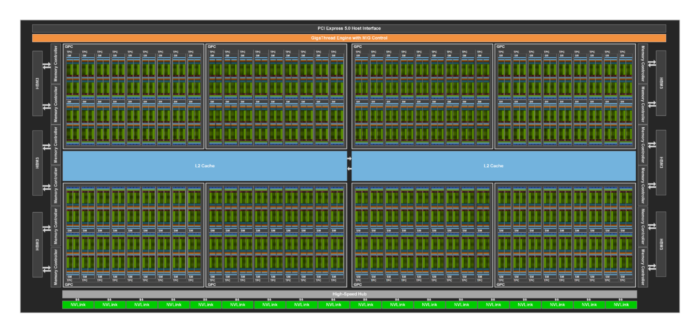
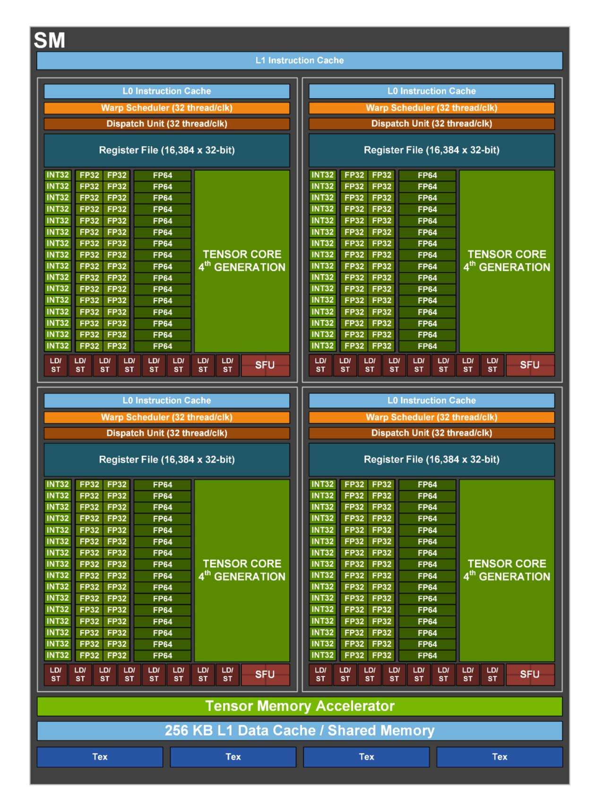
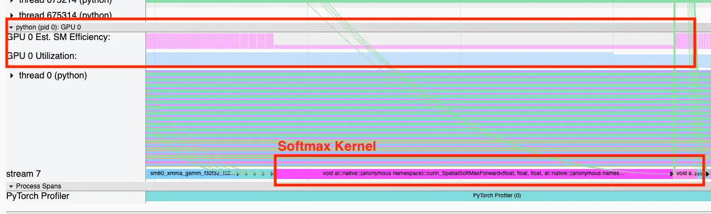
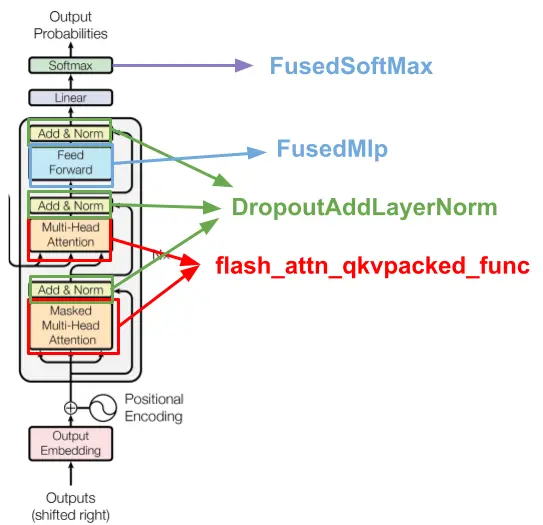

# GPU Utilization：为什么 100% 不等于训练跑满

!!! info "论文信息"
    **论文题名：** GPU Utilization is a Misleading Metric。 
    **作者：** Trainy。 
    **机构：** Trainy。 
    **时间 / 主题：** 2025-02；高效训练。 
    **arXiv / 官方报告：** arXiv：未找到专门条目；官方材料：[www.trainy.ai/blog/gpu-utilization-misleading](https://www.trainy.ai/blog/gpu-utilization-misleading)。 
    **GitHub / 项目：** GitHub：未找到官方链接；项目页：[www.trainy.ai/blog/gpu-utilization-misleading](https://www.trainy.ai/blog/gpu-utilization-misleading)。 
    **元数据来源与核验口径：** 来源：[官方 / 项目材料](https://www.trainy.ai/blog/gpu-utilization-misleading)；Checked Date：2026-06-04；Repro Status：Paper / official materials reviewed, independent reproduction not claimed。

## 100% GPU utilization 之后，优化为什么还没有结束

Trainy 为一家基础模型公司优化 LLM 训练时，先做了最常见的一轮调整。数据加载端增加 worker、调整 batch size、使用 pinned memory 与预取；计算端采用 FP16/BF16 混合精度以及 FusedAdam、FusedAdamW 一类融合优化器；硬件端选择适合训练的 SXM GPU 和网络。GPU utilization 随后达到 100%，功耗也很高，但按模型吞吐算出的 **Model FLOPs Utilization（MFU，模型浮点运算利用率）只有约 20%**。机器持续繁忙，模型却没有相应地跑快。[↗](https://www.trainy.ai/blog/gpu-utilization-misleading)

这篇文章的核心洞见，是把“设备有没有在执行”“工作分布到多少计算单元”“每秒完成多少有效模型计算”拆开。沿着这三层去看，100% 和 20% 完全可以同时成立。GPU utilization 达到上限，只说明排查工作应该从设备空闲转向执行效率，不能宣布性能优化已经完成。

作者接下来用 profiler 定位到 Softmax 等算子，替换融合实现，再调整模型并行程度，最终报告约 4 倍训练加速和 38% MFU。这是一条从监控现象到具体算子的工程诊断链。要复用它，最需要读懂的是每个指标的分母，以及某个局部优化如何真正缩短训练 step。

## GPU utilization 先把整个 GPU 压成一个“忙或闲”的信号

文章采用的定义是，过去一个采样周期内，GPU 上有一个或多个 kernel 正在执行的时间占比。下面是对该定义的解释性表达，并非原文给出的数学公式。设采样窗口长度为 $T$，$K(t)$ 表示时刻 $t$ 是否至少有一个 kernel 在执行，则

$$
U_{\mathrm{GPU}}=\frac{1}{T}\int_0^T \mathbf{1}[K(t)]\,\mathrm{d}t.
$$

这个表达只对“有没有”计时。一个 kernel 使用一个 SM，另一个 kernel 使用所有 SM，只要它们各自覆盖完整采样窗口，都可能得到 100%。kernel 内执行的是矩阵乘法、读取内存，还是等待已发出的访存请求，这个高层百分数也不负责区分。PyTorch 的 profiler 文档同样用“一个线程持续执行也能得到 100%”解释这一限制。[↗](https://pytorch.org/blog/pytorch-profiler-1.9-released/#gpu-metric-on-timeline)

因此，原文所说“只读写内存、做 0 FLOPs 也可能达到 100%”，描述的是指标没有浮点吞吐的含义。它不等于没有执行指令，更不意味着 memcpy、显存容量占用与所有监控工具中的 utilization 字段都是同一指标。理解读数之前，要先确认具体字段来自哪套计数和哪段采样时间。

这也解释了为什么高功耗不能补上缺失的信息。功率说明设备消耗了能量，却没有回答这些能量换回多少模型 token。训练系统中的内存访问、通信和低效 kernel 都可能很忙，端到端吞吐仍然有限。

## 从整卡到 SM，再到 warp，观察尺度逐层缩小

### 原图中的 144 SM 与例子里的 132 SM

先看原文的 GH100 整体结构图。图内大量重复的小块才是执行 kernel 的 SM；HBM、L2 Cache、互连等组件围绕这些执行单元组织数据移动。观察重点是工作可以分布到很多个 SM，而整卡 utilization 把这种空间分布压成了一个时间读数。

{ width="820" }

*Trainy 引用的 GH100 完整芯片结构示意图。图示为 144 SM，后文例子使用启用 132 SM 的 H100 配置。二者不能混为同一产品的启用规格。*

再把一个 SM 放大。图中既有 FP32、FP64 执行单元，也有 Tensor Core、LD/ST、寄存器和共享内存；顶部的 warp scheduler 负责调度线程组。因此，“某个 SM 处于活跃状态”仍然没有指定内部哪类单元在工作，更没有保证 Tensor Core 一直执行适合它的矩阵计算。

{ width="760" }

*原文的单个 SM 结构图。读取数据、保存中间结果与执行算术是不同环节；看到活跃线程，不能直接推出所有算术资源已被充分使用。*

文章以 132 SM、每个 SM 128 个 CUDA core 的 H100 为例，总数是 16,896。假设一个 kernel 连续运行 10 秒，却只使用其中一个 SM，那么整卡 utilization 可以达到 100%，而按活跃 SM 的时空平均计算，活动率只有 $1/132\approx0.76\%$。原文写约 0.7%，这里的 0.76% 是直接除法后的更精细近似。[↗](https://www.trainy.ai/blog/gpu-utilization-misleading)

### SM activity 增加了空间维度，但仍然不是有效计算比例

NVIDIA DCGM 对 **SM Activity** 的定义更精确：每个 SM 至少有一个活跃 warp 的时间比例，再对全部 SM 求平均。这里的活跃 warp **包括等待内存的 warp**，不要求它当下正在发射算术指令。对应字段是 `DCGM_FI_PROF_SM_ACTIVE`，编号 1002。[↗](https://docs.nvidia.com/datacenter/dcgm/latest/user-guide/feature-overview.html#profiling-metrics)

用 $M$ 表示 SM 数、$a_m(t)$ 表示第 $m$ 个 SM 是否至少有一个活跃 warp，可把这个定义解释为

$$
A_{\mathrm{SM}}=\frac{1}{MT}\sum_{m=1}^{M}\int_0^T a_m(t)\,\mathrm{d}t.
$$

它同时平均时间和空间。DCGM 给出的两个例子尤其有用：若五分之一的 SM 持续工作，活动率约为 20%；若全部 SM 只在五分之一的时间工作，其余时间完全空闲，活动率也约为 20%。相同的平均数，背后可能是并行覆盖不足，也可能是工作供应不连续。需要把指标与时间线对齐，才能选择不同的改进方式。

反过来，即使所有 SM 都有活跃 warp，如果它们经常等待内存，活动率仍可以很高。这里不能把旧的判断“GPU utilization 高，所以性能好”，换成新的判断“SM activity 高，所以性能好”。活动率帮助缩小排查范围；算术流水线、内存带宽与实际 step time 才能继续区分原因。

### Occupancy 衡量驻留的 warp 数量

**SM Occupancy（SM 占用率）**进一步关心每个 SM 驻留多少 warp，相对于该硬件支持的最大并发 warp 数是多少。DCGM 的字段是 `DCGM_FI_PROF_SM_OCCUPANCY`，编号 1003。它与仅要求“至少一个 warp”的 SM activity 不同。[↗](https://docs.nvidia.com/datacenter/dcgm/latest/user-guide/feature-overview.html#profiling-metrics)

更多驻留 warp 有时能让调度器在一组线程等待数据时，切换到另一组已有数据的线程，从而隐藏延迟。但寄存器、共享内存和每个 block 的线程数共同限制驻留量；较高 occupancy 也不保证较短的 kernel 时间。若计算单元或内存通路已经成为瓶颈，继续提高驻留数量可能不再带来收益。更不能把“驻留”解释为每个 warp 都在同一时刻执行。

三个层次的区别可以放在同一张解释表里。这张表用于梳理定义，不是原文的实验表。

| Metric | Measurement | Useful question | What it does not establish |
|---|---|---|---|
| GPU Utilization | 有 kernel 执行的时间比例 | GPU 是否经常空闲 | 工作是否覆盖整卡、有效 FLOPs 是否高 |
| SM Activity | SM 上至少一个 warp 活跃的时间比例，再跨 SM 平均 | 工作是否覆盖更多 SM 和时间 | 活跃 warp 是否正在算术运算 |
| SM Occupancy | 驻留 warp 相对最大并发容量的比例 | 是否有足够线程组隐藏延迟 | 提高该比例是否会缩短运行时间 |
| Tensor Activity | Tensor 指令管线活跃的周期比例 | Tensor Core 管线是否得到工作 | 完整模型训练是否接近理论效率 |
| MFU | 有效模型计算吞吐相对硬件峰值 | 当前实现每秒完成多少有用模型工作 | 哪一个 kernel 或通信步骤造成损失 |

## MFU 把分子换回模型真正要完成的工作

对于相同模型，用户最终关心每秒处理多少训练 token、完成固定训练预算要多久。设模型每 token 必需的前向和反向计算量为 $C_{\mathrm{model}}$ FLOPs，实测吞吐为 $R$ tokens/s，使用 $N$ 个相同 GPU，每卡在所用数值精度下的峰值为 $P$ FLOPs/s，那么 MFU 可按定义写为

$$
\mathrm{MFU}=\frac{C_{\mathrm{model}}R}{NP}.
$$

等价地，$NP/C_{\mathrm{model}}$ 是假定全部峰值都用于模型有效计算时的理论 token 吞吐，MFU 是实测吞吐与它的比值。这里各项必须使用同一口径：序列长度会影响注意力计算，模型架构会影响每 token 工作量，分母则需要对应实际设备数、精度及适用的峰值条件。不能拿 BF16 训练的吞吐随意除以另一种精度或不适用的稀疏峰值。

原文引用的 PaLM 定义还有一个关键边界：**MFU 不把 activation rematerialization 的重复计算计作额外有效模型工作**。重计算确实会让硬件执行更多 FLOPs，但它是在显存约束下重复完成已有前向计算。若把这部分也算入分子，得到的是包含实现额外工作的硬件利用率口径，而非 PaLM 用来比较训练效率的 MFU。[↗](https://arxiv.org/html/2204.02311v5#S4)

PaLM 本身提供了一个清楚的例子：论文给出包含注意力的 MFU 为 46.2%，包含重计算的 hardware FLOPs utilization 为 57.8%。同一次训练可以有不同百分数，区别来自计量目标。重计算仍可能帮助性能，因为它释放显存、允许更合适的 batch；是否值得，需要看由此换回的 token 吞吐，而不能靠“多执行了 FLOPs”证明。[↗](https://arxiv.org/html/2204.02311v5#S4)

Trainy 提到的常见 35%–45% MFU 是其 2025 年文章的经验参照。模型、序列长度、精度、规模与并行策略不同，不宜把它当作所有训练系统通用的合格线。在这次案例中，20% 的作用是提示仍有明显效率空间，并推动作者寻找具体原因。

## Profiler 把“有空间”变成可以修改的算子

下面的原图应沿同一时间轴对齐三条信息：底部标红的长 Softmax kernel、上方的 GPU Utilization，以及 **Est. SM Efficiency**。Softmax 持续执行时，整卡忙碌条仍很高，而估计的 SM efficiency 明显降低。

{ width="860" }

*原文的 PyTorch Profiler 截图。这里显示的是 Est. SM Efficiency，保留“估计”这一标签；截图没有提供可重建完整基准的算子尺寸和精确计数。*

这张图首先支持定位判断：慢的区间可以落到一个具体 kernel，不能继续只看整个训练作业的平均 utilization。它并不单独证明究竟有多少带宽未用、多少 warp 在等待，或更大的 batch 必然能解决问题。后续仍需要结合算子的计算模式来解释。

原文指出，朴素 Softmax 是典型的内存相关瓶颈。为了理解为何融合能帮助它，可以把数值稳定的 Softmax 展开为一个说明性过程。对一行输入 $x$，先找最大值 $m$，再计算指数、求和、归一化：

$$
m=\max_j x_j,\qquad e_i=\exp(x_i-m),\qquad y_i=\frac{e_i}{\sum_j e_j}.
$$

如果这些步骤由分离的操作实现，中间值可能反复写入和读出显存。算术本身并不复杂，数据却在算子之间搬运。GPU 可以一直执行 kernel，时间仍大量消耗在访存上。这个展开用于解释内存流量，并不声称截图中的具体 Softmax 恰好按四个独立 kernel 实现。

在注意力内部，问题还会放大：若显式存储整张 attention score，再存储归一化概率，长序列会产生大量中间读写。融合注意力实现能够改变计算与中间结果的存放方式，让相关操作一起执行，减少这些往返。这里减少的是执行路径上的数据移动，不要求改变模型本来要计算的注意力功能。

## 融合优化改变了哪些环节

原文并没有为每个层重新开发 CUDA。它复用了 FlashAttention 等已有库里的实现，重点是把模型中的相应模块换成兼容的融合版本。下图从输入到输出标出四组候选位置：注意力、前馈网络、dropout–residual–normalization，以及输出 Softmax。

{ width="540" }

*原文的融合位置示意图，保留 `flash_attn_qkvpacked_func`、`FusedMlp`、`DropoutAddLayerNorm`、`FusedSoftMax` 标注。图采用带交叉注意力的通用 Transformer 示意，不足以据此推断客户模型就是同样的 decoder 结构。*

**注意力路径。** 文中使用 FlashAttention 作为融合的代表。应关注 Q/K/V 到注意力输出的整个计算区域，不能把图最上方的 `FusedSoftMax` 当成对注意力所有中间读写的替代。对现有模型，接入点需要匹配张量布局、mask、精度以及前后向接口；已有库的模块封装减少了手写 autograd 的负担，但不会自动消除接口差异。[↗](https://github.com/Dao-AILab/flash-attention)

**MLP 路径。** 图中的 `FusedMlp` 对应前馈网络内可合并的计算。其实际收益来自实现减少部分中间写回和调度成本。模块名不意味着两个矩阵乘法、激活和全部反向传播都被压进同一个 kernel。原文提供的是可复用实现方向，没有报告这一个模块独立贡献的加速倍数。[↗](https://github.com/Dao-AILab/flash-attention/blob/9a11f440d3a34f618b4ba814c825b109c6d7e8f5/flash_attn/ops/fused_dense.py#L531)

**Dropout、残差加法与 LayerNorm。** 这些操作相邻地处理同一批激活。若每一步单独读写整个张量，计算量不大，带宽成本却会累积。融合可以复用已读入的数据并减少中间张量。不过，训练时 dropout 的随机行为、归一化的数值语义及梯度都必须保持正确。局部更快，只有在前向、反向和训练稳定性都符合要求时才是可用优化。

这些替换共同说明，kernel fusion 的收益不限于“少启动几个 kernel”。对访存受限的操作，更重要的是减少中间值经过高带宽显存的次数，以及让数据在靠近计算单元的位置被继续消费。不同算子、张量尺寸和硬件下，哪种收益占主导需要实际测量。

文章还讨论了 `torch.compile` 与 FSDP、graph break 的实际体验。它反映的是 2025 年发表时的环境，不能直接改写成当前版本的兼容性结论。可复用的判断是查看实际编译覆盖了哪些计算、在哪些边界断开，再决定是否采用手工模块替换；“启用了编译”与“关键区间已经得到融合”之间仍需要运行结果连接。

## 4 倍加速与 20%→38% MFU 应当分别怎样读

作者报告，大部分收益来自融合 kernel，以及依据模型大小和 3.2 Tbps InfiniBand 网络调整模型并行程度。这里不只有单卡算子优化：并行切分改变每张卡收到的工作量，也改变跨卡通信安排，因此要一起看端到端 step time。[↗](https://www.trainy.ai/blog/gpu-utilization-misleading)

下面整理原文唯一的客户结果。列名为说明方便而设，原文没有对应的正式消融表。

| Reported quantity | Before | After / available condition |
|---|---:|---|
| GPU Utilization after initial tuning | 100% | 后续优化的 utilization 未单列 |
| Model FLOPs Utilization | ~20% | 38% |
| Training speedup | Baseline | 4× reported |
| Network | — | 3.2 Tbps InfiniBand available |
| Main changes | 已做常规数据、精度、优化器调整 | Fused kernels + model-parallelism tuning |

从 20% 到 38% 是提高约 18 个百分点，相对提高约 90%。若模型工作量、设备数和峰值口径完全不变，根据 MFU 定义可推出 token 吞吐比为 $38/20=1.9$。**这不能推出 4 倍训练加速。** 原文没有公开足够的阶段基线、模型配置和 GPU 规模，不能替作者补出一组能强行对齐两者的条件。

这也限制了收益归因。没有逐项开关的消融，便不能把 4 倍分配给 FlashAttention、MLP 或某一种并行方式；没有完整训练配置，也不能预期任意模型采用同样模块就获得 38% MFU。它有力地支持的是更具体的工程观察：已有 100% utilization 的训练仍可能通过算子实现和并行配置得到明显改善。

## 把诊断链带回自己的训练任务

可复用的起点是为固定工作建立基线。记录模型、序列长度、有效 global batch、数值精度、GPU 类型与数量，在稳定运行区间比较 token/s 和 step time。编译预热、数据等待或周期性 checkpoint 若进入计时，需要在前后实验保持一致；否则指标变化可能来自计时窗口，而不是被修改的算子。

接着对齐时间线。若 GPU 经常空闲，优先调查数据供应、CPU 调度、kernel 启动间隙和同步；若 GPU 持续忙碌而模型吞吐低，就把耗时区间落到 kernel 或通信操作，进一步区分 SM 覆盖、驻留 warp、内存活动和 Tensor 管线工作情况。DCGM 的设备级平均适合持续观察，profiler 的算子时间线适合定位问题，两者回答的尺度不同。

最后只改动可以解释的一组因素，例如替换已定位的融合模块，或调整一种并行配置。先比较输出与梯度，再比较完整训练 step。吞吐改善后重新计算 MFU，并检查节省的显存、通信变化和训练稳定性是否影响实际可用的配置。这样才能知道局部 kernel 加速有没有转化为整个训练任务的收益。

这篇案例最值得带走的工作习惯，是让监控指标承担它真正能回答的问题。GPU utilization 告诉你设备是否经常没有工作；更细粒度指标帮助定位执行瓶颈；固定训练工作所需的时间，负责决定优化是否成功。
