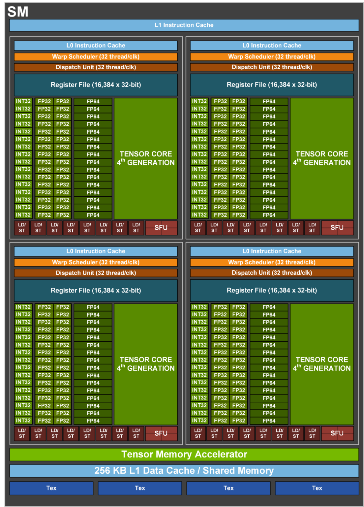
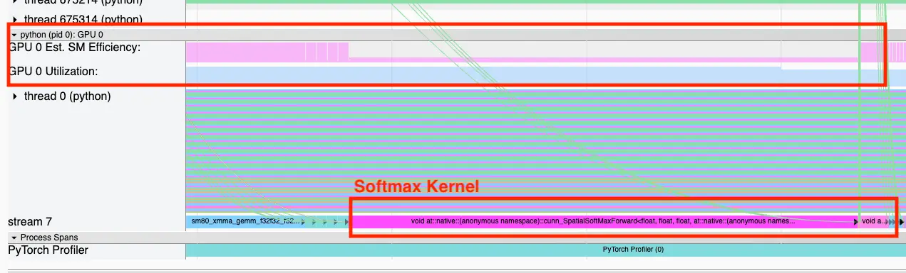
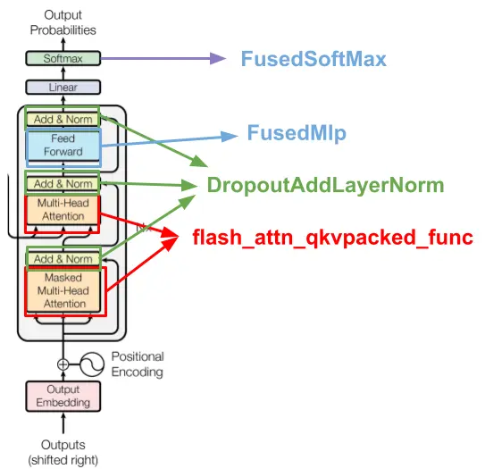

# GPU Utilization：为什么 100% 不等于训练跑满

!!! note "读法定位"
    这页先按“训练性能排障案例”读：它不是一篇算法论文，而是一篇把 GPU 指标、profiler 和 Transformer kernel 优化串起来的工程文章。背景概念先回 [论文专题讲解](../index.md)、[训练与基础系统](../../training/index.md) 和 [算子与编译器](../../operators/index.md)。
    **前置**：最好先知道 CUDA kernel、SM、mixed precision、FlashAttention、FSDP / model parallelism 和 MFU 的基本含义。
    **主线关系**：读完后把结论回填到「高效训练」路线里，判断一次训练慢到底是数据管线、kernel、显存带宽、通信，还是观测指标本身误导了你。

!!! info "文章信息"
    - 技术博客：`GPU Utilization is a Misleading Metric`
    - 原文链接：[Trainy blog](https://www.trainy.ai/blog/gpu-utilization-misleading)
    - 中文辅助：[掘金译文](https://juejin.cn/post/7411406818025537546)
    - 作者：Roanak Baviskar
    - 日期：2025-02-24
    - 关键词：GPU utilization、MFU、SM efficiency、SM activity、PyTorch Profiler、kernel fusion、FlashAttention、FSDP、model parallelism、LLM training

这篇文章最值得带回训练系统里的结论是：**GPU utilization 更像“GPU 没闲着”的指标，不是“GPU 算力被有效使用”的指标。**

Trainy 的案例里，团队已经把 `nvidia-smi` 里常见的 GPU utilization 推到 100%，功耗也不低，但训练 workload 的 MFU 只有约 `20%`。继续 profile 后，他们发现 Softmax kernel 虽然让 GPU utilization 很高，但 SM efficiency 很低。经过 fused kernels 和合适的 model parallelism 调整后，训练时间达到 `4x` 加速，MFU 从约 `20%` 提到 `38%`。

!!! note "关于中文辅助材料"
    掘金文章可作为中文阅读辅助，但本站涉及最终数字时以 Trainy 原文为准：原文写的是 MFU 从 `20%` 提到 `38%`，不是 `58%`。这个差异正好提醒我们，性能优化文章一定要保留指标口径和原始来源。

## 它的效率贡献是什么

| 维度 | 贡献 |
| --- | --- |
| 节省的成本 | 避免把 100% GPU utilization 误读成训练已经吃满算力，从而把优化停在数据加载、混合精度和基础并行配置之后 |
| 核心机制 | 用 MFU 判断端到端计算效率，用 SM efficiency / SM activity 定位 kernel 是否真正铺满 SM，再用 profiler 找到 memory-bound 或 launch-heavy 层 |
| 对世界模型主线的意义 | 视频 DiT、LLM、VLA 和世界模型训练都容易被 attention、softmax、通信和数据管线卡住；GPU utilization 只能做 idle signal，不能做效率验收 |
| 主要风险 | SM efficiency 也不是最终答案；SM 活跃不代表 Tensor Core、内存带宽、occupancy、NCCL 和端到端 step time 都健康 |
| 应接到本站哪里 | [训练路线图](../../training/index.md)、[训练数据系统与吞吐优化](../../training/data-systems-and-optimization.md)、[GEMM 与 Attention Kernel](../../operators/gemm-attention-and-fused-kernels.md)、[世界模型高效训练技术路线图](../../world-models/efficient-training-roadmap.md) |

## 证据等级与外推边界

这篇文章的证据来自一个 LLM 训练优化项目、PyTorch Profiler 截图、指标定义解释和优化后 MFU/训练时间变化。它能支撑“GPU utilization 会误导训练性能判断”，但不能替代完整 benchmark 或严格消融。

| Claim | Evidence | Evidence level | Can reuse for training systems | Cannot directly infer |
| --- | --- | --- | --- | --- |
| 100% GPU utilization can still waste compute | 100% utilization with about 20% MFU in the case study | Engineering case | Treat GPU utilization as an idle detector, not a compute-efficiency metric | All 100% utilization jobs are inefficient |
| SM efficiency helps expose underused kernels | PyTorch Profiler shows low SM efficiency during Softmax | Profiler evidence | Add SM activity / SM efficiency to cluster observability and per-layer profiling | High SM efficiency alone means the workload is optimal |
| Fused kernels matter for Transformer training | Softmax, FlashAttention, MLP, dropout-layernorm-residual fusion discussion | System mechanism | Replace memory-bound PyTorch-native layer stacks with fused CUDA/Triton implementations when profiling supports it | Kernel fusion always improves every model or batch shape |
| MFU is a better top-level training efficiency metric | MFU moved from about 20% to 38% after optimization | Case result | Use MFU with tokens/s, step time and peak FLOPs to judge whether more optimization is worth pursuing | MFU can localize the bottleneck by itself |
| Model parallelism must match model and network | Case mentions tuning model-parallel level under 3.2 Tbps InfiniBand | System tuning | Profile communication and compute together instead of only changing batch size | A fixed TP/PP/FSDP layout is best across models and clusters |

最稳的外推方式是把它当成一套诊断顺序：先看 GPU 是否 idle，再看 MFU 是否低，再用 profiler 和 SM / memory / tensor 指标定位具体 kernel 或通信阶段，最后做单项替换并回归训练 loss、吞吐和显存。

## 文章位置

很多训练优化教程会先列四件事：调大 batch 和 dataloader 参数、打开 fp16/bf16、换 fused optimizer、使用训练型 GPU 和高速网络。这些都重要，但它们只能把训练从“明显喂不饱 GPU”推进到“GPU 一直有活干”。

Trainy 文章提醒的是下一层问题：GPU 一直有活干，不代表这些活是高价值计算。一个 memory-bound softmax、一个很小的 kernel、一个通信等待阶段，或者一串频繁读写 HBM 的算子，都可能让 GPU utilization 很高，但实际 FLOPs 很低。

所以这篇文章在高效训练专题里的位置是“观测指标与排障入口”。Megatron-LM、ZeRO、MagiAttention、Attn-QAT 这些页面讨论的是具体并行、显存、attention 和低比特机制；这篇先回答：**你怎么知道自己的训练真的需要这些优化，以及该先优化哪一层。**

## GPU Utilization 到底测了什么

原文先用 GH100 / H100 的 SM 结构解释为什么 GPU utilization 容易误导。SM 可以理解成 GPU 内调度和执行线程块的基本计算单元；一个 CUDA kernel 只要在某个采样窗口里持续运行，就可能让 GPU utilization 看起来很高，但它未必使用了足够多的 SM，更未必让每个 SM 内部的 Tensor Core 或 CUDA core 高效工作。

{ width="820" }

<small>图源：[Trainy: GPU Utilization is a Misleading Metric](https://www.trainy.ai/blog/gpu-utilization-misleading)。原图说明：GH100 GPU 中包含大量 Streaming Multiprocessors；原文用它说明 GPU 并行能力来自很多 SM 的协同工作。</small>

{ width="560" }

<small>图源：[Trainy: GPU Utilization is a Misleading Metric](https://www.trainy.ai/blog/gpu-utilization-misleading)。原图说明：H100 单个 SM 内部包含多个执行单元；原文用它说明“有 kernel 在跑”和“所有计算单元都被有效使用”不是同一件事。</small>

!!! note "这两张图怎么读"
    Figure 1 看的是整块 GPU 被拆成多少个 SM；Figure 2 看的是单个 SM 内还有很多执行资源。GPU utilization 的问题在于，它首先回答“有没有 kernel 在跑”，不是回答“多少 SM 在跑、每个 SM 内部多忙、Tensor Core 是否在做矩阵乘”。因此一个只占少量 SM、主要读写内存的 kernel，也可能让 utilization 看起来很好。

原文给了一个很极端但非常有用的思想实验：如果一个 kernel 连续运行 10 秒，但只用到 1 个 SM，那么 `nvidia-smi` 风格的 GPU utilization 可能显示 100%；可是在 132 SM 的 H100 上，SM efficiency 只有 \(1/132 \approx 0.7\%\)。这说明 utilization 是必要信号，但不是充分信号。

## 指标分层

训练排障时更稳的做法，是把指标按粒度分层看。

| Metric | What it measures | Useful for | Blind spot | Typical tool |
| --- | --- | --- | --- | --- |
| GPU Utilization | Time with at least one running kernel or active GPU work | Detecting idle GPUs and data-loader stalls | Does not reveal SM coverage, arithmetic intensity, Tensor Core use, or memory-bound kernels | `nvidia-smi`, NVML, dashboards |
| SM Efficiency / SM Activity | Fraction of SMs active over a sampling window | Finding kernels that do not spread work across SMs | Active SMs can still be doing low-value memory work or underfilled warps | PyTorch Profiler, DCGM, Nsight |
| Achieved Occupancy | Active warps per SM relative to hardware capacity | Diagnosing whether each active SM has enough resident work | High occupancy does not guarantee high FLOPs; memory stalls can still dominate | Nsight Compute, PyTorch Profiler |
| Tensor Core / Pipe Utilization | How busy specific execution pipelines are | Checking whether bf16/fp16/fp8 GEMMs are actually using accelerated math units | Does not explain data input or communication stalls by itself | Nsight Compute, DCGM profiling metrics |
| Memory Bandwidth | HBM or memory-interface traffic relative to peak | Identifying memory-bound softmax, norm, copies, cache misses | High bandwidth can be healthy or a symptom depending on arithmetic intensity | Nsight, DCGM, vendor dashboards |
| MFU | Model FLOPs achieved relative to theoretical peak FLOPs | Top-level training efficiency comparison across runs | Requires a model FLOPs estimate and does not localize the slow layer | Training logs plus hardware peak FLOPs |

这里最重要的是别把这些指标排成“谁替代谁”。它们回答的问题不同：

```text
GPU utilization: is the GPU idle?
MFU: is the training job using enough of theoretical compute?
SM efficiency: are kernels spreading work across SMs?
Occupancy / pipe / memory metrics: why are active SMs still slow?
Profiler timeline: which operator or communication phase is responsible?
```

### GPU utilization 高但 Tensor Core 低

用户最容易遇到的下一层问题是：GPU utilization 已经很高，SM activity 也不低，但 Tensor Core / tensor pipe utilization 仍然偏低。这通常不是“卡坏了”，而是 workload 没有把时间花在 Tensor Core 擅长的 dense matrix multiply / convolution 上。

NVIDIA 的 [mixed precision 文档](https://docs.nvidia.com/deeplearning/performance/mixed-precision-training/index.html)把 Tensor Core 优化拆成三件事：满足 shape 约束、提高 arithmetic intensity、减少 non-Tensor-Core work 的占比。NVIDIA 的[矩阵乘性能指南](https://docs.nvidia.com/deeplearning/performance/dl-performance-matrix-multiplication/index.html)也强调，现代 cuBLAS/cuDNN 即使在部分未对齐 shape 上仍可能使用 Tensor Core，但维度按 16 bytes 或更高粒度对齐时效率更好。PyTorch 侧还要看 [AMP/autocast op eligibility](https://docs.pytorch.org/docs/2.8/amp.html#op-eligibility)、[TF32 开关](https://docs.pytorch.org/docs/2.8/notes/cuda.html#tensorfloat-32-tf32-on-ampere-and-later-devices)和具体 op eligibility：例如 `linear`、`matmul`、`mm`、`bmm`、`conv` 更容易走低精度矩阵路径，而 `softmax`、`layer_norm`、`sum`、`log`、部分 loss 和 reduction 常会保持或转到 fp32 路径。

| Symptom | Likely reason | How to verify | Typical fix |
| --- | --- | --- | --- |
| High GPU Util, low Tensor Core, high memory bandwidth | Memory-bound kernels dominate | Nsight Compute roofline, memory workload analysis, profiler operator table | Fuse memory-bound ops, reduce HBM traffic, use FlashAttention / fused norm / fused optimizer |
| High GPU Util, low Tensor Core, many non-GEMM kernels | Work is softmax, layer norm, activation, embedding, optimizer, scatter/gather, masking, or NCCL | PyTorch Profiler categories, Nsight Systems timeline | Reduce non-Tensor-Core fraction, fuse pointwise/reduction ops, overlap communication |
| Matmul exists, but Tensor Core low | Dtype path is not eligible: fp32 with TF32 disabled, AMP disabled, explicit `dtype=`, in-place or `out=` ops bypass autocast | Check PyTorch autocast regions, `torch.set_float32_matmul_precision`, TF32 flags, kernel metrics | Enable bf16/fp16 AMP where stable, enable TF32 for fp32 matmul when acceptable, avoid autocast-breaking calls |
| Tensor Core kernels appear, but utilization low | GEMM shapes are too small, fragmented, or poorly aligned | Inspect M/N/K, batch size, sequence packing, head dimension, tile count | Increase micro-batch, pad dimensions, pack sequences, choose hidden/head sizes aligned with Tensor Core-friendly multiples |
| Tensor Core active only in short bursts | Kernel launch overhead or many tiny kernels dominate | Nsight Systems launch timeline, CPU overhead, graph breaks | Use fused modules, CUDA Graphs where applicable, `torch.compile` only after validating graph breaks |
| Good Tensor Core in forward, low step-level Tensor Core | Backward, optimizer, communication, checkpoint recompute or dataloader consumes wall time | Step breakdown: forward/backward/optimizer/NCCL/dataloader | Fused optimizer, communication overlap, better FSDP/TP buckets, input pipeline fixes |
| Tensor Core low in MoE / sparse / retrieval-heavy model | Routing, top-k, all-to-all, unstructured sparsity and gather/scatter dominate | Per-layer trace and NCCL timeline | Batch/routing coalescing, expert capacity tuning, structured sparsity or dense fallback for hot paths |

这个现象和 Trainy 文章里的 Softmax 案例是同一个家族：GPU 一直忙，但忙的是内存读写、reduction、通信或小 kernel，而不是大块 dense GEMM。Tensor Core 低时，优先问四个问题：

1. 当前 step 的 wall time 里，dense GEMM/conv 到底占多少？
2. 这些 GEMM/conv 的 dtype、shape、layout 是否能走 Tensor Core 高效路径？
3. 非 Tensor Core work 是否被 softmax、norm、optimizer、mask、embedding、NCCL 或 dataloader 放大？
4. 即使 Tensor Core kernel 很快，端到端 step time 是否被通信、checkpointing 或 Python/launch overhead 吃掉？

!!! note "诊断口径"
    不要只看一个 `tensor_core_utilization` 面板。更稳的方式是同时看 Nsight Systems 的时间线、[Nsight Compute roofline](https://docs.nvidia.com/nsight-compute/2023.3/NsightCompute/index.html#rooflines) 里的 tensor pipe / memory / roofline、PyTorch Profiler 的 op 表，以及训练日志里的 MFU。若 roofline 显示 kernel 被 memory ceiling 限制，Tensor Core 低是结果，不是根因；若 GEMM shape 很小或未对齐，Tensor Core 低才可能是直接优化点。

### MFU 的训练口径

MFU 来自 PaLM 等大模型训练报告中常用的口径。对 dense Transformer，粗略上可以写成：

$$
\mathrm{MFU} =
\frac{\mathrm{model\ FLOPs\ per\ token} \times \mathrm{tokens/s}}
{\mathrm{number\ of\ GPUs} \times \mathrm{peak\ FLOPs\ per\ GPU}}
$$

如果是图像、视频或世界模型训练，也可以把分子改成每 step 估算的训练 FLOPs 除以 step time：

$$
\mathrm{MFU} =
\frac{\mathrm{estimated\ training\ FLOPs\ per\ step} / \mathrm{step\ time}}
{\mathrm{cluster\ peak\ FLOPs}}
$$

这个公式有三个容易踩坑的地方：

1. `model FLOPs` 要和模型结构一致。MoE 要按 activated experts 和实际路由算，不能简单用 total parameters；长上下文 attention 还要补 \(O(BS^2H)\) 或对应 fused attention 的等价 FLOPs。
2. `peak FLOPs` 要和实际精度一致。bf16/fp16/fp8/fp4 的理论峰值不同，Tensor Core 是否被用上也会影响解释。
3. `tokens/s` 或 `samples/s` 要在 warmup 后稳态测。包含 checkpoint、eval、数据缓存未命中和编译 warmup 的窗口会污染 MFU。

所以 MFU 很适合做“还有没有大优化空间”的判断。比如 20% MFU 通常说明值得继续 profile；40% 到 50% 之后，再提升十个百分点可能就需要更深的 kernel、通信和并行布局改造。

## Softmax 为什么会暴露问题

Trainy 的案例中，PyTorch Profiler 显示 Softmax kernel 的 GPU utilization 很高，但 SM efficiency 很低。

{ width="860" }

<small>图源：[Trainy: GPU Utilization is a Misleading Metric](https://www.trainy.ai/blog/gpu-utilization-misleading)。原图说明：PyTorch Profiler 中 Softmax kernel 显示低 SM Efficiency；原文用它说明 GPU utilization 高并不等于 kernel 高效。</small>

!!! note "这张 profiler 图怎么读"
    先看时间轴里是哪类算子占据训练循环，再看同一段里的 GPU utilization、SM efficiency 和算子名称是否一致。这里的重点不是“Softmax 永远不好”，而是 naive softmax 常常读写多、算术强度低、shape 又可能不够饱满；它可以让 GPU 忙着搬数据，却没有把大量时间花在 Tensor Core GEMM 这类高 FLOPs 计算上。

Transformer block 里 attention softmax 特别容易成为指标陷阱：

| Workload pattern | Why GPU Utilization can look good | Why MFU / SM metrics may stay low | Typical fix |
| --- | --- | --- | --- |
| Naive Softmax | A kernel runs continuously and touches memory | Low arithmetic intensity, repeated HBM traffic, poor fusion | Fused softmax, FlashAttention / SDPA |
| Small elementwise ops | Many kernels keep launching | Launch overhead and fragmented memory reads dominate | Fuse dropout, bias, residual, layer norm |
| Tiny micro-batches | GPU always has some work | GEMMs are too small to saturate Tensor Cores | Larger micro-batch, gradient accumulation, better sequence packing |
| Communication-heavy step | NCCL or synchronization keeps devices active | Compute units wait around collectives or imbalance | Tune TP/PP/DP/FSDP, overlap communication, fix stragglers |
| Input pipeline almost-but-not-quite stable | GPU rarely fully idle | Short bubbles between batches reduce steady-state throughput | Prefetch, pin memory, CPU/GPU preprocessing split |

这张表也说明，GPU utilization 不是没用。它能告诉你机器有没有明显空闲，但它不能告诉你“忙的内容是否值钱”。

## 优化路径：从替换指标到替换 kernel

原文最终把优化落到 Transformer block 内的 kernel fusion。

{ width="620" }

<small>图源：[Trainy: GPU Utilization is a Misleading Metric](https://www.trainy.ai/blog/gpu-utilization-misleading)。原图说明：Transformer block 中可以通过 fused attention / fused MLP / fused dropout-layernorm-residual 等减少内存读写和 kernel launch 开销。</small>

!!! note "这张 kernel fusion 图怎么读"
    图里的重点不是“所有层都要手写 CUDA”，而是把多个 PyTorch 原生小算子替换成更少、更贴近硬件的数据流。FlashAttention 是典型例子：它不只是把 softmax 写快，而是避免把完整 attention matrix 反复写入 HBM。MLP、dropout、layer norm、residual add 的融合也类似，目标是减少读写、减少 launch，并让 shape 更容易喂饱 GPU。

训练优化可以按下面顺序做，避免一上来就改复杂分布式结构：

1. **先确认不是输入饿死 GPU**：记录 dataloader wait time、CPU preprocessing、storage bandwidth、batch ready time。常见调参是 `num_workers`、`pin_memory`、`prefetch_factor`、persistent workers、数据缓存和 GPU-side preprocessing。
2. **再确认数值路径对**：bf16/fp16 是否真的启用 Tensor Core；是否有意外 fp32 fallback；loss scale、grad scaler 和 autocast 范围是否合理。
3. **再算 MFU**：如果 GPU utilization 高但 MFU 低，说明训练还没把理论峰值转成有效模型 FLOPs。
4. **用 profiler 找层级瓶颈**：按 step time 排序，看 attention、MLP、norm、optimizer、all-reduce、all-gather、activation checkpoint recompute、dataloader 哪些占比异常。
5. **按证据替换 fused implementation**：优先替换 profiler 指出的 memory-bound 或 launch-heavy 算子，例如 FlashAttention / SDPA、fused MLP、fused bias-dropout-add-layernorm、fused optimizer。
6. **重新选并行切分**：TP、PP、DP、FSDP、ZeRO、sequence/context parallelism 都会改变通信/计算比。模型小却过度切分，通信会盖过计算；模型大但切分不足，又会 OOM 或 micro-batch 太小。
7. **回归质量和稳定性**：吞吐提升后要同时看 loss curve、grad norm、溢出、checkpoint 可恢复性和验证集指标。训练系统优化不能只看 tokens/s。

这里的训练细节尤其适合和 [Megatron-LM](megatron-lm.md)、[ZeRO](zero.md)、[MagiAttention](magiattention.md) 一起读：Megatron-LM 解释 tensor parallel 为什么能把大 GEMM 切开；ZeRO 解释参数、梯度和优化器状态为什么要分片；MagiAttention 解释长上下文 attention 为什么还要按 mask area 和通信路径调度。Trainy 这篇则提醒你：这些复杂技术要由指标和 profiler 触发，而不是凭感觉堆上去。

## 对 LLM / 世界模型训练的具体启发

### LLM 预训练

LLM 训练中，最常见的误判是“GPU utilization 100%，所以吞吐慢只能加卡”。实际可能是：

| Symptom | Likely bottleneck | Training detail to inspect |
| --- | --- | --- |
| 100% GPU Utilization, low MFU | Memory-bound kernels or tiny GEMMs | Attention implementation, sequence length, micro-batch, tensor shapes |
| High SM Activity, low Tensor Core use | Non-GEMM kernels dominate | Softmax, layer norm, embedding, optimizer, fp32 fallback |
| Good single-GPU step, poor multi-GPU scaling | Communication or sharding imbalance | NCCL timeline, TP all-reduce, FSDP all-gather, gradient bucket sizes |
| High throughput but unstable loss | Numerical or optimizer issue | bf16/fp16 range, fused optimizer behavior, gradient clipping, loss scaling |
| Profiler dominated by dataloader | Input pipeline | Token packing, mmap/cache, CPU preprocessing, prefetch and worker count |

这也是为什么训练日志里不应该只写 `gpu_util`。更稳的最小日志集包括：

```text
global_step
tokens_per_second / samples_per_second
step_time_ms
forward_time_ms / backward_time_ms / optimizer_time_ms
dataloader_wait_ms
gpu_utilization
sm_activity
memory_bandwidth_utilization
tensor_core_or_pipe_utilization
peak_memory_allocated
nccl_time_ms
estimated_mfu
loss / grad_norm / overflow_count
```

### 视频 DiT 和世界模型

视频生成和世界模型训练更容易被 GPU utilization 误导，因为它们同时有长序列 attention、VAE/tokenizer、视频解码、数据增强、条件编码器、跨帧 mask、分布式通信和 rollout 评测。

如果只看 GPU utilization，你很难区分下面几种情况：

| World-model case | Looks like | Real question |
| --- | --- | --- |
| Long video attention | GPU is busy | Is attention compute-bound, memory-bound, or communication-bound? |
| Action-conditioned rollout | GPU is busy | Is decode dominated by denoising steps, KV cache, or action adapter? |
| Multi-camera batch | GPU is busy | Are camera streams packed efficiently or padded into wasted tokens? |
| Synthetic data generation | GPU is busy | Are generated samples accepted by checker, or just burning rollout compute? |
| Closed-loop evaluation | GPU is busy | Is simulator / environment step blocking model compute? |

对世界模型高效训练来说，真正应该验收的是“每 GPU-hour 产生多少有效训练信号”。这比 GPU utilization 更接近工程目标：

```text
accepted_tokens_or_frames_per_gpu_hour
valid_rollouts_per_gpu_hour
action-sensitive_success_cases_per_gpu_hour
risk_event_replay_hits_per_gpu_hour
loss_reduction_per_gpu_hour
closed_loop_score_delta_per_gpu_hour
```

换句话说，GPU 忙不忙只是第一层；它忙出来的 token、帧、rollout 和 hard cases 是否进入有效训练，才是高效训练的最终账。

## 一个可复用排障流程

把 Trainy 的经验压缩成工程流程，可以这样跑：

```text
1. Warm up training for enough steps
2. Record steady-state throughput and GPU utilization
3. Estimate MFU from model FLOPs and tokens/s
4. If utilization is high but MFU is low, capture profiler traces
5. Inspect SM activity, achieved occupancy, tensor pipe, memory bandwidth and NCCL timeline
6. Pick one bottleneck class: input, kernel, memory, communication, optimizer, checkpointing
7. Apply one change: fused kernel, batch/packing, parallelism, overlap, optimizer, dataloader
8. Re-run the same window and compare step time, MFU, memory and loss stability
```

这套流程的关键是单变量迭代。不要同时改 batch、precision、FlashAttention、FSDP bucket、activation checkpointing 和数据加载，否则吞吐涨了也很难知道原因，loss 波动时更难回滚。

## 局限和风险

这篇文章有几个边界要保留：

1. 它是工程案例，不是公开可复现实验。`4x` 加速和 `20% -> 38% MFU` 不能直接套到所有模型。
2. SM efficiency 比 GPU utilization 更细，但不是最终指标。高 SM activity 仍可能因为内存、warp divergence、低 Tensor Core use 或通信等待而低效。
3. MFU 依赖 FLOPs 估算。MoE、稀疏 attention、activation checkpointing、重计算和多模态 encoder 都会让估算变复杂。
4. Fused kernel 可能改变数值路径、autograd 图、checkpoint 兼容性和调试难度。尤其在 FSDP、ZeRO、sequence parallel 和 `torch.compile` 混用时，要用小规模回归先验证。
5. 训练效率不是唯一目标。对世界模型和 VLA 来说，action sensitivity、风险校准、长时一致性和闭环成功率必须和吞吐一起验收。

!!! info "本站判断"
    **成熟度**：工程常用的性能排障经验，证据来自作者案例和主流 GPU profiling 工具链，不是算法 benchmark。  
    **可复用机制**：把 `GPU utilization -> MFU -> SM activity -> profiler timeline -> fused kernels / parallelism` 做成训练性能排障顺序。  
    **下一步证据**：在本站世界模型实验里，应把 GPU utilization、SM activity、memory bandwidth、NCCL time、MFU、有效 rollout / GPU-hour 和质量回归一起记录，避免只用单一利用率判断训练效率。
