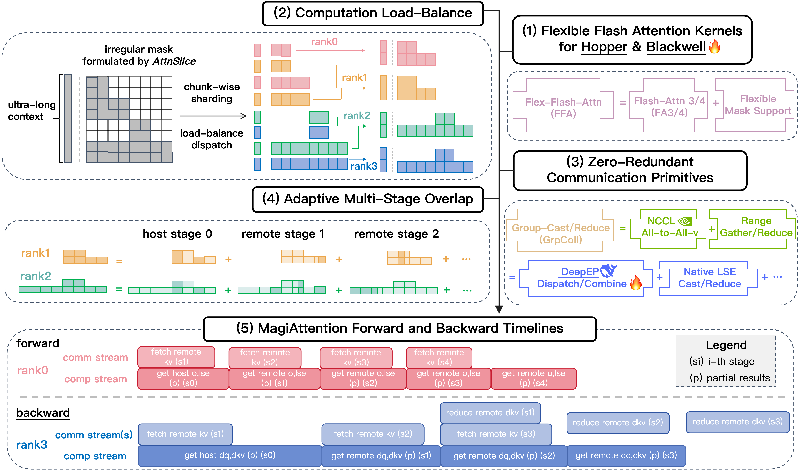
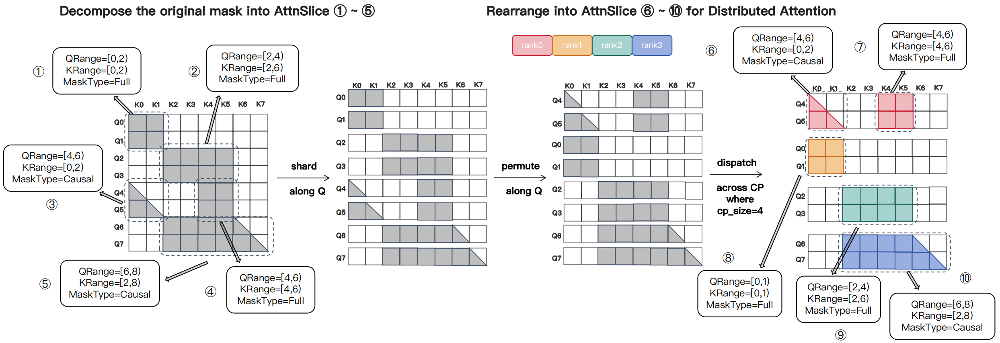
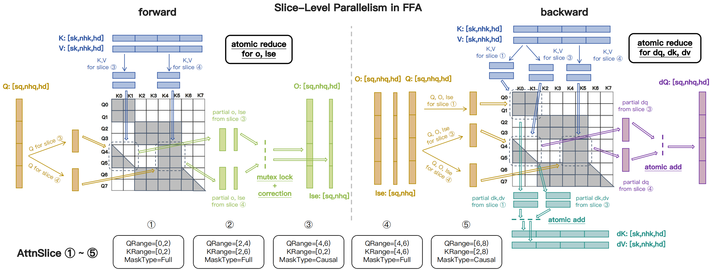
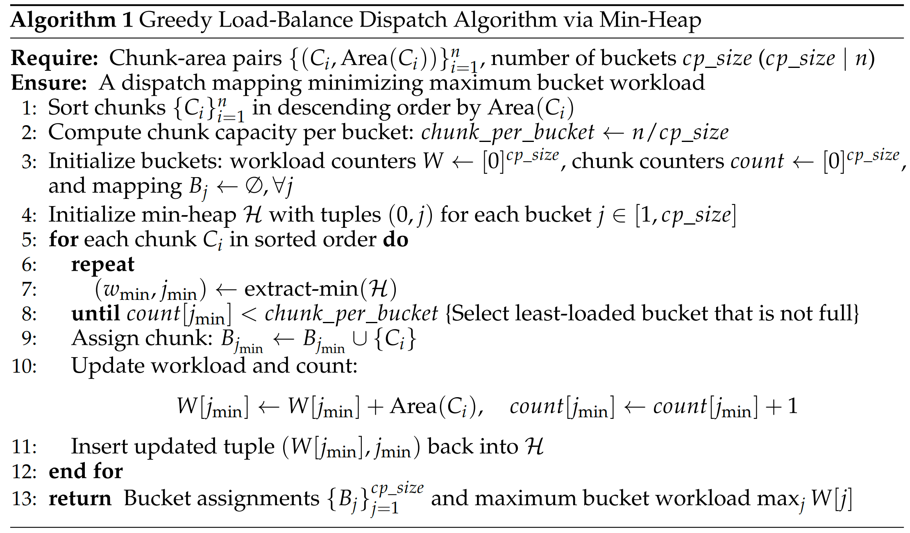
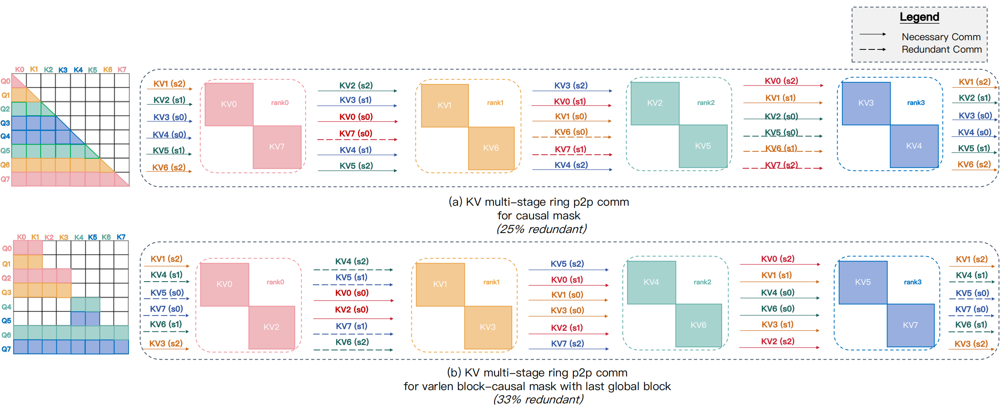
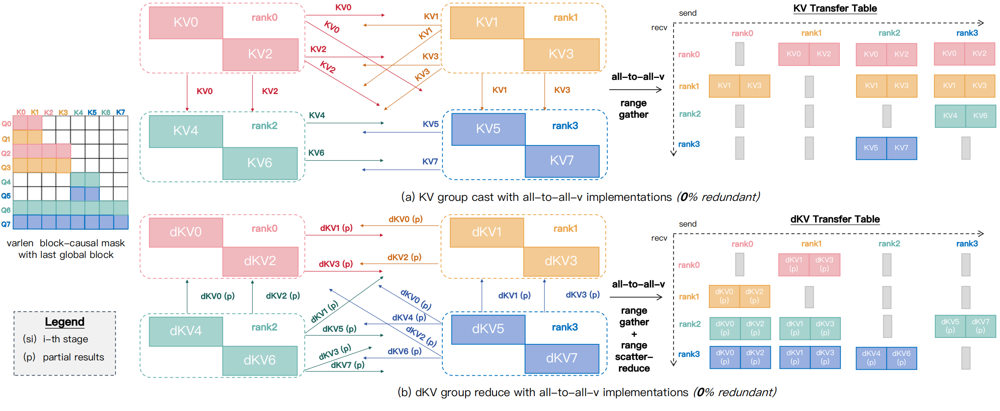
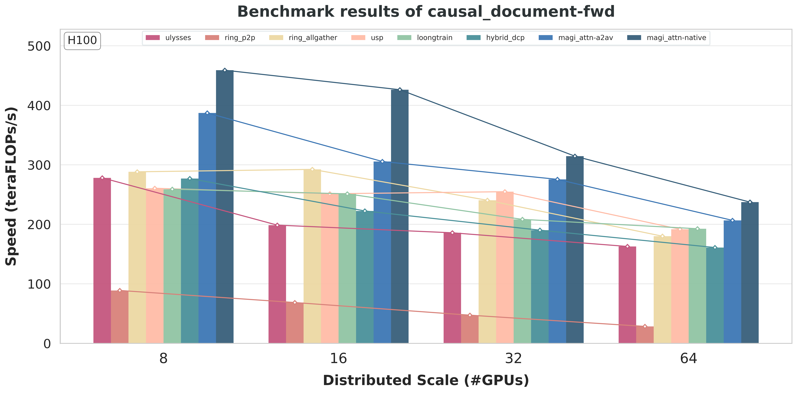
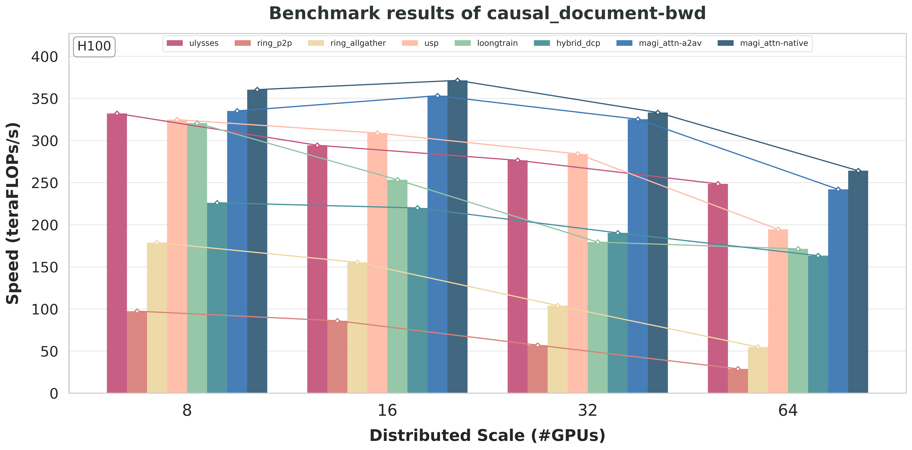
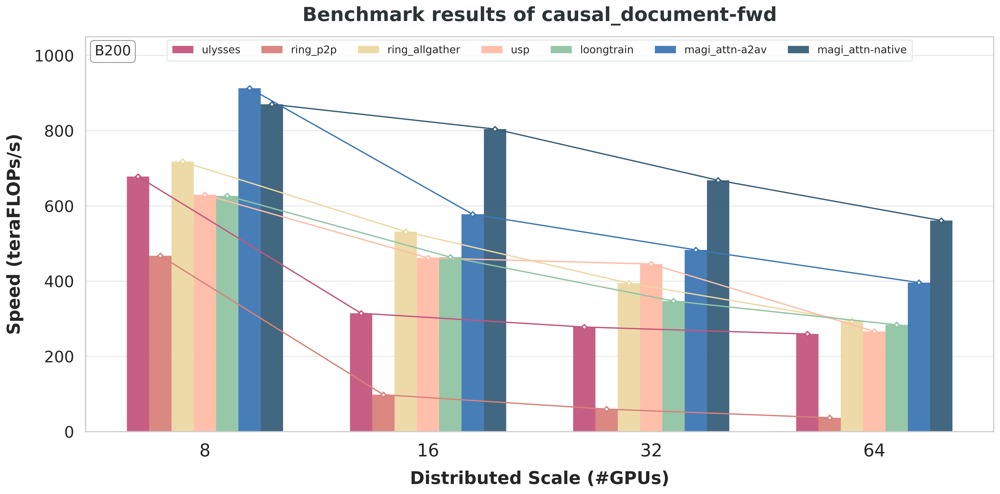
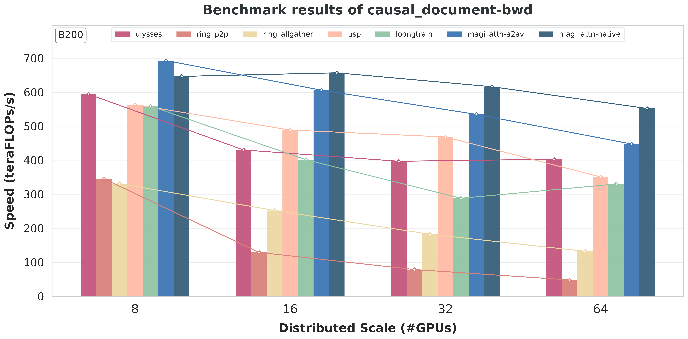

# MagiAttention：超长上下文分布式 Attention

!!! info "论文信息"
    - 技术博客：`MagiAttention: A Distributed Attention Towards Linear Scalability for Ultra-Long Context, Heterogeneous Mask Training`
    - 链接：[MagiAttention official blog](https://sandai-org.github.io/MagiAttention/docs/main/blog/magi_attn.html)
    - Benchmark：[Long-Context Attention Benchmark](https://sandai-org.github.io/MagiAttention/docs/main/blog/cp_benchmark.html)
    - 代码：[SandAI-org/MagiAttention](https://github.com/SandAI-org/MagiAttention)
    - 相关模型：[Magi-1](https://github.com/SandAI-org/MAGI-1)
    - 日期：2025-04-21
    - 关键词：context parallelism、Flex-Flash-Attention、AttnSlice、heterogeneous masks、GroupCast、GroupReduce、multi-stage overlap、FlashAttention-3、FlashAttention-4、H100、B200

MagiAttention 讨论的不是“attention 又快了一点”这种单点优化，而是一个训练系统问题：**当视频生成或长上下文模型要处理百万级 token、并且 mask 形状高度不规则时，context parallel attention 怎么继续保持可扩展？**

它的答案是把分布式 attention 拆成四层一起设计：kernel 层要能表达异构 mask，dispatch 层要把计算量均匀分给 CP ranks，通信层要避免 Ring P2P 里的冗余 KV/dKV 传输，调度层还要把通信和计算尽量重叠起来。这个视角很适合放在“高效训练”里，因为它展示了一个大模型训练瓶颈如何从公式里的 \(O(N^2)\)，一路落到 mask 表达、数据 pack、rank 负载、NCCL buffer、kernel backend 和 overlap tuning。

## 它的效率贡献是什么

| 维度 | 贡献 |
| --- | --- |
| 节省的成本 | 降低超长上下文和视频训练中的 attention 计算失衡、冗余 KV 通信和 CP rank 等待时间 |
| 核心机制 | 用 AttnSlice 表达异构 mask，用 dispatch solver 均衡有效 mask area，用 GroupCast/GroupReduce 减少无效通信，再用 overlap solver 重叠通信与计算 |
| 对世界模型主线的意义 | 视频世界模型和 VLA 长任务训练会遇到变长、block-causal、patch-and-pack 等复杂 mask；MagiAttention 展示了长序列效率不是单个 kernel 问题，而是 mask、分布式和通信共同问题 |
| 主要风险 | 依赖复杂调度、kernel 支持和训练数据形态；如果 workload mask 很规则或上下文不长，收益可能不足以覆盖系统复杂度 |
| 应接到本站哪里 | [世界模型高效训练技术路线图](../../world-models/efficient-training-roadmap.md)、[训练路线图](../../training/index.md)、[算子与编译器](../../operators/index.md) |

## 系统位置

MagiAttention 的直接背景是 Magi-1 这类大规模自回归视频生成训练。视频 token 数本来就长，再加上 Patch-and-Pack 这类数据管线，实际 batch 里经常出现 variable-length sequences、block-causal attention、局部块和全局块混合等模式。结果是 mask 不再是简单 full 或 causal，而是很多不规则子区域拼出来的 heterogeneous mask。

{ width="820" }

<small>图源：`MagiAttention` 官方博客，Figure 1。原图概览了 FFA kernel、dispatch solver、GroupCast/GroupReduce、overlap solver，以及 forward/backward 时间线如何共同支撑超长上下文和异构 mask 训练。</small>

这张图可以先读成一条流水线：

```text
global heterogeneous mask
  -> AttnSlice 表达
  -> dispatch solver 做负载均衡
  -> FFA 计算本地或远端片段
  -> GroupCast / GroupReduce 只传必要 KV / dKV
  -> overlap solver 安排多阶段通信和计算
```

这也是它和普通 FlashAttention 优化的差别。FlashAttention 主要解决单卡或单 rank 内 attention 的 IO 和并行效率；MagiAttention 关注的是，当一个 attention 被拆到多个 CP ranks 后，mask、数据分布和通信拓扑如何不把 GPU 等待时间重新带回来。

## 核心问题

现有 context parallel 方法各自抓住了一部分问题，但在 Magi-1 这种超长、变长、异构 mask 训练里会同时遇到约束。

| Method family | What it shards | Main issue under heterogeneous masks |
| --- | --- | --- |
| Ulysses | attention heads through All-to-All | Requires the number of heads to be divisible by CP size; conflicts with GQA and head-aware TP layouts |
| Ring-Attention / Ring P2P | sequence blocks passed around a ring | Communication scales poorly and can send KV blocks to ranks that do not need them under sparse or varlen masks |
| Zigzag sharding | manually rearranged sequence blocks | Helps some causal masks but causes fragmentation, padding, and poor generality for varlen block-causal masks |
| USP / LoongTrain | hybrid head and sequence parallelism | Reduces some bottlenecks but still inherits mask-specific load imbalance and communication complexity |
| DCP / HybridCP | dynamic CP groups by sequence length | Avoids some unnecessary sharding, but adds scheduling complexity, cross-group synchronization, and extra communication buffers |

{ width="760" }

<small>图源：`MagiAttention` 官方博客，Figure 2。原图对比 full、causal、varlen full 和 varlen causal mask 下 Ring-Attention 的 sharding 策略，重点展示 varlen causal 会带来更强的碎片化、padding 和负载不均。</small>

这里的关键不是“某个 baseline 不好”，而是 attention 的计算量并不等于每个 rank 拿到的 token 数。对 full mask 来说，按 sequence 均匀切分通常还可以；对 causal 或 varlen causal 来说，不同 query chunk 对应的 valid key area 差很多。更麻烦的是，视频训练中的 block-causal + PnP 会让 mask area 变得更不规则，手工 zigzag 很难覆盖所有情况。

所以 MagiAttention 设定的目标有三条：

1. **Balanced computational workloads**：每个 CP rank 的有效 mask area 尽量接近，减少等待；
2. **Zero-redundant communication**：只传对方真正需要的 KV 或 dKV，不做固定环形广播；
3. **Full overlap of communication and computation**：通信不能成为 CP size 放大后的新瓶颈。

## 方法总览

MagiAttention 的组件分工很清楚：

| Component | Role | Training-system meaning |
| --- | --- | --- |
| `FFA` / Flex-Flash-Attention | FlashAttention-3 based kernel with flexible mask support | 让不规则 mask 仍能走高吞吐 fused attention forward/backward |
| `AttnSlice` | Represents a contiguous 2D QK sub-mask as `(QRange, KRange, MaskType)` | 把复杂 mask 分解成 kernel 可调度的基本片段 |
| `dispatch solver` | Assigns query chunks to CP buckets under load-balance constraints | 同时平衡 attention 计算量和非 attention 层的 token 数 |
| `attn solver` | Emits `CalcMeta` and `CommMeta` for each rank and stage | 把预处理阶段的 mask/dispatch 结果变成训练时的 kernel 参数 |
| `GroupCast` / `GroupReduce` | Zero-redundant KV and dKV communication primitives | 避免 Ring P2P 对无关 rank 传输数据 |
| `overlap solver` | Splits communication and computation into overlapped stages | 让远端 KV 预取、partial attention 和 dKV reduce 尽量并行 |

这套设计的主线是：**先用 AttnSlice 让 mask 可表达，再用 dispatch solver 让计算可均衡，最后用 group collectives 和 overlap 让分布式通信不抵消前面的收益。**

## Flex-Flash-Attention 与 AttnSlice

MagiAttention 的 kernel 层叫 `FFA`，全称 Flex-Flash-Attention。它基于 FlashAttention-3，但不是只给 FA3 多加几个 boolean mask 参数，而是引入 `AttnSlice`：

\[
\mathrm{AttnSlice} = (\mathrm{QRange}, \mathrm{KRange}, \mathrm{MaskType})
\]

其中 `QRange` 和 `KRange` 是连续 query/key 范围，`MaskType` 描述这个 2D 子块内部的规则。博客中当前列出的 mask types 包括 `FULL`、`CAUSAL`、`INV-CAUSAL` 和 `BI-CAUSAL`。

{ width="760" }

<small>图源：`MagiAttention` 官方博客，Figure 3。原图说明复杂全局 mask 如何被拆成多个 AttnSlice，并且这些 slice 在 CP ranks 间重排后仍能作为有效计算单元。</small>

{ width="780" }

<small>图源：`MagiAttention` 官方博客，Figure 4。原图展示 AttnSlice 能覆盖 FA3 常见 mask，以及 varlen block-causal 等 FA3 原生不方便表达的 irregular masks。</small>

这个抽象很实用。传统 fused attention kernel 通常假设 mask 形状比较规则，例如 full、causal、local window 或 varlen causal。可是训练数据一旦被 pack，某些样本可能有全局块、某些块只看局部历史、某些 query 段还要跨样本边界禁看。把这些全部硬编码进 kernel 会爆炸；AttnSlice 则把它们拆成若干相对规则的小区域，让 kernel 只需要处理有限种局部 mask。

{ width="780" }

<small>图源：`MagiAttention` 官方博客，Figure 5。原图展示 FFA forward/backward kernel 中的数据加载、on-chip 计算，以及 slice-level parallelism 下通过 atomic reduction 合并 partial results。</small>

训练角度最重要的是：FFA 不是只做 inference forward。它要支持 backward，还要和分布式的 `CalcMeta`、`CommMeta` 配合。也就是说，AttnSlice 不是一个可视化概念，而是进入了训练时的 kernel 参数、远端 KV 获取、partial output reduce 和 backward dKV reduce。

## Dispatch Solver

如果只把 sequence 平均切给不同 CP ranks，非 attention 层确实很均衡，因为每个 rank token 数差不多。但 attention 的真实工作量取决于 mask area。MagiAttention 的 dispatch solver 就是在这两者之间找平衡：既不能让某个 rank 拿太少 token 导致 MLP/norm 等非 attention 层失衡，也不能让某个 rank 拿到明显更大的 attention mask area。

设全局 sequence 被按 `chunk_size` 切成 \(n\) 个 query chunks：

\[
n = \frac{seqlen}{chunk\_size}
\]

每个 chunk \(C_i\) 有对应的有效 mask area，记作 \(\mathrm{Area}(C_i)\)。dispatch solver 要把 chunks 分到 `cp_size` 个 buckets 中，并约束每个 bucket 的 chunk 数相同：

\[
f^\*=\arg\min_f \max_j \sum_{C_i \in B_j} \mathrm{Area}(C_i)
\]

约束是：

\[
|B_j| = \frac{n}{cp\_size}, \qquad seqlen \bmod (cp\_size \times chunk\_size)=0
\]

这个优化问题本身是 NP-hard。MagiAttention 实际采用 greedy Min-Heap algorithm，时间复杂度约为 \(O(n\log n)\)：先估计每个 chunk 的 area，再不断把较重 chunk 分给当前负载较低的 bucket。

{ width="760" }

<small>图源：`MagiAttention` 官方博客，Figure 10。原图展示 dispatch solver 如何用 Min-Heap 近似解决 query chunks 到 CP buckets 的负载均衡分配。</small>

这里有一个容易忽略的训练细节：为什么要强制每个 bucket 的 chunk 数一样？因为一个 Transformer block 不只有 attention。MLP、norm、residual、embedding、loss 等通常按 token 数计费。假如 dispatch 只追求 attention area 均衡，可能会让某些 rank token 数过多，非 attention 部分又失衡。MagiAttention 的约束是在大训练系统里更稳的选择。

## 通信与重叠

Ring P2P 的问题不是“不能工作”，而是在异构 mask 下会传很多对目标 rank 没用的 KV。MagiAttention 官方博客举了两个直观例子：简单 causal mask 下会出现约 25% 的冗余通信；带最后 global block 的 varlen block-causal mask 下，冗余比例可以超过 33%。

{ width="760" }

<small>图源：`MagiAttention` 官方博客，Figure 11。原图展示 Ring P2P 在 simple causal 和 irregular varlen block-causal mask 下的冗余 KV 传输。</small>

MagiAttention 用 `GroupCast` 和 `GroupReduce` 改写这个通信模型：

| Primitive | Data path | Purpose |
| --- | --- | --- |
| `GroupCast` | sender KV -> only ranks whose Q slices need it | forward 和 backward 中只把 KV 发送给真正需要的 CP ranks |
| `GroupReduce` | partial dKV from consumer ranks -> owner rank | backward 中把多个 rank 产生的 dKV partials 聚合回原 KV owner |

{ width="760" }

<small>图源：`MagiAttention` 官方博客，Figure 12。原图展示基于 AlltoAll-v 的 GroupCast/GroupReduce：通过 transfer table、Range-Gather 和 Range-Scatter-Reduce 支持 zero-redundant KV/dKV 通信。</small>

最初实现基于 `AlltoAll-v`，需要额外的 `Range-Gather`、`Range-Scatter-Reduce` 等 pre/post kernels。这能消除冗余通信，但 D2D 重排开销不小。后续 benchmark 中还加入了 `magi_attn-native`，也就是基于 DeepEP 思路的 native group collectives，用来减少 AlltoAll-v 方案的重排和 launch overhead。

通信减少以后，还要处理 overlap。MagiAttention 把远端 KV 获取和 FFA partial attention 拆成多阶段：

{ width="760" }

<small>图源：`MagiAttention` 官方博客，Figure 13。原图展示 forward 中 prefetch next-stage KV 与 current-stage FFA overlap，以及 backward 中 KV prefetch、partial dKV reduce 和 current-stage attention 的多阶段重叠。</small>

forward 里，本地 qkv 已经可用，所以初始 stage 可以先算，同时预取下一阶段远端 KV；理想情况下通信被当前阶段计算覆盖，只暴露最后一个远端 stage 的计算。backward 更复杂：既要预取下一阶段 KV，又要 reduce 上一阶段 partial dKV，还要算当前 stage，因此 overlap solver 要同时安排 prefetch、FFA backward 和 GroupReduce。

实际训练里 `overlap_degree` 是一个重要旋钮。官方博客建议通常在 `{1, 2, 3, 4}` 里手动调；自动搜索如果对计算/通信比估计不准，可能会选到不理想配置。这一点很现实：分布式 attention 的最优点不仅取决于 FLOPs，还取决于 GPU 型号、网络、mask 分布、CP size、kernel backend 和当前 batch 的序列分布。

## 训练和 Benchmark 设置

MagiAttention 页面展示的是 attention 系统和 benchmark，不是完整 Magi-1 端到端训练报告。因此下面这些设置应该读成“长上下文 attention 训练子系统的压力测试”，而不是模型最终质量指标。

官方 CP benchmark 的 common configuration 如下，表头和字段保持原格式：

| settings | value |
| --- | --- |
| attention type | self-attention where `seqlen = seqlen_q = seqlen_k` |
| batch size (b) | 1 |
| number of heads (nh) | nhq:nhk:nhv = 64:8:8 (GQA) |
| head dimension (hd) | 128 |
| dtype | `torch.bfloat16` |
| window size | 1024 (for sliding window masks only) |

这组配置有几个训练含义。`64:8:8 (GQA)` 说明它不是只为普通 MHA 服务，GQA 场景下 Ulysses 这类 head sharding 的可整除约束会更扎眼。`hd=128` 和 `bf16` 则接近现代大模型训练常见设置。batch size 固定为 1，是为了把主要变量集中到 sequence length、mask pattern 和 CP strategy。

吞吐定义也要看清楚。kernel-level 使用 `TFLOPs/s`，distributed-level 使用 `TFLOPs/s/GPU`。对每个 AttnSlice，benchmark 按下式计算 FLOPs：

\[
\begin{aligned}
\mathrm{FLOPs}^{(fwd)} &= 2 \times 2 \times \mathrm{MaskArea}(seqlen, mask\_type) \\
&\times batch\_size \times num\_heads\_q \times head\_dim \\
\mathrm{FLOPs}^{(bwd)} &= 2.5 \times \mathrm{FLOPs}^{(fwd)}
\end{aligned}
\]

其中 full mask 的 area 是 \(seqlen^2\)，causal mask 的 area 是 \(\frac{seqlen(seqlen+1)}{2}\)。distributed 计时使用所有 ranks 中最慢的 elapsed time：

\[
\mathrm{ElapsedTime}^{(wd)}=\max_{rank\in[0,cp\_size)}\mathrm{ElapsedTime}_{rank}^{(wd)}
\]

这个定义很重要。分布式训练的步时由最慢 rank 决定，所以 load imbalance 不会被平均吞吐掩盖。

benchmark 的 varlen 数据分布也值得注意。官方做法是从代表性训练数据中抽取真实长上下文长度分布，先 shuffle dataset，再顺序 pack samples，之后 reshuffle packs。为了避免 varlen mask 退化成接近 pure full/causal，每个 sample length 被限制为总 sequence length 的最多四分之一。例如总长度为 64K 时，单个 sample 不超过 16K。

distributed-level benchmark 的设置如下：

| setting | value |
| --- | --- |
| mask patterns | `full`, `causal`, `varlen full`, `varlen causal` |
| cp_size | from `8` up to `64` |
| H100 per-device sequence length | `8K` |
| B200 per-device sequence length | `16K` |
| total sequence length | scales linearly with `cp_size` |
| Hopper backend | baselines use `FA3`; MagiAttention uses `FFA` |
| Blackwell backend | baselines use `cuDNN`; MagiAttention uses `FFA_FA4` |

legend-name mapping 保持官方表格格式：

| legend | name |
| --- | --- |
| magi_attn-a2av | `MagiAttention` with `AlltoAll-v`-based group collectives |
| magi_attn-native | `MagiAttention` with native group collectives |
| ulysses | `Ulysses` |
| ring_p2p | `Ring P2P` |
| ring_allgather | `Ring AllGather` |
| usp | `USP` |
| loongtrain | `LoongTrain` |
| hybrid_dcp | Megatron `HybridCP` |

Blackwell 上有一个额外细节：`FFA` 本体基于 FA3，而 FA3 主要面向 Hopper；因此官方临时提供 `FFA_FA4` backend，用 forked FlashAttention-4 的 HSTU Function representation 支持 Blackwell。benchmark 里也说明，FA4 在稳定 `2.8.3` 上对 varlen backward 的支持还不够稳，所以 Blackwell baseline 采用 cuDNN，Megatron `HybridCP` 因依赖 FA3 而不进入 Blackwell 对照。

## 实验结果

主博客里展示了最有代表性的 varlen causal mask 分布式结果，因为这类 mask 最接近真实长上下文训练中的难点：既有 causal 方向性，又有变长 pack 造成的碎片化和负载不均。

{ width="820" }

<small>图源：`MagiAttention` 官方博客，H100 varlen causal forward benchmark 原图。原图比较 MagiAttention 与 Ulysses、Ring、USP、LoongTrain、HybridCP 等 CP strategies 在不同 CP size 下的 distributed-level throughput。</small>

{ width="820" }

<small>图源：`MagiAttention` 官方博客，H100 varlen causal backward benchmark 原图。原图重点展示 backward 中 dKV reduce 和通信重叠对扩展性的影响。</small>

{ width="820" }

<small>图源：`MagiAttention` 官方博客，B200 varlen causal forward benchmark 原图。B200 结果使用临时 `FFA_FA4` backend，对照组使用 Blackwell 上可用的 attention backend。</small>

{ width="820" }

<small>图源：`MagiAttention` 官方博客，B200 varlen causal backward benchmark 原图。原图用于验证 Blackwell 上 MagiAttention 分布式 attention 的 backward scalability。</small>

这些图的读法不要只看最高点，而要看曲线随 `cp_size` 增大是否保持斜率。对超长上下文训练来说，CP size 增大通常意味着总 sequence length 也增大。如果 throughput per GPU 很快掉下去，说明通信、负载不均或 kernel fragmentation 已经吃掉了并行收益。MagiAttention 的结果想证明的是：在 varlen causal 这种更接近真实训练的 mask 下，AttnSlice + dispatch + group collectives + overlap 能让分布式 attention 更接近线性扩展。

`magi_attn-native` 和 `magi_attn-a2av` 的差别也很有信息量。前者说明 AlltoAll-v 虽然能表达 zero-redundant group communication，但额外 gather/scatter 和 D2D copy 仍会成为 overhead；native group collectives 能进一步把设计收益释放出来。换句话说，MagiAttention 的系统贡献不止是“少传数据”，还包括把少传数据这件事变成可用的高效通信 primitive。

## 和其他高效训练路线的关系

MagiAttention、[SLA / SLA2](sla-sparse-linear-attention.md) 和 [Attn-QAT](attn-qat.md) 都在减少 attention 成本，但它们切的层级不同。

| Method | Main target | What changes | Best mental model |
| --- | --- | --- | --- |
| MagiAttention | Distributed long-context training | CP dispatch, flexible mask kernel, KV/dKV communication, overlap schedule | 让真实异构 mask 的长上下文训练可扩展 |
| SLA / SLA2 | Video DiT attention compute | Sparse exact branch, linear compensation, learnable routing, QAT | 减少单层 attention 需要精确计算的 blocks |
| Attn-QAT | Low-bit attention | FP4 fake quant forward/backward and inference kernel alignment | 让 fused attention 进入 4-bit 训练和推理 |
| Muon | Optimizer efficiency | Matrix-level orthogonalized momentum and distributed optimizer | 提升大模型预训练的 token/FLOP efficiency |

如果要组合这些方向，MagiAttention 更像底层分布式 substrate。SLA/SLA2 可以减少每个 rank 实际要算的 attention blocks，Attn-QAT 可以降低 attention GEMM 的精度和带宽压力，MagiAttention 则负责在超长上下文和异构 mask 下把这些计算合理分发、通信和重叠。真正困难的地方是三者的 metadata 要对齐：sparse block map、low-bit activation、AttnSlice、dispatch plan、KV ownership 和 backward dKV reduce 都会互相影响。

## 局限

第一，官方页面目前主要是技术博客和 benchmark，而不是完整论文正文。它展示了系统设计和 attention benchmark，但不是 Magi-1 端到端训练质量报告。因此不能把这些吞吐图直接读成模型质量提升。

第二，static attn solver 的假设比较强：global mask 在预处理阶段已知，并且 forward/backward 与各层之间保持稳定。对 layer-varying hybrid attention 或 runtime dynamic sparse masks，官方提到 dynamic solver 仍属于 WIP/experimental 方向。

第三，`overlap_degree` 仍需要调参。只要网络拓扑、GPU 型号、CP size 或 mask 分布改变，最优 overlap stage 可能变化。自动调参要准确估计 compute/communication ratio，不是简单枚举就稳定。

第四，Blackwell 支持还处在过渡阶段。`FFA_FA4` 让 MagiAttention 可以在 B200 上跑，但官方也把 native FFA on Blackwell、B300/A100 等更多 benchmark 和 distributed-native FFA kernel 列为未来工作。

MagiAttention 最值得记住的一点是：**超长上下文训练的瓶颈不是单个 attention 公式，而是 mask、数据分布、rank 映射、kernel 表达和通信调度共同形成的系统问题。** 当上下文长度进入百万级，真实训练里的 irregular mask 会让“平均分 token”这类直觉失效；高效训练需要把有效计算面积、数据移动和 step-time straggler 一起纳入设计。

## 参考链接

1. 官方技术博客：[MagiAttention](https://sandai-org.github.io/MagiAttention/docs/main/blog/magi_attn.html).
2. 官方 benchmark：[Long-Context Attention Benchmark](https://sandai-org.github.io/MagiAttention/docs/main/blog/cp_benchmark.html).
3. 代码仓库：[SandAI-org/MagiAttention](https://github.com/SandAI-org/MagiAttention).
4. 相关模型：[SandAI-org/MAGI-1](https://github.com/SandAI-org/MAGI-1).
