# MagiAttention：超长上下文分布式 Attention

!!! info "论文信息"
    **论文题名：** MagiAttention: A Distributed Attention Towards Linear Scalability for Ultra-Long Context, Heterogeneous Mask Training。 
    **作者：** SandAI。 
    **机构：** SandAI。 
    **时间 / 主题：** 2025-04；高效训练。 
    **arXiv / 官方报告：** arXiv：未找到专门条目；官方材料：[sandai-org.github.io/MagiAttention/docs/main/blog/magi_attn.html](https://sandai-org.github.io/MagiAttention/docs/main/blog/magi_attn.html)。 
    **GitHub / 项目：** GitHub：[github.com/SandAI-org/MagiAttention](https://github.com/SandAI-org/MagiAttention)；项目页：[sandai-org.github.io/MagiAttention/docs/main/blog/magi_attn.html](https://sandai-org.github.io/MagiAttention/docs/main/blog/magi_attn.html)。 
    **元数据来源与核验口径：** 来源：[GitHub API / repo](https://github.com/SandAI-org/MagiAttention)；[官方 / 项目材料](https://sandai-org.github.io/MagiAttention/docs/main/blog/magi_attn.html)；Checked Date：2026-06-04；Repro Status：Paper / official materials reviewed, independent reproduction not claimed。

## 长上下文分到多张卡之后，为什么仍然有卡在等

MagiAttention 解决的是一个分布式执行问题。超长视频或多文档序列已经放进多张 GPU，每张卡也拿到了同样多的 token，但 attention 的计算仍可能严重不均：有的 query 只看同一短文档，有的可以读很长的历史，还有的位于视频块或特殊全局块中。通信若继续把所有 KV 送给所有设备，又会为大量不可能参与计算的位置搬运数据。

这里的关键认识是，**mask 不只是 Softmax 之前的一次遮挡，也是工作量和数据依赖的说明书**。知道哪些 query 能读哪些 key，才能决定一张卡该算多少、缺哪些输入、结果应交回哪里。MagiAttention 把这份说明贯穿到 kernel、任务分配、通信与重叠执行中，而不是只替换一个更快的矩阵乘法。[↗](https://sandai-org.github.io/MagiAttention/docs/main/blog/magi_attn.html#overview)

总览图先看左侧不规则区域如何切成小块、分给不同颜色的 rank，再看右侧 FFA 与通信原语，最后沿底部时间线追踪一次前向和反向。各部分处理的是同一批依赖，而非四个互不相干的优化开关。

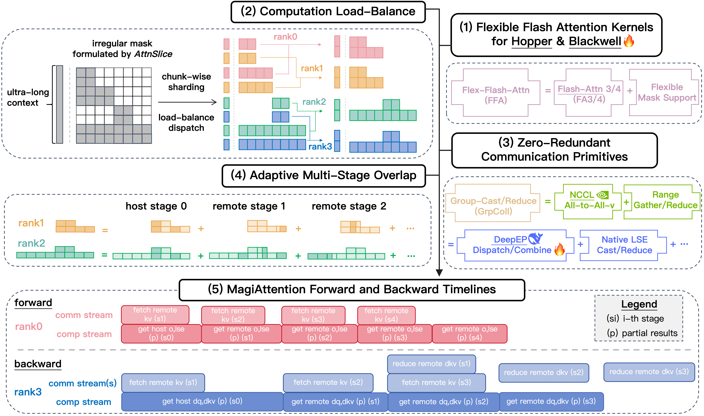{ width="820" }

*图源：[MagiAttention 官方文档](https://sandai-org.github.io/MagiAttention/)，官方总览图。上部决定工作和数据放在哪里，下部决定何时搬运、何时计算。*

标题中的 linear scalability 指向增加设备后的分布式扩展目标。它没有把完整 attention 的二次交互改成线性算法；后面的实测曲线也并非每卡吞吐完全不下降。该工作的价值是让复杂 mask 更容易在多卡上有效执行，最终收益需要同时看算子效率、通信路径和实际任务大小。

## 均分 token 为什么不等于均分工作

### 同样长的 query 条带，可以有完全不同的面积

先考虑一个解释性的小例子。长度为 8 的因果序列，第 1 到第 8 个 query 分别读取 1 到 8 个 key。按顺序给四张卡各分两个 query，工作量就是 $3,7,11,15$ 个有效 query-key 对。四张卡各有两个 token，attention 工作却相差五倍。

把序列前后两端搭配，分成 $(1,8),(2,7),(3,6),(4,5)$，每张卡的面积都是 9。这正是 zigzag 思路适合规则因果 mask 的原因。然而，多篇长短不同的文档打包后，每篇都有自己的因果三角形；视频 block-causal 又允许同一块内部双向可见、块之间按时间可见。为每个小样本单独交错切分，会产生更多碎片，连续加载、padding 和 kernel 调度都可能受影响。

下图从左到右增加 mask 的复杂程度。比较各颜色的有效面积，同时注意最右侧短样本被切成了多少细条，便能看到“算得均匀”与“算得连续”之间的矛盾。

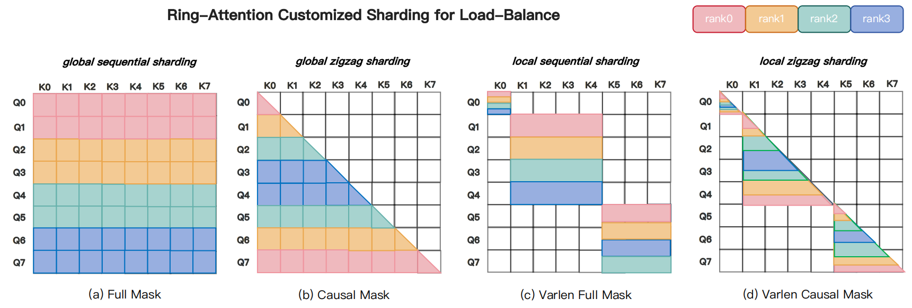{ width="760" }

*图源：[MagiAttention 官方文档](https://sandai-org.github.io/MagiAttention/)，官方 Ring Attention 切分示意，依次为 full、causal、varlen full、varlen causal。*

### 其他 CP 路线改变了哪一种布局

Ulysses 用 All-to-All 在序列切分和 head 切分之间转换，使设备能在一部分 head 上处理完整序列。这简化了单个 attention 的计算，却受到 head 数与并行规模整除关系的限制，GQA 中较少的 KV heads 尤其需要考虑。Ring Attention 保留本地 query，将远端 KV 依次送来，扩展不必完全依赖 head 数，但通信量与分块负载又成为问题。

USP、LoongTrain 等混合方案结合 head 与序列维度，动态 CP 则按样本长度调整分组。它们分别扩大了某些布局的适用范围。MagiAttention 的切入点更靠近实际 mask：先把有效注意力区域表达成可拆分工作，再根据工作本身组织执行。它不是仅给 Ring 换一个通信库，也不是要求所有任务都变成同一种稀疏模型。[↗](https://sandai-org.github.io/MagiAttention/docs/main/blog/magi_attn.html#related-work)

## AttnSlice 如何让同一注意力换位置执行

### 切片携带的不只是一个矩形

Flex-Flash-Attention（FFA）将基本计算单位定义为

$$
\mathrm{AttnSlice}=(\mathrm{QRange},\mathrm{KRange},\mathrm{MaskType}).
$$

前两项是连续、左闭右开的 query 与 key 范围，最后一项规定矩形内部哪些位置有效。一个范围可能全可见，也可能只允许其中的因果部分。多个切片组合起来，就能描述 packed documents、block-causal 和带全局块的布局。

例如两段各有两个 token 的视频块，若块内双向、块间因果，可以用 `Q=[0,2), K=[0,2), FULL` 描述首块，用 `Q=[2,4), K=[0,4), FULL` 描述第二块。第二块读取历史与当前块，首块没有看到未来。这个例子只解释表示方式，没有另外学习一个稀疏筛选器。

原图左侧将不规则 mask 分成五个切片，随后沿 query 维切分、重排，右侧重新生成适合各 rank 的范围。原先允许的交互关系仍被保留，变化的是内存位置和执行归属。图中特别说明没有同时优化负载，因此不能把这幅表示图当成 dispatch 已取得最优均衡的证据。

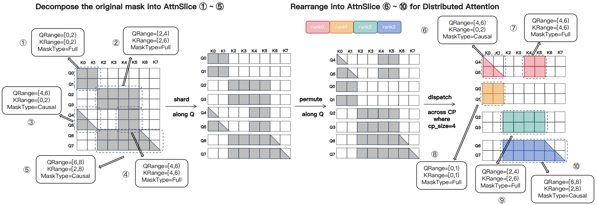{ width="760" }

*图源：[MagiAttention 官方文档](https://sandai-org.github.io/MagiAttention/)，官方 AttnSlice 重排示意。切片范围需要随数据布局一起转换。*

再看下图第二行。Block-causal、varlen block-causal，以及额外带一个 global block 的情况，其差异都落在具体允许的区域中。FFA 要保持这些给定语义，而不是为了快而任意删除其中的注意力边。

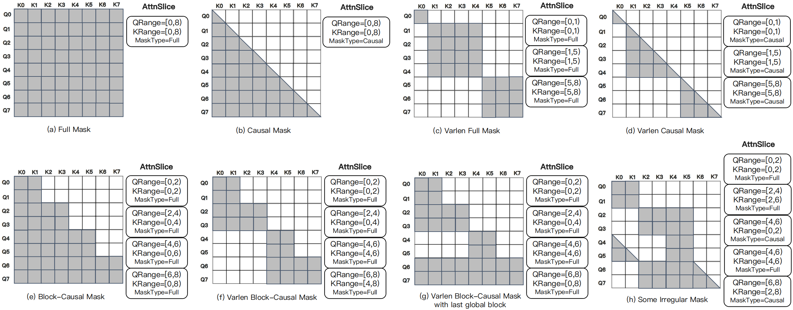{ width="780" }

*图源：[MagiAttention 官方文档](https://sandai-org.github.io/MagiAttention/)，官方 mask 示例，上排较规则，下排展示视频等工作负载中的组合结构。*[↗](https://sandai-org.github.io/MagiAttention/docs/main/blog/magi_attn.html#attnslice-representation)

### 四种基本 mask 避免把滑动窗口拆成逐行任务

只有 FULL 与 CAUSAL 时，某些窗口结构可能需要很多很小的切片。官方因此增加 INV-CAUSAL 与 BI-CAUSAL。下面这张矩形示例中，query 长度为 4、key 长度为 8：CAUSAL 保留右下对齐边界的左侧，INV-CAUSAL 保留左上对齐边界的右侧，BI-CAUSAL 取两者共同的带状区域。

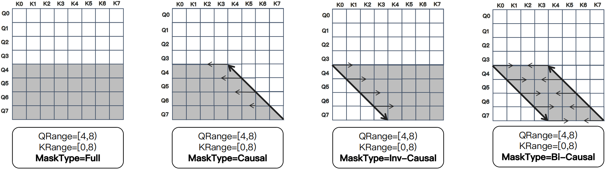

*图源：[MagiAttention 官方文档](https://sandai-org.github.io/MagiAttention/)，官方基本类型图，`QRange=[4,8)`、`KRange=[0,8)`。两条斜边采用不同对齐方式。*

这也解释了一个容易误读的名字。BI-CAUSAL 并非普通的“全双向注意力”：query 与 key 一样长时，两条边界重合，只剩主对角线；query 比 key 长时，交集可以为空。使用这种接口必须保留范围长度与边界对齐，不能只看到 `CAUSAL` 就假定所有子块都按全局左上角切三角形。[↗](https://sandai-org.github.io/MagiAttention/docs/main/blog/magi_attn.html#basic-mask-types-in-attnslice)

## 切片各自算完，怎样合成同一个 Softmax

### 局部输出不能直接相加

同一个 query 可能通过不同切片读取多个 key 子集。各切片独立 Softmax 后的输出都已经归一化，若直接相加或平均，就会让每个子集获得错误的总权重。这是灵活分块能否保持精确注意力语义的核心。

对固定 query 行 $i$，设第 $a$ 个切片包含的有效 key 集合为 $\mathcal K_a$，分数为 $s_{ij}$。将互不重复的有效 key 按这些集合划分，局部归一化常数与输出为

$$
Z_{i,a}=\sum_{j\in\mathcal K_a}e^{s_{ij}},\qquad
L_{i,a}=\log Z_{i,a},\qquad
O_{i,a}=\frac{\sum_{j\in\mathcal K_a}e^{s_{ij}}V_j}{Z_{i,a}}.
$$

整行需要的常数是 $Z_i=\sum_a Z_{i,a}$，因此可以用局部 LSE（log-sum-exp）合并

$$
L_i=\operatorname{logsumexp}_a L_{i,a},\qquad
O_i=\sum_a e^{L_{i,a}-L_i}O_{i,a}.
$$

权重正是每个子集在整行 Softmax 中应占的概率质量。假设两个子集的 $Z$ 分别为 1 与 3，局部标量输出为 2 与 6，合并应为 $\frac14\cdot2+\frac34\cdot6=5$，直接相加得到 8，平均得到 4，都不是同一个 attention。这个数值例子是对定义的展开。

上述写法来自官方 FlashAttention 数学说明中的行分解与归一化关系。实际 kernel 用稳定的在线 max、sum 或 LSE 更新，避免直接指数运算溢出；数学等价也不保证不同并行归约顺序下逐位浮点相同。[↗](https://sandai-org.github.io/MagiAttention/docs/main/blog/fa2_math_derivation.html#step1-basic-row-decomposition)

### 前向需要归一化修正，反向需要按所有者累加

Hopper 路线的 FFA 基于 FA3，利用 TMA 加载数据，并将 AttnSlice 作为并行工作单位。图左侧的绿色 partial O/LSE 可能写向同一 query 输出，必须以互斥、归约与修正机制合并；并行执行不能覆盖别人已累计的结果。

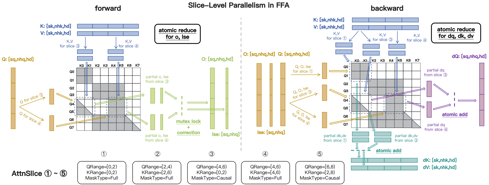{ width="780" }

*图源：[MagiAttention 官方文档](https://sandai-org.github.io/MagiAttention/)，官方 FFA 前后向示意。左侧合并 O/LSE，右侧累加 dQ、dK、dV。*

反向收到上层 $dO$ 后，借助前向保存的整行 LSE 重建各有效分数对应的概率，再计算局部梯度。多个 key 切片会贡献到同一 dQ，多个 query 切片也可能贡献到同一 dK/dV，所以图右侧标出 atomic add。跨设备时，这些局部 dKV 还必须回到其原始 KV 所在 rank 并求和。

因此，FFA 提供的灵活性不仅是支持更多 mask 标志。它还要保证重排后的局部计算、全局 Softmax 和梯度归属一致，才能让上层调度器自由搬动工作。[↗](https://sandai-org.github.io/MagiAttention/docs/main/blog/magi_attn.html#attnslice-level-parallelism-in-ffa)

## Dispatch 同时保住 attention 与非 attention 层的平衡

### 为什么必须限制每张卡的 chunk 数

设序列长度为 $S$，每个 chunk 有 $c$ 个 token，共 $n=S/c$ 个 chunk，分给 $P$ 个 CP ranks。$C_i$ 的有效 mask 面积记作 $A_i$，rank $j$ 获得的 chunk 集合为 $B_j$。官方将分配问题写成最小化最忙设备的面积

$$
\min_f\max_j\sum_{C_i\in B_j}A_i,
\qquad |B_j|=\frac nP,
\qquad S\bmod(Pc)=0.
$$

第一项控制 attention 的慢卡，等量 chunk 约束则让每张卡仍有相同 token 数。否则可以给一张卡塞入很多只读很短上下文的便宜 query，attention 看似均衡，随后 MLP、投影等按 token 计算的层却重新失衡。整除条件是这份切分定义的要求，也意味着实际 packing 和 chunk 粒度需要一起安排。

面积是有效交互数量的代理，并不完整包含每种切片的启动、padding 和访存成本。因此均衡面积是重要调度依据，仍不能单独保证实际 kernel 时间完全相同。

### 贪心分配具体做了什么

该组合问题是 NP-hard，每个 micro-batch 求精确最优并不现实。算法先按面积从大到小排序，再维护一个以当前总面积为键的最小堆。每次取出尚未装满的最轻 bucket，放入下一个 chunk，更新面积和数量后送回堆。排序与堆操作给出 $O(n\log n)$ 的复杂度。

下图先看第 1 行排序，再看第 7–8 行如何跳过已满 bucket。这个容量检查是等 token 约束真正进入算法的位置。

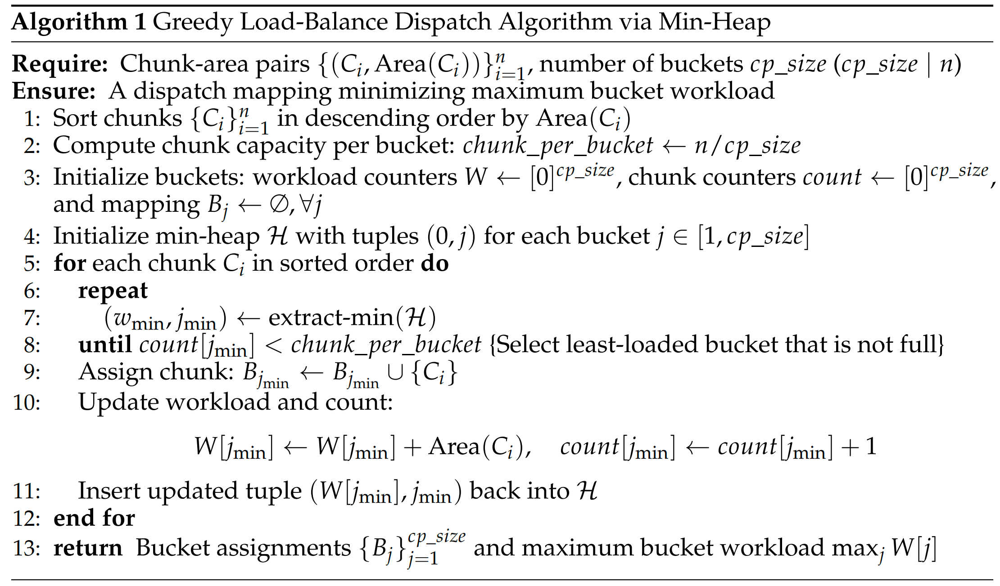{ width="760" }

*图源：[MagiAttention 官方文档](https://sandai-org.github.io/MagiAttention/)，官方 Greedy Load-Balance Dispatch Algorithm via Min-Heap。它是快速启发式分配，不是任意输入上的全局最优证明。*

仍用前面面积为 $1,2,\ldots,8$、四卡各装两个 chunk 的例子，算法先把 $8,7,6,5$ 分开，再依次把 $4,3,2,1$ 给当前最轻的 bucket，最终每卡总面积为 9。这说明它如何找到适合规则因果例子的平衡；复杂 mask 下是否同样理想，则由具体面积分布和容量共同决定。[↗](https://sandai-org.github.io/MagiAttention/docs/main/blog/magi_attn.html#dispatch-solver)

分配之后，static attention solver 生成 `CalcMeta` 和 `CommMeta`。前者列出每个 rank、每个阶段的切片及 kernel 参数，后者列出需要接收的 KV、发送目标与梯度归约关系。它们将“训练任务的全局 mask”转换成“本设备现在能执行的计算与搬运”，避免 kernel 在运行时反复推理全局布局。

## Zero-redundant 有两层含义，不能只数接收者

### 第一层减少无用的目标 rank

规则 Ring 会让 KV 沿设备环流转。对于完整 mask，各处都可能需要它；对于因果或多文档 mask，许多目的地没有任何依赖。靠后 KV 可能只被本地 query 使用，却仍被送往其他卡。

原图中实线代表有用传输，虚线代表冗余。上面的因果示例标出 25%，下面带最后一个全局块的 varlen block-causal 示例标出 33%。这些数值属于图中的特定布局，不能作为所有 Ring 实现或所有稀疏 mask 的固定损耗。

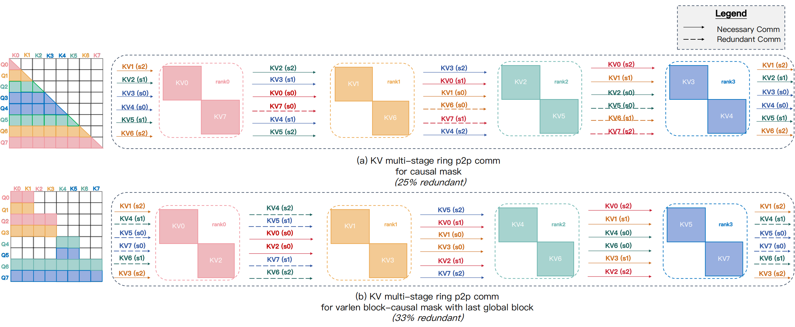{ width="760" }

*图源：[MagiAttention 官方文档](https://sandai-org.github.io/MagiAttention/)，官方 Ring P2P 冗余示例。判断某次传输是否必要，依据是目的地是否有实际计算依赖。*

**GroupCast** 从一个所有者向真正需要该 KV 块的 rank 集合发送；**GroupReduce** 则把这些设备算出的局部 dKV 聚合回所有者。前向是按需求分发，反向是沿相应关系回收并相加。GroupReduce 不能简单选择某张卡的梯度，因为同一个 key/value 可能被多个远端 query 使用，每一处都对它产生导数。

下图右侧的 transfer table 将这种关系落成发送、接收缓冲区。先对照上排某个 KV 块有哪些目标，再沿下排查找相应 dKV 从哪里归来。

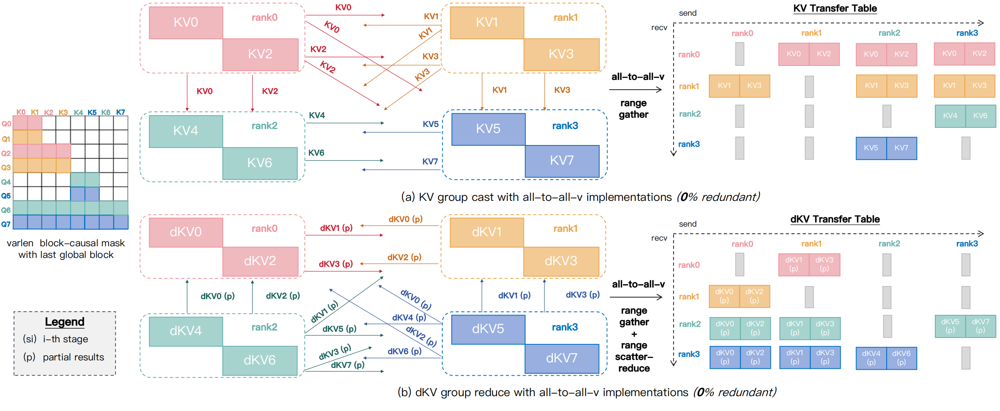{ width="760" }

*图源：[MagiAttention 官方文档](https://sandai-org.github.io/MagiAttention/)，官方基于 AlltoAll-v 的 GroupCast/GroupReduce 原型。Range-Gather 与 Range-Scatter-Reduce 负责组织和归约缓冲区。*[↗](https://sandai-org.github.io/MagiAttention/docs/main/blog/magi_attn.html#group-collective-primitives)

### 接收者都必要，仍可能在慢链路上重复传同一份数据

AlltoAll-v 原型先重排输入，为每个 peer 准备发送数据，再在接收端整理顺序、归约结果。这带来额外设备内拷贝。它还缺少原生 cast 语义：同一块数据发给 $m$ 个目标，通常需要 $m$ 份面向 peer 的发送缓冲区与独立传输。

尤其当多个目标位于同一个远端节点，这些接收者虽然都必要，相同内容却可能多次穿过带宽较低的 RDMA 链路。逻辑上已经做到“不发给无关 rank”，物理通信上仍有可去重的部分。区分这两层，才能理解为什么已有 zero-redundant 设计之后，还需要 native group collective。

官方 v1.1.0 的 native CUDA 路线借鉴 DeepEP 的 dispatch/combine，将 gather、scatter 和归约纳入通信 kernel。发送侧对一个 input split 用 TMA 读入共享内存，再由不同 warp 服务目标；接收侧直接落到对应 output split。它减少了独立预处理、后处理及重复中间缓冲区。[↗](https://sandai-org.github.io/MagiAttention/docs/main/blog/native_grpcoll.html#implementation)

### 用 NVLink 分发，把跨节点重复搬运压到一次

假设节点 A 的一份 KV 要送给节点 B 内的四张 GPU。原生 GroupCast 先通过 RDMA 送到 B 中与发送者 local rank 对应的中转设备，再在 B 内通过 NVLink 分发给四个实际目标。这份 payload 不必为四个目标各跨一次节点。

GroupReduce 反过来做。B 内多个源设备先用 NVLink 将部分梯度送到中转设备，节点内求和后，仅将结果通过 RDMA 送回 A；最终所有者再合并来自不同节点的部分和。数学上需要的是所有贡献之和，先局部求和再跨节点合并不改变这一目标，但浮点求和顺序可能改变舍入。

对同一远端节点内的 $k$ 个接收者，文档描述的是这份数据的 RDMA 传输可从 $k$ 份减少到一份，同时增加或保留节点内传递。它并不保证整个 attention 获得 $k$ 倍加速，最终还受 NVLink、同步、kernel 占用与其他计算影响。[↗](https://sandai-org.github.io/MagiAttention/docs/main/blog/native_grpcoll.html#rdma-transfer-de-duplication)

native 接口也保留了实际部署条件。文档给出的节点内 CP 支持 1–8；跨节点模式的节点内规模当时固定为 8，节点间规模支持 2、4、8、16、32，并需要正确配置 IBGDA。它支持将 K/V 按同一通信模式打包传输、分开设置通信与归约精度，以及 sum、avg、LSE 归约。这些能力扩大了可优化范围，也意味着不能只开一个开关，就假定任意网络拓扑都采用了图中的路径。

## 计算通信重叠，既要排好阶段，也要让 kernel 真正启动

### 前向和反向的尾部不同

KV-only 路线将 Q/O 留在本地。前向先处理本地就绪的 QKV，同时预取下一阶段的远端 KV；之后让当前 attention 计算与下一批 GroupCast 重叠。反向则有三种工作并行推进：读取下一阶段 KV、计算当前阶段的 dQ/dKV、归约上一阶段已经完成的 dKV。

原图上排是四个远端阶段的前向，下排是三个远端阶段的反向。先沿同一 rank 的时间线看数据依赖，再比较颜色不同的 rank 是否在接近的时间结束。

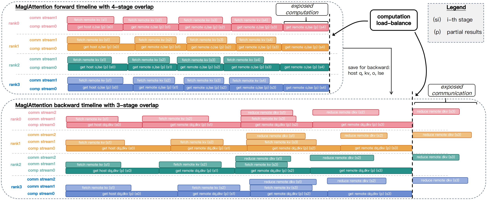{ width="760" }

*图源：[MagiAttention 官方文档](https://sandai-org.github.io/MagiAttention/)，官方多阶段调度示意。前向最后一段计算、反向最后一段 dKV 归约，处于不同的流水线尾部。*

这个理想排程需要当前计算足够覆盖相关通信。`overlap_degree` 表示远端工作分成多少阶段；切得太少，单次通信可能暴露，切得太多，小块执行和启动成本又会上升。官方明确建议先在 1、2、3、4 等常见值中实测，再考虑自动搜索，因为计算通信比例估计不准时，自动方案可能更差。前向与反向的成本构成不同，也不应直接假定同一粒度对两者都最佳。[↗](https://sandai-org.github.io/MagiAttention/docs/main/blog/magi_attn.html#dynamic-overlap-stage-search)

### 两条 CUDA stream 不等于两种工作正在同时跑

还有一类等待发生在更底层。大型计算 kernel 可能先占满 SM，通信 kernel 即使已提交到另一个 stream，也没有资源启动。CPU 看起来已异步发出两项工作，GPU 上仍可能先算完再通信。

官方讨论的 `sm_margin` 是为通信预留部分 SM。其观察中，AlltoAll-v/NCCL 在某些 cluster 设置下留 4–8 个 SM 就能重叠；使用更强 cluster 或 cooperative launch 的 native kernel 时，需求可能更高。这是依赖实现的经验值，预留过多又会直接减少计算资源。高优先级 stream 同样是调度帮助，文档观察它在 Blackwell 上比 Hopper 更可靠，不能当成跨架构保证。

后续引入的 **KernelBarrier** 将同步点放到“通信已经开始”，而非“通信全部结束”。通信 kernel 的首个线程在实际执行时对设备计数器调用 `arrive`；计算 stream 先排入一个只有一个 block、一个 thread 的小等待 kernel，达到所需到达计数后，才释放后面的重计算 kernel。

于是，大计算不会在通信拿到资源之前就把 SM 占满。这个等待只占很少资源，为通信启动留下空间。它解决的是启动顺序与资源饥饿；下一个阶段真正读取远端数据之前，仍然必须满足数据传输完成的依赖。把“已启动”误作“数据已可用”，会破坏正确性。[↗](https://sandai-org.github.io/MagiAttention/docs/main/blog/kernel_overlap.html#kernel-barrier)

## 静态 mask 与运行时 mask，需要不同的任务搬运方式

### 静态 solver 为什么先重排 token

静态路线假设一个 micro-batch 的 mask 在数据处理阶段已知，并在相应 attention 层的前后向中保持不变。它可以提前估算 chunk 面积、重排 token，使 Q 留在本地时，各卡就已有相近的总工作量。对于文档边界和固定窗口等模式，这种预处理很自然。

若稀疏索引器在每层根据当前激活决定读哪些 KV，工作量事先便不可知。沿用原来的 Q 分配，只允许搬 KV，会把 query 所在设备的总工作锁死：某张卡即使有大量任务，也无法将它们分给空闲设备。逐层变化的 mask 不只是再增加一种 `MaskType`，它改变了调度前提。

后续官方 Dynamic Attention Solver 专文给出另一条路径：token 保持均匀连续切分，同时允许 Q/O 与 KV 都通信。某块 Q–KV 交互可以交给其他设备执行，算出的 O/LSE 再回到 Q 所有者。反向相应需要传递 Q、O、dO、LSE 等信息，并回收 dQ 与 dKV。[↗](https://sandai-org.github.io/MagiAttention/docs/main/blog/dynamic_solver.html#core-problem-design-approach)

### 在线 solver 如何在负载与通信之间选择

动态方案将任务看作 query chunk、KV chunk 和 head 组合形成的计算块。每块的有效面积估计 FLOPs，搬运成本则按 token 数与 head 数估计，跟踪各 rank 的发送量、接收量。多个任务复用同一已传来的数据时，不应把通信成本重复计算成独立全量搬运。

求解器对一个通信预算阈值 $K$ 做二分搜索。给定 $K$ 后，先按“能解锁多少计算／通信成本”给候选数据传递边打分，在发送者和接收者都未超预算时选择边。随后，将一个任务所需 QO 与 KV 都能到达的设备取交集，得到它可以执行的位置。

任务分配优先处理候选位置少、面积大的工作，尽量本地执行，再使用 head-group 亲和性与最轻负载等启发式。最后在可执行位置之间迁移过载设备上的任务。若这份通信预算下能够满足负载约束，就尝试缩小预算；否则放宽预算。它是快速近似搜索，目标是避免最慢通信 rank 和最重计算 rank，未给出任意 mask 上全局最优的保证。[↗](https://sandai-org.github.io/MagiAttention/docs/main/blog/dynamic_solver.html#dynamic-solver-algorithm)

这条动态路线已提供启用接口，但当前求解在 CPU 上进行，设备生成 mask 时仍有元数据回传与同步；执行只采用一个 local stage 加一个 remote stage，后者算完还需把输出归约回所有者。它尚不能直接等同于静态路线图中的任意多阶段重叠。

### 减少通信量的收益，需要和求解时间一起读

| Setting | Reported solver cost / reduction |
| --- | --- |
| GQA 64:8，8192 tokens/device，CP ≤ 64，四类所测 mask | 求解时间均低于 30 ms |
| GQA document masks，CP 最高 128 | 低于 45 ms |
| MHA 64:64，document masks，CP ≤ 32 | 低于 32 ms；head 展平后任务数量约增加 8 倍 |
| Full document，H100，GQA，8–64 GPUs，相对 USP | forward 通信量减少 48%–55%；backward 减少 6%–42% |
| Causal document，同组比较 | forward 减少 62%–70%；backward 减少 33%–64% |

这些数值来自动态 solver 专文，求解耗时与通信量降幅不能混成同一个端到端时间指标。通信字节少一半，不等于每层快一倍；当 attention 本身很短时，几十毫秒的 CPU 求解可能反而重要。重复 mask 可以缓存求解结果，每层都变化的 mask 则更难摊薄这部分成本。文档也将 device-side solver 与更多远端执行阶段列为后续方向。[↗](https://sandai-org.github.io/MagiAttention/docs/main/blog/dynamic_solver.html#benchmark)

## 吞吐图的分母，决定了“扩展性”究竟意味着什么

### 统一设置与有效 FLOPs

官方 benchmark 将单 kernel 与分布式 attention 分开测量，前后向也分别计时。共同设置如下。

| Setting | Value |
| --- | --- |
| Attention | Self-attention，query/key sequence length 相同 |
| Batch size | 1 |
| Query : Key : Value heads | 64 : 8 : 8，GQA |
| Head dimension | 128 |
| Dtype | BF16 |
| Sliding window size | 1024，仅窗口实验 |
| Distributed CP sizes | 8、16、32、64 |
| H100 tokens/device | 8K，总长度随规模从 64K 到 512K |
| B200 tokens/device | 16K，总长度从 128K 到 1024K |

变长样本来自代表性训练数据的长度分布，经打乱、依次打包、再打乱数据包构造。单个样本最多占总序列的四分之一，例如总长 64K 时，单样本不超过 16K，避免所谓 varlen 测试实际退化成只有一个巨大的 full/causal 样本。[↗](https://sandai-org.github.io/MagiAttention/docs/main/blog/cp_benchmark.html#benchmark-settings)

计算量按有效 mask 面积统计。若面积总和为 $A$、batch 为 $b$、query heads 为 $H_q$、head dimension 为 $d$，文档采用

$$
F_{\mathrm{fwd}}=4AbH_qd,\qquad
F_{\mathrm{bwd}}=2.5F_{\mathrm{fwd}}.
$$

前向对应 QK 与 PV 两次矩阵乘法，每次乘加按两 FLOPs 计；反向包含重计算，共按五次矩阵乘法估算。Full mask 的面积为 $S^2$，causal 为 $S(S+1)/2$，多文档则累计各自有效区域。把整张方阵当分子，会高估稀疏或变长模式的有效工作。

分布式每卡吞吐是

$$
R_{\mathrm{GPU}}=
\frac{F}{10^{12}\,P\,\max_r t_r}
\quad\mathrm{TFLOPs/s/GPU}.
$$

$t_r$ 是 rank $r$ 的耗时，以最慢 rank 为准。即使其余卡早已完成，训练这一段仍需等待慢卡，所以最大耗时与负载均衡目标直接对应。

这套测试增加卡数时也增加总序列，**不是固定一段输入，检查 64 卡是否比 8 卡恰好快八倍**。对完整 attention，总长度增长还会增加每个 query 需要读取的 key 数；对 packed 文档则取决于文档分布。比较每卡有效吞吐，可以观察扩大问题规模后设备工作效率如何变化，不能直接据此推出 tokens/s 保持不变或单个样本延迟按卡数反比下降。

### 硬件相同，后端也未必完全相同

H100 的分布式基线使用 FA3，MagiAttention 使用 FFA，便于比较相近 Hopper kernel 路线上的分布式设计。B200 则不同：MagiAttention 使用 FFA_FA4，分布式对照采用 cuDNN；依赖 FA3 的 HybridCP 没有出现在这组 Blackwell 结果中。

单 kernel 的 Blackwell 对照也未报告 FA4 backward，原因是当时版本对 varlen backward 的支持尚不稳健。因此 B200 的差距包含 kernel 后端与分布式路径共同的作用，不能全部归因于一种通信原语。官方还明确说明部分 benchmark 使用尚未默认开启、仍待稳定的实验功能，实际采用应对齐版本、开关及网络条件。[↗](https://sandai-org.github.io/MagiAttention/docs/main/blog/cp_benchmark.html#distributed-baselines)

## 灵活 kernel 的收益，在不同 mask 上并不一样

### Full mask 检查灵活性是否有代价

先看普通 full mask。下图蓝色 FFA 与粉色 FA3 的差距，比只看最右侧峰值更有用：1K 时 FFA 的有效吞吐明显更低，长度变大后才靠近 FA3。这一实验检验增加切片灵活性后，规则场景能否仍保持高效率。

*图源：[MagiAttention 官方文档](https://sandai-org.github.io/MagiAttention/)，官方单 kernel full-mask 前向图。这里没有跨设备通信，横轴是序列长度。*

按原图刻度读取，1K 时 FFA 约 220 TFLOPs/s，FA3 约 560；32K 时约为 635 对 700。对应反向图在 32K 约为 575 对 600。它支持较长规则序列上 FFA 接近 FA3，同时显示短序列启动或切片组织成本不能忽略；并不支持“FFA 在所有情况下都比 FA3 更快”。[↗](https://sandai-org.github.io/MagiAttention/docs/main/blog/cp_benchmark.html#kernel-tflops-h100-full-mask-fwd)

### Block-causal document 检查能否高效表达实际需求

换成不规则的 block-causal document mask，问题不仅是速度，部分接口根本无法执行该布局。下面先看图底的 X，再比较可运行方法在序列增长时的曲线。

*图源：[MagiAttention 官方文档](https://sandai-org.github.io/MagiAttention/)，官方不规则 mask 前向图。X 表示该测试配置不支持或运行报错，可能包括 OOM，不是测得 0 TFLOPs/s。*

32K 前向中，FFA 约为 570 TFLOPs/s，FlashMask 约 160，SDPA 约 20；反向对应约为 360 对 205，FFA 与 FlashMask 的差距比前向小。规则接口中的 FA2、FA3、cuDNN 在这幅图上标为 X，不能从缺失值计算无限倍加速，也不能扩展为这些软件永远不可能支持任何相似 mask。

短序列还有反例。1K 前向的 FFA 约 50，低于 FlashMask 的约 80。因而合理的结论是，灵活表示与切片并行在较长、较复杂的目标布局上更能发挥作用，而非只要 mask 不规则就一定获益。上面的数值均是按公开图刻度读取的近似值，目的是呈现量级与交叉趋势，并非作者提供的原始计时表。[↗](https://sandai-org.github.io/MagiAttention/docs/main/blog/cp_benchmark.html#kernel-tflops-h100-varlen-block-causal-mask-fwd)

## 多卡结果支持更好的效率，也保留了扩展损失

### H100 的前后向表现不能只挑一幅图

下面四张分布式图都使用 varlen causal，也在图题中写作 `causal_document`。先看 H100 前向的两条蓝线：深蓝 native 在所有四个规模点均高于 AlltoAll-v 版本，但它自己也从 8 卡附近的 460 降到 64 卡附近的 240 TFLOPs/s/GPU。

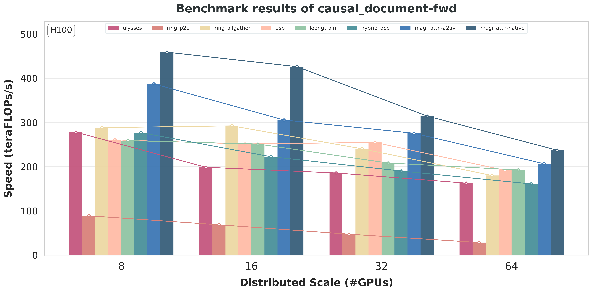{ width="820" }

*图源：[MagiAttention 官方文档](https://sandai-org.github.io/MagiAttention/)，官方 H100 varlen-causal 前向图。按 benchmark 定义，纵轴读作每卡有效吞吐。*

相同序列和 mask 下，更高的有效吞吐意味着这一 attention 阶段更快，但每卡吞吐随规模下降，说明通信与调度等影响尚未完全被隐藏。标题的扩展目标不能代替这条实测曲线。

反向先比较 8 到 16 卡，再看 64 卡。native 在 16 卡略高于 8 卡，到 64 卡仍有下降；AlltoAll-v 版在 64 卡约为 240，而 Ulysses 约为 250，native 约为 260。不是每个 MagiAttention 变体在每个点都领先所有基线。

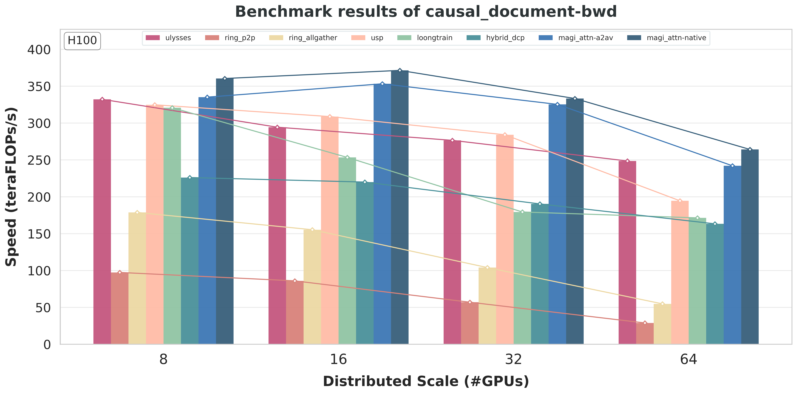{ width="820" }

*图源：[MagiAttention 官方文档](https://sandai-org.github.io/MagiAttention/)，官方 H100 varlen-causal 反向图。反向既有更多矩阵乘法，也要归约 dKV，排序不能从前向直接推断。*

### B200 的 native 收益主要在跨节点后扩大

B200 前向的 8 卡点，AlltoAll-v 约为 910，native 约为 870，后者略慢。到了 16、32、64 卡，native 反而更高；64 卡约为 560 对 400，差距明显扩大。这符合 native 路线重点减少跨节点重复传输的设计动机，但单独这组端到端 attention 曲线没有分离 D2D 拷贝、RDMA 去重与调度分别贡献多少。

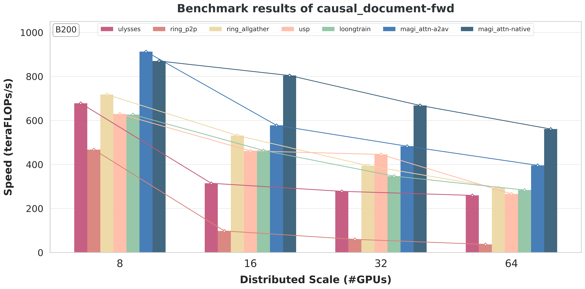{ width="820" }

*图源：[MagiAttention 官方文档](https://sandai-org.github.io/MagiAttention/)，官方 B200 varlen-causal 前向图。8 卡时的交叉，说明 native 并非无条件胜出。*

反向也有类似交叉：8 卡时 native 约 650、AlltoAll-v 约 690；64 卡时变为约 550 对 450。前后向趋势都提示，应按实际 CP 规模选择与测量通信后端，不能仅依据“native”这个名字做决定。

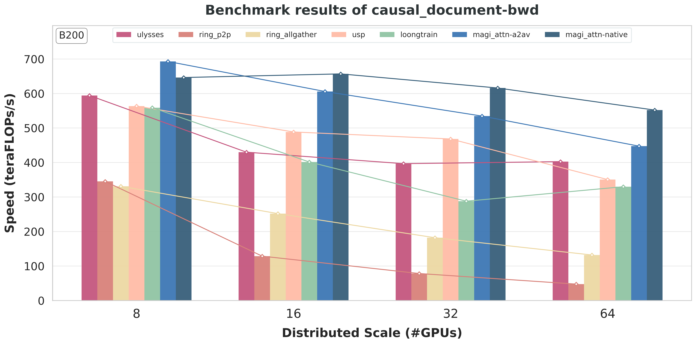{ width="820" }

*图源：[MagiAttention 官方文档](https://sandai-org.github.io/MagiAttention/)，官方 B200 varlen-causal 反向图。native 的每卡吞吐保持得更好，仍没有完全消除扩展成本。*

为了把这些观察放到相同口径下，下面只摘取 8 卡与 64 卡端点。数值按图读取并取约数，单位统一为 TFLOPs/s/GPU。

| Hardware / Pass | AlltoAll-v @8 GPUs | Native @8 GPUs | AlltoAll-v @64 GPUs | Native @64 GPUs |
| --- | ---: | ---: | ---: | ---: |
| H100 / Forward | ≈390 | ≈460 | ≈210 | ≈240 |
| H100 / Backward | ≈340 | ≈360 | ≈240 | ≈260 |
| B200 / Forward | ≈910 | ≈870 | ≈400 | ≈560 |
| B200 / Backward | ≈690 | ≈650 | ≈450 | ≈550 |

按 B200 前向 64 卡的近似读数相除，native 约为 AlltoAll-v 的 1.4 倍；它不是完整模型训练快 1.4 倍，也不能解释为 64 卡相对 8 卡的扩展倍率。若 attention 只占训练 step 的一部分，投影、MLP、优化器与其他并行通信不会因这些图中的改进自动同比缩短。

官方用约 4M token 的视频工作负载说明动机，而这里给出的分布式图按所列设置最大达到 H100 512K、B200 1024K。动机中的长度与这组可直接读取的测试上限应分开，不能用后一组图宣称已展示 4M 上完全相同的吞吐。[↗](https://sandai-org.github.io/MagiAttention/docs/main/blog/cp_benchmark.html#distributed-level)

## 真正可复用的是把依赖、位置与时间一起安排

MagiAttention 没有提出新的监督目标，也不依靠改变模型质量来换速度。它将给定 mask 的语义分解为可执行切片，用分配算法控制慢卡，再按实际依赖分发输入、回收结果与梯度。Softmax 的合并规则保证这套搬运仍在计算同一个注意力，通信 kernel 和启动同步则决定数学上可行的排程能否在硬件上兑现。

采用这套方案，首先要判断 mask 的生成时机。固定文档边界适合提前 dispatch；每层生成的稀疏选择需要能搬动 Q/O 的动态调度，还要计入 CPU 求解与同步。其次要看部署规模：节点内与跨节点的主要瓶颈不同，native RDMA 去重的收益也会随拓扑改变。最后应分别测前向、反向与完整训练 step，把有效 FLOPs、最慢 rank、通信时间和额外缓冲区放在同一份记录中。

这些区别使它更适合被理解成一套 mask 驱动的分布式 attention 执行系统。灵活性、均衡、按需传输和真正重叠需要一起成立，单独一张 kernel 峰值图或一条理想流水线都不足以替代完整结果。[官方代码](https://github.com/SandAI-org/MagiAttention)

前置知识可以按三步补齐：先看[通信 kernel 与计算重叠](../../operators/communication-kernels-and-overlap.md)，确认 ready、launch 和 consumer 之间的依赖；再看[长上下文与 FlashAttention 演进](../../operators/long-context-and-flashattention-evolution.md)，区分 online softmax 与分布式切片；最后回到[分布式训练与 checkpoint](../../training/distributed-training-and-checkpointing.md)，检查局部结果怎样进入完整训练 step。这样读图时关注的是依赖和证据，不只是峰值 TFLOPs。
