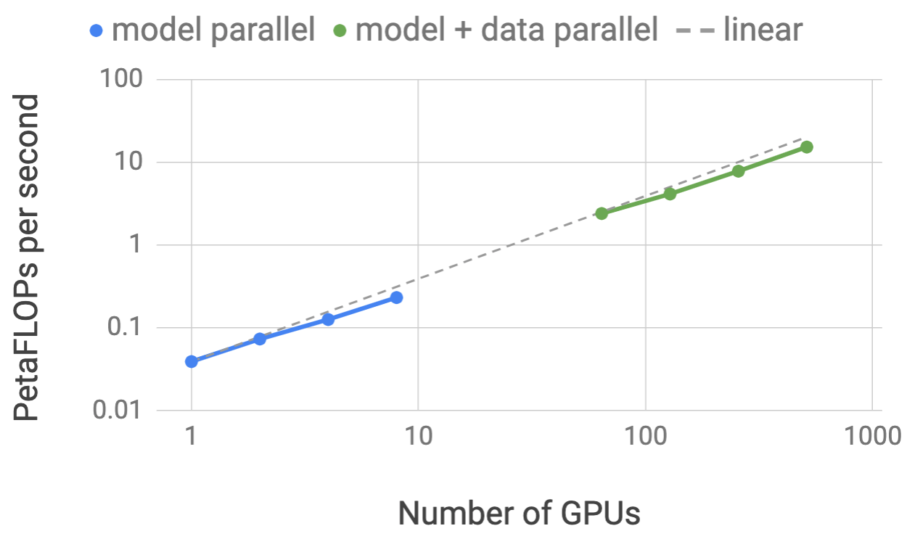
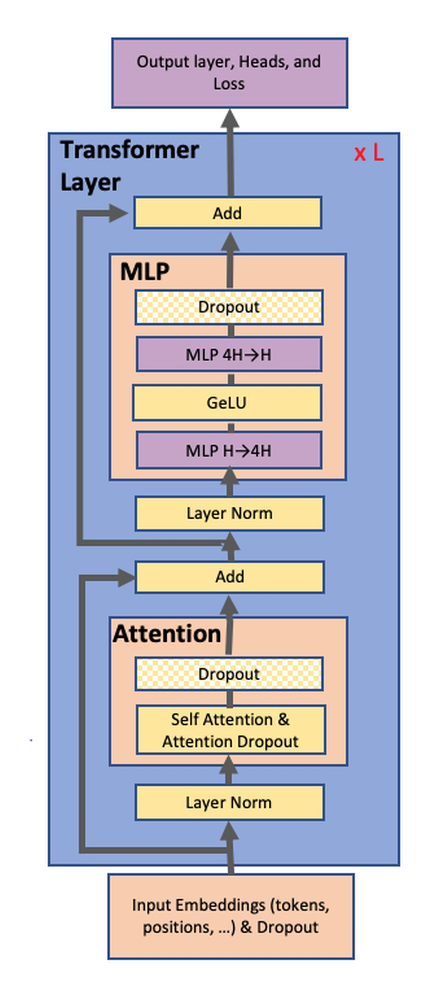
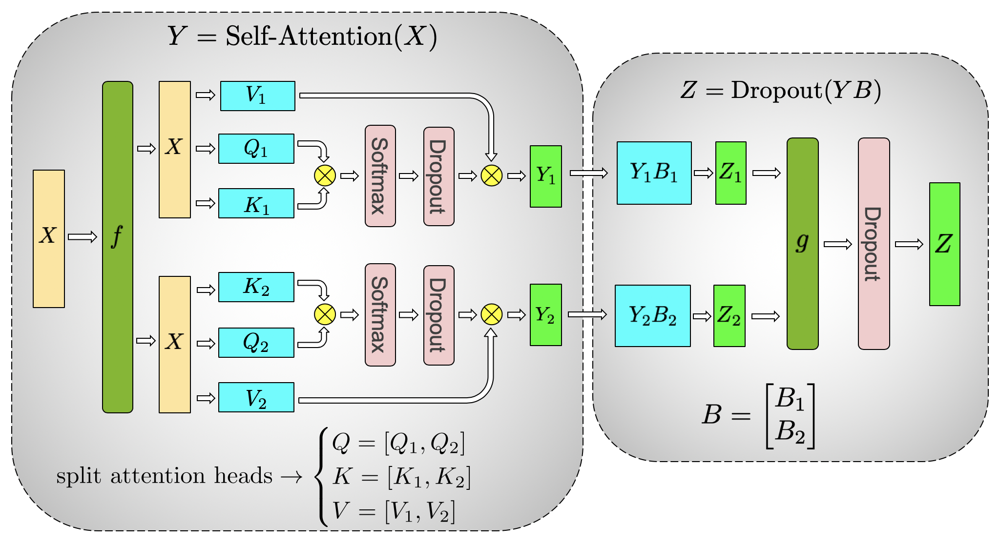
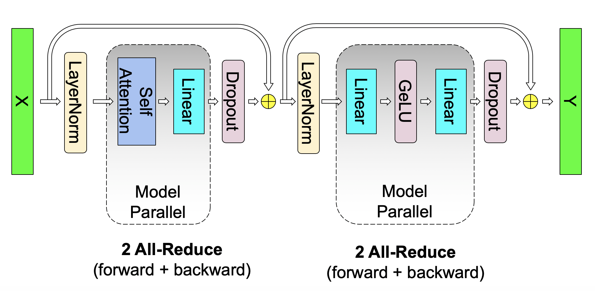
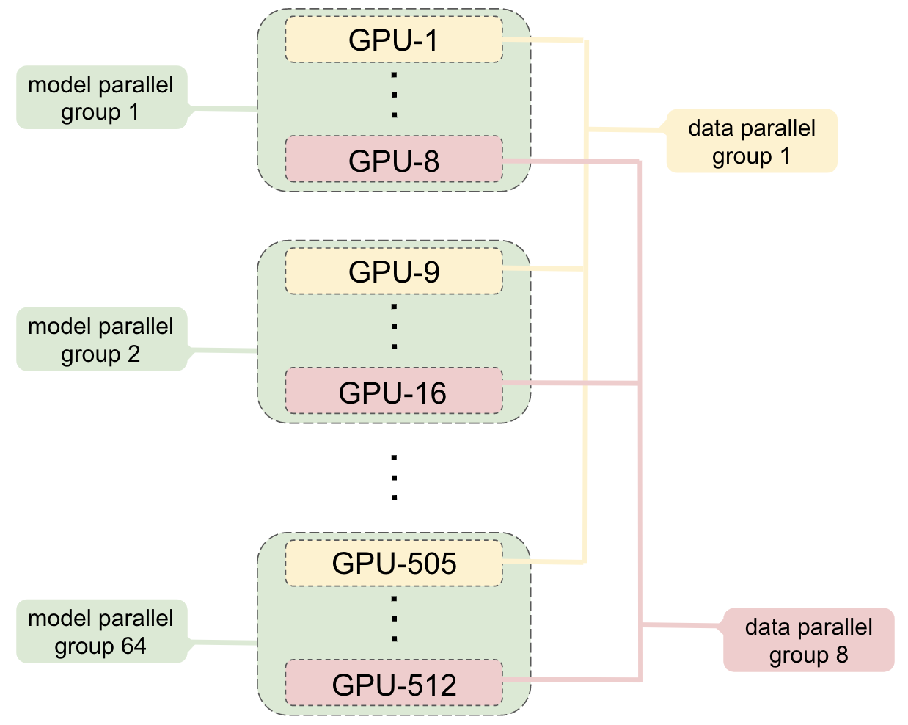
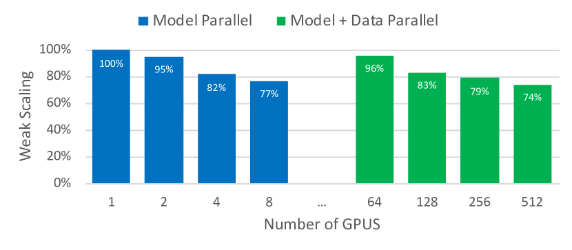
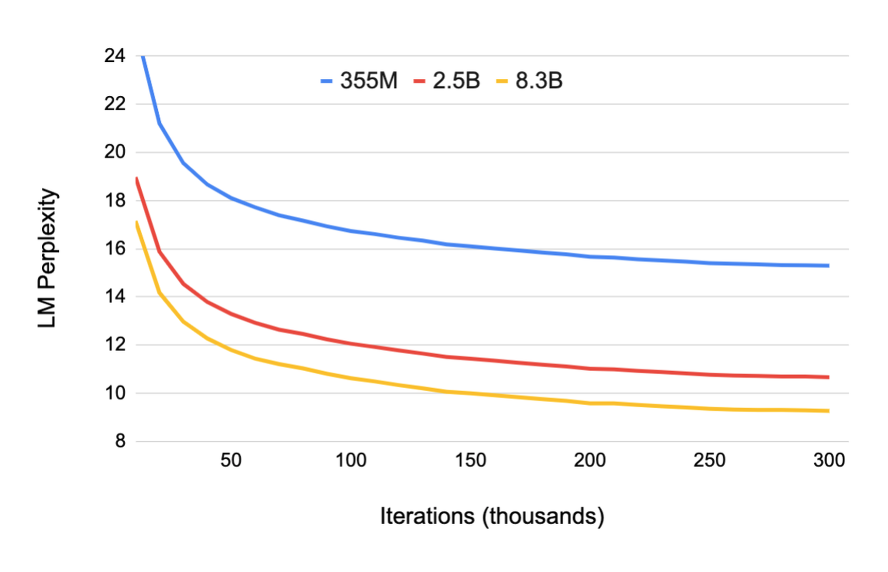
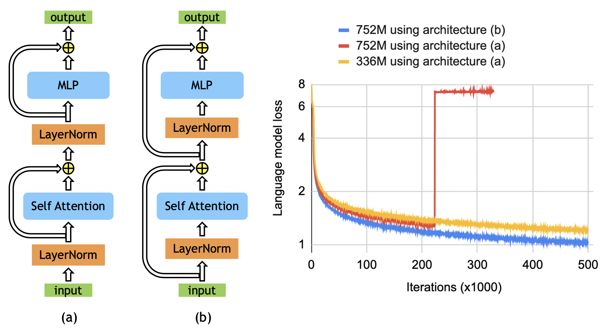

# Megatron-LM：Tensor Model Parallel 的大模型训练栈

<!-- [补充] -->
| 读者 | 建议读法 | 工程落点 |
| --- | --- | --- |
| 初学者 | 先抓“Megatron-LM：Tensor Model Parallel 的大模型训练栈”要解决的问题、关键术语和最小例子；公式只看变量方向。 | 能说清输入、输出和常见失败信号。 |
| 工程师 | 直接对照结构、指标、成本和边界条件，必要时回到前置页补概念。 | 落到数据、算力、延迟、显存、评测和回滚检查。 |

!!! note "合并提示"
    **note · 读法定位**

    这页先按“论文证据节点”读：先问它解决哪一个瓶颈，再看核心图表、实验 setting 和不能外推的边界。背景概念先回 [论文专题讲解](../index.md) 和 [训练与基础系统](../../training/index.md)。
    **前置**：不必先读完所有相关论文，但要知道本篇的输入、训练/推理路径和评测口径分别对应什么。
    **主线关系**：读完后把结论回填到「训练与基础系统」路线里，判断它改变的是机制、成本、数据配方、评测口径，还是仍停留在前沿假设。

    **info · 论文信息**

    - 论文：`Megatron-LM: Training Multi-Billion Parameter Language Models Using Model Parallelism`
    - 链接：[arXiv:1909.08053](https://arxiv.org/abs/1909.08053)
    - 作者：Mohammad Shoeybi、Mostofa Patwary、Raul Puri、Patrick LeGresley、Jared Casper、Bryan Catanzaro
    - 代码：[NVIDIA/Megatron-LM](https://github.com/NVIDIA/Megatron-LM)
    - 日期：2019-09
    - 关键词：tensor model parallelism、intra-layer model parallelism、Megatron-LM、GPT-2、BERT、mixed precision、activation checkpointing、hybrid model and data parallelism、NCCL

Megatron-LM 是很多后续大模型训练栈的起点之一。它讨论的问题非常朴素：当 Transformer 参数、激活和 Adam optimizer state 已经放不进单卡时，能不能不引入复杂 compiler，也不依赖 pipeline bubble，把一个 Transformer layer 内部的 GEMM 切到多张 GPU 上训练？

它的答案就是后来被大家称作 **tensor parallelism** 的方案：在 MLP、attention 和词表 logits 上按张量维度切分，让每个 GPU 只持有一部分权重和计算，并把通信压缩到少数几个 `all-reduce`。论文用这个方法在 512 张 V100 上训练 8.3B GPT-2-like 模型和 3.9B BERT-like 模型，展示了模型并行和数据并行可以组合成可训练的大模型系统。

## 它的效率贡献是什么

| 维度 | 贡献 |
| --- | --- |
| 节省的成本 | 把单卡装不下的 Transformer 参数、梯度、optimizer state 和激活切到多 GPU，减少需要跨 GPU 同步的中间张量 |
| 核心机制 | MLP 用 column-parallel + row-parallel GEMM；attention 按 heads 切 Q/K/V，再 row-parallel output projection；词表 logits 与 cross entropy 融合，避免巨大 all-gather |
| 对训练系统主线的意义 | 奠定 Megatron 系列 TP/DP 组合训练的基本形态，也解释了为什么大模型训练要同时看 GEMM shape、通信位置、随机数、activation checkpoint 和数据去重 |
| 主要风险 | 论文主要验证 V100/DGX-2H 时代的 dense GPT/BERT；没有覆盖 ZeRO/FSDP、pipeline parallel、sequence/context parallel、MoE、FP8/FP4 等后来的训练栈组件 |
| 应接到本站哪里 | [Megatron-LM / DeepSpeed 与训练栈](../../training/megatron-lm-deepspeed-and-open-training-stacks.md)、[分布式训练与 Checkpointing](../../training/distributed-training-and-checkpointing.md)、[低比特训练与数值格式](../../training/low-bit-training-and-numerics.md) |

## 证据等级与外推边界

论文的主要证据来自系统扩展实验、GPT-2 zero-shot 结果、BERT downstream 结果和训练稳定性观察。它证明的是“intra-layer tensor model parallel 可以高效训练数十亿参数 Transformer”，不是证明“只靠 TP 就能覆盖现代训练系统所有需求”。

| 论文结论 | 证据来源 | 证据等级 | 可外推到高效训练 | 不能直接外推 |
| --- | --- | --- | --- | --- |
| Transformer layer 内部可以用少量 all-reduce 做模型并行 | MLP / attention 切分设计、Figure 3 和 Figure 4 | System design + implementation | 现代 Megatron TP、ColumnParallelLinear、RowParallelLinear 的核心直觉 | 不代表所有算子都适合 TP；embedding、loss、norm、MoE 还有各自处理 |
| TP 与 DP 可以混合扩展到 512 GPU | Table 1、Figure 1、Figure 5、Appendix B | Scaling experiment | 大模型训练要同时定义 model-parallel group 和 data-parallel group | 不包含 pipeline parallel、ZeRO optimizer state sharding 或现代 heterogeneous cluster |
| 大模型训练质量随规模提升 | GPT-2 Table 2、Table 3 和 Figure 6 | Model quality experiment | 系统效率要落到可收敛训练和评测指标，而不只是 TFLOPs | 训练数据、评测任务和 tokenizer 都是 2019 年上下文 |
| BERT-like 模型扩展依赖 layer norm / residual placement | Figure 7、Table 4、Table 5 | Stability + downstream result | 训练稳定性是架构、初始化、归一化和优化器共同问题 | 不等于所有 encoder-only 模型都只需改 pre-norm/post-norm |
| 数据去重和 test leakage 检查会影响结论可信度 | Training dataset 和 GPT-2 overlap 检查 | Reproducibility practice | 训练系统页面应把 dataset cleaning 写进“训练配方”，而不是只写并行框架 | 不提供现代数据治理、质量打分或多语种混合策略 |

## 系统位置

论文的出发点不是“让已有模型快一点”，而是“模型已经大到单卡放不下”。单卡放不下的对象不只有参数，还包括 Adam 的一阶/二阶状态、梯度和 activation。Activation checkpointing 可以缓解激活内存，但参数和 optimizer state 仍然会随模型规模线性增长。

{ width="820" }

<small>图源：Megatron-LM Figure 1。原图展示 model parallel 与 model+data parallel 在 GPU 数增加时的应用级 FLOPS 扩展；论文报告 8.3B 模型在 512 V100 上达到 15.1 PFLOPs，并相对单 GPU strong baseline 保持约 76% scaling efficiency。</small>

!!! note "这张图怎么读"
    **输入输出**：输入是 Transformer 层、张量并行 rank 和数据并行副本，输出是分片 GEMM 与同步路径。  
    **效率机制**：把 MLP、attention 和 vocab projection 切到多卡，降低单卡计算/显存压力。  
    **对主线意义**：它是训练系统成本账的底座，帮助解释世界模型长轨迹训练怎么扩展。  
    **不能证明什么**：TP/DP 结构图不能证明任务质量、收敛稳定性或具体集群效率。

这张图有两个读法：

1. **model parallel 不是为了增大 batch**：它主要是让更大的模型能放进多卡，并让每张卡都有足够 GEMM 可算。
2. **model+data parallel 才是训练吞吐形态**：TP 解决单个模型实例的切分，DP 复制多个模型实例并同步梯度，二者相乘得到总 GPU 数。

## Transformer 的切分入口

论文先把普通 Transformer layer 摆出来：self-attention 后接两层 MLP，外面有 dropout、residual connection 和 layer normalization。

{ width="302" }

<small>图源：Megatron-LM Figure 2。原图展示 Transformer layer 中 attention、MLP、dropout、residual 与 layer normalization 的位置。Megatron-LM 的模型并行主要进入 attention 和 MLP 两个大 GEMM 区域。</small>

!!! note "图解"
    这张小结构图只需要抓两块：self-attention 和两层 MLP。Megatron-LM 的切分不会优先动 layer norm、dropout 或 residual，而是把最重的 GEMM 分片；图里的顺序帮助判断通信必须放在进入 residual 前还是可以推迟到局部 GEMM 后。

这个结构决定了切分目标：尽量切大矩阵乘法，尽量不要在 nonlinear、dropout、residual 等地方产生额外同步。

## MLP：先 Column Parallel，再 Row Parallel

Transformer MLP 的第一段是 `X @ A -> GeLU`。如果把 `A` 按行切、`X` 按列切，每张 GPU 得到的是 partial sum，而 GeLU 是非线性的，必须先同步出完整 pre-activation 才能继续。这会在 GeLU 前插入一个同步点。

Megatron-LM 选择反过来切：

1. 第一层 GEMM 把权重按列切，形成 `A = [A1, A2]`；
2. 每张 GPU 独立算自己的 `GeLU(X @ Ai)`；
3. 第二层 GEMM 把权重按行切，直接吃各自的 GeLU shard；
4. 第二层输出再做一次 all-reduce，得到完整 MLP 输出。

{ width="760" }

<small>图源：Megatron-LM Figure 3a。原图展示 MLP block 的 column-parallel first GEMM 与 row-parallel second GEMM。这样可以把两个 GEMM 串成局部计算，只在 MLP block 输出处同步。</small>

!!! note "图解"
    先看第一层权重按列切：每张 GPU 得到不同 hidden shard，并能独立过 GeLU。再看第二层权重按行切：各 GPU 吃自己的 shard，最后只在输出处 all-reduce。关键点是非线性 GeLU 前没有同步，否则切分收益会被通信吃掉。

训练含义很关键：这不是随便切矩阵，而是在 nonlinear 的位置避开同步。现代 Megatron 里的 `ColumnParallelLinear` 和 `RowParallelLinear` 基本就是这个思路的工程化表达。

## Attention：按 Head 切 Q/K/V

Multi-head attention 天然有 head 级并行。Megatron-LM 把 Q、K、V 的 GEMM 按列切，使每个 GPU 拿到一部分 attention heads；每个 head 的 attention score、softmax 和 value aggregation 都可以在本地完成。随后 output projection 按行切，直接吃本地 attention output，再在 projection 输出后同步。

{ width="820" }

<small>图源：Megatron-LM Figure 3b。原图展示 self-attention block 的 Q/K/V column-parallel 切分和 output linear row-parallel 切分。通信被推迟到 output projection 后，而不是 attention heads 之间。</small>

!!! note "图解"
    这张图按 head 读：Q/K/V projection 被切成多组 heads，每张 GPU 本地完成 attention score、softmax 和 value 聚合。只有 output projection 后才需要同步完整 hidden state；因此 TP size、head 数和 hidden size 的整除关系会直接影响负载均衡。

这解释了 TP 和 attention head 数之间的关系：如果按 head 切，head 数、hidden size、每头维度和 TP size 的整除关系会直接影响 GEMM shape 和负载均衡。论文的 scaling study 里特意让 hidden size per attention head 保持固定，就是为了让不同规模下的 GEMM 更可比。

## f / g Operators：通信只放在必要位置

<!-- [融合：算法基础] 来源：llm-algo-leetcode《05. Communication Topologies | 通信拓扑与分布式基石 (Communication & Distributed Topology)》-->
> **算法视角**：ZeRO、张量并行、流水线并行和通信 overlap 都是在切分“状态、矩阵或 micro-batch”；收益来自显存和计算分摊，代价会转成 all-gather、reduce-scatter、all-reduce 或 pipeline bubble。
>
> 延伸阅读：[05. Communication Topologies | 通信拓扑与分布式基石 (Communication & Distributed Topology)](https://datawhalechina.github.io/llm-algo-leetcode/01_Hardware_Math_and_Systems/05_Communication_Topologies.html)

<!-- [融合：复杂度分析] 来源：llm-algo-leetcode《05. Communication Topologies | 通信拓扑与分布式基石 (Communication & Distributed Topology)》-->
| 操作 | 时间复杂度 | 空间复杂度 | 说明 |
|------|-----------|-----------|------|
| ZeRO 状态分片 | 计算量基本不变 | 被分片状态约 $O(\Psi/N_d)$ | $\Psi$ 为参数量，$N_d$ 为 data-parallel degree；参考：[对应章节](https://datawhalechina.github.io/llm-algo-leetcode/01_Hardware_Math_and_Systems/05_Communication_Topologies.html) |
| 分布式通信 | 取决于消息大小与拓扑 | 通信 buffer 需额外预算 | 显存省下后，瓶颈常转移到带宽、延迟和 overlap 能力。 |

论文把两个通信算子记为 `f` 和 `g`：

| Operator | Forward | Backward | 用在哪里 |
| --- | --- | --- | --- |
| `f` | identity | all-reduce | 让 backward gradient 在 model-parallel ranks 间合并 |
| `g` | all-reduce | identity | 让 forward output 在进入 dropout/residual 前变成完整张量 |

{ width="820" }

<small>图源：Megatron-LM Figure 4。原图展示单个 model-parallel Transformer layer 的通信位置：forward 和 backward 合计 4 次通信，覆盖 MLP 与 attention 两个 block。</small>

!!! note "图解"
    图中的 `f` 和 `g` 不是新算子，而是通信占位：`g` 在 forward 做 all-reduce，`f` 在 backward 做 all-reduce。读这张图要数同步点，Megatron-LM 的主张就是每层只在必要边界同步，局部 GEMM 和非线性尽量留在各 TP rank 内。

这里的工程味很浓。论文强调不需要新 compiler，也不需要重写 PyTorch 图，只要在 PyTorch transformer implementation 中插入少量通信 primitive。代价是开发者必须清楚哪些张量是 sharded，哪些张量是 replicated，哪些地方进入 residual 前必须已经 all-reduce。

## 词表并行和 Loss 融合

语言模型输出层的矩阵大小是 hidden size 乘 vocabulary size。GPT-2 词表有 50,257 个 token，输出 logits 的张量形状是 `batch_size x sequence_length x vocab_size`，如果先 all-gather 全量 logits 再算 cross entropy，通信量会非常大。

Megatron-LM 的做法是：

| 位置 | 切分方式 | 训练含义 |
| --- | --- | --- |
| input embedding | vocabulary dimension column-wise | 每张 GPU 只持有部分词表 embedding；embedding 输出后需要同步 |
| output embedding / logits | vocabulary dimension parallel GEMM | 每张 GPU 只算自己词表 shard 的 logits |
| cross entropy | 与 parallel logits 融合 | 不 all-gather 巨大 logits，只通信 max / sum / scalar loss 需要的聚合量 |

这个细节经常被忽略，但对大词表训练很重要。TP 不只是切 Transformer block，也要把 embedding、logits 和 loss 放进同一张通信账本。

## Hybrid MP + DP：组怎么建

Megatron-LM 把 model parallel 和 data parallel 组合起来。直观地说，8 张 GPU 先组成一个 model-parallel group，里面共同持有一个 8.3B 模型实例；然后 64 个这样的模型实例组成 data-parallel replicas，总共就是 `8 x 64 = 512` 张 GPU。

{ width="760" }

<small>图源：Megatron-LM Figure 8。原图展示 8-way model parallel 与 64-way data parallel 的 GPU 分组。每个 model-parallel group 内做 TP all-reduce；不同 group 中相同位置的 GPU 组成 data-parallel group 做 gradient all-reduce。</small>

!!! note "图解"
    先横向看一个 model-parallel group：它共同持有一个模型实例的不同 shard。再纵向看 data-parallel group：不同模型副本中同位置的 shard 同步梯度。这个分组图解释了为什么总 GPU 数等于 TP size 乘 DP size，也解释了通信域不能混在一起。

这张图适合直接拿来解释训练栈里的 group 概念：

| Group | 包含什么 | 负责什么通信 |
| --- | --- | --- |
| model-parallel group | 同一个模型实例的 TP ranks | MLP、attention、embedding、loss 里的 tensor-parallel all-reduce |
| data-parallel group | 不同模型实例中位置相同的 ranks | backward 后同步相同 shard 的梯度 |
| total GPUs | `model_parallel_size x data_parallel_size` | 模型大小由 TP 支撑，训练吞吐由 DP 放大 |

论文还补了一个很实用的随机数细节：residual 前的 dropout 位于 model-parallel region 之外，应该在同一模型实例的 TP ranks 上保持相同 dropout pattern；attention 内部的 dropout 位于 model-parallel region 内，则应该让每个 TP rank 用独立随机数，以保证整体操作有足够随机性。

## 训练配方：不只是并行

Megatron-LM 的训练细节很值得补，因为它展示了早期大模型训练已经不是“把代码分布式跑起来”这么简单。

| Training component | Detail |
| --- | --- |
| Hardware | up to 32 DGX-2H servers, 512 Tesla V100 SXM3 32GB GPUs; NVSwitch inside server; InfiniBand between servers |
| Dataset | Wikipedia, CC-Stories, RealNews, OpenWebText; BERT adds BooksCorpus; GPT-2 excludes BooksCorpus because of LAMBADA overlap |
| Data cleaning | remove WikiText103 test articles from Wikipedia; remove CC-Stories newline artifacts; filter documents shorter than 128 tokens |
| Deduplication | locality-sensitive hashing with Jaccard similarity greater than 0.7 |
| Corpus size | 174 GB deduplicated text |
| Precision | mixed precision training with dynamic loss scaling on V100 Tensor Cores |
| Initialization | weights sampled from `N(0, 0.02)`: mean 0 and scale/std 0.02; weights before residual layers scaled by `1 / sqrt(2N)`, where `N` is number of Transformer layers |
| Optimizer | Adam with weight decay `lambda = 0.01` |
| Stabilization | global gradient norm clipping of 1.0; dropout 0.1 |
| Memory | activation checkpointing after every Transformer layer |

这里最值得记住的是四件事：

1. **数据去重和泄漏检查写进训练系统**：论文不仅报告数据来源，还移除 WikiText103 test articles，并用 8-gram overlap 检查 WikiText103 / LAMBADA 与训练集的重叠。
2. **混合精度要配 dynamic loss scaling**：V100 Tensor Cores 的吞吐收益要靠 mixed precision 释放，但数值稳定性需要 loss scaling。
3. **初始化和 residual scaling 是稳定性组件**：参数越大、层数越深，初始化尺度和 residual 路径会影响可训练性。
4. **activation checkpointing 是默认内存策略**：TP 切参数和 GEMM，checkpointing 则减少激活峰值，二者解决的是不同内存项。

### GPT-2 Training

| Training component | Detail |
| --- | --- |
| Sequence length | 1024 subword units |
| Batch size | 512 |
| Iterations | 300k |
| Learning rate | `1.5e-4` |
| Warmup | 3k iterations |
| Decay | single-cycle cosine decay over remaining 297k iterations |
| Minimum learning rate | `1e-5` |
| Vocabulary adjustment | original GPT-2 vocab 50,257 padded to 51,200 for efficient per-GPU GEMM under up to 8-way TP |

### BERT Training

| Training component | Detail |
| --- | --- |
| Vocabulary | original BERT vocabulary, size 30,522 |
| Objective change | replace next sentence prediction with sentence order prediction |
| Masking | whole word n-gram masking |
| Batch size | 1024 |
| Learning rate | `1.0e-4` |
| Warmup | 10,000 iterations |
| Decay | linear decay over 2 million iterations |
| Fine-tuning report | tune batch size and learning rate per task, then report median dev result over 5 random seeds |

## Scaling Study

论文的 scaling study 用 GPT-2-like 模型做，hidden size per attention head 固定为 96，以便比较不同模型规模下的 GEMM 效率。下面表格重绘自原论文 Table 1，保留英文列名。

| Hidden Size | Attention heads | Number of layers | Number of parameters (billions) | Model parallel GPUs | Model +data parallel GPUs |
| --- | --- | --- | --- | --- | --- |
| 1536 | 16 | 40 | 1.2 | 1 | 64 |
| 1920 | 20 | 54 | 2.5 | 2 | 128 |
| 2304 | 24 | 64 | 4.2 | 4 | 256 |
| 3072 | 32 | 72 | 8.3 | 8 | 512 |

{ width="780" }

<small>图源：Megatron-LM Figure 5。原图展示 model parallel 和 model+data parallel 的 weak scaling efficiency。8.3B 模型在 8-way TP 下约 77% linear scaling，在 512 GPU 的 model+data parallel 下约 74% scaling。</small>

!!! note "图解"
    横轴看 GPU/模型规模增加，纵轴看相对线性扩展效率。model parallel 曲线回答“单个大模型实例切到更多 GPU 后效率如何”，model+data parallel 曲线回答“再复制多个实例后总体训练吞吐如何”。这张图证明的是系统扩展性，不直接证明模型质量。

注意这里的 baseline 很强：1.2B 模型单 V100 已经有 39 TFLOPs，约为 DGX-2H 单卡理论峰值的 30%。因此后面的 scaling efficiency 不是相对一个很弱的单卡实现，而是相对一个比较充分利用 GEMM 的实现。

## GPT-2：训练规模和 Zero-shot 结果

<!-- [补充] -->
> **这个实验说明了什么**：这一节主要检查论文主张是否在作者设定的数据、模型和评测口径下成立；阅读时要把指标提升、消融贡献和未覆盖场景分开看。

下面表格重绘自原论文 Table 2，保留英文列名。

| Parameter Count | Layers | Hidden Size | Attn Heads | Hidden Size per Head | Total GPUs | Time per Epoch (days) |
| --- | --- | --- | --- | --- | --- | --- |
| 355M | 24 | 1024 | 16 | 64 | 64 | 0.86 |
| 2.5B | 54 | 1920 | 20 | 96 | 128 | 2.27 |
| 8.3B | 72 | 3072 | 24 | 128 | 512 | 2.10 |

8.3B 模型每个 epoch 约两天，论文把一个 epoch 定义为 68,507 iterations。比较有意思的是，8.3B 比 2.5B 用更多 GPU，因此 epoch time 没有随着参数量线性变长。

{ width="760" }

<small>图源：Megatron-LM Figure 6。原图展示 355M、2.5B、8.3B GPT-2-like 模型训练 300k iterations 时的 validation perplexity。模型越大，收敛更快且最终 perplexity 更低。</small>

!!! note "图解"
    横轴是训练迭代，纵轴是 validation perplexity，越低越好。三条曲线的核心信息是：在这套数据和训练配方下，更大的 GPT-2-like 模型不仅最终更低，也更早达到较好 perplexity。它不能外推成“任何任务只要加参数就好”，因为数据、优化器和并行系统都在共同作用。

下面表格重绘自原论文 Table 3，保留英文列名。

| Model | Wikitext103 Perplexity ↓ | LAMBADA Accuracy ↑ |
| --- | --- | --- |
| 355M | 19.31 | 45.18% |
| 2.5B | 12.76 | 61.73% |
| 8.3B | 10.81 | 66.51% |
| Previous SOTA | 15.79 | 63.24% |

从训练系统角度看，Table 3 的意义不是“只要模型大就一定好”，而是系统扩展实验必须连接到可收敛训练和下游指标。否则一张 FLOPS scaling 图只能说明机器忙了，不说明模型学到了什么。

## BERT：LayerNorm / Residual Placement 是训练稳定性

论文还做了 BERT-like 模型扩展。这里最重要的观察不是 TP 本身，而是 **BERT 原始架构在更大模型上会不稳定，调整 layer normalization 和 residual connection 的顺序后才能稳定扩展**。

{ width="820" }

<small>图源：Megatron-LM Figure 7。原图对比 original BERT architecture 与 rearranged architecture 的训练 loss。论文观察到后者能让 752M 级别 BERT 更稳定，并在更大 BERT-like 模型中继续使用。</small>

!!! note "图解"
    这张图看两种 residual/layer norm 顺序的 loss 曲线。原始 BERT 结构在更大规模下更容易不稳定，rearranged architecture 曲线更平滑；作者想说明扩展 encoder-only 模型时，稳定性不只是并行策略，还和 norm、residual 路径、初始化和优化器配方有关。

下面表格重绘自原论文 Table 4，保留英文列名。

| Parameter Count | Layers | Hidden Size | Attention Heads | Total GPUs |
| --- | --- | --- | --- | --- |
| 336M | 24 | 1024 | 16 | 128 |
| 1.3B | 24 | 2048 | 32 | 256 |
| 3.9B | 48 | 2560 | 40 | 512 |

Table 5 很宽，这里按原论文列名重绘，保留英文指标格式。

| Model | trained tokens ratio | MNLI m/mm accuracy (dev set) | QQP accuracy (dev set) | SQuAD 1.1 F1 / EM (dev set) | SQuAD 2.0 F1 / EM (dev set) | RACE m/h accuracy (test set) |
| --- | --- | --- | --- | --- | --- | --- |
| [RoBERTa (Liu et al., 2019)](https://arxiv.org/abs/1907.11692) | 2 | 90.2 / 90.2 | 92.2 | 94.6 / 88.9 | 89.4 / 86.5 | 83.2 (86.5 / 81.8) |
| [ALBERT (Lan et al., 2019)](https://arxiv.org/abs/1909.11942) | 3 | 90.8 | 92.2 | 94.8 / 89.3 | 90.2 / 87.4 | 86.5 (89.0 / 85.5) |
| [XLNet (Yang et al., 2019)](https://arxiv.org/abs/1906.08237) | 2 | 90.8 / 90.8 | 92.3 | 95.1 / 89.7 | 90.6 / 87.9 | 85.4 (88.6 / 84.0) |
| Megatron-336M | 1 | 89.7 / 90.0 | 92.3 | 94.2 / 88.0 | 88.1 / 84.8 | 83.0 (86.9 / 81.5) |
| Megatron-1.3B | 1 | 90.9 / 91.0 | 92.6 | 94.9 / 89.1 | 90.2 / 87.1 | 87.3 (90.4 / 86.1) |
| Megatron-3.9B | 1 | 91.4 / 91.4 | 92.7 | 95.5 / 90.0 | 91.2 / 88.5 | 89.5 (91.8 / 88.6) |
| [ALBERT ensemble (Lan et al., 2019)](https://arxiv.org/abs/1909.11942) | - | - | - | 95.5 / 90.1 | 91.4 / 88.9 | 89.4 (91.2 / 88.6) |
| Megatron-3.9B ensemble | - | - | - | 95.8 / 90.5 | 91.7 / 89.0 | 90.9 (93.1 / 90.0) |

这组结果适合放回训练章节的稳定性讨论：BERT 扩展失败并不一定说明“大模型没用”，也可能是 normalization、residual path、初始化和优化器配方没有跟上模型规模。

## 读这篇时要补上的现代视角

| 2019 Megatron-LM 解决的事 | 后来训练栈继续补上的事 |
| --- | --- |
| intra-layer TP 切参数和 GEMM | pipeline parallel 切 layers，sequence/context parallel 切 sequence，expert parallel 切 MoE experts |
| DP 同步完整 shard gradient | ZeRO / FSDP 分片 optimizer states、gradients 和 parameters |
| mixed precision + dynamic loss scaling | BF16、FP8、FP4、MXFP/NVFP 等更复杂数值格式和 kernel path |
| activation checkpointing | selective recompute、offload、activation partition、通信重叠 |
| NCCL all-reduce | reduce-scatter / all-gather overlap、ring/tree collectives、topology-aware group placement |
| dense GPT/BERT | MoE、multimodal、long context、video/world-model training |

所以这篇最好不要读成“Megatron-LM 等于现代训练栈全部”。更准确的读法是：它给出了现代大模型训练系统的第一块硬骨头，解释 TP 如何让 Transformer block 的大 GEMM 分布式化，并且把训练效率、模型质量、数据处理和稳定性放到同一个实验报告里。

## 可以直接复用的训练检查表

如果要把 Megatron-LM 的思想迁移到自己的训练项目，可以按下面顺序检查：

1. **先定模型能否单卡容纳**：参数、optimizer state、gradient、activation 哪一项最先爆？
2. **再定并行维度**：TP 解决单模型实例，DP 提升吞吐；如果层数很多或显存仍不够，再考虑 PP/FSDP/ZeRO。
3. **检查 GEMM shape**：hidden size、attention heads、vocab size 是否能被 TP size 友好整除，per-GPU GEMM 是否太小。
4. **画通信位置**：MLP、attention、embedding、loss、DP gradient sync 分别需要哪些 all-reduce、all-gather 或 reduce-scatter。
5. **确认随机数语义**：TP region 内和 region 外 dropout 是否应该共享 seed，activation checkpoint 后是否保持可复现。
6. **补齐训练配方**：数据去重、泄漏检查、mixed precision、loss scaling、gradient clipping、LR schedule、residual scaling 都要记录。
7. **用质量指标闭环**：FLOPS 或 tokens/s 只是系统信号，最终还要看 validation loss、perplexity、downstream task 或目标任务评测。

Megatron-LM 的核心价值就在这里：它把“模型切得开”与“训练跑得稳、结果能变好”放在同一篇论文里。对今天的高效训练来说，这种账本意识仍然比某一个具体并行参数更重要。

这一页最后回到三个验收点：方法上，Megatron-LM 的公式抓手是把 MLP 和 attention 的矩阵乘按 hidden dimension 切分，让每张卡只持有一部分权重和激活。实验上，FLOPs scaling、weak scaling 和 validation perplexity 要一起看，避免只追吞吐忽略质量。诊断上，hybrid MP+DP 图说明张量并行不是孤立技巧，而要和数据并行、通信算子和 batch 配方一起设计。

!!! note "合并提示"
    **info · 本站判断**

    Megatron-LM 的长期价值是张量并行的工程范式：方法要抓 MLP/attention 切分、通信位置和混合并行；实验看 weak scaling、perplexity 与吞吐。它证明大模型训练要联合算子、并行和数值稳定设计，而不只是堆 GPU。

    **tip · 下一站**

    - 回到论文总入口：[论文专题讲解](../index.md)，用同一套 claim / 图表 / 边界口径横向比较。
    - 把本篇结论接回主题：[训练与基础系统](../../training/index.md)。
    - 按导航顺序继续：[ZeRO：零冗余优化器](zero.md)。
