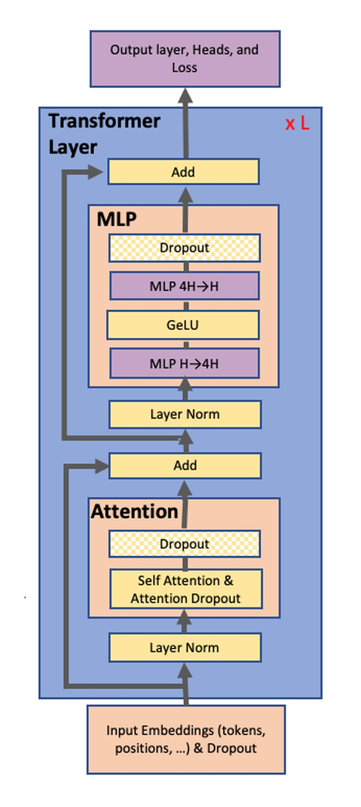
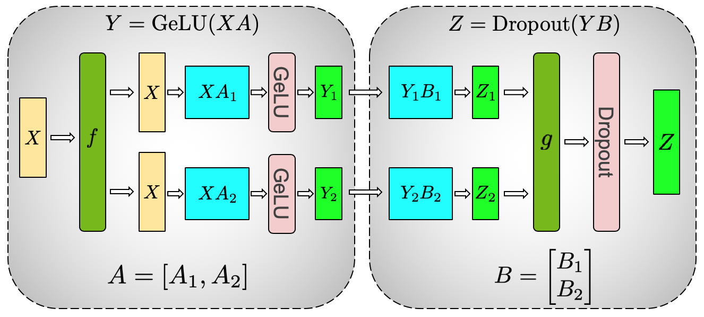
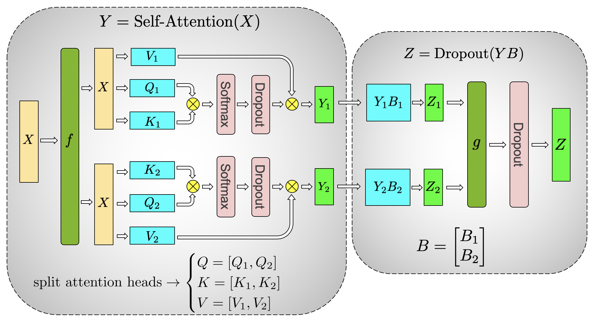
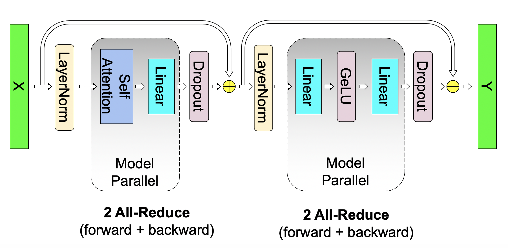
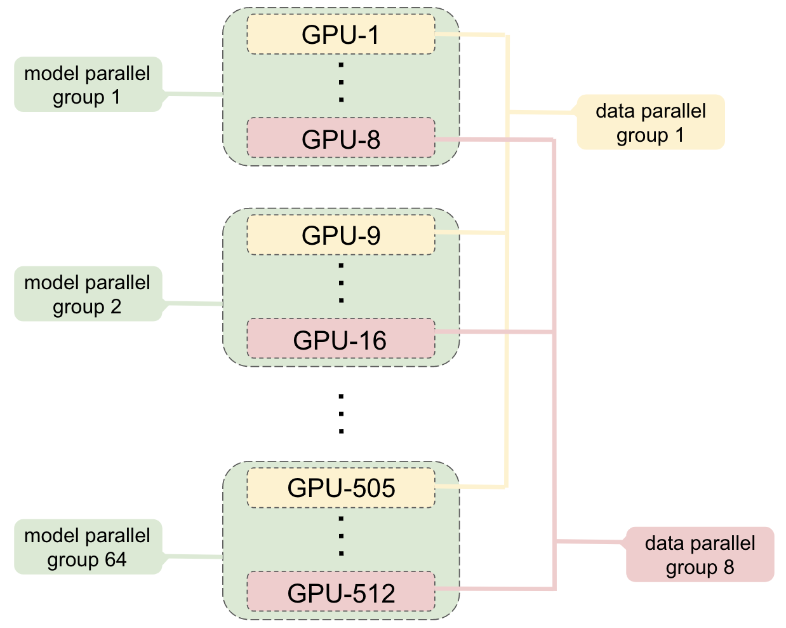
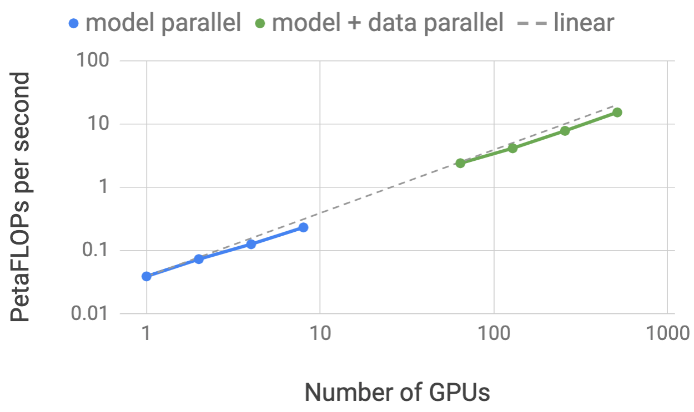
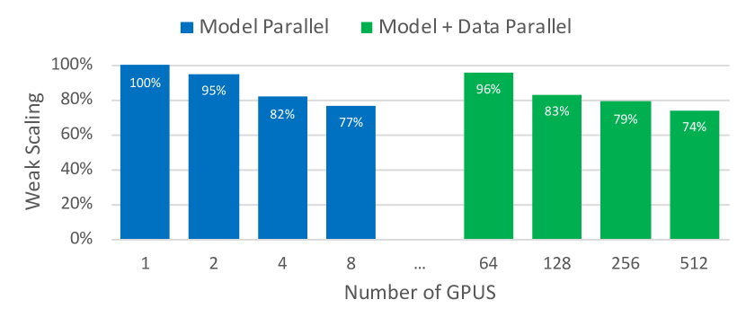
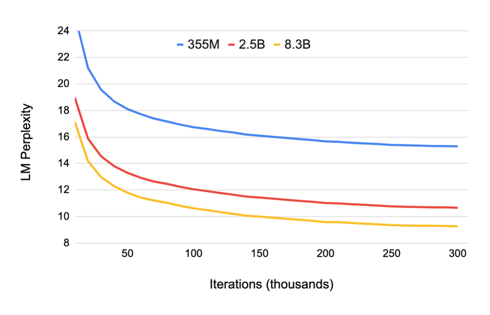
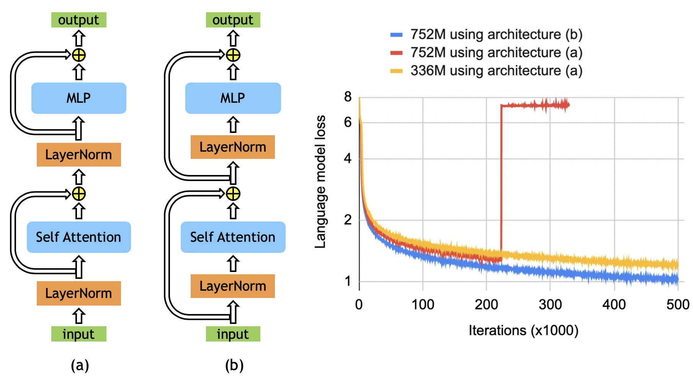

# Megatron-LM：Tensor Model Parallel 的大模型训练栈

!!! info "论文信息"
    **论文题名：** Megatron-LM: Training Multi-Billion Parameter Language Models Using Model Parallelism。 
    **作者：** Mohammad Shoeybi、Mostofa Patwary、Raul Puri、Patrick LeGresley、Jared Casper、Bryan Catanzaro。 
    **机构：** 未在公开元数据中稳定解析；以 arXiv/PDF 或官方页 affiliation block 为准。 
    **时间 / 主题：** 2019-09；高效训练。 
    **arXiv / 官方报告：** arXiv：[1909.08053](https://arxiv.org/abs/1909.08053)；官方材料：[docs.nvidia.com/megatron-core/developer-guide/latest/api-guide/tensor_parallel.html](https://docs.nvidia.com/megatron-core/developer-guide/latest/api-guide/tensor_parallel.html)。 
    **GitHub / 项目：** GitHub：[github.com/NVIDIA/Megatron-LM](https://github.com/NVIDIA/Megatron-LM)；项目页：[docs.nvidia.com/megatron-core/developer-guide/latest/api-guide/tensor_parallel.html](https://docs.nvidia.com/megatron-core/developer-guide/latest/api-guide/tensor_parallel.html)。 
    **元数据来源与核验口径：** 来源：[arXiv](https://arxiv.org/abs/1909.08053)；[GitHub API / repo](https://github.com/NVIDIA/Megatron-LM)；[官方 / 项目材料](https://docs.nvidia.com/megatron-core/developer-guide/latest/api-guide/tensor_parallel.html)；Checked Date：2026-06-04；Repro Status：Paper / official materials reviewed, independent reproduction not claimed。

## 大模型装不进单卡，为什么不能只把矩阵平均切开

Megatron-LM 解决的是一个会同时牵动容量、通信和训练稳定性的问题。数据并行让不同 GPU 处理不同样本，却要求每张卡保存完整模型；当参数、梯度、优化器状态和激活超过单卡容量，再增加数据并行设备也不能让模型装进去。把一个模型分到多卡可以解除这道限制，但如果每个矩阵乘法后都交换完整中间结果，通信就可能吞掉新增计算资源的收益。

论文的关键观察是，**分片方式必须连同下游算子一起选择**。Transformer 的 MLP 中，第一层的输出经过逐元素 GeLU，再进入第二层；多头注意力中，不同 head 的计算在输出投影之前相互独立。这些结构允许连续完成两段局部大矩阵运算，直到模块输出确实需要完整隐藏状态时才归约。Megatron-LM 用少量通信算子把这种结构写进普通 PyTorch 计算图，使层内模型并行与数据并行共同工作。[↗](https://arxiv.org/pdf/1909.08053v4#page=4)

它最终训练了 8.3B 的 GPT 类模型与 3.9B 的 BERT 类模型，但并行正确性、硬件扩展性和模型质量是三条不同的证据线。模型能在 512 张卡上高效运行，不能直接证明其语言能力；模型准确率提高，也不能归因于把同一运算切成了多份。理解这篇论文，需要先追踪一次层内计算如何保持数学语义，再检查实际资源和训练结果。

## 一个 Transformer 层中，哪些状态完整保留，哪些状态按通道分开

先沿 Figure 2 从输入走到 attention，再进入两层 MLP。层的外部接口仍是完整的隐藏状态，残差、LayerNorm 和 dropout 围绕这些接口工作；模块内部的投影矩阵和中间通道则可以分布到多张 GPU。这个“外部完整、内部切分”的安排，使不同模块能够反复使用同一套接口。

{ width="420" .atlas-figure-tall }

图源：Megatron-LM，Figure 2。先找完整隐藏状态经过的位置，再找 attention 和 MLP 内部宽度变化的位置。并行方案利用的是后者提供的独立计算空间。

设输入 $X$ 的形状为 $[b,s,h]$，$b$ 是局部 batch，$s$ 是序列长度，$h$ 是隐藏维度。为讨论矩阵乘法，可以把前两维展平成 $[bs,h]$。采用 $p$ 路模型并行时，各卡在模块入口持有相同的 $X$，却各自拥有一部分权重，并负责不同的中间输出通道。

这与将序列分成几段、每张卡只看一段上下文是不同的分解。本文 attention 的每个完整 head 仍能访问该样本需要的序列信息，变化发生在 head 和投影通道的归属上。它也与按层切开模型的流水线并行作用于不同维度；论文强调两者可以组合，但本文实验重点是层内模型并行。[↗](https://arxiv.org/pdf/1909.08053v4#page=5)

## MLP 的两次矩阵乘法怎样共用一次前向同步

MLP 的第一层为

$$
Y=\operatorname{GeLU}(XA).
$$

这里 $A$ 将隐藏维度扩展到中间维度，第二层权重 $B$ 再把它投影回隐藏维度。假如先沿输入维度切分 $A$，则 $XA=X_1A_1+X_2A_2$。两张卡各自得到的只是同一个输出的部分和，必须在 GeLU 之前相加，因为

$$
\operatorname{GeLU}(X_1A_1+X_2A_2)
\ne\operatorname{GeLU}(X_1A_1)+\operatorname{GeLU}(X_2A_2).
$$

这个非线性阻止了同步继续后移。单纯为了均分矩阵而选择这样的切法，会把一次跨卡归约插进 MLP 中间。

论文改为按输出列划分 $A=[A_1,A_2]$，使

$$
Y=[Y_1,Y_2],\qquad Y_i=\operatorname{GeLU}(XA_i).
$$

每个 $XA_i$ 已经是对应输出通道的完整结果，所以可以直接执行 GeLU。随后让第二层权重按匹配的输入行切分，得到

$$
Z=YB=Y_1B_1+Y_2B_2.
$$

以上对应论文公式 1–3 的分解。第一层按列分，保留输出通道独立性；第二层按行分，消费刚才的局部通道，最终只需对它们的输出贡献求和。[↗](https://arxiv.org/pdf/1909.08053v4#page=4)

{ width="760" }

图源：Megatron-LM，Figure 3a。沿每张卡的 $A_i$、GeLU、$B_i$ 连续读下去，直到 $g$ 才发生前向归约。真正节省通信的是这段连续局部计算。

用一个解释性形状例子看，两路切分、MLP 中间宽度为 $4h$ 时，每卡保存 $A_i\in\mathbb R^{h\times2h}$ 和 $B_i\in\mathbb R^{2h\times h}$。各卡的 $Y_i$ 只有一半中间通道，但 $Z_i=Y_iB_i$ 都是 $[bs,h]$。**$Z_i$ 的形状完整，数值却只是部分贡献**，必须相加才能成为下一模块的输入。张量形状正确并不足以说明分布式计算正确。

反向也遵循同一分解。若上游梯度为 $G=\partial L/\partial Z$，每卡可独立计算 $\partial L/\partial B_i=Y_i^\top G$、$\partial L/\partial Y_i=GB_i^\top$，再通过局部 GeLU 得到 $\partial L/\partial A_i$。只有回传给共享输入 $X$ 时，需要把所有通道分支的贡献相加。这说明省掉中间同步以后，完整梯度仍然能够由局部计算与边界归约恢复。

## Attention 按完整 head 划分，为什么小算子反而复制执行

多头注意力提供了另一种自然独立性。Q、K、V 投影按列切分，让某些完整 heads 位于同一 GPU。对这些 heads，本卡可以连续计算 attention scores、softmax、attention dropout 和 value 加权，不需要在一个 head 的内部跨卡拼接中间结果。最后的输出线性层按行切分，将局部 heads 对最终隐藏状态的贡献投影出来，再做一次 all-reduce。

{ width="820" }

图源：Megatron-LM，Figure 3b。先看 Q/K/V 的 head 分组，再看输出线性层怎样把每组 heads 投影到同一个隐藏维度。与 MLP 一样，完整结果在块的边界恢复。

分片让大 GEMM 变小，但也会降低单卡矩阵运算的效率。模型并行度越大，单卡持有的 heads 越少；如果局部矩阵已经很小，继续增加设备会让内存访问、kernel 启动和通信占比上升。后面的 head 数消融和强扩展实验会直接检验这一代价。

LayerNorm、残差加法和模块外的 dropout 则采用另一种选择。作者让各模型并行进程重复执行这些较小的运算，并在各卡保留 LayerNorm 参数副本。若只让一张卡完成，再将结果广播到其他卡，就会为节省少量计算增加通信。这里的优化目标是整体时间，因此“每个运算都只执行一次”并不是最优原则。[↗](https://arxiv.org/pdf/1909.08053v4#page=5)

复制执行要求随机语义也一致。附录 B 区分了两类 dropout：残差连接前、模型并行区域外的 dropout 使用共同种子，使各卡对同一个完整张量产生相同 mask；attention 内部属于不同 heads 的 dropout 则使用各模型并行进程独立的随机数状态。这既保持复制接口一致，又避免不同 head 错误地共用随机模式。检查并行实现时，除了权重切片和 collective，还需要追踪随机数状态。[↗](https://arxiv.org/pdf/1909.08053v4#page=11)

## 两种通信算子如何把前向和反向连接起来

论文把通信收敛为两个配对算子，便于直接插入自动微分图。

| Operator | Forward | Backward |
| --- | --- | --- |
| $f$ | identity | all-reduce |
| $g$ | all-reduce | identity |

$f$ 位于复制输入进入局部计算的位置。前向各卡已有相同输入，无需交换；反向不同分支产生不同的输入梯度贡献，需要相加。$g$ 位于局部贡献恢复完整输出的位置，前向归约，反向各分支接收相同输出梯度。复制接口中的梯度按这一约定传播，不能把 $g$ 随意换成前后向都归约，否则会改变梯度计数。

{ width="820" }

图源：Megatron-LM，Figure 4。attention 和 MLP 各有一个前向归约和一个反向归约，因此一层合计前向两次、反向两次。这是模型并行区域的计数。

这个“四次”需要放回执行条件。输入 embedding 另有通信；数据并行还要归约参数梯度；启用 activation checkpointing 后，反向阶段重算的前向也会再次执行相应通信。它不是整个训练 step 的全部 collective 数量。若用这一图估计系统成本，需要把重计算和不同通信组分别放进时间线。

参数更新则保持局部。一个模型并行进程负责自己的权重分片，优化器更新也在该处发生；复制的小参数在相同输入和正确梯度语义下更新。本文方案不需要在每次更新后再把全部权重广播成完整模型。这是层内计算分片与参数所有权相互匹配的结果。

## 词表并行的关键，是把 logits 和损失一起设计

Transformer 层的通信减少后，词表输出仍可能非常大。设词表大小为 $v$，完整 logits 为 $[b,s,v]$。各卡沿词表维度计算一部分 logits，随后 all-gather 再做交叉熵，虽然简单，却需要交换 $bsv$ 量级的元素。

论文沿词表维度切分共享的输入与输出 embedding。输入查表后，各分片贡献通过 all-reduce 恢复完整输入 embedding；输出侧则把词表分片 GEMM 与交叉熵融合，把通信降到每个 token 的标量量级 $bs$，不收集整张 logits 表。[↗](https://arxiv.org/pdf/1909.08053v4#page=5)

可以用下面的解释性推导理解为何可行。它展开了分布式 softmax 交叉熵的计算需求，并非论文另列的公式。对于一个 token，令第 $i$ 张卡拥有词表子集 $V_i$ 及对应 logits $z_j$。先计算全局最大值

$$
m=\max_i\max_{j\in V_i}z_j,
$$

再将各卡的局部指数和归约成

$$
D=\sum_i\sum_{j\in V_i}\exp(z_j-m).
$$

目标词 $y$ 的 logit 只由拥有它的分片提供，最终损失为

$$
\ell=m+\log D-z_y.
$$

这些操作交换的是每个位置的最大值、归一化量和目标 logit，而不是每个位置的所有词表项。各卡得到归一化量后，也能计算自己词表分片上的 softmax 梯度。$m$ 的作用是数值稳定，词表求和保证不同分片使用同一个概率分母。

例如序列长度 1024、词表约 51200 时，每个样本的完整 logits 已有约 5243 万个元素；每位置标量只有 1024 个。这个计算仅说明维度差异，不等于实际通信时间必然缩短 51200 倍，因为融合方案仍有多次归约及其启动成本。可复用的设计原则是先问下游究竟需要哪些充分量，再决定是否必须聚合完整张量。

## 混合并行怎样安排样本、权重和互联

一个模型并行组共同处理同一份输入，但每卡拥有不同权重分片。多个这样的组再组成模型副本，各自处理不同数据；处于相同分片位置的进程构成数据并行组，在反向时汇总同一参数分片对不同样本的梯度。

{ width="760" }

图源：Megatron-LM，Figure 8。先固定一个输入，找到共同完成它的 MP group；再固定一段权重，沿不同副本寻找其 DP group。两类归约相加的对象不同。

8.3B 的大规模配置使用 8 路模型并行与 64 路数据并行，共 512 GPU。模型并行组放在服务器内，利用较快互联执行每层通信；数据并行组通常跨服务器，处理权重梯度归约。通信通过 PyTorch 的 Python 调用进入 NCCL。这个布局将频繁的层内同步与较粗粒度的副本间同步分开。[↗](https://arxiv.org/pdf/1909.08053v4#page=11)

实验设备是最多 32 台 DGX-2H，共 512 张 Tesla V100 SXM3 32GB。论文报告服务器内 NVSwitch 带宽为 300 GB/s，服务器间通过每台 8 个 InfiniBand 适配器提供 100 GB/s 互联带宽。后一个数字是文中对服务器间互联的描述，不能再乘以 8 当作单适配器速率。通信拓扑构成扩展结果的一部分，不能只复制 GPU 数就预期相同效率。[↗](https://arxiv.org/pdf/1909.08053v4#page=6)

## 弱扩展、head 大小与强扩展分别回答什么问题

### 增加 GPU 后，是否能高效运行更大的模型

Figure 1 给出应用级吞吐，单 GPU 的 1.2B 基线约为 39 TFLOPS，8.3B、512 GPU 运行达到约 15.1 PFLOPS。这是整个训练应用维度的报告值，不能与单个 GEMM 的峰值直接混用。

{ width="820" }

图源：Megatron-LM，Figure 1。纵轴是应用级总计算吞吐。设备和模型同时扩大，所以这张图首先证明的是较大模型的可运行规模与集群利用程度。

Table 1 固定每个 attention head 的隐藏维度为 96，通过改变层数、隐藏维度和 head 数构造不同模型。

| Hidden size | Attention heads | Number of layers | Parameters (B) | Model parallel GPUs | Model + data parallel GPUs |
| ---: | ---: | ---: | ---: | ---: | ---: |
| 1536 | 16 | 40 | 1.2 | 1 | 64 |
| 1920 | 20 | 54 | 2.5 | 2 | 128 |
| 2304 | 24 | 64 | 4.2 | 4 | 256 |
| 3072 | 32 | 72 | 8.3 | 8 | 512 |

仅模型并行时，各配置 batch 固定为 8；加入数据并行时，保持 64 个数据副本，全局 batch 为 512。词表由原始 50257 填充到 51200，使每卡词表宽度可以保持 128 的倍数，并支持最多 8 路模型并行。这些形状选择是为了使 GEMM 更有效率。[↗](https://arxiv.org/pdf/1909.08053v4#page=6)

{ width="780" }

图源：Megatron-LM，Figure 5。蓝色 MP 效率依次为 100%、95%、82%、77%；绿色 MP + DP 为 96%、83%、79%、74%。绿色相对下降反映了数据并行梯度通信的额外开销。

正文与 Figure 5 将最大配置的效率明确写成 **74%**。摘要则报告 **76%**，用概述中的 $15.1\text{ PFLOPS}/(512\times39\text{ TFLOPS})$ 计算约为 75.6%。这两个位置的报告值应分别保留，不能把 Figure 5 的 74% 改写成 76%。它们都属于相对单 GPU 基线的弱扩展讨论，不是固定同一个模型在 512 卡上获得约 512 倍加速。

### 相同总隐藏维度下，head 形状是否影响效率

附录 D 保持 8.3B 模型及 8 路模型并行，改变 head 数，结果如下。

| Attention heads | Hidden size per head | Scaling efficiency |
| ---: | ---: | ---: |
| 16 | 192 | 82% |
| 24 | 128 | 80% |
| 32 | 96 | 77% |

总隐藏维度相同，并不意味着 GPU 执行特性相同。每个 head 更窄、head 数更多，会改变局部 attention 运算的矩阵形状。这里 16 heads 比 32 heads 高 5 个百分点，说明架构超参数也进入了系统效率的决定因素。这组实验支持形状敏感性，不支持“减少 head 总能提高模型质量”。[↗](https://arxiv.org/pdf/1909.08053v4#page=15)

### 已经装得下的固定模型，多卡还能快多少

强扩展实验固定 1.2B 模型与 batch 8，仅增加模型并行 GPU 数。

| Number of GPUs | 1 | 2 | 4 | 8 |
| --- | ---: | ---: | ---: | ---: |
| Speedup | 1.00 | 1.64 | 2.34 | 2.98 |

两卡获得 1.64 倍加速，八卡只有 2.98 倍。按理想线性加速归一化，八卡效率约为 $2.98/8=37.3\%$，这是由表值计算的结果。模型固定后，更多设备让每卡计算变少，内存和通信成本更容易主导；与弱扩展中让模型也变大相比，这是更苛刻的问题。工程上应先区分“需要多卡才能装下”与“希望同一模型更快”，再选择模型并行度。

## 训练配方怎样把高吞吐转化成可用模型

作者把 Wikipedia、CC-Stories、RealNews 与 OpenWebText 合并，删除 WikiText103 测试集对应的 Wikipedia 文章，修复 CC-Stories 中预处理引入的换行，过滤短于 128 tokens 的文档，再用 locality-sensitive hashing 去除 Jaccard 相似度大于 0.7 的重复内容，得到约 174 GB 去重文本。BERT 另外使用 BooksCorpus；GPT 训练排除它，因为它与 LAMBADA 有重叠。[↗](https://arxiv.org/pdf/1909.08053v4#page=5)

这一步直接影响能力结果的解释。去重改变了有效数据量，剔除测试相关文章减少了直接泄漏，GPT 与 BERT 的语料又不是完全相同。因而比较模型时，不能只列参数量与 benchmark 分数，省去训练数据口径。

共同训练配置包括 FP16 混合精度与动态 loss scaling、Adam、weight decay 0.01、全局梯度范数裁剪 1.0，以及 dropout 0.1。权重初始化原文写为 $W\sim\mathcal N(0,0.02)$，残差前的权重再按 $1/\sqrt{2N}$ 缩放，$N$ 为 Transformer 层数。每个 Transformer 层之后保存激活检查点，以重算换显存。

| Setting | GPT-like models | BERT-like models |
| --- | --- | --- |
| Sequence / vocabulary | 1024 subword units; GPT vocabulary | Original BERT vocabulary, 30522 |
| Global batch size | 512 | 1024 |
| Training schedule | 300000 iterations | Planned linear schedule over 2M iterations |
| Peak learning rate | $1.5\times10^{-4}$ | $1.0\times10^{-4}$ |
| Warmup | 3000 iterations | 10000 iterations |
| Decay | Cosine over remaining 297K, minimum $10^{-5}$ | Linear decay |
| Task-specific changes | Left-to-right language modeling | Sentence order prediction; whole-word n-gram masking |

BERT 用 sentence order prediction 替换 next sentence prediction，并采用 whole-word n-gram masking。这些训练任务也会影响结果，不能将后面的提升全部归给参数规模。大模型系统论文需要提供这些配方，是因为“训练跑完”只有结合优化目标和数据，才构成模型质量证据。

## GPT 实验中，验证困惑度、零样本结果和评测协议怎样对应

实际训练质量评测的三种 GPT 配置见 Table 2。它与前面的系统缩放配置不完全相同，尤其 8.3B 模型采用 24 heads、每 head 128 维；Figure 5 对应的 8.3B 配置则是 32 heads、每 head 96 维。

| Parameters | Layers | Hidden size | Attention heads | GPUs | Days per epoch |
| --- | ---: | ---: | ---: | ---: | ---: |
| 355M | 24 | 1024 | 16 | 64 | 0.86 |
| 2.5B | 54 | 1920 | 20 | 128 | 2.27 |
| 8.3B | 72 | 3072 | 24 | 512 | 2.10 |

每个 epoch 为 68507 iterations。若直接按 8.3B 的 2.10 天每 epoch 和 300K iterations 外推，约需 9.2 天；这是表值的粗略换算，不是论文独立报告的完整作业墙钟时间。8.3B 的每 epoch 时间略低于 2.5B，同时也使用了四倍 GPU，不能据此判断更大的模型计算成本更低。[↗](https://arxiv.org/pdf/1909.08053v4#page=7)

{ width="760" }

图源：Megatron-LM，Figure 6。横轴按训练 iterations 比较，在相同 step 位置，更大模型的验证困惑度更低。8.3B 的验证结果约为 9.27，不能与下面 WikiText103 测试集的 10.81 当成同一指标位置。

Table 3 再检验损失下降是否转化为两个零样本评测的收益。

| Model | WikiText103 perplexity ↓ | LAMBADA accuracy ↑ |
| --- | ---: | ---: |
| Previous state of the art | 15.79 | 63.24% |
| Megatron-355M | 19.31 | 45.18% |
| Megatron-2.5B | 12.76 | 61.73% |
| Megatron-8.3B | 10.81 | 66.51% |

两列原先的最好结果来自各自任务的已有工作，不能把首行理解成一个共同基线模型。2.5B 在 WikiText103 上已低于原先的 15.79，但 LAMBADA 的 61.73% 仍低于 63.24%；8.3B 才在两个任务上都超过表中先前结果。这样的跨任务差异比一句“随规模全面提升”提供了更多信息。[↗](https://arxiv.org/pdf/1909.08053v4#page=7)

### 困惑度的分母必须与被比较工作一致

附录 E 对 WikiText103 使用的定义为

$$
\operatorname{PPL}=\exp\left(-\frac{1}{T_o}\sum_{t=1}^{T}\log P(x_t\mid x_{<t})\right).
$$

$T$ 是输入模型的 subword token 数，$T_o$ 是原始词级 token 数。测试集在原有词级切分下为 $T_o=245566$，经适配模型的切分后为 $T=270329$。分子累加 subword 的对数概率，分母仍用原始词数，才能与此前词级报告对齐；直接除以 $T$ 会改变数值口径。

作者先用可逆 detokenizer 去除原数据的标点与空白预处理痕迹，$T_o$ 则在这一步之前计数。模型上下文为 1024，评测窗口每次前进 32 tokens，仅对窗口最后 32 tokens 计损失，从而兼顾长上下文和评测成本。它既不是将测试集切成互不重叠的 1024 段，也不是对每个 token 都独立跑一次完整窗口。[↗](https://arxiv.org/pdf/1909.08053v4#page=15)

LAMBADA 评测最后一个词的预测。这个词可能被切成多个 subword，论文使用 teacher forcing，要求所有相关 subword 的预测都正确才计为答对。66.51% 因而对应这套 cloze 协议，不是通用问答或长文事实准确率。

数据污染检查使用 8-gram 重叠：WikiText103 测试内容与预训练语料约有 10.8% 重叠，LAMBADA 约为 1.4%；WikiText103 自身训练集对其测试集的重叠约为 9.09%。这些数值说明作者检查了字面相似性，但 n-gram 重叠无法单独证明完全没有语义泄漏，也不能把所有重叠都解释成记住了测试答案。这里应把剔除规则、重叠诊断和实际任务分数共同看待。

## BERT 放大以后，残差路径为什么需要单独验证

系统能运行更大网络，并不保证原来的优化结构继续稳定。Figure 7 把 336M 与 752M BERT 的训练曲线和两种 LayerNorm、残差布局放在一起。先看 752M 的两条曲线：原布局约在 220K iterations 后损失突然上升到图中约 7.5，重新安排后的布局继续下降；336M 在原布局下仍能正常训练。

{ width="820" }

图源：Megatron-LM，Figure 7。除了曲线，还要追踪左侧两个网络图的 skip 从哪里分叉。图中两种画法在 attention 前都有 LayerNorm，关键区别是残差是否绕过归一化。

对 Figure 7b，可把一个子层理解为 $x+F(\operatorname{LN}(x))$：未经归一化的 $x$ 沿残差路径直接到加法处。Figure 7a 的相应分叉则在归一化之后，skip 携带的是归一化后的值。把这个图简单概括成“把一个已有模块从 Post-LN 换成 Pre-LN”容易漏掉图中具体的跳连起点；复现时应按实际计算图对齐输入、归一化和加法。

采用重排结构后，作者训练以下三种 BERT。它们都保持每个 head 64 维。

| Parameters | Layers | Hidden size | Attention heads | GPUs | Pretraining iterations | Validation perplexity ↓ |
| --- | ---: | ---: | ---: | ---: | ---: | ---: |
| 336M | 24 | 1024 | 16 | 128 | 2M | 1.58 |
| 1.3B | 24 | 2048 | 32 | 256 | 2M | 1.30 |
| 3.9B | 48 | 2560 | 40 | 512 | 1.5M | 1.16 |

验证集占 3%。3.9B 报告时训练到 1.5M iterations，论文说明仍在训练；不能把计划中的 2M schedule 写成三者都已执行完 2M。1.3B 与 336M 层数相同、宽度不同，3.9B 又增加深度，因此这组结果证明这些可训练配置的扩展收益，并未隔离“只加深”或“只加宽”的独立作用。[↗](https://arxiv.org/pdf/1909.08053v4#page=8)

### 单模型与集成必须分开读

Table 5 的 MNLI、QQP 和 SQuAD 使用开发集，RACE 使用测试集；SQuAD 两个数字依次是 F1 与 EM。

| Model | MNLI m/mm accuracy | QQP accuracy | SQuAD 1.1 F1 / EM | SQuAD 2.0 F1 / EM | RACE accuracy (middle / high) |
| --- | ---: | ---: | ---: | ---: | ---: |
| Megatron-336M | 89.7 / 90.0 | 92.3 | 94.2 / 88.0 | 88.1 / 84.8 | 83.0 (86.9 / 81.5) |
| Megatron-1.3B | 90.9 / 91.0 | 92.6 | 94.9 / 89.1 | 90.2 / 87.1 | 87.3 (90.4 / 86.1) |
| Megatron-3.9B | 91.4 / 91.4 | 92.7 | 95.5 / 90.0 | 91.2 / 88.5 | 89.5 (91.8 / 88.6) |
| Megatron-3.9B ensemble | — | — | 95.8 / 90.5 | 91.7 / 89.0 | 90.9 (93.1 / 90.0) |

**RACE 的单模型结果是 89.5%，90.9% 属于五模型集成。** 两者相差 1.4 个百分点，来自不同推理配置，不能在资源讨论中合并。单模型内部，RACE 从 83.0% 到 89.5% 的提升为 6.5 个百分点；QQP 同期只从 92.3 到 92.7，说明任务对扩大模型的响应并不相同。[↗](https://arxiv.org/pdf/1909.08053v4#page=8)

作者先调 batch size 与学习率，再报告五个随机种子中位数的开发集结果。RACE 通过开发集确定五个种子中的中位数 checkpoint，然后报告该 checkpoint 的测试结果；集成另行报告。这个流程避免了把一次幸运运行的最高分当作常规结果，但开发集仍参与了调参，不能视作未经选择的独立测试。

跨论文比较也有预算差异。Table 5 将预训练消耗的 tokens 相对 Megatron-336M 归一化，RoBERTa 为 2、ALBERT 为 3、XLNet 为 2，Megatron 行标为 1。这不是总 FLOPs 相同的实验；不同目标、模型大小和实际训练长度都影响成本。表格支持给定配方下的任务表现，不能单凭排名证明某一种架构在严格等算力条件下更优。

附录 A 给出大型 BERT 的任务调参结果：MNLI 使用 batch 128、学习率 $10^{-5}$、10 epochs；QQP 使用 256、$4\times10^{-5}$、12 epochs；两个 SQuAD 任务使用 48、$10^{-5}$、2 epochs；RACE 使用 32、$2\times10^{-5}$、3 epochs。附录 Table 6 将大型模型标为 3.8B，正文称 3.9B，引用其配置时需按对应的大型模型行理解，而非另造一个实验模型。[↗](https://arxiv.org/pdf/1909.08053v4#page=11)

## 从这篇论文带走的，是按计算依赖组织分布式系统的方法

Megatron-LM 的直接价值在于把超出单卡容量的 Transformer 变成可训练的模型，并给出了可组合的层内分片、通信边界、随机数处理和词表损失接口。其精髓可以落实到一个具体设计动作：画出相邻算子的依赖，选择能让局部结果继续被下游局部消费的分片，直到确实需要完整结果时才同步。

采用这套方法时，可以先用小模型对齐单卡与多卡的前向、损失和梯度，尤其检查 GeLU 前的求和、残差 dropout 和词表交叉熵；再用实际的 head 宽度、词表宽度和局部 batch 测量 GEMM 与 collective。容量不足决定是否需要更多分片，固定模型的强扩展数据则帮助判断额外设备是否值得投入。两类问题应分别测量。

论文的 512 V100、8 路模型并行、64 路数据并行说明了当时一个可工作的资源尺度。后续训练系统加入其他并行与状态管理方式以后，仍可沿用这里的依赖分析，但需要重画状态驻留与通信时间线。模型结构、优化稳定性、训练数据与评测口径也必须一起保留，才能把“算得动”进一步变成可复用、可比较的训练结果。
