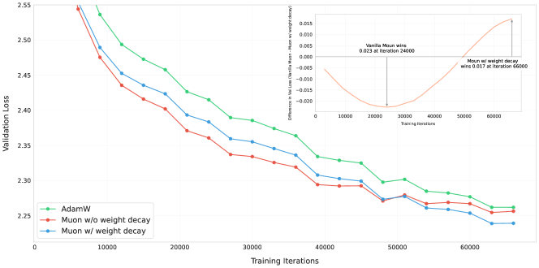
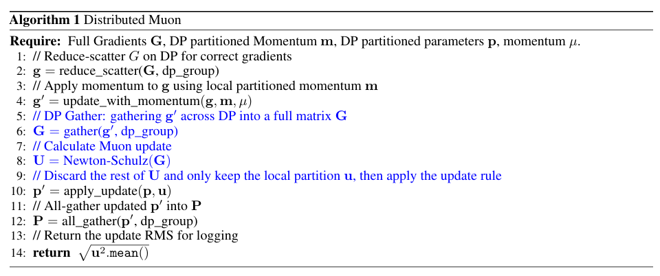
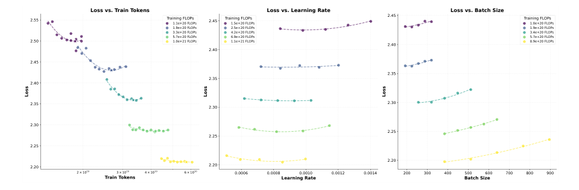
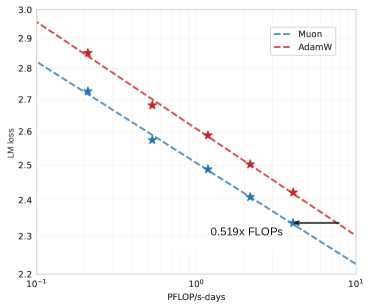
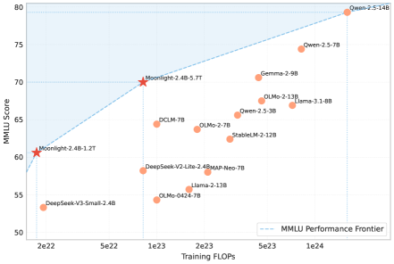
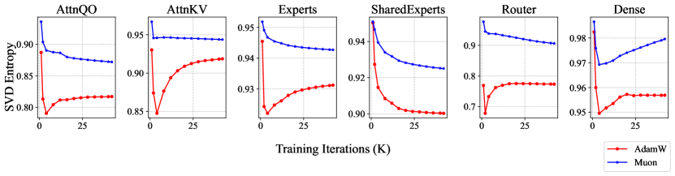
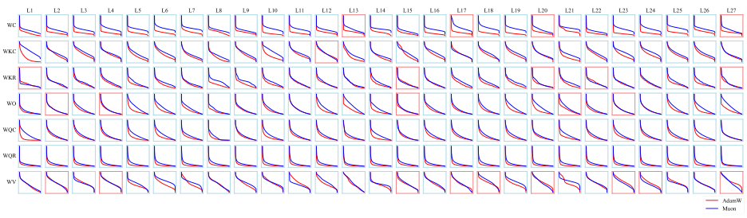
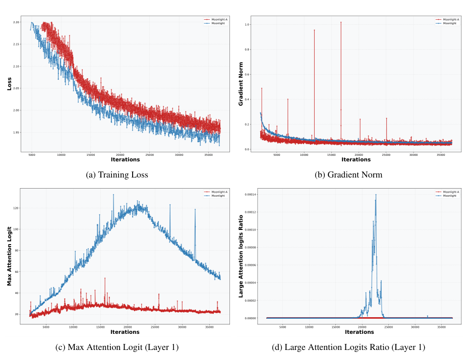

# Muon：LLM 预训练优化器

!!! info "论文信息"
    **论文题名：** Muon is Scalable for LLM Training。 
    **作者：** Jingyuan Liu、Jianlin Su、Xingcheng Yao、Zhejun Jiang、Guokun Lai、Yulun Du、Yidao Qin、Weixin Xu、Enzhe Lu、Junjie Yan 等（共 28 人）。 
    **机构：** Moonshot AI 2 UCLA。 
    **时间 / 主题：** 2025-02；高效训练。 
    **arXiv / 官方报告：** arXiv：[2502.16982](https://arxiv.org/abs/2502.16982)；官方材料：[huggingface.co/moonshotai/Moonlight-16B-A3B](https://huggingface.co/moonshotai/Moonlight-16B-A3B)。 
    **GitHub / 项目：** GitHub：[github.com/MoonshotAI/Moonlight](https://github.com/MoonshotAI/Moonlight)；项目页：[huggingface.co/moonshotai/Moonlight-16B-A3B](https://huggingface.co/moonshotai/Moonlight-16B-A3B)。 
    **元数据来源与核验口径：** 来源：[arXiv](https://arxiv.org/abs/2502.16982)；[GitHub API / repo](https://github.com/MoonshotAI/Moonlight)；[官方 / 项目材料](https://huggingface.co/moonshotai/Moonlight-16B-A3B)；Checked Date：2026-06-04；Repro Status：Paper / official materials reviewed, independent reproduction not claimed。

## 从小模型的好优化器，到万亿 token 训练的可用配方

Muon 原本已经提出一个区别于 AdamW 的思路：把梯度动量当成矩阵，近似正交化之后再更新权重。Moonshot 这篇报告没有重新发明这一步，而是追问它能否扩展到数十亿参数、万亿 token 和分布式训练。小规模短训练中下降得快，不能保证权重尺度在长训练里仍然健康，也不能保证把矩阵切到多张卡上以后还是同一个优化器。[↗](https://arxiv.org/pdf/2502.16982v1#page=2)

报告补上了三个具体环节：用 weight decay 控制长期尺度，用矩阵形状修正对齐不同参数的更新 RMS，以及在 ZeRO-1 风格分片下重建正交化所需的完整矩阵。随后，作者先用 dense 模型研究 compute-optimal loss，再训练包含 embedding 时约 16B 总参数、3B 激活参数的 Moonlight MoE，累计处理 5.7T token。

两层实验回答不同问题。Scaling-law 曲线给出达到相近语言模型损失约需 AdamW 52% 训练 FLOPs 的结果；Moonlight 的同配方对照检验下游能力是否改善。前者不是任意集群上的墙钟时间减半，后者也不是所有 benchmark 都提高。尤其是后面的 SFT 实验表明，直接把一个已有模型的微调优化器换成 Muon，并没有同样清楚的优势。

## Muon 改变的是更新矩阵的奇异值，不是直接把权重正交化

设当前参数矩阵为 $W_{t-1}$，损失为 $L_t$，动量系数为 $\mu$，学习率为 $\eta_t$。论文先用下面的概念式定义 Muon：

$$
\begin{aligned}
M_t&=\mu M_{t-1}+\nabla L_t(W_{t-1}),\\
O_t&=\operatorname{NewtonSchulz}(M_t),\\
W_t&=W_{t-1}-\eta_t O_t.
\end{aligned}
$$

$M_0$ 为零，$M_t$ 汇集当前和历史梯度。与逐元素维护一阶、二阶统计量的 AdamW 不同，Muon 把整个矩阵交给变换。论文脚注进一步说明，实际实现使用 Nesterov-style momentum，把 $\mu M_t+\nabla L_t(W_{t-1})$ 送入 Newton–Schulz，而非直接使用上式的 $M_t$。这是概念介绍与实现之间需要保留的区别。[↗](https://arxiv.org/pdf/2502.16982v1#page=2)

理解变换时，可以先看理想的精确情形。若动量的紧致奇异值分解为 $M=U_r\Sigma_rV_r^\top$，$r$ 是秩，那么对应变换保留左右奇异方向，把非零奇异值的尺度去掉，得到 $O=U_rV_r^\top$。原文用 $(MM^\top)^{-1/2}M$ 描述这一目标；对矩形或秩不足的情形，应在相应非零奇异子空间理解它，不能无条件对奇异的 $MM^\top$ 求普通逆。

一个解释性例子是，若某次动量在两个奇异方向上的尺度为 100 和 1，直接动量更新会让前者主导，理想变换则把二者的更新奇异值拉到相同尺度。这不是说第二个方向一定更有用，也不意味着增加了新的梯度信息。它改变的是已有方向如何分配步长。被变换的也是更新矩阵 $O$，权重 $W$ 仍由历史权重、衰减和多次更新累积得到。

论文从范数约束下最速下降的角度解释这一设计：精确正交化对应谱范数约束，符合把权重看作欧氏空间之间线性算子的视角。这个联系为更新形式提供解释，但不能仅由几何直觉证明它对任意任务优于 AdamW，后续实验才负责检验性能。

### 五步 Newton–Schulz 近似怎样把 SVD 换成矩阵乘法

直接对每个大权重的动量做 SVD 代价较高。论文先令 $X_0=M/\|M\|_F$，再使用五次多项式迭代：

$$
X_k=aX_{k-1}+b(X_{k-1}X_{k-1}^\top)X_{k-1}
+c(X_{k-1}X_{k-1}^\top)^2X_{k-1}.
$$

系数沿用原 Muon 的 $a=3.4445$、$b=-4.7750$、$c=2.0315$。若把矩阵写成 SVD，这些乘法对每个奇异值施加 $f(x)=ax+bx^3+cx^5$，同时保留左右奇异向量。Frobenius 归一化控制初始尺度，多项式则帮助较小奇异值迅速增大，使更新谱更均衡。[↗](https://arxiv.org/pdf/2502.16982v1#page=3)

实际只做有限次迭代，而且使用 BF16，因此不能把结果当成每个奇异值都精确等于 1 的严格正交矩阵。作者比较 5 步与 10 步时发现，10 步的正交化更精确，却没有更好的模型性能，于是后续用 5 步；动量系数取 0.95，调节动量也没有带来一致收益。这里的目标是取得有用且便宜的更新，而非把数值分解误差降到最低。[↗](https://arxiv.org/pdf/2502.16982v1#page=4)

## 第一处修正：早期下降快，仍需要约束长期权重尺度

放大模型并延长训练后，作者观察到部分权重与层输出 RMS 持续增大，并担心这损害 BF16 下的有效精度和长期表现。报告采用 AdamW 风格的解耦衰减：

$$
W_t=W_{t-1}-\eta_t(O_t+\lambda W_{t-1})
=(1-\eta_t\lambda)W_{t-1}-\eta_tO_t.
$$

$\lambda$ 是衰减系数。右侧等式直接说明它的作用：在加入新的正交化方向之前，先按比例缩小已有权重。它没有为 Muon 增添一套 AdamW 的二阶动量。[↗](https://arxiv.org/pdf/2502.16982v1#page=3)

Figure 2 使用约 800M 参数模型和 100B token，后者约为该规模 compute-optimal token 数的五倍。先看红、蓝曲线前后期的相对位置，再看右上角差值：没有衰减的 vanilla Muon 并非一开始就更差，而是其早期优势在长训练中反转。

{ width="650" }

*原论文 Figure 2。绿色为 AdamW，红色为 Muon without weight decay，蓝色为 Muon with weight decay；差值小图更清楚地显示后期交叉。*

原图标出，第 24,000 次迭代时 vanilla Muon 的验证 loss 低约 0.023，而第 66,000 次迭代时加入衰减的版本反而低约 0.017。若只在较早 checkpoint 选优化器，就可能得出相反判断。这项实验支持在本文长训练配方里保留衰减；它没有单独证明所有差异都由 BF16 数值精度造成，因为权重衰减也会改变优化和正则化行为。[↗](https://arxiv.org/pdf/2502.16982v1#page=4)

## 第二处修正：正交化之后，矩阵越大，逐元素更新反而越小

### 更新 RMS 的形状依赖从哪里来

**RMS（Root Mean Square，均方根）**在这里是矩阵各元素平方均值的平方根。对 $A\times B$ 的理想更新矩阵，若其 $r$ 个非零奇异值都是 1，则 Frobenius 范数平方为 $r$。因此可把附录 A 的结论用下面的等价推导写清：

$$
\operatorname{RMS}(O)^2
=\frac{\|O\|_F^2}{AB}
=\frac{r}{AB}.
$$

满秩时 $r=\min(A,B)$，于是

$$
\operatorname{RMS}(O)=\frac{1}{\sqrt{\max(A,B)}}.
$$

这里的满秩和理想正交化是推导条件；有限次 Newton–Schulz 的实际值只会近似遵循它。关键后果是，共享同一个学习率并不等于共享相近的逐参数更新尺度。宽 MLP 矩阵的更新 RMS 会更小；把较大的投影人为拆成很多小矩阵分别处理，又可能让更新变大并改变方向耦合。[↗](https://arxiv.org/pdf/2502.16982v1#page=14)

### 同时消除形状差异，并与 AdamW 的尺度对齐

为抵消分母，作者对每个矩阵乘 $\sqrt{\max(A,B)}$；再乘经验系数 0.2，让更新 RMS 接近实际 AdamW 常见的 0.2–0.4。最终规则为

$$
W_t=W_{t-1}-\eta_t\left(
0.2\sqrt{\max(A,B)}\,O_t+\lambda W_{t-1}
\right).
$$

矩阵形状因子只乘在 $O_t$ 上，权重衰减仍在括号中单独计算。理论上它把满秩、精确变换后的更新 RMS 拉到 0.2；实际实现没有强制对每次近似结果重新归一化，因此不应承诺逐步精确等于 0.2。[↗](https://arxiv.org/pdf/2502.16982v1#page=4)

这样处理还有一个工程目的：Moonlight 并非所有参数都用 Muon。RMSNorm、embedding 和 LM head 仍由 AdamW 更新，二者希望共享可复用的学习率和 weight decay 超参数。虽然 embedding 和 LM head 在存储上也可以是二维矩阵，它们仍是本文配方明确留下的例外，不能只按 `ndim == 2` 决定全部参数归属。

### Table 1 分离了“矩阵形状”和“全局尺度”

作者用约 800M 的模型，特意把 SwiGLU MLP 换成标准两层 MLP，使主要矩阵从约 $[H,2.6H]$ 变成 $[H,4H]$，扩大它与方形 query 投影的差别。实验只训练到 20B-token schedule 中的 4B token，用来捕捉早期尺度异常。三个方案分别是：

- **Baseline**：所有矩阵统一乘 $0.2\sqrt H$，只近似匹配典型形状的 AdamW 尺度。
- **Update Norm**：直接使用 $0.2O/\operatorname{RMS}(O)$，把每次更新严格归一到 0.2。
- **Adjusted LR**：采用 $0.2\sqrt{\max(A,B)}O$，只根据静态形状调整。

| Methods | Training loss | Validation loss | query weight RMS | MLP weight RMS |
|---|---:|---:|---:|---:|
| Baseline | 2.734 | 2.812 | 3.586e-2 | 2.52e-2 |
| Update Norm | 2.720 | 2.789 | 4.918e-2 | 5.01e-2 |
| Adjusted LR | 2.721 | 2.789 | 3.496e-2 | 4.89e-2 |

*原论文 Table 1。RMS 列是权重的 RMS，不是前面定义的更新 RMS。*

两种修正都把验证 loss 从 2.812 降到 2.789。对 $[H,4H]$ 的 MLP，形状修正相对 baseline 多乘 $\sqrt{4H}/\sqrt H=2$，权重 RMS 也约增加一倍。方形 query 的形状因子不变，Adjusted LR 对应的权重 RMS 因而更接近 baseline；直接 Update Norm 还会校正近似迭代产生的实际尺度，query RMS 变化更明显。两者 loss 接近时，作者选择不需要额外动态归一化的 Adjusted LR。[↗](https://arxiv.org/pdf/2502.16982v1#page=6)

附录 A 再检查 0.2 这个全局尺度是否合理。在小模型训练 2,000 步、约 2B token 后，结果如下。

| Optimizer | AdamW | 0.05 RMS | 0.1 RMS | 0.2 RMS | 0.4 RMS | 0.8 RMS |
|---|---:|---:|---:|---:|---:|---:|
| LM training loss | 3.512 | 3.355 | 3.239 | 3.198 | 3.199 | 3.386 |
| LM validation loss | 3.679 | 3.503 | 3.374 | 3.325 | 3.314 | 3.543 |
| AttnQ weight RMS | 1.01e-2 | 5.74e-3 | 8.44e-3 | 1.57e-2 | 2.95e-2 | 7.23e-2 |
| Mlp weight RMS | 1.25e-2 | 8.01e-3 | 1.27e-2 | 2.35e-2 | 4.51e-2 | 8.73e-2 |

*原论文 Table 8。除第一列外均为控制更新 RMS 的 Muon。*

0.2 与 0.4 是这一组里较好的范围，但 0.4 的验证 loss 3.314 还略低于 0.2 的 3.325。因此论文选择 0.2 是合理默认值的经验支持，不能写成理论唯一最优，或声称任何模型都无需检查更新尺度。[↗](https://arxiv.org/pdf/2502.16982v1#page=14)

## 第三处修正：分片保存状态，计算时恢复所需的矩阵

ZeRO-1 把优化器状态分散到数据并行 rank。对 AdamW，这很自然：每个参数元素的更新只需要该元素的梯度和动量状态。Muon 不同，$MM^\top$ 会耦合矩阵内不同位置。任意切出一段向量，再各自运行 Newton–Schulz，通常不会得到完整矩阵变换的对应片段。

原论文 Algorithm 1 中的蓝色步骤就是为恢复这层语义而增加的操作。阅读时应把“状态由谁长期持有”与“这一次计算暂时需要什么”分开。

首先在 DP 组中 reduce-scatter 梯度，得到已正确归约的本地梯度分片。各 rank 利用本地分片动量计算带动量的更新输入。接着，只针对自己负责的参数所需矩阵，从 DP 组 gather 对应片段，恢复 Newton–Schulz 的矩阵输入；计算完整更新后，丢弃不属于本地参数分区的部分。最后应用权重更新，并 all-gather 新参数，供下一轮前后向使用。[↗](https://arxiv.org/pdf/2502.16982v1#page=5)

这不是长期复制全部优化器状态。动量和 master weight 仍分片保存，完整矩阵只在相应计算阶段被重建。若还采用 tensor parallelism，论文脚注说明需要额外的 BF16 TP gather；不能只重建 DP 分片，就默认已经恢复原始参数矩阵。

代价也应按组成分别看。Muon 只维护一个动量 buffer，AdamW 维护两个，因此**这部分动量存储减半**，而非权重、梯度、激活和全部训练显存都减半。新增 gather 采用 BF16，论文以每元素通信字节粗略计算上界：

$$
\frac{4\;\text{(FP32 gradient reduce-scatter)}
+2\;\text{(BF16 Muon gather)}
+4\;\text{(FP32 parameter all-gather)}}
{4+4}=1.25.
$$

由此报告相对 Distributed AdamW 的通信工作量位于 $(1,1.25]$，实际仅需 gather 本地参数对应矩阵时可更接近 1。这个范围属于文中通信假设，额外 TP 通信和不同并行布局不能自动忽略。公式算的是数据量，也不是网络延迟增加恰好 25%。

作者给出的实践判断是，优化器执行通常只相当于前后向时间的约 1%–3%，五步 BF16 迭代和通信还可与其他工作重叠，因此其大规模集群上没有可察觉的端到端额外延迟。这支持“矩阵更新的系统代价可以受控”，没有单独给出所有硬件、模型规模和 microbatch 下的统一延迟保证。[↗](https://arxiv.org/pdf/2502.16982v1#page=5)

## Scaling-law 比较先建立了一个经过搜索的 AdamW 基线

优化器比较很容易被弱 baseline 误导。作者先在自有数据上，对多个计算预算搜索 AdamW 配方。附录 B 使用 $C=6ND$ 的训练计算近似，在固定预算下调整参数量 $N$，反向调整 token 数 $D$；选出较好的容量–数据组合后，再搜索学习率和 batch，整个过程重复 2–3 轮缩小范围。[↗](https://arxiv.org/pdf/2502.16982v1#page=15)

下面的 Figure 5 按三列分别看 token、学习率和 batch 对 loss 的影响。每种颜色对应一种 FLOPs 预算；有些区间很平，另一些明显上升，因此不能只从单个经验值宣布 AdamW 已被充分比较。

*原论文 Figure 5。不同预算下的局部搜索为后面的 baseline 配置提供依据；它没有证明连续超参数空间的全局最优。*

最终用于比较的 Llama 类 dense 模型从 399M 到 1.5B 非 embedding 参数，context length 均为 8K。Table 2 明确 batch 是样本数，不是 token 数。

| # Params. w/o Embedding | Head | Layer | Hidden | Tokens | LR | Batch Size |
|---|---:|---:|---:|---:|---:|---:|
| 399M | 12 | 12 | 1536 | 8.92B | 9.503e-4 | 96 |
| 545M | 14 | 14 | 1792 | 14.04B | 9.143e-4 | 128 |
| 822M | 16 | 16 | 2048 | 20.76B | 8.825e-4 | 160 |
| 1.1B | 18 | 18 | 2304 | 28.54B | 8.561e-4 | 192 |
| 1.5B | 20 | 20 | 2560 | 38.91B | 8.305e-4 | 256 |

*原论文 Table 2，Batch Size 的单位是 8K-context examples。*

Muon 没有重新进行同等搜索，而是在更新尺度对齐后复用这组为 AdamW 选出的超参数。这一设计同时检验了迁移便利性与 loss 改善：已有强 AdamW 配方时，是否可以较少调参地得到收益。严格地说，它不等于分别穷尽两种优化器的所有超参数后得到两条绝对最优前沿。

读 Figure 1(a) 时先固定纵轴 loss，再横向比较 FLOPs，而非把两条曲线的垂直距离当作加速倍数。

{ width="430" .atlas-figure-compact }

*原论文 Figure 1(a)，横轴为 PFLOP/s-days。图中示例箭头标为 0.519× FLOPs。*

Table 3 给出的拟合是

$$
L_{\mathrm{Muon}}=2.506C^{-0.052},\qquad
L_{\mathrm{AdamW}}=2.608C^{-0.054}.
$$

这里 $C$ 应采用图中 PFLOP/s-days 的数值尺度；不能把原始 FLOPs 数直接代入而保留相同系数。两条幂律指数不同，等 loss 所需预算之比会随目标 loss 改变，约 52% 是实验范围的概括，并非所有预算下固定成立的常数。[↗](https://arxiv.org/pdf/2502.16982v1#page=7)

它也没有直接测量省下多少 GPU 小时。模型训练 FLOPs 与通信、优化器矩阵迭代、数据处理和等待共同决定墙钟成本。本文的分布式实现使额外开销看起来较小，但部署到另一套系统后，仍需把 loss–token 曲线与真实训练吞吐放在一起评估。

## Moonlight 把优化器放进了完整的 MoE 训练配方

### 架构沿用了什么，又改了什么

Moonlight 以 DeepSeek-V3-Small 类架构为基础。排除 embedding 时为 **15.29B total / 2.24B activated parameters**，包含 embedding 后报告约 **16B / 3B**。两种数字来自统计范围不同，不能拿激活参数当作模型总显存规模。[↗](https://arxiv.org/pdf/2502.16982v1#page=7)

附录 C 列出三项修改。首先，作者没有观察到 MTP 在其预训练实验中的明显收益，因此 Moonlight 不引入 MTP 层。这是本文配方的选择，没有提供足以否定所有 MTP 配置的独立消融表。

其次，auxiliary-loss-free load balancing 的 bias 更新做了中心化。原先对专家 $i$ 使用 $b_i\leftarrow b_i+u\operatorname{sign}(e_i)$，本文改为

$$
b_i\leftarrow b_i+u\left(
\operatorname{sign}(e_i)-\operatorname{mean}_j\operatorname{sign}(e_j)
\right).
$$

$e_i$ 表示专家负载违反目标的量，$u$ 是更新率。减去各专家共同的平均项，可以抑制 bias 整体漂移。对同一次更新而言，这相当于给所有候选打分再减去同一个常数，不改变专家间的相对排序，因此保留 top-k 选择逻辑。[↗](https://arxiv.org/pdf/2502.16982v1#page=15)

第三，gate scaling factor 取 2.446，略区别于文中引用的 DeepSeek-V3 的 2.5。Figure 6 的计算过程先生成 Gaussian logits，经过 sigmoid，选择 top-k 后归一化得到 $p_i$，再计算 $1/\sqrt{\sum_i p_i^2}$ 并多次取平均。它试图让组合后的专家输出具有接近 dense 层的 RMS，是基于模拟门控分布的尺度选择，不是每个真实 token 在线重新求出的最优常数。[↗](https://arxiv.org/pdf/2502.16982v1#page=16)

### 三个训练阶段不能压缩成“5.7T token 预训练”

所有阶段最大 context length 为 8K，weight decay 为 0.1。前两个阶段 auxfree bias update rate 为 $10^{-3}$，最后阶段设为 0。下面整理正文给出的 schedule。

| Stage | Token range | Learning rate | Batch size (examples) | Additional setting |
|---|---|---|---|---|
| Warmup | 0–33B | 2K steps 线性升至 4.2e-4 | 2048 | auxfree update rate 1e-3 |
| Main pretraining | 33B–5.2T | 4.2e-4 cosine decay 至 4.2e-5 | 200B tokens 前 2048，之后 4096 | auxfree update rate 1e-3 |
| Cooldown | 5.2T–5.7T | 100 steps 升至 1e-4，再在 500B tokens 内线性降至 0 | 4096 | 高质量 math/code/reasoning 数据，auxfree update rate 0 |

最后阶段虽然称为 cooldown，但开始时先短暂升学习率，然后线性下降，并同时改变数据质量和路由 bias 更新。这些因素决定了最终 checkpoint 的能力，不能把它与 1.2T 的中间模型直接当成只多训练一些 token 的对照。报告把预训练数据细节指向另一个团队材料，因此本文自身不能还原一个完整公开数据混合比例。[↗](https://arxiv.org/pdf/2502.16982v1#page=7) [↗](https://arxiv.org/pdf/2502.16982v1#page=8)

## 同配方 1.2T 对照：代码和数学改善，但 BBH 下降

Table 4 最接近优化器归因的是 Moonlight-A@1.2T 与 Moonlight@1.2T。前者沿用相同训练设置，只把优化器换成 AdamW；二者都是 5.7T schedule 中途的 checkpoint，学习率尚未衰减到最终值，也未经历 cooldown。DSV3-Small 则是公开参考模型，训练 1.33T token，即便架构相近，也不是相同数据配方的严格对照。[↗](https://arxiv.org/pdf/2502.16982v1#page=8)

| Benchmark (Metric) | DSV3-Small | Moonlight-A@1.2T | Moonlight@1.2T |
|---|---:|---:|---:|
| Activated Params, w/o embedding | 2.24B | 2.24B | 2.24B |
| Total Params, w/o embedding | 15.29B | 15.29B | 15.29B |
| Training Tokens | 1.33T | 1.2T | 1.2T |
| Optimizer | AdamW | AdamW | Muon |
| MMLU | 53.3 | 60.2 | 60.4 |
| MMLU-pro | — | 26.8 | 28.1 |
| BBH | 41.4 | 45.3 | 43.2 |
| TriviaQA | — | 57.4 | 58.1 |
| HumanEval | 26.8 | 29.3 | 37.2 |
| MBPP | 36.8 | 49.2 | 52.9 |
| GSM8K | 31.4 | 43.8 | 45.0 |
| MATH | 10.7 | 16.1 | 19.8 |
| CMath | — | 57.8 | 60.2 |
| C-Eval | — | 57.2 | 59.9 |
| CMMLU | — | 58.2 | 58.8 |

正文列出的协议包括 MMLU、MMLU-pro、TriviaQA、C-Eval、CMMLU 的 5-shot，BBH 的 3-shot，GSM8K 的 4-shot，HumanEval 与 MBPP 的 pass@1。这些是 base-model 评价，不能与后面 SFT 的 CoT/shot 设置混用。

在相同 Moonlight 配方下，HumanEval 提高 7.9 分、MBPP 提高 3.7 分、MATH 提高 3.7 分，均为表中直接相减的百分点差值。MMLU 只提高 0.2 分，BBH 则下降 2.1 分。它支持“收益在代码和部分数学任务上更突出”，不支持“所有能力普遍增强”。表格没有提供重复运行误差，较小差异也不应被扩展为稳定的显著优势。

## 最终能力与训练预算：有竞争力，也有明确未超过的任务

训练到 5.7T 后，Moonlight 与相近激活参数规模模型的结果如下。排除 embedding 的参数口径沿用原论文。

| Benchmark (Metric) | Llama3.2-3B | Qwen2.5-3B | DSV2-Lite | Moonlight |
|---|---:|---:|---:|---:|
| Activated Params | 2.81B | 2.77B | 2.24B | 2.24B |
| Total Params | 2.81B | 2.77B | 15.29B | 15.29B |
| Training Tokens | 9T | 18T | 5.7T | 5.7T |
| Optimizer | AdamW | Unknown | AdamW | Muon |
| MMLU | 54.7 | 65.6 | 58.3 | 70.0 |
| MMLU-pro | 25.0 | 34.6 | 25.5 | 42.4 |
| BBH | 46.8 | 56.3 | 44.1 | 65.2 |
| TriviaQA | 59.6 | 51.1 | 65.1 | 66.3 |
| HumanEval | 28.0 | 42.1 | 29.9 | 48.1 |
| MBPP | 48.7 | 57.1 | 43.2 | 63.8 |
| GSM8K | 34.0 | 79.1 | 41.1 | 77.4 |
| MATH | 8.5 | 42.6 | 17.1 | 45.3 |
| CMath | — | 80.0 | 58.4 | 81.1 |
| C-Eval | — | 75.0 | 60.3 | 77.2 |
| CMMLU | — | 75.0 | 64.3 | 78.2 |

*原论文 Table 5。TriviaQA 使用完整测试集合。*

Moonlight 在多数行有优势，但 GSM8K 的 77.4 低于 Qwen2.5-3B 的 79.1。不同模型的数据、token 预算和架构也不同；相同“激活参数量”并不意味着相同参数存储或相同通信成本。这张表说明最终模型配方的竞争力，不应单独用它计算优化器带来的全部收益。[↗](https://arxiv.org/pdf/2502.16982v1#page=9)

Figure 1(b) 把 MMLU 与报告的训练 FLOPs 放在一起。先看两个 Moonlight checkpoint 的位置，再看同一分数附近其他模型需要的预算；图的含义是这组已列模型中的性能–计算前沿。

{ width="490" .atlas-figure-compact }

*原论文 Figure 1(b)。公开模型的性能与计算量来源由论文引用的对比材料汇集，数据配方并未统一。*

附录 E 还把 Moonlight 与更多计算预算的 dense 模型比较，避免只停留在较小基线。Table 10 中，Moonlight 的 MMLU 70.0 低于 Gemma2-9B 的 71.3 和 Qwen2.5-7B 的 74.2；HumanEval 48.1 高于 Gemma2-9B 的 37.8，却低于 Qwen2.5-7B 的 57.9。GSM8K 77.4 同样处于 Gemma 的 70.7 与 Qwen 的 85.4 之间。作者的预算优势有意义，但不等于绝对能力全面超过这些模型。[↗](https://arxiv.org/pdf/2502.16982v1#page=17)

## 奇异谱分析检验了直觉，但还没有独立证明因果机制

更新谱更均衡，是否真的留下不同的权重？作者对训练权重的奇异值 $\sigma_1,\ldots,\sigma_n$ 计算归一化 SVD entropy：

$$
p_i=\frac{\sigma_i^2}{\sum_j\sigma_j^2},\qquad
H(\sigma)=-\frac{1}{\log n}\sum_{i=1}^{n}p_i\log p_i.
$$

这里使用奇异值的平方，衡量 Frobenius 能量如何分配。若能量集中在少数方向，熵较低；若较均匀地覆盖多个方向，熵较高。除以 $\log n$ 让完全均匀的情形对应 1，但不同功能、不同形状的矩阵仍不宜只按一个熵值排名。[↗](https://arxiv.org/pdf/2502.16982v1#page=9)

Figure 4 把矩阵分为 attention Q/O、attention K/V、experts、shared experts、router 与 dense 六组。应先在同一面板比较两个优化器的曲线，再看哪组差异突出。

{ width="760" }

*原论文 Figure 4，按组对跨层矩阵做宏平均；专家分析为降低成本，只采样了 64 个专家中的 3 个。*

Muon 的组均值普遍较高，router 的差异尤其明显。这与不让少数强方向支配更新的出发点一致。不过，均值会掩盖单个矩阵的例外，附录 F 因而进一步逐矩阵画出奇异值曲线。

*原论文 Figure 9。每格按最大奇异值归一化后降序绘图；红色边框表示该矩阵的 Muon SVD entropy 反而低于 AdamW。*

图中确实存在红框。论文对所分析矩阵报告超过 90% 的 Muon 熵更高，而非所有矩阵无一例外。这里也没有固定其他因素、独立操纵权重谱后再测能力，所以应把它视为与机制直觉一致的诊断证据，不能直接推出“更高熵导致更高 benchmark 分数”，或“所有 MoE 必然比 dense 更受益”。[↗](https://arxiv.org/pdf/2502.16982v1#page=18)

## SFT 实验划清了最重要的迁移边界

### 预训练与微调优化器能否随意互换

作者对 1.2T 的 Muon 与 AdamW 预训练 checkpoint，分别使用两种优化器做 SFT，形成四个组合。训练数据都是 tulu-3-sft-mixture，长度 4K、两轮训练，学习率从 $5\times10^{-5}$ 线性降到 0。Table 6 按预训练与 SFT 的顺序读取各列。

| Benchmark (Metric) | # Shots | Muon → Muon | AdamW → Muon | Muon → AdamW | AdamW → AdamW |
|---|---|---:|---:|---:|---:|
| MMLU (EM) | 0-shot (CoT) | 55.7 | 55.3 | 50.2 | 52.0 |
| HumanEval (Pass@1) | 0-shot | 57.3 | 53.7 | 52.4 | 53.1 |
| MBPP (Pass@1) | 0-shot | 55.6 | 55.5 | 55.2 | 55.2 |
| GSM8K (EM) | 5-shot | 68.0 | 62.1 | 64.9 | 64.6 |

*原论文 Table 6，四个组合沿用原表顺序，箭头仅把上下两行优化器标签合并。*

Muon 预训练、Muon 微调的组合在四项上最好，但从这一列不能推出 Muon SFT 对所有初始模型都更好。固定 AdamW 预训练后，换成 Muon SFT，MMLU 从 52.0 升到 55.3，GSM8K 却从 64.6 降到 62.1；效果有任务差异。固定 Muon 预训练再换成 AdamW SFT，也会明显丢掉部分优势。[↗](https://arxiv.org/pdf/2502.16982v1#page=10)

这说明预训练得到的参数状态与后续更新规则之间存在交互。论文称其为 optimizer mismatch，但没有给出已验证的机制解释，也没有证明某种切换一定不可修复。它留下的实际边界是：预训练阶段的收益不能无条件搬到现有 checkpoint 的微调。

### 对公开 Qwen2.5-7B，四项结果均未超过 Adam

另一个实验直接从 Qwen2.5-7B base 开始，使用相同 Tulu 数据、8K packing，学习率从 $2\times10^{-5}$ cosine decay 到 $2\times10^{-6}$。原表使用 Adam-SFT 标签，保留如下。

| Benchmark (Metric) | # Shots | Adam-SFT | Muon-SFT |
|---|---|---:|---:|
| MMLU (EM) | 0-shot (CoT) | 71.4 | 70.8 |
| HumanEval (Pass@1) | 0-shot | 79.3 | 77.4 |
| MBPP (Pass@1) | 0-shot | 71.9 | 71.6 |
| GSM8K (EM) | 5-shot | 89.8 | 85.8 |

*原论文 Table 7。*

虽然正文将整体表现概括为 on par，表中 Muon 四项均较低，GSM8K 差 4.0 个百分点。没有误差条，不能据此断言所有微调场景存在确定退化；但这已经足以反驳“直接更换 SFT 优化器就能普遍提升”的强推论。本文最清楚的收益证据仍来自预训练阶段，以及保持 Muon 的完整预训练–SFT 路径。

## loss 平稳时，还要检查 attention 的极端值

附录 D 是采用这套配方时不能省略的部分。作者报告 Moonlight 的训练 loss 和 gradient norm 没有出现尖峰，但这两条曲线正常，不代表所有内部量都正常。Figure 7 应先看上排整体训练状态，再看下排第一层 attention logits。

*原论文 Figure 7。蓝色为 Moonlight，红色为 Moonlight-A；下排分别是最大 attention logit 与超过 100 的 logits 比例。*

Muon 的最大 logit 在早期阶段升到 100 以上，随后逐渐回落，AdamW 对该极端值的控制更温和。为了判断这是否影响大量注意力位置，作者又统计一个 batch 中大于 100 的 logits 比例，约为 $10^{-4}$ 量级。这说明极端值稀疏，并解释了为何整体 loss 仍可能平稳；它不是对所有层和所有配置的稳定性保证。[↗](https://arxiv.org/pdf/2502.16982v1#page=16)

作者还特别指出，**RMSNorm gamma 需要 weight decay**，以避免各层输出 RMS 过高。由于这些参数属于 AdamW 部分，完整配方不仅涉及 Muon 的矩阵更新，还涉及混合优化器的参数分组和衰减设置。照搬“所有归一化参数都不衰减”的习惯，会偏离这份报告认为重要的稳定性条件。

## 实际采用时，迁移的是一组相互配合的条件

对于从头预训练、已有较强 AdamW 配方的团队，本文给出了一条可检验的路线：对合适的隐藏层矩阵使用五步 Newton–Schulz 和 0.95 动量，采用形状相关的 $0.2\sqrt{\max(A,B)}$ 更新缩放及 weight decay；保留 embedding、LM head、RMSNorm 的 AdamW 更新；在分布式计算中恢复完整矩阵语义。之后用相同预算的 loss 和下游任务检验收益，再结合真实吞吐判断节省多少训练时间。

需要同时记录的量也来自本文的具体发现：更新 RMS 能发现矩阵形状问题，权重与输出 RMS 能暴露长期尺度增长，attention logits 能揭示 loss 曲线看不见的极端值。SVD entropy 可以帮助理解变化，但不能替代任务分数。对仅能微调公开 checkpoint 的场景，Table 7 提供了更直接的判断依据，不能用预训练 scaling-law 曲线承诺微调收益。

报告真正推进的是把矩阵几何、更新尺度、长期稳定性和分布式语义连成可运行的训练方案。约 52% FLOPs 是这套方案在特定 dense 模型、数据和预算范围中的证据；Moonlight 则证明它可以支撑一次 5.7T-token 的 MoE 训练，并把下一步问题收窄到跨模型、跨阶段的迁移是否仍然成立。

## 继续阅读

Muon 的更新规则应放回[优化器与学习率](../../prerequisite-math/optimization-and-gradient-methods.md)比较；大规模训练中的 optimizer state、通信和 checkpoint 见[分布式训练](../../training/distributed-training-and-checkpointing.md)。
