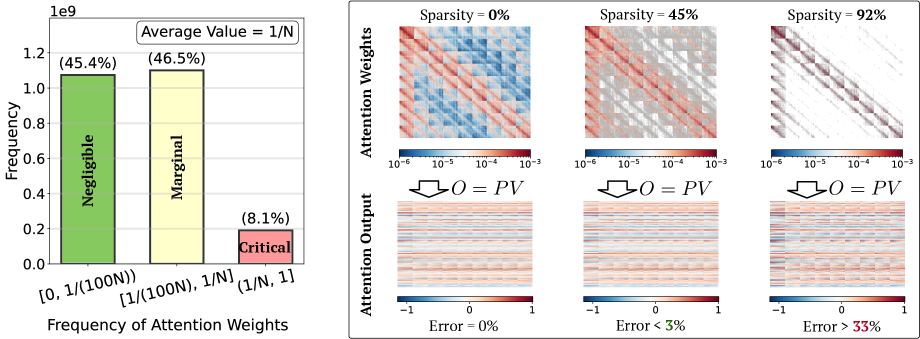
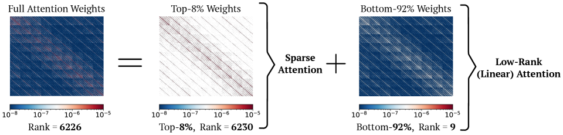
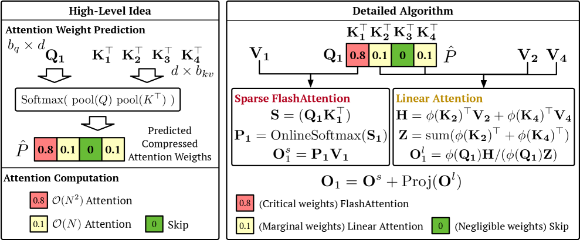
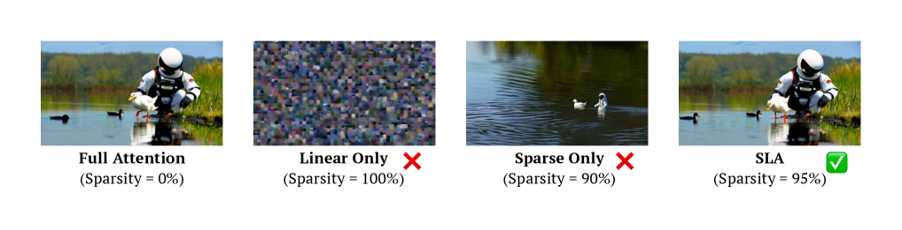
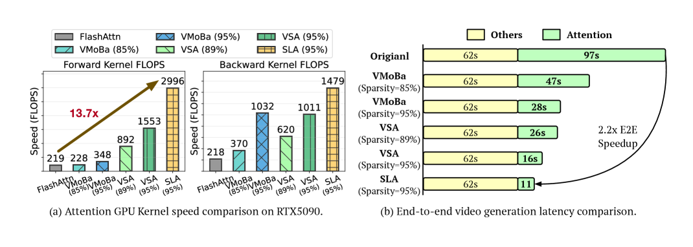
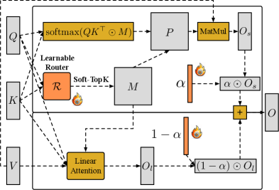

# SLA / SLA2：DiT 稀疏线性 Attention

!!! info "本站判断"
    这页把《SLA / SLA2：DiT 稀疏线性 Attention》当作机制和证据案例来读：先看它真正改变了哪个接口，再看实验、消融、scaling 或失败边界是否支撑这个 claim。

    Checked Date: 2026-06-04；Repro Status: Paper / official materials reviewed, independent reproduction not claimed.

这两篇论文讨论的是视频 DiT 里一个很基础但很工程化的问题：**attention 既是长序列视频生成的瓶颈，又很难直接靠稀疏或线性化单独解决。** SLA 先把 attention 权重分成三类：少数关键块精确算，大量边缘块用 linear attention 补偿，极小块直接跳过。SLA2 则继续追问：这个三分法能不能不靠手工规则，低比特 attention 能不能和 sparse-linear attention 一起训练出来。

因此这篇讲解把两篇合在一起看：SLA 是 sparse-linear attention 的第一版，证明“高秩少数精确算、低秩多数便宜补”这条路线可行；SLA2 是第二版，补上可学习路由、比例混合和 QAT，让它更接近可部署的高稀疏注意力方案。

先用一个视频 DiT 场景理解它为什么不是普通稀疏。假设一个 5 秒视频 latent 有上万 token：同一只手、桌面、杯子和背景在不同帧里互相影响。少数 query-key block 真的很关键，例如手接近杯子的区域，要精确看；很多远处背景 block 权重很小，可以跳过；但还有一大批“中等但数量很多”的 block，单个不重要，合起来却维持了时序一致和背景结构。SLA 的核心就是给这三类 block 分配三种计算，而不是用一种稀疏规则粗暴处理整张 attention matrix。

## 论文位置

标准 attention 是：

\[
\operatorname{Attn}(Q,K,V)
=
\operatorname{softmax}\left(\frac{QK^\top}{\sqrt d}\right)V
\]

它的问题是 \(QK^\top\) 和 attention weight matrix 都是 \(N\times N\)，复杂度随序列长度平方增长。LLM 长上下文会遇到这个问题，视频 DiT 更明显，因为视频 latent token 同时包含时间和空间维度，序列长度经常达到 10K 到 100K。

已有加速路线大致分两类：

| Route | Basic idea | Main issue in video DiT |
| --- | --- | --- |
| Sparse attention | 只计算重要 attention blocks | 稀疏率太高会损质量；block mask 和 kernel 也有开销 |
| Linear attention | 用 feature map 把 attention 改成 \(O(N)\) | 对完整 softmax attention 的高秩部分近似差，视频质量容易崩 |

SLA 的判断是：这两类路线各自失败，是因为它们都试图用一种结构覆盖整个 attention matrix。实际上，attention weights 里少数大权重是高秩的，适合 sparse exact attention；大量剩余小权重是低秩的，适合 linear attention。

两篇论文的关系可以这样理解：

| Paper | Main question | Main answer |
| --- | --- | --- |
| SLA | Sparse attention 和 linear attention 能否在视频 DiT 里互补？ | 用 block-level 权重预测把 attention 划成 critical / marginal / negligible，critical 走 sparse FlashAttention，marginal 走 linear compensation，再用短步数 fine-tuning 适配 |
| SLA2 | SLA 的手工路由和补偿公式是否足够合理？还能不能叠加低比特 attention？ | 用 learnable router \(R\) 学路由，用可学习比例 \(\alpha\) 直接混合 sparse / linear 分支，并用 QAT 训练 sparse + low-bit attention |

## SLA：核心观察与方法

### 关键观察：attention 不是简单“稀疏”

论文先看 Wan2.1 中的 attention weight 分布。大多数权重很小，但不能简单把它们全删掉，因为中间权重虽然单个不大，数量很多，合起来会影响输出。

{ width="760" }

<small>图源：`SLA: Beyond Sparsity in Diffusion Transformers via Fine-Tunable Sparse-Linear Attention`，Figure 1。原论文图意：左图展示 Wan2.1 attention weights 的分布，约 8.1% 为 critical，约 46.5% 为 marginal，约 45.4% 为 negligible；右图说明只跳过最小 45% 权重误差很小，但只保留最大约 8% 会导致输出误差显著增大。</small>

**Attention 分布图先区分 critical、marginal、negligible。**
绿色 negligible 权重可以跳过；红色 critical 权重要精确算；黄色 marginal 权重是难点。它们不够大到值得 full attention，但直接丢掉又会带来明显误差。SLA 的关键不是“更激进地稀疏”，而是承认中间权重需要一种便宜但可训练的补偿。

论文进一步用 stable rank 观察 attention matrix。完整 attention 和 top weights 部分仍然高秩，而去掉 top 8% 后，剩余 bottom 92% 的 stable rank 很低。

{ width="760" }

<small>图源：`SLA`，Figure 3。原论文图意：Wan2.1 attention weights 可分成 top-8% 高秩部分和 bottom-92% 低秩部分；前者适合 sparse attention，后者适合 low-rank / linear attention。</small>

**这张 rank 图支撑什么。**
这张图不要只看 top-8% 的稀疏性，而要看 stable rank。红色高权重部分仍然高秩，所以需要 sparse exact attention；剩下的大量低权重部分更低秩，才适合 linear attention 补偿。SLA 的核心假设就是“不同权重区间对应不同结构”。

这就是 SLA 名字里的 “Sparse-Linear”：不是把 sparse attention 和 linear attention 机械相加，而是让它们分别处理 attention matrix 的不同结构。

### 方法：critical / marginal / negligible 三分法

SLA 先按 query/key block 估计一个压缩 attention weight matrix。论文用 mean pooling 压缩 token 维度，再计算一个 block-level 的 \(\hat P\)。然后每个 block 被分成三类：

| Category | Block label | Computation | Complexity role |
| --- | --- | --- | --- |
| Critical | large predicted weight | Sparse FlashAttention | 对少数关键块做精确 \(O(N^2)\) 计算 |
| Marginal | middle predicted weight | Linear Attention | 用 \(O(N)\) 低秩补偿中间权重 |
| Negligible | tiny predicted weight | Skip | 直接省掉计算 |

{ width="820" }

<small>图源：`SLA`，Figure 4。原论文图意：左侧展示 SLA 的 high-level idea：先预测压缩 attention weights，再把 block 分成 critical / marginal / negligible；右侧展示 forward algorithm：critical blocks 用 Sparse FlashAttention，marginal blocks 用 Linear Attention，negligible blocks skip。</small>

**SLA overview 图要按三类 block 的执行路径读。**
左半边读分类，右半边读执行。critical block 走精确 sparse FlashAttention，marginal block 走 linear branch，negligible block 直接跳过；颜色表示 block 的计算路径。作者想证明的不是“稀疏越高越好”，而是三类 block 必须承担不同角色。

SLA 的输出可以理解成两部分：

\[
O = O^{s} + \operatorname{Proj}(O^{l})
\]

其中 \(O^{s}\) 来自 sparse FlashAttention，处理 critical blocks；\(O^{l}\) 来自 linear attention，处理 marginal blocks；`Proj` 是一个可学习线性投影，用来减小 softmax attention 与 linear attention 的分布不匹配。

**linear attention 在 SLA 里不是直接替代 softmax。**
论文特别强调，SLA 里的 linear attention 更像 trainable compensation，而不是对 marginal softmax attention 的精确近似。完整 softmax attention 的高秩结构很难被 linear attention 表达，所以 SLA 把高秩 critical 部分交给 sparse exact attention，只让 linear attention 负责低秩剩余结构，并通过 fine-tuning 让模型适配。

### 为什么需要微调

SLA 不是纯 training-free 稀疏推理方法。它把原模型 attention 替换成 SLA 后，需要用接近预训练分布的数据微调少量 steps。

原因有两层：

1. `Proj` 等新增/调整路径需要学习；
2. linear attention 与 softmax attention 的输出分布不同，模型需要重新适配这种 residual-like 补偿。

论文的训练设定如下：

| Item | Setting |
| --- | --- |
| Main video model | Wan2.1-1.3B |
| Fine-tuning dataset | 20,000 5-second videos collected from websites such as Pexels and Common Crawl |
| Video resolution | 480p |
| Fine-tuning steps | 2,000 |
| Batch size | 64 |
| Activation function in SLA linear component | softmax |
| Fine-tuning cost note | less than 0.1% of Wan-style pre-training cost |
| Image appendix model | LightningDiT-1.03B |
| Image appendix data | ImageNet |

这组细节很关键：SLA 的目标不是重新预训练一个视频模型，而是给已有 DiT 做 attention replacement 后的轻量适配。对工程团队来说，这意味着它更像“模型加速后处理 / post-training adaptation”，而不是从零建模方案。

### forward / backward 和 kernel

SLA 的工程重点是把 sparse 和 linear 两条路径融合到同一个 GPU kernel，并且同时支持 forward 和 backward。

forward 的关键优化是：对 linear attention 路径预先计算每个 key/value block 的中间量。当某个 query block 遇到 marginal block 时，不需要重新做完整 attention，只需要把已经预计算好的 linear contribution 加进来。

训练时 backward 也要处理两部分梯度：

| Path | Forward role | Backward role |
| --- | --- | --- |
| Sparse FlashAttention | 对 critical blocks 做 exact softmax attention | 沿 FlashAttention 的分块 softmax 推导回传 \(Q,K,V\) 梯度 |
| Linear Attention | 对 marginal blocks 做低秩补偿 | 通过预计算的 linear attention 中间量聚合梯度 |
| Projection | 缓解 softmax / linear 分布错配 | 学习补偿路径如何与 sparse 输出合并 |

这也是为什么论文不是只报 FLOPs。稀疏方法常见陷阱是理论 FLOPs 下降，但 GPU 上因为索引、block map、mask 判断和 kernel launch 开销不降反升。SLA 把 forward/backward 都融合，是为了让 attention reduction 真正转成 wall-clock speedup。

## SLA 实验结果

### 实验设置和指标

视频实验主线使用 Wan2.1-1.3B。评测不只看速度，也看生成质量。

| Evaluation aspect | Metrics |
| --- | --- |
| Video quality | VBench dimensions: Imaging Quality (IQ), Overall Consistency (OC), Aesthetic Quality (AQ), Subject Consistency (SC) |
| Preference / quality | Vision Reward (VR), Aesthetic Video Quality (VA), Techniqual Video Quality (VT) |
| Efficiency | FLOPs, attention kernel FLOPS, end-to-end generation latency |
| Image appendix | FID on ImageNet with LightningDiT |

论文比较的 baseline 包括 `VSA`、`VMoBa`、training-free `Sparge-F`、trainable `Sparge-T`，以及 ablation 中的 `Linear Only`、`Sparse Only`、`L+S`。

### 主要结果：95% sparsity 但质量接近 full attention

论文 Table 1 的核心结果如下，保留原英文列名：

| Method | VA | VT | IQ | OC | AQ | SC | VR | FLOPs | Sparsity |
| --- | ---: | ---: | ---: | ---: | ---: | ---: | ---: | ---: | ---: |
| Full Attention | 76.78 | 82.88 | 62.5 | 23.3 | 56.1 | 93.0 | 0.059 | 52.75T | 0% |
| Sparge-F | 0.002 | 0.026 | 26.0 | 4.6 | 35.7 | 85.1 | -0.216 | 7.91T | 85% |
| Sparge-T | 73.83 | 77.87 | 61.9 | 22.7 | 55.4 | 93.1 | 0.014 | 7.38T | 84% |
| VMoBa | 32.33 | 35.79 | 58.0 | 18.8 | 46.2 | 89.9 | -0.175 | 7.91T | 85% |
| VSA | 55.37 | 64.61 | 60.6 | 22.4 | 51.9 | 83.6 | -0.069 | 5.92T | 89% |
| SLA | 76.96 | 83.92 | 62.2 | 23.6 | 55.9 | 93.1 | 0.048 | 2.74T | 95% |

<small>表源：`SLA`，Table 1。原论文表意：SLA 在 95% sparsity 下 FLOPs 大幅降低，同时视频质量指标接近 Full Attention，并显著优于 sparse-only baseline。</small>

从表里看，SLA 的重点不是单个质量指标超过 full attention，而是它在 `2.74T` FLOPs 下保持了接近 full attention 的 VA/VT/IQ/OC/AQ/SC，而其他稀疏方法在更高 FLOPs 或更低 sparsity 下质量明显下降。

{ width="820" .atlas-figure-compact }

<small>图源：`SLA`，Figure 2。原论文图意：在 Wan2.1 上对比 Full Attention、Linear Only、Sparse Only 和 SLA，SLA 在 95% sparsity 下保持接近 full attention 的视频质量；Linear Only 和 Sparse Only 出现明显质量退化。</small>

**质量对比图先看失败类型。**
按列比较方法，按行比较同一 prompt 的生成质量。Linear Only 便宜但容易丢细节和一致性，Sparse Only 保留大权重但漏掉大量中间贡献，SLA 通过 sparse exact 加 linear compensation 接近 full attention。它是视觉证据，不替代表格指标。

### 效率：attention 变得接近不再是瓶颈

论文在 RTX 5090 上比较 attention kernel 和端到端生成延迟。

{ width="760" }

<small>图源：`SLA`，Figure 6。原论文图意：SLA 在 forward attention kernel 上相对 FlashAttention2 达到 13.7x speedup；端到端视频生成中 attention latency 从 97s 降到 11s，整体 E2E speedup 为 2.2x。</small>

**效率图要分 kernel 和端到端。**
左侧看 attention kernel 自身，右侧看端到端生成。attention 从主要瓶颈变成较小部分后，VAE、MLP、采样循环和其他算子会显得更突出，所以 13.7x kernel speedup 只转化为约 2.2x E2E speedup。这是部署时最容易误读的地方。

这张图说明一个系统事实：即使 attention kernel 加速很多，端到端不一定等比例加速，因为视频生成里还有 VAE、MLP、norm、sampling loop、数据搬运等其他部分。SLA 把 attention 从 97s 降到 11s 后，剩下的 62s “Others” 成为主要时间，整体速度提升约 2.2x。也就是说，SLA 的成功会把瓶颈推向 attention 之外的模块。

### 消融：为什么不是 Linear Only / Sparse Only / L+S

论文 Table 2 对 SLA 的融合策略、linear activation 和参数选择做了消融，核心部分如下：

| Method | VA | VT | IQ | OC | AQ | SC | VR | FLOPs | Sparsity |
| --- | ---: | ---: | ---: | ---: | ---: | ---: | ---: | ---: | ---: |
| Full Attention | 76.78 | 82.88 | 62.5 | 23.3 | 56.1 | 93.0 | 0.059 | 52.75T | 0% |
| Linear Only | 0.042 | 0.099 | 39.5 | 3.6 | 28.8 | 90.7 | -0.213 | 0.10T | 100% |
| Sparse Only | 64.00 | 70.50 | 57.2 | 21.8 | 51.7 | 88.7 | -0.073 | 7.91T | 85% |
| L+S | 29.65 | 41.15 | 58.6 | 18.8 | 45.3 | 87.1 | -0.105 | 5.37T | 90% |
| SLA (softmax) | 76.96 | 83.92 | 62.2 | 23.6 | 55.9 | 93.1 | 0.048 | 2.73T | 95% |

<small>表源：`SLA`，Table 2。原论文表意：Linear Only 质量崩溃，Sparse Only 不够省，直接相加的 L+S 也不稳定；SLA 的分类、投影和微调融合才是关键。</small>

这个消融非常重要。它说明 SLA 不是“把两个 attention 输出加起来”的朴素 ensemble，而是需要：

1. block-level 重要性预测；
2. critical / marginal / negligible 的路由；
3. 对 linear component 做可学习投影；
4. 替换 attention 后进行短步数 fine-tuning。

### 图像生成附录：不是只对 Wan2.1 有效

论文还在 LightningDiT-1.03B / ImageNet 上做了图像生成实验：

| Method | FID | FLOPs | Sparsity |
| --- | ---: | ---: | ---: |
| Full Attention | 31.87 | 12.88G | 0% |
| SpargeAttn-F | 206.11 | 3.66G | 71.57% |
| SpargeAttn-T | 46.05 | 3.16G | 75.45% |
| VSA(2D) | 35.75 | 3.62G | 75.00% |
| VMoBA(2D) | 39.45 | 3.22G | 75.00% |
| SLA | 31.49 | 1.73G | 87.50% |

<small>表源：`SLA`，Table 3。原论文表意：SLA 在图像 DiT 中也能以更高 sparsity 和更低 FLOPs 保持接近甚至略优于 Full Attention 的 FID。</small>

不过，论文主战场仍是视频生成。图像实验更像泛化验证：SLA 的 attention decomposition 不只存在于 Wan2.1 视频 DiT，也能迁移到图像 DiT。

## SLA2：从手工分解到可训练路由

### 后续改进解决什么

SLA2 的出发点不是推翻 SLA，而是把 SLA 里两个比较“工程经验化”的地方改成可训练目标。

第一，SLA 的 sparse 分支并不等价于原 full attention 的 masked 子矩阵。设 full attention probability 为 \(P=\operatorname{softmax}(S)\)，mask 为 \(M\)，理想分解是：

\[
P = P_1 + P_2,\quad P_1=P\odot M,\quad P_2=P\odot(1-M)
\]

但是 sparse attention 会在 masked positions 内重新归一化。对每个 query row，若被 mask 选中的概率和为 \(\alpha\)，那么 sparse branch 实际得到的是近似 \(P_s=P_1/\alpha\)，而不是 \(P_1\)。这会带来一个 row-wise scaling mismatch。SLA 用 `Proj(O^l)` 试图补偿这个错配，但 linear 分支既要近似 \(P_2V\)，又要补 sparse 分支的 scale error，任务变得不干净。

第二，SLA 用 attention-weight magnitude 的启发式 top-k 路由决定哪些 block 进 sparse branch、哪些交给 linear branch。这个规则直观但不一定最优，因为“权重大”不完全等于“必须精确算”，“权重中等”也不一定就是 linear branch 最容易拟合的低秩部分。

SLA2 的总体 pipeline 如下：

{ width="520" .atlas-figure-compact }

<small>图源：[SLA2: Sparse-Linear Attention with Learnable Routing and QAT](https://arxiv.org/abs/2602.12675)，Figure 1。原论文图意：SLA2 用 learnable router \(R(Q,K)\) 产生 sparse mask，再用 learnable ratio \(\alpha\) 混合 sparse attention output 和 linear attention output；sparse 分支还可以通过 QAT 引入 low-bit attention。</small>

**SLA2 图重点看两个可学习量。**
这张小图按三步读：router \(R(Q,K)\) 先决定哪些 block 进入 sparse 分支，\(\alpha\) 再决定 sparse output 和 linear output 的混合比例，QAT 则让 sparse 分支在低比特 forward 下训练适配。它补的是 SLA 的两个缺口：路由可学习、分支比例显式可学。

### SLA2 的公式：从 `Proj` 补偿改成比例混合

SLA2 把输出写成：

\[
O = \alpha \odot O^s + (1-\alpha)\odot O^l
\]

其中：

| Symbol | Meaning |
| --- | --- |
| \(O^s\) | 由 mask \(M=R(Q,K)\) 选中的 sparse softmax attention 输出 |
| \(O^l\) | 对 \(1-M\) 剩余部分的 linear attention 输出 |
| \(\alpha\) | 每个 query 的 learnable ratio，用来控制 sparse / linear 两个分支的混合比例 |
| \(R\) | learnable sparse-attention mask predictor，也就是 SLA2 的 router |

这个改动很小，但含义很关键。SLA 是：

\[
O = O^s + \operatorname{Proj}(O^l)
\]

SLA2 是：

\[
O = \alpha \odot O^s + (1-\alpha)\odot O^l
\]

前者把错配交给一个 projection 去学，后者直接把 sparse branch 的 row-wise probability mass 放进公式里。对学习来说，SLA2 的目标更明确：\(\alpha O^s\) 对应被 sparse branch 负责的 \(P_1V\)，\((1-\alpha)O^l\) 对应 linear branch 负责的 \(P_2V\)。

### Learnable routing：SLA2 不再只按权重大小硬切

SLA 的路由大致是：pool \(Q,K\)，算 compressed attention weights，然后按 top \(k_h\%\) 进 sparse branch，bottom \(k_l\%\) skip，中间交给 linear attention。SLA2 保留“先降采样再决定 block mask”的工程思路，但把路由函数改成可学习的 \(R(Q,K)\)。

论文对 \(R\) 的设计有三个直观理由：

1. 路由输入用 \(Q,K\)，因为 attention pattern 由 \(QK^\top/\sqrt d\) 决定，\(V\) 不影响 softmax weight 的形成。
2. 先对 \(Q,K\) 做 mean pooling，避免 router 自己产生 \(O(N^2)\) 级别开销。
3. 在 pooled \(Q,K\) 上加 learnable projections，使 top-k 选择不只是原始 attention magnitude 的启发式排序，而是能学出更适合 sparse / linear 分解的表示。

可以把 SLA2 的 router 看成“可学习的 block sparse mask 生成器”。它不是让每个 token 自由选择任意路径，而是在保留 block-sparse kernel 友好的结构下，让模型学会哪些块应该留给 sparse exact attention，哪些块更适合被 linear branch 吸收。

| Design point | SLA | SLA2 | Why it matters |
| --- | --- | --- | --- |
| Sparse / linear split | attention-weight magnitude heuristic | learnable router \(R(Q,K)\) | 少依赖全局手工阈值，能按模型、层和时刻学路由 |
| Branch combination | \(O^s+\operatorname{Proj}(O^l)\) | \(\alpha O^s+(1-\alpha)O^l\) | 修正 sparse branch row-wise normalization mismatch |
| Linear branch role | marginal blocks compensation | direct sparse-linear decomposition component | 目标更干净，不需要同时补 sparse scale error |
| Low-bit attention | not central | sparse + low-bit attention with QAT | 进一步减少 sparse branch 的算子和带宽成本 |
| Scale validation | Wan2.1-1.3B main result | Wan2.1-1.3B and Wan2.1-14B | 更关注大模型和高分辨率视频生成部署 |

### SLA2 的训练：两阶段路由 + QAT

SLA2 比 SLA 更像一个训练出来的 attention replacement，而不是只靠 kernel 替换。论文强调 two-stage training，原因是 router 里最终用于推理的 hard top-k 不可导；如果一开始就直接端到端训练，路由不稳定会让后续 fine-tuning 很难收敛。

| Stage | What is trained | Routing form | Main purpose |
| --- | --- | --- | --- |
| Stage 1: router initialization | learnable projections in \(R\) and learnable ratio \(\alpha\) | differentiable SoftTop-k | 让 router 先学到合理 sparse / linear 分解，避免 hard routing 冷启动 |
| Stage 2: end-to-end fine-tuning | full diffusion model with SLA2 attention | hard Top-k, aligned with inference | 让训练路径和推理路径一致，恢复生成质量 |
| QAT path | low-bit sparse attention forward; FP16 backward | quantized forward simulation | 让模型适配 low-bit attention 的量化误差 |

QAT 细节也值得单独看。SLA2 的 low-bit attention 主要放在 sparse attention branch 的 forward 中：先量化 \(Q,K\)，算低比特 \(QK^\top\) 后反量化得到 score；softmax 后再量化 \(P,V\)，计算低比特 \(PV\)，最后反量化回 FP16 输出。训练时 forward 使用 low-bit attention，backward 仍保持 FP16，这样既让模型看到推理时的量化噪声，又避免低比特 backward 破坏训练稳定性。

| Tensor / step | SLA2 QAT treatment | Reason |
| --- | --- | --- |
| \(Q,K\) | quantize before score matmul, then dequantize score | 加速 sparse score computation，同时让训练感知量化误差 |
| \(P,V\) | quantize before value aggregation, then dequantize output | 加速 sparse attention output computation |
| Backward | keep FP16 | 降低训练不稳定和梯度误差 |
| Fine-tuning | quantization-aware, not pure post-training quantization | 让 diffusion model 主动适配 low-bit sparse attention |

这里和很多 LLM KV cache 量化的直觉类似：当 sparse-linear attention 已经把理论 FLOPs 压得很低时，真正的部署瓶颈会越来越受内存带宽、数据格式转换和 kernel 实现影响。QAT 的意义不是“多一个压缩技巧”，而是把 low-bit attention 作为模型训练时就要适配的计算路径。

### SLA2 的实验结论

SLA2 报告的主结果是：在视频 diffusion models 上可以达到 `97%` attention sparsity，并实现约 `18.6x` attention runtime speedup，同时保持生成质量。论文还强调，考虑 linear branch 以后，`97%` sparsity 约等价于 `96.7%` computation savings。

和 SLA 相比，SLA2 的效率结论更激进：

| Method | Key sparsity | Attention speedup | E2E note |
| --- | ---: | ---: | --- |
| SLA | 95% | 13.7x forward attention kernel speedup on RTX 5090 | Wan2.1-1.3B-480P 上约 2.2x E2E speedup |
| SLA2 | 97% | 18.6x / 18.7x attention runtime speedup reported | Wan2.1-1.3B-480P 上 attention latency 从 97s 降到约 7s，约 2.30x E2E；Wan2.1-14B-720P 上约 4.35x E2E |

SLA2 的结果不要只理解成“稀疏率从 95% 到 97%”。更重要的是它把三件事合在一起：

1. 用 error analysis 指出 SLA 的 sparse branch scaling mismatch；
2. 用 learnable router 和 \(\alpha\) 让分解目标更直接；
3. 用 QAT 把 low-bit sparse attention 纳入训练，而不是在训练后硬量化。

这也解释了为什么 SLA2 在更大模型 Wan2.1-14B 上仍然有价值：模型越大、分辨率越高，attention 的 kernel 时间和显存/带宽压力越明显，可学习路由和 low-bit branch 的收益越容易转成端到端收益。

## 和 FlashAttention、Sparse Attention、Linear Attention 的关系

| Method family | What changes | Exactness | Training needed | Position |
| --- | --- | --- | --- | --- |
| FlashAttention | 改数据流，不改 attention 数学 | exact | no | SLA 的 critical blocks 仍借助 FlashAttention 风格精确计算 |
| Sparse Attention | 跳过低重要度 blocks | approximate | often no / sometimes yes | SLA 保留 sparse exact path，但不把 marginal blocks 简单丢掉 |
| Linear Attention | 改 attention 公式到 \(O(N)\) | approximate | usually yes | SLA 只把 linear attention 用作低秩补偿 |
| SLA | sparse exact + linear compensation + skip | approximate but fine-tuned | yes, few steps | 在视频 DiT 上用短微调换高 sparsity 和端到端加速 |
| SLA2 | learnable sparse-linear routing + ratio mixing + QAT | approximate but trained for deployment path | yes, two-stage fine-tuning + QAT | 把 SLA 的手工路由和 projection 补偿改成可学习目标，并叠加 low-bit attention |

如果用一句话概括：FlashAttention 是 **exact attention 的 kernel 优化**；SLA / SLA2 是 **允许模型适配的新 attention 算法 + kernel 优化 + 训练后适配流程**。它们不是同一层问题。

## 工程启发

1. 不要只看 sparsity。理论跳过 95% attention blocks，不代表端到端就 20x 加速；必须看 kernel fusion、backward、其他模块占比和采样 loop。
2. 近似 attention 最好给模型适配机会。training-free 稀疏在质量上容易到瓶颈，SLA 用 2000 steps fine-tuning 换来更高 sparsity，SLA2 进一步用两阶段训练让 router 和 hard top-k 推理路径对齐。
3. 视频 DiT 的 attention 结构有分层性。少量高秩 critical blocks 和大量低秩 residual blocks 应该用不同计算处理。
4. 线性 attention 不一定适合单独替代 softmax，但可以作为低秩补偿路径；SLA2 的 \(\alpha\) 混合说明补偿路径最好和 attention probability mass 对齐。
5. 路由策略本身值得训练。简单 top-k magnitude 是强 baseline，但不一定给 linear branch 留下最容易低秩近似的残差。
6. 低比特 attention 要和模型一起适配。SLA2 的 QAT 提醒我们，部署路径里的量化误差不能只靠 PTQ 硬扛，尤其是视频生成这种误差会被采样过程放大的场景。
7. 加速成功后瓶颈会转移。SLA 把 attention latency 压到 11s 后，系统下一步应盯 VAE、MLP、采样器、I/O 和其他 kernel；SLA2 在 14B/720P 上的收益也说明大模型高分辨率场景更容易吃到 attention 优化红利。

## 局限

SLA 的结论不要过度外推。

1. 它需要微调，不能简单替换 kernel 就上线。
2. SLA 的主要实验证据来自 Wan2.1-1.3B 和 LightningDiT；SLA2 扩展到 Wan2.1-1.3B 和 Wan2.1-14B，但其他 DiT、其他分辨率、其他采样器仍要重新验证。
3. 数据分布要接近预训练/部署分布。论文用 20,000 条 5 秒 480p 视频微调，如果目标域差异大，适配成本和质量风险可能变化。
4. 端到端加速受系统其他部分限制。attention 不是唯一瓶颈，尤其在短序列或强 VAE/MLP 占比场景里收益会缩小。
5. SLA2 的 learnable router 和 QAT 会引入额外训练复杂度。router 冷启动、SoftTop-k 到 hard Top-k 的训练/推理一致性、low-bit kernel 可用性，都需要工程回归。
6. 这是近似 attention。对需要严格数值等价、训练稳定性极敏感或已有精细对齐的视频模型，要做充分回归。

## 结论

SLA 最值得记住的不是“95% sparsity”这个数字，而是它给近似 attention 提供了一个更合理的分解方式：**高秩少数精确算，低秩多数便宜补，极小部分直接跳过，再用短微调让模型适配。** SLA2 的价值则是把这个思路继续工程化：用 learnable router 替代手工路由，用 \(\alpha\) 修正 sparse / linear 分解公式，用 QAT 把 low-bit attention 纳入训练。

对高效训练学习来说，这条线把四个常被分开讨论的主题接了起来：attention 数学结构、稀疏/低秩近似、可学习路由、GPU kernel / low-bit 部署效率。读完这篇后，看任何 attention 加速论文都应该追问五个问题：它省的是理论 FLOPs 还是 wall-clock？质量是否在同等 sparsity 下比较？路由是手工规则还是可训练目标？是否需要微调或 QAT？端到端瓶颈是否真的还在 attention？

## 外部精读

1. 论文：[SLA: Beyond Sparsity in Diffusion Transformers via Fine-Tunable Sparse-Linear Attention](https://arxiv.org/abs/2509.24006).
2. 后续论文：[SLA2: Sparse-Linear Attention with Learnable Routing and QAT](https://arxiv.org/abs/2602.12675).
3. SLA 原图 HTML：[ar5iv:2509.24006](https://ar5iv.labs.arxiv.org/html/2509.24006).
4. SLA2 Figure 1 见论文 PDF：[arXiv:2602.12675](https://arxiv.org/abs/2602.12675).
5. 官方代码：[thu-ml/SLA](https://github.com/thu-ml/SLA).

## 阅读结论

SLA 的主线是把 dense attention 分解成 sparse / linear / skip 三条路径，用短微调让模型适配近似计算；SLA2 则把路由、分支比例和低比特 sparse attention 都放进训练路径。读这类论文时，速度、显存、质量表和消融必须一起看；单独的稀疏率没有意义。真正要问的是：质量来自稀疏模式本身，还是来自 linear 补偿、微调和 QAT 在兜底。

## 相关阅读与下一步

- 外部材料：[论文标题 arXiv 检索](https://arxiv.org/search/?query=SLA+%2F+SLA2%3A+Sparse-Linear+Attention+for+Diffusion+Transformers&searchtype=title)。
- 外部材料：[Semantic Scholar 标题检索](https://www.semanticscholar.org/search?q=SLA+%2F+SLA2%3A+Sparse-Linear+Attention+for+Diffusion+Transformers)。
- 外部材料：[Papers with Code 检索](https://paperswithcode.com/search?q=SLA+%2F+SLA2%3A+Sparse-Linear+Attention+for+Diffusion+Transformers)。
- 站内下一步：[论文精读专题](../index.md)。
- 站内下一步：[论文专题写作规范](../writing-standard.md)。
- 站内下一步：[外部精读来源台账](../../references/external-reading-ledger.md)。
